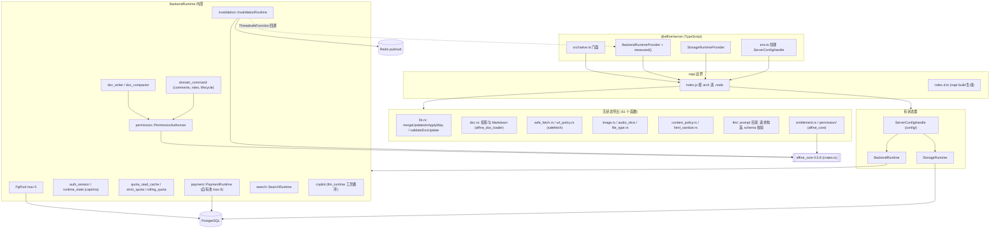
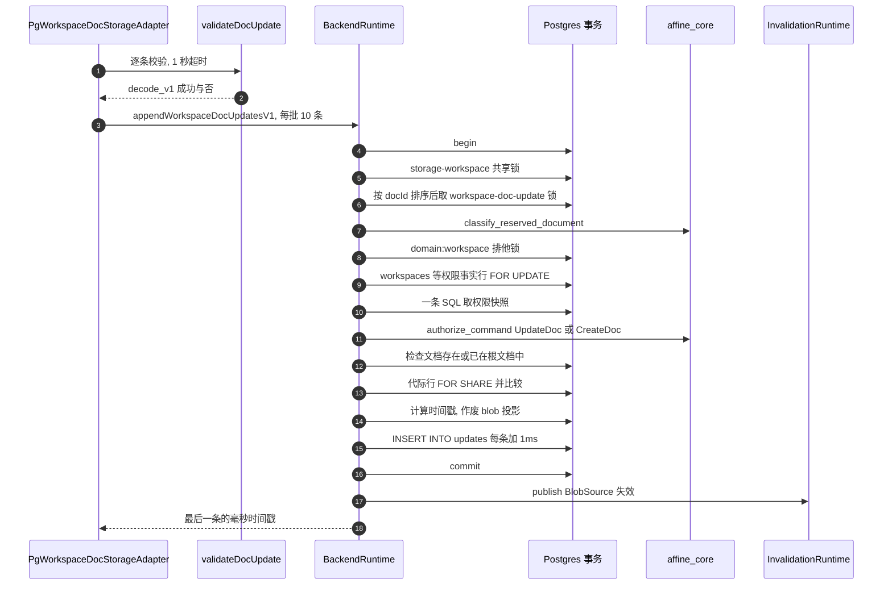
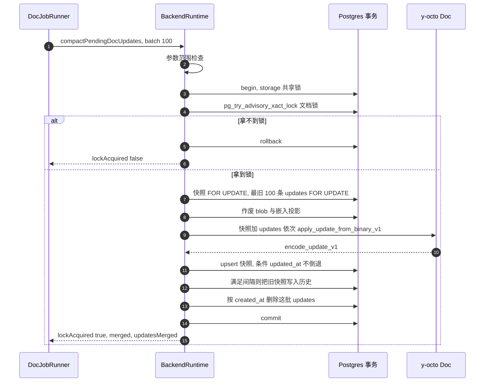
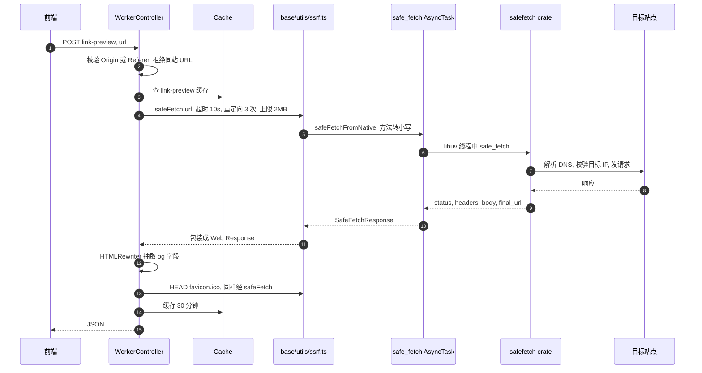

# @affine/server-native 精讲

> 一句话：`@affine/server` 的 Rust 半身。它用 napi-rs 编译成一个 `.node` 动态库，一半是无状态工具函数（Yjs 二进制投影、SSRF 安全抓取、图片和音频处理、内容扫描），另一半是三个有状态类（`BackendRuntime`、`StorageRuntime`、`ServerConfigHandle`），其中两个自带 PostgreSQL 连接池。文档写入、权限判定、配额、鉴权会话、计费、搜索、Copilot 路由这些"控制面"决策，最终都在这里的 SQL 事务里落定。
>
> 对应分层文档：[`@affine/server-native`](../L6-后端/affine-server-native.md) · 源码：`packages/backend/native`

分层文档已经介绍了 napi 宏的基本语法、`AsyncTask` 的写法和目录树，本文不再重复。[`@affine/server` 精讲](./06-affine-server.md) 已经从 TS 侧讲过同步网关、权限代际和两条合并路径，本文站在 Rust 侧往下挖，回答三个问题：边界上的数据和错误怎么走；一次写入在 Rust 事务里到底加了哪些锁、查了哪些行；哪些行为和 TS 侧的直觉不一样。所有结论都来自读码，没有编译运行；标了"根据源码推断"的，是由多处代码拼出来的推论。

## 0. 为什么是重点包

| 指标 | 数据 | 核实结果 |
|---|---|---|
| 直接被依赖 | 1（`@affine/server`） | 一致。`packages/backend/server/package.json:27` 声明 `"@affine/server-native": "workspace:*"` |
| 传递被依赖 | 全仓排名第 93 | 未复核，沿用给定值 |
| 源码行数 | 约 86,072 行 | 实测完全吻合，口径见下 |
| 所在链路 | 后端原生控制面 | 成立。update 写入、异步合并、权限判定、会话、配额、计费、搜索、LLM 路由都在这里执行 |

**86,072 的构成**：`src/` 下 268 个 `.rs` 文件共 84,147 行，加 `build.rs` 3 行、生成的 `index.d.ts` 1,916 行、`dts-header.d.ts` 6 行，正好 86,072。可见给定的口径是"所有 `.rs` 加 TS 声明文件"。按用途拆开：

| 部分 | 行数 | 说明 |
|---|---|---|
| 独立测试文件 | 12,087 | 14 个 `tests.rs` / `*_tests.rs`，最大的是 `payment/tests.rs`（3,931）和 `backend_runtime/tests.rs`（2,922） |
| 内联 `#[cfg(test)] mod tests` | 约 13,216 | 分布在 87 个文件里。按"测试模块起始行到文件末尾"估算，会略微高估 |
| 手写业务 Rust | 约 58,800 | 84,147 减去上两项 |
| 生成的 TS 声明 | 1,922 | `index.d.ts` 加 `dts-header.d.ts` |
| 未计入 | — | `src/runtime/sql/*.sql` 共 6 个文件 1,001 行（用 `include_str!` 编进二进制）、`src/llm/assets` 下的 JSON 1,021 行、`index.js` 14 行、`benchmark/index.js` 42 行、`fixtures/` 下 8 个音频和 license 二进制样本 |

按目录统计（含测试）：`runtime/` 70,924 行。其中 `runtime/backend_runtime/` 占 55,842 行（`payment` 12,877、`search` 7,775、`auth_session` 6,406、`domain_command` 3,789、`entitlement` 2,620、`blob_access` 2,580、`embedding` 2,461、`strict_quota` 2,186），其余是 `storage_runtime` 5,427、`object_storage` 4,403、`config` 3,200。`runtime/` 之外，`llm/` 7,510，`search_index/` 1,331，顶层零散模块合计约 3,600。**九成代码在有状态的 runtime 里**，分层文档目录树里列的那些顶层小模块只占很小一块。

满足的标准：

- **B 体量复杂度**：手写 Rust 约 5.9 万行，比 `@affine/server` 的 TS 少不了多少。导出面有 61 个顶层函数、1 个常量、5 个类。光 `BackendRuntime` 一个类就有 110 个方法（`packages/backend/native/index.d.ts:7-129`），分布在 29 个 `#[napi] impl BackendRuntime` 块里。代码里还同时用到三种并发模型：libuv 线程池、tokio、JS 主线程回调。
- **C 关键链路**：同步网关推来的每一条普通文档 update，都由 `append_authorized_updates`（`packages/backend/native/src/runtime/backend_runtime/doc_writer.rs:85-189`）在一个事务里完成鉴权、比较权限代际和写入。worker 每 30 秒的快照合并由 `compact_doc`（`packages/backend/native/src/runtime/backend_runtime/doc_compactor.rs:274-353`）完成。这两处出错，后果就是数据丢失或越权写入。

不懂它会卡在哪：

1. 在 `packages/backend/server/src/core/backend-runtime/operations.ts:25` 看到正则 `\[affine-runtime:([a-z0-9_]+)\]`，在 TS 里却找不到是谁拼了这个前缀。答案是 Rust 的 `to_napi_error`（`packages/backend/native/src/runtime/error.rs:156-159`），见 2.5。
2. `packages/backend/server/src/core/permission/service.ts` 只把动作名交给 `authorizePermissionV1`，`index.d.ts` 里这个方法的入参和返回值却都是 `any`。真实的入参结构和 `deny_unknown_fields` 约束写在 `packages/backend/native/src/permission/types.rs:3-14`，见 2.3。
3. 推送失败时客户端收到 `sync_permission_generation_changed`。要弄清这个比较发生在哪把锁之后、为什么能和权限表上的触发器互斥，得读 3.1 的锁顺序。
4. `packages/backend/server/src/core/doc-jobs/job.ts:158-201` 调 `compactPendingDocUpdates` 后拿到 `lockAcquired: false`。这不是错误，而是"有人在读写，本轮跳过"，见 3.2。
5. `packages/backend/server/src/base/utils/ssrf.ts:33-46` 用 `message.includes('blocked_ip')` 这类子串匹配来判定 SSRF 拦截。这些字符串来自外部 crate `safefetch`，见 3.3。

## 1. 全景架构



逐块说明：

- **加载层**：`index.js` 是手写的 14 行加载器。它先 `require('./server-native.node')`，失败了再按 `process.arch` 依次尝试 `server-native.arm64.node`、`server-native.armv7.node`、`server-native.x64.node`（`packages/backend/native/index.js:1-14`）。它不区分操作系统，因为 Docker 镜像里只有 Linux 产物（见 6.5）。`package.json` 的 `exports` 在 `require` 条件下直接指向 `./server-native.node`，只有 `import` 条件才走 `index.js`（`packages/backend/native/package.json:10-16`）。
- **类型层**：`index.d.ts` 由 `napi build --release --no-const-enum` 生成（`packages/backend/native/package.json:32-33`），头部拼上 `dts-header.d.ts` 里的 `default` 导出声明。`build.rs` 只有一行 `napi_build::setup()`（`packages/backend/native/build.rs:1-3`），作用是给 cdylib 配好 Node-API 的链接参数，本身不生成任何代码。
- **无状态导出**：顶层 `lib.rs` 声明了 20 个模块，自己只直接导出三个函数 `merge_updates_in_apply_way`、`validate_doc_update`、`authorize_reserved_doc_subject` 和一个常量 `AFFINE_PRO_PUBLIC_KEY`（`packages/backend/native/src/lib.rs:37-83`）。其余函数大多是外部 crate 的薄包装：Yjs 投影用 `affine_doc_loader`，SSRF 用 `safefetch`，权限和权益规则用 `affine_core`，LLM 用 `llm_adapter` 和 `llm_runtime`。
- **有状态类**：`ServerConfigHandle` 负责读 `config.json`，并作为另外两个类的构造参数。`BackendRuntime` 和 `StorageRuntime` 各自在 `start()` 时建自己的连接池。TS 侧分别由 `BackendRuntimeProvider`（`packages/backend/server/src/core/backend-runtime/provider.ts:70-88`）和 `StorageRuntimeProvider`（`packages/backend/server/src/core/storage-runtime/provider.ts:39`）持有实例。
- **反向通道**：Rust 有两条路回到 JS。一条是构造时传入的两个 `ThreadsafeFunction`，分别上报权限遥测和失效事件；另一条是 Copilot 流式调用时传入的 `callback` 和 `toolCallback`。跨节点的失效广播走的是 Rust 自己连的 Redis pub/sub（`packages/backend/native/src/runtime/backend_runtime/invalidation.rs:166`、`packages/backend/native/src/runtime/backend_runtime/invalidation.rs:221`），和 socket.io 的 Redis adapter 不是同一套连接。

## 2. 核心抽象与数据模型

### 2.1 `BackendRuntime`：持有连接池和全部子运行时的 napi 类

定义在 `packages/backend/native/src/runtime/backend_runtime/mod.rs:109-132`。字段分层文档已经贴过，这里只补三点。

**第一，字段几乎都是"启动前为 `None`"的槽位。** `pool` 的类型是 `Arc<Mutex<Option<PgPool>>>`，`search`、`embedding`、`payment`、`blob_access`、`quota_read_cache`、`invalidation` 也都是 `Arc<Mutex<Option<...>>>`。构造函数 `new`（`packages/backend/native/src/runtime/backend_runtime/mod.rs:136-169`）只解析配置和角色，不碰网络。真正的初始化在 `start_inner`（`packages/backend/native/src/runtime/backend_runtime/lifecycle.rs:22-166`）：

```rust
let pool = PgPoolOptions::new()
  .max_connections(5)
  .acquire_timeout(Duration::from_secs(5))
  .connect(database_url)
  .await
  .map_err(|err| RuntimeError::database("BackendRuntime failed to connect postgres", err))?;
// … 用数据库里的覆盖项重建配置，按需创建 PaymentRuntime、BlobAccessService、QuotaReadCache
// … 非 script 模式启动 InvalidationRuntime，搜索开启时创建 SearchRuntime
if let Err(error) = initialized {
  self.rollback_start().await;
  pool.close().await;
  return Err(error);
}
*guard = Some(pool);
```

（`packages/backend/native/src/runtime/backend_runtime/lifecycle.rs:30-35`、`packages/backend/native/src/runtime/backend_runtime/lifecycle.rs:145-151`）

整个初始化过程都持有 `pool` 的锁，中途任何一步失败，都会回滚已经创建的子服务。初始化成功之前，`pool()` 一律报 `BackendRuntime must be started before using postgres operations`（`packages/backend/native/src/runtime/backend_runtime/mod.rs:171-179`）。

**第二，角色决定装配什么。** `ServerRole::from_environment`（`packages/backend/native/src/runtime/backend_runtime/role.rs:10-35`）优先读 `AFFINE_SERVER_ROLE`，没有再从 `SERVER_FLAVOR` 推出：`sync` 和 `renderer` 归为 `Frontend`，`graphql` 是 `Api`，`script` 是 `Frontend` 加上 `script_mode`。只有 `Worker` 和 `AllInOne` 跑后台任务（`owns_background`）；只有 `AllInOne` 允许内嵌搜索（`packages/backend/native/src/runtime/backend_runtime/role.rs:49-59`），其他角色配了内嵌搜索，`start` 会直接报错（`packages/backend/native/src/runtime/backend_runtime/lifecycle.rs:119-124`）。这相当于 TS flavor 矩阵（见 [06 第 1 段](./06-affine-server.md)）在 Rust 侧的镜像，但两边各自解析环境变量，没有共享代码。

**第三，方法按领域散在 29 个文件里。** napi-rs 允许写多个 `#[napi_derive::napi] impl BackendRuntime` 块，生成时合并成一个 JS 类。110 个方法里有 104 个是 `async fn`，跑在 napi 内置的 tokio 运行时上。

### 2.2 两类事务入口：`append_*` 与 `DomainCommandInputV1`

Rust 侧所有"写库并鉴权"的操作都套用同一个模板：`pool.begin()` → 取一组 advisory lock → `authorize_domain` → 执行业务 SQL → `commit` → 提交后发失效提示。入口分两类：

| 入口 | 输入类型 | 用途 |
|---|---|---|
| `append_workspace_doc_updates_v1` | `AppendWorkspaceDocUpdatesInputV1`（`#[napi(object)]`，强类型） | 同步网关推送普通文档 update |
| `append_workspace_doc_updates_trusted_v1` | `AppendWorkspaceDocUpdatesTrustedInputV1` | 服务端自己写，如 `DocWriter`、`pushDocUpdatesTrusted`。**不鉴权，也不比较代际** |
| `execute_domain_command_v1` | `serde_json::Value`，反序列化为 `DomainCommandInputV1` | 评论、发布、生命周期、根文档 update、角色变更等 17 种命令 |

`DomainCommandInputV1`（`packages/backend/native/src/runtime/backend_runtime/domain_command/mod.rs:31-137`）是 serde 的内部标签枚举，标注为 `#[serde(tag = "command", rename_all = "snake_case", rename_all_fields = "camelCase")]`。TS 侧的 `DomainCommandInputV1` 联合类型（`packages/backend/server/src/native.ts:390-505`）是手写的镜像。napi 不会为 `serde_json::Value` 生成类型，所以 `index.d.ts` 里这个方法的签名只是 `executeDomainCommandV1(input: any): Promise<any>`。

`authorize_domain`（`packages/backend/native/src/runtime/backend_runtime/domain_command/mod.rs:147-172`）是所有命令共用的鉴权步骤：

```rust
lock_workspace(transaction, workspace_id).await?;          // storage 共享锁 + domain:workspace 排他锁
let quota = if command.effect().requires_quota_guard() {
  load_command_quota_in(transaction, authorizer.deployment, workspace_id).await?
} else { None };
lock_permission_facts(transaction, actor_user_id, workspace_id, doc_id).await?; // 一串 SELECT ... FOR UPDATE
authorizer.authorize_command_in(transaction, actor_user_id, workspace_id, doc_id, command,
  quota.as_ref().map(|quota| quota.facts())).await
```

`lock_permission_facts`（`packages/backend/native/src/runtime/backend_runtime/domain_command/mod.rs:271-312`）逐一对以下行加 `FOR UPDATE`：`workspaces` 行、`workspace_access_policies` 行、执行者在 `workspace_members` 里的行、该文档的 `doc_access_policies` 行、执行者的 `doc_grants` 行。这几张表正是权限代际触发器所监听的表，所以判定所依据的权限事实，在事务提交前不会被别人改掉。

### 2.3 `PermissionAuthorizer`：仓库内取事实，`affine_core` 做判定

权限链路在 Rust 里分成几层，边界很清楚：

| 层 | 位置 | 做什么 |
|---|---|---|
| 事实采集 | `packages/backend/native/src/runtime/backend_runtime/permission/store.rs:155-228` | 一条 SQL 用 `jsonb_build_object` 把工作区策略、执行者的成员行、候选文档的策略和授权、工作区的 `entitlements` 一次查成 JSON，再反序列化成 `SnapshotRow` |
| 权益解析 | `packages/backend/native/src/runtime/backend_runtime/permission/store.rs:300-312` | 调 `affine_core::access_control::resolve_entitlements`，传入部署类型、`now`（取自 SQL 的 `statement_timestamp()`）、license 公钥和签名载荷 |
| 判定 | `packages/backend/native/src/runtime/backend_runtime/permission/authorizer.rs:329-338` | 调 `affine_core::access_control::authorize(&request, &facts, &grant)`，这是个纯函数 |
| 命令判定 | `packages/backend/native/src/runtime/backend_runtime/permission/authorizer.rs:215-267` | 调 `authorize_command`，把 `CommandDenialReason` 翻译成 `workspace_owner_cannot_leave`、`domain_permission_denied:Doc.Update` 这类错误码 |
| 对外映射 | `packages/backend/native/src/permission/mod.rs:30-96` | 把 `AuthorizationDecision` 转成 `PermissionEvaluationOutputV1`。其中 `sources` 和 `restrictions` 标了 `#[serde(skip)]`（`packages/backend/native/src/permission/types.rs:46-50`），**不会序列化给 TS** |

仓库里能看到的，是 `affine_core` 暴露的接口：

- 类型：`AclFacts`、`DocAclFacts`、`AccessGrant`、`AuthorizationRequest`、`DomainCommand`、`CommandFacts`、`Decision`、`DecisionSource`、`DenialReason`；
- 函数：`authorize`、`authorize_command`、`resolve_entitlements`、`canonicalize_document_identity`、`classify_reserved_document`、`authorize_reserved_document`、`workspace_action_catalog`、`doc_action_catalog`、`doc_role_allows`；
- `affine_core::auth` 里 access token 用的 `ACCESS_TOKEN_ISSUER`、`ACCESS_TOKEN_AUDIENCE`、`CLOCK_TOLERANCE_SECONDS` 等常量；
- `affine_core::invalidation` 里失效消息的频道名和编解码函数。

看不到的，是角色到动作的映射表、`DomainCommand::effect()` 规定了哪些命令需要配额守卫、license 签名怎样校验、`memberDefaultDocRole` 怎样继承。`Cargo.lock` 里记录的来源是 crates.io、版本 0.0.8，带校验和，依赖只有 `p256`、`sha2`、`base64`、`chrono`、`serde` 等少数几个（`Cargo.lock:78-92`）。要审计这部分规则，只能去 crates.io 下载这个版本的源码包。

TS 和 Rust 之间唯一保证"规则清单一致"的测试是 `packages/backend/server/src/core/permission/__tests__/actions.spec.ts:17-21`。它断言 TS 的 `WORKSPACE_ACTIONS`、`DOC_ACTIONS` 和 `permissionActionCatalogV1()` 返回的清单完全相同。如果升级 `affine_core` 新增了动作而 TS 没跟上，这个测试会失败。

另外，`AuthorizePermissionInputV1` 带 `#[serde(deny_unknown_fields)]`（`packages/backend/native/src/permission/types.rs:3-5`）。TS 侧多传一个字段，Rust 就会报 JSON 解析错误，整个调用失败。

### 2.4 `ServerConfigHandle` 与三组连接池

`ServerConfigHandle::new(path, legacy_deployment_type)`（`packages/backend/native/src/runtime/config/napi.rs:14-24`）在 `packages/backend/server/src/env.ts:121` 创建，它的 `inner: Arc<ServerConfig>` 由 `BackendRuntime` 和 `StorageRuntime` 共享。数据库连接参数从这里来，但三处各建各的池：

| 池 | 位置 | 上限 |
|---|---|---|
| `BackendRuntime.pool` | `packages/backend/native/src/runtime/backend_runtime/lifecycle.rs:30-33` | 5 |
| `StorageRuntime.pool` | `packages/backend/native/src/runtime/storage_runtime/mod.rs:110` | 5 |
| `PaymentRuntime` | `packages/backend/native/src/runtime/backend_runtime/payment/runtime.rs:38` | 8 |

再加上 Prisma 自己的池，一个 Node 进程对同一个库最多有四组连接。

### 2.5 错误跨边界的三种约定

| 约定 | 产生处 | 形态 | TS 怎么认 |
|---|---|---|---|
| runtime 错误码 | `to_napi_error` / `napi_error`（`packages/backend/native/src/runtime/error.rs:156-192`） | `Status::GenericFailure`，消息为 `[affine-runtime:code] 原文` | `measured` 用正则取出 code（`packages/backend/server/src/core/backend-runtime/operations.ts:581-609`） |
| 原样消息 | `affine_common::napi_utils::map_napi_err`（`packages/common/native/src/napi_utils.rs:5-11`） | `GenericFailure`，消息是底层错误的 `Display` | 一般不做识别，直接冒泡 |
| 参数错误 | `safe_fetch.rs`、`image.rs`、`search_index`、`llm` 里的 `invalid_arg` | `Status::InvalidArg`，消息是机器可读的短语 | 按子串匹配，例如 `packages/backend/server/src/base/utils/ssrf.ts:33-46` |

`napi_error` 取 code 的规则是：取消息中第一个冒号之前的部分，只要它全由小写字母、数字和下划线组成，就当作 code（`packages/backend/native/src/runtime/error.rs:185-192`）。所以 `napi_error("domain_permission_denied")` 和 `RuntimeError::invalid_input("domain_permission_denied:Doc.Update")` 在 TS 看来是同一个 code。反过来，如果写成 `napi_error(format!("Lock failed: {e}"))`，开头是大写字母，不满足规则，code 就退化成 `runtime_error`。还要注意，`RuntimeError::Database` 的消息里带着 sqlx 的原始错误文本（`packages/backend/native/src/runtime/error.rs:45-50`），这些文本会进入 TS 侧的日志。

### 2.6 三种异步形态

| 形态 | 例子 | 跑在哪 | JS 侧 |
|---|---|---|---|
| 同步 `#[napi] fn` | `merge_updates_in_apply_way`、`parse_doc_to_markdown`、`create_doc_with_markdown`、`get_mime`、`inspect_image_for_proxy`、`scan_content_policy_v1` | **JS 主线程** | 直接返回值 |
| `AsyncTask` | `safe_fetch`、`process_image`、`parse_doc`、`verify_challenge_response`、`fetch_remote_attachment` | `compute` 在 libuv 线程池，`resolve` 回到主线程 | `Promise` |
| `async fn` | `validate_doc_update`、`split_transcript_audio`、`BackendRuntime` 的 104 个方法 | napi 的 tokio 运行时；CPU 重活再用 `spawn_blocking` | `Promise` |

`Buffer` 参数在跨线程之前，大多先 `to_vec()` 复制一份，例如 `packages/backend/native/src/lib.rs:53`、`packages/backend/native/src/image.rs:46-52`。`get_mime(input: &[u8])` 是少数直接借用 JS 内存的例子，因为它是同步执行的。

## 3. 关键流程走读

### 3.1 一批普通文档 update 在 Rust 事务里的完整过程

从网关到适配器的 TS 部分见 [06 的 3.1](./06-affine-server.md)。这里从 `appendWorkspaceDocUpdatesV1` 进入 Rust 开始讲。



1. **TS 预校验**（`packages/backend/server/src/core/doc/storage/doc.ts:88-127`）：`[0, 0]` 这种空 update 直接放行，超过 32MB 的丢弃，其余逐条调 `validateDocUpdate`。Rust 侧只做 `Update::decode_v1(update).is_ok()`，并放在 `spawn_blocking` 里执行（`packages/backend/native/src/lib.rs:51-57`）：

   ```rust
   #[napi(catch_unwind)]
   pub async fn validate_doc_update(update: Buffer) -> Result<bool> {
     let update = update.to_vec();
     tokio::task::spawn_blocking(move || Update::decode_v1(update).is_ok())
       .await
       .map_err(|err| napi::Error::from_reason(format!("Doc update validation task failed: {err}")))
   }
   ```

   这一步只验证能否解码，不验证能否应用到文档上，也不检查内容语义。TS 门面用 `AbortSignal` 实现了 1 秒超时（`packages/backend/server/src/native.ts:218-267`），但超时只意味着 TS 不再等待，Rust 那边的阻塞任务仍会跑完。
2. **开事务，取前两把锁**（`packages/backend/native/src/runtime/backend_runtime/doc_writer.rs:96-113`）：先取 `storage-workspace:{ws}` 的**共享** advisory lock。它和工作区删除操作所用的排他锁互斥，最多等 5 秒（`packages/backend/native/src/runtime/storage_lifecycle.rs:9-29`）。然后取文档锁 `workspace-doc-update:{ws}/{doc}`。`permissionDocId` 和 `docId` 不同时要锁两篇文档，代码先排序再加锁，避免两个事务交叉等待。这把文档锁的键和 TS 读路径合并时用的完全一样（`packages/backend/server/src/models/doc.ts:147-150`），哈希函数也都是 `hashtextextended($1, 0)`。
3. **保留文档**（`packages/backend/native/src/runtime/backend_runtime/doc_writer.rs:115-124`）：`classify_reserved_document` 识别 `userdata$...`、`db$...` 这类保留 id，`authorize_reserved_document` 判定执行者能不能碰它。`lib.rs` 里的单测列出了规则中能看到的部分：别人的 `userdata` 文档不可写，未知后缀不可写（`packages/backend/native/src/lib.rs:104-127`）。合法的保留文档一律按 `UpdateDoc` 处理，即使 TS 传的是 `create_doc`。
4. **鉴权**：`UpdateDoc` 和 `CreateDoc` 都走 2.2 讲过的 `authorize_domain`。它会再取一次 storage 共享锁，接着取 `domain:workspace:{ws}` 的**排他**锁，然后对权限事实行加 `FOR UPDATE`，最后在同一个事务里取快照，交给 `affine_core` 判定。注意，`PermissionAuthorizer` 构造时拿的是 `pool.clone()`（`packages/backend/native/src/runtime/backend_runtime/doc_writer.rs:114`），但这里调用的是带 `_in(transaction, ...)` 后缀的变体，查询走当前事务的连接，能看到本事务持有的锁。
5. **存在性**（`packages/backend/native/src/runtime/backend_runtime/doc_writer.rs:140-171`）：`UpdateDoc` 要求 `snapshots` 或 `updates` 里已经有这篇文档，否则报 `doc_not_found`。`CreateDoc` 要求文档 id 已经出现在工作区根文档的活跃列表里（`workspace_root_contains_active_doc`），也就是"先在根文档登记，再写文档本体"。
6. **权限代际**（`packages/backend/native/src/runtime/backend_runtime/doc_writer.rs:268-291`）：

   ```rust
   sqlx::query("INSERT INTO workspace_sync_permission_generations(workspace_id,generation) VALUES($1,0) ON CONFLICT DO NOTHING")
   // …
   let current = sqlx::query_scalar::<_, i64>(
     "SELECT generation FROM workspace_sync_permission_generations WHERE workspace_id=$1 FOR SHARE",
   )
   // …
   if expected.is_some_and(|expected| current != expected) {
     return Err(napi_error("sync_permission_generation_changed"));
   }
   ```

   `FOR SHARE` 和触发器对同一行的 `UPDATE` 互斥。如果权限变更事务先提交，这里读到的就是新值，推送被拒绝；如果这里先拿到共享锁，权限变更就得等本事务提交后才能加一。`expected` 为 `None` 时只加锁、不比较，所以不传代际的调用方不受代际约束。
7. **写入**（`packages/backend/native/src/runtime/backend_runtime/doc_writer.rs:219-266`）：`append_updates_in` 又取了一次 storage 锁和文档锁。advisory xact lock 在同一个会话里可以重复获取，所以不会自己锁死自己。时间戳由数据库计算：`GREATEST(date_trunc('milliseconds', clock_timestamp()), max(created_at) + 1ms)`（`packages/backend/native/src/runtime/backend_runtime/domain_command/mod.rs:255-269`）。这保证了同一文档的 `created_at` 严格递增，而且不依赖各 Node 节点的本地时钟。写入之前，把 `doc_blob_ref_projections` 置为 `pending`，并软删除这篇文档的 `embedding_sources`，让搜索和嵌入的投影稍后重建（`packages/backend/native/src/runtime/backend_runtime/domain_command/mod.rs:200-234`）。
8. **提交之后**：只有提交成功才发 `BlobSource` 失效提示。`InvalidationRuntime` 先通知本地目标（blob 访问缓存、配额读缓存、JS 回调），再 `PUBLISH` 到 Redis 的 `INVALIDATION_CHANNEL_V1` 频道，让其他节点也失效。返回值是最后一条 update 的毫秒时间戳，Rust 类型是 `i64`，到 JS 里是 `number`。

工作区根文档走另一条路：`execute_domain_command_v1` 里的 `append_root_update`（`packages/backend/native/src/runtime/backend_runtime/domain_command/lifecycle.rs:91-178`）。锁和代际检查与上面相同，但多了一步**语义校验**：把根快照、所有待合并的根 update、新 update 依次用 y-octo 应用，在应用新 update 前后各做一次根文档投影。只要有文档被删除、被移入回收站或被恢复，就报 `doc_lifecycle_requires_command`（`packages/backend/native/src/runtime/backend_runtime/domain_command/lifecycle.rs:216-248`）。普通文档没有这样的语义校验，只要能解码就会落库。

### 3.2 worker 把 update 合并成快照

TS 侧的调度见 [06 的 3.3](./06-affine-server.md)，这里只讲 Rust 事务内部发生了什么。



1. **参数检查**（`packages/backend/native/src/runtime/backend_runtime/doc_compactor.rs:373-388`）：`batch_limit` 必须为正，历史间隔和保留期必须非负且不会溢出。保留期由 TS 按工作区配额算好后传进来，注释写明"The compactor does not make quota decisions"。
2. **只尝试一次加锁**（`packages/backend/native/src/runtime/backend_runtime/doc_compactor.rs:288-300`）：写入路径是"循环重试直到拿到锁"，这里不同，用 `pg_try_advisory_xact_lock` 只试一次。失败就回滚并返回 `None`，TS 拿到 `lockAcquired: false` 后跳过这篇文档。也就是说，worker 不和在线读写抢锁。
3. **读取**：快照和最旧的 `batch_limit` 条 update 都加 `FOR UPDATE`（`packages/backend/native/src/runtime/backend_runtime/doc_compactor.rs:80-122`）。没有 update 就直接提交，返回 `(0, false)`。
4. **合并**（`packages/backend/native/src/runtime/backend_runtime/doc_compactor.rs:59-69`）：新建一个空的 `y_octo::Doc`，把快照和 update 依次 `apply_update_from_binary_v1`，再 `encode_update_v1`。如果只有一个输入，就直接用原始字节，不经过 y-octo。这一步在 tokio 工作线程上同步执行，执行期间一直持有数据库事务。
5. **写快照**（`packages/backend/native/src/runtime/backend_runtime/doc_compactor.rs:124-166`）：SQL 是 `ON CONFLICT ... DO UPDATE ... WHERE snapshots.updated_at <= $5`，新时间戳取这批最后一条 update 的 `created_at`。原来没有快照时允许写入空文档；原来有快照时，空结果不会覆盖它。
6. **写历史**（`packages/backend/native/src/runtime/backend_runtime/doc_compactor.rs:168-248`）：只有同时满足三个条件，才把**旧**快照写进 `snapshot_histories`：快照确实更新了、旧快照不是空文档、距上一条历史超过了 `history_min_interval_ms`。过期时间是当前时间加保留期。
7. **删除与提交**（`packages/backend/native/src/runtime/backend_runtime/doc_compactor.rs:345-352`）：按 `created_at = ANY($3)` 删除这批 update，然后提交。

第 7 步不看第 5 步的返回值，问题见 6.1。

`compact_pending_doc_updates` 的文档注释（`packages/backend/native/src/runtime/backend_runtime/doc_compactor.rs:357-363`）提醒：在 y-octo 与 yjs 的往返兼容问题解决之前，不要把它的结果发回 yjs 客户端。而 worker 合并出的快照，正是 `space:load-doc` 读到的那一份，[06 的 6.7](./06-affine-server.md) 已经讨论过这个矛盾。这里补充一点：**y-octo 产物发往客户端的地方不止合并这一处。** `create_doc_with_markdown`、`update_doc_with_markdown`、`add_doc_to_root_doc` 这些 MCP 写工具函数（`packages/backend/native/src/doc.rs:368-495`）同样用 y-octo 生成 update，再经 `DocWriter`（`packages/backend/server/src/core/doc/writer.ts:84`）写库并推送。

客户端侧也有一套 Rust 合并：`packages/frontend/native/nbstore/src/doc.rs:170` 的 `get_doc` 用 `y_octo::merge_updates_v1` 合并，并做乐观 CAS 重试，见 [04 精讲](./04-affine-nbstore.md)。两边都用 y-octo，但属于不同的 crate，没有共享代码。

### 3.3 一次需要内容安全的请求：链接预览

用户在编辑器里粘贴链接后，前端会请求 `POST /api/worker/link-preview`，拿回标题、描述和图片。



1. **入口过滤**（`packages/backend/server/src/plugins/worker/controller.ts:270-306`）：`Origin` 和 `Referer` 至少有一个在白名单里；目标 URL 如果和本站同源，也会被拒绝，防止有人借预览接口探测服务自身。
2. **调用参数**（`packages/backend/server/src/plugins/worker/controller.ts:326-334`）：`timeoutMs: 10_000`、`maxRedirects: 3`、`maxBytes: 2MB`，常量定义在 `packages/backend/server/src/plugins/worker/controller.ts:44-49`。图片代理用同一套机制，上限是 10MB。
3. **TS 包装**（`packages/backend/server/src/base/utils/ssrf.ts:76-118`）：只允许 6 种 HTTP 方法，和 Rust 的 `SafeFetchMethod` 枚举一一对应（`packages/backend/native/src/safe_fetch.rs:9-18`）。`headers` 和 `body` 分别被规范化成 `Record` 和 `Buffer`。
4. **跨边界**（`packages/backend/native/src/safe_fetch.rs:118-141`）：`safe_fetch` 返回 `AsyncTask`。`compute` 在 libuv 线程里调用外部 crate 的 `safefetch::safe_fetch`，这是一次**阻塞式**网络请求；`resolve` 回到主线程，把 `Vec<u8>` 转成 `Buffer`。
5. **SSRF 判定**发生在 `safefetch` crate 内部，仓库里看不到实现。从接口能推断出它支持哪些约束：`allowed_hosts`、`allow_http`、`allow_private_target_origin`、`allowed_headers`、`max_redirects`、`max_bytes`，以及 ECH（`packages/backend/native/src/safe_fetch.rs:20-35`）。拦截原因以字符串形式出现在错误消息里，TS 用 8 个固定短语做子串匹配，再转成 `SsrfBlockedError`（`packages/backend/server/src/base/utils/ssrf.ts:8-46`）。
6. **抽取与缓存**：HTML 用 `HTMLRewriter` 解析，图片和 favicon 只收集 URL，不会逐个抓取或校验。favicon 用 `HEAD` 请求加 `maxBytes: 0` 探测是否存在（`packages/backend/server/src/plugins/worker/controller.ts:436-450`）。结果缓存 30 分钟。

其他内容安全函数和它们的调用点：

| 函数 | Rust 位置 | 做什么 | TS 调用点 |
|---|---|---|---|
| `scanContentPolicyV1` | `packages/backend/native/src/content_policy.rs:40-66` | NFKC 归一化，去掉默认可忽略字符，把混淆字符折成 ASCII 骨架，再查找 URL 或域名 | `packages/backend/server/src/core/content-policy.ts:3-14`。邀请成员、邮件任务、通知服务用它拒绝"名字里带链接"的输入 |
| `htmlSanitize` | `packages/backend/native/src/html_sanitize.rs:1-4` | 只是 `v_htmlescape::escape`，**是转义，不是清洗** | `packages/backend/server/src/core/doc-renderer/controller.ts:230-232`，用于拼页面标题和摘要 |
| `assertSafeUrl` | `packages/backend/native/src/safe_fetch.rs:143-146` | 同步校验 URL | `packages/backend/server/src/base/utils/ssrf.ts:60-74` |
| `buildSafeCallbackUrl` 等 3 个 | `packages/backend/native/src/url_policy.rs:62-165` | 回调和重定向 URL 的白名单校验 | `packages/backend/server/src/base/helpers/url.ts:116-145` |
| `fetchRemoteAttachment` / `inferRemoteMimeType` | `packages/backend/native/src/safe_fetch.rs:167-219` | 带类型和尺寸限制的附件抓取 | `packages/backend/server/src/plugins/copilot/storage.ts:180`、`packages/backend/server/src/plugins/copilot/providers/utils.ts:78` |
| `inspectImageForProxy` | `packages/backend/native/src/safe_fetch.rs:148-165` | 同步检查图片类型和宽高 | `packages/backend/server/src/plugins/worker/controller.ts:244` |

### 3.4 其余模块速查

| 模块 | 形态 | 是什么 | TS 调用点 |
|---|---|---|---|
| `doc.rs` | 同步 | `affine_doc_loader` 的包装：画布、搜索和根文档投影，页面和工作区解析，转 Markdown，以及 MCP 写工具 | `packages/backend/server/src/core/utils/blocksuite.ts:175-186`、`packages/backend/server/src/core/doc/writer.ts:84` |
| `doc_loader.rs` | `AsyncTask` | `doc_extractor` 的包装，按文件路径的扩展名把上传文件切成文本块，和 Yjs 无关 | `parseDoc` 只在 `packages/backend/server/src/native.ts:313` 导出，server 源码里没有调用者 |
| `image.rs` | `AsyncTask` | 解码、按长边缩放、转 webp、可选保留 EXIF；边长上限 16,384，像素上限 4,000 万（`packages/backend/native/src/image.rs:20-22`） | `packages/backend/server/src/core/user/resolver.ts:135`（头像）、`packages/backend/server/src/plugins/copilot/conversation/inbox.ts:78` |
| `audio_slice/` | `async fn` 加 `spawn_blocking` | 把 opus、m4a、webm、mka 格式的转写音频切成片段 | `packages/backend/server/src/plugins/copilot/transcript/processor.ts:328` |
| `file_type.rs` | 同步 | 先用 `infer`、再用 `file-format` 嗅探 MIME，然后细分 Matroska 和 MP4 | `packages/backend/server/src/base/storage/utils.ts:60`、`packages/backend/server/src/core/storage/wrappers/comment-attachment.ts:53` |
| `tiktoken.rs` | 同步类 `Tokenizer` | `gpt-5` 前缀用 `o200k_base`，其余按模型名取编码 | `getTokenEncoder` 只在 `packages/backend/server/src/native.ts:285` 定义，server 源码里没有调用者 |
| `hashcash.rs` | `AsyncTask` | 顶层的 `verifyChallengeResponse` 和 `mintChallengeResponse` | 生产路径不用它们。验证码改走 `BackendRuntime.verifyAuthCaptchaV1`（`packages/backend/server/src/plugins/captcha/service.ts:82-94`），Rust 侧在事务里校验 stamp，再把挑战标记为已消费以防重放（`packages/backend/native/src/runtime/backend_runtime/runtime_state/captcha.rs:82-110`）。`mintChallengeResponse` 只在测试里用 |
| `auth_session.rs` | crate 内部 | 自己实现的 HS256 签名和校验，检查 `alg`、`typ`、`kid`、`iss`、`aud`，带时钟容差（`packages/backend/native/src/auth_session.rs:93-188`） | 不直接导出。由 `runtime/backend_runtime/auth_session/`（6,213 行，含 OAuth、刷新、密钥环）经 `executeAuthSessionCommandV1`、`resolveAuthPrincipalV1` 使用 |
| `entitlement.rs` | 同步 | `resolveEntitlementV1`、`issueLicenseV1`、`validateLicenseSeatQuantityV1`，规则来自 `affine_core` 的 `LicenseIssuer`、`LicenseVerifier` | `resolveEntitlementV1` 在 `packages/backend/server/src/plugins/license/adapter.ts:95`；另外两个在 server 源码里没有调用者 |
| `license.rs` | crate 内部 | 访问 `https://app.affine.pro` 的阻塞式 HTTP 客户端（激活、停用、健康检查、席位），经 `safefetch` 发请求 | 由 `packages/backend/native/src/runtime/backend_runtime/entitlement/license_client.rs:74` 在 `spawn_blocking` 里调用 |
| `license_import.rs` | crate 内部 | 把旧版 AES-GCM 加密的 license 文件解成 JSON 信封，密钥在编译期注入 | 由 entitlement 运行时调用 |
| `search_index/` | crate 内部 | 基于 `memory-indexer` 的内存索引 `EmbeddedSearchIndex` | 由 `runtime/backend_runtime/search/` 使用。provider 可以是 `embedded`、`elasticsearch` 或 `manticoresearch`（`packages/backend/native/src/runtime/backend_runtime/search/runtime.rs:59`） |
| `llm/` | 同步为主 | 内置 prompt 目录（`assets/prompts/built-in.json`）、请求构造、BYOK 目录与校验、JSON schema 校验，共 35 个 napi 函数 | `packages/backend/server/src/native.ts:746-990` 包装成一组 `llm*` 函数 |

Copilot 的实际执行在 `BackendRuntime.executeCopilotStream`（`packages/backend/native/src/runtime/backend_runtime/copilot/stream.rs:64-113`）。它在 `spawn_blocking` 里跑 `llm_runtime::run_tool_loop`，用 `ureq` 同步发 HTTP 请求。需要调用工具时，它通过 `toolCallback` 这个 `ThreadsafeFunction` 把请求交给 JS，JS 返回一个 Promise；Rust 线程用 `mpsc::sync_channel` 加 100ms 轮询等待结果，单次工具调用最多等 5 分钟（`packages/backend/native/src/runtime/backend_runtime/copilot/stream.rs:45-47`、`packages/backend/native/src/runtime/backend_runtime/copilot/stream.rs:186-236`）。流结束时发送 `__AFFINE_COPILOT_STREAM_END__` 作为结束标记。

## 4. 源码阅读路线

1. `packages/backend/native/package.json`、`packages/backend/native/index.js`、`packages/backend/native/build.rs`：弄清产物名、加载顺序、`exports` 的两个条件。5 分钟即可。
2. `packages/backend/native/src/lib.rs`：三个顶层函数正好是三种写法的样板：同步函数、`async` 加 `spawn_blocking`、委托给 `affine_core`。顺便看 `AFFINE_PRO_PUBLIC_KEY` 是怎样在编译期注入的。
3. `packages/backend/server/src/native.ts`：对照 `index.d.ts` 读。分清哪些是直接透传，哪些包了一层（`validateDocUpdate` 的超时、`getTokenEncoder` 的缓存、`safeFetch` 的转发），哪些 TS 类型是手写的（`DomainCommandInputV1`、`AuthorizePermissionInputV1`）。
4. `packages/backend/native/src/runtime/error.rs`：读懂 `boundary_code` 和 `message_code`。读完之后，看到任何 Rust 报错，都能预测 TS 会拿到什么 code。
5. `packages/backend/native/src/runtime/backend_runtime/mod.rs` 和 `packages/backend/native/src/runtime/backend_runtime/lifecycle.rs`：字段含义、`start_inner` 的装配顺序、`rollback_start` 的回滚。
6. `packages/backend/native/src/runtime/backend_runtime/role.rs`：和 TS 的 flavor 矩阵对照着看。
7. `packages/backend/native/src/runtime/backend_runtime/domain_command/mod.rs`：重点看 `authorize_domain`、`lock_workspace`、`lock_permission_facts`、`next_workspace_doc_update_timestamp` 这几个公共步骤。
8. `packages/backend/native/src/runtime/backend_runtime/doc_writer.rs`：对照 3.1 逐行读，弄懂锁的顺序和代际比较。
9. `packages/backend/native/src/runtime/backend_runtime/permission/store.rs` 和 `packages/backend/native/src/runtime/backend_runtime/permission/authorizer.rs`：看那条大 SQL 取了哪些事实，哪些交给了 `affine_core`。
10. `packages/backend/native/src/runtime/backend_runtime/doc_compactor.rs`：和 TS 的 `squashUpdatesToSnapshot`（`packages/backend/server/src/core/doc/storage/doc.ts:179-218`）对照着读。
11. `packages/backend/native/src/runtime/backend_runtime/domain_command/lifecycle.rs`：根文档 update 的语义校验。
12. `packages/backend/native/src/runtime/backend_runtime/invalidation.rs`：本地失效目标加 Redis 广播的组合方式，以及 `ThreadsafeFunction` 回调。

可以先跳过：

- `runtime/backend_runtime/payment/`（1.3 万行，其中 3,931 行是测试）、`byok/`、`embedding/`、`search/`：业务相对独立，改到相关功能时再读。
- `llm/`：主要是数据结构和 prompt 目录，核心逻辑在外部 crate `llm_adapter`、`llm_runtime` 里。
- `runtime/object_storage/`、`runtime/storage_runtime/`：对象存储客户端和清理任务，和文档同步主链路无关。
- `runtime/config/admin.rs`：管理后台配置项的描述和校验。

## 5. 设计取舍

### 5.1 权限规则放进外部 crate，仓库内只"取事实"

- **选择**：判定逻辑是 `affine_core` 里的纯函数，输入是 `AclFacts` 和 `AccessGrant`；仓库里的 Rust 代码只负责用 SQL 拼出这些事实。
- **原因**：源码没有写明动机。能看到的事实是，`affine_core` 同时提供了 `auth` 常量、`invalidation` 编解码、license 签发和校验、文档 id 规范化，这些都是"多个进程或多种语言之间必须一致"的东西。推测它的目的是让规则在多个后端组件之间复用，同时把 license 签名这类商业逻辑和开源仓库分开（推断）。
- **代价**：在仓库内无法审计角色到动作的映射，也没法单独改一条规则；升级规则要先在 crates.io 发新版本，再改 `packages/backend/native/Cargo.toml:14`。仓库内能做的保护只有 `actions.spec.ts` 的清单比对，以及 `runtime/backend_runtime/permission/tests.rs` 对 Rust 侧事实组装的测试。
- **替代方案**：把规则放进仓库里的 workspace crate，像 `affine_common`（`packages/common/native`）那样。源码里没有看到朝这个方向调整的迹象。

### 5.2 Rust 自己开事务，和 Prisma 共用一个库

| 维度 | 现状 | 代价 |
|---|---|---|
| 事务 | Rust 的每个写操作自己 `pool.begin()`，不参与 TS 的 CLS 事务 | 在 TS 的 `@Transactional()` 方法里调 Rust，Rust 看不到 TS 尚未提交的写入（[06 的 5.4](./06-affine-server.md)） |
| 互斥 | 靠约定好的 advisory lock 键：`workspace-doc-update:{ws}/{doc}`、`storage-workspace:{ws}`、`domain:workspace:{ws}` | 这些键是散落在两种语言里的字符串常量。改了一边忘了另一边，互斥就失效了，编译期查不出来 |
| 迁移 | Rust 有自己的 `runtime_migrations.sql` 以及嵌入、搜索的 SQL（`packages/backend/native/src/runtime/migrations.rs:6-32`），由 `runMigrations` 在 predeploy 阶段执行 | 同一张表可能先由 Prisma 迁移创建，再被 Rust 的 SQL 加列或建索引 |
| 连接 | 每个进程最多 5 + 5 + 8 个 Rust 连接，再加 Prisma 的池 | 横向扩容时，数据库连接数随进程数成倍增长 |

- **原因**：分层文档总结为"强一致、防篡改、计算密集"。源码里能看到的直接收益是：鉴权和写入在同一个事务里完成，权限事实行被 `FOR UPDATE` 锁住，判定结果在提交前不会失效。这在 TS 里也能做到，但要求每个调用点都正确地使用事务。
- **替代方案**：Rust 只做纯计算，事务留在 TS。那样一次权限判定就要在 napi 上往返多次，"取事实、判定、写入"没法放进一个 Rust 函数。

### 5.3 强类型对象和 JSON `any` 并存

- **选择**：数据形状稳定的接口用 `#[napi(object)]`，自动生成 TS 接口，例如 `AppendWorkspaceDocUpdatesInputV1`。形状复杂、变化快的接口直接收发 `serde_json::Value`，在 `index.d.ts` 里显示为 `any`。这样的方法共 8 个，包括 `authorizePermissionV1`、`executeDomainCommandV1`、`executeAuthSessionCommandV1`、`executePaymentCommandV1`。
- **原因**：`DomainCommandInputV1` 这种带标签的大枚举，napi 的 `string_enum` 和 `object` 表达不了，用 serde 的 `tag` 和 `rename_all_fields` 最省事（推断）。
- **代价**：这 8 个方法的 TS 类型全靠手写（`packages/backend/server/src/native.ts:344-507`、`packages/backend/server/src/core/backend-runtime/contracts.ts`）。和 Rust 定义不一致时，编译期发现不了，只能在运行时收到 JSON 解析错误。
- **替代方案**：用 `#[napi(ts_type = "...")]` 手工指定类型字符串，`runtime/types.rs` 里的 `bigint | number` 就是这么做的。代价是要另外维护一份 TS 类型字面量。

### 5.4 三种并发模型混用

- **选择**：轻量的同步计算直接在主线程执行；早期的接口用 `AsyncTask`；`BackendRuntime` 全部用 `async fn` 跑在 tokio 上，遇到 CPU 重活或同步 HTTP 再用 `spawn_blocking`。
- **代价**：
  - `AsyncTask` 占用 libuv 线程池，默认只有 4 个线程。`safe_fetch` 在 `compute` 里做阻塞式网络请求，最长 10 秒（3.3）。几个慢站点就能把线程池占满，拖慢同样依赖这个线程池的 `fs`、`dns.lookup` 和 `crypto`（根据源码推断，没有压测）。
  - 同步导出会直接阻塞事件循环。`parseDocToMarkdown`、`createDocWithMarkdown`、`mergeUpdatesInApplyWay` 的耗时和文档大小成正比，处理大文档时，同一进程里的所有 socket 都会卡住。
  - `compact_doc` 和根文档校验里的 y-octo 合并在 tokio 工作线程上同步执行，执行期间持有事务和锁。
- **替代方案**：把阻塞式 HTTP 也改成 `async fn` 加 `spawn_blocking`，`license.rs` 已经是这么用的（`packages/backend/native/src/runtime/backend_runtime/entitlement/license_client.rs:74`）；或者让 `safefetch` 提供异步接口。

### 5.5 y-octo 与 yjs 并存

- **选择**：服务端写入时只做解码校验；读路径合并默认用 yjs；worker 合并、根文档校验、MCP 写工具、文档投影都用 y-octo。
- **原因**：y-octo 在 Rust 里，能在事务内、在不阻塞 Node 的线程上处理文档；yjs 是客户端在用的权威实现。
- **代价**：同一篇文档的快照可能由两种实现交替产出，而 Rust 注释自己就承认存在往返兼容问题。服务端唯一的比对机制是 `doc.experimental.yocto` 开关打开时的双跑比对（`packages/backend/server/src/core/doc/options.ts:18-50`），默认是关闭的。
- **替代方案**：全部用 yjs，在 Node 里合并；或者全部改用 y-octo，以它的结果为准。源码目前处在两者之间的过渡状态。

## 6. 易错点与调试

### 6.1 合并时快照没写进去，update 却被删了

- **现象**：在极端情况下，某篇文档的一批编辑在 worker 合并后消失了。
- **原因**：`compact_doc` 里的 `upsert_snapshot` 带条件 `snapshots.updated_at <= $5`。如果旧快照的时间比这批最后一条 update 还新，它返回 `false`，快照不更新。但后面的 `delete_updates` 不检查这个返回值，照样删掉这批 update 并提交（`packages/backend/native/src/runtime/backend_runtime/doc_compactor.rs:326-352`）。TS 读路径里对应的逻辑，只在 `success` 为真时才调用 `markUpdatesMerged`（`packages/backend/server/src/core/doc/storage/doc.ts:206-214`）。快照时间什么时候会比待合并的 update 新？update 的时间戳来自数据库时钟，而快照的时间戳可能来自 TS 算出的 `Math.max(finalUpdate.timestamp, snapshot.timestamp + 1)`（`packages/backend/server/src/core/doc/storage/doc.ts:193`），或者其他写快照的入口（如 `upsertDocSnapshot`）。这个窗口是否真的会出现，没有验证过，属于根据源码推断的风险。
- **避免**：改这段代码时，让删除依赖 `snapshot_updated` 的结果。排查时，比对 `snapshots.updated_at` 和该文档 `updates.created_at` 的最大值。

### 6.2 加锁循环没有上限，5 个连接很容易被占满

- **现象**：某个热门工作区的写入变慢后，同一节点上的权限检查、配额查询也开始超时，日志里出现 sqlx 的连接获取超时。
- **原因**：`lock_workspace_doc_update` 和 `lock_workspace` 都是"`pg_try_advisory_xact_lock` 失败就睡 25ms 再试"的死循环，没有超时（`packages/backend/native/src/runtime/backend_runtime/domain_command/mod.rs:174-191`、`packages/backend/native/src/runtime/backend_runtime/domain_command/mod.rs:236-253`），等待期间一直占着一个池连接。只有 storage 共享锁有 5 秒上限。此外，`authorize_domain` 每次都会取 `domain:workspace:{ws}` 的**排他**锁，所以同一工作区里所有经过鉴权的写入，即使写的是不同文档，在事务提交前也是串行的（根据源码推断）。TS 读路径合并持有文档锁的时间，最长可以到 Prisma 事务的 60 秒上限。只要有几个推送卡在锁上，`BackendRuntime` 的 5 个连接就会被用完，其他调用在 `acquire_timeout(5s)` 之后报错。更严重的是加锁顺序反转：推送写入先拿文档锁、再在 `authorize_domain` 里拿工作区锁（`packages/backend/native/src/runtime/backend_runtime/doc_writer.rs:106,130`），恢复历史则先拿工作区锁、再拿文档锁（`packages/backend/native/src/runtime/backend_runtime/domain_command/history.rs:29-39`）。两边都是自旋 try-lock，PostgreSQL 的死锁检测不会介入，两者交错一次就会永久互等，整个工作区的写入随之卡死（读码确认，见[附录](./99-附录-源码缺陷验证.md) B2）。
- **排查**：看 `storage.backend_runtime` 指标里 `appendWorkspaceDocUpdatesV1` 的耗时分布；在数据库里查 `pg_locks` 中 `locktype = 'advisory'` 的等待者。

### 6.3 `validateDocUpdate` 遇到异常时默认放行

- **现象**：明显损坏的 update 被写进了 `updates` 表，之后的合并报 `DocCompactor merge failed`。
- **原因**：两层都偏向放行。Rust 只检查能不能解码，不检查能不能应用（`packages/backend/native/src/lib.rs:51-57`）；TS 在校验超时或抛错时返回 `null`，也就是当作有效处理（`packages/backend/server/src/core/doc/storage/doc.ts:115-126`）。worker 合并失败时只记日志，这批 update 会一直留在表里，每 30 秒重试一次。
- **排查**：看指标 `doc.doc_update_validation_failed`、`doc.doc_update_rejected`，以及 worker 日志里的 `document compaction failed`。

### 6.4 编译方式决定 license 公钥

- **现象**：自托管实例启动时报 `AFFINE_PRO_PUBLIC_KEY must be embedded in self-hosted server-native builds.`；或者反过来，调试构建的实例接受了测试密钥签发的 license。
- **原因**：公钥和 license AES 密钥都在编译期用 `option_env!` 读取。release 构建如果没设环境变量，值就是 `None`（`packages/backend/native/src/lib.rs:70-83`）；debug 或 test 构建会退回内置的调试公钥和 `TEST_LICENSE_AES_KEY`（`packages/backend/native/src/license_import.rs:13-17`）。`yarn affine @affine/server-native build` 是 release 构建，`build:debug` 是 debug 构建。CI 构建 Docker 镜像时从 secrets 注入这两个值（`.github/workflows/build-images.yml:131-138`）。
- **避免**：本地验证 license 功能时，显式设置这两个环境变量；不要把 `build:debug` 的产物部署出去。

### 6.5 产物名和平台

- **现象**：在 Apple Silicon 上 `require` 失败，或者在 Docker 里找不到模块。
- **原因**：本地 `napi build` 输出的文件名是 `server-native.node`；CI 只为 Linux x64、arm64、armv7 构建，并把产物改名为 `server-native.x64.node`、`server-native.arm64.node`、`server-native.armv7.node`（`.github/workflows/build-images.yml:107-145`）。`index.js` 先找不带后缀的文件，再按 `process.arch` 找带后缀的。`package.json` 的 `napi.targets` 列了 6 个三元组，里面却没有 armv7；mimalloc 在 32 位 ARM 上是关闭的（`packages/backend/native/src/lib.rs:28-30`）。另外，`exports` 的 `require` 条件直接指向 `./server-native.node`，在 CommonJS 环境下不会经过 `index.js` 的回退逻辑。
- **排查**：先确认 `packages/backend/native/` 下实际存在哪些 `.node` 文件。

### 6.6 没有数据库时，Rust 测试会静默通过

- **现象**：`cargo test` 全部通过，但 `doc_writer` 的锁逻辑其实已经改坏了。
- **原因**：依赖数据库的测试通过 `runtime_from_database_url()` 获取运行时。没有 `DATABASE_URL` 时它返回 `None`，测试直接 `return Ok(())`（`packages/backend/native/src/runtime/backend_runtime/tests.rs:332-335`、`packages/backend/native/src/runtime/backend_runtime/doc_writer.rs:316-321`）。另外，`package.json` 的 `test` 脚本指向一个不存在的 `__tests__` 目录（`packages/backend/native/package.json:30`）。
- **避免**：跑 Rust 测试前设置好 `DATABASE_URL`。数据库相关的测试共用 `DATABASE_TEST_LOCK`，串行执行（`packages/backend/native/src/runtime/migrations.rs:14-17`）。

### 6.7 只改了 JSON 契约的一边

- **现象**：TS 编译通过，运行时却报 `[affine-runtime:runtime_error] unknown field ...` 或 `missing field`。
- **原因**：那 8 个 `any` 方法的数据结构由 serde 决定，`AuthorizePermissionInputV1` 还开了 `deny_unknown_fields`。解析失败时，`napi_error(error.to_string())` 的消息以 `unknown field` 开头，中间有空格，不符合 code 规则，所以 code 是 `runtime_error`（`packages/backend/native/src/runtime/backend_runtime/control_plane.rs:122-132`）。
- **避免**：改 `DomainCommandInputV1`、`AuthorizePermissionInputV1` 这类类型时，同步修改 `packages/backend/server/src/native.ts` 里的手写类型，并补一条真正经过 napi 的 TS 测试。

### 6.8 其他细节

- `RuntimeDocCompactionResult.updatesMerged` 这类 `i64` 字段，在 `index.d.ts` 里是 `number`（`packages/backend/native/index.d.ts:1300-1307`），超过 2^53 会丢失精度。只有显式写了 `ts_type = "bigint | number"` 的字段才可能是 `bigint`（`packages/backend/native/src/runtime/types.rs:50`）。
- 失效回调以 `ThreadsafeFunctionCallMode::NonBlocking` 方式调用，队列上限 1024（`packages/backend/native/src/runtime/backend_runtime/invalidation.rs:31`、`packages/backend/native/src/runtime/backend_runtime/invalidation.rs:57`），返回值被忽略。JS 主线程长时间阻塞时，失效事件可能被丢弃（根据源码推断）。
- 整个 crate 只有 39 处用了 `catch_unwind`，集中在 `lib.rs`、`llm/` 和配置校验里，`BackendRuntime` 的方法一个都没有。而 Rust 侧有 `expect("workspace action has a decision")` 这类假设（`packages/backend/native/src/runtime/backend_runtime/permission/authorizer.rs:112`），一旦 `affine_core` 的行为变了，就可能 panic。

### 调试手段

- **TS 侧**：`measured` 给每个 `BackendRuntime` 调用记录 `storage.backend_runtime` 指标，标签是 `method`（`packages/backend/server/src/core/backend-runtime/operations.ts:581-591`）；`BackendRuntimeError.code` 就是 Rust 的错误码。`health()` 返回数据库、嵌入和失效通道的状态。
- **Rust 单测**：`cargo test -p affine_server_native`。设置 `DATABASE_URL` 后，会跑真实数据库上的测试。核心入口有 `packages/backend/native/src/runtime/backend_runtime/tests.rs`、`packages/backend/native/src/runtime/backend_runtime/doc_writer.rs:293` 起的测试模块，以及 `packages/backend/native/src/runtime/backend_runtime/doc_compactor.rs:421` 起的测试模块。
- **基准**：`packages/backend/native/benchmark/index.js`，用 `yarn bench` 运行。
- **库内观察**：看 `workspace_sync_permission_generations` 了解代际；看 `pg_locks` 了解 advisory lock；按 `(workspace_id, guid)` 统计 `updates` 表的行数了解积压。

### 与分层文档不一致之处

> 以下各条已于 2026-11-01 同步更正到分层文档，保留在此作为勘误记录。

- 分层文档说 `doc_loader.rs` 是"文档加载辅助（affine_doc_loader 桥接）"。实际上它包装的是 `doc_extractor`，作用是把上传的文件切成文本块（`packages/backend/native/src/doc_loader.rs:1-75`）；用到 `affine_doc_loader` 的是 `doc.rs`。
- 分层文档说 `scan_content_policy_v1` 先做 Unicode NFC 归一。源码用的是 `nfkc()`（`packages/backend/native/src/content_policy.rs:74-76`）。
- 分层文档说 `index.js` 是"napi 生成的加载器，按当前平台 require 对应二进制"。它其实是手写的 14 行文件，只按 CPU 架构选择，不区分操作系统。
- 分层文档说 `license.rs` 负责"许可证签发/校验，用 `AFFINE_PRO_PUBLIC_KEY` 验签"。实际上签发在 `entitlement.rs` 的 `issue_license_v1`，验签在 `affine_core` 的权益解析里，`license.rs` 是访问 `app.affine.pro` 的 HTTP 客户端。分层文档还说 server 经 `issueLicenseV1`、`validateLicenseSeatQuantityV1` 调用它们，但 server 源码里只有 `native.ts` 的导出，没有调用者。
- 分层文档拿 `verify_challenge_response` 当 `AsyncTask` 的例子，读起来像验证码走的是这个函数。生产路径实际走 `BackendRuntime.verifyAuthCaptchaV1`，顶层的 hashcash 导出已经没有生产调用者了。
- 分层文档说"`package.json` 的 `napi.targets` 声明 6 个目标三元组，CI 交叉编译出各平台 `.node`"。实际上构建镜像的 CI 只编译 3 个 Linux 目标，其中 armv7 还不在 `napi.targets` 里。

## 7. 扩展实践

### 7.1 新增一个无状态导出函数

任务：导出 `inspectDocUpdate(update)`，返回 update 的字节数和能否解码，供 TS 记录指标用。

步骤：

1. 新建 `packages/backend/native/src/doc_inspect.rs`，并在 `packages/backend/native/src/lib.rs` 里加一行 `pub mod doc_inspect;`。
2. 纯逻辑放进普通函数，napi 函数只负责线程切换和类型转换。这样写单测时不依赖 Node。
3. 运行 `yarn affine @affine/server-native build`，确认 `index.d.ts` 里出现了 `inspectDocUpdate` 和 `DocUpdateInspection`。
4. 在 `packages/backend/server/src/native.ts` 里加上导出。
5. 写一个 Rust 单测和一条 ava 测试。

```rust
// packages/backend/native/src/doc_inspect.rs
use napi::bindgen_prelude::Buffer;
use napi_derive::napi;
use y_octo::Update;

#[napi(object)]
pub struct DocUpdateInspection {
  pub byte_length: u32,
  pub decodable: bool,
}

fn inspect(bytes: Vec<u8>) -> DocUpdateInspection {
  let byte_length = bytes.len() as u32;
  DocUpdateInspection {
    byte_length,
    decodable: Update::decode_v1(bytes).is_ok(),
  }
}

/// Decoding is CPU bound for large updates, so it runs on the blocking pool.
#[napi(catch_unwind)]
pub async fn inspect_doc_update(update: Buffer) -> napi::Result<DocUpdateInspection> {
  let bytes = update.to_vec();
  tokio::task::spawn_blocking(move || inspect(bytes))
    .await
    .map_err(|err| napi::Error::from_reason(format!("inspect doc update failed: {err}")))
}

#[cfg(test)]
mod tests {
  use super::*;

  #[test]
  fn reports_decodability() {
    assert!(inspect(vec![0, 0]).decodable);
    assert!(!inspect(vec![0]).decodable);
    assert_eq!(inspect(vec![0, 0]).byte_length, 2);
  }
}
```

```ts
// packages/backend/server/src/native.ts 中追加
export const inspectDocUpdate = serverNativeModule.inspectDocUpdate;
```

```ts
// packages/backend/server/src/__tests__/native/inspect-doc-update.spec.ts
import test from 'ava';

import { inspectDocUpdate } from '../../native';

test('inspectDocUpdate reports empty update as decodable', async t => {
  const result = await inspectDocUpdate(Buffer.from([0, 0]));
  t.deepEqual(result, { byteLength: 2, decodable: true });
});
```

要点：

- `#[napi(object)]` 的字段会自动转成 camelCase，`byte_length` 在 JS 里叫 `byteLength`。
- 测试用例 `vec![0, 0]` 和 `vec![0]` 的预期结果，取自现有测试 `packages/backend/native/src/lib.rs:98-102`。
- 如果函数会在 TS 事件循环的热路径上被调用，就像上面这样写成 `async fn` 加 `spawn_blocking`。只有确定输入很小，才写成同步函数。

### 7.2 给 `BackendRuntime` 加一个查库方法

任务：新增 `countPendingDocUpdatesV1(workspaceId, docId)`，供运维接口查看某篇文档积压了多少条 update。

```rust
// packages/backend/native/src/runtime/backend_runtime/doc_pending.rs
use napi::Result;

use super::{BackendRuntime, RuntimeError, to_napi_error};

#[napi_derive::napi]
impl BackendRuntime {
  #[napi]
  pub async fn count_pending_doc_updates_v1(&self, workspace_id: String, doc_id: String) -> Result<i64> {
    let pool = self.pool().await.map_err(to_napi_error)?;
    sqlx::query_scalar::<_, i64>("SELECT count(*) FROM updates WHERE workspace_id=$1 AND guid=$2")
      .bind(&workspace_id)
      .bind(&doc_id)
      .fetch_one(&pool)
      .await
      .map_err(|error| to_napi_error(RuntimeError::database("count pending doc updates", error)))
  }
}
```

在 `packages/backend/native/src/runtime/backend_runtime/mod.rs` 的模块列表里加上 `mod doc_pending;`。TS 侧在 `packages/backend/server/src/core/backend-runtime/operations.ts` 里，照着 `compactPendingDocUpdates` 的写法包一层：

```ts
async countPendingDocUpdatesV1(workspaceId: string, docId: string) {
  return await this.measured('countPendingDocUpdatesV1', rt =>
    rt.countPendingDocUpdatesV1(workspaceId, docId)
  );
}
```

要点：

- 错误统一用 `to_napi_error(RuntimeError::...)` 包装，TS 的 `measured` 才能解析出 `database_error` 这样的 code。不要用 `napi::Error::from_reason`，那样 TS 只能拿到原始异常。
- 只读查询直接用 `&pool`。如果要写库并鉴权，就照着 `doc_writer.rs` 的模板开事务、取锁、调 `authorize_domain`。锁键必须复用 `domain_command/mod.rs` 里的函数，不要自己拼字符串。
- 需要数据库的 Rust 测试，照 `packages/backend/native/src/runtime/backend_runtime/doc_writer.rs:316-321` 的写法：用 `pg_test_lock()` 串行执行，用 `runtime_from_database_url()` 获取运行时。
- 如果这个方法只应该在 worker 上跑，开头调用 `self.require_background()?`（`packages/backend/native/src/runtime/backend_runtime/mod.rs:181-190`）。

## 8. 与其他重点包的协作

| 重点包 | 关系 | 接口 | 数据流 |
|---|---|---|---|
| [`@affine/server`](./06-affine-server.md) | 唯一调用方 | `packages/backend/server/src/native.ts` 门面；`BackendRuntimeProvider`、`StorageRuntimeProvider` 持有类实例；`env.ts` 创建 `ServerConfigHandle` | TS 传入 `Buffer` 和 JSON，Rust 在自己的事务里读写同一个 Postgres；错误以 `[affine-runtime:code]` 前缀返回；失效和遥测经 `ThreadsafeFunction` 回到 TS 的 `EventBus` |
| [`@affine/nbstore`](./04-affine-nbstore.md) | 间接对端 | nbstore 推来的 update 经 server 网关进入 `appendWorkspaceDocUpdatesV1`；`space:load-doc` 读到的快照可能由本包的 `compact_doc` 生成 | 客户端 yjs update → 解码校验 → `updates` 表 → y-octo 合并 → 快照 → 客户端。客户端 SQLite 侧另有一套 y-octo 合并（`packages/frontend/native/nbstore/src/doc.rs:170`），两个 Rust 包不共享代码 |
| [`@blocksuite/store`](./02-blocksuite-store.md) | 数据结构的上游 | `affine_doc_loader` 按 `affine:*` 块结构解析 Yjs 二进制，生成标题、摘要、Markdown 和搜索投影 | 块模型改字段名或新增块类型时，这里的投影可能读不到，需要升级外部 crate `affine_doc_loader` |
| [`@affine/graphql`](./10-affine-graphql.md) | 无代码依赖 | 前端经 GraphQL 拿到的权限、配额字段，最终来自本包的判定结果 | `PermissionEvaluationOutputV1.effectiveRole` → resolver → `schema.gql` → 前端类型 |
| [`@affine/core`](./05-affine-core.md) | 无代码依赖 | 前端的链接预览、头像上传、Copilot 对话，最终都会落到本包的 `safe_fetch`、`process_image`、`executeCopilotStream` | 用户输入经 server 转发给本包处理 |

其余重点包，即 [`@toeverything/infra`](./01-toeverything-infra.md)、[`@blocksuite/std`](./03-blocksuite-std.md)、[`@blocksuite/affine-shared`](./07-blocksuite-affine-shared.md)、[`@blocksuite/affine-block-surface`](./08-blocksuite-affine-block-surface.md)、[`@blocksuite/data-view`](./09-blocksuite-data-view.md) 和 [扩展装配](./12-扩展装配.md)，都是前端包，和本包在代码和协议层面都没有直接关系。
