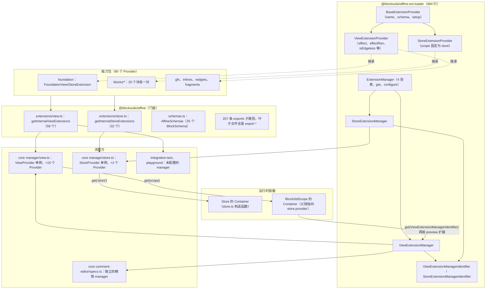
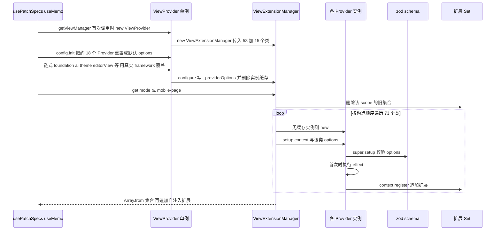
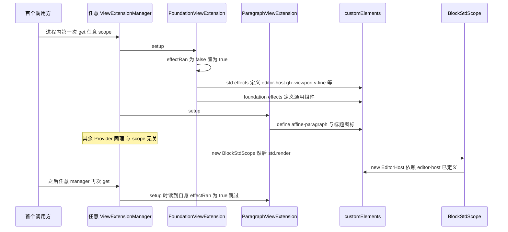
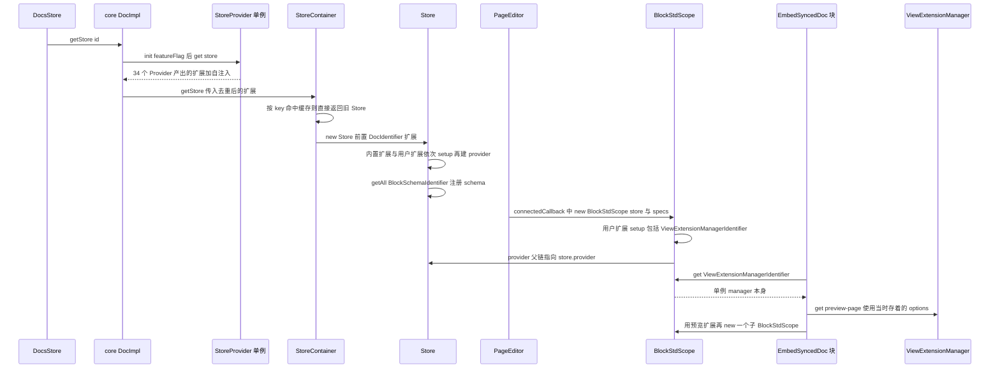

# 扩展装配精讲：`@blocksuite/affine-ext-loader` 与 `@blocksuite/affine`

> 一句话：`@blocksuite/affine-ext-loader` 规定了能力包怎样声明自己在 store 层和 view 层各注册哪些扩展（Provider），也规定了一组 Provider 怎样按场景算成一份 `ExtensionType[]`（Manager）；`@blocksuite/affine` 把 BlockSuite 内置的 90 个 Provider 汇成两份有序清单，再用 207 条 `exports` 子路径把底层几十个包收到同一个包名下。两者合起来是编辑器的**组装层**：上面接各个能力包，下面接 `Store` 和 `BlockStdScope` 的 DI 容器。
>
> 对应分层文档：[`@blocksuite/affine-ext-loader`](../L3-编辑器业务层/blocksuite-affine-ext-loader.md)、[`@blocksuite/affine`](../L3-编辑器业务层/blocksuite-affine.md) · 源码：`blocksuite/affine/ext-loader`、`blocksuite/affine/all`

分层文档已经讲清了这些：Provider、Context、Manager 各是什么，`configure` 会删实例缓存，`effect` 靠静态标志守护，门面用 exports 平移子路径。DI 容器的解析规则（`get` 走父链、`getAll` 不走）和 `BlockStdScope` 的生命周期，[`@blocksuite/std` 精讲](./03-blocksuite-std.md)里已经讲透。core 采用"全局单例管理器 + 每次渲染重新配置"，[`@affine/core` 精讲](./05-affine-core.md) 5.3 节已有结论。本篇只往下深挖以下几点：

- `get(scope)` 每次到底做了什么：哪些东西被缓存，哪些每次重算；
- options 校验的真实语义：校验结果被丢弃，zod 的 `default` 不会生效；
- `effect` 一次性守护的边界：它与 scope 无关，与 manager 实例无关，被继承时会出错；
- 扩展数组怎样分别进入 `Store` 和 `BlockStdScope`，块组件又怎样反过来拿到 manager，再造一个预览编辑器；
- 单例 manager 被多个调用方各自只重配一部分之后的配置串扰，以及门面包带来的构建代价。

## 0. 为什么是重点包

| 指标 | `@blocksuite/affine-ext-loader` | `@blocksuite/affine` |
| --- | --- | --- |
| 直接被依赖 | 60 个（运行时 59） | 15 个（运行时 14） |
| 传递被依赖 | 87 个（运行时 77），全仓第 7 | 28 个（运行时 18），全仓第 70 |
| 源码行数 | `src` 下非测试 `.ts` 共 484 行（7 个文件），另有测试 229 行 | `src` 下非测试 `.ts` 共 513 行（218 个文件），另有 `__tests__` 20 个文件、15,687 行 |
| 对外入口 | `exports` 只有 `.` 一条 | `exports` 207 条，`dependencies` 69 个 |
| 所在链路 | 组装层：每个块、widget、gfx、inline、fragment 包都通过它声明 store 和 view 两层扩展 | 组装层的门面：汇总全部内置扩展，产品和 playground 都从这里取 |

**统计口径与差异**（实测：用只读脚本遍历根 `package.json` 中 `workspaces` 覆盖的 123 个包）：

- 直接被依赖数与编排方一致。ext-loader 的 60 个依赖方里，只有 `@affine/core` 把它写在 `devDependencies`。原因是 core 的运行时代码都经门面 `@blocksuite/affine/ext-loader` 引入（24 个文件），只有一个测试 `packages/frontend/core/src/__tests__/ai/utils/apply-model/apply-patch-to-doc.spec.ts:6` 直接引用底层包。`@blocksuite/affine` 的 15 个依赖方里，只有 `@affine-test/kit` 仅在 `devDependencies` 中出现。
- 传递被依赖数，全口径实测各比编排方多 1（87 对 86，28 对 27），运行时口径一致（77、18）。差的这 1 个，推测是两边对"是否计入仓库根包"的处理不同。
- 行数实测比编排方给的"约 512 / 554 行"少。本篇的统计方法是：`src` 下非测试 `.ts` 文件逐个计行再求和。编排方没有说明自己的口径。
- 本篇还额外统计了 Provider 类的数量。仓库里共有 108 个类继承 `ViewExtensionProvider`（74 个）或 `StoreExtensionProvider`（34 个）。其中 90 个在 `blocksuite/affine/*`（blocks 40、gfx 16、widgets 16、inlines 12、fragments 4、foundation 2），18 个在 `packages/frontend/core/src`。

**满足的标准：**

- **A 依赖枢纽**。ext-loader 的传递被依赖数全仓第 7，代码却不到 500 行。原因有三：
  1. **它定义的是契约，不是功能。** 能力包依赖它，只是为了两个基类和一个 `Context` 类型。每个块包的 `./store`、`./view` 子入口导出的正是 Provider 类，例如 `blocksuite/affine/blocks/paragraph/package.json` 的 `exports` 里就有 `./store`、`./view` 两条。一个包只要想被装配，就必须依赖它。
  2. **它自身的依赖极轻。** 运行时只依赖 `@blocksuite/global`、`@blocksuite/store`、`zod`（`blocksuite/affine/ext-loader/package.json`），**不依赖 std**。所以任何层级的包都能依赖它而不形成环；store 层的 Provider 也能在没有视图的场景（导入、AI 解析、测试）里使用。
  3. **它的依赖方横向铺满。** 60 个直接依赖方几乎都是叶子能力包，彼此很少互相依赖。所以传递数（87）只比直接数多 27 个，多出来的主要是门面和各个应用。

  `@blocksuite/affine` 被依赖得少，排名也靠后（第 70），这正是门面的特征：它依赖全部 69 个底层包，处在依赖图顶端，只有应用、测试和 playground 依赖它。它是组装链路的出口，算不上依赖枢纽。
- **D 范式定义者**。"一个能力包 = 一个 `XxxStoreExtension` + 一个 `XxxViewExtension`；在 `setup` 里按 `context.scope` 分支调用 `register`；在 `effect` 里调用 `customElements.define`"——BlockSuite 的 90 个内置 Provider 全是这个写法。core 的 18 个 Provider 也照此编写，并统一用 zod 声明 options，例如 `framework: z.instanceof(FrameworkProvider)`。门面的 `blocks/<名>/{index,store,view}.ts` 三文件结构，又把这个约定固化成了目录结构。

**不懂它会卡在哪：**

1. 读 `blocksuite/affine/blocks/paragraph/src/view.ts:42-45`：`customElements.define('affine-paragraph', …)` 为什么包在 `effect()` 里，而不写在模块顶层？包为什么敢声明 `"sideEffects": false`？见 2.3 节、5.5 节。
2. 读 `blocksuite/affine/blocks/embed-doc/src/embed-synced-doc-block/embed-synced-doc-block.ts:119-122`：块组件里 `this.std.get(ViewExtensionManagerIdentifier).get(name)` 拿到的是哪个 manager？用的是谁的配置？见流程 ③ 和 6.3 节。
3. 读 `packages/frontend/core/src/blocksuite/manager/view.ts:249-284`：桌面端先开启 AI 再关闭，段落占位符为什么不会恢复成默认值？见 6.3 节。
4. 读 `blocksuite/affine/inlines/comment/src/view.ts:14-16`：schema 里写了 `.default(true)`，为什么不配置时评论 inline 反而是关闭的？见 2.1 节、6.2 节。
5. 读 `blocksuite/affine/all/src/extensions/view.ts:107-108` 的注释 `order will affect the z-index of the widget`：数组顺序是怎样一路传到 widget 的 DOM 顺序的？见流程 ① 第 6 步。

## 1. 全景架构



逐块说明：

- **ext-loader 内部只有两层。** 第一层是 `base-provider.ts` 和 `manager.ts`：不关心 scope 取哪些值，只用泛型 `Scope extends string` 参数化。第二层是 view、store 各一个子类：把 scope 收窄成 `ViewScope`（6 个值）或字面量 `'store'`，并各自在 `get` 的结果里追加一个扩展，作用是把 manager 自己注册进 DI。注意 `index.ts` 只导出第二层（`blocksuite/affine/ext-loader/src/index.ts:1-4`）：`BaseExtensionProvider`、`ExtensionManager`、`Context`、`Empty` **都不对外导出**，外部只能从 view、store 两个子类起步。

  | 文件 | 行数 | 内容 |
  | --- | --- | --- |
  | `base-provider.ts` | 68 | `Empty`、`Context<Scope>`、`BaseExtensionProvider` |
  | `manager.ts` | 146 | `ExtensionManager`：构建、去重、配置 |
  | `view-provider.ts` | 129 | `ViewScope`、`ViewExtensionProvider`、`ViewExtensionContext` |
  | `view-manager.ts` / `store-manager.ts` | 49 / 47 | 两个 manager 子类与对应的 Identifier |
  | `store-provider.ts` | 41 | `StoreExtensionProvider`、`StoreExtensionContext` |
  | `index.ts` | 4 | 只 re-export 上面四个子类文件 |

- **能力包**只依赖 ext-loader 的子类：在自己的 `src/store.ts`、`src/view.ts` 里各写一个 Provider，再由 `package.json` 暴露成 `./store`、`./view` 子路径。只有视图部分的包（widget、fragment、大部分 gfx、部分 inline）只有 `./view`。
- **门面**做三件事：把 90 个 Provider 按固定顺序排成两份清单；导出纯模型清单 `AffineSchemas`；用 207 条 `exports` 把底层包的子路径平移到 `@blocksuite/affine/*` 下。门面自己**不创建任何 manager**。仓库里直接拿门面清单 `new` manager 的只有两处：`blocksuite/integration-test/src/view.ts:4`、`blocksuite/integration-test/src/store.ts:4`（另有测试工具 `blocksuite/affine/all/src/__tests__/utils/store.ts:5`）。
- **消费方**各自持有 manager。core 有两个进程级单例（`ViewProvider`、`StoreProvider`），评论编辑器另有一个独立的精简 manager（`packages/frontend/core/src/components/comment/comment-editor/specs.ts:121-170`）。integration-test 的 manager 从不调用 `configure`，playground 直接复用它（`blocksuite/playground/apps/starter/utils/extensions.ts:12-20`）。
- **运行时**：store 扩展装进 `Store` 构造函数里新建的 `Container`，view 扩展装进 `BlockStdScope` 的 `Container`，后者的 provider 以前者为父（见流程 ③）。图里从 std 指回 manager 的那条线最容易被忽略：manager 自己就注册在 std 里，块组件随时能拿到它，再算一份 preview 扩展，去渲染嵌套编辑器。

## 2. 核心抽象与数据模型

### 2.1 `BaseExtensionProvider` 与 `Context`：契约的全部内容

```ts
// blocksuite/affine/ext-loader/src/base-provider.ts:16-21
export type Context<Scope extends string> = {
  scope: Scope;
  register(extensions: ExtensionType[] | ExtensionType): Context<Scope>;
};

// blocksuite/affine/ext-loader/src/base-provider.ts:46-67
export class BaseExtensionProvider<Scope extends string, Options extends object = Empty> {
  name = 'BaseExtension';
  schema: ZodSchema = z.object({});
  setup(_context: Context<Scope>, option?: Options) {
    if (option) {
      this.schema.parse(option);
    }
  }
}
```

有三点分层文档没讲，但读源码时必须知道：

1. **`name` 不参与任何逻辑。** manager 用**类本身**作 key（`manager.ts:17-27`），从不读取 `name`。90 个内置 Provider 都写了 `override name = 'affine-xxx-block'`，这个值只在调试时有用；两个 Provider 同名也不会冲突。
2. **`schema.parse` 的返回值被丢弃。** 校验只起一个作用：不合法就抛错。子类拿到的仍然是**原始 options**，zod 的 `.default()`、`.transform()`、`z.function()` 的包装都不会作用到 `setup` 的入参上。仓库里已经有受此影响的写法，见 6.2 节。
3. **`option` 为假值时不做校验。** `configure(P, undefined)` 之后的 `get` 不会触发校验；子类如果没把 options 传给 `super.setup`，同样不会触发校验，见 6.1 节。

`Context` 是一个只含 `scope` 和 `register` 的普通对象。一次 `get` 只创建一个 context（`manager.ts:39-40`），所有 Provider 共用它。`register` 返回 context 本身，可以链式调用；不过仓库里几乎都是分多次单独调用，或者一次传一个数组。

### 2.2 `ExtensionManager`：每次 `get` 都完整重算

四张表的含义见分层文档 3.3 节。这里讲清楚**哪些被缓存、哪些每次重算**：

| 对象 | 是否缓存 | 位置 | 说明 |
| --- | --- | --- | --- |
| Provider 类列表与顺序 | 构造时固定 | `manager.ts:34-36` | `new Set(providers)`：同一个类重复传入时，保留**第一次出现的位置** |
| Provider 实例 | 缓存，`configure` 时作废 | `manager.ts:42-49`、`:144` | 测试 `ext-loader.unit.spec.ts:98-107` 断言的是**构造函数**只调用一次 |
| `setup` 调用 | **不缓存**：每次 `get`，所有 Provider 都调用一遍 | `manager.ts:50` | |
| 某 scope 的扩展集合 | **不缓存**：`get` 开头先删除 | `manager.ts:97-99` | `_extensions` 只是 `_build` 期间的临时收集器 |
| options | 一直保存，直到下次 `configure` | `manager.ts:137-141` | 单例 manager 出现配置串扰的根源 |

由此可以推出以下几点（根据源码推断）：

- **`get` 的开销与 Provider 总数成正比，与 scope 无关。** core 的单例有 73 个 Provider，每次 `get` 都要执行 73 次 `setup`，带 options 的 Provider 还要各做一次 zod 校验。`blocksuite/affine/blocks/surface-ref/src/surface-ref-block.ts:121-126` 把 `_previewSpec` 写成了 getter，每访问一次就完整构建一次。
- **扩展对象的身份每次都可能不同。** `ParagraphBlockConfigExtension({ getPlaceholder })`（`blocksuite/affine/blocks/paragraph/src/view.ts:60-62`）这类工厂调用，每次 `setup` 都返回新对象。所以两次 `get` 的结果不能用 `===` 判断是否相同，也不能指望 `Set` 跨两次 `get` 去重。在同一次 `get` 内，`Set` 也只对**同一个对象**去重（`manager.ts:69-71`）。
- **扩展的顺序由两层决定：先按 Provider 的顺序，再按各 Provider 内部 `register` 的顺序。** 没有依赖声明，也没有拓扑排序。同一个对象第二次 `register` 时位置不变，因为 `Set.add` 不会移动已有元素。
- **空 scope 会抛错。** `_registerToScope` 只在第一次 `register` 时才创建集合（`manager.ts:60-73`）。如果某个 scope 下没有任何 Provider 注册东西，`get` 会抛 `BlockSuiteError(ValueNotExists)`（`manager.ts:101-107`），而不是返回空数组。

`configure` 的语义：

```ts
// blocksuite/affine/ext-loader/src/manager.ts:120-145
configure<T extends Empty>(provider, options: ((prev: T | undefined) => T | undefined) | T | undefined) {
  const prev = this._providerOptions.get(provider);
  let config: T | undefined;
  if (typeof options === 'function') { config = (options as (prev: unknown) => T)(prev); }
  else { config = options; }
  if (prev === config) { return; }
  if (config === undefined) { this._providerOptions.delete(provider); }
  else { this._providerOptions.set(provider, config); }
  // If the config is changed, we need to rebuild the extension
  this._providerInstances.delete(provider);
}
```

两个细节：

- 判断依据是 `typeof options === 'function'`。这意味着**不能把一个函数直接当作 options 传进去**：它会被当成 updater 调用。
- "是否变化"只看引用是否相等。core 每次都传新的对象字面量（如 `{ framework }`，`packages/frontend/core/src/blocksuite/manager/view.ts:212`），所以每调用一次 `init()`，就有大约 18 个 Provider 的实例缓存作废，下一次 `get` 时全部重新 `new`。对 core 来说，实例缓存实际上只对从未配置过的 Provider 起作用（根据源码推断）。好在 Provider 实例几乎没有状态，重建的代价只是一次 `new`。

### 2.3 `ViewExtensionProvider`：6 个 scope 与一次性 `effect`

`ViewScope` 有 6 个值（`view-provider.ts:11-17`），三个判定辅助函数都是实例上的箭头函数属性（`view-provider.ts:89-113`）。它们的实际使用很不均衡：在 `blocksuite/affine` 下，`this.isEdgeless(` 出现 26 次，`this.isMobile(` 出现 3 次，`this.isPreview(` 一次都没有出现。预览判断都是直接比较字符串，例如 `blocksuite/affine/blocks/root/src/view.ts:44-47`。

移动端的判断还有两套并行的写法：
- `KeyboardToolbarViewExtension` 判断 `context.scope === 'mobile-page'`，同时兼容 `IS_MOBILE`（`blocksuite/affine/widgets/keyboard-toolbar/src/view.ts:20-26`）；
- core 的 `MobileViewExtension` 直接看 `BUILD_CONFIG.isMobileEdition`，完全不看 scope（`packages/frontend/core/src/blocksuite/view-extensions/mobile/index.ts:23-24`）。

`effect` 的守护逻辑：

```ts
// blocksuite/affine/ext-loader/src/view-provider.ts:115-122
override setup(context: ViewExtensionContext, options?: Options) {
  super.setup(context, options);
  const constructor = this.constructor as typeof ViewExtensionProvider;
  if (!constructor.effectRan) {
    constructor.effectRan = true;
    this.effect();
  }
}
```

分层文档讲了"每个子类各有独立的标志"。这里补充四条边界：

1. **执行时机：校验之后，子类 `register` 之前。** 子类总是先调用 `super.setup(...)` 再 `register`，所以 `effect` 跑在本 Provider 注册任何扩展之前。如果 options 校验失败，`super.setup` 会先抛错，`effect` 不执行，`effectRan` 也不会被置位。
2. **与 scope 无关。** 进程内第一次 `get`，无论取的是哪个 scope，**所有** Provider 的 `effect` 都会执行。桌面端第一次 `get('page')` 时，移动端键盘工具栏、白板工具栏的自定义元素也会一并被 define。
3. **与 manager 实例无关。** 标志挂在类上，所以 core 的单例 manager、评论编辑器的 manager、integration-test 的 manager 共享同一个"是否已执行"状态。评论编辑器的 manager 里没有 `FoundationViewExtension`（`specs.ts:123-153`），`editor-host` 等基础元素要靠别的 manager 先执行 Foundation 的 effect 才会被定义（根据源码推断；正常使用中主编辑器总是先渲染）。
4. **继承一个具体 Provider 会出错。** 读取 `constructor.effectRan` 时会沿静态原型链查找。假设写了 `class MyParagraph extends ParagraphViewExtension`：
   - 如果父类先执行过，子类读到的是继承来的 `true`，子类自己的 `effect` 永远不会执行；
   - 如果子类先执行并调用了 `super.effect()`，父类之后还会再执行一次 `effects()`，重复调用 `customElements.define('affine-paragraph')` 会抛错。

   仓库里目前没有这种继承（检索 `extends XxxViewExtension` 无结果），但扩展时要避开这种写法（根据源码推断）。

`StoreExtensionProvider`（`store-provider.ts:30-35`）只改了 `name`，**没有 `effect`**。所以只用 store 扩展的场景（导入、AI 解析、`packages/common/reader`）不会触发任何 `customElements.define`，可以在没有 DOM 的环境里运行（根据源码推断）。

### 2.4 Manager 自注入：两个 Identifier 落在两个容器里

`ViewExtensionManager.get` 和 `StoreExtensionManager.get` 都会在结果末尾追加一个对象字面量形式的扩展（`view-manager.ts:40-48`、`store-manager.ts:38-46`），用 **`addImpl`**（而不是 `override`）注册 `() => this`。由此有三个结果：

- `StoreExtensionManagerIdentifier` 进入 `Store` 的容器，`ViewExtensionManagerIdentifier` 进入 std 的容器。std 的 provider 以 store 为父，所以在 std 里两个都能 `get` 到。
- 这个自注入扩展每次 `get` 都是新对象。如果把两次 `get` 的结果放进同一个容器，就会出现两次 `addImpl`，抛出 `DuplicateServiceDefinitionError`（`blocksuite/framework/global/src/di/container.ts:179-182`）。典型写法有两种：`[...m.get('page'), ...m.get('page')]`；或者 `getStore` 已经自带 store 扩展，调用方又传了一份 `get('store')`。core 的 `getStore` 会用 `new Set(exts)` 去重（`packages/frontend/core/src/modules/workspace/impls/doc.ts:147-150`），但只能去掉同一个对象（根据源码推断）。
- 注册进去的是 **manager 本身**，不是当时 options 的快照。之后谁再调用 `get`，用的都是那一刻 manager 里存着的 options（见流程 ③、6.3 节）。

在 `blocksuite/affine` 下，有 6 处通过 `ViewExtensionManagerIdentifier` 取到 manager 来构造嵌套编辑器：
- `embed-synced-doc-block.ts`；
- surface-ref 的 `surface-ref-block.ts` 和 `portal/note.ts`；
- embed-doc 的 `render-linked-doc.ts`；
- frame-panel 的 `frame-preview.ts`；
- drag-handle 的 `preview-helper.ts`。

core 里还有 3 处：`ai-chat-block.ts`、`slides-renderer.ts`、`chat-block-peek-view.ts`。这就是自注入存在的理由：块包不能 import 应用层的 manager，只能从 DI 里反查。

### 2.5 门面的两份清单、`AffineSchemas` 与 `effects.ts`

| 清单 | 位置 | 数量 | 顺序约定 |
| --- | --- | --- | --- |
| `getInternalViewExtensions()` | `blocksuite/affine/all/src/extensions/view.ts:60-132` | 58 个：Foundation 1、Gfx 10、Block 20、Inline 7、Widget 16、Fragment 4 | Foundation 排第一；widget 的顺序影响 z-index（`:107-108`） |
| `getInternalStoreExtensions()` | `blocksuite/affine/all/src/extensions/store.ts:34-72` | 32 个：Foundation 1、Block 20、Inline 5、Gfx 6 | Foundation 排第一 |
| `AffineSchemas` | `blocksuite/affine/all/src/schemas.ts:33-59` | 25 个 `BlockSchema` | 无顺序要求 |

**Foundation 为什么必须排第一？** DI 的 `addImpl` 不能重复，覆盖实现必须用 `override`，而且要注册在默认实现之后（[affine-shared 精讲](./07-blocksuite-affine-shared.md) 6.1 节）。Foundation 注册了 `DocModeService`、`ThemeService` 等默认实现（`blocksuite/affine/foundation/src/view.ts:64-83`），任何想覆盖它们的 Provider 都必须排在它后面。core 把自己的 15 个 Provider 放在 `...getInternalViewExtensions()` 之后，正是这个原因（`packages/frontend/core/src/blocksuite/manager/view.ts:87-105`）。

**schema 有两条登记路径，新增块时两条都要走：**

- **Store 级**：每个块的 StoreExtension 注册 `XxxBlockSchemaExtension`（例如 `blocksuite/affine/blocks/paragraph/src/store.ts:14`）。`Store` 构造时用 `getAll(BlockSchemaIdentifier)` 把它们收集进自己的 `Schema`（`blocksuite/framework/store/src/model/store/store.ts:586-588`）。
- **Workspace 级**：`AffineSchemas` 是一份纯模型数组，供 `new Schema()` 使用。core 在 `packages/frontend/core/src/modules/workspace/global-schema.ts:11-15` 登记它，另外加上两个 AI 块；`packages/common/reader/src/reader.ts:32` 和 playground 的 `blocksuite/playground/apps/starter/utils/collection.ts:31` 也用它。`schemas.ts:1` 的注释 `Import models only` 说明它刻意不引入视图代码。

core 的 AI 块正好是两条路径都走的样板：`AIStoreExtension` 注册 SchemaExtension（`packages/frontend/core/src/blocksuite/store-extensions/ai/index.ts:11-15`），`global-schema.ts` 登记 Schema。

**`effects.ts` 只有类型，没有运行时代码。** 它由 16 个 `import { type effects as X }` 和一个 `export declare const _GLOBAL_` 组成（`blocksuite/affine/all/src/effects.ts:1-34`），编译后什么都不剩。它唯一的使用方是 `blocksuite/integration-test/src/effects.ts:1` 的 `import '@blocksuite/affine/effects'`。它的作用应该是让 TypeScript 把这些 effects 模块里的 `declare global { interface HTMLElementTagNameMap … }` 纳入类型检查（根据源码推断：比如 `blocksuite/affine/rich-text/src/effects.ts`、`blocksuite/affine/blocks/root/src/effects.ts` 里都有 `declare global`）。真正的 `customElements.define` 全部发生在各 Provider 的 `effect()` 里。

## 3. 关键流程走读

### 流程 ①：从 73 个 Provider 到一份 `page` 扩展数组



1. **创建单例。** `getViewManager()` 惰性创建 `ViewProvider`（`packages/frontend/core/src/blocksuite/manager/view.ts:76-82`、`:366-368`），构造函数里执行 `new ViewExtensionManager([...getInternalViewExtensions(), …15 个])`（`:86-106`）。manager 构造时只把类放进 `Set`，不实例化任何 Provider（`blocksuite/affine/ext-loader/src/manager.ts:34-36`）。
2. **`init()` 重置。** `_initDefaultConfig` 不带参数地调用全部 18 个配置方法（`view.ts:137-159`）。大多数方法会执行 `configure(P, { framework: undefined })`，传入的是新对象，因此都会让实例缓存作废。**例外**是 `paragraph()`、`linkedDoc()`、`database()`：参数为假时它们什么都不做（`view.ts:228-284`），旧 options 原样保留。后果见 6.3 节。
3. **真实配置。** `usePatchSpecs` 接着用当前 React 作用域里的 `framework`、`enableAI` 等再链式配置一遍（`packages/frontend/core/src/blocksuite/block-suite-editor/lit-adaper.tsx:93-121`）。同一个 Provider 在这一轮被 `configure` 两次，每次都是新对象，以最后一次为准。
4. **选 scope。** 移动端构建取 `mobile-page` 或 `mobile-edgeless`，其余取 `page` 或 `edgeless`（`lit-adaper.tsx:123-131`）。core 渲染主编辑器时从不取 `preview-*`。预览 scope 只用于反链面板（`bi-directional-link-panel.tsx:183`）、只读评论、设置页快照和各种嵌套编辑器。
5. **构建。** `get` 先删掉旧集合（`manager.ts:97-99`），`_build` 按构造顺序遍历：对每个类先取出或新建实例，再调用 `setup(context, options)`（`manager.ts:39-52`）。以段落为例：

   ```ts
   // blocksuite/affine/blocks/paragraph/src/view.ts:47-64
   override setup(context: ViewExtensionContext, options?: z.infer<typeof optionsSchema>) {
     super.setup(context, options);            // zod 校验 + 首次 effect
     const getPlaceholder =
       options?.getPlaceholder ?? (model => placeholders[model.props.type]);
     context.register([
       FlavourExtension('affine:paragraph'),
       BlockViewExtension('affine:paragraph', literal`affine-paragraph`),
       ParagraphTextKeymapExtension,
       ParagraphKeymapExtension,
       ParagraphBlockConfigExtension({ getPlaceholder }),   // 每次都是新对象
       ParagraphMarkdownExtension,
     ]);
   }
   ```

   这段代码展示了 options 怎样变成块的行为，分三步：
   - 应用层传入的函数被包进一个由 `ConfigExtensionFactory` 产出的扩展；
   - 该扩展在 `setup` 时用 `di.override(ConfigIdentifier('affine:paragraph'), …)` 注册（`blocksuite/framework/std/src/extension/config.ts:31-44`）；
   - 块组件通过 `this.std.get(ParagraphBlockConfigExtension.identifier)` 读出（`blocksuite/affine/blocks/paragraph/src/paragraph-block.ts:66-70`）。
6. **产出结果。** `Array.from(Set)`，再拼上自注入扩展（`view-manager.ts:40-48`）。数组顺序会一路传下去：
   - std 按数组顺序调用 `ext.setup(container)`（`blocksuite/framework/std/src/scope/std-scope.ts:130-132`）；
   - 同一个 identifier 的多个 variant 按注册顺序存进 `Map`；
   - `EditorHost._renderModel` 用 `getAll(WidgetViewIdentifier)` 遍历这个 `Map` 生成 widget 模板（`blocksuite/framework/std/src/view/element/lit-host.ts:75-86`）。

   "门面数组里 widget 的顺序会影响 z-index"就来源于此：数组顺序决定了 widget 在 DOM 中的先后，而叠放次序受 DOM 先后影响（根据源码推断）。

store 侧完全对称，只是只有 `'store'` 一个 scope：`getStoreManager().config.init().featureFlag(svc).value.get('store')`（`packages/frontend/core/src/modules/workspace/impls/doc.ts:143-146`）。`init()` 会把 `FeatureFlagStoreExtension` 重置成 `{ featureFlagService: undefined }`（`packages/frontend/core/src/blocksuite/manager/store.ts:47-58`）。core 里有 20 多处调用方（导入、AI、快照等）只写 `config.init().value.get('store')`，它们拿到的扩展里没有特性开关同步器，这是有意为之。

### 流程 ②：一个块的 `effect` 何时、被谁、只执行一次



1. **谁触发**：进程内**第一次**调用任意 `ViewExtensionManager.get` 的代码。在 AFFiNE 里通常是详情页的 `usePatchSpecs`，也可能是 AI 聊天页（`packages/frontend/core/src/desktop/pages/workspace/chat/index.tsx:87`），或者离屏创建 std 的 `createBlockStdScope`（`packages/frontend/core/src/blocksuite/manager/view.ts:370-375`）。在 playground 里，是 `createTestEditor` 里的两次 `get`（`blocksuite/playground/apps/starter/utils/extensions.ts:51-52`）。
2. **何时**：在 `get` 内部，每个 Provider 的 `setup` 里（`blocksuite/affine/ext-loader/src/view-provider.ts:115-122`）。在 core 里，这一步发生在 React 的 `useMemo` 中，也就是渲染阶段。
3. **Foundation 先执行**：它是清单第一项（`blocksuite/affine/all/src/extensions/view.ts:62`）。它的 `effect`（`blocksuite/affine/foundation/src/view.ts:54-57`）调用 `blocksuite/affine/foundation/src/effects.ts:34-70`，其中第一行是 `stdEffects()`，负责定义 `editor-host`、`gfx-viewport`、`v-element`、`v-line`、`v-text`（`blocksuite/framework/std/src/effects.ts:5-14`）。
4. **块自己的 effect**：`ParagraphViewExtension.effect` 调用 `effects()`：先执行标题图标的 effects，再执行 `customElements.define('affine-paragraph', ParagraphBlockComponent)`（`blocksuite/affine/blocks/paragraph/src/effects.ts:4-7`）。108 个 Provider 所在的文件中，有 59 个覆写了 `effect`。
5. **为什么必须在创建 std 之前执行**：`std.render()` 会 `new EditorHost()`（[std 精讲](./03-blocksuite-std.md) 流程 ① 第 5 步）。对一个还没 define 的自定义元素类执行 `new`，浏览器会抛 `Illegal constructor`。所以"先 `get`，再 `new BlockStdScope`"这个顺序是硬性要求。好在 `extensions` 本来就是 std 的构造参数，这个顺序天然成立。
6. **只执行一次**：`effectRan` 是类的静态属性，所以之后无论哪个 manager、取哪个 scope，都不会再执行。HMR 或测试中，如果模块被重新求值，类会变成新对象，`effectRan` 回到 `false`；但 `customElements` 是全局的，重复 define 仍然会抛错。

### 流程 ③：打开页面编辑器——两份扩展分别装进 `Store` 与 `BlockStdScope`，再被块组件反查



1. **取 Store**：`DocsStore.getBlockSuiteDoc` 调用 `docCollection.getDoc(id)?.getStore({ id })`（`packages/frontend/core/src/modules/doc/stores/docs.ts:25-31`）。
2. **计算 store 扩展**：core 的 `DocImpl.getStore` 每次都执行 `init().featureFlag(this.workspace.featureFlagService).value.get('store')`，再拼上调用方传入的扩展和 `this.storeExtensions`，用 `Set` 去重（`packages/frontend/core/src/modules/workspace/impls/doc.ts:136-159`）。
3. **命中缓存**：`StoreContainer.getStore` 先按 id 或 `{ readonly, query }` 算出 key，命中就直接返回已有的 Store（`blocksuite/framework/store/src/model/store-container.ts:30-34`）。也就是说，**同一个 key 第二次 `getStore` 时传入的扩展会被静默忽略**，第 2 步算出的扩展只在第一次真正生效（根据源码推断）。
4. **装进 Store 的容器**：在用户扩展前面加一个注册 `DocIdentifier` 的扩展（`store-container.ts:36-48`）。`Store` 构造函数依次执行：
   - setup 内置的 `StoreSelectionExtension`、`HistoryExtension`；
   - 依次 setup 用户扩展；
   - 调用 `container.provider(undefined, provider)` 建立 provider；
   - 收集 `BlockSchemaIdentifier` 并注册 schema（`blocksuite/framework/store/src/model/store/store.ts:572-588`）。

   `StoreExtensionManagerIdentifier` 就在这个容器里。`StoreExtension` 的 `loaded()` 要等到 `store.load()` 时才调用（`store.ts:1229-1231`）。
5. **装进 std 的容器**：`PageEditor.connectedCallback` 中执行 `new BlockStdScope({ store: this.doc, extensions: this.specs })`（`packages/frontend/core/src/blocksuite/editors/page-editor.ts:58-67`），specs 就是流程 ① 的产物。std 依次 setup 内置扩展和用户扩展，provider 以 `store.provider` 为父（`blocksuite/framework/std/src/scope/std-scope.ts:119-140`）。之后的生命周期见 [std 精讲](./03-blocksuite-std.md) 流程 ①。
6. **块组件反查 manager**：同步文档块构建预览时，调用 `this.std.get(ViewExtensionManagerIdentifier).get(name)`（`blocksuite/affine/blocks/embed-doc/src/embed-synced-doc-block/embed-synced-doc-block.ts:119-122`），再拼上自己的 `LifeCycleWatcher` 等扩展，交给嵌套的 `BlockStdScope`。这一步发生在块渲染时，比第 5 步晚，而且每个嵌套块各取一次。它用的是**那一刻**单例里存着的 options，不一定是外层编辑器配置时那一份。
7. **specs 变化不会重建 std**：`PageEditor.willUpdate` 只在 `doc` 变化时重建 std（`page-editor.ts:87-100`）。当 `enableAI` 等依赖变化、`usePatchSpecs` 重新算出新的 specs 时，`PageEditor` 不会用新 specs 重建 std（根据源码推断；外层组件是否会重新挂载编辑器，要结合具体页面判断）。

## 4. 源码阅读路线

1. **`blocksuite/affine/ext-loader/src/base-provider.ts`**（68 行，全读）。搞懂 `Context` 只有两个成员，`setup` 只做校验，并且丢弃校验结果。
2. **`blocksuite/affine/ext-loader/src/manager.ts`**（146 行，全读）。对照 2.2 节的表逐行确认哪些被缓存、哪些每次重算；重点看 `get` 开头的 `delete` 和 `configure` 末尾的 `delete`。
3. **`blocksuite/affine/ext-loader/src/view-provider.ts:57-123`**。搞懂 `effectRan` 的读和写都经过 `this.constructor`，然后自己推演一遍"继承具体 Provider"会发生什么。
4. **`view-manager.ts`、`store-manager.ts`**（各约 50 行）。确认自注入扩展用的是 `addImpl`。
5. **`blocksuite/affine/ext-loader/src/__tests__/ext-loader.unit.spec.ts`**（229 行）。五个用例就是行为规格。注意 `:98-107` 统计的是构造函数的调用次数，不是 `setup` 的调用次数。
6. **最简单的块：`blocksuite/affine/blocks/divider/src/{store,view,effects}.ts`**。三个文件加起来不到 50 行，是"一对 Provider 加一个 effects 函数"的最小样板。
7. **带 options 和 scope 分支的块：`blocksuite/affine/blocks/paragraph/src/view.ts`、`blocksuite/affine/blocks/root/src/view.ts`**。前者看 options 怎样变成 Config 扩展；后者看 6 个 scope 怎样分流出不同的根组件标签。
8. **`blocksuite/affine/foundation/src/{view,store,effects}.ts`**。搞懂地基注册了哪些默认实现、哪些只在白板下注册，以及 `stdEffects()` 在哪里被调用。
9. **门面：`blocksuite/affine/all/src/extensions/{view,store}.ts`、`schemas.ts`，以及 `package.json` 的 `exports`**。数一数两份清单各有多少项；对照 `exports`，看哪些子路径有 `/view`、`/store`。
10. **应用侧：先读 `packages/frontend/core/src/blocksuite/manager/{view,store}.ts`，再读 `packages/frontend/core/src/blocksuite/block-suite-editor/lit-adaper.tsx:63-143`**。重点看 `init()` 里哪些方法在参数为空时什么都不做。
11. **反查链路：`blocksuite/affine/blocks/embed-doc/src/embed-synced-doc-block/embed-synced-doc-block.ts:119-150`、`blocksuite/affine/widgets/drag-handle/src/helpers/preview-helper.ts:63-82`**。看嵌套编辑器怎样在预览扩展的基础上追加或覆盖扩展。
12. **对照一个精简 manager：`packages/frontend/core/src/components/comment/comment-editor/specs.ts`**。看不用门面清单、只挑十几个 Provider 时，需要自己补上哪些服务。

**可以先跳过的部分**：
- `blocksuite/affine/all/src` 下 200 多个单行 `export *` 文件，抽查 `blocks/paragraph/*.ts` 即可；
- `blocksuite/affine/all/src/__tests__` 下的 adapter、database 测试，它们只是把门面当作集成测试场地，与装配机制无关；
- `effects.ts` 的类型细节。

## 5. 设计取舍

### 5.1 store 与 view 两层分离

- **选择**：每个能力包分别导出 `XxxStoreExtension` 和 `XxxViewExtension`，经 `./store`、`./view` 两个子入口暴露；store 层只有一个 scope，也没有 `effect`。
- **为什么**：
  - store 扩展装进 `Store` 的容器，而一个 Store 上可以挂多个 std（主编辑器、预览、嵌入）。schema、选区类型、adapter 这类数据层能力只应注册一次。
  - DI 的 `getAll` 不会穿透父级，所以选区类型必须注册在 store 层（[std 精讲](./03-blocksuite-std.md) 2.1 节第 4 条）。
  - 导入、AI 解析、reader 这些无 DOM 场景只需要 store 层。两层分开后，这些场景不会把 Lit 组件和 `customElements.define` 牵连进来（根据源码推断）。
- **代价**：新增一个块要改两个 Provider、两份清单；一个能力该放在哪一层，要靠开发者自己判断。core 甚至维护了两个单例，各有一套 `init()`。
- **替代**：用一个 Provider 同时声明两层，例如在 `setup` 里分别注册。但这样只需要 store 的使用方也必须 import 视图代码，摇树和 SSR 都会更困难。

### 5.2 Provider 是类，而不是扩展数组或函数

- **选择**：声明单元是"类 + 实例方法 `setup` + 静态属性 `effectRan`"，manager 以类为 key 保存 options 和实例。
- **为什么**：类同时提供了三样东西：
  - 一个稳定的 token：`configure(ParagraphViewExtension, …)` 不需要另起名字；
  - 一个可以挂静态状态的位置：`effectRan`；
  - 一个可以声明 `schema` 的位置。

  如果用普通数组，就没法按 scope 分支，也没法接收 options；如果用函数，就得另外设计 token 和一次性标志（根据源码推断）。
- **代价**：静态标志带来了"继承具体 Provider 会出错"的陷阱（2.3 节第 4 条）；`name` 字段形同虚设；`this.isEdgeless` 这类辅助函数是实例属性，每次 `new` 都会重新创建三个闭包（开销很小）。
- **替代**：用 `WeakSet` 按类记录 effect 是否执行过，并让子类调用 `super.effect()` 时跳过父类的逻辑，这样可以消除继承陷阱，但需要改基类实现。

### 5.3 进程级单例 manager，每次使用前重新配置

[core 精讲](./05-affine-core.md) 5.3 节已经讲了这个选择及其原因。这里补充从源码里能看到的**额外代价**：

| 现象 | 位置 | 后果（根据源码推断） |
| --- | --- | --- |
| `init()` 并不是全量重置 | `paragraph()`、`linkedDoc()`、`database()` 在参数为假时不调用 `configure`（`packages/frontend/core/src/blocksuite/manager/view.ts:228-284`） | 这三个 Provider 会保留上一个调用方的 options |
| 不同调用方只配置了一部分 | 反链面板只配 10 项（`packages/frontend/core/src/blocksuite/block-suite-editor/bi-directional-link-panel.tsx:171-184`）；AI 聊天页和 `createBlockStdScope` 只调用 `init()` | 它们执行之后，单例里存的是不完整的配置 |
| 嵌套编辑器延后读取配置 | 流程 ③ 第 6 步 | 主编辑器里的同步文档预览，可能拿到反链面板或聊天页留下的 options |
| 实例缓存基本失效 | 2.2 节 | 每次 `init()` 之后，约 18 个 Provider 都会被重新 `new` |

替代方案除了 core 精讲提到的"每个编辑器各用一个 manager"，还可以让自注入扩展捕获 options 的快照，也就是把 manager 和当时的配置一起注入。这样嵌套编辑器继承的就是外层编辑器的配置，但需要修改 ext-loader。

### 5.4 门面包：一个包名、207 条子路径、全部指向 `src`

- **选择**：`@blocksuite/affine` 的 `.` 入口是 `export {}`（`blocksuite/affine/all/src/index.ts:1`），所有能力都经具名子路径提供。`exports` 直接指向 `./src/**/*.ts`，没有 `dist` 产物映射；包声明了 `sideEffects: false`。
- **为什么**：应用只依赖一个包名，BlockSuite 内部的拆包、改名都由门面吸收。子路径加上 `sideEffects: false`，打包器可以只拉取用到的模块（根据源码推断）。
- **代价**：
  - **摇树的实际收益有限。** 只要 import 了 `extensions/view`，58 个 Provider 的视图代码就全部进入依赖图。`getInternalViewExtensions()` 返回的是数组字面量，打包器没法裁掉其中没用到的块。想裁剪，只能像评论编辑器那样不用门面清单，自己列 Provider（`specs.ts:123-153`）。
  - **构建和类型检查负担重。** `package.json` 有 69 个依赖，`tsconfig.json` 有 69 条 `references`，`build` 脚本是 `tsc --build --verbose`：构建门面就等于构建整个 BlockSuite。`exports` 指向源码，意味着应用的打包器要直接编译全部 BlockSuite 源码。
  - **门面不是强制边界。** core 的 `package.json` 仍然直接声明了 `@blocksuite/affine-shared`、`@blocksuite/std` 等依赖，约 40 个文件直接 import 底层包；例如 `@blocksuite/affine-shared/services` 就出现了 24 次。
  - **清单、`exports`、re-export 文件三处要同步维护，而且没有任何校验。** 实测有 11 个 re-export 文件不在 `exports` 里，外部无法访问：`components/` 下 5 个（如 `edgeless-line-styles-panel.ts`），以及 `widgets/note-slicer`、`widgets/edgeless-selected-rect`、`widgets/edgeless-zoom-toolbar` 各自的 `index.ts` 和 `view.ts`。`inlines/comment` 只导出了 `index`，所以 core 从 `@blocksuite/affine/inlines/comment` 取 `InlineCommentViewExtension`（`packages/frontend/core/src/blocksuite/manager/view.ts:37`）；这能成立，是因为底层包的 `index.ts` 也 re-export 了 `./view`。

### 5.5 副作用写成函数，交给 `effect` 调用

- **选择**：每个包的 `customElements.define` 都写在 `export function effects()` 里，由 Provider 的 `effect()` 显式调用；包本身声明 `sideEffects: false`。
- **为什么**：模块顶层没有副作用，import 一个包不会注册任何元素。打包器可以放心摇树，测试也可以只 import 类型和模型。是否执行、何时执行、执行几次，都交给装配层决定。
- **代价**：执行时机变成了"第一次 `get`"，与 scope 无关，所以桌面端也会定义移动端元素（2.3 节第 2 条）。不经过 manager、直接 `new BlockStdScope` 的代码（例如只拼了几个扩展的测试），必须自己调用相应的 `effects()`，否则会抛 `Illegal constructor`。
- **替代**：按需 define，例如第一次 `register` 某个 `BlockViewExtension` 时再 define。但 std 不知道标签和类的对应关系，需要另外设计一张注册表。

## 6. 易错点与调试

### 6.1 覆写 `setup` 时没把 options 传给 `super.setup`

- **现象**：传了非法 options 也不报错，问题直到运行时才暴露。
- **原因**：校验只发生在 `BaseExtensionProvider.setup` 里（`blocksuite/affine/ext-loader/src/base-provider.ts:63-67`）。仓库里有 3 个 Provider 声明了 `schema`，调用的却是 `super.setup(context)`：`blocksuite/affine/blocks/database/src/view.ts:39`、`blocksuite/affine/widgets/linked-doc/src/view.ts:77`、`blocksuite/affine/blocks/note/src/store.ts:28`。
- **避免**：一律写 `super.setup(context, options)`。顺带一提：`NoteStoreExtension` 的 `mode` 选项在全仓没有任何调用方配置过，所以 store 层注册的永远是 `DocNoteBlockAdapterExtensions`（`note/src/store.ts:30-34`）。

### 6.2 zod 的 `default` 与 `transform` 不生效

- **现象**：`InlineCommentViewExtension` 的 schema 是 `enabled: z.boolean().optional().default(true)`（`blocksuite/affine/inlines/comment/src/view.ts:14-16`）。但在没有配置它的 manager 里（integration-test、playground），`setup` 收到的 `options` 是 `undefined`，`options?.enabled` 为假，于是注册的是 `NullCommentInlineSpecExtension`（`:35-40`），与 schema 表达的意图正好相反（根据源码推断，未运行验证）。
- **原因**：`schema.parse` 的返回值被丢弃（2.1 节第 2 条），而且 `option` 为 `undefined` 时根本不会执行 `parse`。
- **避免**：在 `setup` 里自己写默认值，像段落那样写 `options?.getPlaceholder ?? 默认值`；或者在子类里先执行 `const opts = this.schema.parse(options ?? {})`，之后只用 `opts`。

### 6.3 单例 manager 的配置串扰

- **现象**：桌面端某个会话里先开启了 AI，关闭 AI 后，段落占位符仍然显示 `Type '/' for commands, 'space' for AI`；嵌套预览的行为与外层编辑器不一致。
- **原因**：`_configureParagraph` 只在移动端或 `enableAI` 为真时才调用 `configure`，其余情况什么都不做，旧 options 就一直留在 manager 里（`packages/frontend/core/src/blocksuite/manager/view.ts:249-284`），`init()` 也清不掉它。嵌套编辑器则在块渲染时才读取配置（流程 ③ 第 6 步）（根据源码推断）。
- **避免**：每个配置方法都应在任何参数下调用 `configure`，需要恢复默认时传 `undefined`；新增配置项也照这条规则写。排查时，在控制台拿到 manager（见下文"调试手段"），查看它的私有字段 `_providerOptions`。TS 的 `private` 在运行时仍然可以访问。

### 6.4 `effect` 相关：重复 define、漏 define、继承

- **现象**：报 `NotSupportedError: … has already been used with this registry`，或报 `Illegal constructor`。
- **原因**：
  - 重复 define 通常来自继承具体 Provider（2.3 节第 4 条），或者在 `effect` 之外又手动调用了一次 `effects()`；
  - 漏 define 通常有两种情况：绕过 manager、直接拼扩展数组去 `new BlockStdScope`；或者用了不含 Foundation 的精简 manager，而它恰好是进程里第一个调用 `get` 的。
- **避免**：不要继承具体 Provider，改用组合：另写一个 Provider，排在它后面。精简 manager 要么加上 `FoundationViewExtension`，要么确保主 manager 先 `get` 过一次。排查时在控制台执行 `customElements.get('editor-host')`、`customElements.get('affine-paragraph')`。

### 6.5 两次 `get` 的结果被放进同一个容器

- **现象**：报 `DuplicateServiceDefinitionError`，指向 `ViewExtensionManager` 或 `StoreExtensionManager`。
- **原因**：每次 `get` 都附带一个新的自注入扩展，而它用的是 `addImpl`（`view-manager.ts:42-46`）。
- **避免**：需要多个 scope 的能力时，只调用一次 `get`，再手动追加单个扩展。在 core 里给 `getStore` 传 `extensions` 时，不要再传一份 `get('store')`，因为 `DocImpl.getStore` 自己已经加过了（`packages/frontend/core/src/modules/workspace/impls/doc.ts:143-150`）。

### 6.6 扩展"传了却没生效"

- **现象**：给 `getStore` 传了新扩展，或者 `usePatchSpecs` 重新算出了新 specs，编辑器的行为却没有变化。
- **原因**：
  - `StoreContainer` 按 key 缓存 Store，命中缓存时忽略新扩展（`blocksuite/framework/store/src/model/store-container.ts:30-34`）；
  - `PageEditor` 只在 `doc` 变化时重建 std（`packages/frontend/core/src/blocksuite/editors/page-editor.ts:87-100`）；
  - provider 一旦建好，就已经克隆了容器，之后再执行 `setup` 也不会生效（[std 精讲](./03-blocksuite-std.md) 2.1 节第 2 条）。
- **避免**：需要不同扩展集合的 Store，要用不同的 id 或 query。需要换 specs 时，要么换 `doc`，要么让外层重新挂载编辑器组件。

### 6.7 空 scope 抛错，以及重复构建的开销

- **现象**：自己搭的小 manager 在某个 scope 下 `get` 时抛 `Extension scope xxx not found`；嵌套预览一多，渲染明显变慢。
- **原因**：没有任何 `register` 的 scope 会抛错（`manager.ts:101-107`）。每次 `get` 都会执行全部 `setup`，而 `_previewSpec` 这类 getter 每访问一次就构建一次。
- **避免**：精简 manager 里至少放一个在所有 scope 下都会 `register` 的 Provider，例如 `RootViewExtension`。在块组件里把 `get` 的结果缓存到字段中，不要写成每次访问都重算的 getter。

### 6.8 清单顺序

- **现象**：自定义服务的覆盖不生效，或者报 `DuplicateServiceDefinitionError`；新增的 widget 叠放层级不对。
- **原因**：覆盖实现必须注册在默认实现之后（2.5 节）；widget 在 DOM 中的顺序就是注册顺序（流程 ① 第 6 步）。
- **避免**：应用层 Provider 放在 `...getInternalViewExtensions()` 之后。新增 widget 时，参考注释（`blocksuite/affine/all/src/extensions/view.ts:107-108`）选择插入位置。

### 调试手段

- **单测**：`blocksuite/affine/ext-loader/src/__tests__/ext-loader.unit.spec.ts` 是最小的可运行规格。根脚本 `test` 就是 `vitest --run`，可以在仓库根目录用 `yarn test blocksuite/affine/ext-loader` 按路径过滤运行。
- **拿到单例 manager**：在 `packages/frontend/core/src/blocksuite/manager/view.ts:366-368` 的 `getViewManager` 处打断点，或者在本地临时把 `ViewProvider.instance` 挂到 `window` 上，然后查看 `value._providerOptions`、`value._providerInstances`。在块组件内部，可以在断点处对该块的 `this.std` 执行 `get(ViewExtensionManagerIdentifier)`。
- **查看产物**：在 `lit-adaper.tsx:130` 处打断点，查看 `manager.get(mode)` 的长度和每一项。`ExtensionType` 要么是普通对象，要么是类：类可以看 `name`，工厂产出的对象只能看它 `setup` 的源码。
- **查看 DI**：`std.provider.getAll(WidgetViewIdentifier)` 可以看 widget 的注册顺序；`std.store.provider` 可以看 store 层。
- **查看元素注册**：`customElements.get('标签名')`。

### 与分层文档不一致之处

> 以下各条已于 2026-11-01 同步更正到分层文档，保留在此作为勘误记录。第 1 条提到的包内 README 属于源码，未改。

- ext-loader 分层文档第 6 节说主要导出包括 `BaseExtensionProvider`、`ExtensionManager`，但 `index.ts` 实际并不导出这两个（`blocksuite/affine/ext-loader/src/index.ts:1-4`）。同包的 `README.md` 也写了 `import { BaseExtensionProvider } from '@blocksuite/affine-ext-loader'`，按当前代码这段示例无法编译。
- ext-loader 分层文档第 5 节说"测试验证 `setup` 只被调一次"。实际上测试 `ext-loader.unit.spec.ts:98-107` 统计的是构造函数里的调用次数；`setup` 每次 `get` 都会执行。
- `@blocksuite/affine` 分层文档说 `getInternalViewExtensions` 汇总了"约 50 个"扩展、store 清单"约 30 个"，实测分别是 58 个和 32 个；它说 `exports` 有"上百条"，实测是 207 条。

## 7. 扩展实践

### 7.1 新增一个块：写两个 Provider，接入门面，再接入 AFFiNE

以一个只读的计数块 `affine:counter` 为例。下面的骨架照 divider、paragraph 的结构编写，用到的 API 都来自仓库现有代码。

**步骤清单：**

1. 新建包 `blocksuite/affine/blocks/counter`。`package.json` 的 `exports` 写 `.`、`./store`、`./view` 三条，声明 `"sideEffects": false`；`dependencies` 加上 `@blocksuite/affine-ext-loader`、`@blocksuite/std`、`@blocksuite/store`、`lit`、`zod`。
2. 写模型和 `BlockSchemaExtension`。可以放在本包内，也可以放进 `@blocksuite/affine-model`。
3. 写 `src/effects.ts`、`src/view.ts`、`src/store.ts`。
4. 接入门面：
   - 在 `blocksuite/affine/all/package.json` 的 `dependencies` 和 `tsconfig.json` 的 `references` 里各加一条；
   - 新建 `src/blocks/counter/{index,store,view}.ts` 三个单行 re-export 文件，并在 `exports` 里加三条；
   - 把 `CounterViewExtension`、`CounterStoreExtension` 分别加进两份清单的 Block 组，与现有块一样放在 `RootViewExtension` 之前；
   - 把 `CounterBlockSchema` 加进 `schemas.ts`。
5. AFFiNE 应用不用改：core 的两个单例展开的就是门面清单，`global-schema.ts` 展开的就是 `AffineSchemas`。
6. 验证：在 playground 里插入一个 `affine:counter` 块，再在控制台确认 `customElements.get('affine-counter')` 有返回值。

```ts
// src/model.ts
import { BlockModel, BlockSchemaExtension, defineBlockSchema } from '@blocksuite/store';

export const CounterBlockSchema = defineBlockSchema({
  flavour: 'affine:counter',
  props: () => ({ count: 0 }),
  metadata: { version: 1, role: 'content', children: [] },
  toModel: () => new CounterBlockModel(),
});
export class CounterBlockModel extends BlockModel<{ count: number }> {}
export const CounterBlockSchemaExtension = BlockSchemaExtension(CounterBlockSchema);
```

```ts
// src/counter-block-config.ts —— 单独成文件，避免组件与 view.ts 循环引用
import { ConfigExtensionFactory } from '@blocksuite/std';

export interface CounterBlockConfig {
  format: (count: number) => string;
}
export const CounterBlockConfigExtension =
  ConfigExtensionFactory<CounterBlockConfig>('affine:counter');
```

```ts
// src/counter-block.ts
import { BlockComponent } from '@blocksuite/std';
import { html } from 'lit';

import { CounterBlockConfigExtension } from './counter-block-config';
import type { CounterBlockModel } from './model';

export class CounterBlockComponent extends BlockComponent<CounterBlockModel> {
  override renderBlock() {
    const config = this.std.get(CounterBlockConfigExtension.identifier);
    return html`<div>${config?.format(this.model.props.count)}</div>`;
  }
}
```

```ts
// src/effects.ts —— 只导出函数，模块顶层不产生副作用
import { CounterBlockComponent } from './counter-block';

export function effects() {
  customElements.define('affine-counter', CounterBlockComponent);
}
```

```ts
// src/store.ts
import { type StoreExtensionContext, StoreExtensionProvider } from '@blocksuite/affine-ext-loader';

import { CounterBlockSchemaExtension } from './model';

export class CounterStoreExtension extends StoreExtensionProvider {
  override name = 'affine-counter-block';

  override setup(context: StoreExtensionContext) {
    super.setup(context);
    context.register(CounterBlockSchemaExtension);
  }
}
```

```ts
// src/view.ts
import { type ViewExtensionContext, ViewExtensionProvider } from '@blocksuite/affine-ext-loader';
import { BlockViewExtension, FlavourExtension } from '@blocksuite/std';
import { literal } from 'lit/static-html.js';
import { z } from 'zod';

import { CounterBlockConfigExtension } from './counter-block-config';
import { effects } from './effects';

const optionsSchema = z.object({
  format: z.optional(z.function().args(z.number()).returns(z.string())),
});
export type CounterViewOptions = z.infer<typeof optionsSchema>;

export class CounterViewExtension extends ViewExtensionProvider<CounterViewOptions> {
  override name = 'affine-counter-block';
  override schema = optionsSchema;

  override effect() {
    super.effect();
    effects();
  }

  override setup(context: ViewExtensionContext, options?: CounterViewOptions) {
    super.setup(context, options); // 一定要把 options 传上去（6.1）
    context.register([
      FlavourExtension('affine:counter'),
      BlockViewExtension('affine:counter', literal`affine-counter`),
      // 默认值写在这里，不要依赖 zod 的 default（6.2）
      CounterBlockConfigExtension({ format: options?.format ?? (n => String(n)) }),
    ]);
    if (this.isEdgeless(context.scope)) {
      // 只在白板相关 scope 下需要的扩展放这里
    }
  }
}
```

Config 工厂单独成文件的做法对照 `blocksuite/affine/blocks/paragraph/src/paragraph-block-config.ts`。带属性的 `props` 写法以 `@blocksuite/affine-model` 里的现有块为准，例如 `blocksuite/affine/model/src/blocks/paragraph/paragraph-model.ts:29-31`。

**如果是 AFFiNE 应用私有的块**（不进 BlockSuite），照 AI 聊天块的做法分三处登记：
- 在 `packages/frontend/core/src/blocksuite/store-extensions/` 下写 StoreExtension，加进 `packages/frontend/core/src/blocksuite/manager/store.ts:28-32`；
- 把 schema 加进 `packages/frontend/core/src/modules/workspace/global-schema.ts:11-15`；
- 把 ViewExtension 加进 `packages/frontend/core/src/blocksuite/manager/view.ts:87-105`，位置要在 `...getInternalViewExtensions()` 之后。

### 7.2 让应用层通过 options 覆盖某个块的行为

目标：让 AFFiNE 在移动端用另一种计数格式。下面照 `_configureParagraph` 的结构编写，同时修掉它"参数为假时不重置"的问题。

1. 在 `packages/frontend/core/src/blocksuite/manager/view.ts` 的 `Configure` 类型里加一项 `counter: (compact?: boolean) => Configure`，并加进 `config` getter 返回的对象。
2. 实现配置方法。**无论参数是什么，都要调用 `configure`**：

   ```ts
   private readonly _configureCounter = (compact?: boolean) => {
     this._manager.configure(
       CounterViewExtension,
       compact ? { format: n => (n > 999 ? `${Math.floor(n / 1000)}k` : String(n)) } : undefined
     );
     return this.config;
   };
   ```

   传 `undefined` 会删除已存的 options（`blocksuite/affine/ext-loader/src/manager.ts:137-138`），`setup` 就会退回默认格式。
3. 在 `_initDefaultConfig` 的调用链里加上 `.counter()`（`view.ts:137-159`），保证 `init()` 能把它重置。
4. 在 `usePatchSpecs` 的调用链里加上 `.counter(BUILD_CONFIG.isMobileEdition)`（`packages/frontend/core/src/blocksuite/block-suite-editor/lit-adaper.tsx:94-121`）。如果参数来自 React 状态，要把它放进 `useMemo` 的依赖数组；另外注意 6.6 节：仅仅 specs 变化，不会让已经创建的 std 重建。
5. 从门面子路径引入 `CounterViewExtension`：`import { CounterViewExtension } from '@blocksuite/affine/blocks/counter/view'`，与 core 引入 `ParagraphViewExtension` 的方式一致（`view.ts:29`）。

如果要做的不是"换一个函数"，而是"往块里注入应用服务"，就照 core 的模式：在 options 里声明 `framework: z.instanceof(FrameworkProvider).optional()`，在 `setup` 里 `framework.get(SomeService)`，再把服务包装成扩展。详见 [core 精讲](./05-affine-core.md) 7.2 节和 [affine-shared 精讲](./07-blocksuite-affine-shared.md) 7.1 节。

## 8. 与其他重点包的协作

| 重点包 | 关系方向 | 接口与数据流 | 精讲 |
| --- | --- | --- | --- |
| `@blocksuite/store` | ext-loader 依赖 store 的类型；store 扩展被装进 Store | ext-loader 只用到 `ExtensionType` 这个类型。`StoreExtensionManager.get('store')` 产出的数组经 `getStore({ extensions })` 进入 `Store` 构造函数里的 `Container`；`BlockSchemaExtension` 在这里被 `getAll` 收集进 `Schema`（`blocksuite/framework/store/src/model/store/store.ts:572-588`） | [02-blocksuite-store](./02-blocksuite-store.md) |
| `@blocksuite/std` | ext-loader 不依赖 std；view 扩展被装进 std | `ViewExtensionManager.get(scope)` 的结果作为 `new BlockStdScope({ extensions })` 的参数；Foundation 的 `effect` 调用 `@blocksuite/std/effects` 定义 `editor-host` 等元素；块组件通过 `ViewExtensionManagerIdentifier` 反查 manager，再造嵌套 std | [03-blocksuite-std](./03-blocksuite-std.md) |
| `@blocksuite/affine-shared` | foundation 用 Provider 注册 shared 的默认服务 | `FoundationViewExtension` 注册 `DocModeService`、`ThemeService` 等；`FoundationStoreExtension` 注册 adapter 工厂和选区。Foundation 在清单里排第一，宿主的 override 才能成功 | [07-blocksuite-affine-shared](./07-blocksuite-affine-shared.md) |
| `@blocksuite/affine-block-surface` | surface 是一对标准 Provider | `SurfaceViewExtension` 按 `isEdgeless(scope)` 在 `affine-surface` 和 `affine-surface-void` 之间二选一注册（`blocksuite/affine/blocks/surface/src/view.ts:33-43`）；`SurfaceStoreExtension` 注册 schema 和 adapter | [08-blocksuite-affine-block-surface](./08-blocksuite-affine-block-surface.md) |
| `@blocksuite/data-view` | 经 Foundation 的 effect 注册元素 | `blocksuite/affine/foundation/src/effects.ts:37` 调用 `dataViewEffects()`；门面另有 `./data-view`、`./data-view/effects` 子路径；database 块的 options 可以由应用注入菜单配置（`packages/frontend/core/src/blocksuite/manager/view.ts:228-237`） | [09-blocksuite-data-view](./09-blocksuite-data-view.md) |
| `@affine/core` | core 是装配方 | `ViewProvider`、`StoreProvider` 两个单例在门面清单之后分别追加 15 个和 2 个 Provider；`usePatchSpecs` 链式 `configure` 后调用 `get`；评论编辑器另建一个精简 manager；`global-schema.ts` 使用 `AffineSchemas` | [05-affine-core](./05-affine-core.md) |
| `@toeverything/infra` | 经 options 间接进入 | core 的 Provider 用 `z.instanceof(FrameworkProvider)` 接收 infra 的 `FrameworkProvider`，在 `setup` 里取出服务，包装成 BlockSuite 扩展；ext-loader 本身不知道 infra 的存在 | [01-toeverything-infra](./01-toeverything-infra.md) |
| `@affine/nbstore` | 无直接关系 | Store 的数据由 nbstore 提供；装配只决定 Store 里有哪些扩展，与数据的加载和同步无关 | [04-affine-nbstore](./04-affine-nbstore.md) |
