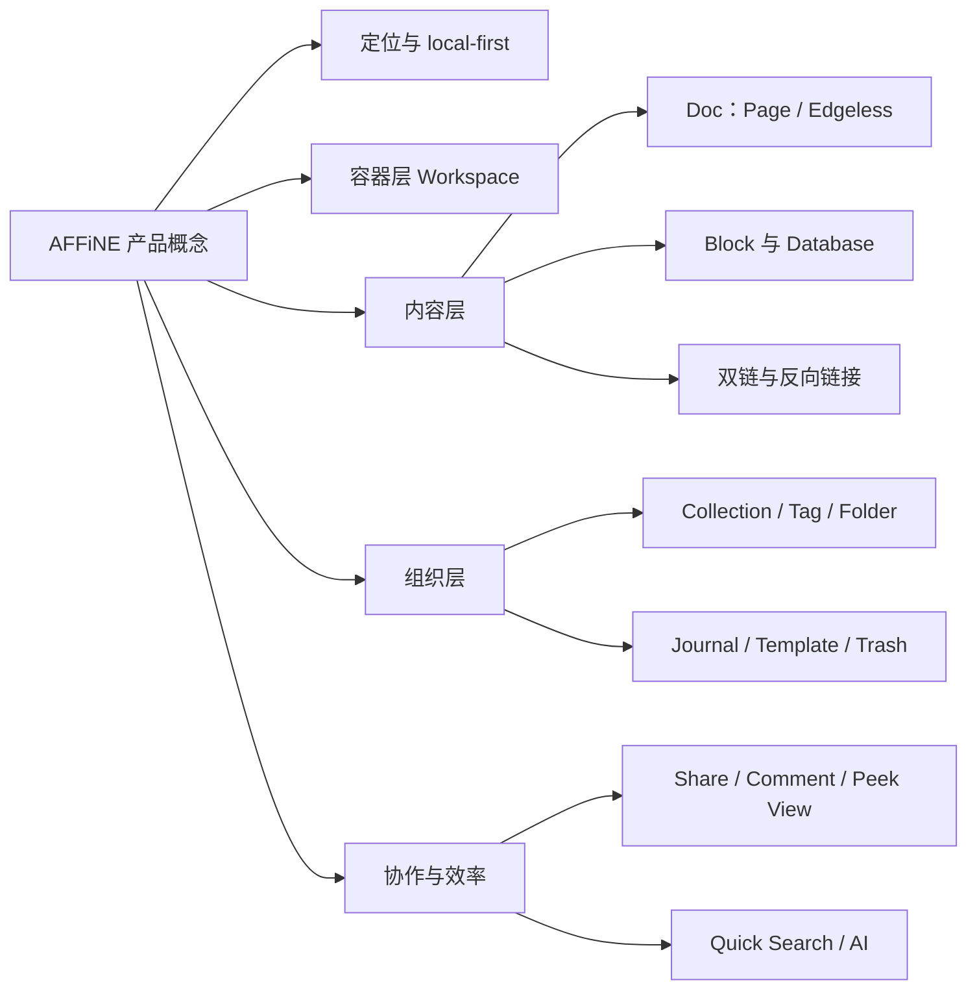
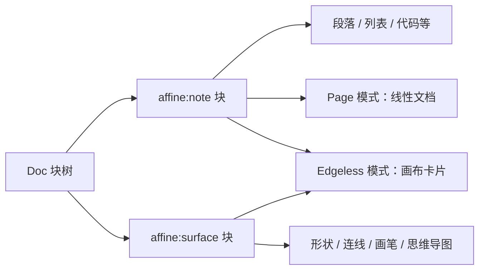
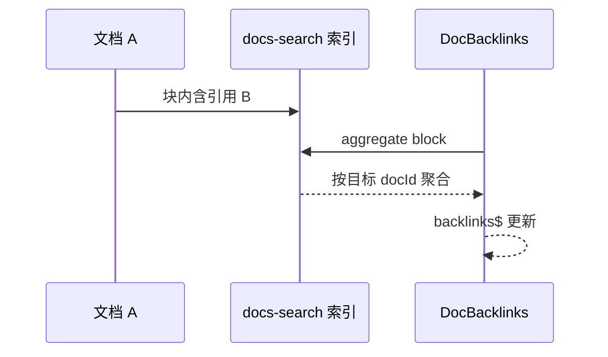
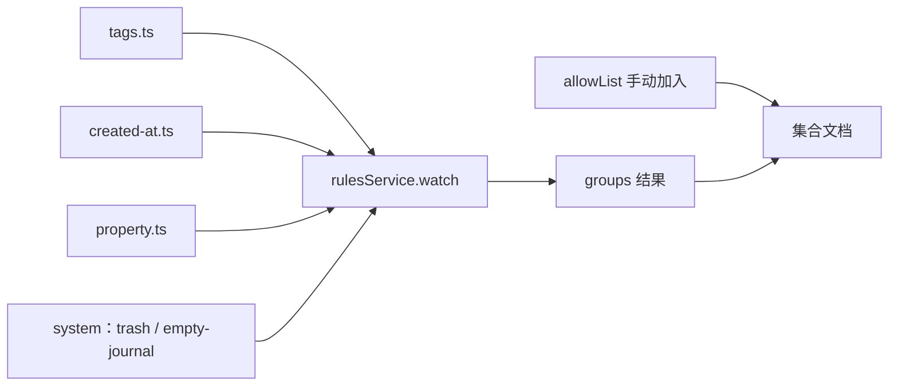

# 第 1 章 产品定位与核心概念

先理解产品，再读代码，事半功倍

第 1 部分 · 产品认知 ｜ 难度 ★☆☆☆☆ ｜ 建议学时 4 小时

Note:
欢迎来到整本 AFFiNE 学习指南的第一章。这一章不追求读懂实现细节，而是先把产品概念吃透。后面 29 章读代码时遇到的 Workspace、Doc、Collection、flavour 等词，都会在这里第一次登场。

---

## 本章导读

- 常见误区：一上来就扎进 `packages/` 读代码
- AFFiNE 的代码组织高度"以产品概念为中心"
- 用户可感知的功能，几乎都在 `modules/` 下有同名模块
- 编辑器侧的块与组件，集中在 `blocksuite/affine/`
- 本章产出：一张"产品概念 → 代码目录"对照表

<div class="callout">

**先理解产品，再读代码。** 本章代码片段只用来印证概念"长什么样"。

</div>

Note:
很多同学读大型开源项目，第一步就打开 packages 目录，结果被一堆陌生名词劝退。AFFiNE 恰好是一个概念驱动的代码库，前端 `packages/frontend/core/src/modules/` 下几乎一个产品功能对应一个模块。所以本章的策略是先建立产品心智模型，再用短小的代码片段做印证，最后沉淀出一张对照表，作为后续所有章节的导航索引。

---

## 学习目标

1. 复述定位 "Write, Draw and Plan All at Once"
2. 解释 local-first，说出本地与云工作区的存储差别
3. 区分 Page / Edgeless 模式，找到 `DocMode` 定义
4. 理清 Block、双链、Collection、Tag、Folder 的关系
5. 描述 Journal、Template、Trash 在数据层如何存储
6. 为任意产品概念快速定位到代码目录

Note:
这六条目标基本对应本章的几个大节。前两条是定位与理念，中间三条是核心概念体系，最后一条是本章的核心产出能力。学完之后，你应该能拿着任何一个产品功能名，在一分钟内找到它在仓库里的位置。

---

## 知识地图



Note:
这张图把本章 20 多个概念分成五层。定位层回答"它是什么"，容器层是 Workspace，内容层是 Doc、Block 和链接网络，组织层解决"找得到"，协作与效率层把个人笔记拓展到团队和智能助手。我们接下来就按这个顺序逐层展开。

---

## AFFiNE 是什么

> A privacy-focused, local-first, open-source, and ready-to-use alternative for Notion & Miro.

| 关键词 | 含义 | 代码体现 |
| --- | --- | --- |
| Write | 块编辑器写作 | `blocksuite/affine/blocks/` |
| Draw | 无限画布白板 | `blocksuite/affine/gfx/` |
| Plan | 数据库、看板 | `blocksuite/affine/data-view/` |
| local-first | 数据先存本地 | `packages/common/nbstore/` |
| open-source | 可自托管、可 fork | `packages/backend/server/` |

Note:
README 第一屏就是 slogan 和一句话定位，我们把它拆成五个关键词。品牌名 affine 是数学里的"仿射"，暗示文档、画布、表格之间可以自由转换。这其实是架构的硬约束：同一份文档数据必须能同时以线性文档和二维画布两种形态渲染，这直接决定了 BlockSuite 的设计。一句话总结：块编辑器加无限白板加多视图数据库加 AI，数据本地优先、代码开源。

---

## local-first 理念

<div class="callout">

**数据的"主副本"在用户设备上**，云端只是同步与备份通道，而不是唯一真相来源。

</div>

- 术语来自 Ink & Switch 2019 年论文《Local-first software》
- 支撑一：CRDT（Yjs / y-octo），多端并发自动合并
- 支撑二：本地存储引擎，Web 用 IndexedDB，原生端用 SQLite
- 支撑三：可选云同步，只是额外挂一条远端通道
- 代价：CRDT 复杂度、本地索引与搜索也要跑一份

Note:
local-first 不是一个功能点，而是一种架构立场。和早期 Notion 这类云优先应用相反，AFFiNE 的数据主副本在你自己的设备上，断网照样能用。代价也很明显：要用 CRDT 处理多端合并，而且全文检索、反向链接这些"中心化能力"必须在客户端也实现一份。这也解释了为什么 AFFiNE 的前端如此"重"。

---

## 按平台选择本地存储

```ts
  readonly flavour = 'local';
  readonly notifyChannel = new BroadcastChannel(
    LOCAL_WORKSPACE_CHANGED_BROADCAST_CHANNEL_KEY
  );

  DocStorageType =
    BUILD_CONFIG.isElectron || BUILD_CONFIG.isIOS || BUILD_CONFIG.isAndroid
      ? SqliteDocStorage
      : IndexedDBDocStorage;
```

<p class="small">来源：`packages/frontend/core/src/modules/workspace-engine/impls/local.ts`</p>

Note:
这段代码是 local-first 最直观的证据。本地工作区的 flavour 固定为 local；桌面端和移动原生端用 SqliteDocStorage，也就是 Rust 实现的 SQLite 存储，纯 Web 用 IndexedDBDocStorage。BroadcastChannel 用来在同一浏览器的多个标签页之间广播本地工作区列表的变化，这是 Web 上做 local-first 的典型问题。

---

## 竞品定位对比

| 维度 | AFFiNE | Notion | Obsidian |
| --- | --- | --- | --- |
| 核心形态 | 文档+白板+数据库 | 块文档+数据库 | Markdown+双链 |
| 数据位置 | 本地优先+可选云 | 云端 | 本地文件 |
| 开源 | 是 | 否 | 否 |
| 白板 | 原生 Edgeless 同源 | 无原生无限画布 | Canvas 插件 |
| 底层格式 | Yjs CRDT 二进制 | 私有 | Markdown 纯文本 |

<p class="small">生态位：开源的、本地优先的 Notion + Miro</p>

Note:
从对比里能提炼出三点差异化。第一，文档等于白板，同一个 Doc 两种模式切换，数据不复制。第二，开源加协作，试图同时拿到 Obsidian 的本地优先和 Notion 的协作能力。第三，选 CRDT 而不是 Markdown，这是和 Obsidian、Logseq 最本质的技术分歧，代价是需要专门的导入导出适配器。

---

## Workspace：本地 vs 云

<div class="cols">
<div>

| 类型 | flavour | 协作 |
| --- | --- | --- |
| 本地 | `'local'` | 仅本机 |
| 云 | 服务器 id | 多人实时 |

- 云 flavour 等于 `this.server.id`
- 可同时连官方云与自托管服务器

</div>
<div>

```ts
export type WorkspaceMetadata = {
  id: string;
  flavour: string;
  initialized?: boolean;
};

export const workspaceMetadataKey =
  (metadata: WorkspaceMetadata) =>
    `${metadata.flavour}:${metadata.id}`;
```

</div>
</div>

<p class="small">`modules/workspace/metadata.ts` ｜ `modules/workspace-engine/impls/cloud.ts`</p>

Note:
Workspace 是最大的数据容器，也是数据和权限的边界。注意 flavour 的类型是 string 而不是枚举，原因在 cloud.ts：云工作区的 flavour 就等于服务器 id。客户端可以同时连接官方云和多个自托管服务器，所以 flavour 是开放集合；workspaceMetadataKey 用 flavour 冒号 id 拼接，保证不同服务器上同 id 的工作区不会冲突。

---

## Doc 与 DocRecord

```ts
export class DocRecord extends Entity<{ id: string }> {
  meta$ = LiveData.from<Partial<DocMeta>>(
    this.docsStore.watchDocMeta(this.id), {}
  );
  properties$ = LiveData.from<DocProperties>(
    this.docPropertiesStore.watchDocProperties(this.id),
    { id: this.id }
  );
  primaryMode$: LiveData<DocMode> = LiveData.from(
    this.docsStore.watchDocPrimaryModeSetting(this.id),
    'page' as DocMode
  ).map(mode => (mode === 'edgeless' ? 'edgeless' : 'page') as DocMode);
}
```

<p class="small">`modules/doc/entities/record.ts` ｜ `meta$` 存根文档 meta，`properties$` 存工作区 DB</p>

Note:
Doc 是工作区内的基本内容单元，底层是一个独立的 Yjs 子文档。代码里经常看到 pageId，这是历史命名，理解成 docId 就行。DocRecord 表示"不打开文档就能拿到的信息"：meta 是标题、标签、是否在回收站这类 BlockSuite 的 DocMeta；properties 是应用层扩展属性，比如主模式、日记日期。以美元符结尾的字段都是可订阅的 LiveData，第 16 章会详讲。

---

## Page 与 Edgeless：同一棵块树



`export type DocMode = 'edgeless' | 'page';` <span class="small">— `blocksuite/affine/model/src/consts/doc.ts`</span>

Note:
关键点：两种模式共享同一棵块树，不是两份数据。Page 模式下的每段文字都属于某个 affine:note 块；切到 Edgeless 时，这些 note 变成画布上的卡片，而形状、连线、笔迹等图形元素存在 affine:surface 块里。白板专属的图形能力分布在 `blocksuite/affine/gfx/` 下。primaryMode 只记录默认打开哪种模式。

---

## Block：一切皆块

```ts
export const ParagraphBlockSchema = defineBlockSchema({
  flavour: 'affine:paragraph',
  props: (internal): ParagraphProps => ({
    type: 'text',
    text: internal.Text(),
    comments: undefined,
  }),
  metadata: {
    version: 1,
    role: 'content',
    parent: ['affine:note', 'affine:database', 'affine:list'],
  },
  toModel: () => new ParagraphBlockModel(),
});
```

<p class="small">`blocksuite/affine/model/src/blocks/paragraph/paragraph-model.ts`（parent 列表已节选）</p>

Note:
每个块有全局唯一的 flavour，比如 affine:paragraph，注意它和工作区的 flavour 不是一回事。从 schema 能读出很多产品信息：type 区分正文、引用和各级标题；parent 约束了块的嵌套规则；comments 字段说明评论是挂在块上的。`blocksuite/affine/blocks/` 下的目录名就是一份块清单，建议你在产品里输入斜杠，对照着逐个插入体验。

---

## 双链与反向链接

<div class="cols">
<div>

- 输入 `@` 或 `[[` 引用另一文档
- 行内：`inlines/reference/`
- 卡片：`embed-linked-doc-block/`
- 嵌入同步：`embed-synced-doc-block/`
- 引用可精确到 `blockIds`、`elementIds`、`xywh`

</div>
<div>



</div>
</div>

Note:
Linked Doc 有行内、卡片、嵌入同步三种展示形态。ReferenceParamsSchema 让引用不仅能指向文档，还能精确到某个模式、某些块、白板元素、视口区域甚至某条评论。反向链接不是写入时维护的双向指针，而是靠 docs-search 索引器扫描所有块里的引用，再按目标 docId 聚合。这样既避免了跨文档写入的并发冲突，还能附带 markdownPreview 上下文预览。

---

## 组织层：五种方式

| 方式 | 本质 | 自动化 | 模块 |
| --- | --- | --- | --- |
| Tag | 文档多值属性 | 否 | `modules/tag` |
| Collection | 规则筛选+白名单 | 是 | `modules/collection` |
| Folder | 侧栏树形目录 | 否 | `modules/organize` |
| Favorite | 个人快捷入口 | 否 | `modules/favorite` |
| Doc 属性 | 自定义字段 | 可作规则条件 | `modules/workspace-property` |

<p class="small">前四者解决"找得到"，属性解决"可计算"</p>

Note:
这五种组织方式是初学者最容易混淆的地方。Tag 是文档属性；Collection 是"智能文件夹"，按规则动态筛选；Folder 是侧栏里的手工目录，里面还能放标签和集合；Favorite 是个人快捷方式；Doc 属性是可以被筛选的结构化字段。标签选项存在根文档 meta 的 `properties.tags.options` 路径下，而且带 parentId，暗示层级标签的可能。

---

## 工作区 DB：数据存在哪里

<div class="cols">
<div>

**`AFFiNE_WORKSPACE_DB_SCHEMA`**（工作区级共享）

- `folders`：文件夹树
- `docProperties`：`primaryMode`、`journal`、`isTemplate`…
- `docCustomPropertyInfo`、`pinnedCollections`

</div>
<div>

**`AFFiNE_WORKSPACE_USERDATA_DB_SCHEMA`**（用户级）

- `favorite`：每个成员各自的收藏

<div class="callout">

底层同样是 Yjs 文档，享受离线与同步能力

</div>

</div>
</div>

<p class="small">`packages/frontend/core/src/modules/db/schema/schema.ts`</p>

Note:
组织信息多数存在一个工作区内置数据库里。这里有一个很重要的产品设计：文件夹和文档属性是工作区级共享数据，团队共用一套目录结构；而收藏是用户级数据，每人有自己的收藏夹。这个 DB 由 `@toeverything/infra` 提供的 ORM 实现，底层也是 Yjs，所以同样离线可用、可同步。Folder 的 index 字段用分数索引排序，拖拽时只改一个节点，减少 CRDT 冲突。

---

## Collection 与规则引擎



<p class="small">集合 = `rules.filters` ∪ `allowList`；过滤器在 `modules/collection-rules/impls/filters/`</p>

Note:
Collection 是最"智能"的组织方式。它由两部分组成：规则筛选结果和手动加入的白名单 allowList。系统总会额外追加两个隐式过滤器：排除回收站文档、排除空日记。每个过滤器返回一个文档 id 集合的 Observable，规则引擎再对多个集合做交集，这是典型的策略模式加响应式流，新增过滤条件只需加一个实现。

---

## Journal：带日期属性的普通 Doc

```ts
export const JOURNAL_DATE_FORMAT = 'YYYY-MM-DD';

  ensureJournalByDate(maybeDate: MaybeDate) {
    // ...
    const docs = this.journalsByDate$(title).value;
    if (docs.length) return docs[0];
    return this.createJournal(maybeDate);
  }
```

- 创建时优先套用日记模板，其次通用页面模板
- 写入 `docProperties.journal` 标记为日记；路由 `/journals`

<p class="small">`packages/frontend/core/src/modules/journal/services/journal.ts`</p>

Note:
Journal 就是一个普通 Doc，只不过 docProperties.journal 被设成了 YYYY-MM-DD 格式的日期。点开某天的日记时调用 ensureJournalByDate，有就直接返回，没有就创建。Template 也是同样思路，任何文档都可以通过 isTemplate 被标记为模板。这种"不增加新实体、只加属性"的设计，让过滤、搜索、同步全部复用已有机制。

---

## Trash：本地与云的分野

```ts
  async applyDocLifecycle(id: string,
    lifecycle: 'trash' | 'restore' | 'delete') {
    const workspace = this.workspaceService.workspace;
    if (workspace.flavour === 'local') {
      if (lifecycle === 'delete') {
        workspace.docCollection.removeDoc(id);
      } else { /* setDocMeta：trash / trashDate */ }
      return;
    }
    const result =
      await workspace.engine.doc.applyDocLifecycle(id, lifecycle);
    applyUpdate(workspace.rootYDoc, result.rootUpdate, 'server-lifecycle');
  }
```

<p class="small">`packages/frontend/core/src/modules/doc/stores/docs.ts`（已节选）</p>

Note:
这段代码完美展示了 local 和 cloud 的区别。本地工作区直接在 meta 上打 trash 为 true 的软删除标记，永久删除才移除子文档。云工作区则交给服务端处理生命周期，因为服务端还要同时处理权限、索引和存储清理，然后把返回的根文档更新 applyUpdate 到本地。回收站页面在 `trash-page.tsx`，路由是 `/trash`。

---

## Database 块与多视图

<div class="cols">
<div>

```ts
export const databaseBlockViews: ViewMeta[] = [
  viewPresets.tableViewMeta,
  viewPresets.kanbanViewMeta,
  viewPresets.calendarViewMeta,
];
```

<p class="small">`blocksuite/affine/blocks/database/src/views/index.ts`</p>

</div>
<div>

- 三种视图：表格、看板、日历
- 视图：`data-view/src/view-presets/`
- 列类型：`data-view/src/property-presets/`
- Database 只需实现 `data-source.ts`
- 另有排版用的 Table 块 `blocks/table/`

</div>
</div>

Note:
AFFiNE 有两种表格：Database 是类 Notion、Airtable 的结构化数据，Table 只是 Word 式的排版表格。Database 支持表格、看板、日历三种视图。值得注意的是 data-view 被拆成了独立的通用数据视图引擎，Database 块只需要提供一个数据源适配，这就是经典的"视图与数据源分离"架构，同一套 UI 可以复用到其他数据源。

---

## 协作与效率能力

| 能力 | 要点 | 模块 |
| --- | --- | --- |
| Share | 公开链接，依赖后端 | `modules/share-doc/` |
| Comment | 内容是 `DocSnapshot` 富文本 | `modules/comment/` |
| Peek View | doc、image、attachment 等 6 类 | `modules/peek-view/` |
| Quick Search | `$mod+K`，7 个搜索会话 | `modules/quicksearch/` |
| AI | 菜单、白板、Chat、`/chat` | `blocksuite/ai/` |

<p class="small">Share、Comment、AI 依赖后端，是云服务的价值点</p>

Note:
这五项把 AFFiNE 从个人笔记拓展到团队协作和智能助手。分享状态依赖 `@affine/graphql`，所以本地工作区无法公开分享。评论内容本身是一个 BlockSuite 快照，评论框其实是迷你编辑器。Cmd+K 用 `$mod` 做跨平台修饰键抽象，打开后同时启动最近文档、集合、命令、标签等多个搜索会话，是典型的命令面板模式。

---

## 源码导读 Top 5

| 优先级 | 路径 | 看什么 |
| --- | --- | --- |
| P0 | `README.md` | 定位、Features、Acknowledgement |
| P0 | `desktop/workbench-router.ts` | 产品信息架构与路由 |
| P0 | `blocksuite/affine/model/src/consts/doc.ts` | DocMode 与引用参数 |
| P0 | `modules/doc/entities/record.ts` | DocRecord 文档级数据 |
| P0 | `modules/db/schema/schema.ts` | 工作区级与用户级表 |

<p class="small">`desktop/`、`modules/` 均位于 `packages/frontend/core/src/` 下</p>

Note:
这五个文件都是 P0，建议按顺序读。README 讲清产品定位；workbench-router 用 lazy import 按需加载每个页面，是理解信息架构的最佳入口；doc.ts 定义模式和引用结构；record.ts 告诉你一个文档能提供哪些数据；schema.ts 区分了工作区级和用户级数据。

---

## 动手实践

1. **产品体验报告**：完成 13 项体验任务，含 3 条实现猜想
2. **IndexedDB 验证 local-first**：离线刷新后数据不丢
3. **概念定位挑战**：不看对照表，给出 4 个路径与行号
4. **追踪集合规则**：列出过滤器、注册位置、属性类型三处
5. **绘制概念关系图**：Mermaid 可渲染，关系与组织层一致

Note:
五个练习由浅入深。练习一先完整体验产品，不需要登录。练习二打开 DevTools 的 IndexedDB 亲眼看到本地数据，再切到 Offline 验证离线可用。练习三和四开始用搜索工具在仓库里定位，练习四会让你提前感受规则引擎的扩展方式。练习五把本章概念画成自己的关系图。

---

## 自测

**Q1：Page 与 Edgeless 的数据是两份吗？形状存在哪？**

不是，同一棵块树；图形元素存于 `affine:surface` 块 <!-- .element: class="fragment" -->

**Q2：反向链接是在写入引用时维护的吗？**

不是，由 `docs-search` 索引器聚合得到 <!-- .element: class="fragment" -->

**Q3：收藏和文件夹，哪个是用户级数据？**

收藏，定义在 `AFFiNE_WORKSPACE_USERDATA_DB_SCHEMA.favorite` <!-- .element: class="fragment" -->

**Q4：为什么 `flavour` 是 `string` 而不是枚举？**

云工作区 flavour 等于服务器 id，是开放集合 <!-- .element: class="fragment" -->

Note:
先给大家几秒思考，再逐个揭晓答案。这四道题覆盖了本章最容易混淆的概念：双模式同源、反向链接靠索引、用户级与工作区级数据、以及 flavour 的开放设计。如果有答错的，回到对应页面再看一遍。

---

## 常见坑

- Page、Doc、`pageId` 混用：把 `pageId` 理解为 `docId`
- 工作区 flavour ≠ 块 flavour（`affine:paragraph`）
- 清空浏览器数据，本地工作区随 IndexedDB 一起消失
- 本地工作区没有分享、评论入口：需升级为云工作区
- Tag ≠ Folder：Folder 内可以放 Tag
- 线上有、本地 dev 没有的功能：查 `modules/feature-flag/`

Note:
这些坑几乎每个新人都会踩。命名问题是历史演进造成的，记住 DocMode 里的 page 才特指 Page 模式。两个 flavour 同名不同义，一个是工作区来源，一个是块类型。另外重要数据请开启云同步或使用桌面端，别让清缓存把本地工作区清掉。

---

## 小结与下一步

- AFFiNE = 块编辑器 + 无限白板 + 多视图数据库 + AI
- local-first 是架构立场，解释了前端为何如此"重"
- Page 与 Edgeless 是同一份数据的两种视图
- Journal、Template 都是"带特殊属性的普通 Doc"
- 对照表是后续 29 章的导航地图

<div class="callout">

**下一章**：第 2 章 功能全景与商业模式 —— 多端矩阵、订阅计划与 AI 能力面

</div>

Note:
回顾一下本章：我们认识了产品定位、local-first 理念，以及从 Workspace 到 Block、从组织层到协作层的整套概念体系。请把产品概念到代码目录的对照表钉在笔记里。下一章我们把视角拉远，看 AFFiNE 跑在哪些终端上、怎么赚钱，以及这些付费权益在代码里如何判定。
