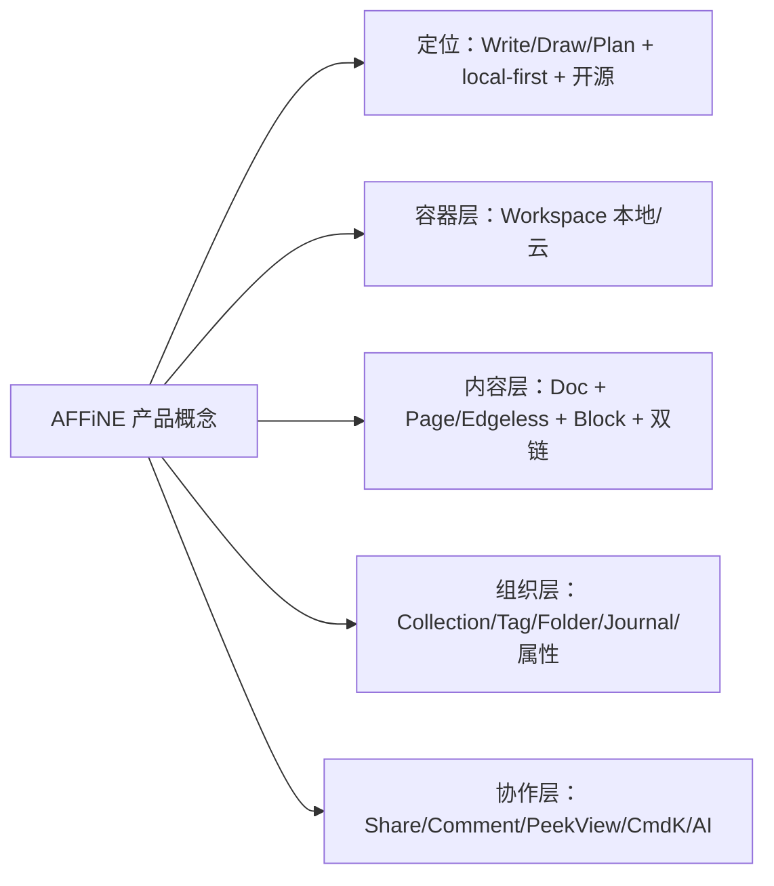
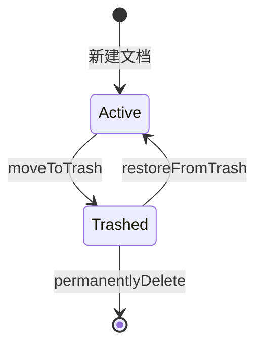

# 第 1 章 产品定位与核心概念

> 先理解产品，再读代码——用一张“概念 → 目录”地图给后续 29 章定位

第 1 部分 · 产品认知 ｜ 难度 ★☆☆☆☆ ｜ 建议学时 4 小时

===

## 为什么从“产品”开始

<p class="lead">学大型开源项目最常见的误区，是一上来就扎进 <code>packages/</code> 读代码，结果看到 Workspace、flavour、Edgeless 一头雾水。</p>

AFFiNE 的代码组织高度**以产品概念为中心**：几乎每个用户能感知的功能，都在 `packages/frontend/core/src/modules/` 下有一个同名模块，或在 `blocksuite/affine/` 下有一个同名块。

<div class="note note--tip">

**本章目标**：用一句话讲清 AFFiNE 是什么；理解贯穿全局的 local-first 理念；认识 20 余个核心概念并知道它们“住”在哪个目录；最终产出一张**“产品概念 → 代码目录”对照表**，作为后续章节的导航索引。

</div>

===

## 知识地图

AFFiNE 的概念体系分四层：定位理念、容器层、内容层、组织与协作。



<div class="note">

本章代码片段都很短，只用来印证“这个概念在代码里长什么样”，不要求看懂所有实现细节。

</div>

===

## 学习目标

<ol class="goals">
  <li>用自己的话复述 AFFiNE 定位 “Write, Draw and Plan All at Once” 及其含义</li>
  <li>解释 local-first，说出本地工作区与云工作区在存储层上的差别</li>
  <li>区分 Doc 的 Page 与 Edgeless 模式，指出 <code>DocMode</code> 定义所在文件</li>
  <li>说明 Block、Linked Doc、反向链接、Collection、Tag、Folder 之间的关系</li>
  <li>描述 Journal、Template、Trash、Doc 属性在数据层如何存储</li>
  <li>为任意产品概念快速定位到对应代码目录</li>
</ol>

===

<!-- section -->
## 一、定位：AFFiNE 是什么

一句话：**块编辑器 + 无限白板 + 多视图数据库 + AI**，且数据本地优先、代码开源。

===

## 从 README 读定位

`README.md` 第一屏就是 slogan 与一句话定位：*“A privacy-focused, local-first, open-source, and ready-to-use alternative for Notion & Miro.”* 拆出五个关键词：

<div class="cards cols-3">
  <div class="card"><div class="card__icon">✍️</div><h4>Write</h4><p>块编辑器，<code class="path">blocksuite/affine/blocks/</code> 下的段落、列表、代码等块。</p></div>
  <div class="card"><div class="card__icon">🎨</div><h4>Draw</h4><p>Edgeless 无限画布，<code class="path">blocksuite/affine/gfx/</code>、<code>blocks/surface/</code>。</p></div>
  <div class="card"><div class="card__icon">📊</div><h4>Plan</h4><p>数据库/看板，<code class="path">blocks/database/</code>、<code>data-view/</code>。</p></div>
  <div class="card"><div class="card__icon">🔒</div><h4>local-first</h4><p>数据先存本地，<code class="path">packages/common/nbstore/</code>。</p></div>
  <div class="card"><div class="card__icon">🌐</div><h4>open-source</h4><p>开源可自托管，根 <code>LICENSE</code>、<code>packages/backend/server/</code>。</p></div>
</div>

<div class="note">

品牌名 **affine（仿射）** 暗示文档、画布、表格之间可像仿射变换般自由转换。这不是噱头，而是架构核心约束：**同一份文档数据必须能同时以线性文档和二维画布两种形态渲染**——它直接决定了 BlockSuite 的设计（第 12–14 章）。

</div>

===

## local-first：一种架构立场

<div class="split">
<div class="split__main">

local-first（本地优先）源自 Ink & Switch 2019 年论文，核心是：**数据的“主副本”在用户设备上，云端只是同步与备份的通道**，而非唯一真相来源。

AFFiNE 落地靠三个支撑：

1. **CRDT**：内容用 Yjs/y-octo 表示，多端并发自动合并（第 8 章）；
2. **本地存储引擎**：Web 用 IndexedDB，桌面/移动用 SQLite（第 19 章）；
3. **可选云同步**：云工作区只是本地之上再挂一个远端通道。

</div>
<div class="split__aside">

```ts
readonly flavour = 'local';
DocStorageType =
  BUILD_CONFIG.isElectron ||
  BUILD_CONFIG.isIOS ||
  BUILD_CONFIG.isAndroid
    ? SqliteDocStorage
    : IndexedDBDocStorage;
```

<p class="small">来源：<code class="path">modules/workspace-engine/impls/local.ts</code></p>

</div>
</div>

<div class="note note--warn">

**代价**：多端合并需引入 CRDT 复杂度；本地数据丢失风险需用户自担（有 `modules/backup`）；全文检索等“中心化能力”在客户端也要跑一份（`modules/docs-search`）。这解释了为什么 AFFiNE 前端如此“重”。

</div>

===

## 竞品里的生态位

AFFiNE 的差异化，用一张对比表最清楚：

| 维度 | AFFiNE | Notion | Obsidian | Logseq |
| --- | --- | --- | --- | --- |
| 核心形态 | 文档+白板+数据库融合 | 块文档+数据库 | Markdown 笔记 | 大纲笔记 |
| 数据位置 | 本地优先，可选云 | 云端 | 本地文件 | 本地文件 |
| 开源 | 是 | 否 | 否 | 是 |
| 白板 | 原生 Edgeless，与文档同源 | 无 | 插件 | 有 |
| 底层格式 | Yjs CRDT 二进制 | 私有 | Markdown | Markdown/DB |

<ul class="takeaways">
  <li>“文档 = 白板”同源：同一个 Doc 两种模式切换，数据不复制。</li>
  <li>开源 + 协作：同时要到 Obsidian（本地优先）与 Notion（强协作）的好处。</li>
  <li>选 CRDT 而非 Markdown：能表达白板坐标、数据库视图并无冲突合并，代价是需要导入导出适配器。</li>
</ul>

===

<!-- section -->
## 二、容器与内容

Workspace 是最大容器；Doc 是内容单元；Block 是内容原子；Page/Edgeless 是同一份数据的两种视图。

===

## Workspace：本地 vs 云

Workspace 是数据与权限的边界，用 **flavour** 区分来源。注意它的类型是 `string` 而非枚举：

<div class="annotate">

```ts [1|3]
export type WorkspaceMetadata = {
  id: string;
  flavour: string;     // 'local' 或 服务器 id
  initialized?: boolean;
};
// 云工作区实现：
readonly flavour = this.server.id;
```

<ol class="annotate__notes">
  <li><b>本地</b>：flavour 固定 <code>'local'</code>，无需登录，存 IndexedDB/SQLite。</li>
  <li><b>云</b>：flavour = <b>服务器 id</b>。客户端可同时连官方云与多个自托管服务器，<code>flavour:id</code> 拼接避免冲突。</li>
</ol>
</div>

<div class="note">

代码入口：`modules/workspace/`（抽象）与 `modules/workspace-engine/`（local/cloud 实现）。产品上“Enable AFFiNE Cloud”把本地工作区迁移到云——本地是默认态、云是增强态，正是 local-first 的体现。

</div>

===

## Doc 与 Page/Edgeless 双模式

一个 Doc 底层是独立的 Yjs 子文档，含一棵块树。它有两种渲染模式，类型定义极简：`type DocMode = 'edgeless' | 'page'`（`blocksuite/affine/model/src/consts/doc.ts`）。

<div class="split">
<div class="split__main">

**关键：两种模式共享同一棵块树。**

Page 模式下每段文字都属于某个 `affine:note` 块；切到 Edgeless，这些 note 变成画布卡片，而形状、连线、画笔存在 `affine:surface` 块中。

白板图形能力分布在 `blocksuite/affine/gfx/`：`brush`、`connector`、`mindmap`、`shape`、`group`…

</div>
<div class="split__aside">

| 模式 | 体验 | 根组件 |
| --- | --- | --- |
| Page | 线性文档 | `blocks/root/src/page/` |
| Edgeless | 无限画布 | `blocks/root/src/edgeless/` |

`primaryMode$` 记录用户为该文档选的默认打开模式。

</div>
</div>

===

## Block：一切皆块

每个块有全局唯一的 **flavour**（如 `affine:paragraph`），通过 schema 声明。从一段 schema 就能读出很多产品信息：

<div class="annotate">

```ts [2|4-5|7-10]
export const ParagraphBlockSchema = defineBlockSchema({
  flavour: 'affine:paragraph',
  props: (internal) => ({
    type: 'text',            // text/quote/h1~h6
    text: internal.Text(),
  }),
  metadata: {
    version: 1,
    role: 'content',
    parent: ['affine:note', 'affine:database', 'affine:list'],
  },
});
```

<ol class="annotate__notes">
  <li><b>type</b>：段落有正文、引用、各级标题等类型。</li>
  <li><b>parent</b>：约束段落能出现在 note/database/list 等块内——这就是“块嵌套规则”。</li>
</ol>
</div>

<div class="note note--tip">

`blocksuite/affine/blocks/` 的目录名就是一份“块清单”：paragraph、list、code、callout、database、image、embed、surface、table… 打开 AFFiNE 按 `/` 唤起斜杠菜单逐个体验。

</div>

===

## Linked Doc 与反向链接

输入 `@` 或 `[[` 引用另一文档，有行内、卡片、嵌入同步三种形态。一个引用能精确到文档、模式、块、白板元素、视口甚至某条评论（`ReferenceParamsSchema`）。

<div class="note note--warn">

**反向链接不是写入时维护的双向指针，而是靠本地索引查询聚合**：若在写入时同时改被引用文档记录“被谁引用”，会产生跨文档写入与并发冲突。改由 `modules/docs-search` 索引器扫描所有块中的引用、按目标 docId 聚合，既无冲突又能附带上下文预览（`markdownPreview`）。

</div>

代码：`modules/doc-link/`、`blocksuite/affine/inlines/reference/`、`blocks/embed-doc/`。

===

<!-- section -->
## 三、组织与生命周期

五种互补的组织方式 + 三种生命周期动作，共同点是“不新增实体、只加属性”。

===

## 五种组织方式，别混淆

| 方式 | 本质 | 自动化 | 代码模块 |
| --- | --- | --- | --- |
| Tag 标签 | 文档的多值属性 | 否 | `modules/tag` |
| Collection 集合 | 规则筛选 + 手动白名单 | 是 | `modules/collection(-rules)` |
| Folder 文件夹 | 侧栏树形目录 | 否 | `modules/organize` |
| Favorite 收藏 | 个人快捷入口 | 否 | `modules/favorite` |
| Doc 属性 | 可筛选的结构化字段 | 作规则条件 | `modules/workspace-property` |

<div class="note">

**用户级 vs 工作区级**：组织信息多存在“工作区内置 DB”（`modules/db`，底层也是 Yjs）。其中 `folders`、`docProperties` 是**工作区共享**，而 `favorite` 在 `USERDATA` schema——是**用户级**。即团队共享一套文件夹，但每人有自己的收藏夹。

</div>

===

## Collection = 规则 ∪ 白名单

集合是最“智能”的组织方式：动态规则筛选，再并上手动加入的文档。

<div class="split">
<div class="split__main">

- 集合 = `rules.filters` ∪ `allowList`；
- 系统总隐式追加两个过滤器：排除回收站、排除空日记；
- `addDoc`/`removeDoc` 只改 `allowList`。

每个过滤器（`collection-rules/impls/filters/`：tags、created-at、favorite、trash…）返回一个“文档 id 集合”的 Observable，规则引擎对多个集合做交集。典型的**策略模式 + 响应式流**，便于扩展。

</div>
<div class="split__aside">

```ts
this.rulesService.watch({
  filters: info.rules.filters,
  extraAllowList: info.allowList,
  extraFilters: [
    { key: 'trash', method: 'is',
      value: 'false' },
    { key: 'empty-journal',
      method: 'is', value: 'false' },
  ],
});
```

</div>
</div>

===

## Journal / Template / Trash：只加属性

这三者都是“带特殊属性的普通 Doc”，复用现有过滤、搜索、同步机制：

<ol class="steps">
  <li><h4>Journal 日记</h4><p>就是普通 Doc，只是 <code>docProperties.journal</code> 设为 <code>YYYY-MM-DD</code>。<code>ensureJournalByDate</code> 当天已有则返回、否则创建并套用日记模板。</p></li>
  <li><h4>Template 模板</h4><p>任何文档标记 <code>docProperties.isTemplate</code> 即为模板；可设“新建页面模板”“日记模板”。</p></li>
  <li><h4>Trash 回收站</h4><p>软删除：本地在 meta 打 <code>trash:true</code>；云端交服务端处理生命周期再回写根文档。</p></li>
</ol>



===

## Database：要做 Plan 用它

AFFiNE 有两种“表格”：Database 数据库块（结构化数据，多视图）与 Table 简单排版表格。Database 支持三种视图：

<div class="cards cols-3">
  <div class="card"><div class="card__icon">▦</div><h4>Table 表格</h4><p>行列网格，支持多种列类型。</p></div>
  <div class="card"><div class="card__icon">📋</div><h4>Kanban 看板</h4><p>按某列分组的卡片列。</p></div>
  <div class="card"><div class="card__icon">📅</div><h4>Calendar 日历</h4><p>按日期字段铺排。</p></div>
</div>

<div class="note note--tip">

**为何 `data-view` 独立成包？** 它是与 database 块解耦的通用“数据视图引擎”：同一套表格/看板/日历 UI 既能渲染 Database 行，也能渲染其他数据源，Database 块只需实现一个 data-source 适配。这是“视图与数据源分离”的经典架构。

</div>

===

<!-- section -->
## 四、协作、效率与地图

Share、Comment、Peek View、Cmd+K、AI —— 把个人笔记拓展为团队协作 + 智能助手。

===

## 五项协作与效率能力

<div class="cards">
  <div class="card"><h4>Share 公开分享</h4><p>云文档生成公开链接，访客免登录阅读。<b>依赖后端</b>，本地工作区不可用。</p></div>
  <div class="card"><h4>Comment 评论</h4><p>对文字/块评论、回复、@提及。评论内容本身也是一个 BlockSuite <code>DocSnapshot</code>（迷你编辑器）。</p></div>
  <div class="card"><h4>Peek View 预览</h4><p>修饰键点击引用/图片/附件弹浮层预览而不跳转，支持文档/图片/附件/AI 对话块等六类。</p></div>
  <div class="card"><h4>Quick Search（⌘K）</h4><p>命令面板模式：同时搜最近文档、集合、命令、标签、链接，多会话并行。</p></div>
</div>

<div class="note">

**AI** 嵌入编辑器各处（选区菜单、白板生成思维导图/幻灯片、侧边栏 Chat、`/chat` 路由）。前端 `blocksuite/ai/`，后端 `packages/backend/server/src/plugins/copilot/`（第 24 章）。Share、Comment、AI 依赖后端，是云服务的价值点。

</div>

===

## 核心产出：概念 → 目录对照表

这张表是后续每章“查地图”的索引，务必收藏（完整版见文档 1.10 节）：

| 产品概念 | 代码位置 |
| --- | --- |
| 本地/云工作区 | `modules/workspace-engine/impls/{local,cloud}.ts` |
| Doc / DocMode | `modules/doc/`、`model/src/consts/doc.ts` |
| Page / Edgeless | `blocks/root/src/{page,edgeless}/`、`blocks/surface/`、`gfx/` |
| 双链 / 反向链接 | `modules/doc-link/`、`inlines/reference/` |
| Collection / 规则 | `modules/collection/`、`modules/collection-rules/` |
| Journal / 属性 | `modules/journal/`、`modules/workspace-property/` |
| Database / 多视图 | `blocks/database/`、`data-view/` |
| 路由总表 | `desktop/workbench-router.ts` |

<ul class="takeaways">
  <li>先用产品概念建立心智地图，再按图索骥读代码，事半功倍。</li>
</ul>

===

## 动手实践

<ol class="steps">
  <li><h4>产品体验报告</h4><p>不登录完成 13 项体验（建工作区、插入各种块、切 Edgeless、@引用看反链、建规则集合、打标签/属性、Journal、Trash、⌘K）。<b>验收</b>：≥13 条笔记，含 3 个“我猜代码里这样实现”的假设。</p></li>
  <li><h4>用 IndexedDB 验证 local-first</h4><p>Web 版写一段文字 → DevTools→Application→IndexedDB 看数据；断网继续编辑并刷新。<b>验收</b>：能说出库名与大致表结构，证明离线不丢。</p></li>
  <li><h4>概念到代码定位挑战</h4><p>仅用 <code>ls</code> 和全局搜索，定位：Favorite 支持类型、Database 视图、Peek View 类型、⌘K 快捷键注册处。<b>验收</b>：给出 4 个文件路径与行号。</p></li>
  <li><h4>追踪一条集合规则</h4><p>读 <code>filters/favorite.ts</code> 与规则注册入口，说明新增“字数 &gt; N”过滤器要改哪些文件。<b>验收</b>：列出过滤器实现、注册位置、属性类型定义三处。</p></li>
</ol>

===

## 自测：点击揭晓答案

<details class="quiz">
<summary>Q1. 为什么 WorkspaceMetadata.flavour 是 string 而不是枚举？</summary>

云工作区的 flavour 等于服务器 id，客户端可同时连接官方云与多个自托管服务器，因此 flavour 是开放集合，用 `flavour:id` 拼接 key 避免不同服务器同 id 冲突。

</details>

<details class="quiz">
<summary>Q2. Page 与 Edgeless 的数据是两份吗？白板形状存在哪个块？</summary>

不是两份，是同一棵块树的两种渲染。形状、连线、画笔等图形元素存在 `affine:surface` 块（`blocksuite/affine/blocks/surface/`）。

</details>

<details class="quiz">
<summary>Q3. 反向链接是写入引用时维护的吗？Collection 由哪两部分组成？</summary>

不是，反向链接由 `docs-search` 索引器扫描所有块中的引用聚合得到。Collection = `rules.filters` 规则筛选 ∪ `allowList` 手动白名单，系统额外追加“不在回收站”“非空日记”两个过滤器。

</details>

===

## 小结与下一步

<ul class="takeaways">
  <li>AFFiNE = 块编辑器 + 无限白板 + 多视图数据库 + AI，数据本地优先、代码开源。</li>
  <li>Workspace 是容器，flavour 区分本地/云；Doc 是内容单元，Page/Edgeless 共享同一棵块树。</li>
  <li>组织层五方式互补；Journal/Template/Trash 都是“带特殊属性的普通 Doc”。</li>
  <li>Share/Comment/AI 依赖后端，是云服务价值点。</li>
  <li>“概念 → 目录”对照表是后续 29 章的导航索引。</li>
</ul>

<div class="note note--tip">

**下一章预告**：第 2 章从功能全景走向商业模式——多端矩阵、Cloud 与自托管、订阅与配额、许可证分区，看清这个开源项目如何“开源 + 云服务”地活下去。

</div>
