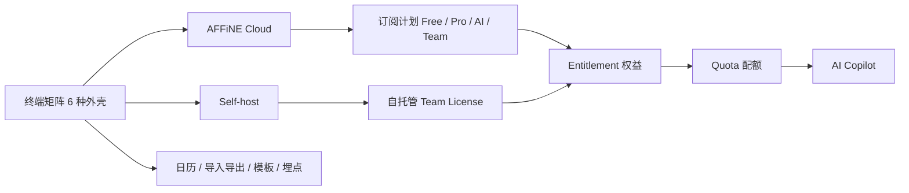
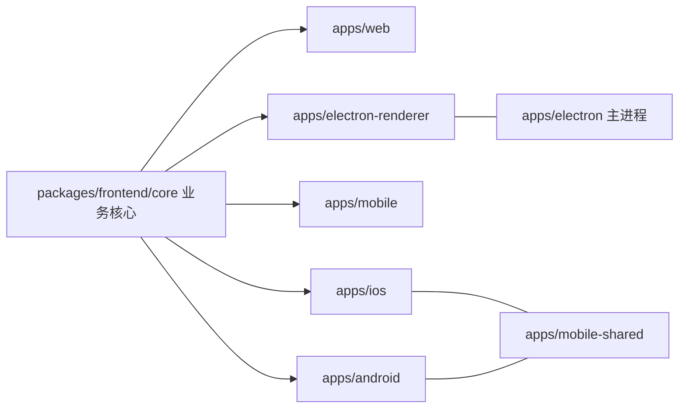
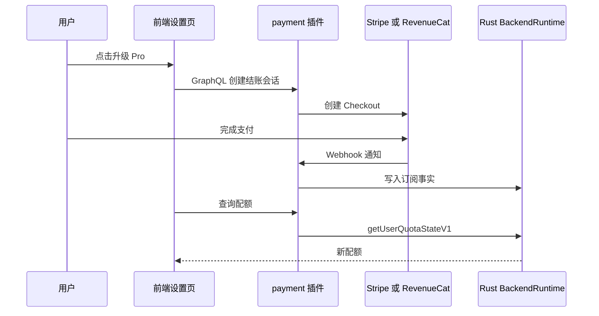
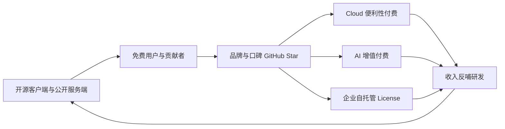

# 第 2 章 功能全景与商业模式

像产品经理一样画出"功能地图 + 收费地图"

第 1 部分 · 产品认知 ｜ 难度 ★☆☆☆☆ ｜ 建议学时 3 小时

Note:
第 1 章我们从用户能看到的概念出发认识了 AFFiNE，这一章把视角拉远。我们要回答三个问题：它跑在哪些终端上、它怎么赚钱、编辑器之外还有哪些外围能力。读完之后，你应该能在代码里找到每一项付费权益的判定位置。

---

## 本章导读

- **多端矩阵**：Web、桌面、移动 Web、iOS、Android、Admin
- **商业模式**：Cloud 订阅、AI 订阅、自托管 Team License
- **外围能力**：AI Copilot、日历、导入导出、模板、埋点
- 后端很多复杂逻辑，本质是回答"有没有权利做这件事"

<div class="callout">

暂时不必理解 NestJS、Prisma 细节，把后端目录当作"带注释的产品文档"来读。

</div>

Note:
这一章会涉及大量后端目录，但别紧张，我们不深入框架细节。这一章的价值在于为第 21 到 24 章的后端学习打基础：很多看起来复杂的后端逻辑，拆开看都是权益判定。先把"谁能用什么"这张地图建立起来，后面读代码就有了方向。

---

## 学习目标

1. 列出 `packages/frontend/apps/` 各端包名与 distribution
2. 解释 Cloud 与 Self-host 区别及 `DeploymentType` 判定
3. 说出订阅计划枚举、付费周期与配额维度
4. 说明"订阅 → 权益 Entitlement → 配额 Quota"链路
5. 列举 AI Copilot 能力面：工具、RAG、转录、MCP、BYOK
6. 从 PM 视角分析"开源 + 云服务"的护城河与风险

Note:
六条目标分别对应多端、部署形态、计划配额、数据链路、AI 和商业分析。其中第四条"订阅到权益到配额"的链路是本章最核心、也最容易迷路的部分，我们会画一张时序图专门讲。

---

## 知识地图



Note:
从左往右读这张图。多端外壳连接到两种服务形态：官方云和自托管。官方云卖订阅计划，自托管卖 Team License，两者最终都汇聚成 Entitlement 权益，再由权益计算出配额，AI 调用次数也受配额控制。右下角是降低迁移和上手成本的外围能力。

---

## 多端矩阵：一套核心，六种外壳

| 包名 | 平台 | 技术方案 | 本地存储 |
| --- | --- | --- | --- |
| `@affine/web` | 桌面浏览器 | React SPA | IndexedDB |
| `@affine/electron` | 桌面主进程 | Electron + Rust NAPI | SQLite |
| `@affine/electron-renderer` | 桌面渲染进程 | React | 经主进程访问 |
| `@affine/mobile` | 移动浏览器 | React 移动布局 | IndexedDB |
| `@affine/ios` / `@affine/android` | 原生 App | Capacitor | SQLite |
| `@affine/admin` | 浏览器 | React + Tailwind | — |

<p class="small">注意：admin 位于 `packages/frontend/admin`，不在 `apps/` 下</p>

Note:
`packages/frontend/apps/` 下每个子目录都是可独立构建发布的应用。桌面端拆成主进程和渲染进程两个包；iOS 和 Android 都基于 Capacitor，分别用 Swift 和 Kotlin，共享代码在 mobile-shared。Admin 后台是个特例，它不在 apps 目录里，但同样是独立应用，第 7 节会讲到。

---

## distribution：区分平台的唯一事实来源

```ts
export const PackageToDistribution = new Map<
  PackageName,
  BUILD_CONFIG_TYPE['distribution']
>([
  ['@affine/admin', 'admin'],
  ['@affine/web', 'web'],
  ['@affine/electron-renderer', 'desktop'],
  ['@affine/electron', 'desktop'],
  ['@affine/mobile', 'mobile'],
  ['@affine/ios', 'ios'],
  ['@affine/android', 'android'],
]);
```

<p class="small">`tools/utils/src/distribution.ts` → `build-config.ts` 派生 `isElectron`、`isWeb`、`isNative` 等编译期常量</p>

Note:
构建系统通过包名到 distribution 的映射，给每个应用注入编译期常量。build-config.ts 里的 getBuildConfig 再派生出一组布尔开关，比如 isNative 在 desktop、ios、android 时为真。还记得第 1 章 local.ts 里的 BUILD_CONFIG.isElectron 吗？就来自这里。因为是编译期常量，打包时会做死代码消除，Web 包里不会带上 SQLite 代码。

---

## 外壳薄、核心厚



<p class="small">各 app 只负责：入口与路由壳、平台能力注入、存储实现选择</p>

Note:
几乎所有业务代码都在 core 里，各个外壳只做三件事：提供入口和路由壳、注入平台能力比如文件系统和内购、选择存储实现。这让一个较小的团队能维护五个平台。代价是 core 中有大量 BUILD_CONFIG 分支和"接口加平台实现"的依赖注入。桌面主进程下还有 updater、tray、recording、deep-link 等纯桌面能力。

---

## AFFiNE Cloud 与 Self-host

| 维度 | AFFiNE Cloud | Self-host |
| --- | --- | --- |
| 运营方 | 官方 app.affine.pro | 你自己 |
| 部署 | 官方集群 | Docker、Render、Sealos 等 |
| 收费 | Stripe / 应用内购订阅 | 软件免费，团队能力需 License |
| 配置 | 官方运维 | `config.json` + Admin 后台 |
| 数据 | 官方存储 | 自己的 PostgreSQL、Redis、对象存储 |

> AFFiNE Community Edition (CE) ... it's free for self-host under the MIT license.

Note:
同一份服务端代码，通过一个开关切换成两种产品形态。官方云按用户或工作区订阅收费，Web 和桌面走 Stripe，移动端走应用商店内购。自托管软件本身免费，README 写明 CE 版本在 MIT 许可下可以免费自托管，但团队高级能力需要购买 License。

---

## DeploymentType 判定

```ts
export enum DeploymentType {
  Affine = 'affine',
  Selfhosted = 'selfhosted',
}
// ... class Env 中：
  DEPLOYMENT_TYPE = this.dev
    ? DeploymentType.Affine
    : DeploymentType.Selfhosted;
  get selfhosted() {
    return this.DEPLOYMENT_TYPE === DeploymentType.Selfhosted;
  }
```

1. 默认：开发环境 `affine`，生产环境 `selfhosted`（默认安全）
2. 存在 `config.json` 时以其 `deploymentType` 为准，否则读 `DEPLOYMENT_TYPE`

<p class="small">`packages/backend/server/src/env.ts`</p>

Note:
判定规则分三步。默认值是开发环境当作官方云，生产环境默认当作自托管，这叫默认安全：别人拿镜像去部署，自动就是自托管模式。如果项目根目录或者 home 下的 `.affine/config/config.json` 存在，就以配置文件为准；否则读环境变量。同文件还定义了 Namespace 和 Flavor，Flavor 是进程角色，别和 DeploymentType 混淆。

---

## 订阅计划与周期

<div class="cols">
<div>

```ts
export enum SubscriptionRecurring {
  Monthly = 'monthly',
  Yearly = 'yearly',
  Lifetime = 'lifetime',
}
export enum SubscriptionPlan {
  Free = 'free',
  Pro = 'pro',
  AI = 'ai',
  Team = 'team',
  Enterprise = 'enterprise',
  SelfHosted = 'selfhosted',
  SelfHostedTeam = 'selfhostedteam',
}
```

</div>
<div>

- Pro / AI：订阅对象是用户
- Team：按席位的工作区订阅
- Enterprise：EE 尚未发布
- `showLifetimePrice` 控制终身价
- 渠道：`stripe`、`revenuecat`

</div>
</div>

<p class="small">`packages/backend/server/src/plugins/payment/types.ts`、`config.ts`</p>

Note:
这就是代码里的"价目表"。周期有月付、年付和终身买断，另外 SubscriptionVariant.Onetime 表示一次性购买。Pro 和 AI 是两个独立可叠加的用户级订阅，Team 是工作区级按席位计费。支付渠道只有两个：Stripe 用于 Web 和桌面信用卡支付，RevenueCat 聚合 App Store 和 Play Store 的内购。

---

## 配额维度与权益文案

| 字段 | Free | Pro | Team |
| --- | --- | --- | --- |
| `storageQuota` 云存储 | 10 GB | 100 GB | 100 GB + 20 GB/席位 |
| `blobLimit` 单文件 | 10 MB | 100 MB | 500 MB |
| `memberLimit` 成员 | 3 | 10 | 不限（10+ 席位） |
| `historyPeriod` 历史 | 7 天 | 30 天 | 文案未单列 |

<p class="small">字段：`models/common/feature.ts`；数值：`i18n/src/resources/en.json` 的 `com.affine.payment.*` 文案</p>

Note:
配额接口 UserQuota 有这些字段，另有 copilotActionLimit 表示 AI 调用次数上限，undefined 表示不限；WorkspaceQuota 在此基础上多一个 seatQuota 席位数。表里的数字来自前端 i18n 文案，不是服务端代码，实际以官网定价页和服务端计算为准。特别提醒：`quota/__tests__/service.spec.ts` 里那些 memberLimit 数字是测试桩数据，不要当成真实配额。

---

## 配额计算在 Rust 侧

```ts
@Injectable()
export class QuotaService {
  constructor(private readonly runtime: BackendRuntimeProvider) {}
  async getUserQuota(userId: string): Promise<UserQuota> {
    const state = await this.runtime.getUserQuotaStateV1(userId);
    return this.userQuotaFromState(state);
  }
  // ...
  private planName(plan: string) {
    switch (plan) {
      case 'pro':
      case 'selfhost_free':
        return 'Pro';
      // ... lifetime_pro、ai、team / selfhost_team、default → 'Free'
```

<p class="small">`core/quota/service.ts` → NAPI `BackendRuntime` → `affine_core` crate（数值不在本仓库）</p>

Note:
这里有两个重要发现。第一，QuotaService 只是薄薄一层，真正的状态来自 BackendRuntimeProvider，也就是 `packages/backend/native/` 编译出的 NAPI 模块，具体计划目录和数值定义在 crates.io 上的 affine_core 里，本仓库看不到。第二，内部计划 id 和展示名不同，自托管默认的 selfhost_free 显示为 Pro，自托管用户默认就享受 Pro 级个人配额，这是对社区的友好设计。

---

## 订阅 → 权益 → 配额



<p class="small">关键表：`ProviderSubscription`、`Entitlement`、`License`（`schema.prisma`）</p>

Note:
这是商业化最核心的数据链路。用户在设置页点击升级，后端创建结账会话，支付完成后 Stripe 或 RevenueCat 通过 Webhook 通知后端，后端把订阅事实交给 Rust runtime，落到 ProviderSubscription 和 Entitlement 表。Entitlement 表示某个目标在某时段拥有某计划，来源可以是订阅、管理员授予或签名 License。记住一句话：计划枚举在 TS，计算在 Rust，文案在 i18n。

---

## 前端：只感知配额，不计算

<div class="cols">
<div>

```ts
export interface NativePaywallProvider {
  showPaywall(type: 'Pro' | 'AI'):
    Promise<void>;
}

export const NativePaywallProvider =
  createIdentifier<NativePaywallProvider>(
    'NativePaywallProvider'
  );
```

<p class="small">`modules/paywall/providers/native-paywall.ts`</p>

</div>
<div>

- core 只声明接口，原生外壳注入实现
- Web / 桌面走 `BUILD_CONFIG.pricingUrl`
- 商店政策要求数字订阅走内购
- 前端 `user-quota.ts` 也有 `planName`
- 前后端两份映射，需同步修改

</div>
</div>

Note:
原生付费墙是依赖倒置的典型例子。core 只声明"我需要一个能弹出 Pro 或 AI 付费墙的东西"，由 iOS 和 Android 外壳注入调用应用商店内购的实现。之所以要这么做，是因为苹果和谷歌要求数字订阅走应用内购买，这也是后端接 RevenueCat 的原因。另外前端也有一份 planName 映射，通过 RealtimeLiveQuery 实时订阅配额，修改计划时记得前后端两边同步。

---

## 自托管 Team License

```ts
  async installLicense(workspaceId: string, license: Buffer) {
    const installed = installedLicense(
      await this.runtime
        .installTeamLicenseFileV1(workspaceId, license)
        .catch(throwNativeLicenseInstallError)
    );
    await this.event.emitAsync('workspace.subscription.activated', {
      workspaceId,
      plan: SubscriptionPlan.SelfHostedTeam,
      // ... recurring、quantity
    });
    return installed;
  }
```

<p class="small">`plugins/license/service.ts`；另有 `activateTeamLicense` 在线激活。`upsertAdminGrant` 在 `env.selfhosted` 时直接抛错</p>

Note:
自托管 CE 免费，但要用 Team 级能力就得从官方买 License。激活方式有两种：installLicense 上传离线 License 文件，适合内网；activateTeamLicense 在线输入 License Key。签名和校验都交给 Rust 的 entitlement.rs。还有一道关键防线：EntitlementService 的 upsertAdminGrant 在自托管模式下直接抛 BadRequest，自托管管理员不能给自己发商业权益，必须通过签名 License。官方云卖 License，自托管实例验 License，形成闭环。

---

## AI Copilot 能力面

| 子目录 | 能力 | 说明 |
| --- | --- | --- |
| `providers/` | 模型提供方 | anthropic、gemini、openai、fal 等 |
| `tools/` | Agent 工具 | `doc-read`、`doc-search`、`doc-write`… |
| `embedding/`、`retrieval/` | RAG | 语义检索，含 `rerank.ts` |
| `transcript/` | 音频转录 | 配合桌面端 `recording` |
| `mcp/` | MCP 服务 | 工作区暴露给外部 AI |
| `byok/` | 自带密钥 | 用户自己的模型 Key |

<p class="small">均位于 `packages/backend/server/src/plugins/copilot/`</p>

Note:
AI 是 AFFiNE 最重要的增值服务之一。它早已不是简单的文本续写，而是一整套能力面：多模型提供方、可以读写文档的 Agent 工具、基于向量嵌入的检索增强、会议录音转录，还有 MCP 和 BYOK。前端入口分别是 `blocksuite/ai/`、`modules/ai-button/` 和独立的 `/chat` 路由。

---

## MCP 与 BYOK

<div class="cols">
<div>

**MCP：外部 AI 访问知识库**

- `read_document`、`doc_search`
- `create_document`、`update_document`
- `update_document_meta`
- 访问模式 `READ_ONLY` / `READ_WRITE`

</div>
<div>

```ts
export enum ByokProviderSource {
  Server = 'byok_server',
  Local = 'byok_local',
  AffinePlan = 'affine_plan',
}
```

<p class="small">`copilot/byok/types.ts`</p>

</div>
</div>

Note:
MCP 把工作区暴露成一个 MCP 服务，Claude Desktop、Cursor 这类客户端可以直接检索和编辑 AFFiNE 文档，凭证由 McpCredential 表管理。BYOK 的 ByokProviderSource 很好地揭示了商业逻辑：算力来源可以是官方计划，消耗配额；也可以是用户自己的 Key，存在服务器或本地。BYOK 对自托管用户尤其重要，具体开关在 `copilot/config.ts` 的 `copilot.byok` 下。

---

## 外围能力

| 能力 | 要点 | 位置 |
| --- | --- | --- |
| 日历 | `google`、`caldav` 两种 | `plugins/calendar/` |
| 导入 | Markdown、Notion、Obsidian、Bear、OneNote | `modules/import/` |
| 模板 | onboarding、白板模板、贴纸 | `packages/frontend/templates/` |
| Admin | setup、accounts、settings 等 | `packages/frontend/admin/` |
| 埋点 | 事件类型穷举，写错编译失败 | `packages/frontend/track/` |

<p class="small">桌面端导入走 `commitNativeImport`（Rust 原生），Web 端在浏览器内解析</p>

Note:
日历、导入和模板降低迁移成本与上手成本；Admin 降低自托管运维成本；埋点支撑数据驱动迭代。导入底层依赖 `blocksuite/affine/shared/src/adapters/` 下的格式转换器，导出同样复用它们。埋点的 events.ts 有 800 多行，用 TypeScript 类型穷举所有事件，其中 PaymentEvents 正好覆盖一条完整的付费漏斗。

---

## Open Core 商业模式



<p class="small">护城河：便利性、AI 算力成本、签名 License、移动端分发</p>

Note:
这是一个正向飞轮。开源吸引用户和贡献者，积累品牌口碑，再通过云服务便利性、AI 增值和企业 License 变现，收入反哺研发。护城河有四条：协作和同步需要服务端，个人宁愿付费也不想运维；AI 有真实算力成本，天然适合订阅；签名 License 防止改数据库字段解锁；官方移动 App 默认连接官方云。

---

## 免费与付费的边界

| 能力 | 本地工作区 | 云 Free | 付费 |
| --- | --- | --- | --- |
| 文档、白板、数据库 | 有 | 有 | 有 |
| 同步与实时协作 | 无 | 受成员数限制 | 更多成员与存储 |
| 公开分享 | 无 | 有 | 有 |
| 历史版本 | 无云端版本 | 7 天 | 30 天或更多 |
| AI | 需登录 | 有限次数 | AI 订阅或 BYOK |

<p class="small">核心生产力免费；协作、容量、智能作为付费点</p>

Note:
这张表清楚地展示了切分原则：核心编辑能力完全免费，协作、容量和智能作为付费点，这是 local-first 产品最自然的商业化切分。风险方面，用户全部转向自托管怎么办？AFFiNE 让自托管默认享受 Pro 级个人配额示好社区，但团队能力仍需 License。许可证细节下一章会讲。

---

## 源码导读 Top 5

| 优先级 | 路径 | 看什么 |
| --- | --- | --- |
| P0 | `tools/utils/src/distribution.ts` | 包名到平台映射 |
| P0 | `tools/utils/src/build-config.ts` | `BUILD_CONFIG` 各开关 |
| P0 | `packages/backend/server/src/env.ts` | `DeploymentType`、`Flavor` |
| P0 | `.../plugins/payment/types.ts` | 计划与周期枚举 |
| P0 | `.../core/quota/service.ts` | 计划名映射、Rust runtime |

<p class="small">`...` 即 `packages/backend/server/src`</p>

Note:
这五个 P0 文件构成本章骨架：前两个讲多端，第三个讲部署形态，后两个讲计划和配额。读完后建议接着看 P1 的 schema.prisma 里的 Entitlement 表和 license/service.ts，把整条商业化链路串起来。

---

## 动手实践

1. **绘制多端矩阵**：≥ 7 行，含包名、distribution、平台、存储
2. **追踪计划名**：搜 `lifetime_pro`，列 ≥ 4 个路径
3. **自托管判定推演**：三种环境下 `env.selfhosted` 的值
4. **体验付费漏斗**：对应上 `viewPlans`、`checkout` 事件
5. **一页商业模式分析**：引用 ≥ 3 处真实代码证据

Note:
练习一熟悉各端应用的 package.json。练习二让你亲眼看到计划名在 TypeScript 和 Rust 里的分布，并解释前端为什么没有 team 分支。练习三是 env.ts 的推演，第三种情况要能说出"取决于配置文件里的 deploymentType"。练习四和五训练产品经理视角。

---

## 自测

**Q1：`@affine/electron` 与 `-renderer` 的 distribution？**

两者都是 `desktop` <!-- .element: class="fragment" -->

**Q2：生产环境无任何配置时的 `DeploymentType`？**

`selfhosted`，默认安全 <!-- .element: class="fragment" -->

**Q3：自托管管理员能直接授予 Team 权益吗？**

不能，`upsertAdminGrant` 抛错，必须签名 License <!-- .element: class="fragment" -->

**Q4：为什么本仓库找不到 Pro 的具体配额数值？**

计算在 Rust `BackendRuntime`，数值在外部 `affine_core` crate <!-- .element: class="fragment" -->

Note:
这四道题分别检验多端、部署形态、License 防线和配额来源。第四题尤其重要：遇到"在 TS 里找不到"的情况，要记得以 BackendRuntimeProvider 为边界，产品层面的数值去看 i18n 文案和官网。

---

## 常见坑

- 在 TS 中找配额数值：计算已下沉到 Rust 与 `affine_core`
- 把 `__tests__` 中的 `memberLimit` 当真：那是测试桩
- 计划显示名前后端各一份 `planName`：改动需同步
- 混淆 `Flavor`（进程角色）与 `DeploymentType`（部署形态）
- 混淆后端 `Flavor` 与前端工作区 `flavour`
- 在 `apps/` 下找不到 admin：它在 `packages/frontend/admin`

Note:
本章的坑主要是"找不到"和"分不清"。找不到的，多半是逻辑下沉到了 Rust 或者目录不在预期位置；分不清的，多半是同名不同义。Flavor 决定这个进程跑哪些模块，DeploymentType 决定是官方云还是自托管，前端的 flavour 又是工作区来源，三者完全不同。

---

## 小结与下一步

- 六种外壳共享同一个 core，`distribution` 区分平台
- 同一份服务端代码，`DeploymentType` 切换两种产品形态
- 计划枚举在 TS，计算在 Rust，展示文案在 i18n
- License 签名是开源商业化的关键防线
- 商业模式 = 开源获客 + 云便利性 + AI 算力 + 企业 License

<div class="callout">

**下一章**：第 3 章 开源治理与协作流程 —— 许可证、贡献流程与社区协作

</div>

Note:
本章我们画出了功能地图和收费地图，也知道了每项付费权益在代码里怎么判定。四条腿支撑起 AFFiNE 的商业模式。下一章进入第 2 部分，我们会细看根目录 LICENSE 里的双许可证结构，以及一个 PR 从提交到合并要经过哪些流程。
