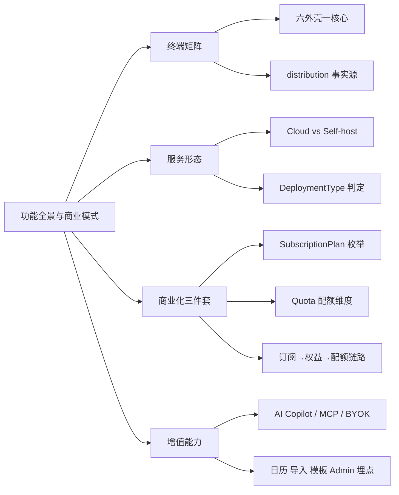
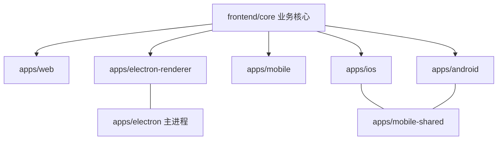
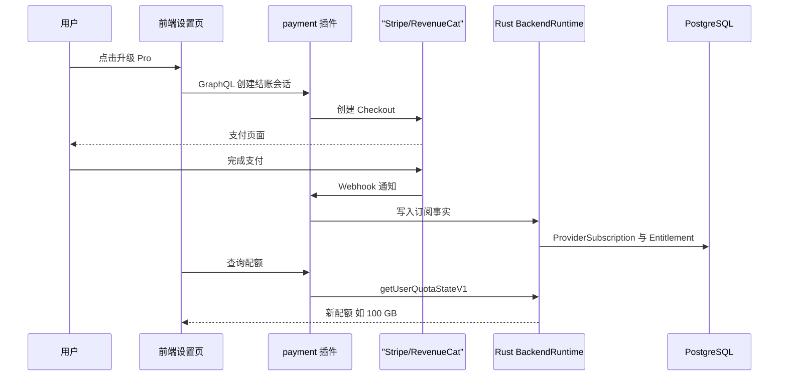
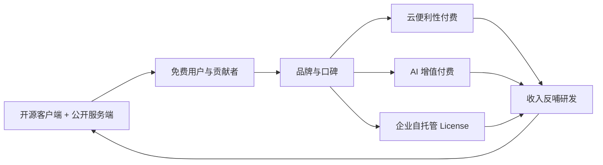

# 第 2 章 功能全景与商业模式

> 像产品经理一样画出「功能地图 + 收费地图」，再回到代码里找到每一项权益的判定点

第 1 部分 · 产品认知 ｜ 难度 ★☆☆☆☆ ｜ 建议学时 3 小时

===

## 本章要解决的问题

<p class="lead">第 1 章我们从「用户看得见的概念」认识 AFFiNE；本章把镜头拉远，回答三个商业问题。</p>

很多看似复杂的后端逻辑，本质上都在回答同一句话：**这个用户 / 工作区，有没有权利做这件事？** 看懂商业模式，就等于提前拿到了第 21–24 章后端代码的「阅读索引」。

<div class="cards cols-3">
  <div class="card"><div class="card__icon">📱</div><h4>跑在哪</h4><p>Web、桌面、移动 Web、iOS、Android，外加给运维用的 Admin 后台，共六种外壳。</p></div>
  <div class="card"><div class="card__icon">💰</div><h4>怎么赚钱</h4><p>一个 MIT 为主、服务端源码公开的项目，靠云订阅、AI 订阅、自托管 License 活下去。</p></div>
  <div class="card"><div class="card__icon">🧩</div><h4>还有什么</h4><p>AI Copilot、日历、导入导出、模板、埋点——围绕编辑器的一圈增值能力。</p></div>
</div>

<div class="note note--tip">

把后端目录当「带注释的产品文档」读即可，暂时不需要懂 NestJS、Prisma 的细节。重点是建立「功能 → 收费 → 代码判定点」三者的对应关系。

</div>

===

## 知识地图

本章沿「**终端矩阵 → 服务形态 → 商业化三件套 → 增值能力**」四段推进，核心是中间那条 `订阅 → Entitlement → Quota` 的权益链。



<div class="note">

本章路径均相对仓库根 `AFFiNE/`。记住一条习惯：**计划枚举在 TS、配额计算在 Rust、权益文案在 i18n**，三处分布是读商业化代码最容易迷路的地方。

</div>

===

## 学习目标

<ol class="goals">
  <li>列出 <code class="path">packages/frontend/apps/</code> 下各端包名、平台与 <code>distribution</code> 构建标识</li>
  <li>解释 AFFiNE Cloud 与 Self-host 的区别，说清 <code>DeploymentType</code> 的三级判定逻辑</li>
  <li>说出 <code>SubscriptionPlan</code> / <code>SubscriptionRecurring</code> 枚举，以及 <code>Quota</code> 的各维度</li>
  <li>描述「订阅 → <code>Entitlement</code> → <code>Quota</code>」数据链路及其关键表</li>
  <li>列举 AI Copilot 能力面（tools、RAG、转录、MCP、BYOK）及代码位置</li>
  <li>从 PM 视角分析「开源 + 云服务」模式的护城河与风险</li>
</ol>

===

<!-- section -->
## 一、多端矩阵

一套核心，六种外壳。`distribution` 是区分平台的唯一事实来源，`BUILD_CONFIG.*` 全从它派生。

===

## 六种外壳，一个 core

`packages/frontend/apps/` 下每个子目录都是可独立构建发布的应用，再加上不在 `apps/` 里的 `packages/frontend/admin`：

| 包名 | 平台 | 技术方案 | 本地存储 |
| --- | --- | --- | --- |
| `@affine/web` | 桌面浏览器 | React SPA | IndexedDB |
| `@affine/electron` | 桌面主进程 | Electron + Rust NAPI | SQLite |
| `@affine/electron-renderer` | 桌面渲染进程 | React | 经主进程访问 SQLite |
| `@affine/mobile` | 移动浏览器 | React 移动布局 | IndexedDB |
| `@affine/ios` / `@affine/android` | iOS / Android | Capacitor + Swift/Kotlin | SQLite |
| `@affine/admin` | 浏览器 | React + Tailwind | — |

<div class="note note--warn">

**易错**：`@affine/admin` 不在 `apps/` 下，而在 `packages/frontend/admin`，它同样是独立应用。

</div>

===

## distribution：平台的唯一事实源

构建系统先把「包名 → distribution」映射好，再派生一组布尔开关，供全仓库做死代码消除。

<div class="annotate">

```ts [2-4|7-11|13-15]
// tools/utils/src/distribution.ts
export const PackageToDistribution = new Map([
  ['@affine/admin', 'admin'],
  ['@affine/web', 'web'],
  ['@affine/electron', 'desktop'],
  ['@affine/electron-renderer', 'desktop'],
  ['@affine/mobile', 'mobile'],
  ['@affine/ios', 'ios'],
  ['@affine/android', 'android'],
]);
// tools/utils/src/build-config.ts（getBuildConfig 派生）
isElectron: distribution === 'desktop',
isNative: distribution === 'desktop' || distribution === 'ios'
  || distribution === 'android',
```

<ol class="annotate__notes">
  <li><b>两个 electron 包</b>：主进程与渲染进程的 <code>distribution</code> <b>都是</b> <code>desktop</code>。</li>
  <li><b>第 1 章回扣</b>：<code>local.ts</code> 里 <code>BUILD_CONFIG.isElectron ? SqliteDocStorage : IndexedDBDocStorage</code> 的开关，正来自这里。</li>
  <li><b>编译期常量</b>：打包器做 tree-shaking，Web 包不会带上 SQLite 相关代码。</li>
</ol>
</div>

===

## 外壳薄，核心厚

<div class="split">
<div class="split__main">

几乎所有业务代码都在 `packages/frontend/core/`，各 app 只负责三件事：**入口与路由壳、平台能力注入、存储实现选择**。

这让小团队维护五个平台成为可能，代价是 core 里要写大量 `BUILD_CONFIG` 分支，并用依赖注入隔离「接口 + 平台实现」（第 16、20 章）。

桌面主进程 `apps/electron/src/main/` 下的 `updater`、`tray`、`recording`、`deep-link.ts`（`affine://` 协议）、`byok-storage` 都是纯桌面能力。

</div>
<div class="split__aside">



</div>
</div>

===

<!-- section -->
## 二、Cloud 与 Self-host

同一份服务端代码，靠 `DeploymentType` 切换成官方云或自托管两种产品形态。

===

## 两形态与 DeploymentType 判定

<div class="compare">
  <div class="compare__col"><h4>AFFiNE Cloud</h4>

- 官方运营 `app.affine.pro`
- 按用户 / 工作区订阅（Stripe、商店内购）
- 官方存储与运维

  </div>
  <div class="compare__col compare__col--good"><h4>Self-host</h4>

- 你自己用 Docker / Render 等部署
- 软件免费（CE），团队能力需 License
- 自备 PostgreSQL、Redis、对象存储

  </div>
</div>

<div class="annotate">

```ts [3-5|7-11]
// packages/backend/server/src/env.ts
export enum DeploymentType { Affine = 'affine', Selfhosted = 'selfhosted' }
// 默认：dev 视为 affine，生产视为 selfhosted
DEPLOYMENT_TYPE = this.dev
  ? DeploymentType.Affine
  : DeploymentType.Selfhosted;
// 若存在配置文件，以其 deploymentType 为准；否则读环境变量
if (configPath || existsSync(appPath) || existsSync(homePath)) {
  this.DEPLOYMENT_TYPE = handle.deploymentType === 'selfhosted'
    ? DeploymentType.Selfhosted : DeploymentType.Affine;
}
```

<ol class="annotate__notes">
  <li><b>默认安全</b>：别人拿镜像部署，生产环境自动进入自托管模式，不会误用官方云的商业逻辑。</li>
  <li><b>三级优先级</b>：配置文件 &gt; 环境变量 <code>DEPLOYMENT_TYPE</code> &gt; 按 <code>NODE_ENV</code> 推定的默认值。</li>
</ol>
</div>

===

## 自托管的签名防线

自托管管理员**不能直接给自己「发」商业权益**，必须通过官方签名的 License。这是开源商业模式最关键的一道防线。

<div class="annotate">

```ts [5-8]
// packages/backend/server/src/core/entitlement/service.ts
async upsertAdminGrant(input: {
  targetType: TargetType; targetId: string; plan: string;
}) {
  if (env.selfhosted)
    throw new BadRequest(
      'Self-hosted commercial entitlements require a signed license.'
    );
  // ...
}
```

<ol class="annotate__notes">
  <li><b>防「改字段解锁」</b>：改个数据库字段并不能解锁 Team 能力，权益来源必须是非对称签名的 License。</li>
  <li><b>对照</b>：<code>SelfhostModule</code> 还提供首次安装引导 <code>setup.ts</code>、静态托管 <code>static.ts</code> 等仅自托管所需能力。</li>
</ol>
</div>

<div class="note">

别混淆两个同名概念：后端 `Flavor`（`allinone`/`graphql`/`sync`…）是**进程角色**；前端工作区 `flavour`（`local` / 服务器 id）是**工作区来源**。`DeploymentType` 则是**部署形态**。

</div>

===

<!-- section -->
## 三、代码里的价目表

计划枚举、配额维度、订阅链路。记住：**枚举在 TS，计算在 Rust，文案在 i18n**。

===

## 计划与周期枚举

<div class="annotate">

```ts [1-4|6-9]
// packages/backend/server/src/plugins/payment/types.ts
export enum SubscriptionRecurring {
  Monthly = 'monthly', Yearly = 'yearly', Lifetime = 'lifetime',
}
export enum SubscriptionPlan {
  Free = 'free', Pro = 'pro', AI = 'ai', Team = 'team',
  Enterprise = 'enterprise', SelfHosted = 'selfhosted',
  SelfHostedTeam = 'selfhostedteam',
}
```

<ol class="annotate__notes">
  <li><b>订阅对象不同</b>：Pro / AI 订阅<b>用户</b>，Team 按席位订阅<b>工作区</b>。AI 与 Pro 独立叠加。</li>
  <li><b>周期</b>：月付、年付、终身（Lifetime）；另有变体 <code>SubscriptionVariant.Onetime</code>（一次性购买）。</li>
  <li><b>两个支付渠道</b>：<code>stripe</code>（Web/桌面信用卡）与 <code>revenuecat</code>（移动端商店内购聚合），数据库 <code>Provider</code> 枚举也只有这两个值。</li>
</ol>
</div>

===

## 配额维度与「三处分布」

配额接口定义在 `models/common/feature.ts`，但**具体数值不在仓库里**：

| 字段 | 产品含义 |
| --- | --- |
| `blobLimit` | 单个文件最大体积 |
| `storageQuota` | 云存储总空间 |
| `historyPeriod` | 历史版本保留时长（秒） |
| `memberLimit` | 工作区成员上限 |
| `copilotActionLimit` | AI 调用次数（`undefined` 为不限） |
| `seatQuota` | 工作区席位数（仅 `WorkspaceQuota`） |

<div class="note note--warn">

**配额计算下沉到 Rust**：`QuotaService` 只是薄薄一层，状态来自 `BackendRuntimeProvider`（NAPI 模块），权益解析在 `packages/backend/native/src/entitlement.rs`，依赖 crates.io 的 `affine_core` crate——**本仓库看不到具体数字**。想知道权益，最可靠的是前端 i18n 文案 `com.affine.payment.cloud.*.benefit.*` 与官网 `affine.pro/pricing`。测试文件里的 `memberLimit: 10n` 是测试桩，别当真。

</div>

内部计划 id 与展示名也不同：`QuotaService.planName` 把 `selfhost_free` 显示为 `Pro`——自托管用户默认就享 Pro 级个人配额，是对社区的友好设计。

===

## 订阅 → 权益 → 配额 链路

`Entitlement`（权益）是枢纽：某目标在某时段拥有某计划，可来自订阅、管理员授予或签名 License。配额则是它的「有效投影」。



<div class="note note--tip">

前端**不计算配额，只感知配额**：`modules/cloud/entities/user-quota.ts` 通过 `RealtimeLiveQuery` 订阅 `UserQuotaStateSnapshot`，实时推送。注意它和后端各有一份 `planName`，是潜在一致性风险，修改要两边同步。移动端付费墙必须走原生内购（`NativePaywallProvider` 由 iOS/Android 外壳注入），这正是后端接入 RevenueCat 的原因。

</div>

===

<!-- section -->
## 四、AI 与外围能力

AI Copilot 已从「文本续写」发展为「Agent + RAG + MCP + BYOK」完整能力面；外围能力负责降低迁移与运维成本。

===

## AI Copilot 能力面

后端集中在 `packages/backend/server/src/plugins/copilot/`：

<div class="cards cols-3">
  <div class="card"><h4><code>tools/</code></h4><p>Agent 工具：<code>doc-read</code>、<code>doc-search</code>、<code>doc-write</code>、<code>exa-search</code>、<code>code-artifact</code> 等。</p></div>
  <div class="card"><h4><code>embedding/</code> <code>retrieval/</code></h4><p>工作区文档语义检索（RAG），含 <code>rerank.ts</code> 重排。</p></div>
  <div class="card"><h4><code>transcript/</code></h4><p>会议录音转文字与总结，配合桌面端 <code>recording</code>。</p></div>
  <div class="card"><h4><code>mcp/</code></h4><p>把工作区暴露为 MCP 服务，供外部 AI 客户端读写。</p></div>
  <div class="card"><h4><code>byok/</code></h4><p>用户自带 OpenAI/Anthropic/Gemini/fal Key。</p></div>
  <div class="card"><h4><code>providers/</code></h4><p><code>CopilotProviderType</code>：anthropic、gemini、openai、fal、cloudflareWorkersAi…</p></div>
</div>

===

## MCP 与 BYOK：两个商业信号

<div class="split">
<div class="split__main">

**MCP** 让 Claude Desktop、Cursor 等外部客户端直接检索、编辑 AFFiNE 文档。注册工具含 `read_document`、`doc_search`、`create_document`、`update_document`；凭证由 `McpCredential` 表管理，`McpAccessMode` 有 `READ_ONLY` / `READ_WRITE` 两档。

**BYOK** 的 `ByokProviderSource` 揭示了算力来源：

</div>
<div class="split__aside">

```ts
// copilot/byok/types.ts
export enum ByokProviderSource {
  Server = 'byok_server',
  Local = 'byok_local',
  AffinePlan = 'affine_plan',
}
```

</div>
</div>

<div class="note">

`affine_plan` 消耗官方计划额度；`byok_server`/`byok_local` 用用户自己的 Key（存服务器或本地）。**BYOK 对自托管用户尤其重要**——他们没有官方 AI 订阅，但可接入自己的模型服务。是否允许、允许哪些 provider，都在 `copilot/config.ts` 的 `copilot.byok` 下。

</div>

===

## 外围五能力

它们共同降低「迁移成本、上手成本、运维成本」，并支撑数据驱动迭代：

<ol class="steps">
  <li><h4>日历集成</h4><p><code>plugins/calendar/</code>，<code>CalendarProviderName</code> 支持 <code>google</code> 与 <code>caldav</code>；与 Journal 结合在日记页显示日程。</p></li>
  <li><h4>导入导出</h4><p><code>modules/import/services/service.ts</code> 支持 Markdown zip、Notion、Obsidian、Bear、OneNote；桌面端走 <code>commitNativeImport</code> 原生导入，Web 端浏览器内解析，底层都靠 <code>shared/src/adapters/</code>。</p></li>
  <li><h4>模板</h4><p><code>packages/frontend/templates/</code>：onboarding 引导、edgeless 白板模板、stickers 贴纸；更丰富模板经 <code>modules/import-template</code> 从官网导入。</p></li>
  <li><h4>Admin 后台</h4><p><code>packages/frontend/admin</code>：安装引导、用户/工作区管理、服务器配置、仪表盘；技术栈用 Tailwind + shadcn 风格。</p></li>
  <li><h4>埋点遥测</h4><p><code>packages/frontend/track/</code>，<code>events.ts</code> 用 TS 类型穷举事件（写错编译失败），<code>PaymentEvents</code> 恰好覆盖 <code>viewPlans → checkout → subscribe → cancel</code> 完整付费漏斗。</p></li>
</ol>

===

<!-- section -->
## 五、商业模式复盘

开源获客 + 云服务便利性 + AI 算力 + 企业 License，四条腿支撑。

===

## Open Core：护城河与边界

<div class="split">
<div class="split__main">

AFFiNE 把**核心生产力（编辑能力）完全免费**，把**协作、容量、智能**作为付费点——这是 local-first 产品最自然的切分。

四条护城河：

- **便利性**：自托管虽免费，但要自运维 PG/Redis/对象存储；
- **AI 成本**：算力有真实成本，天然适合订阅，BYOK 又留住不付费用户；
- **签名 License**：自托管 Team 能力需官方签名，`upsertAdminGrant` 直接抛错；
- **移动端分发**：商店官方 App 默认连官方云。

</div>
<div class="split__aside">



</div>
</div>

<ul class="takeaways">
  <li>免费：本地无限工作区、文档/白板/数据库编辑、斜杠菜单全部块。</li>
  <li>付费：跨设备同步与实时协作、更大存储与成员数、更长历史版本、AI。</li>
  <li>风险应对：自托管默认享 Pro 级个人配额示好社区，但团队能力锁在 License 后。</li>
</ul>

===

## 动手实践

<ol class="steps">
  <li><h4>绘制多端矩阵</h4><p>逐个打开 <code class="path">apps/*</code> 的 <code>package.json</code>，对照 <code>distribution.ts</code> 填表。<b>验收</b>：产出 ≥7 行、含包名/distribution/平台/存储的表。</p></li>
  <li><h4>追踪一个计划名</h4><p>全局搜 <code>lifetime_pro</code>，记录它在 TS 与 Rust 中的出现，对比前后端 <code>planName</code>。<b>验收</b>：列 ≥4 个文件路径，并说明前端为何没有 <code>team</code> 分支。</p></li>
  <li><h4>自托管判定推演</h4><p>读 <code>env.ts</code>，推演「dev 无配置」「生产 + <code>DEPLOYMENT_TYPE=affine</code>」「生产 + 存在 config.json」三种下 <code>env.selfhosted</code> 的值。<b>验收</b>：三个结论正确，第 3 种能说明取决于配置文件。</p></li>
  <li><h4>体验付费漏斗</h4><p>登录后打开计划页（不必付款），把经过的每步对应到 <code>events.ts</code> 的 <code>PaymentEvents</code>。<b>验收</b>：至少对上 <code>viewPlans</code>、<code>checkout</code>。</p></li>
</ol>

===

## 自测：点击揭晓答案

<details class="quiz">
<summary>Q1. 生产环境无任何配置时，服务端默认是哪种 DeploymentType？为什么这样设计？</summary>

`selfhosted`。默认安全：任何人拿镜像部署都自动进入自托管模式，不会误用官方云的商业逻辑。

</details>

<details class="quiz">
<summary>Q2. 为什么在本仓库里找不到 Pro 计划的具体存储数值？该去哪里看？</summary>

配额由 Rust `BackendRuntime` 计算，计划目录与数值定义在 crates.io 的 `affine_core` crate 中。产品层面参考 i18n 文案 `com.affine.payment.cloud.*.benefit.*` 与官网定价页。

</details>

<details class="quiz">
<summary>Q3. 自托管管理员能直接给工作区授予 Team 权益吗？为什么？</summary>

不能。`EntitlementService.upsertAdminGrant` 在 `env.selfhosted` 时抛 `BadRequest`，自托管商业权益必须来自官方签名的 License。

</details>

<details class="quiz">
<summary>Q4. ByokProviderSource 的三个取值分别代表什么？</summary>

`affine_plan` 用官方计划额度；`byok_server` 用户 Key 存服务器；`byok_local` 用户 Key 存本地。

</details>

===

## 小结与下一步

<ul class="takeaways">
  <li>一套 core + 六种外壳，<code>distribution</code> 是区分平台的唯一事实来源。</li>
  <li>同一份服务端代码靠 <code>DeploymentType</code> 切换 Cloud / Self-host，默认安全为自托管。</li>
  <li>商业化三件套：<code>SubscriptionPlan</code> 枚举（TS）→ <code>Entitlement</code> 权益 → <code>Quota</code> 配额（Rust 计算、i18n 展示）。</li>
  <li>AI 能力面 = tools + RAG + MCP + BYOK，兼顾官方订阅与自托管自带模型。</li>
  <li>商业模式 = 开源获客 + 云便利 + AI 算力 + 企业 License，签名 License 是核心防线。</li>
</ul>

<div class="note note--tip">

**下一章预告**：第 3 章走进「人如何协作」——LICENSE 分区授权、CLA、Issue 分诊状态机、commitlint 规则与一众自动化机器人，教你「一次通过」地提交第一个 PR。

</div>
