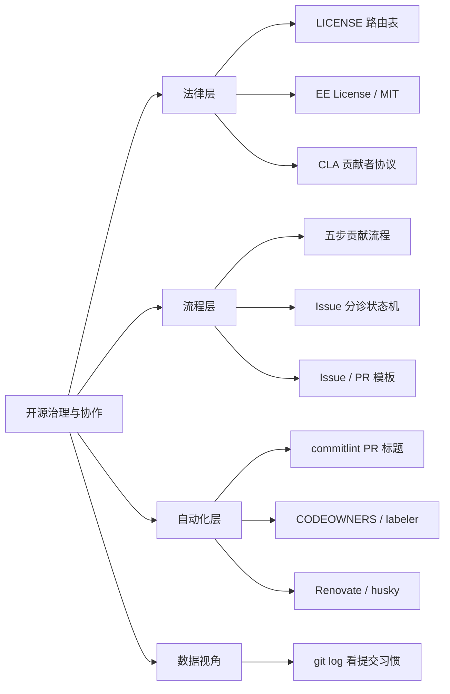
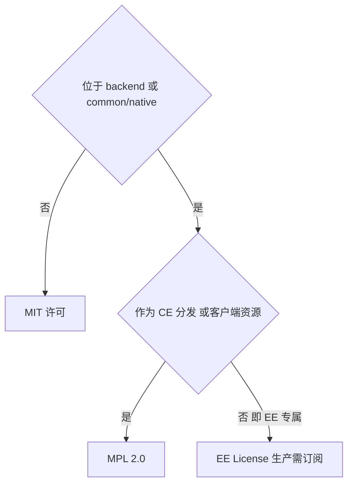
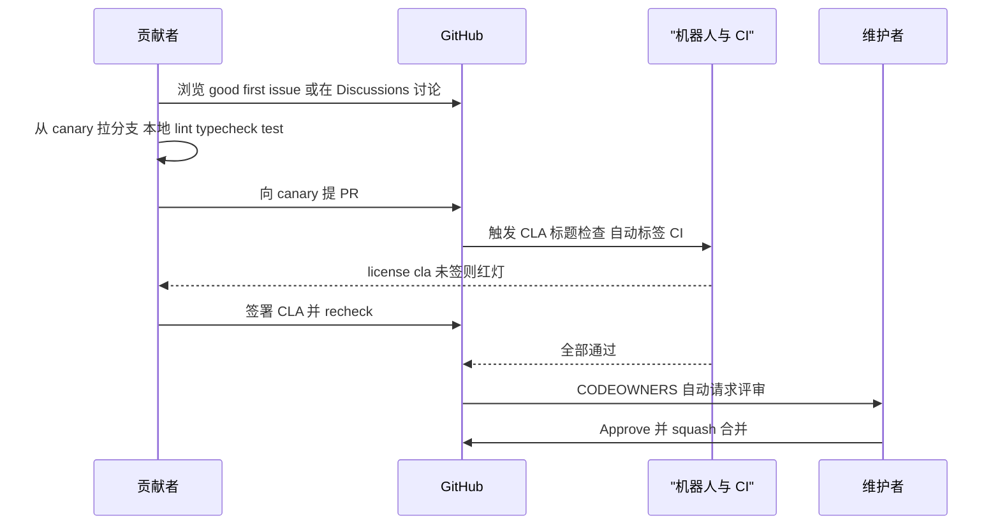
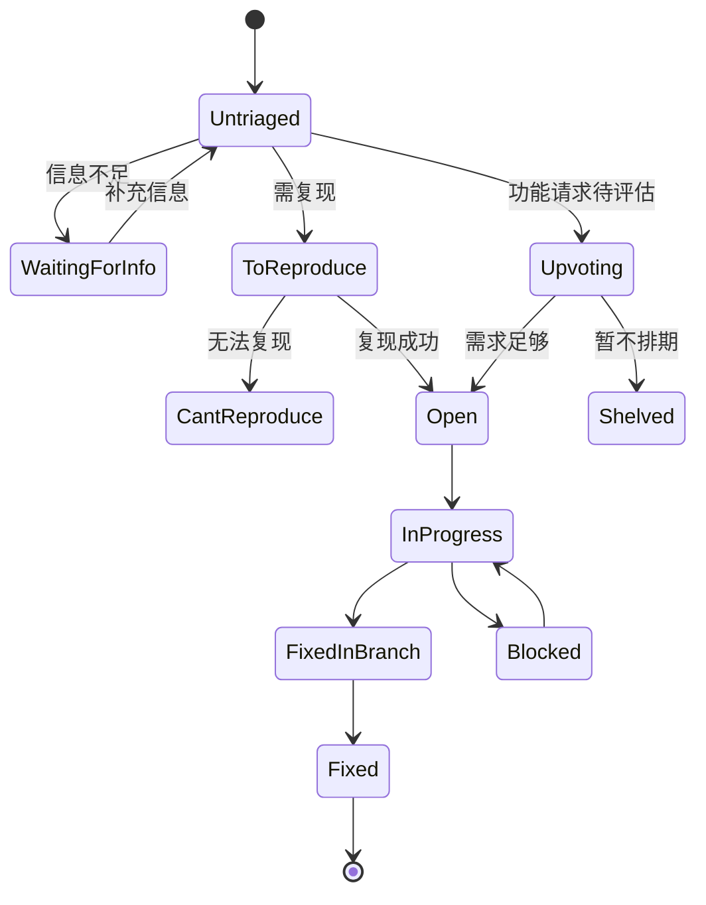
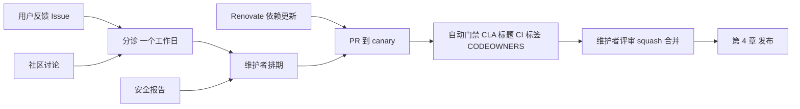

# 第 3 章 开源治理与协作流程

> 从许可证到机器人：搞懂规则，「一次通过」地提交你的第一个 PR

第 2 部分 · 项目管理与开源协作 ｜ 难度 ★★☆☆☆ ｜ 建议学时 3 小时

===

## 本章要解决的问题

<p class="lead">给大型开源项目提第一个 PR 时的那些挫败，几乎都不是技术问题，而是<b>治理与协作规则</b>问题。</p>

PR 卡着不能合（没签 CLA）、CI 报 `subject may not be empty`（标题格式不对）、被机器人打一堆标签、Issue 被标 `Untriaged` 后石沉大海……这些都有明确的规则与自动化在背后。

<div class="cards cols-3">
  <div class="card"><div class="card__icon">⚖️</div><h4>法律层</h4><p>LICENSE 分区授权、CLA 贡献者协议、行为准则。</p></div>
  <div class="card"><div class="card__icon">🔁</div><h4>流程层</h4><p>贡献指南、Issue 分诊状态机、Issue/PR 模板。</p></div>
  <div class="card"><div class="card__icon">🤖</div><h4>自动化层</h4><p>CODEOWNERS、labeler、auto_assign、Renovate、commitlint、husky。</p></div>
</div>

<div class="note note--tip">

读完本章，你应能画出 AFFiNE「公司主导 + 社区参与 + 机器人守门 + 维护者把关」的协作模型，并真正做到「一次通过」。

</div>

===

## 知识地图

四层结构层层递进：**法律层划边界 → 流程层定路径 → 自动化层做守门 → 用 git 数据看真实协作**。



<div class="note">

核心口诀：**先签 CLA，再从 `canary` 拉分支，PR 标题走 `type(scope): description`**。本章把每条规则对应到仓库里的真实文件。

</div>

===

## 学习目标

<ol class="goals">
  <li>说清根 <code>LICENSE</code>、<code>LICENSE-MIT</code>、<code>packages/backend/server/LICENSE</code> 各覆盖的目录</li>
  <li>解释 CLA 的作用、签署方式及 <code>license/cla</code> 检查失败的常见原因</li>
  <li>描述 Issue 从提交到关闭的分诊状态流转</li>
  <li>写出符合 commitlint 规则（类型 + scope 枚举）的 PR 标题</li>
  <li>说明 CODEOWNERS、labeler、auto_assign、Renovate 各自动化了什么</li>
  <li>用 <code>git log</code> / <code>git shortlog</code> 分析提交类型分布与贡献结构</li>
</ol>

===

<!-- section -->
## 一、许可证：一个仓库，两种授权

`package.json` 的 `"license": "MIT"` 只是包元数据，**不代表整个仓库**。真正的授权以根 `LICENSE` 为准。

===

## 根 LICENSE 是一张「路由表」

根 `LICENSE` 开头是一段「哪个目录适用哪个许可证」的路由规则：

<div class="annotate">

```text [1|3]
- packages/backend 与 packages/common/native 目录下的内容，
  适用 packages/backend/server/LICENSE 中定义的许可证。
- 第三方组件适用其各自原始许可证。
- 以上范围之外的所有内容，适用 LICENSE-MIT 中的 MIT 许可证。
```

<ol class="annotate__notes">
  <li><b>后端专属</b>：<code>packages/backend/**</code> 与 <code>packages/common/native/**</code> → AFFiNE EE License。</li>
  <li><b>其余全部 MIT</b>：前端、BlockSuite、工具链、文档都是 MIT，可在闭源商业产品中使用，只要保留声明。</li>
</ol>
</div>

| 范围 | 许可证 |
| --- | --- |
| `packages/backend/**`、`packages/common/native/**` | EE License（`packages/backend/server/LICENSE`） |
| 第三方组件 | 各自原始许可证 |
| 其他所有内容 | MIT（`LICENSE-MIT`） |

===

## EE License 与 CE 例外

EE License 全文 44 行，核心逻辑：**生产使用需订阅，开发测试豁免**，且只约束「不属于 CE 分发」的部分。

<div class="compare">
  <div class="compare__col"><h4>EE License 约束</h4>

- 生产使用需同意订阅条款、持有对应席位
- 可修改、可发补丁（权利归 AFFiNE）
- 开发测试目的可复制修改，无需订阅
- 其余禁止再分发

  </div>
  <div class="compare__col compare__col--good"><h4>CE 例外（MPL 2.0）</h4>

- 作为 CE 分发的部分
- 以图片/字体/CSS/客户端 JS 下发的部分
- 这些按 MPL 2.0 授权

  </div>
</div>



<div class="note note--warn">

**表述差异**：README 说 CE 是 MIT，EE License 文本却说 CE 部分 copyrighted under MPL 2.0。商业使用后端代码前，**务必自行阅读原文并咨询法律意见**，不要仅凭教材判断。

</div>

===

## CLA：PR 能否合并的第一道硬门槛

CLA 解决的问题是：**项目方能否以任意许可证（含商业许可）分发你贡献的代码？** 对采用分层授权、需商业化的项目，CLA 几乎是必需品。

<div class="split">
<div class="split__main">

它**不是版权转让**：你授予 AFFiNE 及其分发对象一个「永久、全球、非独占、免费、不可撤销」的许可，同时**保留贡献的全部权利**，同样代码还能用在别处。

签署方式：访问 `cla-assistant.io/toeverything/AFFiNE`，用 GitHub 账号登录并同意。签署后 `license/cla` 检查自动变绿；若在开 PR 后才签，点机器人评论里的 **recheck** 链接或推一个新 commit 刷新。

</div>
<div class="split__aside">

```text
红灯最常见的两个原因：

① PR 中有其他 committer
  （含 co-author）未签；

② 某个 commit 的作者邮箱
  未关联到 GitHub 账号。

自查：
git log --format='%an %ae'
```

</div>
</div>

<div class="note">

行为准则 `docs/CODE_OF_CONDUCT.md` 采用 Contributor Covenant 1.4，位于 `docs/` 下而非根目录。

</div>

===

<!-- section -->
## 二、贡献流程与 Issue 分诊

「先沟通、后编码」；目标分支永远是 `canary`，不是 `main`。

===

## 五步贡献流程

`docs/CONTRIBUTING.md` 是「五分钟版」指南，核心五步：



<div class="note note--warn">

两个关键约定：① **不要碰仍在分诊中的 Issue**——带 triage 标签意味着团队还没评审，不该开工；② **大改动先讨论**——先开 Discussion 或在 Discord 沟通，避免方向性返工。翻译、文档、反馈都被视为一等贡献。

</div>

===

## Issue 分诊状态机

`docs/issue-triaging.md` 定义了 21 种状态，承诺「通常一个工作日内完成分诊」。按语义分组后，流转非常清晰：



<div class="note">

`Fixed In Branch` 表示已在某分支修复但尚未合入默认分支；`Fixed` 表示已完成。这套状态公开定义，让提交者清楚「我的 Issue 会怎样」，降低沟通成本。

</div>

===

## Issue 模板：把分诊信息前置

`.github/ISSUE_TEMPLATE/` 下三个文件：`BUG-REPORT.yml`（自动加 `bug`）、`FEATURE-REQUEST.yml`（自动加 `feat`、`story`）、`config.yml`（外链 Discussions 与 Discord）。Bug 模板的字段设计很值得学：

<div class="cards cols-3">
  <div class="card"><h4>发行渠道必填</h4><p>stable（<code>app.affine.pro</code>）/ beta（<code>insider.affine.pro</code>）/ canary（<code>affine.fail</code>）——正是第 4 章发布通道在用户侧的体现。</p></div>
  <div class="card"><h4>是否自托管</h4><p>自托管问题常与部署配置相关，需区别对待。</p></div>
  <div class="card"><h4>AI 生成声明</h4><p>要求确认内容非 AI 生成或仅含极少 AI 编辑——AI 时代减少低质量 Issue 的新做法。</p></div>
</div>

<div class="note note--warn">

**小差异**：README 中 Bug 链接带 `labels=bug%2Cproduct-review`，而模板本身只声明 `labels: ['bug']`。`SECURITY.md` 也明确「不接受 AI 生成的安全报告」。

</div>

===

<!-- section -->
## 三、PR 标题与 commitlint

记住一个公式：`type(scope): description`，scope 从枚举里选，拿不准就省略。

===

## commitlint 规则

规则在 `tools/commitlint/.commitlintrc.json`：类型来自 `@commitlint/config-conventional`，scope 被 `scope-enum` 限定为 24 个之一（写了就必须命中，可省略）。

<div class="annotate">

```json [2|4-8]
{
  "extends": ["@commitlint/config-conventional"],
  "rules": {
    "scope-enum": [2, "always", [
      "admin","electron","server","core","web","mobile","ios",
      "android","mobile-native","docs","component","env","graphql",
      "hooks","i18n","native","templates","debug","nbstore",
      "infra","editor","tools","y-octo","client"
    ]]
  }
}
```

<ol class="annotate__notes">
  <li><b>类型</b>：<code>build/chore/ci/docs/feat/fix/perf/refactor/revert/style/test</code>。</li>
  <li><b>scope 级别 2</b>（error）：写了 scope 就必须在这 24 个里；BlockSuite 对应的是 <code>editor</code> 而不是 <code>blocksuite</code>。</li>
</ol>
</div>

| 标题 | 结果 | 原因 |
| --- | --- | --- |
| `fix(editor): keep selection after paste` | ✅ | 类型、scope 合法 |
| `feat: add calendar view` | ✅ | scope 可省略 |
| `Fix bug` | ❌ | 缺少类型 |
| `fix(blocksuite): xxx` | ❌ | `blocksuite` 不在枚举，应用 `editor` |
| `feature(core): xxx` | ❌ | 类型应为 `feat` |

===

## 只检查 PR 标题的工作流

`.github/workflows/pr-title-lint.yml` 只在针对 `canary` 的 PR 上检查**标题**，不检查每个 commit：

<div class="annotate">

```yaml [3-4|7-9]
- name: Install dependencies
  run: yarn workspaces focus @affine/commitlint-config
- name: Check PR title
  env:
    TITLE: ${{ github.event.pull_request.title }}
  run: echo "$TITLE" | yarn workspace @affine/commitlint-config commitlint -g ./.commitlintrc.json
```

<ol class="annotate__notes">
  <li><b>为何只查标题</b>：采用 squash merge，合并后 commit 标题 = PR 标题 +（#号），标题合规则主干历史合规，中间 commit 随意写。</li>
  <li><b>安全写法</b>：标题经环境变量 <code>TITLE</code> 传入，而非内联 <code>${{ }}</code> 到 shell，防止注入（第 28 章）。</li>
</ol>
</div>

<div class="note">

仓库**没有 commit-msg 钩子**做 commitlint（`.husky/` 下只有 `pre-commit`）；commit 信息规范完全靠 PR 标题检查保证。

</div>

===

<!-- section -->
## 四、代码所有权与机器人

CODEOWNERS 管「谁评审」，labeler 管「属于哪个模块」，auto_assign 管「谁负责」。

===

## CODEOWNERS 与 labeler

`.github/CODEOWNERS` 只有两行，但含义明确——编辑器内核是最易回归的部分，需专门团队把关，其余目录不设所有者以降低评审瓶颈：

```text
/blocksuite/ @toeverything/blocksuite-core
/packages/frontend/core/src/blocksuite @toeverything/blocksuite-core
```

labeler 按改动路径自动打标签（`actions/labeler@v7`，规则在 `.github/labeler.yml`）：

| 标签 | 触发路径 |
| --- | --- |
| `app:core` | `packages/frontend/core/**` |
| `mod:i18n` | `packages/frontend/i18n/**` |
| `mod:server-native` | `packages/backend/native/**` |
| `rust` | `**/*.rs`、`Cargo.toml` 等 |
| `docs` | `docs/**`、任意 `README.md` |

<div class="note note--warn">

**配置漂移案例**：`labeler.yml` 里还有指向已不存在目录 `tools/plugin-cli` 的 `mod:plugin-cli` 规则——提醒我们自动化规则是「默认约束」，不是绝对正确。

</div>

===

## 为什么用 pull_request_target

<div class="split">
<div class="split__main">

auto-labeler 用 `pull_request_target` 而非 `pull_request`，是因为来自 fork 的 PR 在 `pull_request` 事件里拿不到写权限，无法打标签；`pull_request_target` 在目标仓库上下文运行、有写权限。

**代价**：绝不能在该工作流中检出并执行 PR 里的不可信代码。这里只用 labeler 读取改动文件列表，是安全的，并显式声明了最小权限 `contents: read`、`pull-requests: write`。

`auto_assign.yml` 则把 PR 作者设为 assignee（`addAssignees: author`），便于在 GitHub Project 看板中按负责人追踪。

</div>
<div class="split__aside">

```yaml
addReviewers: false
addAssignees: author
runOnDraft: true
```

</div>
</div>

===

## Renovate 与 husky

<div class="compare">
  <div class="compare__col"><h4>Renovate 依赖治理</h4>

- minor/patch 分组合并，减少 PR 数
- major 单独 PR 逐个评估
- `nestjs`/`opentelemetry` 等生态专属分组
- 排除 `@blocksuite/`（已在仓库内）
- 统一提交信息 `chore: bump up ...`

  </div>
  <div class="compare__col compare__col--good"><h4>husky 本地钩子</h4>

- `.husky/pre-commit`：`yarn lint-staged && yarn lint:ox`
- 对暂存文件跑 oxfmt / taplo / cargo fmt
- 再对全仓库跑 `oxlint --deny-warnings`
- `postinstall` 时 `yarn husky` 安装钩子

  </div>
</div>

<div class="note">

Renovate 让依赖「持续小步升级」——最近 500 次提交里约 124 次是 `bump up`，其中 37 次带 `[SECURITY]`。husky 让格式问题「在本地就被消灭」，别用 `--no-verify` 绕过。

</div>

===

<!-- section -->
## 五、用 git 数据看真实协作

规则是「应然」，提交历史是「实然」。只读命令就能还原一个项目的协作习惯。

===

## 提交类型、scope 与贡献者结构

统计 HEAD 近 500 次提交（时间跨度约 2026-02 至 2026-10）：

<div class="stats">
  <div class="stat"><b>38%</b><span>fix（190 次）</span></div>
  <div class="stat"><b>34.4%</b><span>chore（172 次，约 124 次 Renovate）</span></div>
  <div class="stat"><b>26.2%</b><span>feat（131 次）</span></div>
  <div class="stat"><b>442/500</b><span>标题以（#号）结尾</span></div>
</div>

- **scope 分布**：`server`（109）> `editor`（60）> `core`（43），另有 222 次未写 scope（多为 Renovate）；
- **有趣发现**：`latex`、`selfhost`、`playground`、`oidc` 等 scope **不在枚举里**却出现在主干——可能是合并时手动改标题或管理员合并所致，具体需查对应 PR 的 Checks；
- **贡献者结构**：核心维护者 + 机器人贡献约 **77%** 的提交，长尾社区贡献者多但单人提交少——典型「核心团队主导型」项目。

<div class="note note--tip">

`(#15588) (#15596)` 这样的双 PR 号通常是 cherry-pick / backport 的痕迹（第 4 章展开）。

</div>

===

## 协作模型：四句话总结



<ul class="takeaways">
  <li><b>公司主导</b>：决策由 TOEVERYTHING 主导，法律上靠 CLA + 分区许可证保障。</li>
  <li><b>社区参与</b>：任何人可提 Issue/PR，高质量要求通过清单表达。</li>
  <li><b>机器人守门</b>：CLA 机器人、标题 lint、labeler、husky 层层自动化。</li>
  <li><b>维护者把关</b>：只对编辑器设 CODEOWNERS，其余灵活分配，最后 squash 合并。</li>
</ul>

===

## 动手实践

<ol class="steps">
  <li><h4>许可证判定</h4><p>对 <code class="path">blocksuite/affine/blocks/database/...</code>、<code>packages/backend/server/src/env.ts</code>、<code>packages/common/native/Cargo.toml</code>、<code>packages/common/nbstore/package.json</code> 判定许可证。<b>验收</b>：前三类分别为 MIT / EE / EE，nbstore 为 MIT，并能引用 <code>LICENSE</code> 原文说明。</p></li>
  <li><h4>复现 PR 标题检查</h4><p>对比 <code>echo "fix(blocksuite): test"</code> 与 <code>echo "fix(editor): test"</code> 走 commitlint 的结果。<b>验收</b>：能解释前者失败、后者通过。</p></li>
  <li><h4>标签预测</h4><p>一个 PR 改了 <code>core/.../journal.ts</code>、<code>i18n/.../en.json</code>、<code>backend/native/.../entitlement.rs</code>，预测标签。<b>验收</b>：<code>app:core</code>、<code>mod:i18n</code>、<code>mod:server-native</code>、<code>rust</code>，并说明 <code>rust</code> 来自 <code>**/*.rs</code>。</p></li>
  <li><h4>复刻提交统计</h4><p>把 3.9 节命令的 <code>-500</code> 改为 <code>-1000</code>，对比类型与 scope 分布。<b>验收</b>：产出自己的统计表 + 2 条观察。</p></li>
</ol>

===

## 自测：点击揭晓答案

<details class="quiz">
<summary>Q1. 根 package.json 的 "license": "MIT" 能代表整个仓库吗？</summary>

不能。那是包元数据。授权以根 `LICENSE` 为准：`packages/backend` 与 `packages/common/native` 适用 EE License，其余为 MIT。

</details>

<details class="quiz">
<summary>Q2. 签了 CLA 但 license/cla 仍红灯，最常见的两个原因？</summary>

PR 中有其他 committer（含 co-author）未签；某 commit 的作者邮箱未关联到签署者的 GitHub 账号（`git log --format='%an %ae'` 自查）。

</details>

<details class="quiz">
<summary>Q3. 为什么只检查 PR 标题而不检查每个 commit？</summary>

采用 squash merge，主干 commit 标题即 PR 标题，检查标题就能保证主干历史规范，同时不打扰贡献者的中间提交。

</details>

<details class="quiz">
<summary>Q4. auto-labeler 为何用 pull_request_target？有何安全注意？</summary>

fork 的 PR 在 `pull_request` 事件中无写权限，无法打标签；`pull_request_target` 在目标仓库上下文运行、可写。注意不得检出执行 PR 中的不可信代码，并只授予最小权限。

</details>

===

## 小结与下一步

<ul class="takeaways">
  <li>授权要先读根 <code>LICENSE</code> 路由表：后端 EE、其余 MIT；<code>package.json</code> 的 license 只是元数据。</li>
  <li>CLA 是合并的第一道硬门槛，不是版权转让；先签再写代码。</li>
  <li>流程：避开分诊中的 Issue，从 <code>canary</code> 拉分支，PR 标题走 <code>type(scope): description</code>。</li>
  <li>自动化：CODEOWNERS 管评审、labeler 管模块、Renovate 管依赖、husky 管本地格式。</li>
  <li>协作模型 =「公司主导 + 社区参与 + 机器人守门 + 维护者把关」。</li>
</ul>

<div class="note note--tip">

**下一章预告**：第 4 章顺着「PR 合并进 canary」继续走——一行代码如何经日更 canary、beta 晋升、跨仓库签名，最终出现在用户的桌面端、app.affine.pro 与 App Store 里。

</div>
