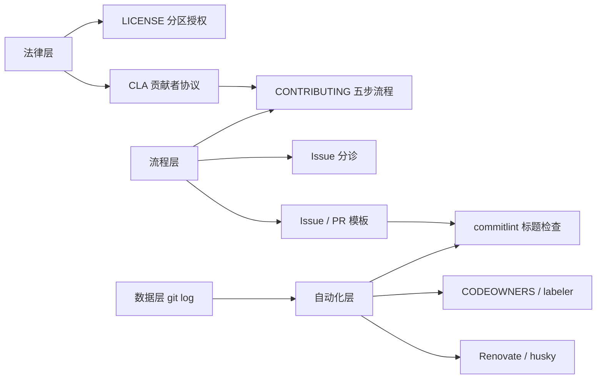
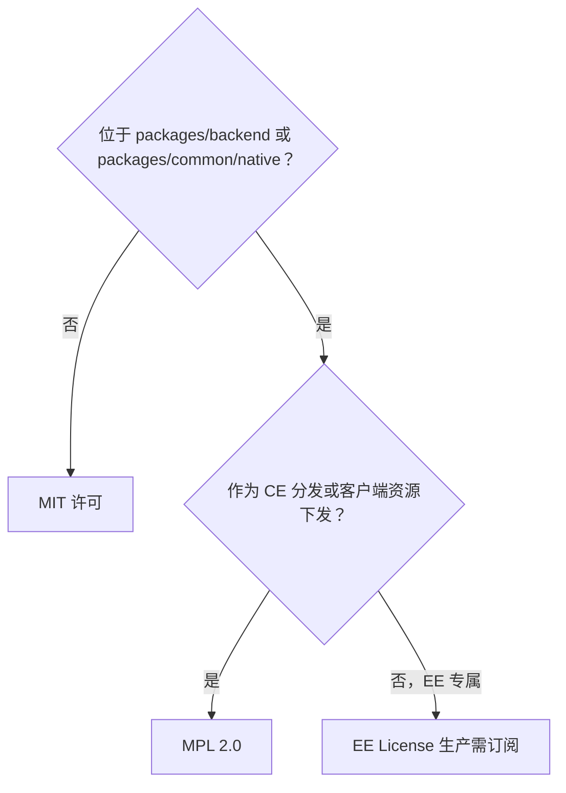
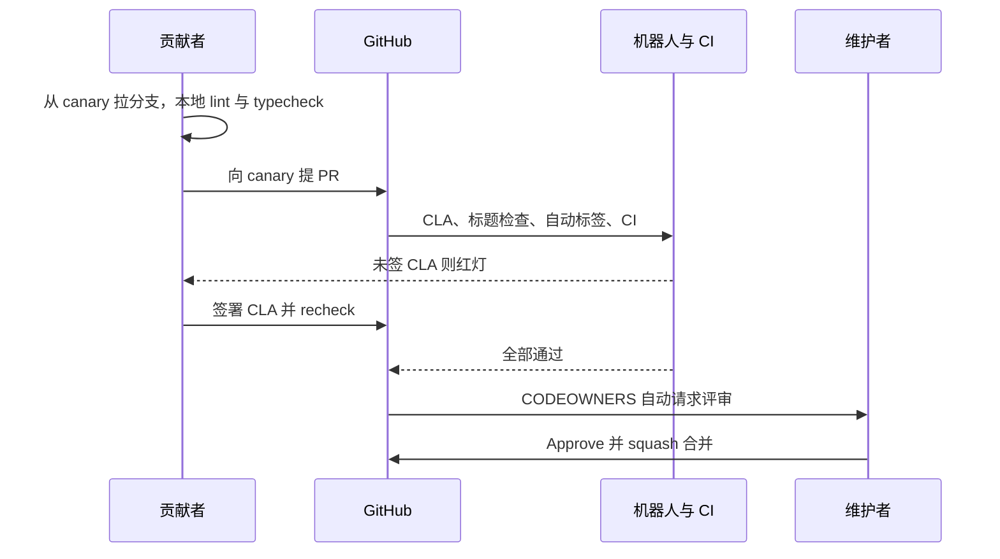
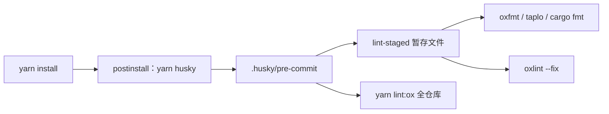
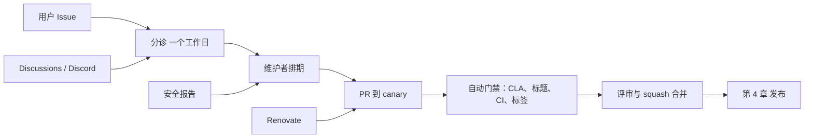

# 第 3 章 开源治理与协作流程

从许可证到机器人：一次通过地提交你的第一个 PR

第 2 部分 · 项目管理与开源协作 ｜ 难度 ★★☆☆☆ ｜ 建议学时 3 小时

Note:
这一章我们暂时离开代码，讲"人如何协作"。PR 卡着合不进去、CI 报标题格式错误、Issue 石沉大海，这些都不是技术问题，而是治理与协作规则问题。学完本章，你应该能一次通过地提交第一个 PR。

---

## 本章导读

<div class="cols">
<div>

**常见卡点**

- PR 无法合并：没签 CLA
- CI 报 "subject may not be empty"
- 被机器人打了一堆标签
- Issue 被标 Untriaged 后石沉大海

</div>
<div>

**四个层次**

- 法律层：LICENSE、CLA、行为准则
- 流程层：贡献指南、分诊、模板
- 自动化层：CODEOWNERS、labeler、Renovate、husky
- 数据层：用 `git log` 看真实习惯

</div>
</div>

Note:
左边这几个卡点，几乎每个第一次给大型开源项目提 PR 的人都会遇到。右边是本章的组织方式：先讲法律层，搞清楚代码到底是什么许可证；再讲流程层和自动化层；最后用 git 数据验证规则是否真的被执行，并从项目管理角度总结协作模型。

---

## 学习目标

1. 说明三个许可证文件各自覆盖的目录与约束
2. 解释 CLA 的作用与 `license/cla` 失败原因
3. 描述 Issue 从提交到关闭的分诊状态流转
4. 写出符合 commitlint 规则的 PR 标题
5. 说明 CODEOWNERS、labeler、Renovate 各自自动化了什么
6. 用 `git log` / `git shortlog` 分析提交与贡献结构

Note:
六条目标里，第一条和第四条最实用：一个决定你能不能用这些代码，一个决定你的 PR 能不能过 CI。第六条是一种通用能力，学会之后可以用来分析任何开源仓库的协作健康度。

---

## 知识地图



Note:
法律层是一切的前提，CLA 签了才能进入贡献流程。流程层定义了 Issue 和 PR 怎么走，模板又和自动化层的标题检查连在一起。数据层用来反向验证：规则是"应然"，提交历史是"实然"，两者对比能发现很多有意思的东西。

---

## 根 LICENSE 是"路由表"

| 范围 | 许可证 | 文件 |
| --- | --- | --- |
| `packages/backend/**` | AFFiNE EE License | `packages/backend/server/LICENSE` |
| `packages/common/native/**` | 同上 | `packages/backend/server/LICENSE` |
| 第三方组件 | 各自原始许可证 | 各依赖自带 |
| 其他所有内容 | MIT | `LICENSE-MIT` |

<div class="callout warn">

`package.json` 里的 `"license": "MIT"` 只是包元数据，**不代表全仓库授权**。

</div>

Note:
很多人看到 package.json 里写着 MIT 就以为整个仓库都是 MIT，这是错误的。根目录 LICENSE 开头就是一张路由表：后端和 `packages/common/native` 适用后端目录下的 EE License，其他所有内容，包括前端、BlockSuite、工具链和文档，都是 MIT。所以 blocksuite 和 frontend 下的代码可以用在商业闭源产品里，只要保留版权声明。

---

## 许可证判定流程



<p class="small">README 称 CE 为 MIT，EE License 文本称 CE 部分为 MPL 2.0，表述存在差异；商用请阅读原文并咨询法律意见</p>

Note:
EE License 有一段关键例外：它只约束"不属于 CE 分发"的部分。作为 CE 分发的部分，以及以图片、字体、CSS、客户端 JS 形式下发的部分，适用 MPL 2.0。结合 README 说 EE 尚未发布，当前状态可以用这张决策图理解。注意这是学习性解读，不构成法律意见，README 和 EE License 文本对 CE 的表述也有出入。

---

## EE License 核心条款

| 条款 | 含义 |
| --- | --- |
| 生产使用需订阅 | 需同意订阅条款并持有对应席位数 |
| 可修改、可发布补丁 | 补丁同样只能在有效订阅下使用 |
| 开发测试豁免 | 开发和测试目的可复制、修改，无需订阅 |
| 禁止再分发 | 除上述外禁止复制、分发、再许可、销售 |
| CE 部分例外 | CE 分发与客户端资源适用 MPL 2.0 |

<p class="small">设计意图：前端 MIT 最大化生态；后端为未来 EE（SSO、审计、品牌定制）保留商业授权空间</p>

Note:
`packages/backend/server/LICENSE` 全文 44 行，是本章最需要仔细读的文件。这种"前端 MIT 加后端分层授权"的结构，是第 2 章讲过的 Open Core 模式的典型做法。前端和编辑器 MIT，BlockSuite 可以被其他项目复用；后端则为未来的企业版留出法律基础。

---

## CLA：贡献者许可协议

<div class="cols">
<div>

**授予什么**

- 永久、全球、非独占、免费、不可撤销
- 可在**任意许可条款**下使用，含商业许可
- 你仍保留贡献的全部权利
- 不是版权转让；管辖法律为新加坡法律

</div>
<div>

**如何签署**

- 访问 `cla-assistant.io/toeverything/AFFiNE`
- 签后 `license/cla` 自动变绿
- PR 后才签：点 recheck 或推新提交
- 每个 committer（含 co-author）都要签
- 作者邮箱须关联 GitHub 账号

</div>
</div>

Note:
CLA 解决的问题是：项目方能否合法地以任意许可证，包括商业许可证，分发你贡献的代码。对分层授权、需要商业化的项目，CLA 几乎是必需品。签署很简单，但排错时要注意两点：PR 里每个提交者都要签，包括 co-author；commit 作者邮箱必须关联到 GitHub 账号，可以用 `git log --format='%an %ae'` 检查。CLA 是 PR 能否合并的第一道硬门槛。

---

## 五步贡献流程

1. **找事做**：good first issue；避开仍在分诊中的 Issue
2. **搭环境**：按 `docs/BUILDING.md` 等文档准备
3. **改代码**：从 `canary` 拉分支，跑 `yarn lint`、`yarn typecheck`
4. **提 PR 到 `canary`**：标题遵循 Conventional Commits
5. **合并**：CLA 绿、CI 过、维护者 approve

<div class="callout">

大改动先在 Discussions 或 Discord 沟通，避免方向性返工

</div>

<p class="small">来源：`docs/CONTRIBUTING.md`</p>

Note:
CONTRIBUTING 是五分钟版的贡献指南。有三个关键约定：目标分支是 canary，不是 main 或 master，第 4 章会详解；不要碰带 triage 标签的 Issue，因为团队还没看过；大改动先讨论。另外 `docs/types-of-contributions.md` 把讨论、Issue、PR、社区支持和翻译都列为一等贡献。

---

## 一个 PR 的生命周期



Note:
这张时序图串起了整个流程。提 PR 之后，机器人和 CI 会同时跑多项检查：CLA、标题格式、自动标签和常规 CI。最常见的红灯就是 CLA 没签。全部通过后，如果改动涉及编辑器目录，CODEOWNERS 会自动请求 blocksuite-core 团队评审，最终由维护者 squash 合并。

---

## Issue 分诊状态

| 阶段 | 典型状态 |
| --- | --- |
| 待处理 | Untriaged |
| 信息收集 | Waiting for Info、To Reproduce、Can't Reproduce |
| 决策中 | To be Discussed、Upvoting |
| 已接受 | Open、In Progress、Blocked |
| 已完成 | Fixed In Branch → Fixed |
| 关闭 | As designed、Declined、Shelved、Duplicate… |

<p class="small">`docs/issue-triaging.md` 定义 21 种状态，承诺通常一个工作日内完成分诊</p>

Note:
issue-triaging 文档定义了 21 种 Issue 状态，我们按语义分成几组。注意 Fixed In Branch 和 Fixed 的区别：前者是在某个分支修复了但还没合入默认分支。这套状态很像 YouTrack 等成熟产品团队的工作流，让提交者清楚自己的 Issue 会怎样，降低沟通成本。实际在 GitHub 上通常体现为标签或 Project 字段。

---

## Issue 与 PR 模板

- `BUG-REPORT.yml`：发行渠道必填，自动加 `bug` 标签
- 渠道即发布通道：`app.affine.pro` / `insider.affine.pro` / `affine.fail`
- `FEATURE-REQUEST.yml`：自动加 `feat`、`story` 标签
- PR 模板：标题须 Conventional Commits，CI 强制
- 清单：签 CLA、目标 `canary`、lint 与 typecheck 通过
- AI 辅助编码须亲自审查范围与冗余实现
- 维护者可不经讨论直接关闭低质量 PR

Note:
模板的作用是把分诊需要的信息前置到提交时收集。Bug 模板里的发行渠道下拉框很有价值：stable、beta、canary 三个域名就是第 4 章发布通道在用户侧的体现。另一个时代特色是 AI 条款：Bug 模板要求声明内容非 AI 生成，SECURITY.md 明确不接受 AI 生成的安全报告，PR 模板允许 AI 辅助但要求亲自审查。

---

## commitlint 规则

```json
{
  "extends": ["@commitlint/config-conventional"],
  "rules": {
    "scope-enum": [2, "always", [
      "admin", "electron", "server", "core", "web", "mobile", "ios",
      "android", "mobile-native", "docs", "component", "env", "graphql",
      "hooks", "i18n", "native", "templates", "debug", "nbstore",
      "infra", "editor", "tools", "y-octo", "client"
    ]]
  }
}
```

<p class="small">`tools/commitlint/.commitlintrc.json`（原文每项占一行，此处合并排版）</p>

Note:
继承标准 Conventional Commits 规则，类型限定为 build、chore、ci、docs、feat、fix、perf、refactor、revert、style、test。scope-enum 级别 2 表示错误，always 表示如果写了 scope，必须是这 24 个之一；scope 本身可以省略。选 scope 的经验：改 blocksuite 用 editor，改前端 core 用 core，改服务端用 server。

---

## PR 标题检查工作流

```yaml
    - name: Install dependencies
      run: yarn workspaces focus @affine/commitlint-config
    - name: Check PR title
      env:
        TITLE: ${{ github.event.pull_request.title }}
      run: echo "$TITLE" | yarn workspace @affine/commitlint-config ...
```

- 只查 PR 标题：squash merge 后主干 commit 标题 = PR 标题
- `yarn workspaces focus`：只装一个 workspace 依赖，几秒完成
- 标题经环境变量 `TITLE` 传入，防止 shell 注入

<p class="small">`.github/workflows/pr-title-lint.yml`（节选，已缩进对齐）</p>

Note:
这个工作流有四个设计细节值得学习。第一，只检查 PR 标题而不查每个 commit，因为 squash merge 之后主干上只剩 PR 标题，你分支上的中间提交可以随便写。第二，job 上的 if 条件让编辑 PR 时只有标题变化才重新检查。第三，focus 只安装 commitlint 这一个包的依赖。第四，标题通过环境变量传入，而不是直接内联到 shell，这是防注入的安全写法。

---

## 标题合规示例

| 标题 | 结果 | 原因 |
| --- | --- | --- |
| `fix(editor): keep selection after paste` | 通过 | 类型、scope 合法 |
| `feat: add calendar view` | 通过 | scope 可省略 |
| `Fix bug` | 失败 | 缺少类型 |
| `fix(blocksuite): xxx` | 失败 | 应使用 `editor` |
| `feature(core): xxx` | 失败 | 类型应为 `feat` |

<div class="callout">

公式：`type(scope): description`，拿不准就省略 scope

</div>

Note:
看几个例子。前两个通过，scope 写了就必须合法，不写也没问题。最常见的错误是第四个：很多人改了 blocksuite 目录就写 blocksuite 作为 scope，但它不在枚举里，应该用 editor。如果 CI 报标题错误，只需要改 PR 标题，不用改 commit。

---

## 三个协作机器人

| 文件 | 管什么 | 要点 |
| --- | --- | --- |
| `.github/CODEOWNERS` | 谁评审 | 仅 `/blocksuite/` 等两行，归 `blocksuite-core` |
| `.github/labeler.yml` | 属于哪个模块 | 按路径打 `app:core`、`rust` 等标签 |
| `.github/auto_assign.yml` | 谁负责 | `addAssignees: author`，便于 Project 追踪 |

<p class="small">auto-labeler 用 `pull_request_target`：fork PR 也有写权限，但不得执行 PR 中的代码</p>

Note:
CODEOWNERS 只有两行，只给编辑器内核和应用层的编辑器集成设了所有者，因为那是最复杂、最易回归的部分，其他目录不设所有者以降低评审瓶颈。labeler 按改动路径自动打标签，用 pull_request_target 是因为 fork 来的 PR 在普通 pull_request 事件里拿不到写权限。另外 labeler 里还有已删除目录 `tools/plugin-cli` 的规则，是个配置漂移的小案例。

---

## Renovate 依赖治理

| 策略 | 目的 |
| --- | --- |
| minor/patch 分组 `all-minor-patch` | 减少 PR 数量，一次升一批 |
| major 单独 PR | 破坏性变更逐个评估 |
| 排除 `^@blocksuite/` | BlockSuite 已在仓库内 |
| `chore: bump up {{depName}} version` | 符合 commitlint，易统计 |
| 锁文件每周维护 + `yarnDedupeHighest` | 刷新间接依赖，控制膨胀 |

<p class="small">最近 500 次提交中 124 次 "bump up"，其中 37 次带 `[SECURITY]`</p>

Note:
renovate.json 是一份成熟的依赖治理配置。小版本分组合并，大版本单独评估；nestjs、opentelemetry 这类强耦合的包分组一起升级；BlockSuite 已经以源码形式在仓库里，所以排除在 npm 升级之外。连 Rust 工具链也通过正则匹配 rust-toolchain.toml 纳入管控。真实数据显示，Renovate 承担了大量日常依赖维护工作。

---

## husky 本地提交钩子



<p class="small">钩子内容：`yarn lint-staged && yarn lint:ox`；没有 commit-msg 钩子，提交信息规范完全靠 PR 标题检查</p>

Note:
yarn install 的 postinstall 会执行 yarn husky 安装 Git 钩子。每次 git commit 时，先对暂存文件做格式化和 lint 修复，再对全仓库跑一次 `oxlint --deny-warnings`。注意仓库没有 commit-msg 钩子，这和"只检查 PR 标题"的策略是一致的。提交时卡一会儿是正常现象，千万不要用 `--no-verify` 绕过。

---

## git 数据：规则的"实然"

<div class="cols">
<div>

| 类型 | 占比 |
| --- | --- |
| fix | 38% |
| chore | 34.4% |
| feat | 26.2% |
| 其他 | 约 1.4% |

</div>
<div>

- 最活跃 scope：`server` 109、`editor` 60
- 442/500 标题以 `(#PR号)` 结尾
- 核心维护者 + 机器人约占 77%
- `latex`、`selfhost` 等不在枚举中却出现

</div>
</div>

<p class="small">统计范围：最近 500 次提交（HEAD `8cef09e1dd`）</p>

Note:
用 git log 配合 sed 统计，fix 多于 feat，说明项目处于稳定打磨期；refactor、test 极少，是因为习惯合并到其他类型里提交。442 次以 PR 号结尾印证了 squash merge；双编号通常是 backport。一个有趣的发现是有些 scope 不在枚举中却出现在主干，原因可能是合并时手动改了标题，这提醒我们自动化规则是默认约束，不是绝对约束。

---

## AFFiNE 的协作模型



<p class="small">公司主导、社区参与、机器人守门、维护者把关</p>

Note:
最后从项目管理视角总结。输入有用户反馈、社区讨论、Renovate 和安全报告；经过分诊和排期进入交付；交付环节由自动门禁守住质量，维护者精力集中在评审上。安全报告走私密渠道，推荐 GitHub Security Advisories，SECURITY.md 只支持当前 0.27.x 稳定线。合并之后就进入第 4 章要讲的发布流程。

---

## 源码导读 Top 5

| 优先级 | 路径 | 看什么 |
| --- | --- | --- |
| P0 | `LICENSE` | 许可证分区路由规则 |
| P0 | `packages/backend/server/LICENSE` | EE 条款与 CE 例外 |
| P0 | `.github/CLA.md` | 授权范围与签署流程 |
| P0 | `docs/CONTRIBUTING.md` | 五步贡献流程 |
| P0 | `tools/commitlint/.commitlintrc.json` | scope 枚举 |

Note:
这五个 P0 文件都很短，半小时就能读完，但它们决定了你能不能用代码、能不能把代码贡献进去。读完之后建议看 P1 的 pr-title-lint.yml 和 PR 模板，把门禁的细节补全。

---

## 动手实践

1. **许可证判定**：5 个路径分别判 MIT 或 EE，并引原文
2. **本地复现标题检查**：解释 `blocksuite` 失败、`editor` 通过
3. **复刻提交统计**：改用 `-1000`，写 2 条观察
4. **标签预测**：答出 `app:core`、`mod:i18n`、`mod:server-native`、`rust`
5. **模拟完整贡献**：写出合规标题与清单，用 `git checkout` 丢弃修改

Note:
练习一训练许可证判断，注意 `packages/common/nbstore` 是 MIT，而 `packages/common/native` 是 EE 管辖。练习四的 rust 标签来自 `**/*.rs` 规则。练习五只在本地操作、不推送，完成后记得丢弃修改。

---

## 自测

**Q1：`packages/common/native` 适用哪个许可证？**

`packages/backend/server/LICENSE` 定义的 EE License <!-- .element: class="fragment" -->

**Q2：签了 CLA 仍红灯，最常见两个原因？**

有 co-author 未签；作者邮箱未关联 GitHub 账号 <!-- .element: class="fragment" -->

**Q3：为什么只检查 PR 标题而不查每个 commit？**

squash merge 后主干 commit 标题就是 PR 标题 <!-- .element: class="fragment" -->

**Q4：Renovate 为何排除 `@blocksuite/`？**

BlockSuite 源码已在 `blocksuite/` 目录，经 workspace 引用 <!-- .element: class="fragment" -->

Note:
四道题分别覆盖许可证、CLA 排错、标题检查策略和依赖治理。第三题背后的思路值得记住：门禁放在最终进入主干的那一层，既保证历史整洁，又不打扰贡献者的中间过程。

---

## 常见坑

- `license/cla` 一直红：去 cla-assistant 签署并关联邮箱
- "scope must be one of"：换枚举内 scope 或省略
- "type may not be empty"：只需改 PR 标题，不必改 commit
- pre-commit 很慢：全仓库 `lint:ox`，别用 `--no-verify`
- `cargo fmt` 报错：按 `rust-toolchain.toml` 装 Rust
- 做了的 Issue 被告知"不做"：它还在 Untriaged / Upvoting

Note:
这些坑基本覆盖了新贡献者九成的问题。特别强调两点：标题错误只改标题，不用 rebase；husky 慢是正常的，绕过钩子只会把问题推给 CI。开工之前先在 Issue 下确认，能避免白干。

---

## 小结与下一步

- 读许可证先看根 `LICENSE` 路由，再看具体目录
- CLA 是合并的第一道硬门槛：先签再写代码
- 标题公式 `type(scope): description`，scope 取自枚举
- 机器人分工：CODEOWNERS 评审、labeler 标签、Renovate 依赖
- 自动化规则是默认约束，git 数据可验证执行情况

<div class="callout">

**下一章**：第 4 章 分支版本与发布节奏 —— canary / beta / stable 与发布流水线

</div>

Note:
本章我们把法律、流程、自动化和数据四个层次串了起来，AFFiNE 的协作模型可以概括为公司主导、社区参与、机器人守门、维护者把关。下一章接着讲 PR 合入 canary 之后发生了什么：分支策略、版本号格式，以及代码如何一步步发布到用户手里。
