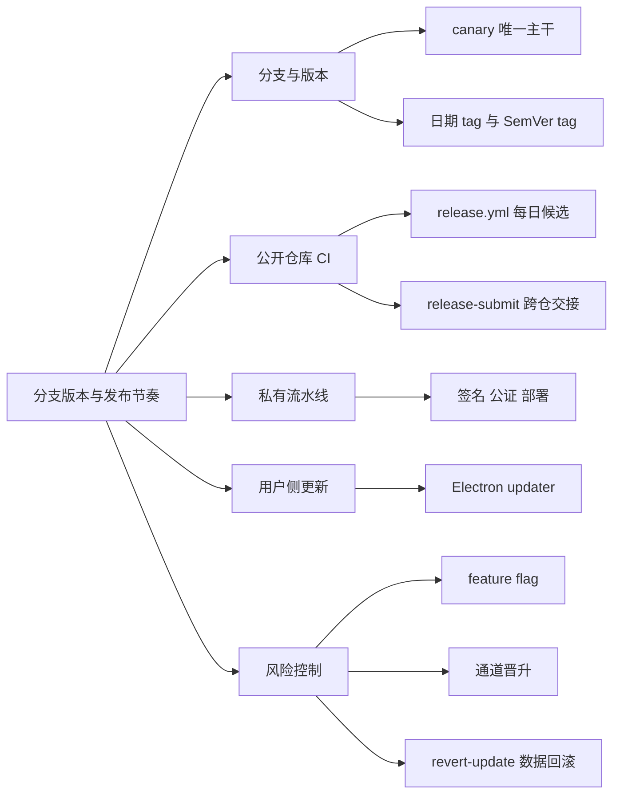
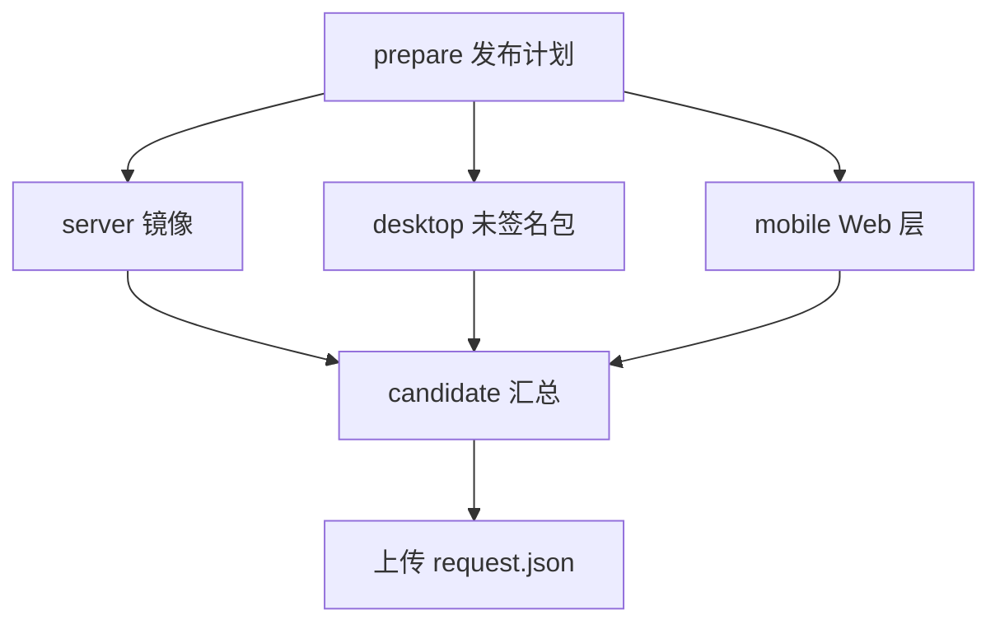
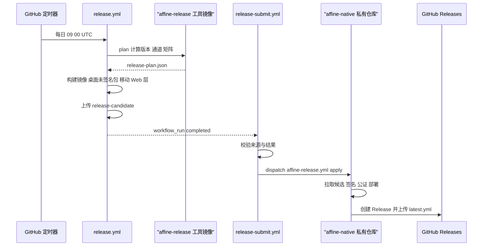
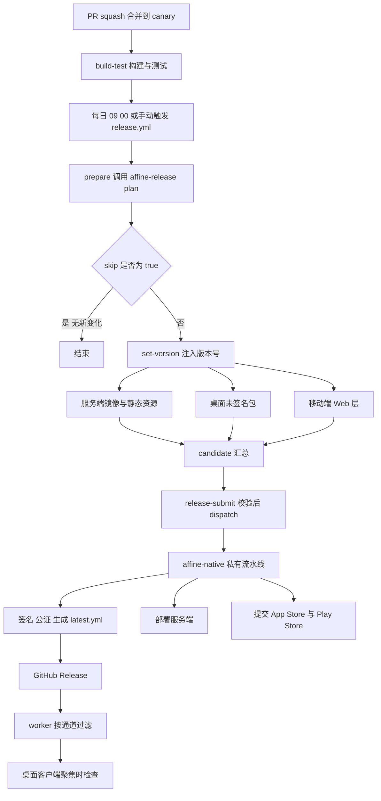

# 第 4 章 分支版本与发布节奏

> 跟踪一行代码从合并进 canary 到出现在用户桌面、网页与应用商店的完整旅程

第 2 部分 · 项目管理与开源协作 ｜ 难度 ★★☆☆☆ ｜ 建议学时 3 小时

===

## 本章要解决的问题

<p class="lead">第 3 章我们走到「PR 被 squash 合并进 <code>canary</code>」。合并之后呢？一行代码要经过哪些环节才会到用户手里？</p>

<div class="cards cols-2">
  <div class="card"><h4>分支与版本</h4><p>为什么只有一个长期分支 <code>canary</code>？<code>v2026.10.27-canary.909</code> 与 <code>v0.27.5-beta.2</code> 两种 tag 各是什么意思？</p></div>
  <div class="card"><h4>构建与交付</h4><p>每日 <code>release.yml</code> 为何只产出「未签名候选包」？桌面端如何自动更新？出问题如何灰度与回滚？</p></div>
</div>

<div class="note note--warn">

**重要时间点**：发布体系在 **2026-10-26 的提交 `b2e56529ee`（"chore: improve ci (#15743)"）** 中刚经历大调整——签名、部署、Helm Chart 被移出公开仓库，交给私有仓库 `toeverything/affine-native`。本章会明确区分「公开仓库看得见」与「只能从接口推断」的部分。

</div>

===

## 知识地图

主线是一条「构建 → 交接 → 分发」的流水线，两侧是版本命名与风险控制。



<div class="note">

一句话主旨：**canary 既是开发主干，也是发布源头；stable/beta 只是 canary 上被「选中」的提交**。

</div>

===

## 学习目标

<ol class="goals">
  <li>说明 canary 主干开发模型，以及 stable/beta 与 canary 提交的关系</li>
  <li>解读日期式 canary tag 与语义化 beta/stable tag，并能用 git 命令查证</li>
  <li>描述 <code>scripts/set-version.sh</code> 改了哪三类文件、iOS 为何用日期版本</li>
  <li>画出 <code>release.yml</code> → 子工作流 → <code>release-submit.yml</code> → 私有流水线的调用链</li>
  <li>解释 Electron 自动更新的 feed 地址、通道参数与文件筛选</li>
  <li>区分功能级灰度、通道级灰度与数据级回滚（<code>revert-update</code>）</li>
</ol>

===

<!-- section -->
## 一、canary 主干分支策略

只有一个长期分支，stable 与 beta 就「长在」canary 上。

===

## 一个主干，三种 tag 同指一处

AFFiNE 默认分支是 `canary`，所有 PR 向它提交——这是典型的 **Trunk-Based Development（主干开发）**。stable/beta 不需要单独的 release 分支：

<div class="annotate">

```text [1-3|5-7]
git log --oneline v0.27.4 -3
b4c8548c09 (tag: v2026.8.17-canary.914, tag: v0.27.4) feat(server): ...
81fb82761c (tag: v0.27.4-beta.2) feat(server): improve stability ...

git tag --points-at v0.27.3
v0.27.3
v0.27.3-beta.2
v2026.7.23-canary.948
```

<ol class="annotate__notes">
  <li><b>同一提交多 tag</b>：一个 canary 提交经验证后被「晋升」为 beta、再晋升为 stable，三个 tag 指向同一提交。</li>
  <li><b>验证归属</b>：<code>git merge-base --is-ancestor v0.27.4 canary</code> 可确认 stable tag 确在 canary 上。</li>
</ol>
</div>

<div class="note">

但 CI 仍为「维护分支」留了口子：`build-test.yml` 的触发分支含 `beta`、`stable`、`v[0-9]+.[0-9]+.x`、`v[0-9]+.[0-9]+.x-staging`——当需要给旧版本做 hotfix/backport 而 canary 已前进太多时，可临时拉维护分支。第 3 章的 `(#15588) (#15596)` 双号就是 backport 痕迹。

</div>

===

## 两套 tag 命名体系

```bash
git tag --sort=-creatordate | head -4
```

输出 `v2026.10.27-canary.909`、`v2026.10.26-canary.915`、`v0.27.5-beta.2`……两套体系并存：

| 通道 | 命名格式 | 样例 | 含义 |
| --- | --- | --- | --- |
| canary | `vYYYY.M.D-canary.N` | `v2026.10.27-canary.909` | 日期式，每日构建 |
| beta | `vX.Y.Z-beta.N` | `v0.27.5-beta.2` | SemVer + 预发布序号 |
| stable | `vX.Y.Z` | `v0.27.4` | 语义化版本 |

<div class="note note--tip">

为什么 canary 改成日期式？SemVer 适合表达「兼容性承诺」，但 canary 每天都发、本身不承诺兼容，用日期更直观——用户一看就知道「这是哪天的构建」。stable/beta 继续用 SemVer，便于判断升级风险。`N`（如 909）由外部发布工具计算，**规则不在本仓库**。

</div>

===

## set-version.sh：版本号同步三处

版本号是「构建时参数」，由脚本批量注入，而非提交进仓库。这就是 canary 版本号不出现在 `package.json` 历史里的原因。

<div class="annotate">

```bash [2-3|5|7]
for DIR_ITEM in $(yarn workspaces list --json | jq -r '.location'); do
  jq ".version = \"$1\"" "$DIR"/package.json > tmp.json \
    && mv tmp.json "$DIR"/package.json
done
update_app_stream_version ".../resources/affine.metainfo.xml" "$new_version"
update_ios_marketing_version \
  ".../ios/App/App.xcodeproj/project.pbxproj" "$ios_new_version"
```

<ol class="annotate__notes">
  <li><b>所有 workspace</b>：遍历 <code>yarn workspaces list</code>，用 <code>jq</code> 改写每个包的 <code>version</code>。</li>
  <li><b>Linux 元数据</b>：更新 AppStream <code>affine.metainfo.xml</code>（Flatpak 等商店读取）。</li>
  <li><b>iOS 工程</b>：更新 <code>project.pbxproj</code> 的 <code>MARKETING_VERSION</code>。</li>
</ol>
</div>

<div class="note note--warn">

**iOS 为何用日期版本**：苹果要求 `CFBundleShortVersionString` 单调递增，而 `0.27.5-beta.2` 这种带后缀的版本不行。于是 stable/beta 用当天日期；canary/nightly 用「最近一个 stable/beta tag 的日期」（`git describe --exclude '*canary*'`），避免 canary 版本号超过下一个正式版。CI 中由 `.github/actions/setup-version` 调用。

</div>

===

<!-- section -->
## 二、release.yml：每日候选工厂

它每天产出一份带完整身份、不可变、未签名的候选物清单——但自己不能创建 Release。

===

## 触发方式与权限最小化

<div class="annotate">

```yaml [2-3|9-11]
on:
  schedule:
    - cron: '0 9 * * *'
  workflow_dispatch:
    inputs:
      targets:
        default: 'server,desktop-macos,desktop-windows,desktop-linux?'
permissions:
  contents: read
  actions: read
  packages: write
```

<ol class="annotate__notes">
  <li><b>每日 09:00 UTC</b>（北京时间 17:00）自动跑，这就是每日 canary 的来源；手动触发时 <code>?</code> 后缀表示「可选目标，失败不阻塞」。</li>
  <li><b>没有 <code>contents: write</code></b>：这个工作流<b>不能创建 Release，也不能打 tag</b>，只给读权限和推镜像的 <code>packages: write</code>。</li>
</ol>
</div>

===

## 五个 Job 与 prepare 计划

<div class="split">
<div class="split__main">

**prepare** 生成发布计划：版本号 `version`、通道 `channel`、是否跳过 `skip`、构建矩阵 `buildMatrix`，**全部由 Docker 镜像 `ghcr.io/toeverything/affine-release` 的 `plan` 命令决定**。该工具源码不在本仓库——「canary.909 里的 909 怎么算」「何时出 beta」都无法在此查证。这体现「发布策略与业务代码解耦」。

**candidate** 汇总所有平台产物，生成 `request.json`：桌面包标记 `unsigned`、静态资源标记 `ready`，上传为**不可变**的 `release-candidate` 制品。

</div>
<div class="split__aside">



</div>
</div>

<div class="note note--warn">

桌面端两级构建：`before-make` 先生成 Web 资源，再按矩阵在各平台 runner 上编译 Rust 原生模块 → 打包。注意 `AFFINE_UNSIGNED_PACKAGE: '1'`——**公开仓库只产出未签名包**。签名脚本 `sign-macos.ts` / `sign-windows.ts` 在 `b2e56529ee` 新增，由私有流水线调用（自托管 runner 标签 `win-signer` 印证了专用签名机器）。

</div>

===

## release-submit.yml：跨仓库交接

候选构建成功后，`release-submit.yml` 通过 `workflow_run` 触发，校验来源后把发布动作交给私有仓库。这是「**两段式发布（build → promote）**」：公开仓库负责「可复现地构建」，私有仓库负责「受控地签名与发布」。

| 校验 / 设计 | 作用 |
| --- | --- |
| `conclusion == 'success'` | 只有完整成功的候选才提交 |
| `head_repository.full_name` | 防止 fork 仓库触发 |
| 事件仅 `schedule`/`workflow_dispatch` | 防止 PR 等事件伪造候选 |
| 校验 `run.path` | 确保候选来自 `release.yml` |
| GitHub App 短期 token，仅授权 `affine-native` | 最小权限、可审计、可轮换 |
| 只传 `candidate-run-id` | 私有流水线自行拉取并校验制品，不信任传入内容 |

<div class="note">

签名证书、商店凭据、生产集群凭据都不出现在公开仓库，大幅降低供应链攻击面（第 28 章）。

</div>

===

## 从定时器到 GitHub Release



===

<!-- section -->
## 三、发布辅助工具

发布不只是打包，还包括更新清单、版本号单调性、清理历史、通知团队、对外说明。

===

## latest.yml 与清理脚本

<div class="split">
<div class="split__main">

**`generate-release-yml.mjs`** 扫描 release 目录下的安装包，为每个文件算 SHA-512 与大小，生成 electron-updater 标准格式的 `latest.yml` / `latest-mac.yml` / `latest-linux.yml`。有一行排序把 `windows-arm64` 放到最后，是为了「让旧的 Windows x64 客户端不默认下载 arm64 包」——一个**向后兼容**细节。

**`cleanup-canary-releases.sh`** 基于 `gh` CLI 清理每日构建：**默认 dry-run**（不加 `--yes` 只打印）、按提交去重、解析失败则保留、默认同时删 tag。这也解释了本地 canary tag 数量可能与 GitHub 不一致。

</div>
<div class="split__aside">

```js
const filenamesMapping = {
  all: 'latest.yml',
  macos: 'latest-mac.yml',
  linux: 'latest-linux.yml',
};
const releaseFiles = [
  'zip', 'exe', 'dmg',
  'appimage', 'deb', 'flatpak',
];
```

</div>
</div>

<div class="note note--danger">

`cleanup-canary-releases.sh` 具有破坏性且作用于远程仓库，学习时**只阅读，不要执行**（即使 dry-run 也需仓库权限）。

</div>

===

## changelog 与商店版本号

<div class="cards cols-2">
  <div class="card"><h4><code>tools/changelog</code></h4><p>遍历 <code>PREV_VERSION</code>→HEAD，用 <code>changelogithub</code> 按 Conventional Commits 分类，渲染为 Slack 消息发内部频道。这正是第 3 章强调规范提交的原因——它是自动生成 changelog 的前提。</p></div>
  <div class="card"><h4><code>tools/playstore-auto-bump</code></h4><p>Google Play 要求 <code>versionCode</code> 严格递增。该工具查询已上传 bundle 的最大 <code>versionCode</code>，与本地 <code>build.gradle</code> 取较大值再 +1，避免「忘改版本号导致上传失败」。</p></div>
</div>

<div class="note">

`CHANGELOG.md` 仓库内不维护逐版本记录，面向用户的 Release Note 在官网博客。不同通道被引导到不同深度的说明：stable 指向 `affine.pro/what-is-new`，beta/canary 指向 GitHub Releases。上述工具在 `.github/workflows/` 中均无引用，推测由私有流水线或维护者手动调用。

</div>

===

<!-- section -->
## 四、Electron 自动更新

构建时通道 + 官网 worker 过滤 + `latest.yml` 清单 + 平台/架构/安装器筛选 + 用户确认。

===

## 通道即用户分群

通道来自构建时被替换进主进程的 `BUILD_TYPE`。一个 canary 包只会更新到 canary，beta 包只会更新到 beta。

<div class="annotate">

```ts [2|9-10]
// electron/src/main/updater/electron-updater.ts
const disabled = buildType === 'internal' || isDev;
export const registerUpdater = async () => {
  if (disabled) return;
  autoUpdater.autoDownload = false;
  autoUpdater.allowPrerelease = buildType !== 'stable';
  autoUpdater.autoInstallOnAppQuit = false;
  const feedUrl = AFFiNEUpdateProvider.configFeed({ channel: buildType });
  autoUpdater.setFeedURL(feedUrl);
};
```

<ol class="annotate__notes">
  <li><b>internal 与 dev 不更新</b>：<code>disabled</code> 为 true 时 <code>registerUpdater</code> 直接返回。</li>
  <li><b>allowPrerelease</b>：非 stable 时为 true——beta/canary 版本号带预发布后缀，electron-updater 默认不更新到预发布版，需显式允许。</li>
</ol>
</div>

<div class="note">

检查时机：`autoCheckUpdate` 为 true 时立即检查；之后每当窗口获得焦点、且距上次检查超过 30 分钟（`1000 * 1800` 毫秒）再次检查。Windows 用 `WindowsUpdater extends NsisUpdater` 自定义下载缓存目录。

</div>

===

## 自定义更新源：中间加一层 worker

更新器不直连 GitHub，而是请求官网 worker——这样能**在不改客户端的前提下控制「哪个版本对哪个通道可见」**，正是灰度与回滚的抓手。

<div class="annotate">

```ts [3-4|8-9]
// electron/src/main/updater/affine-update-provider.ts
static configFeed(options) {
  return {
    provider: 'custom',
    feedUrl: 'https://affine.pro/api/worker/releases',
    updateProvider: AFFiNEUpdateProvider, ...options,
  };
}
get feedUrl() {
  const url = new URL(this.options.feedUrl);
  url.searchParams.set('channel', this.options.channel);
  url.searchParams.set('minimal', 'true');
  return url;
}
```

<ol class="annotate__notes">
  <li><b>按通道请求</b>：<code>?channel=&lt;通道&gt;&amp;minimal=true</code>，worker 返回该通道 Release 列表。</li>
  <li><b>文件筛选</b>：取最新一条的 <code>latest.yml</code>，再用 <code>availableForMyPlatformAndInstaller</code> 按文件名解析通道/平台/架构/安装器，过滤出适合本机的包。</li>
</ol>
</div>

<div class="note note--tip">

渲染进程通过 `updaterHandlers` 暴露 `checkForUpdates`、`downloadUpdate`、`quitAndInstall` 等 IPC；前端对应侧栏「重启以更新」按钮、设置页检查更新、Cmd+K 更新命令。

</div>

===

## 全流程：从合并 PR 到收到更新



<div class="note">

不同终端到达时间差异大：Web 部署后刷新即生效（最快）；桌面取决于用户是否打开应用并点击重启；iOS/Android 受商店审核影响（最慢）；自托管完全由管理员决定。Bug 模板的三个 Web 域名正对应三通道：stable→`app.affine.pro`、beta→`insider.affine.pro`、canary→`affine.fail`。

</div>

===

<!-- section -->
## 五、灰度与回滚

日更 canary + 功能开关 + 通道晋升 + 分发层控制 + CRDT 数据回滚，构成完整的风险控制链。

===

## 三层灰度

| 层级 | 机制 | 代码位置 |
| --- | --- | --- |
| 功能级 | feature flag，可按通道设默认值 | `modules/feature-flag/constant.ts` |
| 通道级 | canary → beta → stable 逐级晋升 | `release.yml`、`ReleaseTypeSchema` |
| 分发级 | 官网 worker 控制各通道可见版本 | `affine-update-provider.ts` 的 `feedUrl` |

<div class="annotate">

```ts [1|5-6]
const isCanaryBuild = BUILD_CONFIG.appBuildType === 'canary';
export const AFFINE_FLAGS = {
  enable_ai_playground: {
    category: 'affine',
    configurable: isCanaryBuild,
    defaultState: isCanaryBuild,
  },
};
```

<ol class="annotate__notes">
  <li><b>按通道开关</b>：<code>enable_ai_playground</code> 只在 canary 默认开启且可配置，beta/stable 看不到。</li>
  <li><b>Trunk-Based 的前提</b>：未完成功能通过 flag 合入主干而不影响稳定用户。</li>
</ol>
</div>

===

## revert-update：回滚的是「数据」

`tools/revert-update` 名字容易误解——它回滚的**不是应用版本，而是文档的 Yjs 数据**。

<div class="annotate">

```ts [5-7|9-11]
function generateRevertUpdate(fromNewerBin, toOlderBin) {
  const newerDoc = new Doc(); applyUpdate(newerDoc, fromNewerBin);
  const olderDoc = new Doc(); applyUpdate(olderDoc, toOlderBin);
  const olderState = encodeStateVector(olderDoc);
  const diff = encodeStateAsUpdate(newerDoc, olderState);
  const undoManager = new UndoManager(Array.from(olderDoc.share.values()));
  applyUpdate(olderDoc, diff);
  undoManager.undo();
  return encodeStateAsUpdate(olderDoc, encodeStateVector(newerDoc));
}
```

<ol class="annotate__notes">
  <li><b>先算增量</b>：计算「旧 → 新」的 <code>diff</code>，在旧文档上应用后 <code>undo()</code>，得到「抵消这段增量」的反向操作。</li>
  <li><b>为何不能直接下发旧快照</b>：CRDT 只增不减，各端都持有新状态，旧快照会被合并而非替换；必须生成反向 update，所有端合并后才回到旧内容（第 8 章）。</li>
</ol>
</div>

<ul class="takeaways">
  <li>代码回滚：<code>git revert</code>（Conventional 的 <code>revert</code> 类型），下一个 canary 即生效。</li>
  <li>版本回滚：electron-updater 只升不降，靠「发布更高版本号的修复版」实现。</li>
  <li>数据回滚：事故中「应用可回滚，但用户数据必须用 CRDT 方式修复」。</li>
</ul>

===

## 动手实践

<ol class="steps">
  <li><h4>验证「晋升」模型</h4><p>任选 3 个 stable tag，执行 <code>git tag --points-at &lt;tag&gt;</code> 与 <code>git merge-base --is-ancestor &lt;tag&gt; canary</code>。<b>验收</b>：找到至少一个与 canary tag 指向同一提交的 stable tag。</p></li>
  <li><h4>推演 iOS 版本号</h4><p>读 <code>get_ios_version_from_git</code>，用 <code>git describe --tags --exclude '*canary*' --abbrev=0 HEAD</code>（输出 <code>v0.27.5-beta.2</code>）推算 canary 构建时的 <code>MARKETING_VERSION</code>。<b>验收</b>：给出结果并说明 canary 为何不用当天日期。</p></li>
  <li><h4>模拟更新文件筛选</h4><p>读 <code>availableForMyPlatformAndInstaller</code>，判断 <code>affine-0.27.5-beta.2-beta-macos-arm64.zip</code> 等文件对 macOS arm64 是否可用，对照 <code>test/main/updater.spec.ts</code>。<b>验收</b>：给出判断及平台/架构/安装器依据。</p></li>
  <li><h4>画发布流程图</h4><p>以「修复一个编辑器 bug」为例，画出从提 PR 到 stable 用户收到更新的流程，标注触发者与公开/私有边界。<b>验收</b>：≥10 个节点，能在 Mermaid 渲染。</p></li>
</ol>

===

## 自测：点击揭晓答案

<details class="quiz">
<summary>Q1. 如何用一条 git 命令证明 v0.27.4 与某个 canary tag 指向同一提交？</summary>

`git tag --points-at v0.27.4`，输出中同时出现 `v0.27.4` 与 `v2026.8.17-canary.914`。

</details>

<details class="quiz">
<summary>Q2. 为什么 release.yml 顶层权限没有 contents: write？</summary>

它只负责构建候选物，不创建 Release 或 tag；发布动作交由私有流水线完成，遵循最小权限原则。

</details>

<details class="quiz">
<summary>Q3. 版本号和通道在哪里计算？为什么本仓库查不到 canary 号规则？</summary>

由 `.github/actions/prepare-release` 运行的 `ghcr.io/toeverything/affine-release` 镜像中的 `plan` 命令计算；该工具源码不在本仓库，所以 `canary.N` 的 N 如何生成无法查证。

</details>

<details class="quiz">
<summary>Q4. tools/revert-update 回滚的是什么？为什么不能直接下发旧快照？</summary>

回滚的是文档的 Yjs 数据。CRDT 只增不减，旧快照会与新状态合并而非替换；必须生成抵消增量的反向 update，所有端合并后才能回到旧内容。

</details>

===

## 小结与下一步

<ul class="takeaways">
  <li><code>canary</code> 是唯一长期主干（Trunk-Based），stable/beta 是它上面被晋升的提交，同提交可带多 tag。</li>
  <li>canary 用日期 tag、beta/stable 用 SemVer；版本号是构建时参数，由 <code>set-version.sh</code> 同步到 npm 包、Linux 元数据、iOS 工程三处。</li>
  <li><code>release.yml</code> 每日产出不可变、未签名的候选物；<code>release-submit.yml</code> 校验后交给私有仓库签名发布（两段式）。</li>
  <li>桌面更新 = 构建时通道 + 官网 worker 过滤 + <code>latest.yml</code> + 平台筛选 + 用户确认。</li>
  <li>风险控制三层：feature flag、通道晋升、worker 分发；数据事故用 <code>revert-update</code> 的 CRDT 反向 update 修复。</li>
</ul>

<div class="note note--tip">

**下一章预告**：第 5 章进入技术基础——AFFiNE 几乎全栈 TypeScript，我们会拆解它的 tsconfig 工程引用、TS6/TS7 双编译器、两套装饰器标准、类型体操与代码生成链路。

</div>
