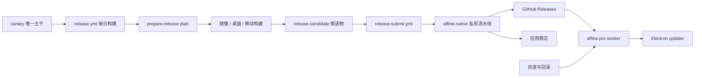
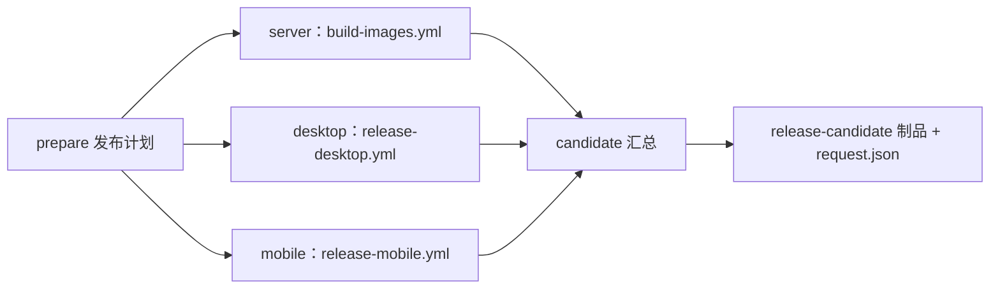
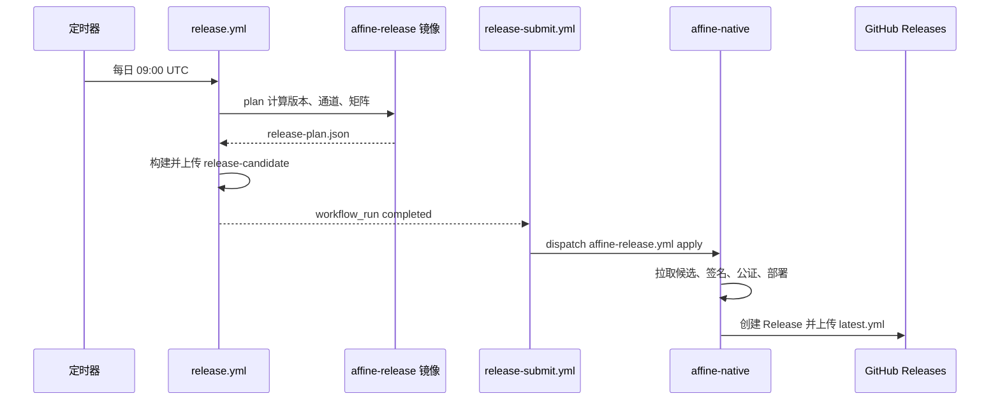

# 第 4 章 分支版本与发布节奏

一行代码从合并到用户手中的完整旅程

第 2 部分 · 项目管理与开源协作 ｜ 难度 ★★☆☆☆ ｜ 建议学时 3 小时

Note:
第 3 章我们走到了 PR 被 squash 合并进 canary 这一步。但合并之后呢？一行代码要经过哪些环节，才会出现在用户的桌面端、出现在 app.affine.pro 上、出现在 App Store 里？这一章就来回答这个问题。

---

## 本章导读

1. 为什么只有一个长期分支 `canary`？stable、beta 从哪来？
2. `v2026.10.27-canary.909` 与 `v0.27.5-beta.2` 意味着什么？
3. 每日 `release.yml` 为什么只产出"未签名候选包"？
4. 桌面端如何自动检测、下载、安装更新？
5. 如何灰度、如何回滚？`tools/revert-update` 回滚的是什么？

<div class="callout warn">

`b2e56529ee`（2026-10-26）将签名、部署、Helm Chart 移出公开仓库，交给私有仓库 `toeverything/affine-native`

</div>

Note:
这五个问题由浅入深。需要特别提醒的是，AFFiNE 的发布体系在 2026 年 10 月 26 日的提交 b2e56529ee 里刚刚经历了一次大调整，签名、部署、Helm Chart 都被移到了私有仓库。所以本章会明确区分"公开仓库里能看到的部分"和"只能从接口推断的部分"，网上较早的教程可能已经过时。

---

## 学习目标

1. 说明 canary 主干开发模型及 stable/beta 与之的关系
2. 解读日期式 canary tag 与语义化 beta/stable tag
3. 描述 `scripts/set-version.sh` 改了哪些文件
4. 画出 `release.yml` → `release-submit.yml` → 私有流水线调用链
5. 解释 Electron 自动更新的 feed、通道与文件筛选
6. 区分 feature flag、通道灰度与数据级回滚

Note:
第四条调用链是本章的主干，我们会用一张流程图和一张时序图把它讲透。第六条最容易混淆：功能级灰度、通道级灰度和数据级回滚是三个完全不同层次的风险控制手段。

---

## 知识地图



Note:
这张图从左到右就是一次发布的完整路径。前半段在公开仓库：canary 主干、每日构建、生成候选物；从 release-submit 开始交接给私有流水线，签名后发布到 GitHub Releases 和应用商店；最后桌面客户端经过官网 worker 拿到更新。灰度和回滚的主要抓手就在 worker 这一层。

---

## canary：唯一的长期分支

| 模型 | 特点 | 代表 |
| --- | --- | --- |
| Git Flow | `develop` + `release/*` + `hotfix/*` + `main` | 传统版本化软件 |
| GitHub Flow | 一个 `main` + 短期功能分支 | 持续部署 Web 服务 |
| Trunk-Based | 一个主干，频繁合入，发布从主干切出 | Google、AFFiNE |

- 远程默认分支 `origin/HEAD -> origin/canary`
- `build-test.yml` 仍监听 `beta`、`stable`、`v[0-9]+.[0-9]+.x` 等维护分支

Note:
AFFiNE 的默认分支是 canary，所有 PR 都向它提交，远程那些分支基本都是个人功能分支，`origin/release` 已经停在 2025 年 4 月不再活跃。这是典型的主干开发。不过 CI 仍为维护分支留了口子：当旧版本需要补丁而 canary 已经前进太多时，可以临时拉出维护分支做 backport。代价是主干必须时刻可发布，未完成功能要靠 feature flag 隐藏。

---

## stable 与 beta "长在" canary 上

```text
$ git tag --points-at v0.27.3
v0.27.3
v0.27.3-beta.2
v2026.7.23-canary.948

$ git log --oneline v0.27.4 -1
b4c8548c09 (tag: v2026.8.17-canary.914, tag: v0.27.4) feat(server): ...
```

<div class="callout">

一个 canary 提交验证后被直接**晋升（promote）**为 beta、再到 stable，三个 tag 指向同一提交

</div>

Note:
这是最有说服力的证据：同一个提交上同时打着 stable、beta 和 canary 三种 tag。也就是说，不需要单独的 release 分支，stable 和 beta 只是 canary 上被"选中"的提交。你也可以用 `git merge-base --is-ancestor` 验证这些 tag 都在 canary 的历史上。canary 既是开发主干，也是发布源头。

---

## 两套 tag 体系

| 通道 | 命名格式 | 样例 |
| --- | --- | --- |
| canary | `vYYYY.M.D-canary.N` | `v2026.10.27-canary.909` |
| beta | `vX.Y.Z-beta.N` | `v0.27.5-beta.2` |
| stable | `vX.Y.Z` | `v0.27.4` |

- 演进：`0.12.0-canary-2024...` → `v0.20.0-canary.1` → 2026-03 起日期式
- canary 不承诺兼容，用日期更直观；stable/beta 用 SemVer 表达兼容性

Note:
canary 用日期，beta 和 stable 用语义化版本。为什么改成日期式？语义化版本适合表达兼容性承诺，但 canary 每天都发、本身不承诺兼容，用户一看日期就知道是哪天的构建。至于 canary 后面的 N，比如 909、915，都集中在 900 左右，它由外部发布工具计算，具体规则在本仓库里无法查证。

---

## 发布节奏的真实数据

| stable | 日期 | beta 期 |
| --- | --- | --- |
| v0.26.7 | 2026-05-30 | beta.0–2 同日 |
| v0.27.0 | 2026-07-15 | 06-25 至 07-15，8 个 beta |
| v0.27.1 | 2026-07-15 | 与 0.27.0 同日快速补丁 |
| v0.27.4 | 2026-08-17 | 07-28 至 08-17 |
| 0.27.5 | 尚未 stable | beta.2 于 10-25 |

<p class="small">minor 版本 beta 期约 3 周；本地 tag 取决于 `git fetch --tags` 时间，仅代表本地快照</p>

Note:
从 tag 时间线能读出节奏：minor 版本从 0.26 到 0.27 有大约 3 周、8 个 beta 的验证期；patch 版本的 beta 期从当天到数周不等。0.27.0 发布当天就紧跟了 0.27.1，说明 stable 发布后发现问题会迅速补丁。当前根 package.json 的版本是 0.27.5，SECURITY.md 也只支持 0.27.x，与此一致。

---

## set-version.sh 与 iOS 日期版本

```bash
if [ -n "$IOS_APP_VERSION" ]; then
  # Manual override via environment variable
  ios_new_version=$IOS_APP_VERSION
elif echo "$new_version" | grep -qE '(canary|nightly)'; then
  # Canary/nightly: use the date of the last stable/beta tag
  ios_new_version=$(get_ios_version_from_git)
else
  # Stable/beta release: use today's date
  ios_new_version=$(date +"%Y.%-m.%-d")
fi
```

同步三处：所有 workspace `package.json`、`affine.metainfo.xml`、iOS `MARKETING_VERSION`

<p class="small">`scripts/set-version.sh`；CI 经 `.github/actions/setup-version` 在构建时调用</p>

Note:
版本号是构建时参数，不是提交到仓库的。set-version.sh 用 jq 批量改所有包的 version，同时更新 Linux AppStream 元数据和 iOS 工程。iOS 为什么用日期？因为苹果要求 CFBundleShortVersionString 单调递增，带 beta 后缀的版本没法直接用。canary 取最近一个 stable 或 beta tag 的日期，避免 canary 版本号超过下一个正式版。注意 `docs/contributing/releases.md` 描述的手动流程已经过时，是个文档漂移案例。

---

## release.yml：每日候选构建

```yaml
name: Release Candidates
on:
  schedule:
    - cron: '0 9 * * *'
  workflow_dispatch:
    inputs:
      targets:
        # ... description、required、type
        default: 'server,desktop-macos,desktop-windows,desktop-linux?'
permissions:
  contents: read
  actions: read
  packages: write
```

<p class="small">每天 UTC 09:00（北京 17:00）；`?` 后缀表示可选目标；无 `contents: write`，不能建 Release 或打 tag</p>

Note:
这就是每日 canary 的来源。定时任务每天 UTC 9 点运行，维护者也可以手动指定目标平台，问号后缀表示构建失败不阻塞整体，比如默认的 desktop-linux。最值得注意的是权限：顶层只给读权限和推送镜像用的 packages write，没有 contents write，所以这个工作流本身既不能创建 Release，也不能打 tag。

---

## 五个 Job



<p class="small">版本号、通道、`skip`、构建矩阵均由镜像 `ghcr.io/toeverything/affine-release` 的 `plan` 命令决定</p>

Note:
prepare 先生成发布计划：如果本 run 已经提交过候选物就报错，候选物不可变，重跑必须新开 run；然后找到上一个 canary 发布，判断有没有新提交、能不能跳过。真正的计算交给外部 Docker 镜像里的 plan 命令，发布规则和业务代码解耦。三个构建 job 复用子工作流，最后 candidate 汇总产物并生成 request.json，桌面包标为 unsigned，静态资源标为 ready。

---

## 桌面与移动端构建

<div class="cols">
<div>

**桌面端两级构建**

- `before-make`：`generate-assets` 产出 Web 资源
- 平台矩阵：编译 Rust `@affine/native`
- `build` → `package --platform --arch`
- `AFFINE_UNSIGNED_PACKAGE: '1'`

</div>
<div>

**移动端**

- `yarn affine bundle -p <platform>`
- 只打包 Capacitor 中的 **Web 层**
- 原生编译、签名、上架在私有流水线
- iOS 用 `fastlane/`，Android 用 `playstore-auto-bump`

</div>
</div>

Note:
桌面端分两级：先在 Ubuntu 上生成 Web 资源，再按平台矩阵在各自的 runner 上编译 Rust 原生模块、打包，Linux 上还会额外验证 .node 原生模块可以加载。关键点是公开仓库只产出未签名包。签名脚本 sign-macos.ts、sign-windows.ts 推测由私有流水线调用，actionlint 里登记的 win-signer 自托管 runner 也印证了这一点。

---

## release-submit：跨仓库交接

| 设计 | 作用 |
| --- | --- |
| `workflow_run` 触发 | 构建 run 本身不持有发布密钥 |
| `conclusion == 'success'` | 只提交完整成功的候选 |
| 校验 `head_repository.full_name` | 防止 fork 仓库触发 |
| 事件仅 `schedule` / `workflow_dispatch` | 防止 PR 等事件伪造候选 |
| GitHub App 短期 token，仅 `affine-native` | 最小权限、可审计、可轮换 |
| 只传 `candidate-run-id` | 私有侧自行拉取并校验制品 |

Note:
release-submit 在候选构建完成后触发，做了一连串来源校验，还会确认 run.path 确实是 release.yml。最后用一个仅授权 affine-native 仓库的 GitHub App 短期 token，dispatch 私有仓库的 affine-release.yml，而且只传一个 run id，私有流水线自己去拉取和校验制品，不信任传入的内容。签名证书、商店凭据、生产集群凭据都不出现在公开仓库中，大幅降低供应链攻击面。

---

## 两段式发布：build → promote



Note:
这就是两段式发布架构：公开仓库负责可复现地构建，私有仓库负责受控地签名与发布。从 release-submit 开始，流程进入公开仓库不可见的领域，后面的签名、公证、部署和上架我们只能根据接口推断。这种设计在安全和透明之间取得了平衡。

---

## 发布辅助工具

| 工具 | 作用 | 亮点 |
| --- | --- | --- |
| `scripts/generate-release-yml.mjs` | 生成 `latest.yml` 等更新清单 | SHA-512；`windows-arm64` 排最后 |
| `scripts/cleanup-canary-releases.sh` | 清理旧 canary Release | 默认 dry-run，`--yes` 才执行 |
| `tools/changelog` | 内部 Slack 发布通知 | 依赖 Conventional Commits |
| `tools/playstore-auto-bump` | Android `versionCode` +1 | 取本地与商店最大值 |

<p class="small">用户侧 Release Note 在官网博客；stable 的 `changelogUrl` 为 `https://affine.pro/what-is-new`</p>

Note:
发布不只是打包，还包括更新清单、版本号单调、清理历史、通知团队、对外说明五件事。generate-release-yml 把 windows-arm64 排到最后，是为了让旧的 x64 客户端不会默认下载 arm64 包，这是一个向后兼容细节。清理脚本默认 dry-run，是破坏性脚本的标准写法，学习时只读不执行。这些工具在公开工作流里都没有引用，推测由私有流水线调用。

---

## Electron 更新器配置

```ts
const disabled = buildType === 'internal' || isDev;
// ...
export const registerUpdater = async () => {
  if (disabled) {
    return;
  }
  // ...
  autoUpdater.autoDownload = false;
  autoUpdater.allowPrerelease = buildType !== 'stable';
  autoUpdater.autoInstallOnAppQuit = false;
  autoUpdater.autoRunAppAfterInstall = true;
  const feedUrl = AFFiNEUpdateProvider.configFeed({
    channel: buildType,
  });
```

<p class="small">`updater/electron-updater.ts`；`buildType` 由 `config.ts` 中 `ReleaseTypeSchema` 解析构建时注入的 `BUILD_TYPE`</p>

Note:
buildType 就是 release.yml 输出的 channel，构建时替换进主进程代码，取值是 stable、beta、canary、internal 四种。canary 包只会更新到 canary，通道即用户分群。internal 和开发模式不自动更新；不自动下载，由用户设置决定；非 stable 允许更新到预发布版本；不在退出时静默安装，而是让用户点"重启以更新"。检查时机是窗口获得焦点且距上次超过 30 分钟。

---

## 自定义更新源

```ts
  static configFeed(options: UpdateProviderOptions): CustomPublishOptions {
    return {
      provider: 'custom',
      feedUrl: 'https://affine.pro/api/worker/releases',
      updateProvider: AFFiNEUpdateProvider,
      ...options,
    };
  }
  get feedUrl(): URL {
    const url = new URL(this.options.feedUrl);
    url.searchParams.set('channel', this.options.channel);
    url.searchParams.set('minimal', 'true');
    return url;
  }
```

<p class="small">`updater/affine-update-provider.ts`：取最新 Release 的 `latest.yml`，再按平台、架构、安装器筛选</p>

Note:
AFFiNEUpdateProvider 是从 electron-builder 的 GitHubProvider 迁移来的。它请求官网 worker，带上通道参数，拿到该通道的 Release 列表，取最新一条里的 latest.yml，再用 availableForMyPlatformAndInstaller 按文件名解析通道、平台、架构和安装器类型。为什么不直接用 GitHub？中间加一层 worker，就能在不改客户端的前提下控制哪个版本对哪个通道可见，这正是灰度与回滚的抓手。

---

## 不同终端的到达时间

| 终端 | 到达路径 | 时延特征 |
| --- | --- | --- |
| Web | 服务端部署 + 静态资源 | 最快，刷新即生效 |
| 桌面端 | Release → worker → updater | 取决于用户打开与重启 |
| iOS / Android | 商店审核 | 最慢 |
| 自托管 | 管理员拉取新镜像 | 由管理员决定 |

<p class="small">通道环境：stable `app.affine.pro` ｜ beta `insider.affine.pro` ｜ canary `affine.fail`，对应后端 `Namespace`</p>

Note:
同一次发布，不同终端的到达时间差异很大。Web 最快，部署后刷新就生效；桌面端要等用户打开应用并点击重启；移动端受商店审核周期影响最慢；自托管完全由管理员决定。第 3 章 Bug 模板里的三个域名正好对应三个通道环境，后端 env.ts 的 Namespace 枚举 dev、beta、production 与之一一对应。

---

## 三层灰度

<div class="cols">
<div>

| 层级 | 机制 |
| --- | --- |
| 功能级 | feature flag |
| 通道级 | canary → beta → stable |
| 分发级 | worker 控制可见版本 |

</div>
<div>

```ts
const isCanaryBuild =
  BUILD_CONFIG.appBuildType === 'canary';
// ...
  enable_ai_playground: {
    category: 'affine',
    // ...
    configurable: isCanaryBuild,
    defaultState: isCanaryBuild,
  },
```

</div>
</div>

<p class="small">`packages/frontend/core/src/modules/feature-flag/constant.ts`（代码已换行排版）</p>

Note:
三层灰度各管一层。功能级用 feature flag，比如 enable_ai_playground 只在 canary 构建中默认开启且可配置，beta 和 stable 用户看不到。build-config.ts 里 canary 预设的注释也写着 canary 会激进地开启所有功能。主干开发模型下，未完成的功能通过 flag 合入主干而不影响稳定用户，这是 Trunk-Based 能成立的前提。

---

## revert-update：回滚的是文档数据

```ts
function generateRevertUpdate(
  fromNewerBin: Uint8Array,
  toOlderBin: Uint8Array
): Uint8Array {
  // ... newerDoc、olderDoc 分别 applyUpdate 加载新旧快照
  const newerState = encodeStateVector(newerDoc);
  const olderState = encodeStateVector(olderDoc);
  const diff = encodeStateAsUpdate(newerDoc, olderState);
  const undoManager = new UndoManager(Array.from(olderDoc.share.values()));
  applyUpdate(olderDoc, diff);
  undoManager.undo();
  return encodeStateAsUpdate(olderDoc, newerState);
}
```

<p class="small">`tools/revert-update/index.ts`：CRDT 只增不减，旧快照会被合并而非替换，必须生成"反向 update"</p>

Note:
这个工具名字容易误导，它不是回滚应用版本，而是回滚文档数据。原理是加载新旧两个 Yjs 快照，计算旧到新的增量，在旧文档上用 UndoManager 跟踪并应用这段增量，再 undo，得到抵消这段增量的操作。为什么不直接下发旧快照？因为 CRDT 只增不减，旧快照会和新状态合并。应用可以回滚，但用户数据的修复必须用 CRDT 的方式完成。代码回滚则用 git revert，版本回滚靠发布更高版本号的修复版。

---

## 源码导读 Top 5

| 优先级 | 路径 | 看什么 |
| --- | --- | --- |
| P0 | `.github/workflows/release.yml` | 定时触发、五个 job |
| P0 | `.github/actions/prepare-release/action.yml` | 外部工具 plan 输出 |
| P0 | `.github/workflows/release-submit.yml` | 跨仓库交接与校验 |
| P0 | `scripts/set-version.sh` | 版本同步、iOS 日期版本 |
| P0 | `.../electron/src/main/updater/electron-updater.ts` | 更新器配置与时机 |

<p class="small">`...` 即 `packages/frontend/apps`</p>

Note:
前三个文件构成发布流水线的骨架，建议按调用顺序读。set-version.sh 讲版本号，electron-updater 讲用户侧如何接收更新。读完后推荐看 P1 的 affine-update-provider.ts 和 revert-update，一个是灰度抓手，一个是数据回滚。

---

## 动手实践

1. **还原发布时间线**：≥ 5 个 stable，指出最长 beta 期
2. **验证晋升模型**：找到与 canary tag 同提交的 stable tag
3. **推演 iOS 版本号**：说明 canary 为何不用当天日期
4. **模拟更新文件筛选**：判断 3 个文件名对 macOS arm64 是否可用
5. **画发布流程图**：≥ 10 节点，标注公开与私有边界

Note:
这些练习都只用只读命令或阅读源码完成。练习三提示一下，可以运行 `git describe` 那条只读命令，当前 HEAD 输出是 v0.27.5-beta.2。练习四可以对照 updater.spec.ts 测试文件验证判断。切记不要执行 cleanup 清理脚本。

---

## 自测

**Q1：如何用一条命令证明 `v0.27.4` 与某 canary tag 同提交？**

`git tag --points-at v0.27.4`，可见 `v2026.8.17-canary.914` <!-- .element: class="fragment" -->

**Q2：为什么 `release.yml` 没有 `contents: write`？**

只构建候选物，发布交给私有流水线，最小权限 <!-- .element: class="fragment" -->

**Q3：Electron 客户端从哪检查更新？如何区分通道？**

`https://affine.pro/api/worker/releases`，查询参数 `channel` <!-- .element: class="fragment" -->

**Q4：为什么不能直接下发旧快照来回滚文档？**

CRDT 只增不减，旧快照会被合并；需生成反向 update <!-- .element: class="fragment" -->

Note:
这四道题分别对应分支模型、流水线权限、自动更新和数据回滚。第二题背后的思想值得反复体会：把"构建"和"发布"拆开，构建端不持有任何发布密钥，是整个两段式架构的安全基础。

---

## 常见坑

- 按 `releases.md` 找 `release-desktop-app.yml`：已不存在
- 本地 canary tag 数与 GitHub 不一致：未 fetch 或已被清理
- 本地桌面端没有自动更新：dev 与 internal 下 `disabled`
- 找 Helm Chart、deploy action：已被 `b2e56529ee` 移除
- 以为 `revert-update` 回滚客户端版本：它回滚 Yjs 数据
- 手动提交 `package.json` 版本号：版本应在构建时注入

Note:
本章的坑大多来自"文档或教程跟不上代码"。发布体系刚刚调整过，遇到找不到的文件，先以当前 HEAD 为准。另外 iOS 的 MARKETING_VERSION 是日期式，和商店展示版本不一致是正常的，商店版本在 App Store Connect 里另行设置。

---

## 小结与下一步

- canary 既是开发主干也是发布源头，stable/beta 由晋升而来
- canary 用日期 tag，beta/stable 用 SemVer
- 公开仓库可复现构建，私有仓库受控签名与发布
- 桌面更新 = 构建时通道 + worker 过滤 + `latest.yml` 清单
- 风险控制：feature flag + 通道晋升 + 分发控制 + CRDT 回滚

<div class="callout">

**下一章**：第 5 章 TypeScript 在 AFFiNE 中的应用 —— 进入第 3 部分编程语言与基础技术

</div>

Note:
本章我们完整走了一遍从合并 PR 到用户收到更新的旅程，也看到 AFFiNE 用日更 canary、功能开关、通道晋升、分发层控制和 CRDT 数据回滚构成了完整的风险控制链。下一章开始进入第 3 部分，我们从 TypeScript 入手，看这门语言在 AFFiNE 里是怎么被用到极致的。
