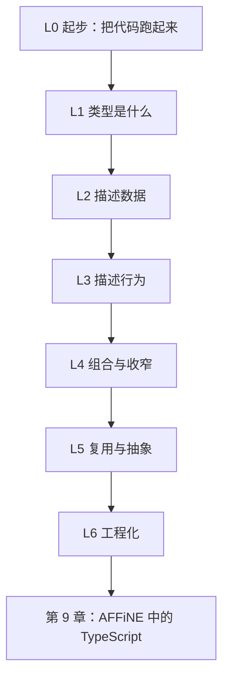

# 第 5 章 TypeScript 基础入门

> 从"完全没写过代码"到读懂 AFFiNE 的类型标注

第 3 部分 · 编程语言与基础技术 ｜ 难度 ★★☆☆☆ ｜ 建议学时 12 小时（零基础）／6 小时（有 JS 基础）

===

## 本章要解决的问题

<p class="lead">AFFiNE 几乎全用 TypeScript 写成。本章从"什么是变量"讲起，一路铺到第 9 章的起点——完全没写过代码也能从这里开始。</p>

TypeScript 的一句话定位：**JavaScript + 静态类型**。它在编译期检查类型、给你补全与重构，最终**擦除类型、编译回普通 JS** 运行——运行时没有类型。记牢这条，很多疑惑迎刃而解。

同一套内容按起点分三条路线。正文八节不依赖 L0 的任何记号，**跳过不会影响阅读**：

<div class="cards cols-3">
  <div class="card"><h4>完全零基础</h4><p>从 L0 起步，按顺序读完八节，随堂小练都动手做。约 12 小时。</p></div>
  <div class="card"><h4>会 JavaScript</h4><p>跳过 L0，每节看动机、最小例子与规则小结。约 6 小时。</p></div>
  <div class="card"><h4>会其他语言</h4><p>只看规则小结与常见坑，遇到不懂再回看例子。约 2 小时。</p></div>
</div>

<div class="note note--tip">

八节正文都按同一节奏推进：**这一节要解决什么 → 最小例子与逐行拆解 → 规则小结 → 最容易误解的点 → 随堂小练**。可据此判断该细读还是略读。

</div>

===

## 知识地图

本章是一条**阶梯**，不是并列的知识清单：后一级建立在前一级之上。



| 阶梯 | 回答的问题 | 对应小节 |
| --- | --- | --- |
| L0 | 代码是什么、怎么跑、报错怎么读 | 起步（新增） |
| L1 | 为什么需要类型 | 一 |
| L2 | 数据长什么样 | 二、三 |
| L3 | 行为长什么样 | 四 |
| L4 | "多种之一"怎么表达 | 五 |
| L5 | 相似类型要不要重复写 | 六、七 |
| L6 | 多文件怎么协作 | 八 |

===

## 学习目标

<ol class="goals">
  <li>能读懂一段 5 行 JavaScript：值、变量、表达式、赋值分别是什么</li>
  <li>能装好 Node 与 <code>tsc</code>，把 <code>.ts</code> 编译运行，并从报错里找出行号与原因</li>
  <li>说清 TS 与 JS 的关系，理解"类型擦除"的含义与限制</li>
  <li>用基础类型、<code>interface</code>、<code>type</code> 描述数据，并说清两者区别</li>
  <li>写出带类型的函数（可选/默认/剩余参数、重载）</li>
  <li>用联合类型、字面量类型与收窄表达"多选一"</li>
  <li>读写泛型函数与约束（<code>extends</code>），理解"类型的参数"这一本质</li>
  <li>使用常见工具类型，看懂 tsconfig 关键项，为第 9 章打底</li>
</ol>

===

## 从一段代码开始

程序就是**给计算机一串带顺序的指令**；指令操作的对象叫**值**，给值起个名字方便复用，这个带名字的位置叫**变量**。

<div class="split">
<div class="split__main">

- `let price = 10;` 声明变量 `price`，把值 `10` 放进去
- `=` 是**赋值**，不是数学等号：`count = count + 1` 完全合法
- `price * count` 是**表达式**（会算出一个值），整行 `let total = ...;` 是**语句**
- `console.log(...)` 只负责把结果显示出来，不参与计算

</div>
<div class="split__aside">

```js
let price = 10;
let count = 2;
let total = price * count;
console.log(total); // 输出：20
```

</div>
</div>

<div class="note">

**类比**：变量像贴了标签的盒子——`let price = 10` 就是"拿个盒子、贴 `price`、放进 10"，之后写 `price` 就是去拿盒子里的东西。`let` 可再赋值，`const` 不可，初学一律先用 `let`。

</div>

===

## 类型到底是什么

**类型就是"值的种类"**。它不是 TypeScript 发明的：JavaScript 的值本来就有类型，可以用 `typeof` 亲眼看。

<div class="split">
<div class="split__main">

| 值 | `typeof` 结果 |
| --- | --- |
| `42`、`3.14` | `number` |
| `'AFFiNE'`、`"20"` | `string` |
| `true`、`false` | `boolean` |
| `{ name: 'AFFiNE' }` | `object` |

关键点：**`42` 与 `'42'` 完全不同**。JS 不会阻止混用，只会尽力猜，猜错就悄悄给出奇怪结果。

</div>
<div class="split__aside">

```js
console.log(42 + 1);    // 输出：43
console.log('42' + 1);  // 输出：421
console.log(typeof 42); // 输出：number

let x = 42;      // 现在装 number
x = 'AFFiNE';    // 合法：现在装 string
```

</div>
</div>

<div class="note note--warn">

JavaScript 是**动态类型**：类型跟着**值**走，不跟着变量走，同一个变量可以这会儿装数字、过会儿装文字。TypeScript 要改的正是这一点——让变量在写下时就约定好只能装哪一类值，之后不守约便在编译期拦住。这就是「静态类型」。

</div>

===

## 函数、对象、数组

正文八节的例子只用这三种结构，这里一次认全。

<div class="cards cols-3">
  <div class="card"><h4>函数</h4><p>把一串操作打包、起名字、反复调用。<code>(a, b) =&gt; a + b</code> 是箭头函数简写，常作为回调交给别人调用。</p></div>
  <div class="card"><h4>对象</h4><p>一组「名字: 值」，用 <code>{ }</code> 写、靠名字取值：<code>item.price</code>。访问不存在的属性得到 <code>undefined</code> 且<b>不报错</b>。</p></div>
  <div class="card"><h4>数组</h4><p>有顺序的一串值，用 <code>[ ]</code> 写、靠位置取值：<code>items[0]</code>。<b>下标从 0 开始</b>，<code>length</code> 是元素个数。</p></div>
</div>

```js
function add(a, b) { return a + b; }
const item = { price: 10, count: 2 };
console.log(item.cuont); // 输出：undefined ← 拼错也不吭声
const cart = { items: [item, { price: 5, count: 3 }] };
console.log(cart.items[0].price); // 输出：10
```

<div class="note note--warn">

请记住 `item.cuont` 这一行——**拼错属性名，JavaScript 一声不吭地给出 `undefined`**，这就是下一页那个 bug 的根源。

</div>

===

## 拆开 reduce

下一页会用一行 `reduce` 算购物车总价。它只是"循环累加"的简写，先看清循环版就不再神秘。

<div class="compare">
  <div class="compare__col"><h4>循环版（朴素、好懂）</h4>

```js
let sum = 0;
for (const it of cart.items) {
  sum = sum + it.price * it.count;
}
```

  </div>
  <div class="compare__col compare__col--good"><h4>reduce 版（等价）</h4>

```js
const sum = cart.items.reduce(
  (s, it) => s + it.price * it.count,
  0
);
```

  </div>
</div>

| 循环版 | `reduce` 版 |
| --- | --- |
| `let sum = 0` | 第二个参数 `, 0`（累加盒初始值） |
| `for (const it of …)` | 由 `reduce` 内部遍历，当前元素交给 `it` |
| `sum = sum + …` | 箭头函数的结果自动成为下一轮的 `s` |
| 循环结束后的 `sum` | 整个 `reduce(...)` 表达式的值 |

**一句话记法**：`reduce(怎么把当前元素并进累加盒, 累加盒初始值)`。

===

## 把代码跑起来

<ol class="steps">
  <li><h4>装 Node.js</h4><p>官网下载 LTS，终端执行 <code>node --version</code> 验证。Node 让 JS 脱离浏览器直接运行。</p></li>
  <li><h4>装编辑器与 tsc</h4><p>VS Code 会在打字时画红线；<code>npm install -g typescript</code> 后 <code>tsc --version</code> 验证。</p></li>
  <li><h4>编译并运行</h4><p><code>tsc --target esnext hello.ts</code> 生成 <code>hello.js</code>，再 <code>node hello.js</code>。</p></li>
  <li><h4>亲眼看见擦除</h4><p>打开生成的 <code>.js</code>，<code>: number</code> 全都不见了——类型只在开发期存在。</p></li>
</ol>

<div class="compare">
  <div class="compare__col"><h4>hello.ts（你写的）</h4>

```ts
let price: number = 10;
let count: number = 2;
console.log(price * count);
```

  </div>
  <div class="compare__col compare__col--good"><h4>hello.js（tsc 生成的）</h4>

```js
let price = 10;
let count = 2;
console.log(price * count);
```

  </div>
</div>

<div class="note note--warn">

**报错怎么读**：`hello.ts:1:5 - error TS2322: Type 'string' is not assignable to type 'number'` 依次是「文件:行:列」「错误码」「给了什么 / 需要什么」。三步法：定位 → 读懂差异 → 改值或改约定。红线不是"你写错了代码"，而是"你写的与你自己声明的约定不一致"。

</div>

全程不需要碰 AFFiNE 仓库，一个 `learn-ts` 文件夹就够。

===

## 为什么要类型：一个真实的 bug

<div class="split">
<div class="split__main">

拼错字段名，运行时静默得到 `NaN`。完整链条：`it.count` → `undefined` → `10 * undefined` → `NaN` → 累加结果 `NaN`，**全程没有任何报错**，往往到界面显示时才被发现。

右栏的 `reduce` 已在「拆开 reduce」里逐项对照过；这里只看类型如何拦住它：TypeScript 让你**在写代码时**就报错——对象字面量里 `cuont` 不存在于 `CartItem`。

类型的价值：**把一类运行时错误提前到编译期**，并带来补全、跳转、安全重构。错误发生的地方与被发现的地方，从此不再隔很远。

</div>
<div class="split__aside">

```ts
interface CartItem {
  price: number;
  count: number;
}
function total(cart: { items: CartItem[] }) {
  return cart.items.reduce(
    (s, it) => s + it.price * it.count, 0);
}
total({ items: [{ price: 10, cuont: 2 }] });
// ❌ “cuont”不存在于类型 CartItem
```

</div>
</div>

<div class="note note--warn">

**类型擦除**：上面的 `interface`、`: number` 编译后**全部消失**，生成的 JS 与手写版几乎一样。所以你**不能**在运行时判断"某值是不是某接口"——运行时根本没有这个类型。

</div>

===

## 类型基础与推断

先读懂标注语法：`let title: string = 'AFFiNE';` 读作"声明变量 `title`，约定它只能装 `string`，初始值放 `'AFFiNE'`"。冒号后面是**约定**，等号后面是**值**。

大多数时候**不用手写类型**，交给编译器推断；函数参数、公共 API 再显式标注——参数没有初始值可推断，不写在 `strict` 下会直接报错。

<div class="split">
<div class="split__main">

- 基础类型：`string`/`number`/`boolean`/`null`/`undefined`；
- 数组 `string[]`、元组 `[string, number]`（定长、每位类型固定）；
- `const` 比 `let` 推断得更"窄"（字面量类型）。

**法则**：初始化与返回值让它自动推断，参数与对象结构显式标注——标注既是检查也是文档。

</div>
<div class="split__aside">

```ts
let title = 'AFFiNE';   // string
const mode = 'page';    // 'page'（字面量）
const list = [1, 2, 3]; // number[]
let pair: [string, number] = ['x', 1];
```

</div>
</div>

===

## any 是逃生舱，unknown 才安全

<div class="compare">
  <div class="compare__col"><h4><code>any</code></h4>

- 放弃类型检查，任何操作都允许
- 会像病毒一样**扩散**，让类型保护失效
- 能不用就不用

  </div>
  <div class="compare__col compare__col--good"><h4><code>unknown</code></h4>

- "我也不知道是什么"
- 使用前**必须先收窄**，否则报错
- 接收外部/不可信输入时优先用它

  </div>
</div>

```ts
const data: unknown = JSON.parse('{}');
// data.foo;  // ❌ unknown 不能直接用
if (typeof data === 'object' && data) { /* 收窄后才能用 */ }
```

===

## 描述对象：interface 与 type

两者都能描述对象，日常可互换，但有两个关键区别——第 9 章会用到。

<div class="annotate">

```ts [1-5|7-9|11]
interface User {
  id: string;
  name?: string;      // 可选
  readonly at: number; // 只读
}
interface User { role: string; } // 同名自动合并（声明合并）
// User = { id; name?; at; role }
type Point = { x: number } & { y: number }; // 交叉组合
```

<ol class="annotate__notes">
  <li><b>只有 type</b> 能做联合、交叉、元组、映射类型等"类型运算"。</li>
  <li><b>只有 interface</b> 支持声明合并——AFFiNE 用它扩展全局接口（后端 <code>Events</code>、<code>AppConfigSchema</code>）。</li>
</ol>
</div>

<div class="note">

经验：描述"对象/类的形状、要被扩展或合并"用 `interface`；要"类型运算"用 `type`。

</div>

===

## 函数类型

<div class="split">
<div class="split__main">

- 标注参数与返回值；
- 可选 `?`、默认值、剩余参数 `...rest`；
- 函数本身也是一种类型（回调）；
- 重载：同名多签名，实现只有一个。

</div>
<div class="split__aside">

```ts
function greet(
  name: string,
  greeting = 'Hi',
  ...rest: string[]
): string {
  return `${greeting}, ${name}`;
}
type Handler = (e: string) => void;
const onClick: Handler = e => console.log(e);
```

</div>
</div>

===

## 联合类型与收窄

<p class="lead">联合类型 <code>A | B</code> 表示"是 A 或 B"，配合字面量类型可精确枚举取值。</p>

```ts
type DocMode = 'page' | 'edgeless'; // 只能是这两个之一
```

> 这正是第 1 章见过的 `DocMode`——AFFiNE 大量用"字符串字面量联合"代替枚举。

用联合后，使用前常需**收窄**到具体分支：`typeof`、`instanceof`、`in`、字面量比较。

<div class="note note--tip">

**可辨识联合**：每个分支带一个共同的字面量字段（如 `kind`），用 `switch (s.kind)` 即可自动收窄——这是 TS 建模状态机、消息类型的利器。

</div>

===

## 可辨识联合示例

```ts
type Shape =
  | { kind: 'circle'; r: number }
  | { kind: 'rect'; w: number; h: number };

function area(s: Shape): number {
  switch (s.kind) {
    case 'circle': return Math.PI * s.r ** 2; // 收窄为 circle
    case 'rect': return s.w * s.h;            // 收窄为 rect
  }
}
```

<ul class="takeaways">
  <li>删掉任一 <code>case</code> 分支时，配合 <code>strict</code> 编译器能提示"未覆盖"——让状态处理无遗漏。</li>
</ul>

===

## 泛型：类型的"参数"

<p class="lead">泛型让类型像函数一样接收参数，写出"对多种类型都成立"的可复用代码。</p>

**为什么需要它**：要"原样返回传入的值"，不用泛型只有三条路——按类型复制 N 份函数、全用 `any`（丢掉"传什么就返回什么"这个事实）、或用联合（返回类型被撑宽）。函数之所以能复用，是因为把**会变的值**抽成了参数；泛型做的是同一件事，只不过抽的是**会变的类型**。

<div class="split">
<div class="split__main">

- `identity<T>(x: T): T` —— 入参与返回同类型；
- `interface Box<T> { value: T }` —— 泛型接口；
- 多数时候 `T` 能从实参**自动推断**，不用手写 `<...>`。

</div>
<div class="split__aside">

```ts
function identity<T>(x: T): T { return x; }
identity('a');  // T = string（推断）
identity(42);   // T = number

interface Box<T> { value: T; }
const b: Box<number> = { value: 1 };
```

</div>
</div>

===

## 泛型约束 extends

限制类型参数"至少具备某些结构"，就能在函数体内安全使用这些结构：

<div class="annotate">

```ts [1|4]
function longest<T extends { length: number }>(a: T, b: T): T {
  return a.length >= b.length ? a : b;
}
longest('ab', 'abc'); // 字符串有 length ✅
longest(1, 2);        // ❌ number 没有 length
```

<ol class="annotate__notes">
  <li><b>约束</b>：T 可为任意类型，但必须有 <code>length: number</code>。</li>
  <li>仍保留"返回值类型 = 传入类型"的能力。</li>
</ol>
</div>

<div class="note note--tip">

第 9 章的 `createIdentifier<T>()`、`LiveData<T>`、`defineBlockSchema` 都靠泛型推断。把"**泛型 = 给类型传参**"记牢，就能看懂这些 API。

</div>

===

## 工具类型：对类型做运算

由已有类型派生新类型，是"类型层面的 DRY"——数据结构改一处，派生自动跟着变。

| 工具类型 | 作用 |
| --- | --- |
| `Partial<T>` | 所有属性变可选 |
| `Required<T>` | 所有属性变必填 |
| `Readonly<T>` | 所有属性变只读 |
| `Pick<T, K>` | 挑选部分属性 |
| `Omit<T, K>` | 去掉部分属性 |
| `Record<K, V>` | 构造键值映射 |
| `ReturnType<F>` | 取函数返回值类型 |

```ts
type PartialUser = Partial<User>;        // 全可选
type UserMap = Record<string, User>;     // { [k:string]: User }
type R = ReturnType<() => number>;       // number
```

它们不是魔法。`Partial` 的简化实现只用本章已学过的东西：

```ts
type MyPartial<T> = { [K in keyof T]?: T[K] };
```

`keyof T` 取出所有属性名组成联合，`K in …` 逐个遍历，`T[K]` 取回该属性原来的类型，`?` 把它变可选——这就是**映射类型**。条件类型（`T extends U ? X : Y`）则是类型层面的 if，`Exclude`、`ReturnType`、`Awaited` 都基于它。

===

## 模块、声明文件与 tsconfig

<div class="cards cols-3">
  <div class="card"><div class="card__icon">📦</div><h4>模块</h4><p>标准 ES 语法；<code>import type</code> 只导入类型，编译后整行消失、避免循环依赖。</p></div>
  <div class="card"><div class="card__icon">📄</div><h4>.d.ts 声明文件</h4><p>只含类型、不含实现；给纯 JS 库或全局对象补类型，codegen 产物多是它。</p></div>
  <div class="card"><div class="card__icon">⚙️</div><h4>tsconfig</h4><p><code>strict</code> 开全严格、<code>noEmit</code> 只检查不产出（编译交给打包器）。</p></div>
</div>

`strict` 不是单一开关，而是一组检查的总闸：`noImplicitAny`（参数不写类型就报错）、`strictNullChecks`（拦住 `null`/`undefined` 乱窜）、`strictFunctionTypes` 等。`noEmit: true` 时 `tsc` **只做检查**，真正产出 JS 的是 Vite / Rspack / SWC——"类型没错"和"能打包"是两件事。

<div class="note note--tip">

**通往第 9 章**：AFFiNE 把 tsconfig 拆成 `tsconfig.json`/`.web.json`/`.node.json` 并用"项目引用"做增量构建，还会发现 `tsc` 是 TS 7 原生版。本章看懂单个 tsconfig，到那里只是"规模放大"。

</div>

===

## 动手实践

按阶梯递进，前两题零基础也能做；建议做完一题再往下走。

<ol class="steps">
  <li><h4>跑通并故意犯错</h4><p>按「把代码跑起来」建好 <code>hello.ts</code>，先让它正常输出，再把 <code>number</code> 的值改成文字，完整读一遍报错后改回。<b>验收</b>：能指认报错里的文件名、行号与"给了什么 / 需要什么"。</p></li>
  <li><h4>给现成代码补类型</h4><p>为 <code>function total(items) { return items.reduce((s, it) =&gt; s + it.price * it.count, 0); }</code> 声明 <code>Item</code> 接口并标注参数/返回值，再故意把 <code>count</code> 拼错。<b>验收</b>：拼写错误在编译期被拦下。</p></li>
  <li><h4>用可辨识联合建模</h4><p>为"加载中/成功/失败"三态设计 <code>RequestState&lt;T&gt;</code> 并用 switch 穷尽处理，加 <code>assertNever</code> 兜底。<b>验收</b>：删任一分支或新增第四态都能报错。</p></li>
  <li><h4>写自己的工具类型</h4><p>不查资料手写 <code>MyPartial&lt;T&gt;</code> 与 <code>MyPick&lt;T, K&gt;</code>（提示：<code>[K in keyof T]</code>）。<b>验收</b>：改 <code>User</code> 字段后派生类型自动更新，能解释 <code>keyof</code> 与 <code>T[K]</code>。</p></li>
  <li><h4>读 AFFiNE 的类型</h4><p>打开 <code>packages/common/infra</code> 任一 .ts，各找一处泛型、联合、<code>import type</code>、工具类型并解释。<b>验收</b>：说清每处在表达什么约束、属于 L2–L6 哪一级。</p></li>
</ol>

===

## 自测：点击揭晓答案

<details class="quiz">
<summary>Q1（L0）. `42` 与 `'42'` 有什么区别？`'42' + 1` 得到什么？</summary>

`42` 是 `number`，`'42'` 是 `string`。`+` 遇到字符串会做拼接，故得到文字 `'421'`。JavaScript 不会阻止这种混用，TypeScript 会在编译期拦下。

</details>

<details class="quiz">
<summary>Q2（L0）. `reduce((s, it) => s + it.price * it.count, 0)` 里末尾的 `0` 是什么？</summary>

累加盒的初始值。第一次调用箭头函数时 `s` 是 0，之后每轮的返回值成为下一轮的 `s`；整个 `reduce` 的返回值就是最后一轮的累加结果。

</details>

<details class="quiz">
<summary>Q3（L0）. 一条 `hello.ts:1:5 - error TS2322: ...` 报错，各部分说明什么？</summary>

`hello.ts:1:5` 定位到文件第 1 行第 5 列；`error TS2322` 是错误码；后面那句英语说明"给了什么类型、这里需要什么类型"。按「定位 → 读懂差异 → 改值或改约定」三步处理。

</details>

<details class="quiz">
<summary>Q4（L1）. "类型擦除"是什么意思？带来什么限制？</summary>

类型只在编译期存在，编译为 JS 后全部擦除，运行时没有类型。因此不能在运行时直接判断"某值是不是某接口"，需用 `typeof`/`in`/类型守卫等运行时手段收窄。附带推论：类型检查通过不代表逻辑正确。

</details>

<details class="quiz">
<summary>Q5（L2）. interface 与 type 最关键的两个区别？</summary>

① 只有 type 能做联合/交叉/元组/映射等类型运算；② 只有 interface 支持声明合并（AFFiNE 用它扩展全局接口）。描述对象形状两者都行。

</details>

<details class="quiz">
<summary>Q6（L4）. 为什么 unknown 比 any 安全？void 与 never 又差在哪？</summary>

any 关闭检查并会扩散；unknown 表示"未知"，使用前必须先收窄，编译器强制你做类型判断。外部输入应优先用 unknown。`void` 是正常返回但没有有用的值；`never` 是根本走不到返回（抛错、死循环、穷尽检查兜底）。

</details>

<details class="quiz">
<summary>Q7（L5）. 泛型约束与映射类型分别在做什么？</summary>

`<T extends { length: number }>` 要求 T 至少具备该结构，从而函数体内可安全访问 `.length`，同时保留"返回类型 = 传入类型"。映射类型 `[K in keyof T]?: T[K]` 逐个遍历属性名做统一变换，`Partial` 等工具类型就由它实现，编译后同样被擦除。

</details>

===

## 小结与下一步

<ul class="takeaways">
  <li>值有类型、变量可以有约定；静态类型把检查提前到编译期，改写下即生效。</li>
  <li>TypeScript = JavaScript + 静态类型；类型在编译期检查、运行时擦除，所以运行时判断要靠收窄。</li>
  <li>按形状匹配（结构化类型）：<code>interface</code> 描述形状并支持声明合并，<code>type</code> 负责类型运算。</li>
  <li>联合 + 收窄（尤其可辨识联合）是最常用的建模方式；<code>unknown</code> 圈出不可信边界。</li>
  <li>泛型 = 给类型传参，<code>extends</code> 施加约束；工具类型用映射类型做"类型级 DRY"。</li>
  <li><code>import type</code> 与 tsconfig 的 strict/noEmit 是工程化基础；<code>tsc</code> 只检查，产出 JS 交给打包器。</li>
</ul>

<div class="note note--tip">

**下一章预告**：第 6 章前端框架基础入门——用本章的泛型与联合类型，快速建立 React、Lit、Signals、RxJS 的核心心智，为第 10 章的前端技术栈打底。

</div>
