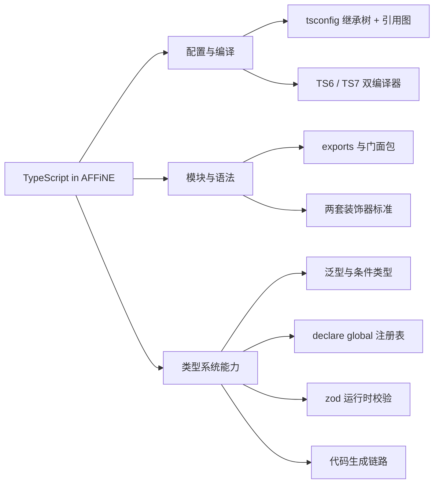
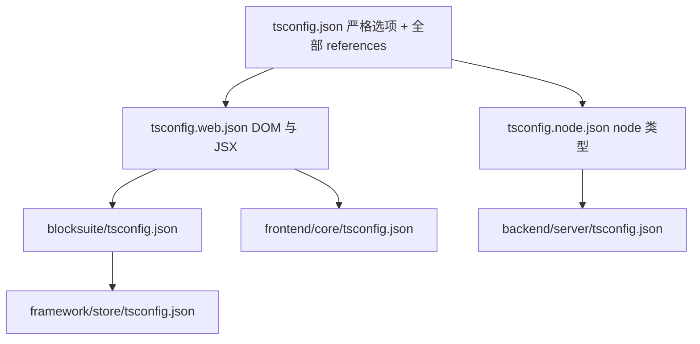
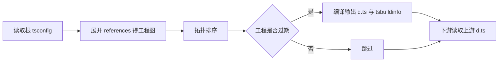
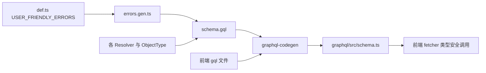

# 第 5 章 TypeScript 在 AFFiNE 中的应用

> 语法速成 + 真实用法双线并行，读懂项目里 90% 的类型代码

第 3 部分 · 编程语言与基础技术 ｜ 难度 ★★★☆☆ ｜ 建议学时 8 小时

===

## 本章要解决的问题

<p class="lead">AFFiNE 几乎全栈 TypeScript：React 应用、BlockSuite（Lit）、NestJS 后端、Electron、构建脚本，统统用 TS 写。</p>

打开仓库，你会被三类东西「劝退」。本章对每个知识点先用一两句讲清原理，再立刻挂到仓库真实代码上。

<div class="cards cols-3">
  <div class="card"><div class="card__icon">⚙️</div><h4>配置层</h4><p>4 个 <code>tsconfig*.json</code>、一百多条 <code>references</code>、<code>typescript</code> 被写成奇怪的 <code>npm:@typescript/typescript6</code> 别名。</p></div>
  <div class="card"><div class="card__icon">🎀</div><h4>语法层</h4><p>后端满屏 <code>@Module @Resolver @Field</code>，编辑器满屏 <code>@property accessor</code>——两套不同的装饰器标准。</p></div>
  <div class="card"><div class="card__icon">🧠</div><h4>类型体操层</h4><p><code>TypesToDeps&lt;ConstructorParameters&lt;Arg1&gt;&gt;</code>、<code>`${P}$`</code> 键重映射、<code>Extract&lt;Queries, {name: Q['id']}&gt;</code>……</p></div>
</div>

===

## 知识地图

八大主题分三组：**配置与编译（1-2）→ 模块与语法（3-4）→ 类型系统能力（5-9）**。



<div class="note">

一条贯穿全章的主线：**内核（BlockSuite）与应用（core/server）在类型层面刻意解耦**——从 tsconfig 的 `types` 白名单，到 `DocMeta` 的模块增强，处处可见这条边界。

</div>

===

## 学习目标

<ol class="goals">
  <li>说清根 <code>tsconfig</code> 与 <code>web/node</code> 基线、各包 <code>tsconfig</code> 的继承/引用关系，解释 <code>tsc -b</code> 增量构建</li>
  <li>解释 <code>typescript</code>→TS6、<code>@typescript/native</code>→TS7 两个别名，知道 <code>tsc</code> 实际指向谁</li>
  <li>根据 <code>exports</code> 推断 <code>@blocksuite/affine/store</code> 解析到哪个源文件</li>
  <li>区分 NestJS legacy 装饰器与 Lit 标准装饰器（<code>accessor</code>），说清为何能共存</li>
  <li>读懂 <code>createIdentifier</code>、<code>SignaledProps</code>、<code>QueryResponse&lt;Q&gt;</code> 等泛型与条件类型</li>
  <li>用 <code>declare global</code> 扩展全局接口，识别代码生成文件及其再生方式</li>
</ol>

===

<!-- section -->
## 一、tsconfig 体系

一棵「继承树」（`extends`）加一张「引用图」（`references`），这是两个正交的概念。

===

## extends 与 references 的分工

初学者最易混淆这两者。记住类比就不会错：

<div class="compare">
  <div class="compare__col"><h4><code>extends</code>：继承编译选项</h4>

- 继承 strict、target、lib 等
- 子配置覆盖父配置
- 类比 **CSS 继承**

  </div>
  <div class="compare__col compare__col--good"><h4><code>references</code>：声明工程依赖</h4>

- `tsc -b` 据此按拓扑顺序增量构建
- 类比 **package.json 的 dependencies**
- 由 `yarn affine init` 自动生成

  </div>
</div>



===

## 根 tsconfig：严格基线 + 引用清单

根配置是一个「solution 配置」——`include`/`files` 都是 `[]`，**自己不编译任何文件**，只把所有子工程串起来。

<div class="annotate">

```jsonc [3|4|9|12]
{
  "compilerOptions": {
    "strict": true,
    "verbatimModuleSyntax": true,
    "noImplicitOverride": true,
    "noUnusedLocals": true,
    "module": "ESNext",
    "moduleResolution": "bundler",
    "useDefineForClassFields": false,
    "composite": true
  },
  "include": [], "files": [],
  "references": [ { "path": "./blocksuite/affine/all" } ]
}
```

<ol class="annotate__notes">
  <li><b>verbatimModuleSyntax</b>：「所写即所得」，纯类型必须写 <code>import type</code>，否则报 TS1484。</li>
  <li><b>noImplicitOverride</b>：覆写父类成员必须写 <code>override</code>——这就是 Lit 组件 <code>override render()</code> 遍地的原因。</li>
  <li><b>useDefineForClassFields: false</b>：类字段编译为构造函数内赋值而非 defineProperty，对 Lit 至关重要（见后文）。</li>
  <li><b>references</b> 由 CLI 生成，注释写明「do not modify it manually」。</li>
</ol>
</div>

===

## tsc -b：增量构建原理

`yarn typecheck` = `tsc -b tsconfig.json --verbose`。它为什么又快又能检查整个仓库？



<div class="note note--tip">

关键：下游工程（如 `core`）**读取上游（如 `infra`）的 `dist/*.d.ts` 而不是重新检查源码**，这是大型 monorepo 能在可接受时间内完成类型检查的秘诀。`composite: true` 是参与 `-b` 的前提，`tsBuildInfoFile` 记录哈希做增量。另外 `web` 基线加 `DOM` 与 `jsx: react-jsx`，`node` 基线**没有 DOM**——在后端写 `window.xxx` 会直接类型错误，这是「用类型系统隔离运行环境」。

</div>

===

<!-- section -->
## 二、两个 TypeScript 并存

`typescript` 名下是 TS6（给工具链用 JS API），`@typescript/native` 名下是 TS7（`tsc` 命令实际指向它）。

===

## 为什么要「反着起名」

根 `package.json` 用 Yarn 的 **npm 别名协议** `"<本地名>": "npm:<真实包>@<版本>"`：

<div class="annotate">

```json [1|3]
"@typescript/native": "npm:typescript@7.0.2",
"oxlint-tsgolint": "7.0.2001",
"typescript": "npm:@typescript/typescript6@6.0.2",
```

<ol class="annotate__notes">
  <li><b>typescript</b> → <code>@typescript/typescript6</code>：JS 实现的传统编译器，提供 <code>require('typescript')</code> 的 JS API（打包插件、vanilla-extract、IDE 都需要）。</li>
  <li><b>@typescript/native</b> → <code>typescript@7.0.2</code>：Go 重写的原生编译器（tsgo），速度显著更快。</li>
</ol>
</div>

| 名字 | bin 名 | 谁在用 |
| --- | --- | --- |
| `node_modules/typescript`（TS6） | `tsc6` | 依赖 JS API 的工具链 |
| `node_modules/@typescript/native`（TS7） | `tsc` | 命令行类型检查 |

<div class="note note--warn">

因此 `node_modules/.bin/tsc` 链接到 `@typescript/native/bin/tsc`——`yarn typecheck` 跑的是 **TS7 原生编译器**。若 IDE（VS Code 内置 TS）与命令行报错不一致，第一个要怀疑的就是「两边不是同一个编译器版本」。

</div>

===

<!-- section -->
## 三、模块解析与门面包

内部包 source-first 直出 `src/*.ts`，`@blocksuite/affine` 用 207 个子路径做门面。

===

## source-first exports 与 Facade

<div class="split">
<div class="split__main">

AFFiNE 内部包几乎都**直接导出 `src/*.ts` 源文件**。`moduleResolution: bundler` 下，TS 读 `exports`：

- `from '@toeverything/infra'` → `./src/index.ts`
- `from '@toeverything/infra/op'` → `./src/op/index.ts`
- `from '@toeverything/infra/src/foo'` → **解析失败**（未暴露路径一律不可访问）

`@blocksuite/affine`（`blocksuite/affine/all`）有 **207** 个 `exports` 条目，每个子路径只是一行再导出，应用层只依赖这一个门面包即可。`.oxlintrc.json` 的 `no-restricted-imports` 再禁止从 `**/dist`、`**/src` 导入，强迫走公开入口。

</div>
<div class="split__aside">

```ts
// affine/all/src/store/index.ts
export * from '@blocksuite/store';
```

```json
// infra/package.json
"exports": {
  "./op": "./src/op/index.ts",
  ".": "./src/index.ts"
}
```

</div>
</div>

<div class="note">

好处：开发时无需先构建依赖包，Vite/Rspack 直接编译源码、改动即时生效、跳转定义直达 `.ts`。唯一例外是根 tsconfig 的 `paths`：`"@affine/core/*"` 因 core 导出复杂而保留映射。

</div>

===

<!-- section -->
## 四、两套装饰器标准

后端用 legacy 装饰器（含参数装饰器 + 元数据），BlockSuite/前端用 TC39 标准装饰器（`accessor`）。靠 tsconfig 隔离在不同工程里。

===

## legacy vs 标准：差在哪

<div class="compare">
  <div class="compare__col"><h4>Legacy（实验性）</h4>

- `experimentalDecorators: true`
- 支持 `@Args() x` **参数装饰器**
- 配 `emitDecoratorMetadata` 输出 `design:paramtypes`
- 使用者：**后端 NestJS**

  </div>
  <div class="compare__col compare__col--good"><h4>TC39 标准（TS 5.0+）</h4>

- 默认即可，不开 experimental
- **不支持**参数装饰器
- 不输出 design 元数据
- 推荐装饰 `accessor`；使用者：**BlockSuite / Lit**

  </div>
</div>

<div class="note">

后端 `packages/backend/server/tsconfig.json` 单独开了 `experimentalDecorators` + `emitDecoratorMetadata`，还关了 `verbatimModuleSyntax`（兼容「把纯类型当值导入」及元数据对运行时类型的需求）；根配置没开。两套规范就此被 tsconfig 隔离在不同工程，各取所需。

</div>

===

## NestJS DI 的秘密：元数据

读 Resolver 要抓住一点：构造函数**没有任何 `@Inject()`，Nest 怎么知道注入什么？**

<div class="annotate">

```ts [3-6|8-9]
// backend/server/src/core/user/resolver.ts
@Resolver(() => UserType)
export class UserResolver {
  constructor(
    private readonly storage: AvatarStorage,
    private readonly models: Models
  ) {}
  @Query(() => UserOrLimitedUser, { name: 'user', nullable: true })
  async user(@Args('email') email: string) { /* ... */ }
}
```

<ol class="annotate__notes">
  <li><b>构造函数注入</b>：<code>emitDecoratorMetadata</code> 为被装饰类生成 <code>design:paramtypes</code>，Nest 读它完成注入——所以参数类型必须是<b>运行时存在的类</b>，不能是 <code>interface</code>。</li>
  <li><b>参数装饰器</b>：<code>@Args('email')</code> 只有 legacy 装饰器支持；<code>@Field(() =&gt; String, {nullable:true})</code> 显式写类型，是因为 <code>design:type</code> 对 <code>string | null</code> 只能得到 <code>Object</code>。</li>
</ol>
</div>

===

## Lit accessor 与 useDefineForClassFields

标准装饰器推荐装饰 `accessor`（自动访问器）。Lit 拦截其 getter/setter，在 setter 中调 `requestUpdate()` 触发重渲染。

<div class="annotate">

```ts [5-6|8-9]
// blocksuite/affine/blocks/paragraph/src/heading-icon.ts
export class ParagraphHeadingIcon extends SignalWatcher(
  WithDisposable(ShadowlessElement)
) {
  override render() {
    const type = this.model.props.type$.value; /* ... */
  }
  @property({ attribute: false })
  accessor model!: ParagraphBlockModel;
}
```

<ol class="annotate__notes">
  <li><b>strict 下的 <code>!</code></b>：确定赋值断言，告诉编译器「框架会赋值」。</li>
  <li><b>同类用法</b>：<code>@state() accessor</code>（内部状态）、<code>@query() accessor</code>（查询渲染根元素）。</li>
</ol>
</div>

<div class="note note--warn">

**为何 `useDefineForClassFields: false` 很重要**：某些 Lit 组件用 `static properties` 在**原型上**定义响应式访问器。若类字段用 define 语义，实例上的同名属性会**遮蔽**原型访问器，赋值不再触发更新——Lit 官方明确警告的坑。设为 `false` 后，`x = null` 编译为 `this.x = null`，走原型 setter。

</div>

===

<!-- section -->
## 五、类型体操：三个项目级实例

幽灵类型、键重映射、`as const` + `Extract` 查表，是读懂 infra / BlockSuite / GraphQL 层的钥匙。

===

## 实例一：createIdentifier 与 TypesToDeps

前端 DI 需要一种「既是值又携带类型」的标识符。靠**幽灵类型**实现：

<div class="annotate">

```ts [3-5|7|9-12]
// infra/src/framework/core/types.ts
export type Identifier<T> = {
  identifierName: string;
  variant: ComponentVariant;
  __TYPE__: T;
};
export type IdentifierType<T> = T extends Identifier<infer R> ? R : never;
// 对构造函数参数元组逐位置要求一个「能产出该类型」的标识符
export type TypesToDeps<T> = {
  [index in keyof T]: GeneralIdentifier<T[index]>
    | (T[index] extends (infer I)[] ? [GeneralIdentifier<I>] : never);
};
```

<ol class="annotate__notes">
  <li><b>幽灵类型</b>：<code>__TYPE__: T</code> 运行时不存在，只让类型系统「记住」 <code>T</code>，<code>IdentifierType</code> 再用 <code>infer R</code> 取出。</li>
  <li><b>编译期发现顺序错误</b>：<code>.store(DocsStore, [WorkspaceService, DocPropertiesStore])</code> 若把两项写反，<code>TypesToDeps&lt;ConstructorParameters&lt;...&gt;&gt;</code> 立刻报错——前端 DI 不靠 <code>emitDecoratorMetadata</code> 也能类型安全。</li>
</ol>
</div>

===

## 实例二：SignaledProps 键重映射

BlockModel 为每个 prop 自动派生一个 `xxx$` 信号属性，靠**键重映射 + 模板字面量**：

<div class="annotate">

```ts [2|7]
// framework/store/src/model/block/block-model.ts
type SignaledProps<Props> = Props & {
  [P in keyof Props & string as `${P}$`]: Signal<Props[P]>;
};
export class BlockModel<Props extends object = object> {
  [modelLabel]: Props = 'type_info_label' as never;
  _props!: SignaledProps<Props>;
}
```

<ol class="annotate__notes">
  <li><b>键重映射</b>：<code>`${P}$`</code> 把 <code>type</code> 变出 <code>type$</code>，这正是 <code>this.model.props.type$.value</code> 能被类型检查的原因。</li>
  <li><b>symbol 字段 <code>[modelLabel]</code></b>：让 TS 在结构比较时「看见」 <code>Props</code>，使 <code>PropsOfModel&lt;T&gt; = T extends BlockModel&lt;infer P&gt; ? P : never</code> 能正确推导。</li>
</ol>
</div>

<div class="note">

`defineBlockSchema` 用**函数重载**：对外是精确签名（`Flavour` 被推导为字面量 `'affine:paragraph'`），实现签名参数宽松；最后一步 `BlockSchema.parse(schema)` 用 zod 在**注册时**就发现配置错误。

</div>

===

## 实例三：GraphQL QueryResponse 查表

前端 GraphQL 类型从后端 schema **生成**，再用条件类型「查表」拿到响应类型，做到前后端类型以 `schema.gql` 为唯一真相源。

<div class="annotate">

```ts [2|6-9]
// common/graphql/src/fetcher.ts
export type QueryResponse<Q extends GraphQLQuery> = Extract<
  Queries | Mutations,
  { name: Q['id'] }
>['response'];
// 生成的查询对象：id 用 as const 锁为字面量
export const getCurrentUserQuery = {
  id: 'getCurrentUserQuery' as const,
  op: 'getCurrentUser', query: `query getCurrentUser { ... }`,
};
```

<ol class="annotate__notes">
  <li><b>关键在 <code>as const</code></b>：让 <code>id</code> 是字面量而非 <code>string</code>，<code>Extract&lt;..., {name: Q['id']}&gt;</code> 才能精确命中那条可辨识联合。</li>
  <li><b>效果</b>：<code>gqlFetch({ query: getCurrentUserQuery })</code> 的返回值自动是 <code>GetCurrentUserQuery</code>，变量类型也自动校验。</li>
</ol>
</div>

===

<!-- section -->
## 六、声明合并与代码生成

`declare global { interface Events / AppConfigSchema }` 是贯穿前后端的「可扩展注册表」套路；改真相源、再生成，是代码生成的铁律。

===

## declare global：可扩展注册表

同名 `interface` 会自动合并——这是「注册表」模式的基础。后端事件就靠它，各业务文件在自己处「认领」事件，无需改中心文件：

<div class="split">
<div class="split__main">

```ts
// base/event/def.ts
declare global {
  interface Events {}
}
export type EventName = keyof Events;
```

```ts
// models/doc.ts 各自认领
declare global {
  interface Events {
    'doc.created': {
      workspaceId: string;
      docId: string; editor?: string;
    };
  }
}
```

</div>
<div class="split__aside">

全仓库所有 `interface Events` 合并成一张表，`EventBus.emit('doc.created', payload)` 的事件名和 payload 都被精确检查。

同样套路还有：后端 `AppConfigSchema`（配置注册表）、BlockSuite 的 `BlockSuiteUIEventState`（事件状态注册表）、`HTMLElementTagNameMap`（自定义元素）。

`tools/@types/env` 还用**模块增强**给 BlockSuite 的 `DocMeta` 加 `trash`、`mode` 等业务字段——又一次内核/应用解耦。

</div>
</div>

===

## 代码生成链路：一份定义，多处使用

三个关键生成文件：`schema.ts`（GraphQL，8600+ 行）、`i18n.gen.ts`（翻译，11000+ 行）、`errors.gen.ts`（错误码）。以错误码为例，一条 `def.ts` 定义贯穿后端抛出、GraphQL 传输、前端识别全链路：



<div class="note note--warn">

生成文件共同约定：文件头带 `AUTO GENERATED`、`oxlint-disable` 或 `@ts-nocheck`；**永远改真相源（`.gql` / `en.json` / `def.ts`），再重新生成**。PR 中改了真相源却没更新生成文件，CI 会报差异（第 26 章）。配套的 zod 则守住运行时边界：`z.input` 是解析前类型（带 `.default()` 的字段可选），`z.infer` 是解析后类型（默认值已填）。

</div>

===

## enum、satisfies 与选型惯例

<div class="compare">
  <div class="compare__col"><h4>联合类型</h4>

- `ParagraphType = 'text' | 'quote' | 'h1'...`
- 零运行时开销，序列化友好
- **需持久化到 CRDT/JSON** 的字段用它

  </div>
  <div class="compare__col compare__col--good"><h4>字符串 enum</h4>

- `NoteDisplayMode`、后端 `Flavor`
- 有运行时对象，可遍历、配 `z.nativeEnum`
- **UI 遍历选项 / GraphQL 枚举** 用它

  </div>
</div>

<div class="note note--tip">

`satisfies`（TS 4.9+）校验值是否满足类型，但**保留更精确的推导**。`USER_FRIENDLY_ERRORS satisfies Record<...>` 让 `keyof typeof` 得到所有错误码的字面量联合，而类型注解只能得到 `string`。`as const satisfies` 更进一步保持嵌套只读字面量（如 DB schema）。另：`isolatedModules: true` 下 SWC/esbuild 无法跨文件内联 `const enum`，项目里几乎看不到它。

</div>

===

## 动手实践

<ol class="steps">
  <li><h4>画引用链</h4><p>打开 <code>frontend/core/tsconfig.json</code>，列出 <code>extends</code> 链至根配置；核对 <code>references</code> 是否等于「workspace 依赖中的 TS 工程」；<code>ls -la node_modules/.bin | grep tsc</code> 记录 <code>tsc</code> 与 <code>tsc6</code> 指向。<b>验收</b>：写出继承链并说出 <code>yarn typecheck</code> 用的编译器版本。</p></li>
  <li><h4>解析一条 import</h4><p>追 <code>from '@blocksuite/affine/model'</code>：<code>all/package.json</code> 的 <code>exports["./model"]</code> → 源文件 → 再导出的包 → 该包 <code>exports["."]</code>。<b>验收</b>：写出到最终 <code>.ts</code> 的完整路径链。</p></li>
  <li><h4>加一个类型安全事件</h4><p>草稿分支里仿 <code>models/doc.ts</code> 加 <code>declare global { interface Events { 'demo.hello': { name: string } } }</code>，故意 <code>emit('demo.hello', { name: 1 })</code>，跑 <code>tsc -b</code>。<b>验收</b>：看到类型不匹配报错，改成字符串后消失，完成后丢弃改动。</p></li>
  <li><h4>追踪一个错误码</h4><p>选 <code>doc_not_found</code>，在 <code>def.ts</code>、<code>errors.gen.ts</code>、<code>schema.gql</code>、<code>schema.ts</code> 中 Grep 其不同形态。<b>验收</b>：画出「定义→生成类→GraphQL→前端类型」链路图并标注生成工具。</p></li>
</ol>

===

## 自测：点击揭晓答案

<details class="quiz">
<summary>Q1. 根 tsconfig 的 include/files 都是空数组，为何还能检查整个仓库？</summary>

它是 solution 配置，自身不编译文件，而是通过 `references` 列出所有子工程。`tsc -b` 展开引用图，按拓扑顺序构建每个子工程。

</details>

<details class="quiz">
<summary>Q2. yarn typecheck 运行的是 TS6 还是 TS7？依据？</summary>

TS7。`typescript` 别名指向 `@typescript/typescript6`（bin 为 `tsc6`）；`@typescript/native` 指向 `typescript@7.0.2`（bin 为 `tsc`），故 `.bin/tsc` 链接到 `@typescript/native/bin/tsc`。

</details>

<details class="quiz">
<summary>Q3. 为何后端能用 @Args() 参数装饰器，而 BlockSuite 组件里看不到？</summary>

参数装饰器只存在于 legacy 规范。后端 tsconfig 单独开了 `experimentalDecorators`；BlockSuite 用根配置（未开），走 TC39 标准装饰器，标准不支持参数装饰器。

</details>

<details class="quiz">
<summary>Q4. 把 useDefineForClassFields 改为 true，LitTemplateWrapper 会怎样？</summary>

`template = null` 会以 `Object.defineProperty` 在实例上定义自有属性，遮蔽 Lit 通过 `static properties` 在原型上创建的响应式访问器，之后赋值不触发 `requestUpdate`，组件不再重渲染。

</details>

===

## 小结与下一步

<ul class="takeaways">
  <li>根 <code>tsconfig</code> 是只做引用的 solution 配置；<code>web/node</code> 两套基线隔离运行环境；<code>tsc -b</code> 读上游 <code>.d.ts</code> 做增量。</li>
  <li><code>typescript</code> 名下是 TS6（工具链 JS API），<code>@typescript/native</code> 名下是 TS7（<code>tsc</code> 实际指向它）。</li>
  <li>source-first 的 <code>exports</code> + <code>bundler</code> 解析，<code>@blocksuite/affine</code> 是 207 子路径的门面包。</li>
  <li>后端 legacy 装饰器靠元数据做 DI；前端/BlockSuite 用标准装饰器 <code>accessor</code>，<code>useDefineForClassFields: false</code> 保护 Lit 响应式。</li>
  <li>幽灵类型、键重映射、<code>as const</code>+<code>Extract</code> 查表、<code>declare global</code> 注册表、zod 边界、代码生成——是读懂全栈类型的钥匙。</li>
</ul>

<div class="note note--tip">

**下一章预告**：第 6 章进入前端技术栈——React、Lit、Signals、RxJS 四种响应式如何在 AFFiNE 里协同，`LiveData` 又如何把 RxJS 的 `Observable` 接到 React 组件上。

</div>
