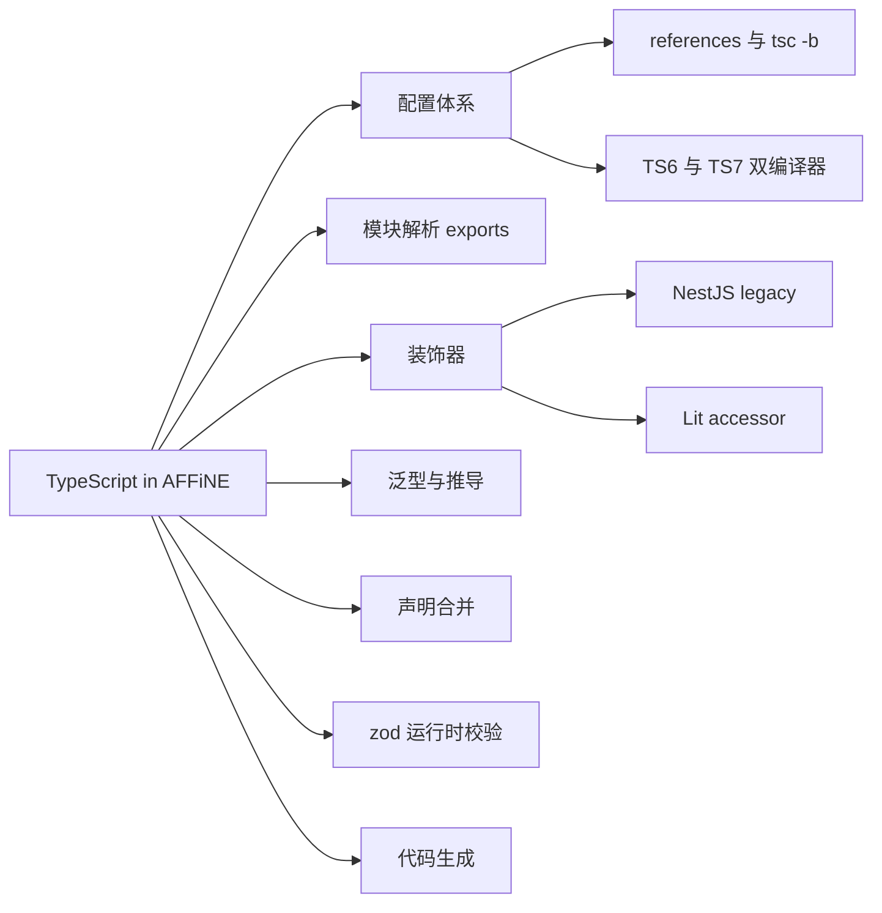
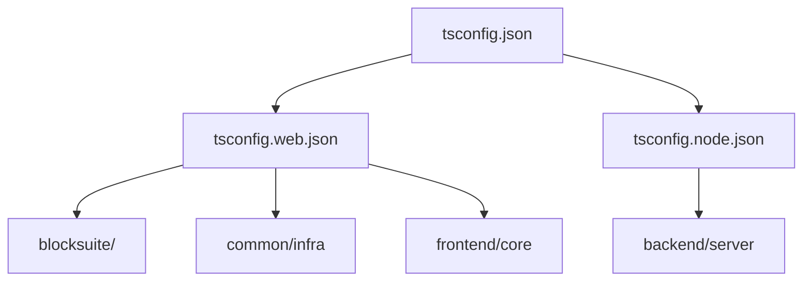
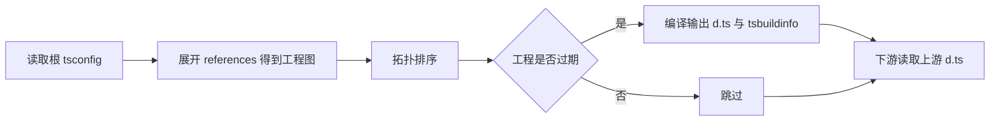
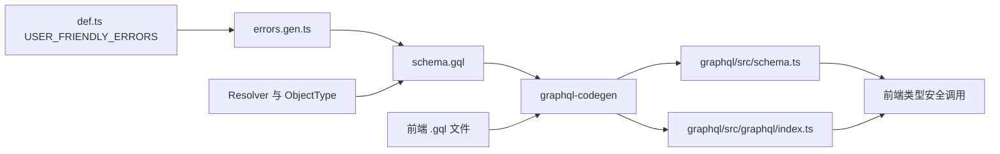

# 第 5 章 TypeScript 在 AFFiNE 中的应用

语法速成 + 真实用法，读懂项目里 90% 的类型代码

第 3 部分 · 编程语言与基础技术 ｜ 难度 ★★★☆☆ ｜ 建议学时 8 小时

Note:
从这一章开始我们进入第 3 部分，正式和代码打交道。AFFiNE 几乎是全栈 TypeScript：React 前端、Lit 编辑器内核、NestJS 后端、Electron 主进程、构建脚本，统统用 TS 写。本章采用"语法速成加真实用法"双线并行，每个知识点先讲原理，再立刻挂到仓库里的真实代码上。

---

## 本章导读：三类"劝退"

- **配置层**：4 个根 `tsconfig*.json`、一百多条 `references`
- `typescript` 依赖竟写成 `npm:@typescript/typescript6@6.0.2`
- **语法层**：后端满屏 `@Module`、`@Resolver`、`@Field`
- 编辑器满屏 `@property accessor model!`，且是两套装饰器标准
- **类型体操层**：`TypesToDeps<ConstructorParameters<Arg1>>`
- 还有 `Extract<Queries, { name: Q['id'] }>['response']`……

<div class="callout">

目标：读懂项目中 90% 的类型代码，并知道类型报错时去哪里找原因

</div>

Note:
打开仓库，你首先会被这三类东西劝退：配置层看不懂引用关系，语法层被两套装饰器搞混，类型体操层被各种 infer 和键重映射吓到。本章就按这三层逐一拆解。别担心，每个难点背后都有清晰的设计意图，理解意图之后这些代码反而会显得很优雅。

---

## 学习目标

1. 说清各 `tsconfig` 的继承与引用关系及 `tsc -b` 原理
2. 解释 TS6 / TS7 两个别名，知道 `tsc` 实际指向谁
3. 根据 `exports` 推断一条 import 解析到哪个源文件
4. 区分 NestJS legacy 装饰器与 Lit 标准装饰器
5. 读懂 `createIdentifier`、`LiveData`、`QueryResponse` 等类型
6. 用 `declare global` 扩展注册表，识别代码生成文件

Note:
这六条目标对应本章的主要小节：配置、编译器、模块解析、装饰器、泛型推导、声明合并和代码生成。建议学习时打开 IDE，边看边悬停查看类型推导结果，效果会好很多。

---

## 知识地图



Note:
整章的知识点分成七块。配置体系和模块解析是基础设施，决定代码怎么被编译和找到；装饰器是语法层；泛型推导和声明合并是类型设计层；zod 处理运行时边界；最后是代码生成，它把后端 schema、翻译文件、错误定义变成类型。

---

## extends 与 references

<div class="cols">
<div>

| 机制 | 作用 | 类比 |
| --- | --- | --- |
| `extends` | 继承编译选项 | CSS 继承 |
| `references` | 声明工程间依赖 | dependencies |

- `extends` 形成三层继承树
- `references` 织出依赖图

</div>
<div>



</div>
</div>

Note:
初学者最容易混淆这两个概念。extends 是继承编译选项，比如 strict、target，子配置覆盖父配置；references 是声明工程之间的依赖，tsc -b 据此按拓扑顺序增量构建。AFFiNE 用 extends 形成根、web 或 node 基线、包级配置三层继承树，再用 references 织出依赖图。

---

## 根 tsconfig 关键选项

| 选项 | 取值 | 影响 |
| --- | --- | --- |
| `verbatimModuleSyntax` | `true` | 纯类型必须 `import type`，否则 TS1484 |
| `noImplicitOverride` | `true` | 处处可见 `override render()` |
| `noUncheckedIndexedAccess` | `false` | `arr[0]` 类型为 `T`，自己留神越界 |
| `moduleResolution` | `bundler` | 支持 `exports`，不要求写扩展名 |
| `useDefineForClassFields` | `false` | 对 Lit 至关重要 |
| `include` / `files` | `[]` | 自身不编译，只是 solution 配置 |

Note:
这张表是日后看到报错时查字典的依据。strict 全家桶打开，所以项目里大量出现非空断言感叹号。verbatimModuleSyntax 导致纯类型必须用 import type。noUnusedParameters 让占位参数需要加下划线前缀。最后一行很关键：根配置自己不编译任何文件，它只是把一百多个子工程串起来的解决方案配置。useDefineForClassFields 为什么关掉，我们讲 Lit 时细说。

---

## web / node 两套基线

| 配置 | 关键差异 | 意图 |
| --- | --- | --- |
| `tsconfig.web.json` | `DOM` 库、`jsx: react-jsx` | 浏览器环境 |
| `tsconfig.node.json` | 仅 `node`、`build-config` 类型 | 后端写 `window` 直接报错 |
| `blocksuite/tsconfig.json` | `types: ["assets", "node"]` | 内核不依赖 `BUILD_CONFIG` |
| `backend/server/tsconfig.json` | `experimentalDecorators` | NestJS 依赖注入 |
| 同上 | `verbatimModuleSyntax: false` | 兼容"类型当值导入" |

<p class="small">后端也开了 `jsx: react-jsx`：邮件模板 `src/mails` 用 React 组件渲染</p>

Note:
web 基线加了 DOM 库和自动 JSX 运行时，node 基线没有 DOM，这是用类型系统隔离运行环境。BlockSuite 中间层把 types 覆盖掉，刻意不依赖应用层的 BUILD_CONFIG，体现内核与应用解耦。后端有三个特殊点：开 JSX 写邮件模板；开 legacy 装饰器和元数据给 NestJS；关掉 verbatimModuleSyntax，因为后端常见把纯类型当值导入的写法，而且装饰器元数据需要构造参数类型在运行时可引用。

---

## references 自动生成与 tsc -b



<p class="small">`references` 由 `tools/cli/src/init.ts` 生成，`postinstall` 自动执行 `yarn affine init`；`yarn typecheck` = `tsc -b tsconfig.json --verbose`</p>

Note:
references 不是手写的，而是 init.ts 根据 workspace 依赖生成的，用 jsonc-parser 做外科手术式修改，保留注释。特例 `@affine/electron-api` 因为循环依赖被跳过。tsc -b 的关键是：composite 是前提，tsbuildinfo 记录哈希只重编改动过的工程，下游读取上游的 d.ts 而不是重新检查源码。所以给包新增依赖后记得跑 yarn affine init。

---

## 两个 TypeScript：TS6 与 TS7

<div class="cols">
<div>

```json
"@typescript/native": "npm:typescript@7.0.2",
"typescript": "npm:@typescript/typescript6@6.0.2",
```

```text
tsc -> ../@typescript/native/bin/tsc
tsc6 -> ../typescript/bin/tsc6
```

</div>
<div>

- `typescript` 名下是 TS6，提供 **JS API**
- 生态工具 `require('typescript')` 继续可用
- `@typescript/native` 名下是 Go 重写的 TS7
- `yarn typecheck` 实际运行 **TS7**
- IDE 与命令行报错不一致？先查编译器版本

</div>
</div>

Note:
这里用了 Yarn 的 npm 别名协议。为什么要反着起名？因为大量工具会 require typescript 调用 JS API，而 TS7 原生版不再提供兼容的同步 JS API。于是把 typescript 这个名字留给 TS6，让工具链继续工作；TS7 装到 @typescript/native 下专门跑命令行类型检查。TS6 包把 bin 命名为 tsc6，所以 tsc 命令实际指向 TS7。oxlint-tsgolint 也基于 Go 版 TypeScript。

---

## source-first 的 exports

```json
{
  "name": "@toeverything/infra",
  "exports": {
    "./storage": "./src/storage/index.ts",
    "./op": "./src/op/index.ts",
    ".": "./src/index.ts"
  }
}
```

- 内部包直接导出 `src/*.ts`；未暴露路径一律解析失败
- 门面包 `@blocksuite/affine` 有 207 个子路径，每个只是 `export * from '...'`
- `.oxlintrc.json` 再禁止从 `**/dist`、`**/src` 导入

<p class="small">`packages/common/infra/package.json`（节选）；包间依赖用 `workspace:*`</p>

Note:
AFFiNE 的内部包几乎都直接导出源文件而不是编译产物。好处是开发时不用先构建依赖包，Vite 或 Rspack 直接编译源码，改动即时生效，跳转定义也直达 ts 源文件。`@blocksuite/affine` 是典型的门面模式：应用层只依赖这一个包，按子路径按需导入，不用关心底层拆成了几十个小包。唯一的例外是根 tsconfig 的 paths，给 `@affine/core/*` 保留了映射。

---

## 装饰器：同一仓库两套标准

| 维度 | Legacy 装饰器 | TC39 标准装饰器 |
| --- | --- | --- |
| 开关 | `experimentalDecorators: true` | 默认即可 |
| 参数装饰器 | 支持 `@Args() x` | 不支持 |
| 元数据 | 输出 `design:paramtypes` | 不输出 |
| 字段装饰 | 直接装饰普通字段 | 推荐 `accessor` |
| 使用者 | 后端 NestJS | BlockSuite / Lit 组件 |

<p class="small">两套规范被 tsconfig 隔离在不同工程里，各取所需</p>

Note:
装饰器本质是在类定义阶段运行的函数。历史上有两套规范：legacy 实验性装饰器和 TS 5.0 起支持的 TC39 标准装饰器。后端 tsconfig 单独打开了 experimentalDecorators，根配置没有，所以两套规范能在同一仓库共存。记住一个简单判断：看到参数装饰器，一定是后端；看到 accessor，一定是标准装饰器。

---

## NestJS：靠元数据完成注入

```ts
@Resolver(() => UserType)
export class UserResolver {
  constructor(
    private readonly storage: AvatarStorage,
    private readonly models: Models
  ) {}

  @Throttle('strict')
  @Query(() => UserOrLimitedUser, { name: 'user', /* ... */ })
  @Public()
  async user(
    @Args('email') email: string,
    @CurrentUser() currentUser?: CurrentUser
  ): Promise<typeof UserOrLimitedUser | null> {
```

<p class="small">`packages/backend/server/src/core/user/resolver.ts`（节选）；构造参数须为运行时存在的类，不能是 `interface`</p>

Note:
构造函数里没有任何 @Inject，Nest 怎么知道要注入 AvatarStorage？答案是 emitDecoratorMetadata：编译器为被装饰的类生成 design:paramtypes 元数据，Nest 读取它完成注入。所以构造参数类型必须是运行时存在的类。参数装饰器只有 legacy 支持。多个方法装饰器自下而上执行，但大多只是写元数据，顺序通常无关紧要。后端还有自定义装饰器工厂 PushMetadata，被 @OnEvent 使用。

---

## Lit：`@property accessor`

```ts
export class ParagraphHeadingIcon extends SignalWatcher(
  WithDisposable(ShadowlessElement)
) {
  static override styles = css`/* ... */`;
  override render() {
    const type = this.model.props.type$.value;
    if (!type.startsWith('h')) return nothing;
    // ...
  }
  @property({ attribute: false })
  accessor model!: ParagraphBlockModel;
}
```

`useDefineForClassFields: false`：类字段编译为 `this.x = ...`，不会遮蔽 Lit 原型上的响应式访问器

<p class="small">`blocksuite/affine/blocks/paragraph/src/heading-icon.ts`</p>

Note:
accessor 是 TC39 提案引入的自动访问器，等价于生成私有存储加 getter、setter，Lit 的标准装饰器拦截 setter 调用 requestUpdate 触发重渲染。为什么 useDefineForClassFields 必须是 false？如果类字段用 define 语义，实例上的同名属性会遮蔽原型上的访问器，赋值不再触发更新，这是 Lit 官方明确警告的坑。另外 BlockSuite 普遍在 effects 函数里显式 customElements.define，便于控制注册时机。

---

## DI 标识符：幽灵类型

```ts
export type Identifier<T> = {
  identifierName: string;
  variant: ComponentVariant;
  __TYPE__: T;
};

export type IdentifierType<T> =
  T extends Identifier<infer R> ? R : T extends Type<infer R> ? R : never;

export type TypesToDeps<T> = {
  [index in keyof T]:
    | GeneralIdentifier<T[index]>
    | (T[index] extends (infer I)[] ? [GeneralIdentifier<I>] : never);
};
```

<p class="small">`packages/common/infra/src/framework/core/types.ts`；`.store(DocsStore, [...])` 依赖顺序写反会在编译期报错</p>

Note:
这是前端 DI 的类型核心。`__TYPE__` 是幽灵类型，运行时根本不存在，只是让类型系统记住 T，IdentifierType 再用 infer 把它取出来。createIdentifier 返回函数和对象的交叉类型，既能读 identifierName，又能调用生成变体。TypesToDeps 对构造函数参数元组逐位置要求一个能产出该类型的标识符。所以在 configureDocModule 里把 DocsStore 的两个依赖写反，会立刻报错，依赖顺序错误在编译期就被发现，不需要 emitDecoratorMetadata。

---

## 递归条件类型与键重映射

```ts
export type Unwrap<T> =
  T extends LiveData<infer Z>
    ? Unwrap<Z>
    : T extends readonly [...infer Elements]
      ? { [K in keyof Elements]: Unwrap<Elements[K]> }
      : T;

type SignaledProps<Props> = Props & {
  [P in keyof Props & string as `${P}$`]: Signal<Props[P]>;
};
```

- `Unwrap` 把 `LiveData<LiveData<number>>` 递归剥成 `number`
- `SignaledProps` 让 props 同时有 `type` 与 `type$: Signal<...>`

<p class="small">`infra/src/livedata/livedata.ts` ｜ `blocksuite/framework/store/src/model/block/block-model.ts`</p>

Note:
Unwrap 是递归条件类型，对元组则逐项映射，flat 方法的返回类型就靠它推导。React 侧的 useLiveData 用分配式条件类型透传可空性，传入可能为 null 的 LiveData 就返回可能为 null 的值。SignaledProps 用键重映射加模板字面量，给每个属性自动生成一个美元符结尾的信号属性，这正是 heading-icon 里 `props.type$.value` 能通过类型检查的原因。defineBlockSchema 里 Flavour extends string 则让 TS 保留字面量类型。

---

## GraphQL：`as const` + `Extract` 查表

```ts
export const getCurrentUserQuery = {
  id: 'getCurrentUserQuery' as const,
  op: 'getCurrentUser',
  // ...
};

export type QueryResponse<Q extends GraphQLQuery> = Extract<
  Queries | Mutations,
  { name: Q['id'] }
>['response'];
```

`gqlFetch({ query: getCurrentUserQuery })` 返回值自动为 `GetCurrentUserQuery`

<p class="small">`packages/common/graphql/src/graphql/index.ts`（生成）｜ `src/fetcher.ts`；唯一真相源 `schema.gql`</p>

Note:
前端 GraphQL 类型是从后端 schema 生成的。schema.ts 末尾有一个巨大的可辨识联合 Queries 和 Mutations，每一项都有 name、variables、response。关键在 as const：它让 id 的类型是字面量而不是 string，Extract 才能精确命中。最终效果是传入哪个查询，返回值和变量类型就自动对上，前后端类型以 schema.gql 为唯一真相源。

---

## 声明合并：可扩展注册表

```ts
declare global {
  interface Events {
    'doc.created': {
      workspaceId: string;
      docId: string;
      editor?: string;
    };
    // ...
  }
}
```

- 同套路：`AppConfigSchema`、`BlockSuiteUIEventState`、`HTMLElementTagNameMap`
- 模块增强：`tools/@types/env/__all.d.ts` 给 BlockSuite `DocMeta` 加 `trash`、`mode`

<p class="small">`packages/backend/server/src/models/doc.ts`；`EventName = keyof Events` 定义于 `base/event/def.ts`</p>

Note:
同名 interface 会自动合并，这是可扩展注册表模式的基础。后端在 def.ts 声明一个空的 Events 接口，各业务模型在自己文件里认领事件，最终合并成一张表，emit 的事件名和 payload 都能被精确检查，新增事件不用改任何中心文件。前端模块增强给 BlockSuite 的 DocMeta 加业务字段，内核对此一无所知。注意那个 d.ts 顶部的 import 不能删，有 import 才是模块，declare module 才是增强而不是新声明。

---

## zod：编译期与运行时的桥梁

```ts
export const UserSettingsSchema = z.object({
  receiveInvitationEmail: z.boolean().default(true),
  receiveMentionEmail: z.boolean().default(true),
  receiveCommentEmail: z.boolean().default(true),
});

export type UserSettingsInput = z.input<typeof UserSettingsSchema>;
export type UserSettings = z.infer<typeof UserSettingsSchema>;
```

- `z.input`：解析前，带 `.default()` 的字段可选
- `z.infer`：解析后，所有字段必有值；`parse` 一步完成校验 + 默认值

<p class="small">`packages/backend/server/src/models/user-settings.ts`；项目使用 zod `^3.25.76`</p>

Note:
TypeScript 类型编译后完全擦除，来自网络、数据库 JSON 列、本地存储的数据，类型系统无法保证。zod 让你写一次 schema，同时得到运行时校验器和静态类型。BlockSuite 也用 zod 校验 schema 本身，defineBlockSchema 最后一步是 BlockSchema.parse，在注册 Block 时就发现配置错误。z.nativeEnum 则把 TS enum 变成校验器。

---

## satisfies 与 enum 惯例

```ts
export const USER_FRIENDLY_ERRORS = {
  // Internal uncaught errors
  internal_server_error: {
    type: 'internal_server_error',
    message: 'An internal error occurred.',
  },
  // ... 约 800 行
} satisfies Record<string, UserFriendlyErrorOptions>;
```

- `satisfies` 校验结构，`keyof typeof` 仍是错误码字面量联合
- 持久化到 CRDT 用联合类型；需遍历、GraphQL、zod 用字符串 enum
- `isolatedModules` 下跨文件 `const enum` 无法内联，项目几乎不用

<p class="small">`packages/backend/server/src/base/error/def.ts`</p>

Note:
如果写成类型注解，keyof typeof 只会是 string；用 satisfies 后，既校验每项必须有 type 和 message，又保留了所有错误码的字面量键。as const satisfies 更进一步，连嵌套值都保持只读字面量，工作区 DB schema 就是这么写的。enum 选型经验：纯类型约束、要存进 Yjs 的字段用联合类型，零运行时开销；要在 UI 遍历、做 GraphQL 枚举或 zod 校验时用字符串 enum。

---

## 代码生成链路



<p class="small">另有 `i18n.gen.ts`（源 `en.json`）：插值 `{{number}}` 生成必填参数。永远改真相源，再生成</p>

Note:
三个最重要的生成文件：GraphQL 的 schema.ts 八千六百多行，i18n.gen.ts 一万一千多行，errors.gen.ts 一千三百多行。一个错误码在 def.ts 里定义一次，会被生成为可抛出的错误类、GraphQL 对象类型和 ErrorNames 枚举项，再经 schema.gql 生成前端类型，贯穿全链路。生成文件头都带 AUTO GENERATED 注释，千万别手改，改了真相源却没更新生成文件，CI 会报差异。

---

## 源码导读 Top 5

| 优先级 | 路径 | 看什么 |
| --- | --- | --- |
| P0 | `tsconfig.json` | 严格选项、`references` |
| P0 | `packages/backend/server/tsconfig.json` | legacy 装饰器、verbatim 关闭 |
| P0 | `infra/src/framework/core/types.ts` | `Identifier`、`TypesToDeps` |
| P0 | `.../store/src/model/block/zod.ts` | `defineBlockSchema` 重载 |
| P0 | `.../store/src/model/block/block-model.ts` | `SignaledProps` 键重映射 |

<p class="small">`infra` 即 `packages/common/infra`；`...` 即 `blocksuite/framework`</p>

Note:
前两个文件讲配置，后三个讲类型设计。defineBlockSchema 用了函数重载，对外暴露精确签名，内部实现用宽松签名，这个技巧值得仔细看。读完 P0 之后，推荐 P1 的 fetcher.ts 和 error/def.ts，分别对应 GraphQL 查表和 satisfies。

---

## 动手实践

1. **画引用链**：写出 `core → tsconfig.web.json → tsconfig.json`
2. **解析一条 import**：从 `@blocksuite/affine/model` 追到 `.ts`
3. **加类型安全事件**：故意传错 payload，看到报错后丢弃改动
4. **复现 `SignaledProps`**：再写 `Unsignal<T>` 去掉 `xxx$` 键
5. **追踪错误码全链路**：`doc_not_found` 从定义到前端类型

Note:
练习一和二是入门，建立配置和模块解析的直觉。练习三在草稿分支上做，验证完记得丢弃改动。练习四在仓库外的临时文件里做类型体操，用 IDE 悬停确认结果。练习五是挑战题，把代码生成链路完整走一遍。

---

## 自测

**Q1：`yarn typecheck` 运行的是 TS6 还是 TS7？**

TS7：`node_modules/.bin/tsc` 指向 `@typescript/native/bin/tsc` <!-- .element: class="fragment" -->

**Q2：为何后端能用 `@Args()`，BlockSuite 不能用参数装饰器？**

参数装饰器仅 legacy 规范支持，只有后端开了 `experimentalDecorators` <!-- .element: class="fragment" -->

**Q3：`useDefineForClassFields` 改为 `true` 会怎样？**

实例自有属性遮蔽 Lit 原型访问器，赋值不再触发重渲染 <!-- .element: class="fragment" -->

**Q4：`USER_FRIENDLY_ERRORS` 为何用 `satisfies` 而非注解？**

注解会拓宽为 `string` 键；`satisfies` 保留字面量键联合 <!-- .element: class="fragment" -->

Note:
这四道题覆盖编译器、装饰器、Lit 坑和 satisfies。第三题是本章最容易在实际开发中踩到的问题，记住类字段语义和 Lit 响应式属性之间的冲突。如果答错了，回到对应页面再看一遍源码。

---

## 常见坑

- TS1484：纯类型未用 `import type`
- 新增依赖后 `tsc -b` 找不到声明：运行 `yarn affine init`
- IDE 与命令行报错不一致：统一 TS 版本，删 `tsbuildinfo`
- Lit 属性赋值不更新：缺 `@property` 或 `accessor`
- Nest "can't resolve dependencies"：构造参数用了 interface
- 手改 `schema.ts` / `i18n.gen.ts` 被覆盖：改真相源

Note:
这六个坑基本覆盖了新人遇到的大部分类型相关报错。另外两个小坑：覆写父类成员忘了 override 会报错；回调签名需要占位参数时加下划线前缀。从包内部路径导入会被 exports 和 lint 双重拦截，需要从公开子路径导入。

---

## 小结与下一步

- 根 `tsconfig.json` 是 solution 配置，`tsc -b` 增量构建
- `typescript` 名下是 TS6，`tsc` 命令实际是 TS7
- source-first `exports` + `bundler` 解析 + 门面包
- 后端 legacy 装饰器，前端标准装饰器 `accessor`
- 幽灵类型、键重映射、`declare global` 注册表、代码生成

<div class="callout">

**下一章**：第 6 章 前端技术栈 —— React、Lit、Signals、RxJS

</div>

Note:
这一章信息量很大，我们从配置、编译器、模块解析、装饰器一路讲到类型设计和代码生成。掌握这些之后，你应该能无障碍地读懂 infra、BlockSuite 和 GraphQL 层的类型代码。下一章我们看 LiveData 背后的 RxJS、Lit 组件里的 Signals，以及 React 与 Lit 如何在同一个应用里协作。
