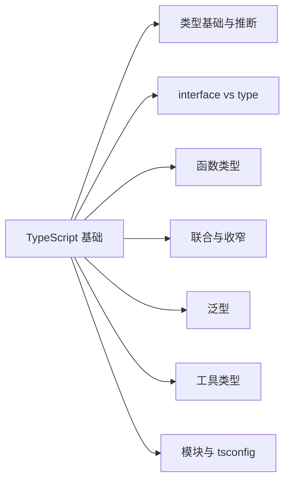

# 第 5 章 TypeScript 基础入门

> 懂编程、不熟 TS？从类型系统的核心概念铺到第 9 章的起点

第 3 部分 · 编程语言与基础技术 ｜ 难度 ★★☆☆☆ ｜ 建议学时 6 小时

===

## 本章要解决的问题

<p class="lead">AFFiNE 几乎全用 TypeScript 写成。第 9 章直接讲它的进阶用法，0 基础直接读会很吃力——本章就是那块垫脚石。</p>

假设你会 JavaScript（变量、函数、对象、`async/await`），本章**从类型系统的核心概念讲起**，一路铺到第 9 章起点。

<div class="note note--tip">

TypeScript 的一句话定位：**JavaScript + 静态类型**。它在编译期检查类型、给你补全与重构，最终**擦除类型、编译回普通 JS** 运行——运行时没有类型。记牢这条，很多疑惑迎刃而解。

</div>

===

## 知识地图

本章围绕"如何用类型描述数据与行为"，由浅入深。



===

## 学习目标

<ol class="goals">
  <li>说清 TS 与 JS 的关系，理解"类型擦除"的含义与限制</li>
  <li>用基础类型、<code>interface</code>、<code>type</code> 描述数据，并说清两者区别</li>
  <li>写出带类型的函数（可选/默认/剩余参数、重载）</li>
  <li>用联合类型、字面量类型与收窄表达"多选一"</li>
  <li>读写泛型函数与约束（<code>extends</code>），理解"类型的参数"这一本质</li>
  <li>使用常见工具类型，看懂 tsconfig 关键项，为第 9 章打底</li>
</ol>

===

## 为什么要类型：一个真实的 bug

<div class="split">
<div class="split__main">

纯 JS 里拼错字段名，运行时静默得到 `NaN`，可能上线才发现。TypeScript 让你**在写代码时**就报错：对象字面量里 `cuont` 不存在于 `CartItem`。

类型的价值：**把一类运行时错误提前到编译期**，并带来补全、跳转、安全重构。

</div>
<div class="split__aside">

```ts
interface CartItem {
  price: number;
  count: number;
}
function total(cart: { items: CartItem[] }) {
  return cart.items.reduce(
    (s, it) => s + it.price * it.count, 0);
}
total({ items: [{ price: 10, cuont: 2 }] });
// ❌ “cuont”不存在于类型 CartItem
```

</div>
</div>

<div class="note note--warn">

**类型擦除**：上面的 `interface`、`: number` 编译后**全部消失**，生成的 JS 与手写版几乎一样。所以你**不能**在运行时判断"某值是不是某接口"——运行时根本没有这个类型。

</div>

===

## 类型基础与推断

大多数时候**不用手写类型**，交给编译器推断；函数参数、公共 API 再显式标注。

<div class="split">
<div class="split__main">

- 基础类型：`string`/`number`/`boolean`/`null`/`undefined`；
- 数组 `string[]`、元组 `[string, number]`（定长、每位类型固定）；
- `const` 比 `let` 推断得更"窄"（字面量类型）。

**法则**：初始化与返回值让它自动推断，参数与对象结构显式标注——标注既是检查也是文档。

</div>
<div class="split__aside">

```ts
let title = 'AFFiNE';   // string
const mode = 'page';    // 'page'（字面量）
const list = [1, 2, 3]; // number[]
let pair: [string, number] = ['x', 1];
```

</div>
</div>

===

## any 是逃生舱，unknown 才安全

<div class="compare">
  <div class="compare__col"><h4><code>any</code></h4>

- 放弃类型检查，任何操作都允许
- 会像病毒一样**扩散**，让类型保护失效
- 能不用就不用

  </div>
  <div class="compare__col compare__col--good"><h4><code>unknown</code></h4>

- "我也不知道是什么"
- 使用前**必须先收窄**，否则报错
- 接收外部/不可信输入时优先用它

  </div>
</div>

```ts
const data: unknown = JSON.parse('{}');
// data.foo;  // ❌ unknown 不能直接用
if (typeof data === 'object' && data) { /* 收窄后才能用 */ }
```

===

## 描述对象：interface 与 type

两者都能描述对象，日常可互换，但有两个关键区别——第 9 章会用到。

<div class="annotate">

```ts [1-5|7-9|11]
interface User {
  id: string;
  name?: string;      // 可选
  readonly at: number; // 只读
}
interface User { role: string; } // 同名自动合并（声明合并）
// User = { id; name?; at; role }
type Point = { x: number } & { y: number }; // 交叉组合
```

<ol class="annotate__notes">
  <li><b>只有 type</b> 能做联合、交叉、元组、映射类型等"类型运算"。</li>
  <li><b>只有 interface</b> 支持声明合并——AFFiNE 用它扩展全局接口（后端 <code>Events</code>、<code>AppConfigSchema</code>）。</li>
</ol>
</div>

<div class="note">

经验：描述"对象/类的形状、要被扩展或合并"用 `interface`；要"类型运算"用 `type`。

</div>

===

## 函数类型

<div class="split">
<div class="split__main">

- 标注参数与返回值；
- 可选 `?`、默认值、剩余参数 `...rest`；
- 函数本身也是一种类型（回调）；
- 重载：同名多签名，实现只有一个。

</div>
<div class="split__aside">

```ts
function greet(
  name: string,
  greeting = 'Hi',
  ...rest: string[]
): string {
  return `${greeting}, ${name}`;
}
type Handler = (e: string) => void;
const onClick: Handler = e => console.log(e);
```

</div>
</div>

===

## 联合类型与收窄

<p class="lead">联合类型 <code>A | B</code> 表示"是 A 或 B"，配合字面量类型可精确枚举取值。</p>

```ts
type DocMode = 'page' | 'edgeless'; // 只能是这两个之一
```

> 这正是第 1 章见过的 `DocMode`——AFFiNE 大量用"字符串字面量联合"代替枚举。

用联合后，使用前常需**收窄**到具体分支：`typeof`、`instanceof`、`in`、字面量比较。

<div class="note note--tip">

**可辨识联合**：每个分支带一个共同的字面量字段（如 `kind`），用 `switch (s.kind)` 即可自动收窄——这是 TS 建模状态机、消息类型的利器。

</div>

===

## 可辨识联合示例

```ts
type Shape =
  | { kind: 'circle'; r: number }
  | { kind: 'rect'; w: number; h: number };

function area(s: Shape): number {
  switch (s.kind) {
    case 'circle': return Math.PI * s.r ** 2; // 收窄为 circle
    case 'rect': return s.w * s.h;            // 收窄为 rect
  }
}
```

<ul class="takeaways">
  <li>删掉任一 <code>case</code> 分支时，配合 <code>strict</code> 编译器能提示"未覆盖"——让状态处理无遗漏。</li>
</ul>

===

## 泛型：类型的"参数"

<p class="lead">泛型让类型像函数一样接收参数，写出"对多种类型都成立"的可复用代码。</p>

<div class="split">
<div class="split__main">

- `identity<T>(x: T): T` —— 入参与返回同类型；
- `interface Box<T> { value: T }` —— 泛型接口；
- 多数时候 `T` 能从实参**自动推断**，不用手写 `<...>`。

</div>
<div class="split__aside">

```ts
function identity<T>(x: T): T { return x; }
identity('a');  // T = string（推断）
identity(42);   // T = number

interface Box<T> { value: T; }
const b: Box<number> = { value: 1 };
```

</div>
</div>

===

## 泛型约束 extends

限制类型参数"至少具备某些结构"，就能在函数体内安全使用这些结构：

<div class="annotate">

```ts [1|4]
function longest<T extends { length: number }>(a: T, b: T): T {
  return a.length >= b.length ? a : b;
}
longest('ab', 'abc'); // 字符串有 length ✅
longest(1, 2);        // ❌ number 没有 length
```

<ol class="annotate__notes">
  <li><b>约束</b>：T 可为任意类型，但必须有 <code>length: number</code>。</li>
  <li>仍保留"返回值类型 = 传入类型"的能力。</li>
</ol>
</div>

<div class="note note--tip">

第 9 章的 `createIdentifier<T>()`、`LiveData<T>`、`defineBlockSchema` 都靠泛型推断。把"**泛型 = 给类型传参**"记牢，就能看懂这些 API。

</div>

===

## 工具类型：对类型做运算

由已有类型派生新类型，是"类型层面的 DRY"——数据结构改一处，派生自动跟着变。

| 工具类型 | 作用 |
| --- | --- |
| `Partial<T>` | 所有属性变可选 |
| `Required<T>` | 所有属性变必填 |
| `Readonly<T>` | 所有属性变只读 |
| `Pick<T, K>` | 挑选部分属性 |
| `Omit<T, K>` | 去掉部分属性 |
| `Record<K, V>` | 构造键值映射 |
| `ReturnType<F>` | 取函数返回值类型 |

```ts
type PartialUser = Partial<User>;        // 全可选
type UserMap = Record<string, User>;     // { [k:string]: User }
type R = ReturnType<() => number>;       // number
```

===

## 模块、声明文件与 tsconfig

<div class="cards cols-3">
  <div class="card"><div class="card__icon">📦</div><h4>模块</h4><p>标准 ES 语法；<code>import type</code> 只导入类型，编译后整行消失、避免循环依赖。</p></div>
  <div class="card"><div class="card__icon">📄</div><h4>.d.ts 声明文件</h4><p>只含类型、不含实现；给纯 JS 库或全局对象补类型，codegen 产物多是它。</p></div>
  <div class="card"><div class="card__icon">⚙️</div><h4>tsconfig</h4><p><code>strict</code> 开全严格、<code>noEmit</code> 只检查不产出（编译交给打包器）。</p></div>
</div>

<div class="note note--tip">

**通往第 9 章**：AFFiNE 把 tsconfig 拆成 `tsconfig.json`/`.web.json`/`.node.json` 并用"项目引用"做增量构建，还会发现 `tsc` 是 TS 7 原生版。本章看懂单个 tsconfig，到那里只是"规模放大"。

</div>

===

## 动手实践

<ol class="steps">
  <li><h4>给一段 JS 加类型</h4><p>给你写过的小工具函数加参数/返回值类型并开 <code>strict</code>，记录编译器报出的潜在 bug。<b>验收</b>：至少发现 1 个此前没注意的隐患。</p></li>
  <li><h4>用可辨识联合建模</h4><p>为"加载中/成功/失败"三态设计 <code>RequestState&lt;T&gt;</code> 并用 switch 穷尽处理。<b>验收</b>：删任一分支能报"未覆盖"。</p></li>
  <li><h4>读 AFFiNE 的类型</h4><p>打开 <code>packages/common/infra</code> 任一 .ts，各找一处泛型、联合、<code>import type</code> 并解释。<b>验收</b>：说清每处在表达什么约束。</p></li>
  <li><h4>工具类型练习</h4><p>给定 <code>Config</code>，派生"全可选更新参数类型"和"只含布尔字段的子类型"。<b>验收</b>：改 Config 后派生自动更新。</p></li>
</ol>

===

## 自测：点击揭晓答案

<details class="quiz">
<summary>Q1. "类型擦除"是什么意思？带来什么限制？</summary>

类型只在编译期存在，编译为 JS 后全部擦除，运行时没有类型。因此不能在运行时直接判断"某值是不是某接口"，需用 `typeof`/`in`/类型守卫等运行时手段收窄。

</details>

<details class="quiz">
<summary>Q2. interface 与 type 最关键的两个区别？</summary>

① 只有 type 能做联合/交叉/元组/映射等类型运算；② 只有 interface 支持声明合并（AFFiNE 用它扩展全局接口）。描述对象形状两者都行。

</details>

<details class="quiz">
<summary>Q3. 为什么 unknown 比 any 安全？</summary>

any 关闭检查并会扩散；unknown 表示"未知"，使用前必须先收窄，编译器强制你做类型判断，从而保留类型安全。外部输入应优先用 unknown。

</details>

===

## 小结与下一步

<ul class="takeaways">
  <li>TypeScript = JavaScript + 静态类型；类型在编译期检查、运行时擦除。</li>
  <li><code>interface</code> 描述形状并支持声明合并，<code>type</code> 负责类型运算。</li>
  <li>联合 + 收窄（尤其可辨识联合）是最常用的建模方式。</li>
  <li>泛型 = 给类型传参，<code>extends</code> 施加约束；工具类型做"类型级 DRY"。</li>
  <li><code>import type</code> 与 tsconfig 的 strict/noEmit 是工程化基础。</li>
</ul>

<div class="note note--tip">

**下一章预告**：第 6 章前端框架基础入门——用本章的泛型与联合类型，快速建立 React、Lit、Signals、RxJS 的核心心智，为第 10 章的前端技术栈打底。

</div>
