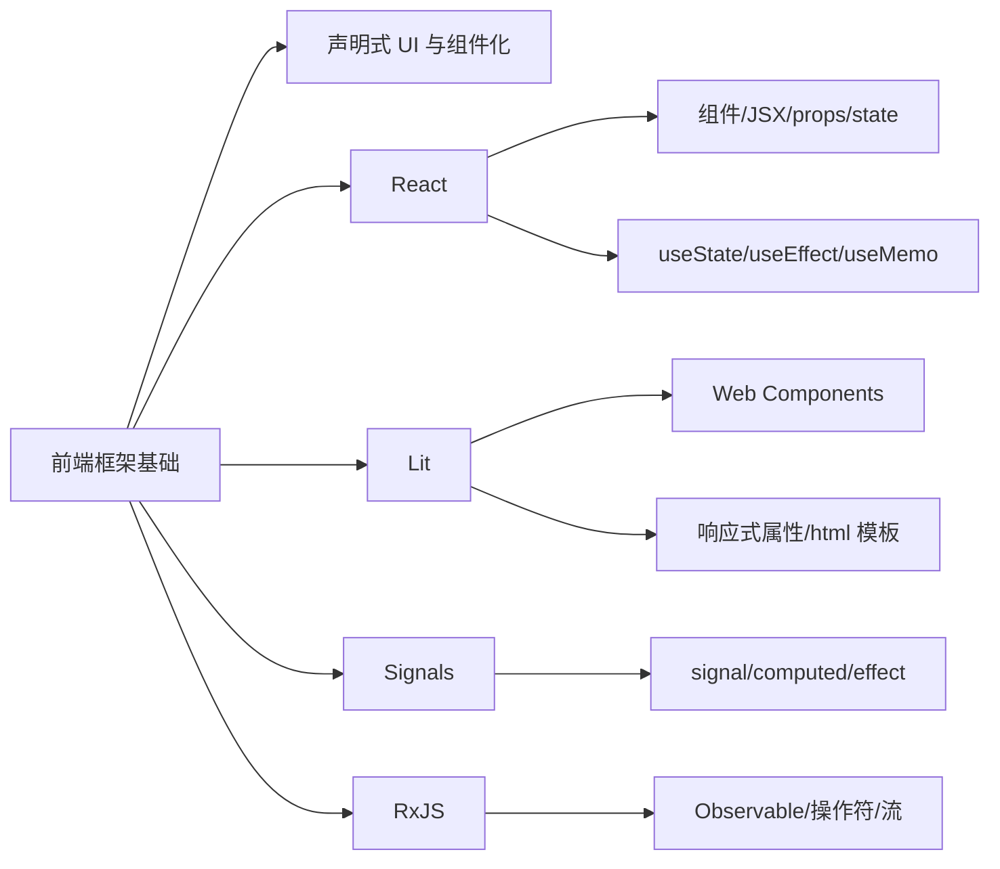
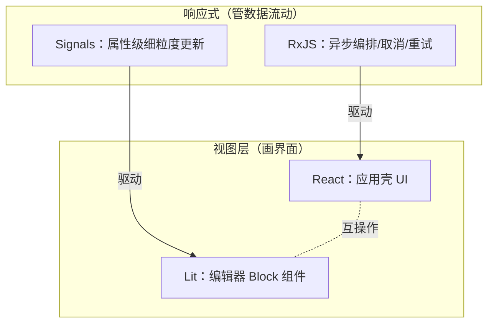

# 第 6 章 前端框架基础入门：React、Lit、Signals、RxJS

> 懂编程、没系统学过前端框架？从核心概念铺到第 10 章的起点

第 3 部分 · 编程语言与基础技术 ｜ 难度 ★★★☆☆ ｜ 建议学时 8 小时

===

## 本章要解决的问题

<p class="lead">第 10 章会抛给你一个困惑：为什么 AFFiNE 一个项目里同时有 React 和 Lit？为什么既有 RxJS 又有 Signals？</p>

如果你懂编程、但没系统学过这几样框架，直接读第 10 章会被名词淹没。本章就是那块垫脚石——从"声明式 UI"这个共同思想讲起，建立四者的核心心智。

<div class="note note--tip">

先把分工钉死：**React / Lit 是视图层**（把数据变成界面，管"界面长什么样"）；**Signals / RxJS 是响应式状态**（管"数据什么时候变、怎么传播"）。视图层负责画，响应式负责通知谁该重画。

</div>

===

## 知识地图

本章围绕"视图层怎么画 + 响应式怎么流动"，四样东西各司其职。



===

## 学习目标

<ol class="goals">
  <li>说清"命令式 UI"与"声明式 UI"的区别，理解组件化</li>
  <li>用 React 的组件、JSX、<code>props</code>/<code>state</code> 搭界面，说清单向数据流</li>
  <li>正确使用 <code>useState</code>/<code>useEffect</code>/<code>useMemo</code>，理解"重渲染"模型</li>
  <li>写出一个 Lit 自定义元素，说清它与 React 的根本差异</li>
  <li>解释 Signals 的 <code>signal</code>/<code>computed</code>/<code>effect</code>，并与 React 重渲染对比</li>
  <li>读写 RxJS 的 <code>Observable</code> 与操作符，说清它与 <code>Promise</code> 的区别</li>
</ol>

===

## 命令式 vs 声明式 UI

<p class="lead">所有现代前端框架的共同起点：你只描述界面"长什么样"，别再亲手操作 DOM。</p>

<div class="compare">
  <div class="compare__col"><h4>命令式（原生 DOM）</h4>

- 亲手 `querySelector` 找节点
- 手动 `label.textContent = ...` 同步
- 状态和界面是**两份**，极易漏改
- 关心"**怎么做**"

  </div>
  <div class="compare__col compare__col--good"><h4>声明式（框架）</h4>

- 只写"给定 state，界面是什么样"
- 状态一变，框架自动更新 DOM
- 界面是状态的**投影**，单一来源
- 关心"**要什么**"

  </div>
</div>

<div class="note note--tip">

核心口诀 **`UI = f(state)`**。**组件化**：把"一段界面 + 状态 + 行为"打包成可复用积木——按钮、弹窗、整页都是组件。React 与 Lit 都是组件框架，区别只在组件怎么定义、更新粒度多细。

</div>

===

## React：组件、JSX 与 props

<div class="split">
<div class="split__main">

React 世界观只有一句：**组件是返回 UI 的函数，状态变了就重新调用它**。

- **组件** = 返回 UI 的函数，首字母大写；
- **JSX** = 长得像 HTML 的 JS 表达式，编译成 `createElement`；
- **props** = 父传子的参数，在子组件里**只读**——这是组件可复用的关键。

JSX 用 `className`、事件用驼峰 `onClick`、`{}` 里放 JS 表达式。

</div>
<div class="split__aside">

```tsx
interface ButtonProps {
  text: string;
  onClick: () => void;
}
function Button({ text, onClick }: ButtonProps) {
  return <button onClick={onClick}>{text}</button>;
}
<Button text="保存"
  onClick={() => console.log('saved')} />;
```

</div>
</div>

<div class="note">

`ButtonProps` 正是第 5 章的 `interface`——React 组件的 props 几乎都用 TS 接口描述。

</div>

===

## state 与 useState：重渲染模型

<div class="annotate">

```ts [2|4]
function Counter() {
  const [count, setCount] = useState(0);
  return <button
    onClick={() => setCount(count + 1)}>
    点击了 {count} 次
  </button>;
}
```

<ol class="annotate__notes">
  <li><b>第 2 行</b>：<code>useState</code> 返回 [当前值, 更新函数]。不能写 <code>count = count+1</code>。</li>
  <li><b>第 4 行</b>：<code>setCount</code> 不只改值，更<b>通知 React 重新渲染该组件</b>。</li>
</ol>
</div>

<div class="note note--tip">

**React 核心模型：重渲染**。state 一变，整个组件函数从头重跑一遍，算出新 JSX，React 再用虚拟 DOM diff 找最小 DOM 改动。粒度是"组件"——记住它，后面对比 Signals 全靠它。

</div>

===

## 单向数据流与受控组件

<p class="lead">数据自上而下单向流动：数据往下传（props），事件往上冒（回调）。</p>

```tsx
function Parent() {
  const [text, setText] = useState('');
  return <Input value={text} onChange={setText} />;
}
function Input({ value, onChange }:
  { value: string; onChange: (v: string) => void }) {
  return <input value={value}
    onChange={e => onChange(e.target.value)} />;
}
```

<ul class="takeaways">
  <li>状态只有一个权威来源（<code>Parent</code> 的 <code>text</code>），流向可预测、好调试。</li>
  <li><b>受控组件</b>：表单值完全由 state 决定（<code>value={text}</code>），输入即回写——"UI = f(state)"在表单上的体现。</li>
</ul>

===

## useEffect：处理副作用

组件函数应当是纯的；订阅、定时器、网络这类**副作用**放进 `useEffect`。

<div class="annotate">

```ts [3|4|6]
function Clock() {
  const [now, setNow] = useState(() => Date.now());
  useEffect(() => {
    const id = setInterval(() => setNow(Date.now()), 1000);
    return () => clearInterval(id);
  }, []);
  return <span>{new Date(now).toLocaleTimeString()}</span>;
}
```

<ol class="annotate__notes">
  <li><b>effect 体</b>：在渲染提交到 DOM <b>之后</b>执行。</li>
  <li><b>清理函数</b>：卸载或依赖变化前调用，防内存泄漏。</li>
  <li><b>依赖数组</b>：<code>[]</code> 只跑一次；<code>[a]</code> 随 a 变化重跑；不填则每次都跑。</li>
</ol>
</div>

<div class="note note--warn">

别把 `useEffect` 当万金油：能由 props/state 直接算出的值应在渲染时算（必要时 `useMemo`），effect 只用于"与外部系统同步"。

</div>

===

## useMemo：缓存昂贵计算

因为 state 一变组件就整个重跑，昂贵计算要缓存，只在依赖变化时重算。

<div class="split">
<div class="split__main">

- `useMemo(fn, deps)`：缓存**计算结果**；
- `useCallback(fn, deps)`：缓存**函数本身**，避免每次渲染生成新引用；
- `map` 出的列表每项要有稳定 `key`，React 靠它识别"哪项是哪项"。

</div>
<div class="split__aside">

```tsx
const filtered = useMemo(
  () => items.filter(
    it => it.name.includes(keyword)),
  [items, keyword]
);
return <ul>{filtered.map(it =>
  <li key={it.id}>{it.name}</li>)}</ul>;
```

</div>
</div>

<div class="note note--tip">

**通往第 10 章**：AFFiNE 的 `useLiveData` 内部用官方 `useSyncExternalStore`（订阅外部数据源的标准 Hook）。本章吃透 Hooks 与重渲染，到那里只是"换个数据源"。

</div>

===

## Lit：自定义元素与响应式属性

<div class="split">
<div class="split__main">

Lit 站在浏览器原生 **Web Components** 之上：你可定义自己的 HTML 标签 `<my-counter>`，任何框架甚至纯 HTML 都能用——这正是编辑器内核选它的首要原因：**框架无关、可独立发布**。

- `@property()`：对外属性，可从 HTML attribute 传入（≈ props）；
- `@state()`：内部私有状态（≈ state）；
- 直接 `this.count += 1` 就触发更新，**无需 setState**。

`html` 模板四种绑定：`class=${}` → attribute，`.value=${}` → DOM property，`?disabled=${}` → 布尔 attribute，`@click=${}` → 事件。

</div>
<div class="split__aside">

```ts
@customElement('my-counter')
export class MyCounter extends LitElement {
  @property({ type: Number }) start = 0;
  @state() private count = 0;

  render() {
    return html`<button
      @click=${() => (this.count += 1)}>
      ${this.start + this.count}
    </button>`;
  }
}
```

</div>
</div>

<div class="note">

lit-html **只更新模板里变化的那几个绑定点**，不重跑整个组件函数，也没有虚拟 DOM——比 React 更细的粒度。

</div>

===

## React vs Lit：根本差异

<div class="compare">
  <div class="compare__col"><h4>React</h4>

- 自有**虚拟 DOM** 体系
- 函数组件 + JSX（需编译）
- `useState`，改值用 `setState`
- 更新粒度：**组件级重渲染 + diff**
- React 专用，不能跨框架

  </div>
  <div class="compare__col compare__col--good"><h4>Lit</h4>

- 浏览器**原生 Web Components**
- 类 + 自定义标签 + `html` 模板
- `@property`/`@state`，直接赋值
- 更新粒度：**模板绑定点级**
- 原生标签，任何框架可用

  </div>
</div>

<div class="note note--tip">

第 10 章：AFFiNE **应用壳**（侧边栏、设置、弹窗）用 React；**编辑器内核 BlockSuite**（段落、表格、白板）用 Lit——因为富文本编辑要对 `contenteditable`、Selection 做精细原生 DOM 控制，不想和虚拟 DOM 打架。

</div>

===

## Signals：signal / computed / effect

<p class="lead">React 的痛点：state 一变整个组件重跑。界面有成千上万独立单元（如每个段落）时太浪费——Signals 为"精确更新"而生。</p>

<div class="annotate">

```ts [1|2|3]
const count = signal(0);
const double = computed(() => count.value * 2);
const dispose = effect(() => {
  console.log('double =', double.value);
});
count.value = 1; // 打印 "double = 2"
```

<ol class="annotate__notes">
  <li><b>signal</b>：会变的值，用 <code>.value</code> 读写。</li>
  <li><b>computed</b>：派生只读值，读了谁就<b>自动依赖谁</b>。</li>
  <li><b>effect</b>：副作用，读到的信号一变就自动重跑。</li>
</ol>
</div>

<div class="note">

两个补充：`batch(fn)` 批量更新，内部多次改值只触发一次 effect；`.peek()` 读当前值但**不建立依赖**。关键魔法是**自动依赖追踪**：不用像 React 手写依赖数组。

</div>

===

## Signals vs React 重渲染

<div class="compare">
  <div class="compare__col"><h4>React：推翻重来</h4>

- state 变 → 组件函数**整个重跑**
- 虚拟 DOM diff 找改动
- 依赖**手写**数组
- 粒度：**组件**

  </div>
  <div class="compare__col compare__col--good"><h4>Signals：精确制导</h4>

- signal 变 → **只重跑依赖它**的计算
- 只更新那一处
- 依赖**运行时自动追踪**
- 粒度：**值**

  </div>
</div>

```ts
const first = signal('AFFiNE');
const full = computed(() => `${first.value} App`);
effect(() => render(full.value)); // 只有这个 effect 在名字变时重跑
first.value = 'BlockSuite';        // 没有"组件重渲染"概念
```

<div class="note note--tip">

第 10 章：BlockSuite 把 Yjs 里的 Block 属性同步成 `xxx$` 信号，用 `SignalWatcher` 把组件 `render()` 包进 `effect`，属性一变只刷新用到它的那个 Block。

</div>

===

## RxJS：Observable 与订阅

<div class="split">
<div class="split__main">

Signals 擅长同步值派生；网络、消息、连续输入、重试取消这类**随时间到来的一串值**，是 RxJS 的主场。

`Observable` = 随时间推送 0 到多个值的数据源，**惰性**（没人订阅就什么都不发生）。订阅后通过 `next`（来值）/`error`（出错终止）/`complete`（结束）推送。约定流变量名以 `$` 结尾。

</div>
<div class="split__aside">

```ts
const clock$ = new Observable<number>(sub => {
  let n = 0;
  const id = setInterval(
    () => sub.next(n++), 1000);
  return () => clearInterval(id); // teardown
});
const s = clock$.subscribe(
  v => console.log('tick', v));
s.unsubscribe(); // 取消 → 触发清理
```

</div>
</div>

===

## 操作符与 switchMap

威力在 `pipe()` 把流一级级变换，很像数组的 `map`/`filter`，只是作用在时间维度上。

<div class="annotate">

```ts [3|4]
fromEvent(input, 'input').pipe(
  map(e => e.target.value),
  debounceTime(300),
  switchMap(kw => search(kw))
).subscribe(results => render(results));
```

<ol class="annotate__notes">
  <li><b>debounceTime</b>：停止输入 300ms 后才继续，防抖。</li>
  <li><b>switchMap</b>：新关键词到来 → <b>自动取消上一个请求</b>，搜索框经典需求。</li>
</ol>
</div>

<div class="note">

高阶映射全家：`switchMap`（切换/取消旧）、`mergeMap`（并发）、`concatMap`（串行排队）、`exhaustMap`（忙时忽略、防重复提交）。

</div>

===

## Observable vs Promise

<div class="compare">
  <div class="compare__col"><h4>Promise</h4>

- 代表**一个**未来的值
- 创建**即执行**（急切）
- **不可**取消
- 组合靠 `then`/`async-await`

  </div>
  <div class="compare__col compare__col--good"><h4>Observable</h4>

- 代表**一串**随时间到来的值
- **订阅才执行**（惰性）
- 可 `unsubscribe()` 取消
- 几十种操作符组合

  </div>
</div>

<p class="lead">一句话：Promise 是单发，Observable 是连发且可退订。</p>

<div class="note note--tip">

两者可互通：`from(promise)` 转成流，`firstValueFrom(obs$)` 转成 Promise。学 RxJS 的真正门槛不是 API，而是建立"万物皆流"的心智。第 10 章的 `LiveData` 本质就是"包了层更好用外壳的 RxJS"。

</div>

===

## 动手实践

<ol class="steps">
  <li><h4>命令式改声明式</h4><p>用原生 DOM 写待办列表，再用 React 重写。<b>验收</b>：说清 React 版里你只维护 <code>items</code> state，不再手动操作任何 DOM。</p></li>
  <li><h4>React Hooks 三连</h4><p>搜索框：<code>useState</code> 存关键词（受控）、<code>useMemo</code> 过滤、<code>useEffect</code> 带清理打印日志。<b>验收</b>：解释依赖数组填 <code>[]</code>/<code>[keyword]</code>/不填的差异。</p></li>
  <li><h4>Lit 自定义元素</h4><p>CDN 引入 lit，写 <code>&lt;my-counter start="5"&gt;</code>，用 <code>@property</code>/<code>@state</code>/<code>@click</code>。<b>验收</b>：改 start 反映到初值，点击自增且无 setState。</p></li>
  <li><h4>RxJS vs Signals 对照</h4><p>分别用 signal 三件套 与 <code>BehaviorSubject+combineLatest+map</code> 算 <code>a+b</code>，连改 a 三次观察触发次数。<b>验收</b>：说清"Signals 同步依赖图、RxJS 推送式时间流"。</p></li>
</ol>

===

## 自测：点击揭晓答案

<details class="quiz">
<summary>Q1. 声明式与命令式 UI 的本质区别？</summary>

命令式要你亲手找 DOM 节点并修改（关心"怎么做"），需手动保持状态与界面一致；声明式让你只写 `UI = f(state)` 这个映射（关心"要什么"），状态变化后框架自动算出并应用 DOM 改动。

</details>

<details class="quiz">
<summary>Q2. React 里为什么不能直接 `count = count + 1`？</summary>

直接改变量 React 感知不到，界面不更新。`setCount` 不仅改值，还通知 React 重新渲染该组件——函数重跑、算新 JSX、diff 更新 DOM。state 必须经更新函数修改。

</details>

<details class="quiz">
<summary>Q3. Lit 和 React 更新粒度的根本差异？</summary>

React 更新单位是整个组件函数（state 变就重跑 + 虚拟 DOM diff）；Lit 基于原生 Web Components，lit-html 只更新模板中变化的绑定点，无虚拟 DOM，粒度更细。

</details>

<details class="quiz">
<summary>Q4. Signals 的自动依赖追踪比 React 依赖数组好在哪？</summary>

React 要手写依赖数组，漏写/多写都会出 bug；Signals 在 computed/effect 执行时自动记录读了哪些信号，建立精确到单个值的依赖图，更新只波及真正依赖该信号的计算。

</details>

<details class="quiz">
<summary>Q5. Observable 和 Promise 最关键的三个区别？</summary>

① 数量：Promise 发一个值，Observable 发 0 到多个；② 执行时机：Promise 创建即执行，Observable 订阅才执行；③ 取消：Promise 不可取消，Observable 可 unsubscribe。

</details>

===

## 小结：四者如何分工

<p class="lead">这张图就是第 10 章全景的雏形——记住它，你已站在第 10 章起点。</p>



<ul class="takeaways">
  <li>声明式 UI：<code>UI = f(state)</code>，组件化把界面切成可复用积木。</li>
  <li>React 组件级重渲染 vs Lit 绑定点级更新 vs Signals 值级精确更新。</li>
  <li>RxJS 的 Observable 是惰性可取消的"流"，与一次性的 Promise 互补。</li>
  <li><b>下一步</b>：第 10 章把四者放回 AFFiNE——React 应用壳、Lit 编辑器、Signals 桥接 Yjs、RxJS/LiveData。</li>
</ul>
