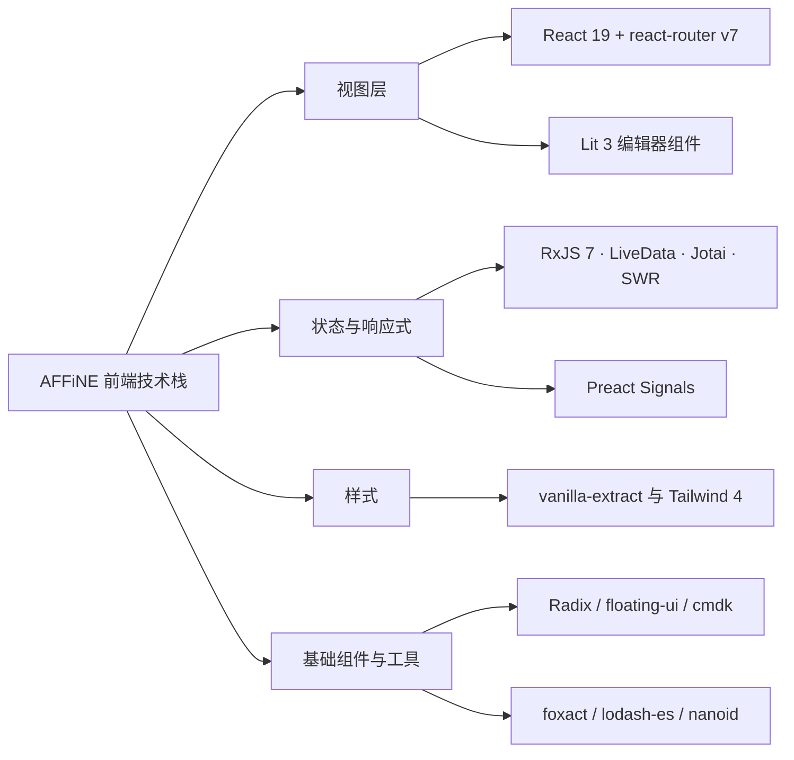
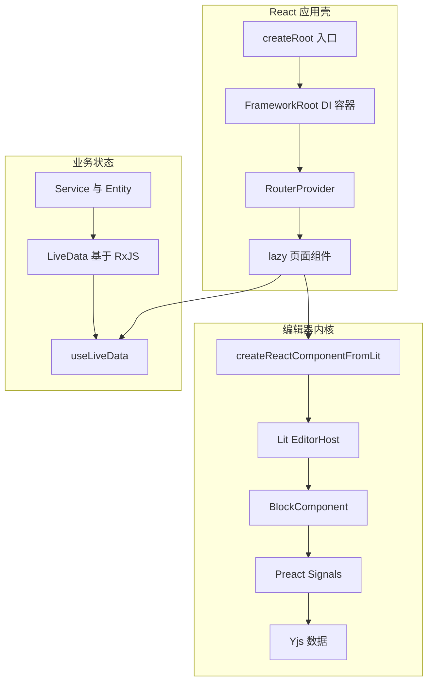
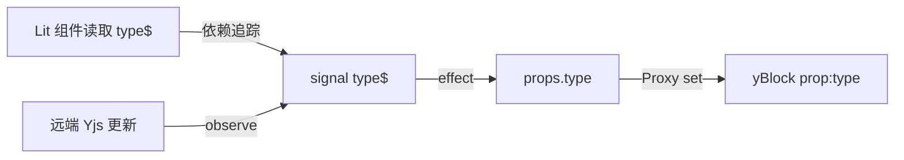
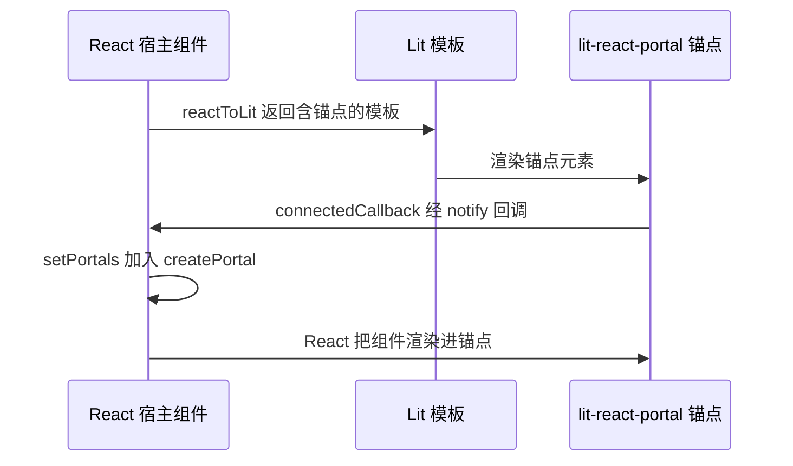

# 第 6 章 前端技术栈：React、Lit、Signals、RxJS

为什么一个项目里同时有 React 与 Lit、RxJS 与 Signals？

第 3 部分 · 编程语言与基础技术 ｜ 难度 ★★★☆☆ ｜ 建议学时 10 小时

---

## 本章导读：分层决定选型

- **应用壳**：React 19，位于 `packages/frontend/core`、`component`
- **编辑器内核**：Lit 3 Web Components，位于 `blocksuite/`
- **编辑器响应式**：`@preact/signals-core` 把 Yjs 变成信号
- **业务状态**：基于 RxJS 7 的 LiveData；少量 Jotai 与 SWR
- **样式**：vanilla-extract（`*.css.ts`），Admin 用 Tailwind 4
- **交互基础件**：Radix UI、floating-ui、cmdk、foxact

<div class="callout">

每项技术按"核心概念 → AFFiNE 真实例子 → 为什么选它"展开。

</div>

Note:
很多同学第一次打开 AFFiNE 前端会困惑：为什么 React 和 Lit 共存，为什么 Observable、Signal、atom、LiveData 都有。答案就在分层：React 管外壳，Lit 管编辑器，各层用最合适的响应式方案。本章每一节都按"速成、真实代码、选型理由"三步走，最后再看一张总表。

---

## 学习目标

- 说清 `createRoot` 到 `RouterProvider` 的启动链路与 `lazy` 路由
- 区分 Jotai、SWR、LiveData 各自负责的场景
- 读懂 nbstore 与 infra 中的 RxJS 操作符用法
- 解释 Signals 及 Yjs 属性如何同步为 `xxx$` 信号
- 写出带 `SignalWatcher` 的 Lit 组件，并说清 Shadow DOM 取舍
- 掌握 Lit 与 React 双向嵌入、vanilla-extract 主题化样式

Note:
这六条目标对应本章的六大块：React 与路由、状态方案、RxJS、Signals、Lit、互操作与样式。学完后你应该能看懂应用层任意一个组件，也能读懂 BlockSuite 一个 Block 的响应链。建议边看边打开对应源码对照。

---

## 知识地图



Note:
整张图分四条主线：视图层、状态与响应式、样式、基础组件。视图层里 React 和 Lit 并存，状态层是本章的重头戏，RxJS、LiveData、Signals 三者的关系要特别理清。样式和基础件相对独立，最后快速过一遍。

---

## 全景：打开一篇文档涉及什么



React 管布局与路由，`useLiveData` 订阅业务状态，`LitDocEditor` 承载编辑器。

Note:
这张图是全章的骨架。页面组件一边通过 useLiveData 订阅 Service 里的 LiveData，一边通过 createReactComponentFromLit 包装出来的 LitDocEditor 挂载编辑器。编辑器内部每个 Block 再通过 Signals 订阅 Yjs 数据变化。后面每一节都是在放大其中某一块。

---

## React 19：应用壳启动链路

```tsx
const framework = new Framework();
configureCommonModules(framework);
// ...
const frameworkProvider = framework.provider();
export function App() {
  return (
    <Suspense fallback={<AppContainer fallback />}>
      <FrameworkRoot framework={frameworkProvider}>
        {/* CacheProvider → I18nProvider → AffineContext → */}
        <RouterProvider router={router} />
      </FrameworkRoot>
    </Suspense>
  );
}
```

<p class="small">节选自 <code>packages/frontend/apps/web/src/app.tsx</code>；入口 <code>index.tsx</code> 用 <code>createRoot(root).render(&lt;StrictMode&gt;…)</code></p>

Note:
注意 DI 容器 Framework 是在组件树之外、模块级代码里创建并配置好的，React 只是把它挂载进来。Provider 从外到内依次是 Suspense 兜底、FrameworkRoot 注入 DI、CacheProvider 是 Emotion 样式缓存、I18nProvider 国际化、AffineContext 内含 Jotai Provider 和主题，最后交给 RouterProvider。这样业务逻辑不依赖 React 生命周期，Electron 和移动端可以复用同一套 configureXxxModule。

---

## react-router v7：lazy 与 loader

```tsx
export const topLevelRoutes = [
  {
    element: <RootRouter />,
    errorElement: <AffineErrorComponent />,
    children: [
      { path: '/', lazy: () => import('./pages/index') },
      {
        path: SHARE_ROUTE_PATH,
        loader: ({ params }) => redirect(/* getWorkspaceDocPath(...) */),
      },
      // ...
    ],
  },
] satisfies [RouteObject, ...RouteObject[]];
```

- `lazy` 模块需导出约定名 `Component`；`loader` 在导航前重定向
- `/* webpackChunkName: "auth" */` 让认证页合并为一个 chunk

<p class="small"><code>packages/frontend/core/src/desktop/router.tsx</code>（已压缩换行）</p>

Note:
Data Router 用路由对象数组定义，每个路由可以带 loader、lazy 和 errorElement。lazy 天然契合大应用按页拆包，404 页面末尾就导出了 `export const Component`。旧分享链接等通过 loader 在导航前 redirect，避免组件里 useEffect 加 navigate 造成闪烁。另外生产环境有 SENTRY_RELEASE 时会用 Sentry 包装路由，basename 用 environment.subPath 支持子路径部署。

---

## RxJS 7 速成

| 概念 | 类比 | 特点 |
| --- | --- | --- |
| `Observable` | 可多次 resolve 的 Promise | 惰性、可取消 |
| `Subject` | EventEmitter | 多播，订阅前的值会丢失 |
| `BehaviorSubject` | 带当前值的 Subject | 订阅即得最新值，`.value` 同步读 |
| `ReplaySubject(n)` | 带缓存的 Subject | 新订阅者回放最近 n 个值 |
| 操作符 | 数组方法的流版本 | `pipe(map, filter, switchMap)` |

`switchMap` 取消旧请求 · `mergeMap` 并发 · `concatMap` 串行 · `exhaustMap` 忙时忽略

Note:
把 Observable 理解成一个惰性的、可以多次发值、并且可以取消的 Promise。BehaviorSubject 在 AFFiNE 里用得最多，因为它总有当前值。最下面这四个高阶映射操作符一定要分清：搜索框用 switchMap，防重复提交用 exhaustMap。

---

## nbstore：用流聚合多端同步状态

```ts
private readonly peers$ = new BehaviorSubject<DocSyncPeer[]>([]);
private readonly _state$ = this.peers$.pipe(
  switchMap(peers =>
    peers.length ? combineLatest(peers.map(peer => peer.peerState$)) : of([])
  ),
  map(allPeers => /* 聚合 total / syncing / synced / retrying */),
  share({
    connector: () => new ReplaySubject(1),
  })
) as Observable<DocSyncState>;

state$ = this._state$.pipe(
  throttleTime(1000, undefined, { leading: true, trailing: true })
);
```

<p class="small"><code>packages/common/nbstore/src/sync/doc/index.ts</code> 中的 <code>DocSyncImpl</code>（节选）</p>

Note:
peers$ 是远端列表，可能动态变化；switchMap 在列表变化时丢弃旧订阅，重新 combineLatest。combineLatest 让任一 peer 状态变化都输出全部 peer 的最新状态，再 map 聚合成总体状态。share 加 ReplaySubject(1) 让多个 UI 订阅者共享一条上游并为后来者回放最新值；throttleTime 最多每秒推送一次，但首尾值都不丢。

---

## effect：声明式的请求管道

```ts
revalidate = effect(
  exhaustMapWithTrailing(() => {
    return fromPromise(async signal => {
      const info = await this.store.fetchWorkspaceInfo(
        this.workspaceService.workspace.id,
        signal
      ); // ...
    }).pipe(
      backoffRetry({ count: Infinity }),
      onStart(() => this.isRevalidating$.setValue(true)),
      onComplete(() => this.isRevalidating$.setValue(false))
    );
  })
);
```

调用 `this.revalidate()` 即 `subject.next()`；`fromPromise` 在取消订阅时 `abort()`

<p class="small"><code>packages/frontend/core/src/modules/permissions/entities/permission.ts</code>（节选）</p>

Note:
effect 内部建一个 Subject，把传入的操作符串成管道，调用 revalidate 就相当于发出一个值。exhaustMapWithTrailing 合并进行中的重复调用，结束后再补跑一次最新的；fromPromise 把 RxJS 的取消语义传给 fetch 的 AbortSignal；backoffRetry 做指数退避重试；onStart 和 onComplete 维护 loading 状态。原代码里还有一个 tap 用来写权限缓存，这里省略了。防抖、取消、重试、loading 全在一条管道里，这是业务层最常见的模式。

---

## LiveData：RxJS 与 UI 的桥梁

- 继承 `Observable`，内部是 `BehaviorSubject`，可同步读 `.value`
- `ops$` 统计 `watch/unwatch`，**有订阅者才订阅上游**
- `.signal` 按需转为 Preact Signal，供 Lit 组件使用
- 反方向 `LiveData.fromSignal(signal)` 把信号接入 React
- 上游抛错会 `poisoned`，应用 `catchErrorInto(error$)` 导出错误
- React 中 `useLiveData` 基于 `useSyncExternalStore` 实现

<p class="small"><code>packages/common/infra/src/livedata/livedata.ts</code>、<code>react.ts</code></p>

Note:
LiveData 是 AFFiNE 自研的一层封装，结合了 RxJS 的组合能力和同步取值。最关键的设计是惰性上游：LiveData.from 用 scan 计数加 switchMap，计数归零就切到 EMPTY，UI 卸载后数据库查询流自动停止。另外一定记住规范：LiveData 上游不能抛错，否则会进入不可恢复的 poisoned 状态。

---

## 一个典型的应用层组件

```tsx
export const TimeRow = ({
  docId,
  className,
}: { docId: string; className?: string }) => {
  const t = useI18n();
  const docsService = useService(DocsService);
  const docRecord = useLiveData(docsService.list.doc$(docId));
  const docMeta = useLiveData(docRecord?.meta$);
  // ...
  const dTimestampElement = useDebouncedValue(timestampElement, 500);
  return (
    <div className={clsx(styles.container, className)}>{dTimestampElement}</div>
  );
};
```

DI（`useService`）+ LiveData + foxact + vanilla-extract 同时出现

<p class="small"><code>packages/frontend/core/src/desktop/dialogs/doc-info/time-row.tsx</code></p>

Note:
这个组件就是 AFFiNE 应用层的典型面貌。useService 从 DI 容器拿服务，useLiveData 订阅数据，注意第二次传入的可能是 undefined，返回类型会自动带上 undefined。useDebouncedValue 来自 foxact，styles.container 来自 vanilla-extract 的 css.ts 文件。

---

## Jotai 与 SWR：轻量补充

<div class="cols">
<div>

**Jotai：原子化 UI 状态**

- `atomWithStorage` 持久化应用设置
- `appSettingAtom` 读写派生 atom
- store 由 `getCurrentStore()` 提供
- 定位：遗留与少量纯 UI 全局状态

</div>
<div>

**SWR：GraphQL 查询缓存**

- `useQuery` 默认 `suspense: true`
- key 为 `['cloud', query.id, variables]`
- 内部调用 `graphqlService.gql(options)`
- 定位："请求-展示"型服务端数据

</div>
</div>

<div class="callout">

新的业务状态推荐放进 Service/Entity + LiveData，复杂编排走 effect。

</div>

Note:
Jotai 的例子在 packages/common/infra/src/atom/settings.ts，appSettingAtom 是一个可读写的派生 atom，还用 jotai-effect 的 atomEffect 把部分设置同步给 Electron 主进程。SWR 的封装在 use-query.ts，开启 suspense 后，没就绪时会抛 Promise 给外层 Suspense。两者都是补充角色，components/atoms 里甚至有标注 deprecated 的 atom。

---

## Preact Signals 速成

```ts
// 教学示例
import { signal, computed, effect, batch } from '@preact/signals-core';

const count = signal(0);                        // 可写信号
const double = computed(() => count.value * 2); // 派生，自动追踪依赖
const dispose = effect(() => {                  // 读到的信号变化就重跑
  console.log('double =', double.value);
});
count.value = 1;      // 打印 double = 2
batch(() => { count.value = 2; count.value = 3; }); // 只触发一次
count.peek();         // 读取但不建立依赖
dispose();
```

Signal：同步、拉取式、自动追踪依赖；RxJS：擅长时间维度的事件编排

Note:
signal、computed、effect、batch 四个 API 就够用了。和 RxJS 最大的区别是：Signal 是同步的依赖图，适合"某个值变了，精确更新某处 UI"；RxJS 是推送式的时间流，擅长节流、重试、取消。编辑器里同时有成千上万个 Block，每次按键只该重渲染一个段落，所以 BlockSuite 选择了属性级的 Signals。

---

## Yjs → Signal：属性为何有 `xxx$`



`SyncController` 为每个属性生成 `key` 与 `key$` 一对，`_mutex` 防止环路无限递归

<p class="small"><code>blocksuite/framework/store/src/model/block/sync-controller.ts</code></p>

Note:
写 model.props.type 等于 h1 时，Proxy 的 set 把值写进 yBlock 的 prop:type 并更新 type$。直接写 type$.value 时，effect 会把值写回 props.type，再经 Proxy 写入 Yjs。远端协作者改了 Yjs，_observeYBlockChanges 会更新信号。表格块这种 isFlatData 的 Block 用 ReactiveFlatYMap，原理类似。

---

## Lit 3：BlockSuite 的组件基类

| 基类 | 继承链 | Shadow DOM |
| --- | --- | --- |
| `ShadowlessElement` | `LitElement` | 否：`createRenderRoot() { return this; }` |
| `BlockComponent` | `SignalWatcher(WithDisposable(ShadowlessElement))` | 否 |
| `EditorHost` | `SignalWatcher(WithDisposable(ShadowlessElement))` | 否 |
| `WidgetComponent` | `SignalWatcher(WithDisposable(LitElement))` | 是 |

Block 依赖原生 Selection、Range、IME，Shadow DOM 会让跨块选区变复杂

<p class="small"><code>blocksuite/framework/std/src/view/element/</code></p>

Note:
富文本编辑依赖浏览器原生的 contenteditable、Selection 和输入法，Shadow DOM 边界会让跨 Block 选区和复制粘贴变得复杂，所以 Block 渲染在 Light DOM。样式由 finalizeStyles 注入 document.head，源码注释坦言这打破了封装，所以选择器要用标签名做前缀。而 Widget 是工具栏、拖拽手柄这类浮层，不参与文本选区，用 Shadow DOM 获得样式隔离更划算。

---

## SignalWatcher：让 Lit 追踪信号

```ts
abstract class SignalWatcher extends Base {
  override performUpdate() {
    this.__dispose?.();
    let updateFromLit = true;
    this.__dispose = effect(() => {
      if (updateFromLit) {
        updateFromLit = false;
        super.performUpdate();
      } else {
        this.requestUpdate();
      }
    });
  }
}
```

<p class="small"><code>blocksuite/framework/global/src/lit/signal-watcher.ts</code>（节选，类混入）</p>

Note:
SignalWatcher 是一个类混入：函数接收一个类，返回它的子类。它把整个 performUpdate，也就是包括 render 在内的渲染过程，包进一个 Preact effect，渲染时读到的所有 signal.value 都成为依赖。依赖变化时 effect 重跑，走 requestUpdate 分支触发 Lit 的下一次更新。它源自 Google 的 lit-labs/preact-signals，同目录还有 watch 指令可以只更新模板里的一个绑定点。

---

## Lit 与 React 双向互操作



React → Lit：`createReactComponentFromLit`；Lit 里放 React：`useLitPortalFactory`

Note:
互操作工具在 packages/frontend/component/src/lit-react。AFFiNE fork 了官方的 createComponent，因为官方实现在元素挂载后才设置 property，而 BlockSuite 组件常在 connectedCallback 里就读 std 和 model。反方向用 useLitPortalFactory：锚点挂载时通知 React，React 用 createPortal 把组件渲染进去，这样组件仍处在 React 上下文里，能用 useService。注意宿主组件必须把返回的 portals 渲染出来。

---

## vanilla-extract：零运行时样式

```ts
export const hVar = createVar('height');
const bgVar = createVar('bg');
export const button = style({
  backgroundColor: bgVar,
  height: hVar,
  // ...
  selectors: {
    '&:hover:before': { opacity: 1 },
    '&[data-size="default"]': { vars: { [hVar]: '28px' } },
    '&[data-variant="primary"]': {
      vars: { [bgVar]: cssVarV2('button/primary') },
    },
  },
});
```

变体 = `data-*` 属性 + CSS 变量；外部覆盖只需改变量，不必和选择器优先级搏斗

<p class="small"><code>packages/frontend/component/src/ui/button/button.css.ts</code>（节选，已压缩换行）</p>

Note:
vanilla-extract 在构建期把 css.ts 提取成静态 CSS，运行时零开销，属性名和值都有类型提示。按钮的变体全部通过 data 属性加 CSS 变量表达，源码注释原话就是"可以从外部覆盖，不用考虑选择器优先级"。颜色来自 @toeverything/theme 的 cssVar 和 cssVarV2，切换明暗主题时只改根节点变量即可。仓库里还残留 Emotion，属于历史遗留，新代码不要用。

---

## 交互基础件与 Admin 样式

| 库 | 解决的问题 | AFFiNE 中的例子 |
| --- | --- | --- |
| Radix UI | 无样式、可访问的原语 | `@affine/component` 的 `Tooltip` |
| `@floating-ui/dom` | 框架无关的浮层定位 | `button-popper.ts` 的 middleware |
| cmdk | 命令面板 | quicksearch 的 `shouldFilter={false}` |
| Tailwind 4 + shadcn | Admin 后台样式 | `admin/src/global.css` 的 `@theme` |
| foxact / nanoid | hooks 与唯一 ID | `useDebouncedValue`、`nanoid()` |

Note:
Radix 只提供行为和无障碍语义，外观由 vanilla-extract 决定。floating-ui 用 DOM 版本是因为 Lit 组件不能用 React 版定位库，button-popper 里还用了 Popover API 把浮层提升到 Top Layer。cmdk 关闭内置过滤，因为搜索结果来自索引器，过滤排序在 quicksearch 模块完成。Admin 是独立 SPA，用 Tailwind 4 的 CSS-first 配置，并在 @theme 中把颜色映射到 AFFiNE 主题变量。

---

## 源码导读 Top 5

| 优先级 | 路径 | 看什么 |
| --- | --- | --- |
| P0 | `packages/frontend/apps/web/src/app.tsx` | Provider 层次、DI 与 React 的关系 |
| P0 | `packages/frontend/core/src/desktop/router.tsx` | `lazy`、`loader`、`errorElement` |
| P0 | `packages/common/infra/src/livedata/livedata.ts` | 惰性订阅、`signal`、`reactSubscribe` |
| P0 | `blocksuite/framework/global/src/lit/signal-watcher.ts` | Lit 与 Signals 的结合 |
| P0 | `blocksuite/framework/store/src/model/block/sync-controller.ts` | Yjs 与 Signal 双向同步 |

Note:
这五个文件都是 P0，建议按顺序读：先看应用壳怎么启动，再看路由，然后是 LiveData 的运行机制，最后是编辑器侧的 SignalWatcher 和 SyncController。另外 block-component.ts 也是 P0，它展示了 Block 基类的 context 和渲染管道，读完 SignalWatcher 后顺手看。

---

## 动手实践

| 练习 | 验收要点 |
| --- | --- |
| 1 画出 Provider 树 | 含 StrictMode 到 RouterProvider 全部层级 |
| 2 RxJS 与 Signals 对照 | 说清"推送式时间流"与"同步依赖图" |
| 3 读懂 Block 响应链 | 写出改为 H2 时 heading-icon 的调用链 |
| 4 主题化徽章 | 切换明暗主题颜色随之变化 |
| 5 React 组件嵌入 Lit | 画出时序图，说明忘渲染 portals 的后果 |

Note:
练习 1 和 2 是入门，主要是阅读和小实验。练习 3 要在 DevTools 里确认段落元素没有 shadow-root，而 widget 有。练习 4 在本地草稿分支完成后记得丢弃改动；练习 5 是挑战题，需要 Grep 找到 useLitPortalFactory 的调用方。

---

## 自测

**Q1. `LiveData.from(upstream$, initial)` 何时订阅上游？**

有订阅者（watch 计数大于 0）时才订阅，归零后切到 `EMPTY` 取消 <!-- .element: class="fragment" -->

**Q2. `SignalWatcher` 如何让 Lit 组件自动重渲染？**

把 `performUpdate` 包进 `effect`，依赖变化时调用 `requestUpdate()` <!-- .element: class="fragment" -->

**Q3. 为什么 AFFiNE fork 了 `@lit/react` 的 `createComponent`？**

官方实现设置 property 晚于挂载，而 Block 在 `connectedCallback` 就读 `std` <!-- .element: class="fragment" -->

Note:
先让大家自己想几秒再翻答案。第一题考惰性上游，好处是 UI 卸载后上游自动停止。第二题是本章最核心的机制之一。第三题的依据写在 lit-react 目录的 readme.md 里。

---

## 常见坑

| 现象 | 处理 |
| --- | --- |
| `PoisonedError: The livedata is poisoned` | 上游用 `catchErrorInto(error$)` 捕获错误 |
| 组件卸载后请求仍在进行 | 用可取消的 `fromPromise(signal => ...)` |
| Lit 组件读了信号但不刷新 | 混入 `SignalWatcher`，或在 `effect` 中读取 |
| Block 样式污染页面其他元素 | 选择器以组件标签名为前缀 |
| React 传给 Lit 的对象变 `[object Object]` | 用 `createReactComponentFromLit` 或 `.prop=${}` |

Note:
这五个坑在实际开发中最高频。尤其是 effect 的 dispose 一定要交给 this.disposables，否则会内存泄漏。另外 vanilla-extract 的 style 只能写在 css.ts 文件里，SWR 开 suspense 时上层必须有 Suspense 边界，否则会白屏。

---

## 小结与下一步

- React 管应用壳，Lit 管编辑器，二者通过 `lit-react` 互操作
- RxJS 负责异步编排，LiveData 增加同步取值与惰性上游
- Signals 把 Yjs 变成属性级信号，`SignalWatcher` 驱动 Lit 更新
- Block 不用 Shadow DOM，Widget 用；样式用 vanilla-extract

<div class="callout">

**下一章**：第 7 章 Rust 与 NAPI-rs——看 AFFiNE 如何把性能与安全敏感逻辑下沉到 Rust。

</div>

Note:
回顾一下本章的四个要点：分层决定选型，RxJS 加 LiveData 管业务状态，Signals 加 SignalWatcher 管编辑器响应式，样式统一用 vanilla-extract。下一章我们离开前端，进入 AFFiNE 的 Rust 世界，看看本地数据库、文档合并这些底层能力是如何通过 NAPI-rs 暴露给 TypeScript 的。
