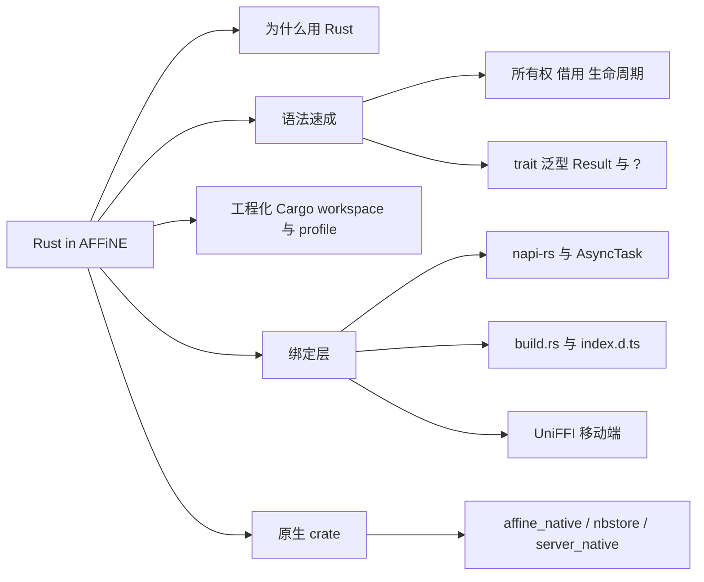
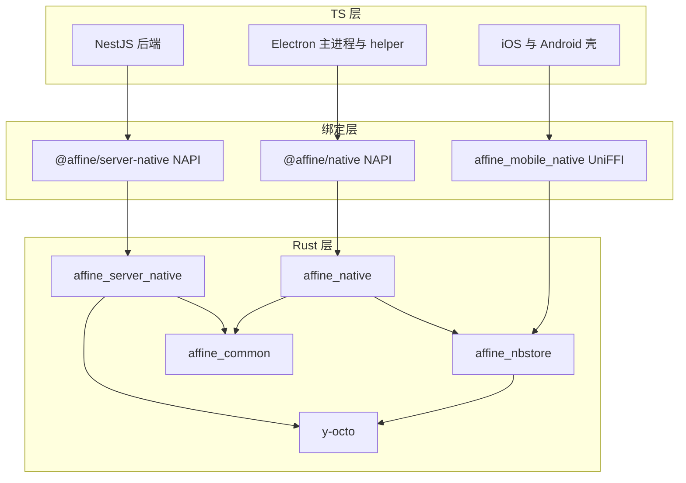
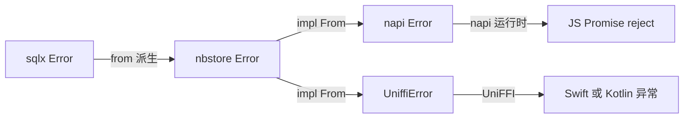
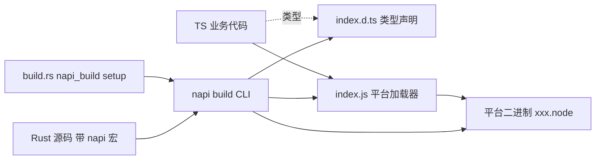
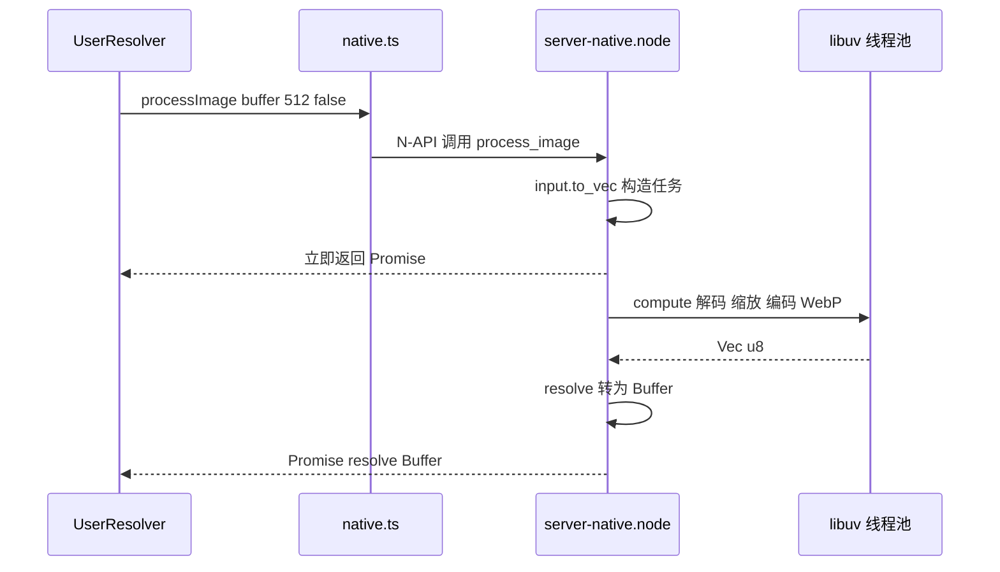

# 第 7 章 Rust 与 NAPI-rs

语法速成 + AFFiNE 真实代码：读懂原生层，写出第一个 `#[napi]` 函数

第 3 部分 · 编程语言与基础技术 ｜ 难度 ★★★★☆ ｜ 建议学时 10 小时

---

## 导读：为什么 AFFiNE 选择 Rust

| 场景 | 代表实现 | 收益 |
| --- | --- | --- |
| CPU 密集计算 | `hashcash.rs`、`image.rs`、`tiktoken.rs` | 原生速度，不阻塞事件循环 |
| CRDT 与文档处理 | `y-octo` 合并更新、解析文档 | 无需在 JS 中加载完整 Yjs |
| 本地存储引擎 | `affine_nbstore`（sqlx + SQLite） | 一份实现，三端复用 |
| 安全敏感逻辑 | `url_policy.rs`、`safe_fetch.rs`、`permission/` | 类型系统 + 单测穷举 |
| 系统 API | ScreenCaptureKit、CoreAudio、WASAPI | Node 本身无法做到 |

Note:
根目录的 Cargo.toml 意味着 AFFiNE 在 TypeScript 之外还维护着一个 Rust workspace，而且它不是点缀。桌面端的本地数据库和录音、后端的文档解析和 SSRF 防护、移动端的存储层都是 Rust 实现的。可以把 Rust 层理解为一组高性能、强约束的底层库，TypeScript 负责编排和 UI。对前端同学来说，学习曲线主要在所有权与借用。

---

## 学习目标

- 说出 AFFiNE 使用 Rust 的典型场景及收益
- 解释所有权、借用、生命周期、trait、泛型、`?` 运算符
- 区分 `thiserror` 与 `anyhow`，读懂错误转换链
- 读懂根 `Cargo.toml` 与工具链、格式化配置
- 用 `#[napi]`、`AsyncTask`、`async fn` 写可被 JS 调用的函数
- 追踪一次从 TypeScript 到 Rust 实现的完整链路

Note:
目标分三层：语法层、工程层、绑定层。学完后你应该能打开 nbstore 的 doc.rs 或后端的 url_policy.rs 逐行读懂，并且能独立添加一个简单的 napi 函数。本章不追求系统讲完 Rust，每讲一个语法点都立刻在仓库里找真实用法。

---

## 知识地图



Note:
本章按这张图从左到右推进：先讲为什么用 Rust，再做四轮语法速成，然后是 Cargo 工程配置，接着是 napi-rs 绑定机制，最后梳理各个原生 crate 的职责以及 JS 如何调用它们。语法部分是前端同学的主要门槛，建议放慢节奏，配合动手实践 2 一起消化。

---

## 全景：TS 层 → 绑定层 → Rust 层



Note:
服务端通过 @affine/server-native 调用 affine_server_native；Electron 通过 @affine/native 调用 affine_native；移动端不跑 Node，所以用 UniFFI 生成 Swift 和 Kotlin 绑定。注意 affine_nbstore 同时被桌面和移动端复用，这是"一份存储实现三端复用"的关键。图里省略了录音的 affine_media_capture。

---

## 所有权：从 JS 内存到 Rust 线程

```rust
#[napi]
pub fn process_image(
  input: Buffer,
  max_edge: u32,
  keep_exif: bool,
) -> AsyncTask<AsyncProcessImageTask> {
  AsyncTask::new(AsyncProcessImageTask {
    input: input.to_vec(),
    max_edge,
    keep_exif,
  })
}
```

三原则：每个值唯一所有者 · 离开作用域即 drop · 赋值传参默认 move

同一时刻：任意多个 `&T`，或只有一个 `&mut T`

<p class="small"><code>packages/backend/native/src/image.rs</code>（已调整换行）</p>

Note:
input.to_vec 把 JS 传入的 Buffer 复制成 Rust 自己拥有的 Vec，任务结构体拿到所有权后，才能安全地送到 libuv 线程池执行。内部函数 process_image_inner 只借用字节切片 &[u8]，不需要所有权。另一个经典技巧在 audio_decoder.rs：compute 只有 &mut self，于是用 std::mem::replace 换出 self.buf，在不违反借用规则的前提下取得所有权、避免大块拷贝。

---

## 共享所有权：Arc 与异步锁

```rust
pub async fn get(
  &self,
  universal_id: String,
) -> Result<Ref<SqliteDocStorage>> {
  let lock = self.inner.read().await;
  let Some(state) = lock.get(&universal_id) else {
    return Err(Error::InvalidOperation);
  };
  let StorageState::Connected(storage) = state else {
    return Err(Error::InvalidOperation);
  };
  Ok(Ref { inner: Arc::clone(storage) })
}
```

`RwLock<HashMap<..>>` 异步读写锁 · let-else 提前返回 · `Arc::clone` 只加引用计数

<p class="small"><code>packages/frontend/native/nbstore/src/pool.rs</code> 的 <code>SqliteDocStoragePool::get</code></p>

Note:
这段代码浓缩了很多 Rust 惯用法。tokio 的 RwLock 允许多个读者并发、写者独占，read().await 不会阻塞线程。StorageState 是带数据的枚举，有 Connecting 和 Connected 两种状态，比 TS 的可辨识联合更强。let-else 在模式不匹配时提前返回，避免层层嵌套。Ref 实现了 Deref，所以可以像引用一样直接调用方法。

---

## 生命周期：借用活多久

```rust
fn first_entry<'a>(
  value: &'a JsonValue,
  operator: &str,
) -> Result<(&'a str, &'a JsonValue)> {
  value
    .as_object()
    .and_then(|value| value.iter().next())
    .map(|(field, value)| (field.as_str(), value))
    .ok_or_else(|| {
      IndexError::InvalidInput(format!("invalid {operator} query"))
    })
}
```

两个引用参数，返回值借自谁？`'a` 声明：**返回的引用借自 `value`**

<p class="small"><code>packages/backend/native/src/search_index/query.rs</code>（已调整换行）</p>

Note:
大多数情况编译器能自动推断生命周期，只有返回引用的来源不明确时才需要手写。这里函数有两个引用参数，编译器猜不出返回值借自哪个，于是标注 'a：只要 value 还活着，返回值就有效，与 operator 无关。这样整个查询编译过程可以零拷贝地引用原始 JSON。更高级的例子是 invalidation.rs 里返回 Pin Box dyn Future 加 'a 的 trait 方法，初学能读懂即可。

---

## trait 与泛型约束

```rust
pub async fn push_update<Update: AsRef<[u8]>>(
  &self,
  doc_id: String,
  update: Update,
) -> Result<NaiveDateTime> {
  // ...
  for attempt in 0..12 {
    match self.try_insert_update_with_timestamp(/* .. */).await {
      Ok(true) => return Ok(timestamp),
      Ok(false) => {}
      Err(err) if attempt == 11 => return Err(err.into()),
      Err(_) => {}
    }
```

`AsRef<[u8]>`：`Vec<u8>`、`&[u8]`、`Uint8Array` 都能传；泛型单态化，零运行时开销

`impl TryFrom<&str> for Stamp`、`impl From<A> for B` 让 `.into()` 自动转换

<p class="small"><code>packages/frontend/native/nbstore/src/doc.rs</code>（节选）</p>

Note:
AsRef 约束让同一个函数既能被 NAPI 层调用，也能被 UniFFI 层和测试代码调用。match 带守卫 if attempt == 11，只有最后一次失败才真正返回错误。trait 方面，hashcash.rs 为 Stamp 实现了标准库的 TryFrom，doc.rs 为 NativeMarkdownResult 实现了 From，于是项目里到处是 Ok(result.into()) 这种写法。

---

## 错误处理：thiserror 定义库错误

```rust
pub type Result<T> = std::result::Result<T, Error>;

#[derive(Debug, thiserror::Error)]
pub enum Error {
  #[error("Sqlite Error: {0}")]
  SqlxError(#[from] sqlx::Error),
  #[error("Invalid operation")]
  InvalidOperation,
  #[error("Document update has missing dependencies")]
  IncompleteDoc,
  #[error("Document changed during compaction")]
  ConcurrentModification,
  // ...
}
```

`#[from]` 自动生成 `From` 实现；应用内部用 `anyhow` 的 `bail!` 与 `.context()`

<p class="small"><code>packages/frontend/native/nbstore/src/error.rs</code>（节选）</p>

Note:
Rust 没有异常，可失败的函数返回 Result，问号运算符的语义是"是 Err 就提前返回并经 From 转换错误类型，否则取出值"。thiserror 适合库，调用方需要区分错误种类；anyhow 适合应用内部，只关心出错了加上下文，比如 image.rs 里的 bail 和 context。#[from] 让 nbstore 里任何 sqlx 调用后面都能直接写问号。

---

## 错误如何跨越 FFI



`impl From<error::Error> for napi::Error` 调用 `to_napi_error(err, GenericFailure)`

<p class="small"><code>packages/frontend/native/nbstore/src/lib.rs</code>、<code>packages/frontend/mobile-native/src/error.rs</code></p>

Note:
JS 只认识 napi::Error，所以每个 crate 都在边界处做一次转换，公共工具 to_napi_error 和 map_napi_err 在 packages/common/native/src/napi_utils.rs。于是 napi 方法里一个问号就能把 nbstore 错误转成 JS 里被 reject 的 Promise。移动端把同一个错误转成 UniffiError，一份错误定义，两种绑定。

---

## async、tokio 与 catch_unwind

```rust
/// Check whether a Yjs update binary can be decoded without applying it to a
/// document state.
#[napi(catch_unwind)]
pub async fn validate_doc_update(update: Buffer) -> Result<bool> {
  let update = update.to_vec();
  tokio::task::spawn_blocking(move || Update::decode_v1(update).is_ok())
    .await
    .map_err(|err| {
      napi::Error::from_reason(format!(
        "Doc update validation task failed: {err}"
      ))
    })
}
```

Rust 的 `Future` 是惰性的，需运行时驱动；CPU 密集代码用 `spawn_blocking`

<p class="small"><code>packages/backend/native/src/lib.rs</code>（已调整换行）</p>

Note:
和 JS 的 Promise 创建即执行不同，Rust 的 async fn 返回一个惰性 Future，必须由 tokio 这样的运行时驱动。napi 开启 async feature 后，#[napi] async fn 会跑在内置 tokio 运行时上并返回 Promise。move 闭包把 update 的所有权移进阻塞线程。catch_unwind 让 Rust panic 变成 JS 异常而不是整个 Node 进程崩溃，处理用户上传的二进制尤其重要。

---

## Cargo workspace 与工程配置

| 配置 | 含义 |
| --- | --- |
| `members` 7 个 | `media_capture` 作为 path 依赖自动成为成员 |
| `resolver = "3"` / `edition = "2024"` | MSRV 感知的依赖解析；Rust 2024 版次 |
| `[workspace.dependencies]` | 统一版本，成员写 `{ workspace = true }` |
| `profile.release` | `codegen-units = 1`、`lto = "fat"`、`strip` |
| 工具链与格式化 | 固定 `1.97.1`；rustfmt `tab_spaces = 2` |

Note:
napi 依赖开启了 async、chrono_date、error_anyhow、napi9、serde 五个 feature。dev profile 里专门给 sqlx-macros、keccak、sha3 开了 opt-level 3，因为 hashcash 的工作量证明在 opt-level 0 下慢得无法接受。release 例外是 affine_mobile_native 设为 strip none，因为 Android 的 UniFFI 绑定生成需要读取符号。rustfmt 用了 unstable 选项，所以 CI 执行的是 cargo +nightly fmt。

---

## napi-rs：从 Rust 到 .node



N-API 是 ABI 稳定的 C 接口；`snake_case` 自动转为 `camelCase`

Note:
Node-API 是 Node.js 提供的 ABI 稳定的 C 接口，napi-rs 用宏把函数和结构体包装成 N-API 导出，并自动生成 TypeScript 声明。产物是动态库，改名为 .node 后可以被 require 加载。生成的 index.js 会根据 process.platform、arch 和是否 musl 依次尝试加载本地 affine.平台.node 或平台子包；后端的加载器则是手写的，更简单。

---

## `#[napi]` 的几种形态

| 写法 | 生成的 JS/TS | 项目例子 |
| --- | --- | --- |
| `#[napi] pub fn` | 同步函数 | `html_sanitize` |
| `#[napi] pub async fn` | 返回 `Promise<T>` | `validate_doc_update` |
| 返回 `AsyncTask<Task>` | Promise，线程池计算 | `verify_challenge_response` |
| `#[napi(object)] struct` | TS `interface`（按值拷贝） | `DocRecord` |
| `#[napi] struct` + `impl` | TS `class`（持有句柄） | `DocStoragePool` |

Note:
另外还有 napi(constructor) 生成构造函数、napi pub const 生成常量、napi(catch_unwind) 把 panic 转成 JS 异常。选择 AsyncTask 还是 async fn 的原则：纯 CPU 计算、不需要 await 别的 Future，用 AsyncTask 走 libuv 线程池；需要 await 数据库或网络，用 async fn 走 tokio。

---

## AsyncTask：线程池中的计算

```rust
#[napi]
impl Task for AsyncVerifyChallengeResponse {
  type Output = bool;
  type JsValue = bool;
  fn compute(&mut self) -> Result<Self::Output> {
    Ok(if let Ok(stamp) = Stamp::try_from(self.response.as_str()) {
      stamp.check(self.bits, &self.resource)
    } else { false })
  }
  fn resolve(&mut self, _: Env, output: bool) -> Result<Self::JsValue> {
    Ok(output)
  }
}
```

`compute` 在工作线程执行（无 `Env`）；`resolve` 回到 JS 主线程转换结果

生成：`verifyChallengeResponse(response, bits, resource): Promise<boolean>`

<p class="small"><code>packages/frontend/native/src/hashcash.rs</code>（已调整换行）</p>

Note:
Task trait 把一次异步计算拆成两步。compute 在工作线程里执行，不能访问 JS 对象，返回 Rust 值 Output；resolve 回到 JS 主线程，可以用 Env 把 Output 转成 JsValue。导出函数 verify_challenge_response 只是 AsyncTask::new 包一下。decode_audio 还用了 with_optional_signal，支持从 JS 传入 AbortSignal 取消。

---

## class、object 与类型映射

<div class="cols">
<div>

```rust
#[cfg_attr(
  not(feature = "use-as-lib"),
  napi(object)
)]
pub struct DocRecord {
  pub doc_id: String,
  pub bin: Data,
  pub timestamp: NaiveDateTime,
}
```

</div>
<div>

```ts
export interface DocRecord {
  docId: string
  bin: Uint8Array
  timestamp: Date
}
```

</div>
</div>

`use-as-lib` 关闭所有 napi 宏，供移动端 UniFFI 复用同一套 nbstore

<p class="small">左：<code>packages/frontend/native/nbstore/src/lib.rs</code>；右：生成的 <code>packages/frontend/native/index.d.ts</code></p>

Note:
左边是 Rust 结构体，右边是 napi 自动生成的 TS 接口。注意 snake_case 变成了 camelCase，NaiveDateTime 借助 chrono_date feature 变成了 Date，Option 会变成可空。条件编译 cfg_attr 只有在不作为普通库使用时才加 napi 宏；移动端开启 use-as-lib 后去掉所有 N-API 代码，改用 UniFFI 包装。Rust 的三斜线文档注释也会被原样搬进 d.ts 的 JSDoc。

---

## build.rs：为 sqlx 现场建库

```rust
#[tokio::main]
async fn main() -> Result<(), std::io::Error> {
  napi_build::setup();
  // always start with a fresh database to have latest db schema
  let cwd = std::env::var("CARGO_MANIFEST_DIR").unwrap();
  let db_path = format!("{cwd}/affine.db");
  // ... 删除旧库，创建 SqlitePool
  get_migrator().run(&pool).await.unwrap();
  println!("cargo::rustc-env=DATABASE_URL=sqlite://{db_path}");
  Ok(())
}
```

`sqlx::query_as!` 在**编译期**连接该库，校验 SQL 与 `DocRecord` 字段映射

<p class="small"><code>packages/frontend/native/nbstore/build.rs</code>（节选）</p>

Note:
build.rs 在编译 crate 本体之前运行。nbstore 的构建脚本每次先删掉旧库、新建 affine.db，用 affine_schema 里的迁移把它迁移到最新结构，再通过 cargo::rustc-env 把 DATABASE_URL 注入编译环境。这就是 query_as! 编译期校验的数据来源。迁移 SQL 同时被运行时和构建脚本使用，所以单独抽成了 affine_schema 这个 crate。

---

## 各原生 crate 职责

| crate | 目录 | 对外包名 | 主要职责 |
| --- | --- | --- | --- |
| `affine_common` | `packages/common/native` | 无 | hashcash、napi 错误工具 |
| `affine_server_native` | `packages/backend/native` | `@affine/server-native` | 文档解析、索引、LLM、安全规则 |
| `affine_native` | `packages/frontend/native` | `@affine/native` | 桌面端原生能力聚合 |
| `affine_nbstore` | `.../native/nbstore` | 经 `affine_native` 导出 | SQLite 文档/Blob/索引存储 |
| `affine_mobile_native` | `packages/frontend/mobile-native` | UniFFI 绑定 | 移动端存储、hashcash |

Note:
affine_common 用 feature 门控，hashcash 和 napi 按需启用，hashcash 是一种工作量证明，用来抵御注册登录接口的批量滥用。affine_native 用 pub use 把 nbstore、sqlite_v1、media_capture、disk_sync 等子 crate 的导出全部汇集到一个 .node 文件，并用 mimalloc 替换系统分配器。y-octo 是与 Yjs 二进制兼容的 Rust CRDT，通过 crates.io 依赖，第 8 章会深入。

---

## 一次 processImage 调用链



`packages/backend/server/src/native.ts` 门面：统一入口 · 参数防御 · 能力增强

Note:
后端不让业务代码到处直接 import 原生模块，而是集中在 native.ts 这个门面。它做三件事：统一入口，未来替换实现只改这里；参数防御，比如 verifyChallengeResponse 先检查类型，因为 napi 收到非字符串会直接抛错；能力增强，比如 validateDocUpdate 加了 AbortSignal 和超时，getTokenEncoder 做了缓存。图里省略了 server-native 的 index.js 加载器这一跳。

---

## 源码导读 Top 5

| 优先级 | 路径 | 看什么 |
| --- | --- | --- |
| P0 | `Cargo.toml` | workspace 成员、依赖统一、profile |
| P0 | `packages/frontend/native/src/hashcash.rs` | 最小的 `AsyncTask` 范例 |
| P0 | `packages/frontend/native/nbstore/src/lib.rs` | napi class/object、条件编译、错误转换 |
| P0 | `packages/frontend/native/nbstore/build.rs` | sqlx 编译期数据库 |
| P0 | `packages/backend/server/src/native.ts` | JS 侧门面 |

Note:
建议从 Cargo.toml 开始建立全局印象，然后读 hashcash.rs，这是最小的 AsyncTask 例子，几十行就能看完。接着读 nbstore 的 lib.rs 和 build.rs，理解 napi 绑定和编译期 SQL 校验。最后读 native.ts，看 JS 侧如何消费。后端 lib.rs 里的 merge_updates_in_apply_way 也是 P0，它是第 8 章的伏笔。

---

## 动手实践

| 练习 | 验收要点 |
| --- | --- |
| 1 跑通 hashcash 单测与基准 | 解释 `#[cfg(feature = "hashcash")]` 的作用 |
| 2 所有权改写实验 | 用自己的话解释 E0507 |
| 3 读懂一次 TS → Rust 调用 | 画出 `pushUpdate` 时序图 |
| 4 设计一个 `word_count` 函数 | 单测通过，写出 `AsyncTask` 骨架 |
| 5 对比 napi 与 UniFFI 导出 | 解释移动端为何用 base64 与整数时间戳 |

Note:
这些练习需要本地安装 Rust，rustup 会根据 rust-toolchain.toml 自动装 1.97.1。练习 1 执行 cargo test -p affine_common --features hashcash，再去掉 features 对比测试数量。练习 2 在仓库外新建一个 crate 做所有权实验。练习 4 在本地草稿分支完成后记得丢弃改动；不需要执行完整的 napi 构建。

---

## 自测

**Q1. `process_image` 为何先 `input.to_vec()`？**

`Buffer` 属于 JS 堆，复制成 `Vec<u8>` 后任务才拥有数据、可送往线程池 <!-- .element: class="fragment" -->

**Q2. `AsyncTask` 与 `async fn` 各适合什么场景？**

纯 CPU 计算用 `AsyncTask`（libuv）；需 await 数据库/网络用 `async fn`（tokio） <!-- .element: class="fragment" -->

**Q3. `sqlx::query_as!` 编译期需要什么？**

一个可连接的数据库：`build.rs` 建库迁移并注入 `DATABASE_URL` <!-- .element: class="fragment" -->

Note:
三道题分别对应所有权、绑定形态和构建脚本这三个核心知识点。第一题的关键词是"JS 堆受垃圾回收与主线程管理"。第三题延伸一下：如果在 IDE 里单独检查宏报 DATABASE_URL must be set，就是 build.rs 没运行导致的。

---

## 常见坑

| 现象 | 处理 |
| --- | --- |
| `Cannot find module './affine.darwin-arm64.node'` | 按第 11 章构建原生模块，检查平台 |
| `cannot move out of self.xxx ... mutable reference` | 用 `std::mem::replace` / `take` |
| Node 进程直接崩溃 | 处理外部输入用 `#[napi(catch_unwind)]` |
| `cargo fmt` 报 unstable 选项警告 | 使用 `cargo +nightly fmt` |
| 改了 Rust 但 TS 类型没变 | 重新构建以再生 `index.d.ts` |

Note:
最常见的是第一个，原生模块没构建或平台不匹配，也可能是误设了 NAPI_RS_NATIVE_LIBRARY_PATH。JS 侧收到 Failed to convert JavaScript value 一般是参数类型和 Rust 签名不符，应该像 native.ts 那样在门面层做校验。macOS 链接报 Undefined symbols _napi 的话，要在仓库根目录执行 cargo，让 .cargo/config.toml 的 dynamic_lookup 生效。

---

## 小结与下一步

- 所有权让"把 JS 数据交给线程池"在编译期被证明安全
- `thiserror` 定义库错误，`From` 一路转为 `napi::Error`
- `#[napi]` 生成 `.node` + `index.d.ts` + `index.js`
- `build.rs` 现场建库，支撑 sqlx 编译期 SQL 校验
- nbstore 以 `use-as-lib` 同时服务桌面 napi 与移动 UniFFI

<div class="callout">

**下一章**：第 8 章 CRDT 与 Yjs 原理——y-octo 合并的到底是什么？

</div>

Note:
本章我们从语法一路走到了工程和绑定。记住两条主线：错误如何从 sqlx 一路转换到 JS 的 reject，以及一个 napi 函数如何变成 TS 里带类型的 Promise。下一章进入 AFFiNE 的数据核心 CRDT，你会看到 merge_updates_in_apply_way 和 nbstore 读时压缩背后的理论基础。
