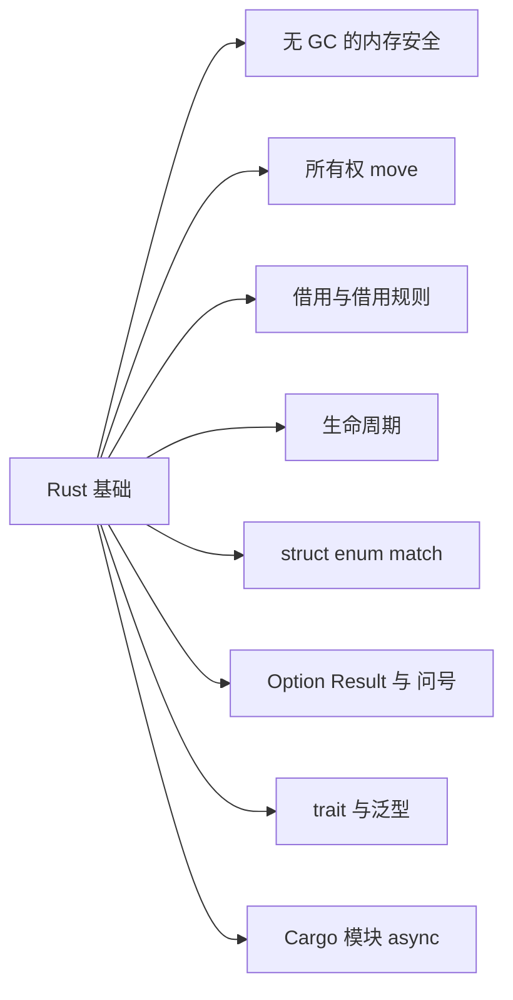

# 第 7 章 Rust 基础入门

> 懂编程、没学过 Rust？从所有权讲起，铺到第 11 章的起点

第 3 部分 · 编程语言与基础技术 ｜ 难度 ★★★☆☆ ｜ 建议学时 6 小时

===

## 本章要解决的问题

<p class="lead">AFFiNE 仓库根有一个 <code>Cargo.toml</code>：本地数据库、CRDT 合并、图片处理、SSRF 防护都用 Rust 写。第 11 章带你读这些真实源码——但 0 基础直接读会被所有权、<code>&mut</code>、<code>'a</code>、<code>?</code> 劝退。</p>

本章只讲 **Rust 语言本身**，不碰 AFFiNE 源码：假设你会一门主流语言，从最核心也最反直觉的概念讲起，一路铺到第 11 章起点。

<div class="note note--tip">

Rust 的一句话定位：**没有 GC、也不用手动 `free`，却依然内存安全的系统级语言**。它靠一套在**编译期**运行的规则（所有权与借用），在程序跑起来之前就证明"不会有悬垂指针、二次释放、数据竞争"。记牢这条，后面全盘皆通。

</div>

===

## 知识地图

本章围绕"编译器凭什么管得住内存"，由地基（所有权）向上搭。



===

## 学习目标

<ol class="goals">
  <li>说清 Rust 为何能"无 GC 又内存安全"，对比 C/C++ 与带 GC 语言</li>
  <li>解释所有权三原则与 move 语义，判断值在何处失效</li>
  <li>区分 <code>&T</code> 与 <code>&mut T</code>，复述借用规则及它如何消灭数据竞争</li>
  <li>读懂生命周期 <code>'a</code>，明白它为何存在、省略规则是怎么回事</li>
  <li>用 <code>struct</code>/<code>enum</code>/<code>match</code> 建模数据并做穷尽匹配</li>
  <li>用 <code>Option</code>/<code>Result</code> 与 <code>?</code> 处理"没有"与"失败"，读懂 trait、泛型、Cargo 与 async 模型</li>
</ol>

===

## 三条路线，Rust 走第三条

内存到底谁来管？你熟悉前两条，Rust 另辟蹊径。

<div class="cards cols-3">
  <div class="card"><div class="card__icon">🔧</div><h4>手动管理</h4><p>C/C++ 自己 <code>malloc</code>/<code>free</code>。快，但悬垂指针、二次释放、数据竞争防不胜防。</p></div>
  <div class="card"><div class="card__icon">🗑️</div><h4>垃圾回收</h4><p>JS/Java/Go 运行时定期回收。省心，但有 GC 停顿与运行时开销。</p></div>
  <div class="card"><div class="card__icon">📐</div><h4>编译期所有权</h4><p>Rust 按规则在编译期确定释放点。既无 GC 开销，又堵住那些内存错误。</p></div>
</div>

<div class="note note--tip">

核心洞察：**"内存何时释放"在编译期可推断**——只要给"谁拥有它"定一套明确规则。检查这套规则的编译器部件叫 **borrow checker**。代码一旦编译通过，就不会有上述那类内存错误。你和它"吵架"时，本质是它在替你做证明。

</div>

===

## 所有权三原则

<ol class="steps">
  <li><h4>唯一所有者</h4><p>每个值有且只有一个所有者（通常是某变量），同一时刻只有一个。</p></li>
  <li><h4>离开作用域即释放</h4><p>所有者离开作用域，值立即被 drop——这就是"何时释放"的答案，无需 GC、无需手写 free。</p></li>
  <li><h4>赋值/传参默认 move</h4><p>把值交给别人，所有权<b>转移</b>，原变量随即失效。要保留就 <code>clone()</code>，或只<b>借用</b>。</p></li>
</ol>

<div class="note">

第 1、2 条解决"何时释放"，第 3 条最反直觉——下一屏专门拆解 move。

</div>

===

## move 语义：赋值不是拷贝

把 `String` 赋给另一个变量，所有权就"搬家"了，原变量当场失效。

<div class="compare">
  <div class="compare__col"><h4>JavaScript 的直觉</h4>

- `s2 = s1` 只是多一个引用
- 两者指向同一对象，都能用
- 由 GC 统一回收

  </div>
  <div class="compare__col compare__col--good"><h4>Rust 的 move</h4>

- `let s2 = s1;` 所有权转给 `s2`
- `s1` 立即失效，再用就报错
- 保证只有一个所有者负责释放

  </div>
</div>

```rust
let s1 = String::from("hello");
let s2 = s1;          // 所有权移动到 s2，s1 失效
// println!("{s1}");  // ❌ borrow of moved value: `s1`
println!("{s2}");     // ✅
```

<div class="note note--warn">

为什么要 move？若 `s1`、`s2` 都"有效"，作用域结束时这块堆内存会被**释放两次**（二次释放）。move 从根上杜绝了它。

</div>

===

## Copy 与 clone：两条出路

move 不是绝对的，看数据在哪、有多贵。

<div class="split">
<div class="split__main">

- **Copy 类型**：`i32`/`bool`/`char`/`f64` 等栈上定长类型，赋值<b>按位复制</b>，原变量仍可用，不发生 move。
- **clone**：想对 `String`/`Vec` 这类堆数据留一份独立副本，必须<b>显式</b> `clone()`——代价可见。

Rust 让"复制有多贵"变得显式：廉价栈拷贝悄悄发生，昂贵堆拷贝必须你亲手写。

</div>
<div class="split__aside">

```rust
let a = 5;
let b = a;           // i32 是 Copy
println!("{a} {b}"); // ✅ 5 5

let s1 = String::from("hi");
let s2 = s1.clone(); // 显式深拷贝
println!("{s1} {s2}"); // ✅ 都能用
```

</div>
</div>

<div class="note note--warn">

别把 `clone()` 当"消除编译错误的咒语"。满屏 clone 往往意味着你真正需要的是**借用**，根本不必拷贝。

</div>

===

## 借用：&T 与 &mut T

每次用值都 move 显然不现实。用 `&` 创建**引用**，临时访问而不获取所有权。

<div class="split">
<div class="split__main">

- `&T`：<b>不可变引用</b>（共享借用），只能读；
- `&mut T`：<b>可变引用</b>（独占借用），可以改。

函数借用用完，原变量依然归自己——这正是借用相对 move 的价值。方法里的 `&self` / `&mut self` 也是同一回事。

</div>
<div class="split__aside">

```rust
fn length(s: &String) -> usize { s.len() }
fn push_bang(s: &mut String) { s.push('!'); }

let mut text = String::from("hi");
let n = length(&text);  // 只读借用
push_bang(&mut text);   // 可变借用
println!("{text} {n}"); // hi! 2
```

</div>
</div>

===

## 借用规则：共享只读，或独占可写

<p class="lead">同一时间对同一个值：要么任意多个 <code>&T</code>（只读），要么唯一一个 <code>&mut T</code>（可写）——不能并存。</p>

<ol class="steps">
  <li><h4>多个只读 OK</h4><p><code>let r1 = &v; let r2 = &v;</code> 任意多个共享借用都行，因为谁都不改。</p></li>
  <li><h4>只读用完才可变</h4><p>只读借用不再使用后，才能 <code>let m = &mut v;</code> 独占可变借用并修改。</p></li>
  <li><h4>读写同时发生被拒</h4><p>同时持有 <code>&v</code> 与 <code>&mut v</code> 并都使用 → 编译失败。</p></li>
</ol>

<div class="note note--danger">

"多个读者 **或** 一个写者"正是**数据竞争**的反面。C/C++ 里两线程一读一写同一内存是未定义行为；Rust 把这条规则前移到编译期，**数据竞争在编译阶段就无法通过**——这就是"无畏并发"。

</div>

===

## 借用规则逐步看

跟着注释走一遍 `v` 的借用生命周期。

<div class="annotate">

```rust [3-4|6-7|10-11]
let mut v = vec![1, 2, 3];

let r1 = &v;             // 只读借用
let r2 = &v;             // 可以有多个只读
println!("{r1:?} {r2:?}"); // r1/r2 到此用完

let m = &mut v;          // 现在才能独占可变借用
m.push(4);
println!("{m:?}");

// let r = &v;           // ❌ 若与下一行同时存在…
// let w = &mut v;       // …cannot borrow `v` as mutable
```

<ol class="annotate__notes">
  <li><b>第 3–4 行</b>：多个 <code>&v</code> 只读共享，合法。</li>
  <li><b>第 6–7 行</b>：只读借用用完，可变借用才登场，独占修改。</li>
  <li><b>第 10–11 行</b>：读与写若同时存在就被拒——数据竞争在此被编译期挡下。</li>
</ol>
</div>

===

## 生命周期：引用别比数据活得久

借用引出新问题：引用指向的数据必须比引用本身活得久，否则就是悬垂引用。

<div class="split">
<div class="split__main">

生命周期（lifetime）是编译器追踪"每个引用能活多久"的机制。**大多数时候你根本不用写**，编译器自动推断（省略规则）；只在"返回引用、来源有歧义"时才需手写 `'a`。

`'a` 不延长寿命，只**描述关系**：下方 `longest` 的返回引用活得不超过 `a`、`b` 中较短者。看不懂复杂标注时先问："返回的引用借自哪个参数？"

</div>
<div class="split__aside">

```rust
let r;
{
    let x = 5;
    r = &x;  // 借用 x
}            // ❌ x 被释放
// `x` does not live long enough

fn longest<'a>(a: &'a str, b: &'a str)
    -> &'a str {
    if a.len() >= b.len() { a } else { b }
}
```

</div>
</div>

<div class="note note--tip">

第 11 章会在 AFFiNE 的 JSON 查询代码里见到真实的 `'a`。本屏能读懂"返回引用借自哪个入参"即可。

</div>

===

## struct、enum 与穷尽的 match

`struct` 聚合字段；带数据的 `enum` 对应 TS"可辨识联合"但更强；`match` **必须穷尽**所有变体，漏一个就编译不过。

<div class="split">
<div class="split__main">

```rust
struct User { id: String, active: bool }

enum Shape {
    Circle(f64),             // 携带半径
    Rect { w: f64, h: f64 }, // 具名字段
    Unit,
}
```

删掉 `Shape::Unit` 那一臂，编译器直接报 `non-exhaustive patterns: Unit not covered`——"忘记处理某情况"的 bug 溜不过去。

</div>
<div class="split__aside">

```rust
fn area(s: &Shape) -> f64 {
    match s {
        Shape::Circle(r) =>
            std::f64::consts::PI * r * r,
        Shape::Rect { w, h } => w * h,
        Shape::Unit => 0.0,
    }
}
```

</div>
</div>

<div class="note note--tip">

TS 要靠 `kind` 字段 + `switch` + `strict` 才能模拟，Rust 把它做成**语言内建、默认穷尽**——"代数数据类型比可辨识联合更强"。

</div>

===

## 错误处理：没有 null，没有异常

两个标准库 enum 把"可能出问题"写进**类型**，调用方被逼着处理。

<div class="compare">
  <div class="compare__col"><h4><code>Option&lt;T&gt;</code> 取代 null</h4>

- `Some(T)` 有值 / `None` 没有
- 调用方被类型逼着处理 `None`
- "空指针"类 bug 几乎不存在

  </div>
  <div class="compare__col compare__col--good"><h4><code>Result&lt;T, E&gt;</code> 取代异常</h4>

- `Ok(T)` 成功 / `Err(E)` 失败
- 错误是普通返回值，必须显式处理
- 不会像异常那样悄悄穿透调用栈

  </div>
</div>

```rust
fn first_char(s: &str) -> Option<char> {
    s.chars().next() // 空串返回 None
}
```

===

## ? 运算符：标注一段错误传播

`?` 的语义：**是 `Err` 就立刻 return 这个错误；是 `Ok` 就取出值继续**。

<div class="annotate">

```rust [3|4|5]
use std::num::ParseIntError;

fn sum_two(a: &str, b: &str) -> Result<i64, ParseIntError> {
    let x: i64 = a.parse()?; // 失败就直接 return Err
    let y: i64 = b.parse()?; // 成功就取出值继续
    Ok(x + y)
}
// sum_two("3","4")    -> Ok(7)
// sum_two("3","oops") -> Err(ParseIntError{..})
```

<ol class="annotate__notes">
  <li><b>第 3 行</b>：返回类型写明 <code>Result&lt;i64, ParseIntError&gt;</code>——一眼看出"这里会失败"。</li>
  <li><b>第 4 行</b>：<code>a.parse()?</code> 等价于 <code>match</code>：<code>Err</code> 则 <code>return Err(From::from(e))</code>，<code>Ok</code> 则取值。</li>
  <li><b>第 5 行</b>：<code>?</code> 返回时还会按 <code>From</code> <b>自动转换错误类型</b>——第 11 章整条错误链靠它串起。</li>
</ol>
</div>

<div class="note note--tip">

异常是"隐式控制流"，看签名不知道会抛什么。Rust 把错误写进**返回类型**保持显式，`?` 又让传播写起来和异常一样简洁。

</div>

===

## trait 与泛型

<div class="split">
<div class="split__main">

- **trait**：定义一组行为，`impl Trait for Type` 实现。类似 TS `interface`，但更灵活（可为别人的类型实现自己的 trait）。
- `#[derive(Debug, Clone)]`：让编译器<b>自动实现</b>常用 trait。
- **泛型 + 约束**：`T: PartialOrd` 表示"这个类型至少会比较大小"，函数体内才敢用 `>`。

</div>
<div class="split__aside">

```rust
fn largest<T: PartialOrd>(list: &[T]) -> &T {
    let mut biggest = &list[0];
    for item in list {
        if item > biggest { biggest = item; }
    }
    biggest
}
// largest(&vec![3,7,2,9]) -> 9
```

</div>
</div>

<div class="note note--tip">

**单态化**：Rust 泛型会为每个实际类型**生成一份专用机器码**，<b>零运行时开销</b>，和手写具体类型一样快——与"编译期检查、运行时擦除"的 TS 泛型本质不同。

</div>

===

## Cargo、模块与 async

<div class="cards cols-3">
  <div class="card"><div class="card__icon">📦</div><h4>Cargo + crate</h4><p>包管理 + 构建（≈<code>npm</code>+<code>tsc</code>）。crate 是编译/分发单元，依赖在 <code>Cargo.toml</code> 声明。</p></div>
  <div class="card"><div class="card__icon">🗂️</div><h4>模块</h4><p><code>mod</code> 声明、<code>pub</code> 控可见性（默认私有）、<code>use</code> 引入路径。</p></div>
  <div class="card"><div class="card__icon">⏳</div><h4>async</h4><p><code>async fn</code> 返回<b>惰性</b> Future，<code>.await</code> 才推进；需运行时驱动，AFFiNE 用 <b>tokio</b>。</p></div>
</div>

```rust
async fn fetch_user(id: u32) -> String { format!("user-{id}") }

#[tokio::main]              // 建立 tokio 运行时并驱动
async fn main() {
    let name = fetch_user(1).await; // .await 是后缀语法
    println!("{name}");
}
```

<div class="note note--warn">

与 JS 的关键区别：**Promise 一创建就执行，Rust Future 惰性、需运行时驱动**。CPU 密集同步计算别塞进 async——第 11 章用 `spawn_blocking` 与 napi `AsyncTask` 正是为此。

</div>

===

## 动手实践

<ol class="steps">
  <li><h4>让 move 报错再修好</h4><p><code>let s2 = s1;</code> 后用 <code>s1</code>，观察报错；再分别用 <code>clone()</code> 和传引用 <code>&s1</code> 修好。<b>验收</b>：说清两种修法的代价差异。</p></li>
  <li><h4>撞一次借用规则</h4><p>同时持有 <code>&v</code> 与 <code>&mut v</code> 并都用，记录报错；再调整顺序让只读借用先用完。<b>验收</b>：复述"共享只读 / 独占可写"。</p></li>
  <li><h4>enum + match 建模</h4><p>定义 <code>enum Event { Click{x,y}, Key(char), Close }</code>，用 <code>match</code> 穷尽处理，再故意删一个分支看报错。<b>验收</b>：解释穷尽检查为何能防 bug。</p></li>
  <li><h4>Result 与 ? 串错误</h4><p>写 <code>parse_point("3,4")</code> 用 <code>?</code> 解析两个整数。<b>验收</b>：<code>"3,4"</code> 得 <code>Ok((3,4))</code>、<code>"3,x"</code> 得 <code>Err</code>，并说清 <code>?</code> 做了什么。</p></li>
</ol>

===

## 自测：点击揭晓答案

<details class="quiz">
<summary>Q1. Rust 没有 GC 也不用 free，靠什么保证内存安全？</summary>

靠**所有权 + 借用规则**在**编译期**检查（borrow checker）。唯一所有者、离开作用域即释放、借用遵守"多只读或单可写"。悬垂指针、二次释放、数据竞争在编译阶段就无法通过，因此既无 GC 开销也不靠手动释放。

</details>

<details class="quiz">
<summary>Q2. 什么是 move？为什么 `let s2 = s1;`（String）后 s1 不能用？</summary>

拥有堆内存的类型赋值/传参默认**转移所有权**（move），原变量失效，保证"只有一个所有者负责释放"，避免二次释放。`i32` 等 `Copy` 类型则是复制，原变量仍可用。

</details>

<details class="quiz">
<summary>Q3. 借用规则是什么？和数据竞争什么关系？</summary>

同一时间对同一值，要么多个 `&T`（只读），要么一个 `&mut T`（可写），不能并存。数据竞争正是"并发读写同一内存且至少一个写"，借用规则从编译期禁止这种组合，于是数据竞争被排除。

</details>

<details class="quiz">
<summary>Q4. 生命周期 `'a` 会改变运行行为吗？在表达什么？</summary>

不会。`'a` 只**描述引用的存活关系**供借用检查。如 `longest<'a>(a: &'a str, b: &'a str) -> &'a str` 表示返回引用不比入参中较短者活得久。多数情况编译器自动推断（省略），无需手写。

</details>

===

## 小结与下一步

<ul class="takeaways">
  <li>Rust = 无 GC + 内存安全；靠编译期所有权与借用，而非运行时回收。</li>
  <li>所有权：唯一所有者、离开作用域即释放、赋值/传参默认 move（Copy 例外，保留用 clone）。</li>
  <li>借用规则"多只读或单可写"把数据竞争挡在编译期；生命周期 <code>'a</code> 只描述引用的存活关系。</li>
  <li>带数据的 <code>enum</code> + 穷尽 <code>match</code> 建模；<code>Option</code>/<code>Result</code>/<code>?</code> 取代 null 与异常。</li>
  <li>trait 是接口、泛型单态化零开销；Cargo 管 crate 与模块；async 的 Future 惰性、需运行时驱动。</li>
</ul>

<div class="note note--tip">

**下一章预告**：第 8 章 CRDT 基础入门——理解"断网也能编辑、联网自动合并"的无冲突数据，为第 12 章的 Yjs 与 y-octo 打底；本章的 Rust 功底则在第 11 章 Rust 与 NAPI-rs 里落到 AFFiNE 真实源码。

</div>
