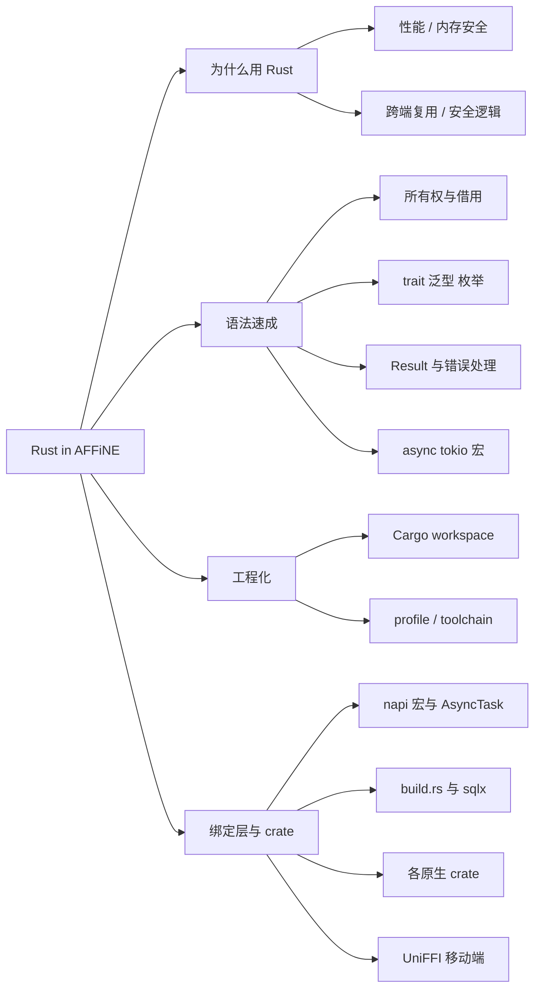
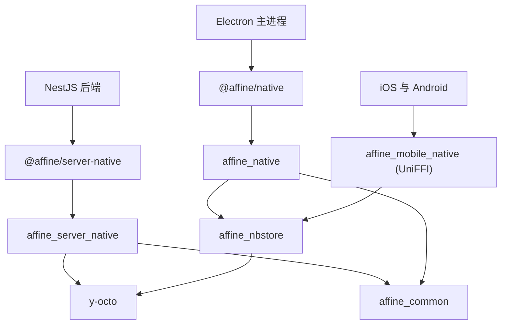
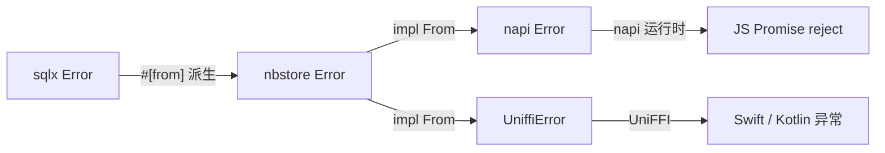
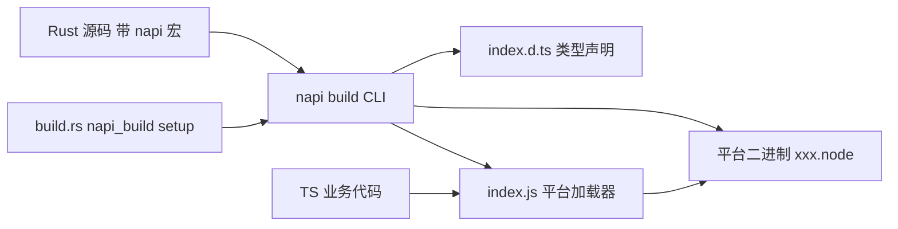
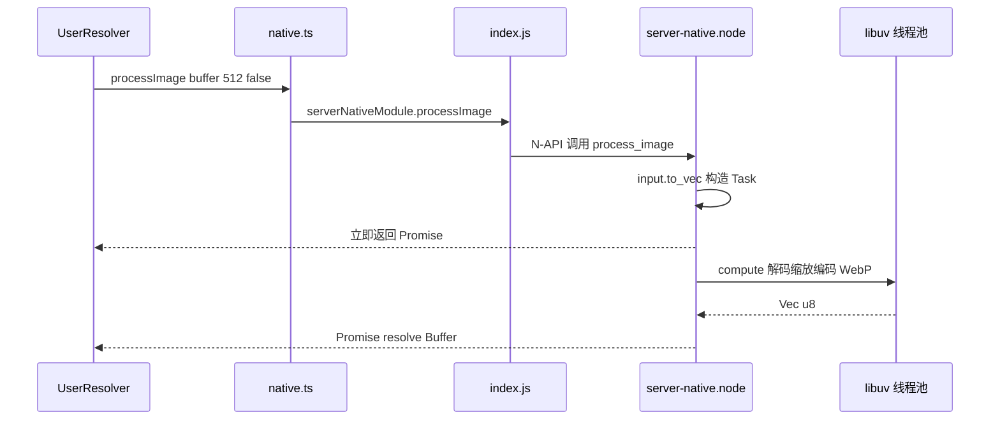

# 第 7 章 Rust 与 NAPI-rs

> TypeScript 之外还有一个 Rust workspace——它怎么跨进 Node 与手机

第 3 部分 · 编程语言与基础技术 ｜ 难度 ★★★★☆ ｜ 建议学时 10 小时

===

## 本章要解决的问题

<p class="lead">仓库根目录有一个 <code>Cargo.toml</code>——AFFiNE 在 TypeScript 之外还维护着一个 Rust workspace，而且它不是点缀。</p>

桌面端的本地数据库、录音、磁盘同步，后端的文档解析、搜索索引、图片处理、SSRF 防护、权限判定，乃至 iOS/Android 的存储层，都由 Rust 实现，再通过 **NAPI-rs**（Node.js）或 **UniFFI**（Swift/Kotlin）暴露给上层。

<div class="note note--warn">

对前端开发者，Rust 的门槛主要在**所有权与借用**。本章不系统讲完 Rust，而采用"**语法速成 + AFFiNE 真实代码**"双线：每讲一个语法点就立刻在仓库里找到用法，最后拉到工程层面弄清 Cargo workspace、napi-rs 绑定生成、各原生 crate 职责与 JS 调用链。

</div>

学完本章，你应能打开 `packages/frontend/native/nbstore/src/doc.rs` 或 `packages/backend/native/src/url_policy.rs` 逐行读懂，并独立添加一个 `#[napi]` 函数。

===

## 知识地图

本章四条主线：**为什么用 Rust → 语法速成 → 工程配置 → 绑定层与各 crate**。



===

## 学习目标

<ol class="goals">
  <li>说出 AFFiNE 使用 Rust 的四类典型场景及收益</li>
  <li>解释所有权、借用、生命周期、trait、泛型、<code>Result</code> 与 <code>?</code>，各指出一处真实用例</li>
  <li>区分 <code>thiserror</code> 与 <code>anyhow</code>，读懂项目的错误转换链到 <code>napi::Error</code></li>
  <li>读懂根 <code>Cargo.toml</code> 的 workspace、<code>profile.release</code> 与工具链固定配置</li>
  <li>用 <code>#[napi]</code>、<code>#[napi(object)]</code>、<code>AsyncTask</code>、<code>async fn</code> 编写可被 JS 调用的函数</li>
  <li>说明 <code>build.rs</code> 如何为 <code>sqlx</code> 编译期校验现场建库，并追踪一次 TS → Rust 调用</li>
</ol>

===

<!-- section -->
## 一、为什么选择 Rust

把 Rust 层理解为一组"高性能、强约束的底层库"，TypeScript 负责编排与 UI。先看它承担哪几类任务。

===

## 四类场景与收益

| 场景 | 代表实现 | 收益 |
| --- | --- | --- |
| **CPU 密集** | hashcash PoW、图片缩放/WebP、Token 计数、音频解码 | 原生速度，可放线程池不阻塞事件循环 |
| **CRDT 与文档处理** | `y-octo` 合并更新、解析文档、生成 Markdown/搜索投影 | 服务端无需加载完整 Yjs，合并更快更省内存 |
| **本地存储引擎** | `affine_nbstore`（sqlx + SQLite） | **一份实现，三端复用**（Electron、iOS、Android） |
| **安全敏感逻辑** | URL 策略、SSRF 抓取、权限判定、许可证校验 | 类型系统 + 内存安全，逻辑集中可被单测穷举 |



===

<!-- section -->
## 二、语法速成（结合真实代码）

所有权/借用、trait/泛型、错误处理、async 与宏——每个语法点都在仓库里对应一处用法。

===

## 所有权：从 JS 内存到 Rust 线程

所有权三原则：每个值只有一个所有者；所有者离开作用域即释放；赋值/传参默认**移动**（move），保留要 `clone()` 或借用。借用规则：**同一时刻要么多个不可变借用 `&T`，要么一个可变借用 `&mut T`**——编译期消灭数据竞争。

<div class="annotate">

```ts [2-5|8]
pub fn process_image(input: Buffer, max_edge: u32, keep_exif: bool)
  -> AsyncTask<AsyncProcessImageTask> {
  AsyncTask::new(AsyncProcessImageTask {
    input: input.to_vec(),   // 把 JS Buffer 复制成 Rust 拥有的 Vec<u8>
    max_edge, keep_exif,
  })
}
fn process_image_inner(input: &[u8], /*…*/) -> AnyResult<Vec<u8>> {
  let format = image::guess_format(input)?;   // 只借用切片，不要所有权
}
```

<ol class="annotate__notes">
  <li><b>第 4 行</b> <code>input.to_vec()</code>：<code>Buffer</code> 指向 JS 堆、受 GC 管理，不能在工作线程长期持有；复制成 <code>Vec&lt;u8&gt;</code> 后任务结构体获得所有权，才能安全送进 libuv 线程池。</li>
  <li><b>第 8 行</b> <code>&amp;[u8]</code>：内部函数只借用只读视图，<code>&amp;Vec&lt;u8&gt;</code> 可自动转为它（deref coercion）。</li>
</ol>
</div>

<div class="note">

另一个经典技巧（`audio_decoder.rs`）：`compute(&mut self)` 无法移走字段，用 `std::mem::replace(&mut self.buf, Uint8Array::new(vec![]))` 换出原值取得所有权，避免大块拷贝；`self.filename.as_deref()` 把 `Option<String>` 转 `Option<&str>`——借用而非移动。

</div>

===

## 共享所有权：Arc、锁与惯用法

多任务共享同一对象时用引用计数指针 `Arc<T>`，配 `RwLock`/`Mutex` 获得内部可变性。一段 nbstore 连接池代码浓缩了大量惯用法：

<div class="split">
<div class="split__main">

| 语法 | 含义 |
| --- | --- |
| `tokio::sync::RwLock<HashMap>` | 异步读写锁，`.read().await` 不阻塞线程 |
| `enum StorageState { Connecting, Connected }` | **带数据的枚举**，比 TS 可辨识联合更强 |
| `let Some(x) = … else { return }` | **let-else**：不匹配就提前返回 |
| `Arc::clone(storage)` | 只增引用计数，不复制数据库连接 |
| `impl Deref for Ref` | 之后 `Ref<T>` 可像 `&T` 一样调方法 |

</div>
<div class="split__aside">

```rust
pub async fn get(&self, id: String)
  -> Result<Ref<SqliteDocStorage>> {
  let lock = self.inner.read().await;
  let Some(state) = lock.get(&id) else {
    return Err(Error::InvalidOperation);
  };
  let StorageState::Connected(s) = state
  else { return Err(Error::InvalidOperation); };
  Ok(Ref { inner: Arc::clone(s) })
}
```

</div>
</div>

<div class="note">

来源：`packages/frontend/native/nbstore/src/pool.rs`。生命周期标注 `'a`（如 `first_entry<'a>(value: &'a JsonValue, …) -> Result<(&'a str, …)>`）告诉编译器"返回的引用借自 `value`"，从而零拷贝引用原始 JSON，防悬垂引用。

</div>

===

## trait、泛型与错误处理

trait 是 Rust 的"接口"，可为别人的类型实现自己的 trait（孤儿规则限制）。泛型是**单态化**的——编译器为每个实际类型生成专用代码，零运行时开销。

<div class="split">
<div class="split__main">

**trait 转换**：实现 `From<A> for B` 后自动获得 `A.into() → B`，项目里大量 `Ok(result.into())` 把第三方结构体转成带 `#[napi(object)]` 的 JS 可见结构体。

**泛型约束**：`push_update<Update: AsRef<[u8]>>` 让 `Vec<u8>`、`&[u8]`、`Uint8Array` 都能传入——同一函数既被 NAPI 调用也被 UniFFI/测试调用。

**错误处理**：无异常，可失败函数返回 `Result<T, E>`；`?` 的语义是"是 `Err` 就经 `From` 转换后提前返回，否则取出 `Ok` 值"。

</div>
<div class="split__aside">

```rust
#[derive(Debug, thiserror::Error)]
pub enum Error {
  #[error("Sqlite Error: {0}")]
  SqlxError(#[from] sqlx::Error),
  #[error("Invalid operation")]
  InvalidOperation,
  #[error(transparent)]
  Parse(#[from] ParseError),
}
pub type Result<T> =
  std::result::Result<T, Error>;
```

</div>
</div>

<div class="note note--tip">

`#[derive(thiserror::Error)]` 是**派生宏**，自动实现 `Error` 与 `Display`；`#[from]` 自动生成 `From`，于是 sqlx 调用后直接写 `?`。分工：**`thiserror` 给库**（调用方需区分错误种类），**`anyhow` 给应用/内部**（只关心"出错了 + 上下文"，用 `bail!`、`.context(...)`）。

</div>

===

## 错误跨越 FFI：一路转成 napi::Error

JS 只认识 `napi::Error`，所以每个 crate 在边界处做一次转换。nbstore 用一个 `impl From` 一次性打通：

```rust
#[cfg(not(feature = "use-as-lib"))]
impl From<error::Error> for napi::Error {
  fn from(err: error::Error) -> Self {
    to_napi_error(err, napi::Status::GenericFailure)
  }
}
```



<ul class="takeaways">
  <li>于是 <code>#[napi]</code> 方法里 <code>self.pool.connect(...).await?</code> 会自动把 <code>nbstore::Error</code> 转成 <code>napi::Error</code>，在 JS 中表现为被 reject 的 Promise。</li>
  <li><b>一份错误定义，两种绑定</b>：移动端把同一个 <code>Error</code> 转成 <code>UniffiError</code>。</li>
</ul>

===

## async、tokio 与宏

Rust 的 `async fn` 返回惰性 `Future`，必须由**运行时**驱动（不同于 JS Promise 创建即执行）。AFFiNE 用 **tokio**。CPU 密集的同步代码不应阻塞运行时，而应 `spawn_blocking`。

<div class="annotate">

```rust [1|3-4]
#[napi(catch_unwind)]
pub async fn validate_doc_update(update: Buffer) -> Result<bool> {
  let update = update.to_vec();
  tokio::task::spawn_blocking(move || Update::decode_v1(update).is_ok())
    .await
    .map_err(|err| napi::Error::from_reason(format!("…{err}")))
}
```

<ol class="annotate__notes">
  <li><b>第 1 行</b> <code>#[napi(catch_unwind)]</code>：Rust panic 不会让 Node 进程崩溃，而转成 JS 异常——处理用户上传二进制时尤其重要。</li>
  <li><b>第 3–4 行</b>：<code>move ||</code> 把 <code>update</code> 所有权移入阻塞线程，<code>spawn_blocking</code> 让 CPU 活不阻塞 tokio 运行时。</li>
</ol>
</div>

<div class="note">

宏分两类：**声明宏**（`format!`、`vec!`、`matches!`、`bail!`）与**过程宏**（`#[derive]`、`#[napi]`、`sqlx::query_as!`）。最值得注意的是 `sqlx::query_as!` 的**编译期 SQL 校验**——它在编译时连一个真实数据库检查 SQL 与列映射。那数据库从哪来？答案在 `build.rs`（见后文）。

</div>

===

<!-- section -->
## 三、Cargo 工程配置

workspace 统一版本、release 用 fat LTO、工具链与格式化固定在仓库内——保证 CI 与本地一致。

===

## 根 Cargo.toml 与 profile

workspace 的两个核心机制：`[workspace.dependencies]` 集中声明版本（成员写 `napi = { workspace = true }` 继承，避免漂移），profile 分别优化 dev 与 release。

<div class="split">
<div class="split__main">

- `resolver = "3"`：Rust 1.84 的 MSRV 感知解析器；
- `edition = "2024"`：带 `let` 链、`unsafe extern` 等；
- **dev 对个别包开优化**：sqlx 宏要编译期执行、hashcash 的 SHA3 在 `opt-level=0` 慢到无法接受；
- **release**：`codegen-units=1` + `lto="fat"` 换更小更快二进制，`strip="symbols"` 去符号；
- **例外**：Android UniFFI bindgen 需读符号，`affine_mobile_native` 不 strip。

</div>
<div class="split__aside">

```toml
[profile.dev.package.sha3]
opt-level = 3

[profile.release]
codegen-units = 1
lto           = "fat"
opt-level     = 3
strip         = "symbols"

[profile.release.package.affine_mobile_native]
strip = "none"
```

</div>
</div>

<div class="note note--warn">

工具链被 `rust-toolchain.toml`（`channel = "1.97.1"`）固定；`rustfmt.toml` 用了 `unstable_features`、`group_imports`、`imports_granularity` 等**只有 nightly 支持**的选项，所以 CI 跑 `cargo +nightly fmt --all -- --check`。`.cargo/config.toml` 还按平台设链接参数（Windows `+crt-static`、macOS `dynamic_lookup`）。

</div>

===

<!-- section -->
## 四、napi-rs：让 Rust 成为 Node 模块

Node-API 是 Node 提供的 ABI 稳定 C 接口；napi-rs 用宏把函数/结构体包装成 N-API 导出，并自动生成 TS 声明。

===

## #[napi] 的几种形态

Node-API 产物是一个动态库，改名 `.node` 后被 `require()`。napi-rs 的编译流程与各种宏形态：



| 写法 | 生成的 JS/TS | 例子 |
| --- | --- | --- |
| `#[napi] pub fn` | 同步函数 | `html_sanitize` |
| `#[napi] pub async fn` | 返回 `Promise<T>`（tokio） | `validate_doc_update` |
| `#[napi] pub fn -> AsyncTask` | `Promise`，计算在 libuv 线程池 | `process_image` |
| `#[napi(object)] pub struct` | TS `interface`（按值拷贝） | `DocRecord` |
| `#[napi] struct + impl` | TS `class`（JS 持 Rust 句柄） | `DocStoragePool` |

<div class="note">

命名自动转换：`snake_case` → `camelCase`（`verify_challenge_response` → `verifyChallengeResponse`，字段 `doc_id` → `docId`）。

</div>

===

## AsyncTask：线程池中的计算

`Task` trait 把异步计算拆成两步：`compute` 在**工作线程**执行（无 `Env`、不能访问 JS 对象），`resolve` 回到**JS 主线程**把结果转为 `JsValue`。

<div class="annotate">

```rust [4-5|8-9]
#[napi]
impl Task for AsyncVerifyChallengeResponse {
  type Output = bool;
  fn compute(&mut self) -> Result<Self::Output> {   // 工作线程
    Ok(Stamp::try_from(self.response.as_str())
       .map(|s| s.check(self.bits, &self.resource)).unwrap_or(false))
  }
  fn resolve(&mut self, _: Env, output: bool) -> Result<bool> {
    Ok(output)   // 回到主线程
  }
}
```

<ol class="annotate__notes">
  <li><b>选择依据</b>：纯 CPU、无需 await 其他 Future → <code>AsyncTask</code>（libuv 线程池）；需 await 数据库/网络 → <code>async fn</code>（tokio）。</li>
  <li><b>可取消</b>：<code>decode_audio</code> 用 <code>AsyncTask::with_optional_signal</code> 支持从 JS 传 <code>AbortSignal</code>，对应声明里的 <code>signal?: AbortSignal</code>。</li>
</ol>
</div>

<div class="note note--tip">

类型映射：`NaiveDateTime` ↔ `Date`（`chrono_date` feature）、`Option<T>` ↔ `T | null`、`Vec<T>` ↔ `Array<T>`、`Uint8Array`/`Buffer` 各自对应。前端 crate 多用 `Uint8Array`，后端多用 `Buffer`。Rust 的 `///` 文档注释会被原样搬进 `.d.ts` 的 JSDoc。

</div>

===

## build.rs：为 sqlx 现场建库

`build.rs` 在编译 crate 本体前运行。最简形式是 `napi_build::setup()`，但 nbstore 的 build.rs 大有文章——它正是 `sqlx::query_as!` 编译期校验的数据来源：

<div class="annotate">

```rust [3-4|6|8]
#[tokio::main]
async fn main() -> Result<(), std::io::Error> {
  napi_build::setup();
  let db_path = format!("{}/affine.db", env!("CARGO_MANIFEST_DIR"));
  // 1. 删旧库、新建 affine.db
  let pool = /* connect_with(create_if_missing) */;
  get_migrator().run(&pool).await.unwrap();   // 2. 迁移到最新结构
  println!("cargo::rustc-env=DATABASE_URL=sqlite://{db_path}");  // 3. 注入编译环境
  Ok(())
}
```

<ol class="annotate__notes">
  <li><b>三步</b>：删旧库建新库 → 用 <code>affine_schema</code> 的迁移建表 → 通过 <code>cargo::rustc-env</code> 把 <code>DATABASE_URL</code> 注入编译环境供 <code>query_as!</code> 读取。</li>
  <li><b>为什么单抽 <code>affine_schema</code> crate</b>：迁移 SQL 要同时被<b>运行时</b>和<b>构建脚本</b>使用，所以它同时出现在 nbstore 的 <code>[dependencies]</code> 与 <code>[build-dependencies]</code> 中。</li>
</ol>
</div>

<div class="note note--warn">

生成的 `index.js` 是多平台加载器：按 `process.platform`/`arch`/是否 musl 依次尝试加载 `affine.<平台>.node` 或平台子包。文件名前缀 `affine` 来自 `package.json` 的 `"napi": { "binaryName": "affine" }`。学习阶段**不必**执行耗时的 napi 构建。

</div>

===

<!-- section -->
## 五、各原生 crate 与调用链

Rust workspace 有 7 个显式成员，产出两类二进制：napi 的 `.node`（给 Node/Electron）与 UniFFI 的库（给 iOS/Android）。

===

## crate 职责总览

| crate | 目录 | 对外包 | 职责 |
| --- | --- | --- | --- |
| `affine_common` | `common/native` | 被依赖 | hashcash、napi 错误工具，feature 门控 |
| `affine_server_native` | `backend/native` | `@affine/server-native` | 服务端原生能力全集 |
| `affine_native` | `frontend/native` | `@affine/native` | 桌面端（Electron）原生能力 |
| `affine_nbstore` | `frontend/native/nbstore` | 经 native 重导出 | SQLite 文档/Blob/索引存储 |
| `affine_schema` | `frontend/native/schema` | — | SQLite 迁移 SQL（运行时 + build.rs 共享） |
| `affine_mobile_native` | `frontend/mobile-native` | UniFFI → Swift/Kotlin | 移动端存储、hashcash、预览 |

<div class="note note--tip">

`affine_common` 用 **feature 门控**（`hashcash`、`napi`）让依赖方只为用到的功能付编译成本：移动端只要 `hashcash`，后端两个都要。`affine_native` 用 `pub use` 把子 crate 的 `#[napi]` 导出聚合进一个 `.node`，JS 侧只需 `import … from '@affine/native'`。

</div>

===

## use-as-lib：一套存储，两种绑定

nbstore 要同时服务桌面（N-API）与移动端（UniFFI）。靠**条件编译**切换：默认带 `#[napi]`，移动端开 `use-as-lib` 去掉所有 napi 代码，改由 UniFFI 包装。

<div class="compare">
  <div class="compare__col"><h4>桌面（napi-rs）</h4>

- `#[cfg_attr(not(use-as-lib), napi(object))]`
- 参数类型 `Uint8Array`、`NaiveDateTime`
- 错误 `napi::Error`，异步走 napi 内置 tokio
- 产物 `.node` + `index.d.ts`

  </div>
  <div class="compare__col compare__col--good"><h4>移动端（UniFFI）</h4>

- `#[derive(uniffi::Record)]`、`#[uniffi::export]`
- `DocRecord.bin` 为 **base64 字符串**（过 Capacitor JS↔原生桥）
- 错误 `#[derive(uniffi::Error)]`，`async_runtime = "tokio"`
- 产物 `.so`/`.a` + `.swift`/`.kt`

  </div>
</div>

<div class="note">

移动端 `affine_mobile_native` 开启 `use-as-lib = ["affine_nbstore/use-as-lib"]`。生成的绑定已提交在仓库（`ios/App/App/uniffi/affine_mobile_native.swift`、`android/.../affine_mobile_native.kt`），`uniffi-bindgen` 就是 crate 内的 `uniffi-bindgen.rs`。

</div>

===

## 读时压缩：nbstore 的核心逻辑

读一个文档时，把"快照 + 所有增量 update"用 y-octo 合并成新快照，校验无缺失依赖后乐观并发写回——这是理解第 8 章 CRDT 的关键。

<div class="annotate">

```rust [2|5-6|8]
// 合并 snapshot 与 updates
let bin = if segments.len() == 1 { segments.pop().unwrap() }
  else { merge_updates_v1(segments)?.encode_v1()? };
let mut doc = DocOptions::new().with_guid(doc_id).build();
doc.apply_update_from_binary_v1(&bin)?;
if doc.has_pending_updates() {   // 有缺失依赖就拒绝写回
  return Err(Error::IncompleteDoc);
}
// 写回用 UPDATE … WHERE updated_at=? AND data=? 乐观并发，冲突重试
```

<ol class="annotate__notes">
  <li><b>第 5–6 行</b>：合并后建文档 apply 一遍，<code>has_pending_updates()</code> 检查有无缺依赖——有就报 <code>IncompleteDoc</code>，不能当快照写回。</li>
  <li><b>乐观并发</b>：写回时 <code>WHERE updated_at=? AND data=?</code>，期间有并发写入就重试，最多 8 次后返回 <code>ConcurrentModification</code>。</li>
</ol>
</div>

<div class="note">

Electron 侧 `handlers.ts` 里 `POOL.pushUpdate`、`POOL.getDoc` 的签名与 Rust 生成的 `DocStoragePool` 一一对应——**Rust 生成的 `.d.ts` 与手写 TS 接口 `NativeDBApis` 在此对接**，任一边不一致都会被 `tsc` 捕获。

</div>

===

## JS 调用链：server-native.ts 门面

后端不让业务代码到处 import 原生模块，而集中在 `native.ts` 门面：统一入口、参数防御、增强能力。追踪一次图片处理的完整旅程：



<ul class="takeaways">
  <li>门面三件事：<b>统一入口</b>（替换实现只改一处）、<b>参数防御</b>（<code>verifyChallengeResponse</code> 先查类型，napi 收到非字符串会抛错）、<b>增强能力</b>（加 <code>AbortSignal</code>/超时、<code>getTokenEncoder</code> 缓存）。</li>
  <li>配置 schema 的真相源也在 Rust：<code>serverNativeModule.appConfigDescriptors('redis')</code>。</li>
</ul>

===

## 动手实践

<ol class="steps">
  <li><h4>跑通 hashcash 单测与基准</h4><p><code>cargo test -p affine_common --features hashcash</code>；去掉 feature 再跑观察测试数变化。<b>验收</b>：能解释 <code>#[cfg(feature = "hashcash")]</code> 的作用，以及为何"生成"比"验证"慢几个数量级。</p></li>
  <li><h4>所有权改写实验</h4><p>仓库外 <code>cargo new</code>，仿 <code>DecodeAudioTask::compute</code> 写 <code>Task { buf: Vec&lt;u8&gt; }</code>，分别试 <code>consume(self.buf)</code>（预期失败）、<code>mem::replace</code>、<code>clone()</code>。<b>验收</b>：能解释 E0507 "cannot move out of … behind a mutable reference"。</p></li>
  <li><h4>读懂一次 TS → Rust 调用</h4><p>从 <code>electron/.../handlers.ts</code> 的 <code>pushUpdate</code>，依次找到 <code>index.d.ts</code> 声明、<code>nbstore/src/lib.rs</code> 的 <code>#[napi] push_update</code>、<code>pool.rs</code> 的 <code>get</code>、<code>doc.rs</code> 的重试逻辑。<b>验收</b>：画时序图，回答为何最多重试 12 次。</p></li>
  <li><h4>设计一个新 #[napi] 函数</h4><p>仿 <code>html_sanitize.rs</code> 新建 <code>word_count.rs</code>，实现 <code>#[napi] pub fn word_count(input: String) -> u32</code> 并写单测。<b>验收</b>：单测通过；能写出改造为 <code>AsyncTask</code> 的骨架。完成后丢弃改动。</p></li>
</ol>

===

## 自测：点击揭晓答案

<details class="quiz">
<summary>Q1. 为什么 process_image 要先 input.to_vec()？</summary>

`Buffer` 引用 JS 堆内存，受 GC 与主线程管理，不能安全地在工作线程长期持有。复制为 Rust 拥有的 `Vec<u8>` 后，任务结构体拥有数据所有权，可在 libuv 线程池中安全执行 `compute`。

</details>

<details class="quiz">
<summary>Q2. nbstore 的 sqlx::Error 如何变成 JS 异常？</summary>

`SqlxError(#[from] sqlx::Error)` 由 thiserror 生成 `From<sqlx::Error>`，`?` 先转为 `nbstore::Error`；`impl From<error::Error> for napi::Error` 再转为 `napi::Error`（GenericFailure）；napi 运行时最终转成 JS Promise 的 reject。

</details>

<details class="quiz">
<summary>Q3. AsyncTask 与 #[napi] async fn 分别适合什么？</summary>

`AsyncTask` 适合纯 CPU 计算，`compute` 在 libuv 线程池、`resolve` 回主线程，如 hashcash、图片处理、音频解码。`async fn` 适合需 await 数据库/网络的场景，在 napi 内置 tokio 运行时执行，如 `DocStoragePool` 各方法。

</details>

<details class="quiz">
<summary>Q4. sqlx::query_as! 编译期需要什么？AFFiNE 如何提供？</summary>

需要可连接的数据库（经 `DATABASE_URL`）校验 SQL 与结果映射。nbstore 的 `build.rs` 在构建前新建 `affine.db`，用 `affine_schema::get_migrator()` 迁移到最新结构，并通过 `cargo::rustc-env=DATABASE_URL=sqlite://...` 注入编译环境。

</details>

===

## 小结与下一步

<ul class="takeaways">
  <li>Rust 承担<b>计算密集、CRDT、本地存储、安全规则、系统 API</b> 五类任务。</li>
  <li>所有权/借用让"把 JS 数据交给线程池"在编译期就被证明安全（<code>to_vec</code>、<code>mem::replace</code>、<code>Arc::clone</code>）。</li>
  <li><code>thiserror</code> 定义库错误、<code>anyhow</code> 处理内部错误，<code>From</code> 把错误一路转成 <code>napi::Error</code> 或 <code>UniffiError</code>。</li>
  <li>napi-rs 用 <code>#[napi]</code> 生成 <code>.node</code> + <code>index.d.ts</code> + <code>index.js</code>；<code>AsyncTask</code> 走线程池、<code>async fn</code> 走 tokio。</li>
  <li><code>build.rs</code> 为 sqlx 编译期校验现场建库；nbstore 用 <code>use-as-lib</code> 同时服务 napi 与 UniFFI。</li>
</ul>

<div class="note note--tip">

**下一章预告**：第 8 章深入 `CRDT 与 Yjs 原理`——本章出现的 `merge_updates_v1`、`validate_doc_update`、读时压缩，都建立在 CRDT 的交换律/结合律/幂等性之上。我们会看清 Block 如何映射到 Y.Map、两客户端并发如何无冲突合并。

</div>
