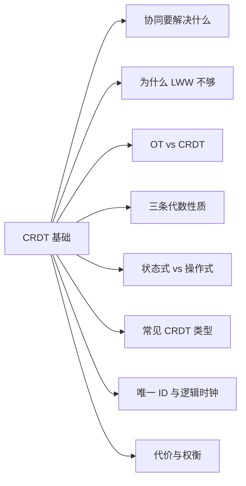
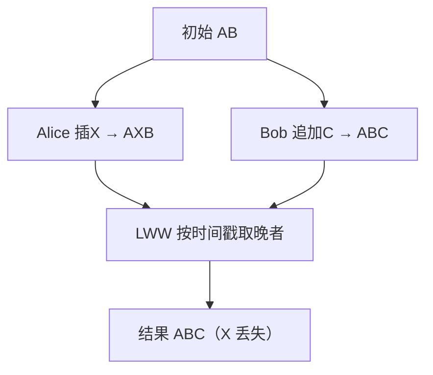
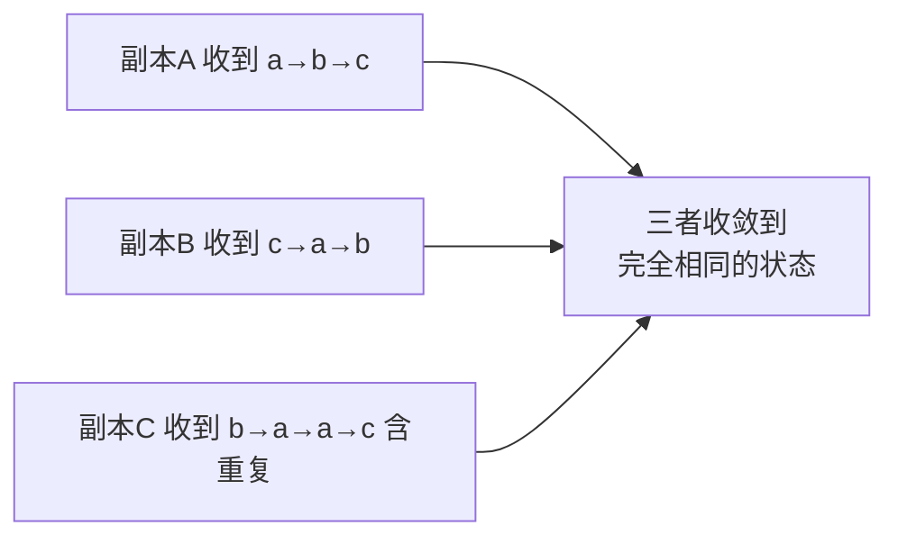
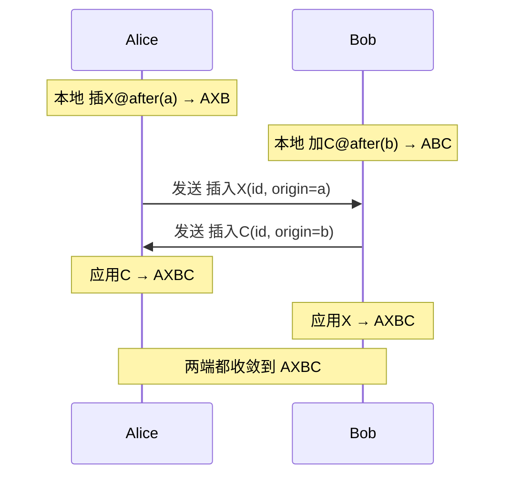
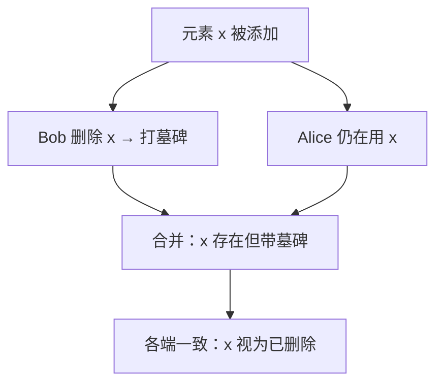

# 第 8 章 CRDT 基础入门

> 懂编程、没接触过协同算法？从核心概念铺到第 12 章的起点

第 3 部分 · 编程语言与基础技术 ｜ 难度 ★★★☆☆ ｜ 建议学时 4 小时

===

## 本章要解决的问题

<p class="lead">AFFiNE 的核心卖点是 local-first：断网也能编辑，联网后与云端、他人修改自动合并，且不会"你的修改覆盖了我的"。撑起这一切的底层技术叫 CRDT。</p>

第 12 章会把 CRDT 和 Yjs、YATA、`Y.Doc` 绑在一起讲，0 基础直接读会被一堆"为什么这么设计"的前提绊住。本章只讲 **CRDT 的通用原理与直觉**，不碰具体库、不读源码，把细节留给第 12 章。

<div class="note note--tip">

CRDT 的一句话定位：**一类特殊的数据结构——无论各副本以什么顺序、分几批、重复多少次收到彼此的修改，最终都会收敛到完全相同的状态，且不需要中心服务器裁决。** 记牢这条，后面的设计都围绕它展开。

</div>

===

## 知识地图

本章围绕"协同难题 → CRDT 凭什么无冲突"，由浅入深。



===

## 学习目标

<ol class="goals">
  <li>说清协同编辑的三个问题：并发冲突、离线编辑、最终一致性</li>
  <li>解释"最后写入者赢（LWW）"为何在协同文本里会丢数据</li>
  <li>对比 OT 与 CRDT 的核心差异与各自代价</li>
  <li>说出 CRDT 依赖的三条代数性质及其现实含义</li>
  <li>区分状态式与操作式 CRDT，知道各自传什么、要求什么</li>
  <li>描述三类常见 CRDT：计数器、集合（墓碑）、有序序列</li>
  <li>说明唯一 ID 与逻辑时钟的作用，为第 12 章 YATA 打底</li>
</ol>

===

## 协同编辑要同时搞定三件事

<div class="cards cols-3">
  <div class="card"><div class="card__icon">⚡</div><h4>并发冲突</h4><p>两人（或一人两设备）几乎同时改同一份文档。谁的改动都不能消失，最终还得一致。</p></div>
  <div class="card"><div class="card__icon">✈️</div><h4>离线编辑</h4><p>地铁、飞机上照样打字；重新联网后离线攒下的改动要自动合并，而非弹"冲突请手动解决"。</p></div>
  <div class="card"><div class="card__icon">🔄</div><h4>最终一致性</h4><p>允许某一瞬间各端内容不同，但承诺：收到彼此全部修改后一定收敛到同一份内容。</p></div>
</div>

<div class="note note--warn">

**为什么不能靠锁**：加锁等于让协作排队，离线时更无锁可抢。协同编辑必须**允许并发修改先发生、再想办法合并**，而不是预先阻止冲突。

</div>

===

## 为什么"最后写入者赢"不够

<div class="split">
<div class="split__main">

**LWW（Last-Write-Wins）**：给每次改动打时间戳，合并取晚者。对**单个独立字段**（标题、主题色）够用——AFFiNE 很多原始值属性就是这语义。

但对**会被同时插入、删除的文本**，LWW 把整段当成不可分割的值按时间戳覆盖，合并粒度太粗：两处本可共存的局部修改被当成"二选一"，一方工作被整段覆盖而丢失。

</div>
<div class="split__aside">

```text
初始： "AB"
Alice：位置1 插 X → "AXB"
Bob：  末尾加 C   → "ABC"

LWW 取时间戳晚的 Bob：
结果 = "ABC"   ← X 彻底消失
本可共存为 "AXBC"
```

</div>
</div>



<div class="note note--danger">

**时间戳本身也不可靠**：各设备时钟有偏差，离线几小时后的改动时间戳可能比在线设备还"新"或"旧"，纯靠物理时间排序根本不公平。第六节的逻辑时钟就是为绕开这个坑。

</div>

===

## 两大流派：OT 与 CRDT

<div class="compare">
  <div class="compare__col"><h4>OT（操作变换）</h4>

- 操作仍用**位置下标**：`insert(1,"X")`
- 应用对方操作前，按已发生的操作**变换下标**
- 通常需要**中心服务器**定序
- 变换函数组合极多、极难写对
- 代表：Google Docs

  </div>
  <div class="compare__col compare__col--good"><h4>CRDT（无冲突复制）</h4>

- 给每个元素一个**全局唯一不变 ID**
- 操作引用 **ID 而非下标**，语义不漂移
- 配确定性排序，**不需要中心服务器**
- 任意拓扑、天然支持离线
- 代表：Yjs、Automerge、y-octo

  </div>
</div>

<div class="note note--tip">

AFFiNE 长时间离线、桌面与手机互同步、多存储间来回——**不存在随时在线的权威定序者**，所以必须选 CRDT。本章主线一句话：**引用 ID 而非下标 + 确定性排序 = 无冲突合并**。第 12 章的 YATA 就是它的具体实现。

</div>

===

## 关键一招：引用 ID 而非下标

<div class="split">
<div class="split__main">

"在位置 1 插入 X"被重新表达成"**在 ID=a 的元素之后插入 X**"。无论对方并发插了多少、删了多少，`a` 始终指向同一个元素——**语义不随并发操作漂移**。

再配一套所有副本都认同的**确定性排序规则**，不管操作以什么顺序到达，各端算出的结果都一样，于是"无冲突"。

</div>
<div class="split__aside">

```text
下标表达（会漂移）：
  insert(1, "X")
  对方先删了位置0 → 1 指错了

ID 表达（稳定）：
  insert(after=a, "X")
  a 永远指向同一元素
```

</div>
</div>

<ul class="takeaways">
  <li>把并发问题从"下标会漂移"转化为"<b>给元素稳定身份 + 规则化排序</b>"——这是 CRDT 一切设计的出发点。</li>
</ul>

===

## 三条代数性质

CRDT 的"无冲突"不是口号，是三条代数性质带来的数学保证。把合并记作 `merge`：

| 性质 | 公式 | 现实含义 |
| --- | --- | --- |
| **交换律** | `merge(a,b)=merge(b,a)` | 先收到谁的都一样 |
| **结合律** | `merge(merge(a,b),c)=merge(a,merge(b,c))` | 怎么分组、分几批都一样 |
| **幂等性** | `merge(a,a)=a` | 收到两次也无妨 |

<div class="cards cols-3">
  <div class="card"><h4>交换律 ↔ 乱序</h4><p>消息到达顺序不可控：谁先到我这不一定。</p></div>
  <div class="card"><h4>结合律 ↔ 打包</h4><p>网络常把多条改动攒成一批，分组不该影响结果。</p></div>
  <div class="card"><h4>幂等 ↔ 重传</h4><p>抖动导致同一条改动发两遍，不能计数翻倍、文字重复。</p></div>
</div>

===

## 收敛是数学必然，不是祈祷

满足三条性质的结构构成**半格（semilattice）**，可证明：**只要各副本最终收到相同的"改动集合"，无论顺序、分组、重复，都会收敛到完全相同的状态。**



<div class="note note--tip">

CRDT 不保证"任何时刻各端都一样"，它保证**"收到相同改动集后必然一样"**。第 12 章里 Yjs 的 update 恰好具备这三条——这正是存储层敢"本地攒批合并再推""服务端压成快照""网络重传不校验"的理论基础。

</div>

===

## 两客户端并发 → 合并收敛

回到被 LWW 搞砸的例子，看 CRDT 如何让双端殊途同归。两端收到对方改动的顺序不同，但结果一致：



<ul class="takeaways">
  <li>两处改动引用的都是稳定 ID、互不干扰，先后应用都得 <code>AXBC</code>——这正是 LWW 丢掉的那个"共存结果"。</li>
</ul>

===

## 状态式 vs 操作式

CRDT 有两种实现风格，区别在于**副本之间到底传什么**。

<div class="compare">
  <div class="compare__col"><h4>状态式（state-based）</h4>

- 同步时传**整个状态**
- 对方用 `merge(状态,状态)` 合并
- 网络可丢、可乱序、可重发——极鲁棒
- 缺点：状态大，传整份很费带宽

  </div>
  <div class="compare__col compare__col--good"><h4>操作式（operation-based）</h4>

- 只传**增量操作**（插了X、计数+1）
- 对方 `apply(操作)` 应用
- 省带宽
- 缺点：要求传输层不丢不重（或操作本身幂等）

  </div>
</div>

<div class="note note--tip">

**现实走混合路线**：成熟库（Yjs、Automerge）平时发操作省带宽，但 update 设计得可乱序、可重复、可任意分组合并——兼得操作式的省流与状态式的鲁棒。第 12 章"state vector + diff 同步"就是这种混合。

</div>

===

## 计数器：各记各的贡献

多副本同时加减一个数字，要合并出正确总和。朴素的"各存一个数相加"分不清"真加两次"与"同一次收两遍"。

<div class="split">
<div class="split__main">

**G-Counter（只增计数器）**：每个副本各记各的贡献，计数值 = 各分量之和；`merge` 对每个节点的分量取 **max**。

取 max 天然满足交换/结合/幂等——这是用代数性质"设计"出一个 CRDT 的范例。要支持减法，用两个 G-Counter（一增一减）相减即可（**PN-Counter**）。

</div>
<div class="split__aside">

```text
状态 = { A:3, B:2, C:0 }
计数值 = 3+2+0 = 5

merge：对每个节点取两边 max
{A:3,B:2} ⊔ {A:1,B:5}
       = {A:3, B:5}
```

</div>
</div>

===

## 集合：删除 = 打墓碑

集合要支持增、删。难点在删除：Alice 删 `x`、Bob 并发又加 `x`，听谁的？

**关键技巧：不物理删除，而是打一个"已删除"标记——墓碑（tombstone）。** 删除变成"添加一个墓碑"，和"添加元素"一样是**单调增长**操作，天然可交换、可幂等，合并时谁也不抹掉对方信息。



<div class="note note--warn">

墓碑是 CRDT 的标志性设计。第 12 章会看到 Yjs 删字符时 Item 也不消失，而是标记墓碑（别人可能还以它为锚点插入），已删 ID 区间记在 `DeleteSet` 随 update 传输。代价是墓碑会堆积，靠 GC 回收。

</div>

===

## 有序序列：协同文本的基础

最核心也最难的 CRDT：维护一个有序列表，支持任意位置并发插入/删除、各端收敛同序。

<div class="split">
<div class="split__main">

做法正是主线那句话：**每个字符有全局唯一 ID，插入时记"插在哪个 ID 之后"而非"第几位"**。并发插在同一位置时，用所有副本都认同的确定性规则（如比较 ID 大小）定先后。

关键不在"谁在前"，而在**所有副本排法一致**——于是收敛。

</div>
<div class="split__aside">

```text
初始： A — B   (各有唯一 ID)
Alice：A 之后插 X (origin=A)
Bob：  A 之后插 Y (origin=A)

origin 相同 → 按 ID 比较
确定性排出 A X Y B
（无论 X、Y 谁先到达）
```

</div>
</div>

<div class="note note--tip">

这正是 Yjs 的 **YATA** 算法。第 12 章会看到字符 Item 带 `id=(clientID,clock)`、`origin`（左邻居）、`rightOrigin`（右邻居），并发冲突比较 `clientID` 确定性排序。

</div>

===

## 唯一 ID：CRDT 的地基

CRDT 的一切都建立在"每个元素有全局唯一、永不改变的身份"之上：

<div class="cards cols-3">
  <div class="card"><div class="card__icon">📌</div><h4>稳定引用</h4><p>操作引用 ID（在 ID=a 之后插入），不受并发下标漂移影响。</p></div>
  <div class="card"><div class="card__icon">♻️</div><h4>幂等去重</h4><p>收到一个 ID 已存在的元素，直接忽略——这就是去重。</p></div>
  <div class="card"><div class="card__icon">🪦</div><h4>精确墓碑</h4><p>删除可精确打墓碑到具体 ID。</p></div>
</div>

ID 通常是 **`(节点标识, 本地计数)`**：节点标识区分哪个副本产生（客户端启动时随机编号），本地计数是副本内部自增序号。两者组合既全局唯一、又能排序。

===

## 逻辑时钟：绕开物理时间

CRDT 不关心"几点几分"，只关心**事件之间的先后**。最常见的是 **Lamport 时钟**：

<div class="annotate">

```text [2|3]
# 每个节点维护计数器 clock
本地每发生一个事件：clock = clock + 1
收到对方消息(带 clock')：clock = max(clock, clock') + 1
```

<ol class="annotate__notes">
  <li><b>本地事件</b>：计数器自增，表达"我这又往前走了一步"。</li>
  <li><b>收消息</b>：取两边最大再 +1，保证"因果在先"的事件 clock 一定更小。</li>
</ol>
</div>

`(clock, 节点ID)` 能给所有事件排出全局一致顺序，不依赖物理钟是否对准；并发（互不知晓）的事件靠节点 ID 打破平手。

<div class="note note--tip">

Yjs 字符 ID `(clientID, clock)` 就是这个思路。第 12 章讲的 `uint53` 补丁——把 clientID 从 32 位扩到 53 位——正因为 **clientID 碰撞会让不同元素被当成同一个**，是 CRDT 的致命问题。

</div>

===

## 代价与权衡

CRDT 不是免费午餐，它用额外空间换"无冲突合并"的能力。

| 代价 | 根因 | 缓解 |
| --- | --- | --- |
| 元数据膨胀 | 每个元素挂 ID、时钟、邻居指针 | 二进制紧凑编码、合并压缩 |
| 墓碑堆积 | 删除只打标记不物理删 | GC 在安全时机真正回收 |
| 历史无限增长 | 操作只增不减 | 定期生成快照、丢弃旧 update |

<div class="split">
<div class="split__main">

一个字符净荷 1 字节，围绕它的 ID、邻居指针等元数据可能是净荷数倍；反复删改的文档墓碑越积越多，体积只增不减。缓解两招：**GC**（确认墓碑再不被引用后真正清除）、**合并压缩/快照**（把一长串历史压成当前状态）。

</div>
<div class="split__aside">

```text
删 1 万字符:
  gc=true  → 体积几乎不增
  gc=false → 墓碑全留，暴涨
```

</div>
</div>

<div class="note note--tip">

第 12 章这些权衡变成具体决策：Yjs 默认 `gc:true` 回收墓碑；AFFiNE 放弃 `Y.snapshot`、改为服务端存整份合并后二进制；nbstore"**写时追加、读时压缩**"把一堆 update 读取时 `mergeUpdates` 成快照。

</div>

===

## 动手实践

<ol class="steps">
  <li><h4>手算 LWW 丢数据</h4><p>初始 <code>HELLO</code>，Alice 改成 <code>HELLO!</code>、Bob 并发改成 <code>HELLO WORLD</code>，用"整段+时间戳"LWW 合并。<b>验收</b>：指出哪方改动丢了，说明本可共存为 <code>HELLO WORLD!</code>。</p></li>
  <li><h4>用三条性质设计计数器</h4><p>纸笔实现 G-Counter（状态 <code>{节点:计数}</code>，merge 取 max），模拟三副本各加几次、乱序+重复互相合并。<b>验收</b>：无论顺序与重复三端计数值相同，并说出对应哪条性质。</p></li>
  <li><h4>给集合加墓碑</h4><p>设计增删集合，删除=打墓碑。模拟 Alice 删 x、Bob 并发重加 x，写出合并结果。<b>验收</b>：说清为何打墓碑比物理删更易满足交换律与幂等。</p></li>
  <li><h4>给序列排并发插入</h4><p>初始 <code>A(id=1) B(id=2)</code>，Alice 在 A 后插 <code>X(id=5)</code>、Bob 在 A 后插 <code>Y(id=3)</code>，约定同 origin 按 id 升序。<b>验收</b>：两端结果一致，解释收敛靠排序规则而非到达顺序。</p></li>
</ol>

===

## 自测：点击揭晓答案

<details class="quiz">
<summary>Q1. 协同编辑要同时解决哪三个问题？</summary>

并发冲突（多端同时改、谁的都不能丢且最终一致）、离线编辑（断网能改、联网自动合并）、最终一致性（允许某瞬间各端不同，但收到相同改动集后必然收敛）。

</details>

<details class="quiz">
<summary>Q2. 为什么 LWW 在协同文本里会丢数据？</summary>

LWW 把整段文本当不可分割的值按时间戳覆盖，合并粒度太粗，两处本可共存的局部修改被当成"二选一"，一方被整段覆盖而消失；且物理时间戳在多设备/离线下本就不可靠。

</details>

<details class="quiz">
<summary>Q3. OT 与 CRDT 处理并发的核心差异？</summary>

OT 仍用位置下标、按已发生操作变换下标、通常需中心服务器定序；CRDT 给每个元素全局唯一不变 ID，操作引用 ID 而非下标，配确定性排序，不需中心服务器、天然支持离线。

</details>

<details class="quiz">
<summary>Q4. CRDT 的三条代数性质分别对应网络中的什么？</summary>

交换律↔到达顺序不可控；结合律↔消息被打包成批；幂等性↔消息被重传。三者保证：收到相同改动集后，无论顺序/分组/重复，各副本必然收敛到相同状态。

</details>

<details class="quiz">
<summary>Q5. 为什么删除常用"墓碑"而非物理删除？</summary>

物理删除难满足交换律与幂等；把删除变成"添加墓碑标记"后，它与"添加元素"一样单调增长，天然可交换、可幂等，合并时不抹掉对方信息。代价是墓碑堆积，靠 GC 回收。

</details>

===

## 小结与下一步

<ul class="takeaways">
  <li>协同三难题：并发冲突、离线编辑、最终一致性；加锁行不通，必须"先并发、再合并"。</li>
  <li>LWW 合并粒度太粗会丢数据；CRDT 用"引用 ID 而非下标 + 确定性排序"实现无冲突。</li>
  <li>三条代数性质（交换/结合/幂等）让"收到相同改动集必然收敛"成为数学必然。</li>
  <li>状态式传整份状态、操作式传增量；成熟库走混合路线。</li>
  <li>计数器各记贡献、集合用墓碑、序列按唯一 ID 排序；逻辑时钟绕开不可靠的物理时间。</li>
</ul>

<div class="note note--tip">

**下一章预告**：第 12 章 CRDT 与 Yjs 原理——把本章的"唯一 ID + 确定性排序 + 墓碑 + 三律"落到 YATA 算法、`Y.Doc/Y.Map/Y.Text`、state vector 与 diff 同步、snapshot/GC，以及 AFFiNE 的 nbstore 与服务端合并。

</div>
