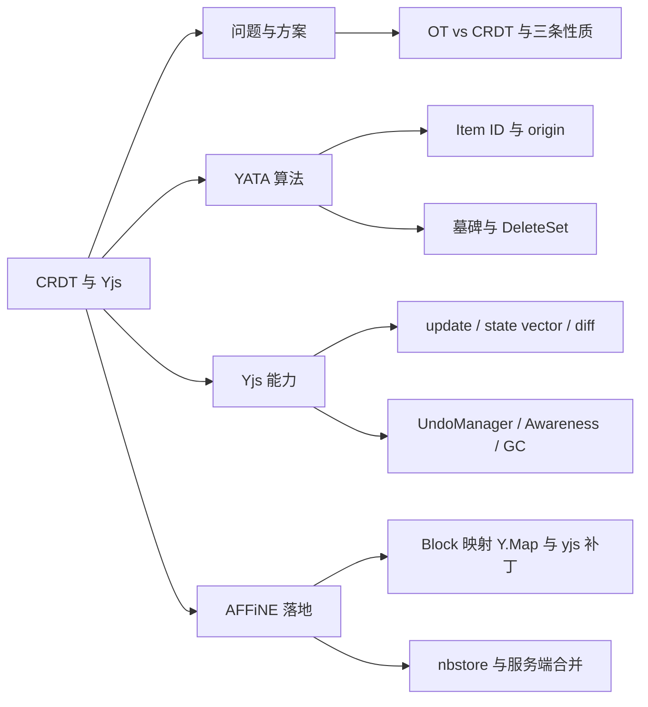
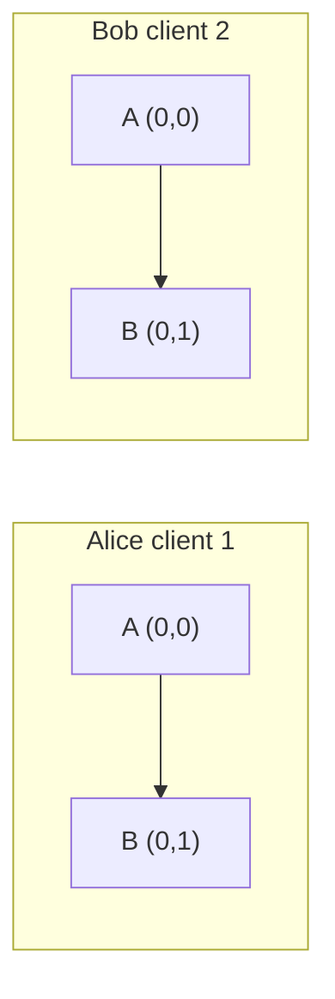
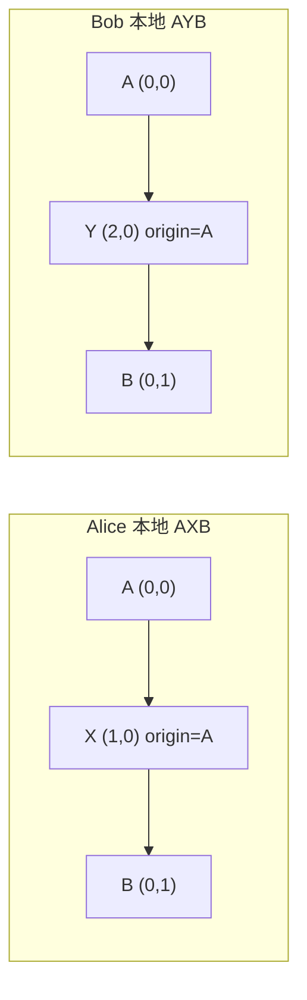
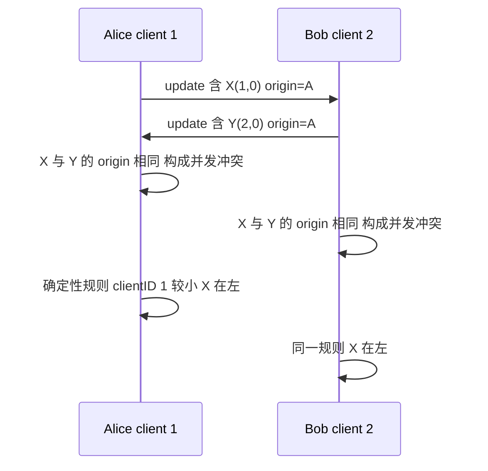
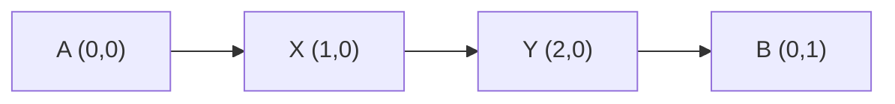
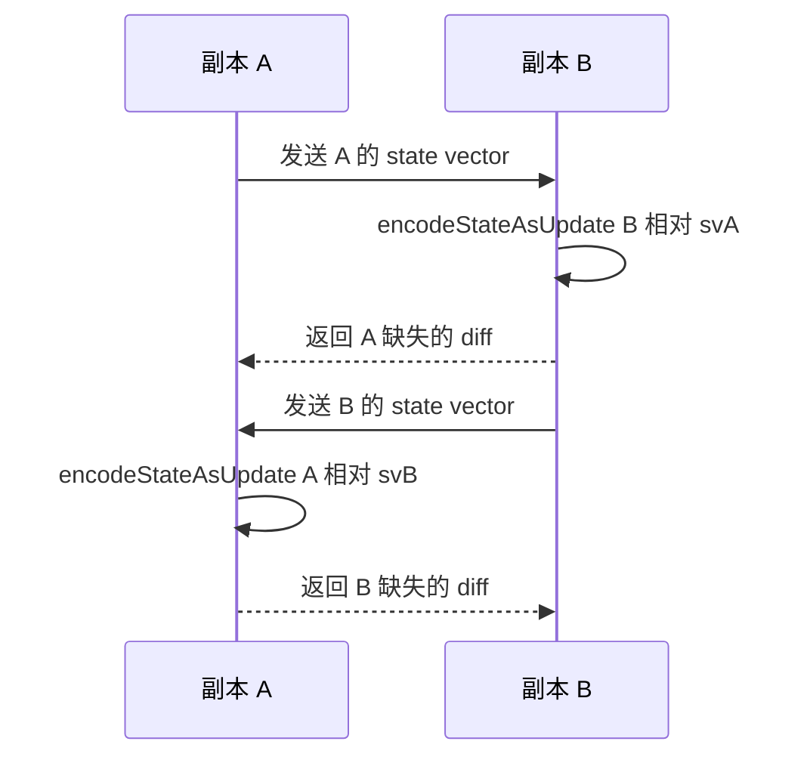
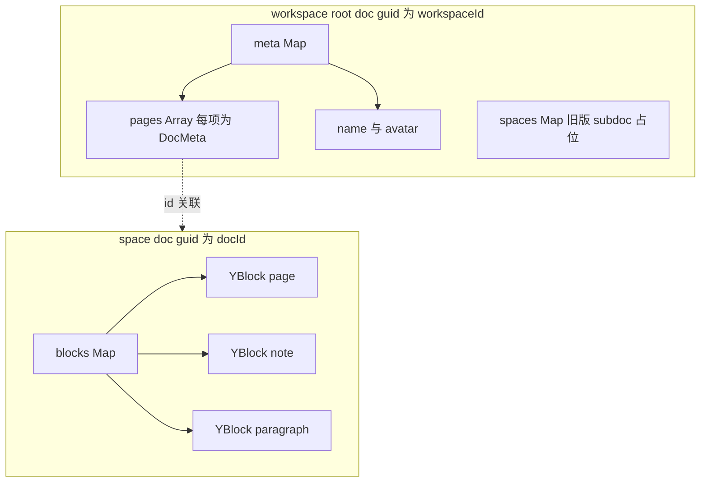
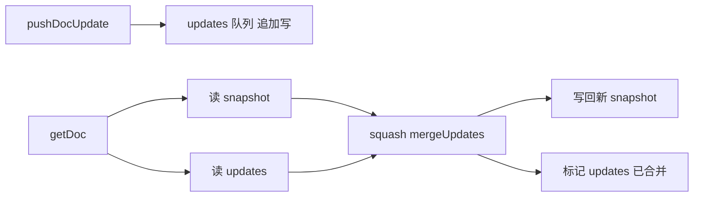
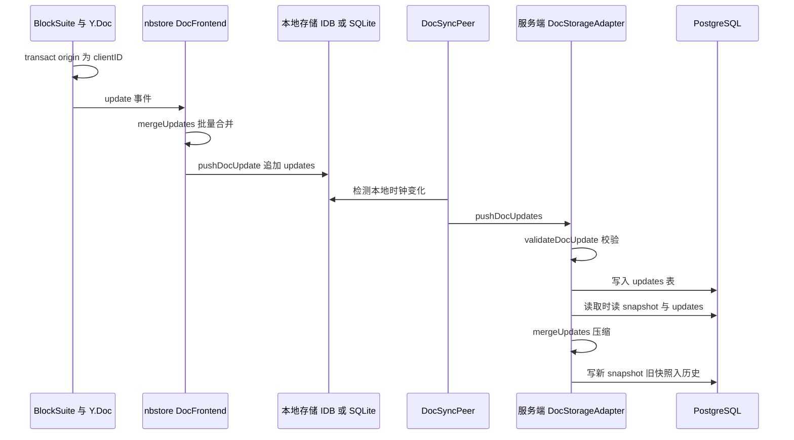

# 第 8 章 CRDT 与 Yjs 原理

local-first 的基石：从并发冲突到 AFFiNE 的 update 存取与合并

第 3 部分 · 编程语言与基础技术 ｜ 难度 ★★★★☆ ｜ 建议学时 8 小时

---

## 导读：CRDT 是唯一的数据真相源

- AFFiNE 断网可编辑，联网后自动合并，不会互相覆盖
- 核心技术：CRDT，实现为 JS 的 **Yjs** 与 Rust 的 **y-octo**
- 每个文档是一个 `Y.Doc`，每个 Block 是一个 `Y.Map`
- 段落文字是 `Y.Text`，二进制 update 存入 IndexedDB/SQLite
- 服务端存入 PostgreSQL 的 `updates`/`snapshots` 表并定期合并

<div class="callout">

两条线：**原理线**（冲突 → CRDT → YATA → Yjs API）与 **落地线**（BlockSuite → nbstore → 服务端）

</div>

Note:
在 AFFiNE 里，CRDT 不是一个同步插件，而是唯一的数据真相源。本章先讲原理：为什么会冲突、CRDT 为什么能无冲突、Yjs 怎么实现。再讲落地：Block 怎么映射到 Y.Map、nbstore 怎么存取 update、服务端怎么合并和生成历史版本。原理部分每个知识点都配有可以在 Node 里跑的教学小实验。

---

## 学习目标

- 解释并发编辑的冲突，对比 OT 与 CRDT 的核心差异
- 说明交换律、结合律、幂等性，并在 Yjs 实验中验证
- 描述 YATA 中 Item 的 `id`、`origin`、`rightOrigin`
- 用 `encodeStateVector`、`diffUpdate`、`mergeUpdates` 完成同步
- 画出 Block → `Y.Map` 结构与 root doc / space doc 关系
- 追踪一次编辑从 `Y.Doc` 到 `snapshot_histories` 的全过程

Note:
这六条目标前三条偏原理，后三条偏落地。特别是最后一条，学完后你要能把一次按键从 BlockSuite 一路追到 PostgreSQL 的历史版本表。另外还会讲仓库对 yjs 打的 uint53 补丁，以及服务端在 Yjs 和 y-octo 之间的合并策略。

---

## 知识地图



Note:
四大块按顺序推进。问题与方案回答"为什么要 CRDT"；YATA 回答"Yjs 内部怎么排序"；Yjs 能力是 API 层面的速成；AFFiNE 落地则是本章的重点，涉及 BlockSuite、nbstore 和服务端三处源码。

---

## 冲突从何而来：OT 与 CRDT

<div class="cols">
<div>

**文本 `"AB"`，Alice 与 Bob 同时操作**

- Alice：`insert(1, "X")` → `"AXB"`
- Bob：`delete(1)` → `"A"`
- 原样互换：Alice 得 `"AB"`，Bob 得 `"AX"`
- 根因：**下标语义在并发下漂移**

</div>
<div>

| 维度 | OT | CRDT |
| --- | --- | --- |
| 思路 | 变换下标 | 唯一 ID |
| 中心服务器 | 通常需要 | 不需要 |
| 离线编辑 | 困难 | 天然支持 |
| 代表 | Google Docs | Yjs、y-octo |

</div>
</div>

Note:
左边这个例子很经典：两端原样应用对方的操作，结果不一致，而且都不是用户期望的 AX。OT 的思路是收到并发操作时变换下标，通常需要中心服务器定序；CRDT 给每个元素分配全局唯一且不变的 ID，操作引用 ID，天然可交换。代价是 CRDT 元数据更大。AFFiNE 的 local-first 定位决定了它必须选 CRDT，因为不存在一个随时在线的权威定序者。

---

## CRDT 的三条代数性质

| 性质 | 公式 | 现实含义 |
| --- | --- | --- |
| 交换律 | `merge(a, b) = merge(b, a)` | 先收到谁的更新都一样 |
| 结合律 | `merge(merge(a, b), c) = merge(a, merge(b, c))` | 可先在本地压缩一批 update |
| 幂等性 | `merge(a, a) = a` | 同一 update 收到两次也无妨 |

满足三者即构成半格 → **强最终一致性**：收到相同更新集合必收敛

`Y.applyUpdate` 可任意顺序、任意分组、重复执行

Note:
这三条性质是整个 AFFiNE 存储设计的理论基础。正因为满足结合律，nbstore 敢把一批 update 合并后再写；服务端敢把一堆 update 压缩成快照。教学实验 1 里逆序加重复应用，结果依然是 c a b。逆序时后面的 update 依赖前面的 Item，Yjs 会先暂存为 pending，这也是 nbstore 里 has_pending_updates 检查的意义。

---

## YATA 算法的直观理解

- 每段插入内容是一个 **Item**，ID 为 `(clientID, clock)`
- 插入时记录左邻 `origin` 与右邻 `rightOrigin`（都是 ID）
- 语义从"插在下标 1"变为"插在某 ID 之后、某 ID 之前"
- 同位置并发插入：大致按 clientID 较小者在左，规则确定
- 删除只标记**墓碑**，已删 ID 区间记入 **DeleteSet**
- 墓碑带来元数据开销，需要 GC 缓解

Note:
clientID 是每个 Y.Doc 随机生成的客户端编号，clock 是该客户端自增的逻辑时钟。ID 永不改变，所以语义不会漂移。冲突排序规则本身不重要，重要的是它是确定性的，所有副本对同一组 Item 排序结果相同，于是自然收敛。回到前面的例子：Bob 删的是 ID 为 B(0,1) 的 Item，Alice 插的是 origin 为 A(0,0) 的 X，无论先后应用，结果都是 AX。下面我们用分步演示看看并发插入的合并过程，按向下键展开。

---

## 并发插入 ① 同一起点



两端已同步，文档都是 `"AB"`，两个 Item 由 client 0 创建

Note:
这是演示的第一步。Alice 是 client 1，Bob 是 client 2，他们的文档已经同步过，都是 AB。字符 A 的 ID 是 (0,0)，B 是 (0,1)，都由 client 0 创建。接下来两人会断网，各自在 A 后面插入一个字符。

--

## 并发插入 ② 离线各自插入



操作引用 ID 而非下标：两个新 Item 的 `origin` 都是 `A (0,0)`

Note:
Alice 插入 X，ID 是 (1,0)；Bob 插入 Y，ID 是 (2,0)。关键在于两个 Item 记录的 origin 都是 A，rightOrigin 都是 B。此时两端各自的文档是 AXB 和 AYB，互不知情。

--

## 并发插入 ③ 交换 update 并排序



Note:
联网后双方交换 update。两端各自发现 X 和 Y 插在同一位置，于是套用同一条确定性规则：clientID 较小的排在左边。这里只是直觉版本，真实 YATA 还会结合 rightOrigin 处理更复杂的交错情形。注意两端不需要协商，也不需要服务器定序。

--

## 并发插入 ④ 收敛



<div class="callout">

两端都得到 `"AXYB"`：无论先应用谁的 update，结果相同——这就是交换律。

</div>

Note:
最终两端都收敛到 AXYB。这个过程印证了前面讲的三条性质：先收到谁的更新都一样，重复收到也没关系。这也是为什么 AFFiNE 可以长时间离线编辑，再在桌面、手机、云端之间任意同步。

---

## Yjs 数据类型

| 类型 | 类比 | AFFiNE 中的用途 |
| --- | --- | --- |
| `Y.Doc` | 一个数据库实例 | workspace root doc、每个文档的 space doc |
| `Y.Map` | `Map` | `blocks` 表、每个 Block、`meta` |
| `Y.Array` | `Array` | `sys:children` 子块 ID 列表、`meta.pages` |
| `Y.Text` | 带格式字符串 | 段落文本 `prop:text`、页面标题 |
| `Y.XmlFragment` | 类 DOM 树 | BlockSuite **未采用**，自建 Block 树 |

Note:
顶层类型用 doc.getMap 加名字获取，各副本中同名即同一对象。嵌套类型必须先插入文档才能使用，没挂载的 Y.Text 读不到 doc，这就是 BlockSuite Text 类里判断 input.doc 的原因。另一个基础是事务：doc.transact 把多次修改打包，只触发一次 update 事件，并携带一个 origin 标记，后面会看到它的妙用。

---

## 两步同步协议：state vector + diff



state vector = `Map<clientID, 下一个期望的 clock>`；双方 `applyUpdate` 后收敛

Note:
状态向量记录"我已经拥有每个客户端的前多少个操作"。对方据此只回传我缺的部分，而不是全量。Yjs 还提供 encodeStateVectorFromUpdate、diffUpdate、mergeUpdates 三个不需要实例化文档的 API，直接在二进制上操作，这是存储层和服务端压缩的关键能力。这是 y-protocols 中 sync step1 和 step2 的思想。

---

## 实验：离线并发编辑后的收敛

```js
const docA = new Y.Doc();
const docB = new Y.Doc();
const textA = docA.getText('t');
const textB = docB.getText('t');
textA.insert(0, 'Hello');
Y.applyUpdate(docB, Y.encodeStateAsUpdate(docA));  // 初始同步
textA.insert(5, ' World');                         // 双方"离线"各改一处
textB.insert(0, 'Say: ');
const svA = Y.encodeStateVector(docA);
const svB = Y.encodeStateVector(docB);
const diffForB = Y.encodeStateAsUpdate(docA, svB); // 只含对方缺的部分
const diffForA = Y.encodeStateAsUpdate(docB, svA);
Y.applyUpdate(docB, diffForB);
Y.applyUpdate(docA, diffForA);
```

实测：A = B = `Say: Hello World`；全量 update 54 字节，diff 仅 29 字节

<p class="small">教学示例 <code>lab-sync.mjs</code>（节选），在 AFFiNE 仓库的 <code>node_modules</code> 下运行</p>

Note:
这个实验可以在仓库外建目录，npm 装 yjs 后用 node 运行。两端各自离线修改后，只交换增量就收敛了，而且 diff 比全量小得多。实测还会打印 clientID 超过 2 的 32 次方，这是 8.7 要讲的补丁效果。另一个实验值得一提：Y.Map 并发写同一个 key，两端一定相同，但只保留一个人的值，所以文本要放进 Y.Text 才能逐字符合并。

---

## origin：区分数据来源的暗号

```ts
// history-extension.ts
this._history = new Y.UndoManager([this.store.doc.yBlocks], {
  trackedOrigins: new Set([this.store.doc.spaceDoc.clientID]),
});

// store.ts
transact(fn: () => void, shouldTransact: boolean = this._shouldTransact) {
  const spaceDoc = this._doc.spaceDoc;
  spaceDoc.transact(
    () => { /* try { fn(); } catch (e) { console.error(...) } */ },
    shouldTransact ? this.spaceDoc.clientID : null
  );
}
```

`clientID` 本地编辑进撤销栈 · `null` 不进撤销栈 · `'nbstore-frontend'` 来自存储不回写

<p class="small"><code>blocksuite/framework/store/src/</code> 下 <code>extension/history/</code> 与 <code>model/store/</code>（节选）</p>

Note:
协同场景下 Ctrl+Z 只能撤销我自己的修改。UndoManager 的 trackedOrigins 只追踪 origin 为本端 clientID 的事务，而 BlockSuite 的所有本地写入都用 clientID 作为 origin。withoutTransact 会把 origin 置为 null，比如初始化默认块，不进撤销栈。远端数据由 nbstore 以 nbstore-frontend 作为 origin 应用，自然不会被撤销。

---

## snapshot、GC、Awareness、subdoc

| 能力 | 作用 | AFFiNE 的做法 |
| --- | --- | --- |
| `Y.snapshot` | 状态向量 + 删除集，需 `gc: false` | **未使用**，历史由服务端存整份二进制 |
| GC | 已删内容替换为轻量 GC 结构 | 保持默认 `gc: true` |
| Awareness | 光标、选区等临时状态 | `AwarenessStore` 的 `selectionV2` |
| subdoc | 文档里嵌套文档 | 仅在 `spaces` 写占位兼容旧版 |

术语提醒：代码中的 "snapshot" 通常指**合并后的完整文档二进制**

Note:
仓库里搜不到 Y.snapshot 和 createDocFromSnapshot 的业务用例，也搜不到 gc: false，两者相互印证：客户端保持 GC 开启、文档更小，代价是历史版本占更多服务端存储。Awareness 不进入文档历史，带超时自动清除。subdoc 现在已不依赖，真正承载内容的是 guid 等于文档 ID 的独立 Y.Doc，并且 spaceDoc.clientID 复用了 rootDoc 的 clientID。

---

## 两层文档：root doc 与 space doc



<p class="small"><code>WorkspaceMetaImpl</code>（<code>impls/meta.ts</code>）管理 <code>meta</code>；<code>DocImpl</code>（<code>impls/doc.ts</code>）中 <code>getMap('blocks')</code></p>

Note:
root doc 在 workspace.ts 里创建，guid 就是 workspaceId，它的 meta Map 存文档列表 pages、name、avatar 等。每个文档一个 space doc，guid 就是文档 ID，内容都在 blocks 这个 Map 里。WorkspaceMetaImpl 用 observeDeep 监听 pages 变化，WorkspaceImpl 据此创建或销毁 DocImpl。这样存储和同步层只需面对"按 docId 存取二进制"这一个简单模型。

---

## YBlock：Block 如何映射到 Y.Map

```ts
const yBlock = new Y.Map() as YBlock;
this._yBlocks.set(id, yBlock);
// ...
yBlock.set('sys:id', id);
yBlock.set('sys:flavour', flavour);
yBlock.set('sys:version', version);
yBlock.set('sys:children', Y.Array.from(children ?? []));
// ...
Object.entries(props).forEach(([key, value]) => {
  if (value === undefined) return;
  yBlock.set(`prop:${key}`, native2Y(value));
});
```

所有 Block **扁平**存于 `blocks`，树形关系靠 `sys:children` 的 ID 列表

冲突粒度：原始值整体覆盖 · 数组/对象元素级 · `Text` 字符级 · `Boxed` 整体

<p class="small"><code>blocksuite/framework/store/src/model/store/crud.ts</code>、<code>reactive/native-y.ts</code></p>

Note:
扁平存储的好处是：移动 Block 只改两个父节点的 sys:children，Block 本身及其文本的 CRDT 历史原封不动；按 ID 查找是 O(1)。native2Y 决定每个属性存成什么 Yjs 类型，也就决定了协同时的冲突粒度，这是设计自定义 Block 时必须考虑的。BlockSuite 的哲学是 CRDT-Native：本地、远端、撤销三种来源都先改 YModel，再经 Y.Event 更新信号和 UI，走同一条管道。

---

## 仓库对 yjs 的 uint53 补丁

```diff
-export const generateNewClientId = random.uint32
+export const generateNewClientId = random.uint53
```

- 根 `resolutions` 把 yjs 锁定为 **13.6.21** 并打补丁
- 各包虽声明 `^13.6.27`，实际安装的都是补丁版
- clientID 冲突 → 两端产生相同 `(clientID, clock)` → 内容损坏
- 53 位空间约为 32 位的 200 万倍，大幅降低碰撞概率

<p class="small"><code>.yarn/patches/yjs-npm-13.6.21-c9f1f3397c.patch</code>（<code>src/utils/Doc.js</code> 与 dist 三处各改一行）</p>

Note:
原版 yjs 的 clientID 是 32 位随机数，约 43 亿种取值。根据生日悖论，参与过编辑的客户端实例达到数万量级时，碰撞概率就不可忽略，而 AFFiNE 每个 space doc 都新建 Y.Doc，这个数量增长很快。注意这里的"为什么"是基于补丁内容和 CRDT 原理的分析，补丁本身没有附说明。Rust 侧 y-octo 必须能处理大于 32 位的 clientID，后端 crate 启用了 large_refs feature，具体语义请查 y-octo 源码。

---

## nbstore DocFrontend：防止同步回环

```ts
const NBSTORE_ORIGIN = 'nbstore-frontend';
// ...
applyUpdate(docId: string, update: Uint8Array) {
  // ...
  applyUpdate(doc, update, NBSTORE_ORIGIN);
}

private readonly handleDocUpdate = (update, origin, doc, transaction) => {
  if (origin === NBSTORE_ORIGIN) {
    return;
  }
  this.schedule({ type: 'save', docId: doc.guid, update });
};
```

`save` 作业把排队的多个 update 先 `mergeUpdates` 再写入——结合律的工程应用

<p class="small"><code>packages/common/nbstore/src/frontend/doc.ts</code>（节选，类型略）</p>

Note:
两个方向、一个暗号。存储到文档：用 NBSTORE_ORIGIN 调用 applyUpdate；文档到存储：update 监听里 origin 是 NBSTORE_ORIGIN 就忽略，否则会把刚读出的数据写回去形成回环。load 作业连接时如果内存里已有内容，会先存为 save 作业，再从存储读出完整二进制 apply，由于交换律，谁先谁后都不影响结果。debug 构建下还会检测"应用远端 update 时又同步修改文档"的问题。

---

## 写时追加，读时压缩



前端 `SnapshotDocStorageBase.getDoc` 与服务端 `DocStorageAdapter` 结构同构

Note:
getDocUpdates 的注释点明了意图：不立即合并能节省大量写入时间，等最新文档被请求时再合并。getDoc 用 await using 获取文档锁，作用域结束自动释放。Rust 版 nbstore 用 y-octo 做同样的事，并多两步：合并后检查 has_pending_updates，有缺失依赖就拒绝写回；写回时用 UPDATE WHERE updated_at 和 data 做乐观并发控制。同步时 getDocDiff 只返回对方缺失的 missing，全程只操作二进制。

---

## 服务端：合并引擎与影子运行

| 函数 | 原理 | 特点 |
| --- | --- | --- |
| `mergeUpdatesWithYjs` | `Y.mergeUpdates` 二进制拼接 | 快，但不做 GC |
| `applyUpdatesWithYjs` | 新建 `Y.Doc` 分批 apply | 体积小，较慢 |
| `applyUpdatesWithNative` | y-octo `merge_updates_in_apply_way` | 更快更省内存 |

默认采用 Yjs apply 结果；开启 `doc.experimental.yocto` 后同时跑 y-octo 并比对

仅 canary 命名空间采用 y-octo 结果；旧快照写入 `snapshot_histories`

<p class="small"><code>packages/backend/server/src/core/doc/merge-updates.ts</code>、<code>options.ts</code>、<code>storage/doc.ts</code></p>

Note:
这是教科书式的影子运行灰度方案：替换 CRDT 引擎风险极高，所以先在生产流量下同时跑两套，用 compareCodecResult 比对，不一致就打指标打日志。squashUpdatesToSnapshot 在一个数据库事务里完成三步：写新快照、把旧快照存为历史、删除已合并的 updates。历史间隔默认 10 分钟，保留时长来自工作区配额，是付费权益的一部分。回滚则是生成一个"让内容变回旧版的新 update"，CRDT 世界没有时光倒流。

---

## 端到端全景：一次按键的旅程



Note:
把整章串起来看：用户输入经 BlockSuite 以 clientID 为 origin 写入 Y.Doc；DocFrontend 收到 update 事件，批量合并后追加到本地存储；DocSyncPeer 发现本地时钟变化后推送给服务端。服务端先用 Rust 的 validateDocUpdate 校验，丢弃无法解码或超过 32MB 的 update，再写入 updates 表。任意客户端读取时触发读时压缩，并生成历史版本。

---

## 源码导读 Top 5

| 优先级 | 路径 | 看什么 |
| --- | --- | --- |
| P0 | `blocksuite/framework/store/src/model/store/crud.ts` | `sys:*` / `prop:*` 结构 |
| P0 | `packages/frontend/core/src/modules/workspace/impls/doc.ts` | 每文档一个 Y.Doc、clientID 复用 |
| P0 | `packages/common/nbstore/src/frontend/doc.ts` | `NBSTORE_ORIGIN`、load/save |
| P0 | `packages/common/nbstore/src/storage/doc.ts` | `getDocDiff`、读时压缩 |
| P0 | `packages/backend/server/src/core/doc/storage/doc.ts` | 服务端压缩、历史、回滚 |

Note:
建议的阅读顺序是从上到下：先看 Block 如何写进 Y.Map，再看文档实例如何创建，然后看 nbstore 前端如何防回环、存储层如何读时压缩，最后看服务端。补丁文件 .yarn/patches 下的 yjs patch 也是 P0，只有几行，顺手看一眼。

---

## 动手实践

| 练习 | 验收要点 |
| --- | --- |
| 1 复现并发冲突与收敛 | 解释为何一轮环形交换不一定收敛 |
| 2 模拟 AFFiNE 文档结构 | 输出含 `sys:*` 字段，指出树结构字段 |
| 3 验证 origin 的三种用途 | 表格对照"能否撤销""是否回存" |
| 4 比较三种合并方式 | 观察 apply 方式结果显著更小 |
| 5 研究回滚的实现 | 回答 change 应用后是否等于 v1 |

Note:
练习 1 到 4 只需要 Node 和 yjs、y-protocols 两个包，不修改仓库。练习 4 的参考数据：3900 个 update，mergeUpdates 结果 25890 字节，apply 方式只有 142 字节，因为 GC 生效。练习 5 是开放问题，鼓励到服务端测试目录里搜索相关用例对照。

---

## 自测

**Q1. 两人同时改同一 Block 的 `prop:type` 与 `prop:text`，结果各如何？**

`prop:type` 只保留一人的值；`prop:text` 是 `Y.Text`，字符级合并 <!-- .element: class="fragment" -->

**Q2. state vector 相等时，`DocSyncPeer` 为何还要比较 diff？**

state vector 不含删除信息，两端仍可能有 DeleteSet 差异 <!-- .element: class="fragment" -->

**Q3. AFFiNE 的版本历史是用 `Y.snapshot` 实现的吗？**

不是：合并时把旧快照完整二进制写入 `snapshot_histories` <!-- .element: class="fragment" -->

Note:
第一题考的是冲突粒度，也是设计 Block Schema 时最重要的考量。第二题对应 peer.ts 里 docDiffUpdate 的细节。第三题要结合 GC 开启这个事实一起理解：GC 开启后 Y.snapshot 无法还原被回收的内容。

---

## 常见坑

| 现象 | 处理 |
| --- | --- |
| 撤销把同事的修改也撤销了 | 本地走 `store.transact`，远端带非本地 origin |
| 同步无限循环、存储暴涨 | 外部 update 用专属 origin 并在监听中过滤 |
| `IncompleteDoc` / 内容缺失 | 检查 update 丢失，不把 pending 结果写为快照 |
| 并发修改对象属性时整块被覆盖 | 按冲突粒度选 `Y.Map`/`Text`/`Boxed` |
| 照抄 `data-synchronization.md` 报错 | 文档示例为旧版 API，参照 nbstore 实现 |

Note:
前两个坑都和 origin 有关，再次说明 origin 是 AFFiNE 中区分数据来源的暗号。还有一个容易忽略的：打开文档后"最后编辑者"变成了自己，原因是应用远端 update 时某个监听器同步修改了文档，debug 构建下 nbstore 会打印警告。服务端日志出现 yocto codec result doesn't match 是影子运行发现的不一致，非 canary 环境仍用 Yjs 结果。

---

## 小结与下一步

- CRDT 用"唯一 ID + 确定性排序"取代下标，契合 local-first
- 三条性质让批量合并、读时压缩、重复推送都安全
- origin 区分来源：`clientID`、`'nbstore-frontend'`、peer `uniqueId`
- 数据模型：root doc + 每文档 space doc，Block 扁平存储
- 前后端都"写时追加、读时压缩"，服务端影子运行 y-octo

<div class="callout">

**下一章**：第 9 章 Monorepo 结构与包依赖地图——为整个仓库画一张地图。

</div>

Note:
本章是全书最"硬核"的一章之一。记住一句话：AFFiNE 的所有存储和同步设计，都是建立在 CRDT 三条代数性质之上的工程应用。下一章我们进入第 4 部分工程化，先弄清 122 个 workspace 包是如何组织、如何依赖的。
