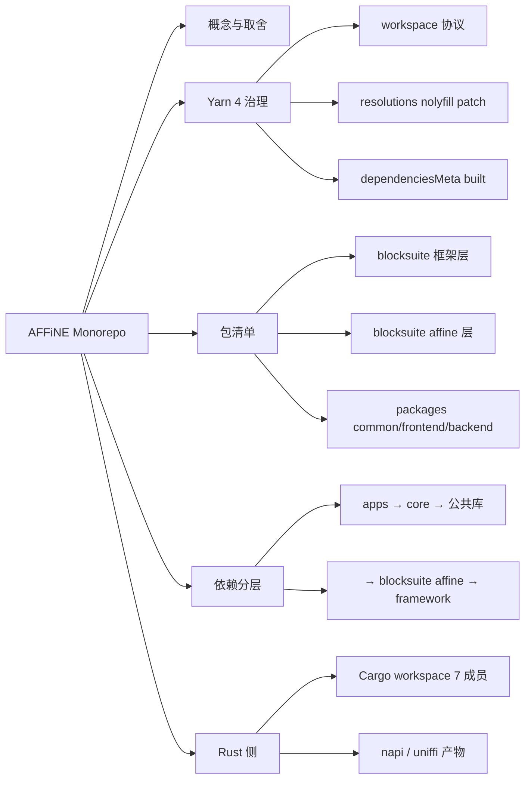
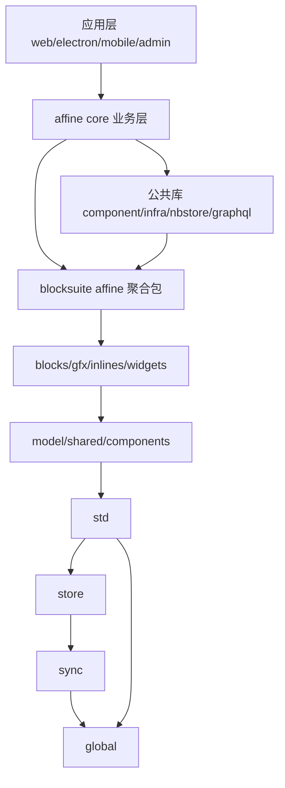
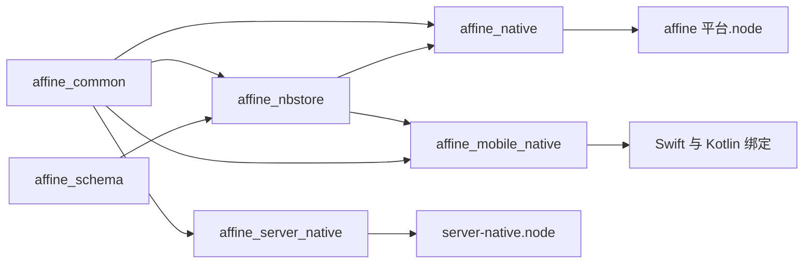

# 第 9 章 Monorepo 结构与包依赖地图

> 122 个包 + 7 个 Rust crate——给这座"大仓库"画一张导航地图

第 4 部分 · 工程化与开发环境 ｜ 难度 ★★☆☆☆ ｜ 建议学时 4 小时

===

## 本章要解决的问题

<p class="lead">第一次 clone AFFiNE，最直观的感受是"大"：根目录五个代码区，<code>yarn workspaces list</code> 列出 <b>122 个包</b>，外加 7 个成员的 Rust workspace。</p>

没有一张地图，你很难判断某段代码属于哪一层、改动会影响谁、某个 import 为什么能解析。本章就是帮你画出这张地图。

<div class="stats">
  <div class="stat"><b>122</b><span>workspace 包</span></div>
  <div class="stat"><b>7</b><span>Cargo 成员</span></div>
  <div class="stat"><b>104</b><span>条 resolutions</span></div>
  <div class="stat"><b>yarn 4.18</b><span>包管理器</span></div>
</div>

<div class="note note--tip">

读完本章，看到任何一个 import 路径，你都能迅速定位它在仓库中的位置和层级：`blocksuite/framework` 是编辑器内核，`blocksuite/affine` 是 AFFiNE 风格编辑器能力，`packages/common` 是前后端通用库，`packages/frontend` 是产品前端，`packages/backend` 是服务端。

</div>

===

## 知识地图

本章从 Monorepo 取舍讲起，依次拆 Yarn 4 配置、包清单、分层依赖图、Rust 对应，最后讲新增包流程。



===

## 学习目标

<ol class="goals">
  <li>说清 Monorepo 相对 polyrepo 的收益与代价，解释 AFFiNE 选 Yarn workspaces + 自研 CLI 的理由</li>
  <li>解释 <code>workspaces</code>、<code>resolutions</code>、<code>dependenciesMeta</code> 的作用</li>
  <li>解读 <code>.yarnrc.yml</code> 关键项，说明 <code>.yarn/patches</code>、<code>.yarn/releases</code> 为何提交进仓库</li>
  <li>用只读命令枚举全部包，并按"框架/编辑器/公共/应用/工具/测试"归类</li>
  <li>依据真实依赖画出从 <code>@affine/web</code> 到 <code>@blocksuite/global</code> 的依赖链</li>
  <li>说出 7 个 Cargo 成员各产出什么、被谁消费，并独立完成"新增一个包"的步骤</li>
</ol>

===

<!-- section -->
## 一、为什么用 Monorepo

单仓多包不等于单体应用。先看取舍，再看 AFFiNE 为何几乎必选它。

===

## polyrepo vs monorepo

Monorepo 把多个可独立构建的项目放同一版本库，各包边界清晰、各有 `package.json`，只是共享 Git 历史、依赖安装与工具链。

| 维度 | 多仓库 polyrepo | 单仓库 monorepo |
| --- | --- | --- |
| 跨包修改 | 多 PR、按序发布、升版本 | 一个 PR 原子完成，评审见全貌 |
| 依赖版本 | 易漂移、钻石依赖 | 根 `resolutions` 统一 |
| 工具链 | 各配一套 | 根一份 lint/tsconfig |
| CI | 独立简单 | 需按路径过滤、分片 |
| 安装体积 | 小 | 大（`yarn.lock` 超 3 万行） |

<div class="cards cols-3">
  <div class="card"><div class="card__icon">🔗</div><h4>编辑器同步演进</h4><p>加一个块能力常要同改 <code class="path">blocksuite/affine/blocks/*</code> 与 <code>frontend/core</code>，同 PR 最自然。</p></div>
  <div class="card"><div class="card__icon">📱</div><h4>多端共享业务</h4><p>Web/Electron/iOS/Android/Admin 共用 <code>@affine/core</code>，差异只在 apps 入口层。</p></div>
  <div class="card"><div class="card__icon">🤝</div><h4>前后端共享协议</h4><p><code>@affine/graphql</code> 由后端 schema 生成，前端直接 import。</p></div>
</div>

<div class="note">

工具选择：**Yarn 4 workspaces**（安装、链接、锁版本）+ **自研 CLI `@affine-tools/cli`**（按包执行脚本、生成 tsconfig references）+ **TS Project References**（`tsc -b` 增量检查）。好处是不引入额外任务编排框架，所有逻辑仓库内可读可改。

</div>

===

<!-- section -->
## 二、Yarn 4 与依赖治理

packageManager 锁版本、`workspace:*` 源码直连、resolutions 三类仲裁、dependenciesMeta 白名单——这几项撑起全仓依赖治理。

===

## 根 package.json 与 workspaces

`workspaces` 的每条 glob 对应一类包。注意 `packages/*/*` 只匹配两层，所以 apps 要单独开一条 glob：

<div class="split">
<div class="split__main">

| glob | 匹配 |
| --- | --- |
| `.` | 根 `@affine/monorepo` |
| `blocksuite/**/*` | 74 个 `@blocksuite/*` |
| `packages/*/*` | backend/common/frontend 共 21 |
| `packages/frontend/apps/*` | 7 个应用包 |
| `tools/*`、`tools/@types/*` | 工具与类型声明 |
| `tests/*` | 8 个 E2E 包 |

`engines.node` 把版本卡在 22.x，配合 `.nvmrc` 与 `engine-strict` 尽早暴露不匹配。

</div>
<div class="split__aside">

```json
"scripts": {
  "affine": "r affine.ts",
  "dev": "yarn affine dev",
  "build": "yarn affine build",
  "typecheck": "tsc -b tsconfig.json",
  "postinstall":
    "yarn affine init && yarn husky"
}
```

</div>
</div>

<div class="note note--tip">

`r` 是 CLI 的 bin（`./bin/runner.js`），`r affine.ts` 找到 `tools/cli/src/affine.ts`。`postinstall` 在每次 `yarn install` 后跑 `yarn affine init` 重新生成 tsconfig references——**新增/删除包后，再跑一次 `yarn install` 生成物就自动更新**。

</div>

===

## .yarnrc.yml 的安全取舍

几项配置体现了对供应链安全与生态兼容的权衡：

| 配置 | 值 | 含义 |
| --- | --- | --- |
| `enableScripts` | `false` | **默认不执行第三方包 install 脚本**，降攻击面 |
| `approvedGitRepositories` | 两个 Git 仓库 | Git 依赖白名单 |
| `nodeLinker` | `node-modules` | 不用 PnP，兼容 Electron、Prisma、`.node` |
| `nmMode` | `hardlinks-local` | 同项目相同文件硬链接省磁盘 |
| `yarnPath` | `.yarn/releases/yarn-4.18.0.cjs` | 用仓库内 Yarn 二进制 |

<div class="note note--warn">

`nodeLinker: node-modules` 是重要取舍：PnP 更快更严格，但 Electron 打包、Prisma 引擎、`.node` 原生模块对 `node_modules` 布局有强假设。`.yarn/` 下默认全忽略，只提交 `patches`（补丁）与 `releases`（Yarn 二进制）；Yarn 版本被 `packageManager` + `yarnPath` + CI 三重锁定。

</div>

===

## workspace:* 协议：源码直连

引用另一个 workspace 包都写 `workspace:*`，安装后 `node_modules/@affine/debug` 是指向 `packages/common/debug` 的符号链接。有个**至关重要**的细节：

<div class="annotate">

```json [3-4]
{
  "name": "@toeverything/infra",
  "exports": { ".": "./src/index.ts" },
  "dependencies": {
    "@affine/debug": "workspace:*",
    "@affine/env": "workspace:*"
  }
}
```

<ol class="annotate__notes">
  <li><b>第 3 行</b>：<code>exports</code> 直接指向 <code>./src/*.ts</code> 源码，而非 <code>dist/</code>——AFFiNE 内部绝大多数包是<b>源码直连</b>的。</li>
  <li><b>影响</b>：消费方（rspack、vitest、tsc）直接编译依赖包的 TS 源码，无需先 build；改了 <code>infra</code> 的代码，<code>web</code> 的 dev server 立刻感知。</li>
</ol>
</div>

<div class="note">

代价：因为消费方统一编译所有源码，SWC 配置（装饰器版本等）必须全仓一致（第 10 章）。

</div>

===

## resolutions：三类仲裁

根 `package.json` 的 `resolutions` 共 **104 条**，分三类：

<div class="cards cols-3">
  <div class="card"><h4>@nolyfill 替换（69）</h4><p><code>"has": "npm:@nolyfill/has@^1"</code>。老包为兼容 ES5 依赖 <code>array-includes</code> 等 polyfill，在 Node 22 纯属多余且拖慢安装。nolyfill 用零依赖替身直接调原生 API。</p></div>
  <div class="card"><h4>patch: 补丁（6）</h4><p><code>yjs</code> 等。安装时对第三方包打补丁，全仓统一到打过补丁的版本。</p></div>
  <div class="card"><h4>版本钉住/安全升级</h4><p><code>"ws@npm:^8.18.0": "^8.21.0"</code> 带范围的 key 只覆盖特定范围，修复安全漏洞。</p></div>
</div>

<div class="note note--tip">

借助 Yarn 的 npm 别名协议 `npm:@nolyfill/xxx@^1`，可在不改任何上游包的情况下全局替换。补丁不一定写在根目录——`tinykeys`、`@electron-forge/core`、`@nestjs/testing` 的补丁就在子包 `package.json` 中声明。制作补丁：`yarn patch <pkg>` → 改临时目录 → `yarn patch-commit -s <dir>`。

</div>

===

## dependenciesMeta：在禁用基线上放行

`enableScripts: false` 全局禁用脚本，但有些包**必须**执行安装脚本。`dependenciesMeta` 做逐包白名单：

<div class="compare">
  <div class="compare__col compare__col--good"><h4>built: true（放行）</h4>

- `@prisma/client`、`@prisma/engines`：生成客户端/下载引擎
- `@sentry/cli`：下载 CLI 二进制
- `esbuild`、`electron-winstaller`：校验平台二进制

  </div>
  <div class="compare__col"><h4>built: false（声明不需要）</h4>

- `core-js`：仅打印赞助广告
- `@scarf/scarf`：安装统计
- `@swc/core`、`msw`、`prisma`

  </div>
</div>

<div class="note">

workspace 自身脚本不受 `enableScripts` 影响：`templates` 的 `postinstall: yarn build`、`server` 的 `postinstall: prisma generate` 照常执行。CI 的 lint job 还有 `yarn dedupe --check`，升级依赖后忘了 dedupe 会失败。

</div>

===

<!-- section -->
## 三、包清单与分层依赖

122 个包按目录分层；依赖是一条清晰的五层单向链，由 CLI 与 lint 规则共同守护。

===

## 全量包清单（按层速查）

用 `yarn workspaces list --json` 为准枚举。按目录速记各层职责与数量：

| 层 | 目录 | 数量 | 代表 |
| --- | --- | --- | --- |
| 框架层 | `blocksuite/framework/*` | 4 | `@blocksuite/global/store/sync/std` |
| affine 基础层 | `blocksuite/affine/{model,shared,…}` | 8 | `@blocksuite/affine`（聚合包） |
| 块/gfx/inline/widget | `blocksuite/affine/{blocks,gfx,…}` | 58 | `@blocksuite/affine-block-paragraph` |
| 后端 | `packages/backend/*` | 2 | `@affine/server`、`server-native` |
| 公共层 | `packages/common/*` | 10 | `@toeverything/infra`、`@affine/nbstore` |
| 前端非应用 | `packages/frontend/*` | 9 | `@affine/core`、`component` |
| 应用层 | `packages/frontend/apps/*` | 7 | `@affine/web`、`electron` |
| 工具 | `tools/*`、`tools/@types/*` | 11 | `@affine-tools/cli`、`utils` |
| 测试+文档 | `tests/*`、`docs/reference` | 9 | `@affine-test/kit` |

<div class="note note--warn">

**以 `yarn workspaces list` 为准**：手动扫 `package.json` 会多扫出 `apps/electron/scripts/package.json`（只有 `{"type":"module"}`、无 `name`），它不在 glob 范围内，只是让该目录脚本按 ESM 解析。CLI 把清单固化成 `tools/utils/src/workspace.gen.ts`，导出 `PackageList` 与 `PackageName` 类型。

</div>

===

## 前端五层单向依赖图

依赖图最该记住的是**方向**：上层依赖下层，下层绝不依赖上层。



<ul class="takeaways">
  <li><b>单向依赖</b>：<code>@blocksuite/*</code> 完全不知道 <code>@affine/core</code> 存在，故 BlockSuite 可独立发布。</li>
  <li><b>core 是汇聚点</b>：几乎所有应用只依赖 core + 少量基础库，平台差异压缩在 apps 层。</li>
  <li><b>nbstore 依赖编辑器</b>：索引、文档解析需理解块结构，故 <code>@affine/nbstore</code> 依赖 <code>@blocksuite/affine</code>。</li>
</ul>

===

## CLI 如何守护依赖图

依赖图不只是约定，CLI 构建 Workspace 模型时强制检查两条硬规则：

<div class="annotate">

```ts [2|6-7]
// 1. 禁止循环依赖
if (building.has(dep.name)) throw new CircularDependenciesError(dep.name);
// 2. 公开包不得依赖私有包
if (!pkg.packageJson.private && dep.packageJson.private) {
  throw new ForbiddenPackageRefError(pkg.name, dep.name);
}
```

<ol class="annotate__notes">
  <li><b>循环依赖</b>：发现环打印 <code>Circular dependencies found: a -> b -> a</code> 并退出。</li>
  <li><b>公开不依赖私有</b>：<code>@blocksuite/*</code> 无 <code>private</code>（要发布），绝不能依赖全部 <code>private</code> 的 <code>@affine/*</code>——从机制上保证 BlockSuite 独立性。</li>
</ol>
</div>

<div class="note">

一个巧思：`@affine/error` 把 `@affine/graphql` 列为 **peerDependencies**（而非 dependencies），而 graphql 把 error 列为 dependencies，于是互相引用却不构成硬依赖环。此外 `.oxlintrc.json` 开启 `no-extraneous-dependencies`——import 了却没在 `package.json` 声明会直接报错，保证依赖表"真实"。

</div>

===

<!-- section -->
## 四、Rust 侧与新增包

Rust workspace 产出两类二进制；新增一个包只需"放对目录 + 写对配置 + 跑 install"。

===

## Cargo 成员与 JS 包对应

根 `Cargo.toml` 定义 7 个显式成员，`[workspace.dependencies]` 集中声明版本（作用同 Yarn `resolutions`）。产出两类二进制：



| crate | crate-type | 产物/消费者 |
| --- | --- | --- |
| `affine_server_native` | cdylib | `server-native.node`，供 `@affine/server` |
| `affine_native` | cdylib+rlib | `affine.<平台>.node`，供 Electron 主进程 |
| `affine_nbstore` | cdylib+rlib | 被 native（开 napi feature）与 mobile 复用 |
| `affine_mobile_native` | cdylib+staticlib | uniffi 生成 Swift/Kotlin，**无 npm 包** |

<div class="note note--tip">

`media_capture` 不在 `members` 中，但被 `affine_native` 以 `path` 依赖——Cargo 把 workspace 目录内的 path 依赖自动视为成员。JS 包与 crate 共用目录（既有 `package.json` 也有 `Cargo.toml`），`yarn affine @affine/native build` 本质是执行 `napi build -p affine_native --platform --release`。

</div>

===

## @blocksuite/affine 聚合包

`blocksuite/affine/all` 有 **207 个 `exports` 子路径**，自身几乎无逻辑，只做 re-export：`export * from '@blocksuite/affine-block-paragraph'`。于是消费方写 `import { … } from '@blocksuite/affine/blocks/paragraph'`，不必逐个声明 70 个依赖。

<div class="split">
<div class="split__main">

**设计意图**：
- 对外稳定入口：内部拆包合包不影响 import 路径；
- 依赖声明简化：消费方只需声明一个 `@blocksuite/affine`；
- 配合 tree-shaking：每块独立子路径 + `sideEffects` 声明。

在 `frontend/core/src` 中 `@blocksuite/affine...` 出现约 1000 次，直接 import 子包仅几十次。

</div>
<div class="split__aside">

```ts
// blocksuite/affine/all/src/index.ts
export {};
// 必须用子路径，不能从根直接 import：
import { X }
  from '@blocksuite/affine/std';
```

</div>
</div>

<div class="note note--warn">

代价：聚合包 `exports` 需随子包同步维护，且根路径 `index.ts` 只有 `export {}`，**不能从根直接 import 任何东西**。命名空间约定：`@blocksuite/*` 发布 npm（无 private），`@affine/*` 全部 `private`；CLI 还为常用包提供短别名（`web`、`server`、`gql` 等）。

</div>

===

## 新增一个包：四步

假设新增纯 TS 工具包 `@affine/hello` 到 `packages/common/hello`：

<ol class="steps">
  <li><h4>创建目录与 package.json</h4><p>目录须落在某条 glob 内（<code>packages/common/hello</code> 匹配 <code>packages/*/*</code>）。参照 <code>error/package.json</code> 最小结构：<code>private: true</code>、<code>type: module</code>、<code>version</code> 一致、<code>exports</code> 指向 <code>./src/index.ts</code>。</p></li>
  <li><h4>创建 tsconfig.json</h4><p>继承根 <code>tsconfig.web.json</code> 或 <code>tsconfig.node.json</code>。<code>references</code> 无需手写，下一步自动生成（没有 tsconfig 的包如 <code>templates</code> 会被自动跳过）。</p></li>
  <li><h4>声明依赖并安装</h4><p>消费方加 <code>"@affine/hello": "workspace:*"</code>，根目录 <code>yarn install</code>。<code>postinstall</code> 触发 <code>yarn affine init</code>，自动更新根 tsconfig references、<code>workspace.gen.ts</code>、<code>.oxlintrc.json</code>、各包 tsconfig references。</p></li>
  <li><h4>提交生成物过 CI</h4><p>CI 的 <code>check-git-status</code> 会重放 <code>yarn affine init</code> 等命令，有 diff 就失败。<b>生成物必须和源码一起提交</b>。</p></li>
</ol>

<div class="note">

按需登记：新 scope 要加进 `tools/commitlint/.commitlintrc.json` 的 `scope-enum`；要被 rspack 打包为独立产物要在 `bundle-shared.ts` 的 `RSPACK_SUPPORTED_PACKAGES` 登记。

</div>

===

## 动手实践

<ol class="steps">
  <li><h4>枚举并分类全部包</h4><p><code>yarn workspaces list --json | wc -l</code> 应为 123 行；用 Node 按顶层目录统计。<b>验收</b>：<code>blocksuite/affine</code> 为 66、<code>blocksuite/framework</code> 为 4、<code>packages/common</code> 为 10、<code>packages/frontend</code> 为 16。</p></li>
  <li><h4>追踪一条依赖链</h4><p>用 Node 读各包 <code>package.json</code> 的 <code>@affine/@blocksuite/@toeverything</code> 依赖，<code>yarn why @blocksuite/global</code>。<b>验收</b>：写出 <code>web → core → affine → std → store → global</code>。</p></li>
  <li><h4>读懂 resolutions 三类</h4><p>Node 统计 <code>resolutions</code> 构成。<b>验收</b>：得到 <code>{ total: 104, nolyfill: 69, patch: 6 }</code>，能解释 yjs 补丁改了什么。</p></li>
  <li><h4>观察 CLI 约束（只读）</h4><p>读 <code>workspace.ts</code> 的 <code>buildDeps</code>。<b>验收</b>：能回答"在 <code>@blocksuite/std</code> 加 <code>@affine/debug</code> 依赖会报什么错"（<code>Public package cannot reference private package</code>）。<b>不要真的改文件</b>。</p></li>
</ol>

===

## 自测：点击揭晓答案

<details class="quiz">
<summary>Q1. 为什么要单独写一条 packages/frontend/apps/*？</summary>

因为 `packages/*/*` 只匹配两层，`packages/frontend/apps` 本身不是包，其下的 `web`、`electron` 在第三层，需额外 glob 才能被识别为 workspace。

</details>

<details class="quiz">
<summary>Q2. enableScripts:false 会阻止 server 的 prisma generate 吗？</summary>

不会。`enableScripts` 只影响第三方依赖，workspace 自身脚本照常执行。`@prisma/engines` 需安装时下载查询引擎，所以在 `dependenciesMeta` 中显式放行 `built: true`。

</details>

<details class="quiz">
<summary>Q3. 为什么 @blocksuite/std 不能依赖 @affine/debug？</summary>

`@blocksuite/std` 是公开包（无 `private`），`@affine/debug` 是私有包。`tools/utils/src/workspace.ts` 的 `buildDeps` 会抛 `ForbiddenPackageRefError`，从机制上保证 BlockSuite 不依赖产品代码、可独立发布。

</details>

<details class="quiz">
<summary>Q4. 从 @blocksuite/affine 根路径能 import 到东西吗？</summary>

不能。`blocksuite/affine/all/src/index.ts` 只有 `export {}`，必须用 `@blocksuite/affine/blocks/paragraph` 这类子路径。这是聚合包以子路径 re-export 作统一门面的设计。

</details>

===

## 小结与下一步

<ul class="takeaways">
  <li>Monorepo 核心收益是"原子修改 + 统一治理"，AFFiNE 的多端、多语言、前后端共享协议放大了它。</li>
  <li>Yarn 4：<code>workspace:*</code> 源码直连；<code>resolutions</code> 用 nolyfill/补丁/范围覆盖三手段仲裁；<code>dependenciesMeta</code> 在"默认禁脚本"上做白名单。</li>
  <li>依赖是一条五层单向链：apps → core → 公共库 → blocksuite affine → blocksuite framework，CLI 与 lint 共同守护。</li>
  <li>Rust workspace 7 成员产出 napi 的 <code>.node</code> 与 uniffi 的库；JS 包与 crate 共用目录。</li>
  <li>新增包：放对目录 + 写对 package.json/tsconfig + 跑 install + 提交生成物。</li>
</ul>

<div class="note note--tip">

**下一章预告**：第 10 章讲 `构建工具链与代码规范`——这些包怎么被运行、打包、检查、生成。自研 CLI `yarn affine` 统一驱动 rspack、Vite、esbuild、napi、oxlint 等一众工具。

</div>
