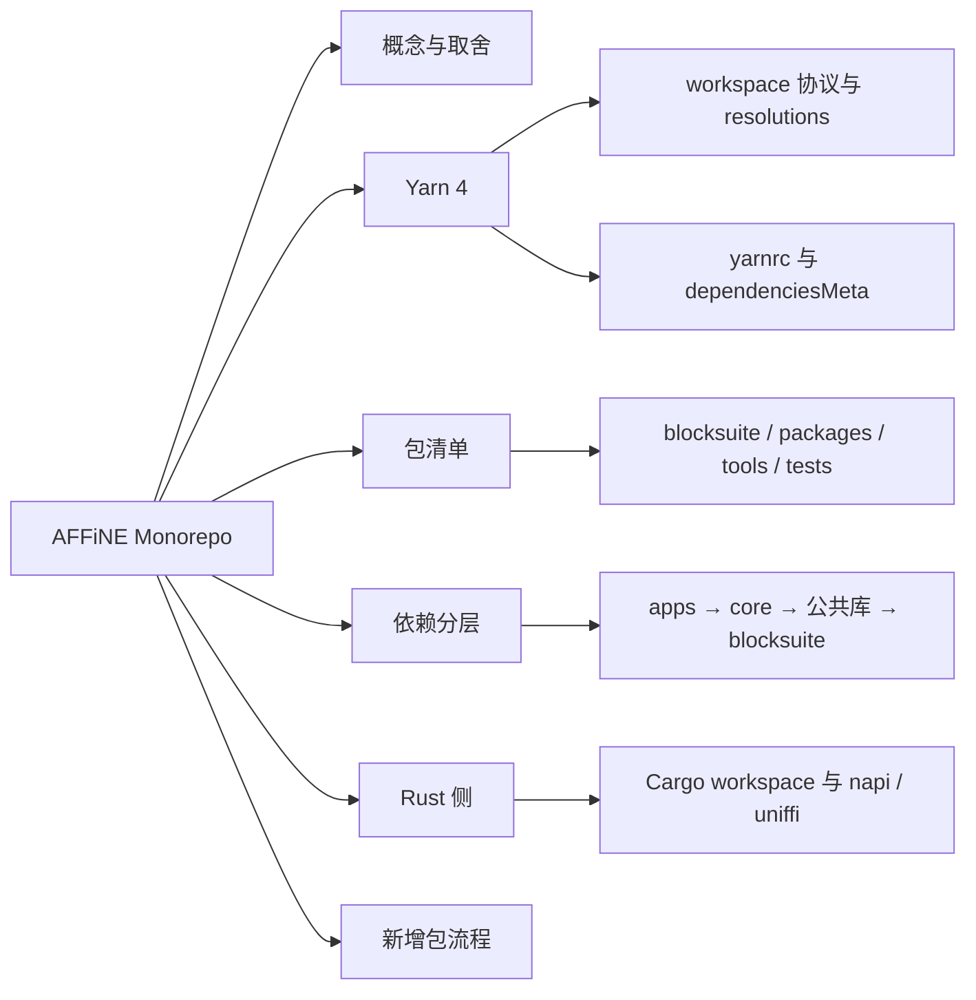
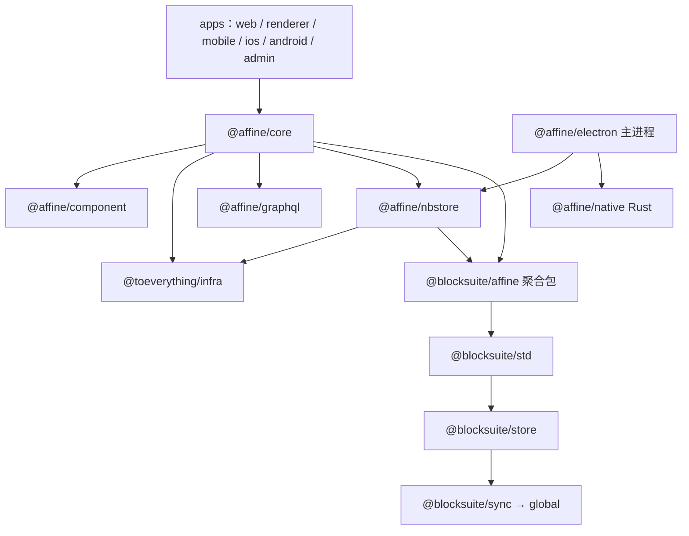
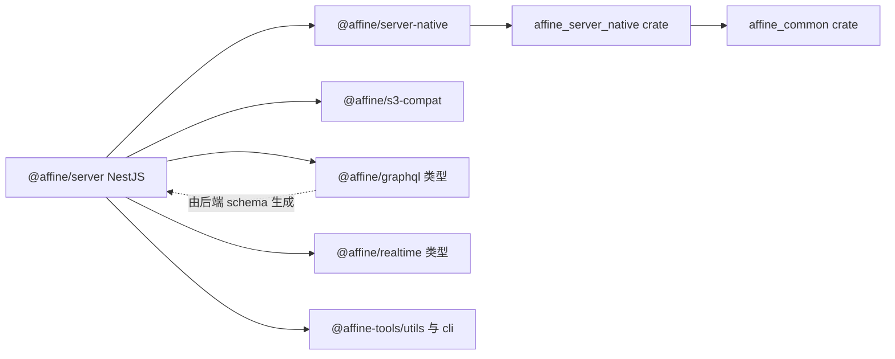
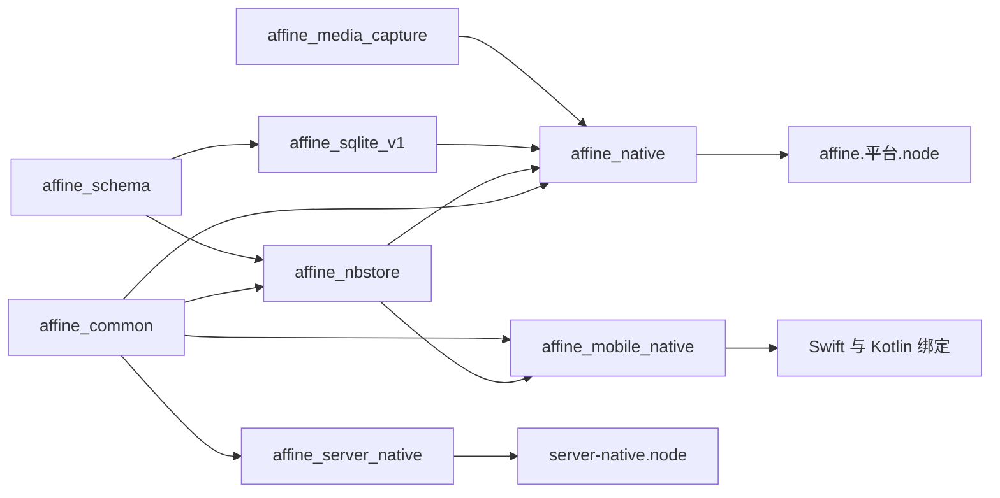
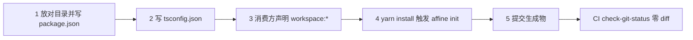

# 第 9 章 Monorepo 结构与包依赖地图

122 个 workspace 包 + 7 个 Cargo 成员：给整个仓库画一张地图

第 4 部分 · 工程化与开发环境 ｜ 难度 ★★☆☆☆ ｜ 建议学时 4 小时

---

## 导读：为什么需要一张地图

- 五个代码区：`blocksuite/`、`packages/`、`tools/`、`tests/`、`docs/`
- `yarn workspaces list` 列出 **122 个包**（另有根包）
- 另有一个由 **7 个成员**组成的 Rust Cargo workspace
- 没有地图，就难以判断代码属于哪层、改动影响谁

<div class="callout">

目标：看到任意 import 路径，都能迅速定位它在仓库中的位置与层级。

</div>

Note:
第一次 clone AFFiNE 最直观的感受就是大。本章先讲 Monorepo 的概念与取舍，再逐行拆解根 package.json 和 .yarnrc.yml，然后枚举全部包、画出真实的分层依赖图，最后讲 Rust crate 与 JS 包的对应关系、命名约定，以及新增一个包需要做什么。

---

## 学习目标

- 说清 Monorepo 相对 polyrepo 的收益与代价
- 解释根 `package.json` 的 `workspaces`、`resolutions` 等字段
- 解读 `.yarnrc.yml` 每项配置及 `.yarn/` 的提交规则
- 用只读命令枚举全部包并按层级归类
- 画出 `@affine/web` 到 `@blocksuite/global` 的依赖链
- 独立完成"新增一个 workspace 包"的全部步骤

Note:
这章难度只有两颗星，但信息量大，是后面所有工程化章节的基础。尤其是依赖分层图，后续讲架构时会反复用到。另外还要能说出 7 个 Cargo 成员各自产出什么、被谁消费。

---

## 知识地图



Note:
六个分支对应本章的六节。Yarn 4 是重点，涉及版本锁定、依赖协议和依赖治理。依赖分层这一支要记住一条五层单向链：应用层、core、公共库、blocksuite affine 层、blocksuite framework 层。

---

## Monorepo vs 多仓库

| 维度 | 多仓库（polyrepo） | 单仓库（monorepo） |
| --- | --- | --- |
| 跨包修改 | 多个 PR、按序发布 | 一个 PR 原子完成 |
| 依赖版本 | 容易漂移 | 根目录 `resolutions` 统一 |
| 工具链 | 各仓库各配一套 | 根目录一份 lint / tsconfig |
| CI | 独立、简单 | 需按路径过滤、分片 |
| 安装体积 | 小 | 大（`yarn.lock` 超过 3 万行） |

Note:
注意 Monorepo 和单体应用是两回事：包依旧边界清晰、各有 package.json，只是共享 Git 历史、依赖安装和工具链。核心收益是"原子修改加统一治理"，代价是仓库大、CI 配置复杂、心智负担重。

---

## AFFiNE 为什么选 Monorepo

<div class="cols">
<div>

**三个特殊性**

- 编辑器与产品同步演进
- 多端共享 `@affine/core`
- 前后端共享 `@affine/graphql` 等协议

</div>
<div>

**工具选择**

- Yarn 4 workspaces：安装、链接、锁版本
- 自研 `@affine-tools/cli`：脚本编排
- TS Project References：`tsc -b`

</div>
</div>

<div class="callout">

没有引入 Nx、Turborepo 等编排框架，所有逻辑都在仓库内可读可改。

</div>

Note:
BlockSuite 曾经是独立仓库，现在并入主仓库，产品要新的块能力时往往要同时改 blocksuite/affine/blocks 和 packages/frontend/core。Web、Electron、iOS、Android、Admin 共用 core，差异只在 apps 入口层。工具上，Yarn 管依赖，自研 CLI 管"按包执行脚本、带依赖执行、生成 tsconfig references"，第 10 章详细讲。代价是缓存、增量构建等高级能力要自己实现或依赖 rspack、tsc -b。

---

## workspaces：哪些目录算作包

| glob | 匹配到的包 | 说明 |
| --- | --- | --- |
| `blocksuite/**/*` | 74 个 `@blocksuite/*` | 递归匹配三层目录 |
| `packages/*/*` | 21 个 | 只匹配两层，`apps` 本身不是包 |
| `packages/frontend/apps/*` | 7 个应用包 | 为 apps 单独开一条 glob |
| `tools/*`、`tools/@types/*` | 8 + 3 个 | 工具与类型声明包 |
| `tests/*`、`docs/reference` | 8 + 1 个 | E2E 测试包与 API 参考 |

`.` 根包本身也是 workspace；`engines.node` 为 `>=22.12.0 <23.0.0`

Note:
没有 package.json 的目录即使被 glob 匹配到也不会成为 workspace，比如 packages/common/native 是纯 Rust crate，只出现在 Cargo.toml 里。根包也是 workspace，所以根 devDependencies 可以用 workspace:* 引用 CLI。Node 版本被 engines、.nvmrc 的 22.23.4 和 .npmrc 的 engine-strict 三重卡死。

---

## scripts：根脚本只做"转发"

```json
"scripts": {
  "affine": "r affine.ts",
  "dev": "yarn affine dev",
  "build": "yarn affine build",
  "lint": "yarn lint:ox && yarn lint:format",
  "lint:ox": "oxlint --deny-warnings",
  "test": "vitest --run",
  "typecheck": "tsc -b tsconfig.json --verbose",
  "postinstall": "yarn affine init && yarn husky"
},
```

`r` 来自 `tools/cli/package.json` 的 `bin`；`postinstall` 在每次安装后重新生成元信息

<p class="small">根 <code>package.json</code>（节选）</p>

Note:
r 是 CLI 声明的可执行文件，负责用合适的 TS 加载器运行 ts 文件，r affine.ts 最终找到 tools/cli/src/affine.ts。dev 和 build 只是别名，真正逻辑在 CLI。postinstall 执行 yarn affine init 和 yarn husky，所以新增或删除包后只要再跑一次 yarn install，生成物就会自动更新。另外根 devDependencies 用 npm 别名让 typescript 实际指向 typescript6 的 6.0.2，同时持有 7.0.2，便于渐进迁移。

---

## Yarn 4 与 .yarnrc.yml

| 配置项 | 值 | 考量 |
| --- | --- | --- |
| `enableScripts` | `false` | 默认不执行第三方安装脚本，降低供应链风险 |
| `nodeLinker` | `node-modules` | 不用 PnP，兼容 Electron、Prisma、原生模块 |
| `nmMode` | `hardlinks-local` | 项目内相同文件用硬链接，节省磁盘 |
| `approvedGitRepositories` | 两个 Git 仓库 | Git 依赖白名单 |
| `yarnPath` | `.yarn/releases/yarn-4.18.0.cjs` | 使用仓库内提交的 Yarn |

`packageManager: "yarn@4.18.0"` + `yarnPath` + CI `check-yarn-binary` 三重锁定

Note:
Corepack 读取 packageManager 字段，确保仓库里敲的 yarn 是 4.18.0；yarnPath 再指向仓库内的二进制，双保险；CI 里 check-yarn-binary 会执行 yarn set version 并 git diff，有差异就失败。.yarn 目录默认全部忽略，只提交 patches 和 releases 等。nodeLinker 是个重要取舍：PnP 更快更严格，但 Electron 打包和 .node 模块对 node_modules 结构有强假设。

---

## workspace:* 与"源码直连"

```json
{
  "name": "@toeverything/infra",
  "private": true,
  "exports": {
    "./storage": "./src/storage/index.ts",
    // ...
    ".": "./src/index.ts"
  },
  "dependencies": {
    "@affine/debug": "workspace:*",
    "@affine/env": "workspace:*",
    // ...
  }
}
```

`exports` 直接指向 `./src/*.ts`：消费方直接编译依赖包源码，无需先 build

<p class="small"><code>packages/common/infra/package.json</code>（节选）</p>

Note:
workspace:* 告诉 Yarn 这个依赖必须来自本仓库，安装后 node_modules/@affine/debug 是一个指向 packages/common/debug 的符号链接。更关键的细节是 exports 指向 src 源码而不是 dist，AFFiNE 内部绝大多数包都是这样。改了 infra 的代码，web 的 dev server 立刻能感知到。代价是 SWC 的装饰器等配置需要全仓一致。

---

## resolutions：全仓版本仲裁

| 类别 | 条数 | 示例 |
| --- | --- | --- |
| `@nolyfill/*` 替换 | 69 | `"has": "npm:@nolyfill/has@^1"` |
| `patch:` 补丁 | 6 | `"yjs": "patch:yjs@npm%3A13.6.21#~/..."` |
| 版本钉住 / 安全升级 | 其余 | `"ws@npm:^8.18.0": "^8.21.0"` |

共 **104 条**；nolyfill 用零依赖原生实现替换老旧 polyfill

Note:
很多老牌 npm 包为兼容 ES5 依赖 array-includes、function-bind 这类 polyfill，在 Node 22 和现代浏览器里纯属多余，还会拖慢安装、扩大攻击面。通过 npm 别名协议可以在不改上游包的情况下全局替换。还有 macos-alias、fs-xattr 被替换为 napi-rs 实现，避免 node-gyp 编译；带范围的 key 只覆盖特定范围请求，用来统一升级有安全问题的旧版本。

---

## patch: 与 dependenciesMeta

<div class="cols">
<div>

**patch: 协议**

- yjs 补丁：clientID `uint32` → `uint53`
- 子包也可声明补丁，如 `tinykeys`
- `yarn patch` → 修改 → `yarn patch-commit -s`

</div>
<div>

**dependenciesMeta.built**

- `true`：`@prisma/engines`、`esbuild` 等放行
- `false`：`core-js`、`@scarf/scarf` 明确禁止
- workspace 自身脚本不受 `enableScripts` 影响

</div>
</div>

<div class="callout">

CI 的 lint job 还会执行 `yarn dedupe --check`，lock 中有可合并的重复版本即失败。

</div>

Note:
yjs 补丁第 8 章讲过，yarn.lock 里最终全仓 yjs 都统一到打过补丁的 13.6.21。另外三个补丁在子包里声明：core 的 tinykeys、electron 的 electron-forge core、server 的 nestjs testing。dependenciesMeta 是在"默认禁用脚本"的安全基线上做白名单：prisma 需要准备查询引擎，sentry cli 需要下载二进制；core-js 安装时只打印赞助广告，所以明确禁止。

---

## 全量包清单：按目录分层

| 目录 | 包数 | 代表 |
| --- | --- | --- |
| `blocksuite/framework/*` | 4 | `@blocksuite/global`、`store`、`std`、`sync` |
| `blocksuite/affine/*` 等 | 70 | blocks、gfx、inlines、widgets、聚合包 |
| `packages/common/*` | 10 | `@toeverything/infra`、`@affine/nbstore` |
| `packages/frontend/*`、`backend/*` | 18 | `@affine/core`、7 个 apps、`@affine/server` |
| `tools/*`、`tests/*`、`docs` | 20 | `@affine-tools/cli`、`@affine-test/kit` |

以 `yarn workspaces list --json` 为准；CLI 固化为 `tools/utils/src/workspace.gen.ts`

Note:
合计 122 个。blocksuite/framework 是编辑器内核，blocksuite/affine 是 AFFiNE 风格的编辑器能力，包括 20 个块、22 个 fragments、gfx 和 inlines、16 个 widgets；packages/common 是前后端通用库；packages/frontend 是产品前端；packages/backend 是服务端。用 Node 自己扫 package.json 会多扫出 electron/scripts 下一个没有 name 的 package.json，这说明以 Yarn 的结果为准很重要。

---

## 前端分层依赖图



上层依赖下层，下层绝不依赖上层；`core` 是汇聚点

Note:
这张图依据各包 package.json 里真实的 workspace:* 依赖简化绘制。BlockSuite 完全不知道 @affine/core 的存在，所以能独立发布。几乎所有应用都只依赖 core 加少量基础库，平台差异压缩在 apps 层。nbstore 依赖 @blocksuite/affine，因为索引和文档解析需要理解块结构。还有个细节：graphql 把 error 列为依赖，而 error 把 graphql 列为 peerDependencies，避免硬性循环。

---

## 后端依赖图



`@affine/graphql` 是"反向生成"的：后端产出 `schema.gql`，前端据此生成 TS 类型

Note:
后端只依赖少量 workspace 包。server-native 包装的是 Rust crate affine_server_native。graphql 这条虚线很有意思：后端代码生成 packages/backend/server/src/schema.gql，前端的 graphql 包再根据它生成类型；后端 import graphql 主要用于测试里复用查询语句，比如 getCurrentUserQuery。

---

## CLI 守护依赖图

```ts
if (building.has(dep.name)) {
  throw new CircularDependenciesError(dep.name);
}

if (!pkg.packageJson.private && dep.packageJson.private) {
  throw new ForbiddenPackageRefError(pkg.name, dep.name);
}
```

- **禁止循环依赖**：发现环即报错退出
- **公开包不得依赖私有包**：`@blocksuite/*` 不能依赖 `@affine/*`
- lint 规则 `no-extraneous-dependencies`：未声明的 import 报错

<p class="small"><code>tools/utils/src/workspace.ts</code>（节选）</p>

Note:
依赖图不只是约定，CLI 构建 Workspace 模型时会强制检查。@blocksuite 包没有 private: true，要发布到 npm；@affine 包全部是 private。于是这条规则从机制上保证了 BlockSuite 的独立性。lint 规则则保证依赖表是真实的，import 了却没在 package.json 声明就会报错。

---

## Rust 侧：crate 与 JS 包的对应



7 个显式成员 + 1 个隐式 path 成员（`media_capture`）；产出 napi `.node` 与 uniffi 库

Note:
JS 包和 Rust crate 共用同一个目录，比如 packages/frontend/native 下既有 package.json 也有 Cargo.toml，build 脚本调用 napi build -p affine_native --platform --release。affine_mobile_native 通过 uniffi 生成 Swift 和 Kotlin 绑定，以 cdylib 和 staticlib 链接进 iOS 和 Android 工程，所以没有对应的 npm 包。workspace.dependencies 的作用和 Yarn 的 resolutions 类似，都是版本集中声明。

---

## 命名空间约定

| 命名空间 | 含义 | 发布 npm |
| --- | --- | --- |
| `@blocksuite/*` | 编辑器框架与 AFFiNE 编辑器能力 | 是 |
| `@affine/*` | 产品代码：前端、后端、公共库 | 否 |
| `@toeverything/infra` | 历史沿用的前端基础设施包名 | 否 |
| `@affine-tools/*`、`@affine-test/*` | 内部工具链、E2E 测试 | 否 |
| `@types/*` | `tools/@types` 下的全局类型声明 | 否 |

CLI 短别名：`yarn affine server dev`、`yarn affine gql build`

Note:
@types/affine__env 采用了 DefinitelyTyped 的命名惯例，scoped 包 @affine/env 的类型包名就是 @types/affine__env。短别名在 tools/utils/src/distribution.ts 的 AliasToPackage 里：手写了 10 个，比如 gql 对应 @affine/graphql，desktop 和 renderer 都对应 electron-renderer；另外每个包名斜杠后的部分都自动成为别名。

---

## `@blocksuite/affine` 聚合包

```ts
// blocksuite/affine/all/src/blocks/paragraph/index.ts
export * from '@blocksuite/affine-block-paragraph';

// blocksuite/affine/all/src/std/index.ts
export * from '@blocksuite/std';

// 消费方写法：'@blocksuite/affine/blocks/paragraph'、'@blocksuite/affine/std'
```

- `package.json` 有 **207 个** `exports` 子路径，自身几乎没有逻辑
- 根 `index.ts` 只有 `export {}`，**必须使用子路径**导入

Note:
聚合包有三个设计意图：对外稳定入口，内部拆包合包不影响消费方；依赖声明简化，消费方只需声明一个包；配合 tree-shaking，每个块都是独立子路径。在 core 的源码里统计，从 @blocksuite/affine 导入约 1000 次，直接导入子包的只有几十次。代价是 exports 需要随子包变化同步维护。

---

## 新增一个包的流程



`init` 自动更新：根 `tsconfig.json`、`workspace.gen.ts`、`.oxlintrc.json`、各包 `tsconfig.json`

Note:
假设要新增 packages/common/hello。目录匹配 packages/*/*；package.json 参照 error 包，要点是 private true、type module、version 与仓库一致、exports 指向源码。tsconfig 继承 tsconfig.web.json 或 tsconfig.node.json，references 不用手写。按需还要在 commitlint 的 scope-enum 里登记新 scope，需要 rspack 独立打包的话要在 bundle-shared.ts 和 bundle.ts 登记。

---

## 源码导读 Top 5

| 优先级 | 路径 | 看什么 |
| --- | --- | --- |
| P0 | `package.json` | workspaces、scripts、resolutions、dependenciesMeta |
| P0 | `.yarnrc.yml` | nodeLinker、enableScripts、nmMode、yarnPath |
| P0 | `tools/utils/src/workspace.ts` | 循环依赖与公开/私有包检查 |
| P0 | `tools/cli/src/init.ts` | `yarn affine init` 生成哪些文件 |
| P0 | `Cargo.toml` | Rust workspace 成员与集中依赖 |

Note:
这五个文件都不长，一个小时内可以读完。读 package.json 时重点看 resolutions 的三类条目；读 workspace.ts 时找 buildDeps 函数；读 init.ts 时找 generateWorkspaceFiles，看它到底生成了哪四类文件。

---

## 动手实践

| 练习 | 验收要点 |
| --- | --- |
| 1 枚举并分类全部包 | 输出 123 行，按顶层目录统计 |
| 2 追踪一条依赖链 | 写出 web → core → … → global |
| 3 读懂 resolutions | 得到 total 104、nolyfill 69、patch 6 |
| 4 推演 CLI 约束 | 说出 `Public package cannot reference private package` |
| 5 对照 Rust 与 JS | 说出哪两个 crate 有 npm 包 |

Note:
这些练习都是只读命令，用 yarn workspaces list 和 node -e 读 package.json 即可。练习 4 只推演、不要真的修改文件。练习 5 的答案是：server_native 和 affine_native 有对应 npm 包，mobile_native 和 common 没有，原因分别是 uniffi 链接和仅作为内部依赖。

---

## 自测

**Q1. 为什么要单独写一条 `packages/frontend/apps/*`？**

`packages/*/*` 只匹配两层，apps 下的包在第三层 <!-- .element: class="fragment" -->

**Q2. `@affine/error` 与 `@affine/graphql` 互相引用为何不报循环？**

`error` 把 `graphql` 声明为 `peerDependencies`，不构成硬依赖环 <!-- .element: class="fragment" -->

**Q3. 能 `import { X } from '@blocksuite/affine'` 吗？**

不能：根 `index.ts` 只有 `export {}`，必须用子路径 <!-- .element: class="fragment" -->

Note:
这三题分别考 workspaces glob、依赖治理和聚合包设计。可以追问一题：enableScripts false 会不会阻止 server 的 postinstall prisma generate？答案是不会，它只影响第三方依赖，workspace 自身脚本照常执行。

---

## 常见坑

| 现象 | 处理 |
| --- | --- |
| `yarn -v` 显示 `1.22.x` | `corepack enable` 后重新执行 |
| 新建包后 CLI 报 "not one of" | 执行 `yarn install` 或 `yarn affine init` |
| `Circular dependencies found` | 拆分依赖，或改为 peerDependencies/类型导入 |
| CI `Yarn Dedupe` 失败 | 本地 `yarn dedupe` 后提交 `yarn.lock` |
| CI `check-git-status` 失败 | 执行 `yarn affine init` 等并提交生成物 |

Note:
最常见的是第一个，没启用 Corepack 用了全局 Yarn 1。还有一个：两份 yjs 导致 Yjs was already imported 警告，根 resolutions 已统一 yjs，rspack 和 vitest 配置里也 alias 到根 node_modules，如果还出现，检查是不是有包引入了自带 yjs 的产物。修改补丁后不生效要重新 yarn install。

---

## 小结与下一步

- Monorepo 核心收益是"原子修改 + 统一治理"
- Yarn 版本三重锁定，`enableScripts: false` 守护供应链
- 内部包源码直连；`resolutions` 以三种手段仲裁依赖
- 五层单向依赖链，由 CLI 与 lint 规则共同守护
- 新增包：放对目录、写对配置、`yarn install`、提交生成物

<div class="callout">

**下一章**：第 10 章 构建工具链与代码规范——这些包是怎么被运行、打包、检查和生成的？

</div>

Note:
本章画出了仓库的静态地图：有哪些包、它们怎么依赖。下一章回答动态问题：一条 yarn dev 命令是怎么一路走到 rspack dev server 的，oxlint、husky、各种代码生成器又是如何保证代码质量和生成物一致的。
