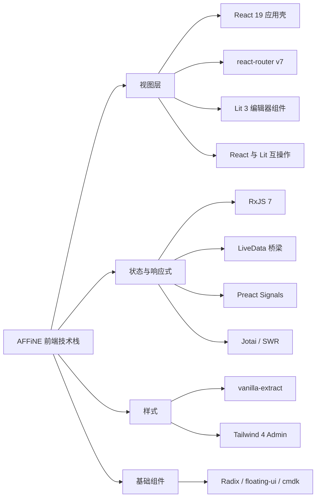
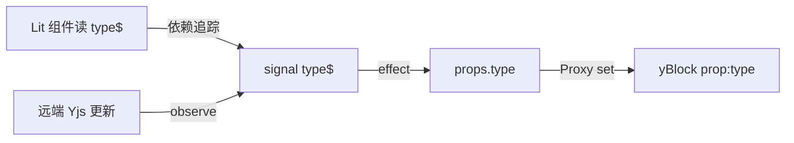
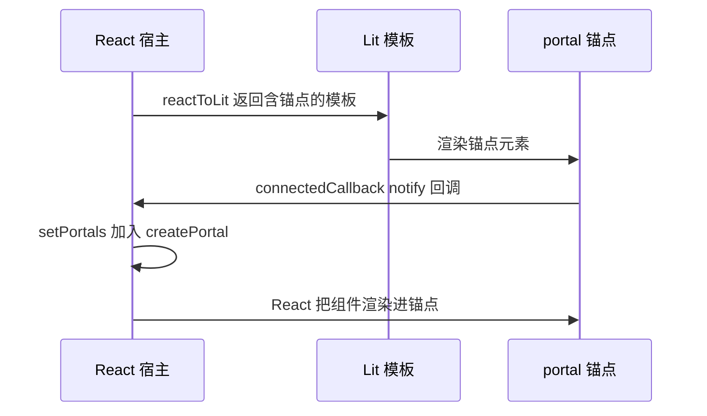

# 第 10 章 前端技术栈：React、Lit、Signals、RxJS

> 一个应用里为什么同时有五六种"框架"？看清每种技术各管哪一层

第 3 部分 · 编程语言与基础技术 ｜ 难度 ★★★☆☆ ｜ 建议学时 10 小时

===

## 本章要解决的问题

<p class="lead">第一次打开 AFFiNE 前端，最大的困惑是"技术栈太多"：React 和 Lit 并存，RxJS、Preact Signal、Jotai、SWR 四套响应式同场。</p>

这不是技术选型失控，而是**分层架构的必然结果**。每一层有自己最难的问题，就用最擅长解决它的工具：

<div class="cards cols-3">
  <div class="card"><div class="card__icon">🪟</div><h4>应用壳</h4><p>侧边栏、设置、列表、弹窗——表单型 UI，用 <code>React 19</code>，在 <code class="path">packages/frontend/core</code>。</p></div>
  <div class="card"><div class="card__icon">✍️</div><h4>编辑器内核</h4><p>段落、白板、表格——要精细控制 DOM 且框架无关，用 <code>Lit 3</code>，在 <code class="path">blocksuite/</code>。</p></div>
  <div class="card"><div class="card__icon">🔁</div><h4>响应式</h4><p>编辑器用 <code>Signals</code> 做属性级更新，业务层用 <code>RxJS</code>/LiveData 编排异步。</p></div>
</div>

<div class="note note--tip">

**本章方法**：对每项技术按"核心概念速成 → AFFiNE 真实例子 → 为什么选它"三步展开，最后给一张"技术选型 → 使用位置"总表。重点不是学会每个库，而是**理解边界**：遇到一段代码，能立刻判断它属于哪一层、用的是哪套响应式。

</div>

===

## 知识地图

前端技术栈可按"视图层 / 状态与响应式 / 样式 / 基础组件"四块来记。本章主线是**视图**（React + Lit + 互操作）与**响应式**（RxJS → LiveData → Signals）。



===

## 学习目标

<ol class="goals">
  <li>说清 React 应用壳从 <code>createRoot</code> 到 <code>RouterProvider</code> 的启动链路与 Provider 层次</li>
  <li>区分 <code>Jotai</code>、<code>SWR</code>、<code>LiveData</code> 三种状态方案各自负责的场景</li>
  <li>读懂 RxJS 的 <code>switchMap/combineLatest/share/throttleTime</code> 在 nbstore 与 infra 中的用法</li>
  <li>解释 Preact Signals 的 <code>signal/computed/effect</code>，以及 Block 属性为何有 <code>xxx$</code></li>
  <li>说清 <code>SignalWatcher</code> 原理，并指出哪些 BlockSuite 组件用/不用 Shadow DOM</li>
  <li>用 <code>createReactComponentFromLit</code>、<code>useLitPortalFactory</code> 在 React 与 Lit 之间双向嵌入</li>
</ol>

===

<!-- section -->
## 一、视图层：React 应用壳

侧边栏、设置、列表这类"壳"由 React 编写。先看它从入口到路由的启动链路，理解 DI 容器与 React 的关系。

===

## 启动链路与 Provider 层次

Web 入口 `packages/frontend/apps/web/src/index.tsx` 只做一件事：`createRoot(root).render(<App/>)`。关键在 `app.tsx`——**DI 容器在组件树之外创建**，React 只负责"挂载"它。

<div class="annotate">

```tsx [1-3|6-12]
const framework = new Framework();
configureCommonModules(framework);
configureBrowserWorkbenchModule(framework);
const frameworkProvider = framework.provider();
export function App() {
  return (
    <Suspense fallback={<AppContainer fallback />}>
      <FrameworkRoot framework={frameworkProvider}>
        <I18nProvider><AffineContext store={getCurrentStore()}>
          <RouterProvider router={router} />
        </AffineContext></I18nProvider>
      </FrameworkRoot>
    </Suspense>
  );
}
```

<ol class="annotate__notes">
  <li><b>第 1–3 行</b>：<code>configureXxxModule</code> 是模块级代码，不依赖 React 生命周期——所以 Electron、移动端可复用同一套配置。</li>
  <li><b>第 6–12 行</b>：Provider 从外到内：<code>Suspense</code>（兜底）→ <code>FrameworkRoot</code>（注入 DI，之后可 <code>useService</code>）→ <code>I18nProvider</code> → <code>AffineContext</code>（内含 Jotai Provider、主题）→ <code>RouterProvider</code>。</li>
</ol>
</div>

<div class="note">

**为什么选 React**：应用层是典型的表单/列表/弹窗 UI，React 的声明式组件模型最高效，且 Radix、cmdk、react-virtuoso 等生态成熟。React 只管"壳"，复杂富文本交给 Lit，避免虚拟 DOM 与 `contenteditable` 打架。

</div>

===

## react-router v7：懒加载与 loader

react-router v6.4+ 的 **Data Router**：用 `createBrowserRouter(routes)` 定义路由数组，每条路由可带 `lazy`（按需加载）、`loader`（导航前取数/重定向）、`errorElement`。

<div class="split">
<div class="split__main">

要点全在这段路由表里：

- **懒加载**：`lazy: () => import('./pages/index')`，模块需导出约定名 `Component`；
- **loader 做重定向**：旧分享链接在导航前用 `redirect()` 转换，组件层无需关心闪烁；
- **魔法注释** `/* webpackChunkName: "auth" */` 让多个认证页打进同一 chunk；
- **`satisfies`** 确保至少一项路由且保留字面量推导。

</div>
<div class="split__aside">

```tsx
export const topLevelRoutes = [{
  element: <RootRouter />,
  errorElement: <AffineErrorComponent />,
  children: [
    { path: '/',
      lazy: () => import('./pages/index') },
    { path: SHARE_ROUTE_PATH,
      loader: ({ params }) =>
        redirect(getWorkspaceDocPath(/*…*/)) },
    { path: '/auth/:authType',
      lazy: () => import(
        /* webpackChunkName: "auth" */
        './pages/auth/auth') },
  ],
}] satisfies [RouteObject, ...RouteObject[]];
```

</div>
</div>

<div class="note">

来源：`packages/frontend/core/src/desktop/router.tsx`。Admin 端用另一种写法——JSX 声明式 `<Routes>/<Route>`，两种风格 v7 都支持。

</div>

===

<!-- section -->
## 二、响应式：四种范式

RxJS、LiveData、Preact Signals、Jotai/SWR 各管一摊。先横向对比，建立坐标系，再逐个深入。

===

## React / Lit / Signals / RxJS 四范式

同样是"数据变 → UI 变"，四种技术的机制、擅长场景截然不同。记住这张对比，就不会用错工具：

<div class="compare">
  <div class="compare__col"><h4>React（推 + 协调）</h4>

- 机制：`setState` → 重渲染整棵子树，虚拟 DOM diff
- 擅长：表单/列表/弹窗型 UI
- 粒度：**组件级**
- 位置：`packages/frontend` 应用壳

  </div>
  <div class="compare__col compare__col--good"><h4>Lit（模板 + 局部更新）</h4>

- 机制：`@property`/`@state` 变 → 异步批量 `render`，lit-html 只更新动态绑定点
- 擅长：`contenteditable` 等精细 DOM
- 粒度：**绑定点级**
- 位置：`blocksuite/` 编辑器

  </div>
</div>

<div class="compare">
  <div class="compare__col"><h4>Signals（拉 + 依赖追踪）</h4>

- 机制：`signal/computed/effect` 同步追踪依赖，值变精确触发
- 擅长：某值变 → 精确更新某处
- 粒度：**属性级**
- 位置：BlockSuite 的 Block 属性

  </div>
  <div class="compare__col compare__col--good"><h4>RxJS（推 + 时间编排）</h4>

- 机制：`Observable` 惰性可取消，`pipe` 组合操作符
- 擅长：节流/重试/取消/多源合并
- 粒度：**事件流**
- 位置：nbstore 同步、infra effect

  </div>
</div>

<div class="note note--tip">

一句话记忆：**Signals 是同步的依赖图，RxJS 是时间维度的事件流**；React 管壳、Lit 管编辑器视图。LiveData（下文）正是把 RxJS 包装得像"带当前值的信号"，在二者之间架桥。

</div>

===

## RxJS：用流聚合多端同步状态

编辑器同步、网络重连、多存储对齐，本质是**多源异步事件的组合与取消**。看 nbstore 如何用一条管道聚合所有 peer 的同步状态：

<div class="annotate">

```ts [2|3-4|5|6-9]
private readonly peers$ = new BehaviorSubject<DocSyncPeer[]>([]);
private readonly _state$ = this.peers$.pipe(
  switchMap(peers => peers.length
    ? combineLatest(peers.map(p => p.peerState$)) : of([])),
  map(allPeers => /* 聚合为一个总体状态 */),
  share({ connector: () => new ReplaySubject(1) })
);
state$ = this._state$.pipe(
  throttleTime(1000, undefined, { leading: true, trailing: true })
);
```

<ol class="annotate__notes">
  <li><b>第 3–4 行</b> <code>switchMap</code>：远端列表一变，<b>丢弃旧订阅</b>，对新列表重新 <code>combineLatest</code>。</li>
  <li><b>第 5 行</b> <code>map</code>：把所有 peer 的最新状态聚合成一个总体状态对象。</li>
  <li><b>第 6–9 行</b> <code>share(ReplaySubject(1))</code>：多订阅者共享一条上游、后来者立即拿到最新值；<code>throttleTime</code> 最多每秒推一次 UI，但保首尾值。</li>
</ol>
</div>

<div class="note">

来源：`packages/common/nbstore/src/sync/doc/index.ts`。四个高阶映射操作符的差别要分清：`switchMap`（取消旧，搜索框）、`mergeMap`（并发全部）、`concatMap`（排队串行）、`exhaustMap`（忙时忽略，防重复提交）。

</div>

===

## infra 的 effect：把管道变成可调用函数

AFFiNE 业务层最常见的模式：用 `effect(...)` 把"防抖、取消、重试、loading"声明式地放进一条 RxJS 管道，暴露成一个可调用方法。

<div class="annotate">

```ts [1|2|3-4|5-6]
revalidate = effect(
  exhaustMapWithTrailing(() =>
    fromPromise(async signal =>
      this.store.fetchWorkspaceInfo(id, signal)).pipe(
      backoffRetry({ count: Infinity }),
      onStart(() => this.isRevalidating$.setValue(true)),
      onComplete(() => this.isRevalidating$.setValue(false))
    )));
```

<ol class="annotate__notes">
  <li><b>第 1 行</b>：<code>effect</code> 内部建一个 <code>Subject</code>，调用 <code>this.revalidate()</code> 相当于 <code>subject.next()</code>。</li>
  <li><b>第 2 行</b> <code>exhaustMapWithTrailing</code>：请求进行中再次调用会被合并，结束后补跑一次最新的。</li>
  <li><b>第 3–4 行</b> <code>fromPromise(signal => …)</code>：取消订阅时 <code>abort()</code>，把 RxJS 的取消语义传给 <code>fetch</code>。</li>
</ol>
</div>

<div class="note note--warn">

来源：`packages/frontend/core/src/modules/permissions/entities/permission.ts`。RxJS 的代价是学习曲线陡峭，所以 AFFiNE 在其上包了一层更易用的 **LiveData**（下一节）。

</div>

===

## LiveData：RxJS 与 React/Signals 的桥梁

`LiveData<T>` 继承 `Observable`，内部是 `BehaviorSubject`——既能当流用，又能同步读 `.value`。它的两个巧思最值得记：

<div class="split">
<div class="split__main">

**惰性上游**：`LiveData.from(upstream$, initial)` 用 `ops$` 统计 `watch/unwatch`，**只有存在订阅者时才订阅上游**（`scan` 计数 + `switchMap(op => op==='watch' ? upstream$ : EMPTY)`）。于是 UI 卸载后，数据库查询流自动停止。

**双向转换**：`.signal` 按需把 LiveData 转为 Preact Signal 供 Lit 使用；反向有 `LiveData.fromSignal(signal)`。

</div>
<div class="split__aside">

```ts
export function useLiveData(liveData) {
  return useSyncExternalStore(
    liveData
      ? liveData.reactSubscribe
      : noopSubscribe,
    liveData
      ? liveData.reactGetSnapshot
      : undefinedGetSnapshot
  );
}
// React 组件里一行订阅：
const docRecord = useLiveData(
  docsService.list.doc$(docId));
```

</div>
</div>

<div class="note note--warn">

**poisoned 状态**：LiveData 上游抛错会让它进入不可恢复状态。规范要求上游不要抛错，错误应通过 `catchErrorInto(error$)` 导入另一个 LiveData。`useLiveData` 基于官方 `useSyncExternalStore`，这是 LiveData 接入 React 的根基。

</div>

===

## Jotai 与 SWR：两个轻量补充

并非所有状态都值得上 DI + LiveData。两类场景有更轻的选择：

<div class="cards">
  <div class="card"><h4>Jotai：原子化全局 UI 状态</h4><p><code>atom(initial)</code> 定义原子，<code>atomWithStorage</code> 自动持久化。主要承担<b>历史遗留与少量纯 UI 全局状态</b>（如本地设置 <code class="path">infra/src/atom/settings.ts</code>）。新业务状态推荐放进 Service/Entity + LiveData。</p></div>
  <div class="card"><h4>SWR：GraphQL 请求缓存</h4><p><code>useSWR(key, fetcher)</code> 按 key 缓存、去重、重验证。缓存 key = <code>['cloud', 查询 id, 变量]</code>，<code>suspense: true</code> 未就绪抛 Promise 交给 <code>Suspense</code>。用于"请求-展示"型服务端数据（设置页、历史版本）。</p></div>
</div>

<div class="note note--tip">

**三者分工口诀**：全局 UI 开关/本地设置 → Jotai；一次性服务端查询 → SWR；需要复杂编排、取消、重试的业务状态 → Service + LiveData + effect。

</div>

===

## Preact Signals 与 Yjs 桥接

BlockSuite 数据存在 Yjs 里，但 UI 需要"能被追踪的响应式值"。`SyncController` 为每个属性 `key` 同时生成**值 `key`** 与**信号 `key$`**，再加一个 Proxy 双向绑定：



<ul class="takeaways">
  <li>写 <code>model.props.type = 'h1'</code> → Proxy 把值写进 <code>yBlock.set('prop:type', …)</code> 并更新 <code>type$</code>。</li>
  <li>写 <code>model.props.type$.value = 'h1'</code> → <code>effect</code> 把值写回 <code>props.type</code> 再经 Proxy 入 Yjs；<code>_mutex</code> 防止环路递归。</li>
  <li><b>为什么选 Signals</b>：编辑器可能有上万个 Block，每次按键只应重渲染<b>一个</b>段落，属性级依赖追踪把范围压到最小。</li>
</ul>

===

<!-- section -->
## 三、Lit 视图层

编辑器组件由 Lit 编写。重点看两件事：BlockSuite 为何大多不用 Shadow DOM，以及 `SignalWatcher` 如何把 Signals 接进 Lit。

===

## 组件基类与 Shadow DOM 取舍

查看 `blocksuite/framework/std/src/view/element/` 可得明确结论：**Block 不用 Shadow DOM，Widget 用**。

<div class="compare">
  <div class="compare__col compare__col--good"><h4>Block（Light DOM）</h4>

- `ShadowlessElement`：`createRenderRoot() { return this; }`
- `BlockComponent`、`EditorHost` 继承它
- 样式由 `finalizeStyles` 注入 `document.head`
- **原因**：富文本依赖原生 Selection/Range/`contenteditable`/IME，Shadow 边界会让跨块选区、复制粘贴变复杂

  </div>
  <div class="compare__col"><h4>Widget（Shadow DOM）</h4>

- `WidgetComponent` 继承 `LitElement`，保留 Shadow Root
- 工具栏、拖拽手柄、斜杠菜单等浮层
- **原因**：不参与文本选区，用 Shadow DOM 获得样式隔离更划算

  </div>
</div>

<div class="note note--warn">

代价：`ShadowlessElement` 的样式注入全局（注释坦言"打破了封装"），所以 `heading-icon.ts` 的样式要写成 `affine-paragraph-heading-icon .heading-icon {...}`，用标签名做前缀手动加作用域。

</div>

===

## SignalWatcher：让 Lit 自动追踪信号

这是一个**类混入（Mixin）**：接收一个类、返回其子类，把整个 `performUpdate`（含 `render`）包进 Preact `effect`。

<div class="annotate">

```ts [4|5-6|8-10]
export function SignalWatcher(Base) {
  abstract class SignalWatcher extends Base {
    override performUpdate() {
      if (this.isUpdatePending === false) return;
      this.__dispose?.();
      let updateFromLit = true;
      this.__dispose = effect(() => {
        if (updateFromLit) {
          updateFromLit = false;
          super.performUpdate();   // 渲染，期间读到的 signal 成为依赖
        } else {
          this.requestUpdate();    // 依赖变化 → 触发 Lit 下一次渲染
        }
      });
    }
  }
  return SignalWatcher;
}
```

<ol class="annotate__notes">
  <li><b>第 8–10 行</b>：首次进入 effect 执行 <code>super.performUpdate()</code>，渲染中读到的所有 <code>signal.value</code> 都被收集为依赖。</li>
  <li><b>依赖变化</b>：effect 重跑走 <code>requestUpdate()</code> 分支，触发 Lit 下次渲染，下次 <code>performUpdate</code> 再重建依赖。</li>
</ol>
</div>

<div class="note">

来源：`blocksuite/framework/global/src/lit/signal-watcher.ts`，源自 Google 的 `@lit-labs/preact-signals`。于是 `render()` 里写 `this.model.props.type$.value`，标题级别一变图标自动刷新，无需手动订阅。effect 返回的 dispose 交给 `this.disposables`，组件断开时统一清理。

</div>

===

<!-- section -->
## 四、互操作与样式

React 与 Lit 必须互相嵌入；样式用零运行时的 vanilla-extract。这两块决定了"壳"与"编辑器"如何无缝拼合。

===

## React 与 Lit 双向互操作

AFFiNE 自带互操作工具（`packages/frontend/component/src/lit-react/`），因为官方 `@lit/react` 对"在 `connectedCallback` 中访问的 property"有时机问题，而 BlockSuite 组件常在该钩子里就读 `this.std`。

<div class="split">
<div class="split__main">

**方向一（React 中用 Lit）**：`createReactComponentFromLit({ react, elementClass })` 返回 `forwardRef` 组件，React props 被设为元素 **property**（而非 attribute），因此能传对象、函数。

**方向二（Lit 中嵌 React）**：`useLitPortalFactory` 返回一个 `reactToLit`——它在 Lit 模板里插入 `<lit-react-portal>` 锚点，锚点 `connectedCallback` 时通过 `notify` 回调通知 React，React 再 `createPortal` 把组件渲染进锚点。

</div>
<div class="split__aside">



</div>
</div>

<div class="note note--warn">

关键：React 宿主必须把返回的 `portals` 渲染出来（`{portals.map(p => p.portal)}`），组件才会"穿越"到 Lit 树，同时仍处在 React 上下文（能用 `useService`）。**忘记渲染 `portals`，浮层就不出现**。模板中 `.notify=${cb}` 是 property 绑定，`portalId=${…}` 是 attribute 绑定。

</div>

===

## vanilla-extract：零运行时 CSS-in-TS

在 `*.css.ts` 里用 TS 写样式，**构建期**提取成静态 CSS，运行时零注入开销。仓库有 400 余个 `*.css.ts`，绝大部分在应用层（BlockSuite 内多用 Lit 的 `css`）。

<div class="annotate">

```ts [1|4-6|8-11]
export const hVar = createVar('height');
const bgVar = createVar('bg');
export const button = style({
  backgroundColor: bgVar,
  height: hVar,
  selectors: {
    '&[data-size="default"]': {
      vars: { [hVar]: '28px' } },
    '&[data-variant="primary"]': {
      vars: { [bgVar]: cssVarV2('button/primary') } },
  },
});
```

<ol class="annotate__notes">
  <li><b>变体用 <code>data-*</code> + CSS 变量表达</b>：<code>&lt;button data-variant="primary"&gt;</code>，切换只改属性。</li>
  <li><b>外部覆盖免争优先级</b>：想改高度只需设 <code>hVar</code>，不用和选择器优先级搏斗（源码注释原意）。</li>
  <li><b>颜色来自主题 token</b>：<code>cssVarV2(...)</code> 返回 <code>var(--affine-...)</code>，切换明暗主题只改根节点变量。</li>
</ol>
</div>

<div class="note">

来源：`packages/frontend/component/src/ui/button/button.css.ts`。Emotion 仍保留在 component 包中属历史遗留，新代码应用 vanilla-extract。Admin 端则用 Tailwind 4 + shadcn（`cva` + `cn`），与主应用殊途同归。

</div>

===

## 交互基础件：Radix / floating-ui / cmdk

三类"无样式、强能力"的基础件，各补一块 React/Lit 都需要的交互能力：

<div class="cards cols-3">
  <div class="card"><h4>Radix UI</h4><p>提供 Dialog/Popover/Tooltip 的<b>行为与 a11y</b>（焦点、键盘、ARIA、Portal），不带样式。<code>Root/Trigger/Portal/Content</code> 组合，<code>asChild</code> 合并行为到子元素。</p></div>
  <div class="card"><h4>@floating-ui/dom</h4><p>框架无关的浮层定位：<code>offset/flip/shift/size</code> middleware。因 Lit 不能用 React 版，BlockSuite 直接用 DOM 版，还配合 Popover API 提升到 Top Layer。</p></div>
  <div class="card"><h4>cmdk</h4><p>命令面板（⌘K）。AFFiNE 设 <code>shouldFilter={false}</code> 关掉自带过滤——搜索结果来自索引器等多源，排序由 quicksearch 模块完成，cmdk 只管交互。</p></div>
</div>

<div class="note">

`@affine/component` 在 Radix 之上加了 AFFiNE 的样式（vanilla-extract）与功能（快捷键展示），对外暴露统一的 `Tooltip`、`Menu`、`Modal`。这就是"基础件提供能力、组件库补足外观"的分层。

</div>

===

## 技术选型 → 使用位置总表

一张表把全章串起来，遇到代码查这张表即可定位：

| 技术 | 主要位置 | 解决的问题 | 为什么选它 |
| --- | --- | --- | --- |
| React 19 | `frontend/core`、`apps/*` | 应用壳 UI | 生态成熟、声明式 |
| react-router v7 | `desktop/router.tsx` | 路由、懒加载、重定向 | Data Router `lazy/loader` |
| RxJS 7 | `nbstore`、`infra/livedata` | 异步编排、取消、重试 | 组合与取消语义完备 |
| LiveData（自研） | `infra`、业务 Service | 业务状态 + React 订阅 | RxJS 能力 + 同步取值 + 惰性上游 |
| @preact/signals | `blocksuite` 各 Block | 细粒度响应式 | 同步、自动依赖追踪、框架无关 |
| Lit 3 | `blocksuite/**` | 编辑器视图 | 标准 Web Components、精细 DOM |
| Jotai | `infra/atom` | 少量全局 UI 状态 | 原子化、`atomWithStorage` |
| SWR | `hooks/use-query.ts` | GraphQL 请求缓存 | 简单、支持 Suspense |
| vanilla-extract | 400+ `*.css.ts` | 样式 | 零运行时、类型安全 |
| Radix / floating-ui / cmdk | component、blocksuite 浮层 | 弹窗/定位/命令面板 | 无样式、可访问、框架无关 |

===

## 动手实践

<ol class="steps">
  <li><h4>画出 Provider 树</h4><p>读 <code class="path">apps/web/src/index.tsx</code>、<code>app.tsx</code> 与 <code>components/context/index.tsx</code>，画出从 <code>createRoot</code> 到 <code>RouterProvider</code> 的嵌套。<b>验收</b>：至少含 <code>StrictMode</code>、<code>Suspense</code>、<code>FrameworkRoot</code>、Jotai <code>Provider</code>、<code>RouterProvider</code>。</p></li>
  <li><h4>RxJS 与 Signals 对照实验</h4><p>仓库外 <code>npm i rxjs @preact/signals-core</code>，分别用 <code>combineLatest+map</code> 和 <code>computed</code> 计算 <code>a+b</code>，再用 <code>throttleTime</code> 与 <code>batch</code> 观察输出次数。<b>验收</b>：能说清"RxJS 是推送式时间流，Signals 是同步依赖图"。</p></li>
  <li><h4>读懂一个 Block 的响应链</h4><p>从 <code>heading-icon.ts</code> 的 <code>type$.value</code> 出发，在 <code>sync-controller.ts</code> 找 <code>type$</code> 创建处，在 <code>signal-watcher.ts</code> 确认 <code>render</code> 被 effect 包裹；DevTools 确认该元素无 <code>#shadow-root</code> 而 widget 有。<b>验收</b>：写出"段落改 H2 → heading-icon 重渲染"的完整链。</p></li>
  <li><h4>React 组件嵌入 Lit</h4><p>Grep <code>useLitPortalFactory</code> 找到调用处，分析宿主如何渲染 <code>portals</code>、如何把 <code>reactToLit</code> 传给 BlockSuite。<b>验收</b>：画出时序图并说明忘记渲染 <code>portals</code> 的后果。</p></li>
</ol>

===

## 自测：点击揭晓答案

<details class="quiz">
<summary>Q1. 为什么同一应用里同时用 React 和 Lit？</summary>

React 用于应用壳（布局、设置、列表、弹窗），生态成熟、效率高；BlockSuite 编辑器用 Lit Web Components，获得框架无关性、对 `contenteditable` 与 DOM 的精细控制、更细粒度更新。两者通过 `packages/frontend/component/src/lit-react` 互操作。

</details>

<details class="quiz">
<summary>Q2. LiveData.from 何时订阅上游？这样设计有什么好处？</summary>

只有当存在订阅者（watch 计数 >0）或被 `getValue` 读取时才订阅上游，计数归零时通过 `switchMap` 切到 `EMPTY` 取消订阅。好处是 UI 卸载后数据库监听、网络流自动停止，节省资源。

</details>

<details class="quiz">
<summary>Q3. SignalWatcher 如何让 Lit 在信号变化时自动重渲染？</summary>

覆写 `performUpdate`，把 `super.performUpdate()`（含 `render`）包进 Preact `effect`，渲染时读取的所有 `signal.value` 被追踪为依赖；依赖变化时 effect 重跑走 `requestUpdate()` 分支触发下一次更新，下次 `performUpdate` 再重建依赖。

</details>

<details class="quiz">
<summary>Q4. 哪些 BlockSuite 组件不用 Shadow DOM？为什么？</summary>

继承 `ShadowlessElement` 的组件（含 `BlockComponent`、`EditorHost`）通过 `createRenderRoot() { return this; }` 渲染到 Light DOM。原因是富文本编辑依赖原生 Selection/Range/`contenteditable`/IME，Shadow 边界会让跨块选区与复制粘贴变复杂。`WidgetComponent` 继承 `LitElement` 保留 Shadow DOM 以获样式隔离。

</details>

===

## 小结与下一步

<ul class="takeaways">
  <li>分层决定选型：应用壳用 React、编辑器用 Lit，两者经 <code>lit-react</code> 双向互操作。</li>
  <li>响应式四范式：React 组件级、Lit 绑定点级、Signals 属性级、RxJS 事件流；LiveData 在 RxJS 与 React/Signals 间架桥。</li>
  <li>RxJS 擅长时间编排（节流/重试/取消），Signals 擅长同步依赖追踪，各司其职。</li>
  <li>Block 属性的 <code>x</code> 与 <code>x$</code> 由 <code>SyncController</code> 的 Proxy + Signal 双向绑定到 Yjs。</li>
  <li>样式用零运行时的 vanilla-extract，变体以 <code>data-*</code> + CSS 变量 + 主题 token 表达。</li>
</ul>

<div class="note note--tip">

**下一章预告**：第 11 章进入 `Rust 与 NAPI-rs`——TypeScript 之外，AFFiNE 还维护一个 Rust workspace，承担计算密集、CRDT、本地存储、安全规则与系统 API，再通过 NAPI-rs/UniFFI 暴露给 JS 与移动端。

</div>
