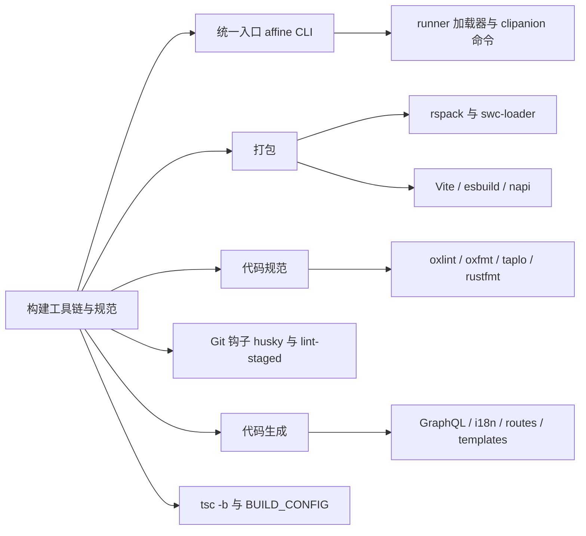
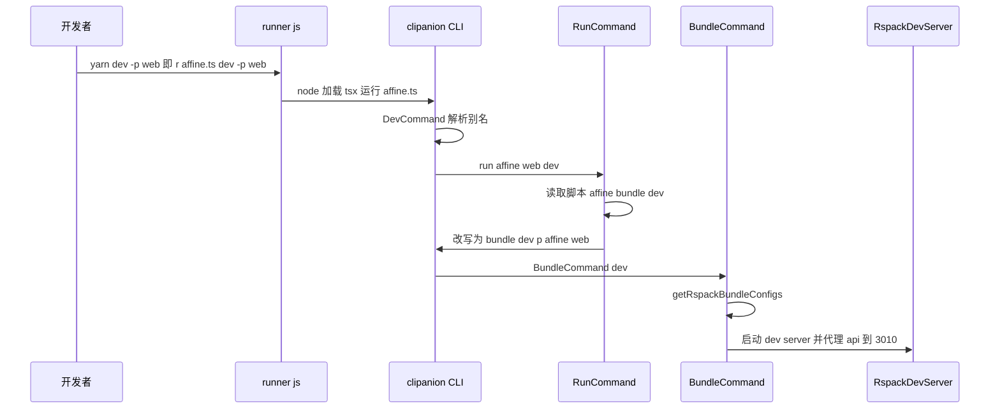
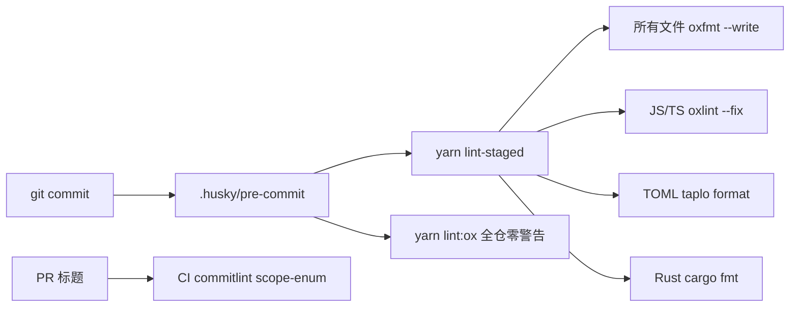
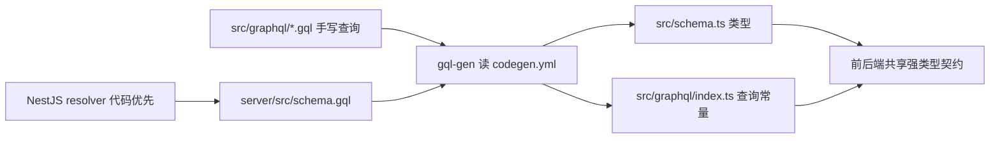

# 第 10 章 构建工具链与代码规范

这些包是怎么被运行、打包、检查和生成的？

第 4 部分 · 工程化与开发环境 ｜ 难度 ★★★☆☆ ｜ 建议学时 6 小时

---

## 导读：一切从 `yarn affine` 开始

- 几乎不直接敲 `rspack`、`tsx`、`napi`，统一走 `yarn affine ...`
- **rspack + SWC**：Web、桌面渲染进程、服务端打包
- **Vite**：playground 与 Vitest；**esbuild**：Electron 主进程
- **oxlint + oxfmt**：JS/TS 规范；taplo、rustfmt 管其余
- **husky + lint-staged**：把检查挂到 Git 提交上
- **代码生成**：GraphQL、i18n、路由、模板等

Note:
第 9 章回答了仓库里有哪些包、它们怎么依赖；本章回答这些包是怎么被运行、打包、检查和生成的。自研 CLI @affine-tools/cli 是总调度，其余工具各管一摊。理解了 CLI，就理解了整个工具链的骨架。我们会逐一打开这些配置文件，讲清楚每个工具为什么在这里、怎么配、有什么坑。

---

## 学习目标

- 画出 `yarn dev -p @affine/web` 到 rspack dev server 的调用链
- 解释 `yarn affine <包名> <脚本>` 的解析与加载器注入
- 读懂 rspack 中 HTML、Worker、Node 三类目标配置的差异
- 说明 SWC 在打包、Vitest、服务端中的装饰器配置差异
- 解读 `.oxlintrc.json` 结构，说出 pre-commit 对各类文件的检查
- 列举代码生成器及 CI 如何校验生成物已提交

Note:
这六条目标覆盖 CLI、打包、SWC、规范、钩子和代码生成。还有一个隐含目标：理解 BUILD_TYPE 等环境变量如何变成运行时的 BUILD_CONFIG 常量，这在第 13 页会讲到。学完后你应该能独立排查大部分构建和 lint 报错。

---

## 知识地图



Note:
六个分支对应本章的主体内容。CLI 是入口，打包是重头戏，代码规范和 Git 钩子保证质量，代码生成保证一致性，最后是类型检查和环境变量。建议边看幻灯片边打开 tools/cli/src 目录对照。

---

## 工具链全景

| 工具 | 用在哪里 | 配置位置 |
| --- | --- | --- |
| `@affine-tools/cli` | 所有 `yarn affine ...` 命令 | `tools/cli/src` |
| rspack + SWC | web、mobile、admin、renderer、server 等打包 | `tools/cli/src/rspack/index.ts` |
| Vite · esbuild · napi | playground 与 Vitest · Electron 主进程 · Rust | 各包配置 |
| oxlint · oxfmt · taplo | JS/TS lint 与格式化 · TOML | `.oxlintrc.json`、`.oxfmtrc.json` |
| husky · lint-staged | Git 提交前检查 | `.husky/pre-commit`、根 `package.json` |

Note:
rspack 的版本是 @rspack/core 2.0.8，Vite 是 7.3.7，oxlint 是 1.78.0 加 oxlint-tsgolint，oxfmt 是 0.63.0，Rust 工具链 1.97.1。TypeScript 用 npm 别名指向 6.0.2，做类型检查 tsc -b。commitlint 在 tools/commitlint 里，用于校验 PR 标题，后面会讲。

---

## runner.js：智能的 node

```js
if (
  scriptLocation.endsWith('.ts') ||
  scriptLocation.startsWith(scriptsFolder)
) {
  if (scriptLocation.startsWith(serverRoot)) {
    nodeOptions.unshift(`--import=${pathToFileURL(tsRuntimeRegister)}`);
  } else {
    nodeOptions.unshift(`--import=${pathToFileURL(tsxRuntimeRegister)}`);
  }
} else {
  nodeOptions.unshift('--experimental-specifier-resolution=node');
}
```

查找顺序：`process.cwd()` → `tools/cli/src` → 仓库根，再 `spawn(node, ...)`

服务端用 `register.js`（SWC hooks：legacy 装饰器 + metadata），其余用 tsx

<p class="small"><code>tools/cli/bin/runner.js</code>（节选）</p>

Note:
根脚本 affine 是 r affine.ts，r 就是 runner.js。它按当前目录、tools/cli/src、仓库根的顺序查找脚本，所以在哪个目录执行都能找到 affine.ts。为什么服务端要单独用 SWC hooks？因为 NestJS 依赖旧版装饰器加 emitDecoratorMetadata 做依赖注入，而 tsx 基于 esbuild，不支持 decorator metadata。hooks.js 实现了 Node 的 resolve 和 load 钩子，并用 mtimeMs 做内存缓存。

---

## clipanion：七个命令

| 命令 | 别名 | 作用 |
| --- | --- | --- |
| `run` | 空路径、`run`、`r` | 执行某个包的脚本（默认命令） |
| `init` | `init`、`i`、`codegen` | 生成 tsconfig references、`workspace.gen.ts` |
| `dev` / `build` | `d` / `b` | 选择包执行 `dev`；`build` 支持 `--deps` |
| `bundle` | `bundle`、`pack`、`bun` | 用 rspack 打包，`--dev` 启动 dev server |
| `clean` / `cert` | — | 清理产物 / 生成本地 HTTPS 证书 |

`yarn affine dev -p web` ≡ `yarn affine @affine/web dev`

Note:
命令在 tools/cli/src/affine.ts 里用 cli.register 注册，CliContext 在 clipanion 的 BaseContext 上扩展了 workspace 字段，所有命令都能拿到第 9 章介绍的 Workspace 模型。包名校验来自 workspace.gen.ts 和 AliasToPackage，所以 -p web 和 -p @affine/web 都合法。DevCommand 把可选列表限制为 web、server、electron 等 8 个可运行目标，缺省时用 inquirer 交互选择。

---

## RunCommand：四条规则

- **脚本存在就执行脚本**：`native build` → `napi build ...`
- **脚本不存在就当作命令**：`prisma ...` → `yarn prisma ...`
- **脚本以 `affine` 开头则递归回 CLI**：改写后追加 `-p <包名>`
- **前缀环境变量被提取**：`FOO=bar`、`cross-env` 剥离为环境变量
- 非白名单命令自动在 `NODE_OPTIONS` 注入 TS 加载器
- `--deps` 先在所有 workspace 依赖上执行同名脚本

<p class="small"><code>tools/cli/src/run.ts</code></p>

Note:
第三条最有意思：web 的 dev 脚本是 affine bundle --dev，会被改写成 bundle --dev -p @affine/web 再交给 clipanion，进入 BundleCommand。加载器注入解释了为什么 server 的 dev 脚本 nodemon ./src/index.ts 能直接跑 TS。白名单 ignoreLoaderScripts 里有 vitest、vite、tsx、prisma、tsc 等。所以服务端命令要用 yarn affine @affine/server，而不是 yarn workspace，后者不会注入加载器。

---

## 一条命令的完整旅程



Note:
把前面几页串起来就是这张时序图。根脚本 dev 转发给 CLI，DevCommand 解析别名后翻译成 run 命令；RunCommand 读到 web 的 dev 脚本以 affine 开头，于是改写参数递归回 CLI，进入 BundleCommand。BundleCommand 组装 rspack 多编译器配置，启动 dev server，并把 api 请求代理到本地服务端 3010 端口。

---

## rspack：每个包打包什么

| 包 | 目标配置 | Worker |
| --- | --- | --- |
| `@affine/admin` | HTML，`selfhostPublicPath: '/admin/'` | 无 |
| `@affine/web`、`@affine/mobile` | HTML + Worker | 基础 5 个 + nbstore |
| `@affine/ios`、`@affine/android` | HTML + Worker | 基础 3 个 + nbstore |
| `@affine/electron-renderer` | 多入口 HTML + Worker | 基础 3 个 |
| `@affine/server`、`@affine/reader` | Node（reader 为 ESM 库） | 无 |

<p class="small"><code>tools/cli/src/bundle.ts</code> 的 <code>getRspackBundleConfigs</code>，返回 <code>MultiRspackOptions</code></p>

Note:
bundle-shared.ts 声明了支持 rspack 打包的 8 个包。基础 Worker 来自 core 源码：workspace-profile、pdf、turbo-painter，以及仅 web 和 mobile 包含的 mermaid、typst 两个 Worker。HTML 目标的 dependencies 字段设为这些 Worker 配置的 name，rspack 会保证 Worker 先于主应用编译完成。electron-renderer 有 app、shell、popup、background-worker 四个入口。

---

## HTML 目标：resolve 配置

```ts
target: ['web', 'es2022'],
resolve: {
  symlinks: true,
  extensionAlias: {
    '.js': ['.js', '.tsx', '.ts'],
    '.mjs': ['.mjs', '.mts'],
  },
  extensions: ['.js', '.ts', '.tsx'],
  alias: {
    yjs: ProjectRoot.join('node_modules', 'yjs').value,
    lit: ProjectRoot.join('node_modules', 'lit').value,
    // '@preact/signals-core' 同理 ...
  },
},
```

`extensionAlias`：源码写 `./foo.js` 映射回 `.ts`；alias 保证三个库全局单例

<p class="small"><code>tools/cli/src/rspack/index.ts</code> 的 <code>createHTMLTargetConfig</code>（节选）</p>

Note:
yjs、lit、@preact/signals-core 都依赖全局单例：Yjs 的类型判断、Lit 的自定义元素注册、Signals 的依赖追踪，多副本会出现 instanceof 失败、重复注册或响应式失效等诡异 bug。另外 strictExportPresence 为 true，导入不存在的导出直接报错。CSS 链路是 style-loader 或 CssExtract、css-loader、postcss-loader，始终启用 VanillaExtractPlugin 处理 css.ts。

---

## SWC、Vite、esbuild 分工

| 场景 | 接入方式 | 装饰器 |
| --- | --- | --- |
| 前端打包 | `swc-loader`（rspack） | `decoratorVersion: '2022-03'` |
| 前端单测 | `unplugin-swc`（Vitest） | `2022-03` |
| 服务端运行/测试/打包 | `tools/cli/hooks.js`、`swc-loader` | legacy + metadata |
| BlockSuite playground | Vite（`vite --host`） | — |
| Electron main/preload/helper | esbuild | — |

前后端都设 `useDefineForClassFields: false`，与根 `tsconfig.json` 一致

Note:
前端用 TC39 标准装饰器，因为 BlockSuite 的 Lit 组件大量使用 property、state 等标准装饰器；服务端 NestJS 依赖 legacy 装饰器和反射元数据。Vitest 底层是 Vite，默认用 esbuild 转译，所以引入 unplugin-swc 接管，保证测试和产物的语义完全一致。playground 纯前端、单入口、强调秒级 HMR，适合 Vite；产品端需要多 Worker、多 HTML、CDN publicPath，rspack 更顺手。napi build 则负责 Rust 原生模块。

---

## BUILD_CONFIG：编译期常量

```ts
function getBuildConfigFromEnv(pkg: Package) {
  const channel = process.env.BUILD_TYPE ?? 'canary';
  const dev = process.env.NODE_ENV === 'development';
  // ... channel 不在 availableChannels 中则抛错
  return getBuildConfig(pkg, {
    // @ts-expect-error checked
    channel,
    mode: dev ? 'development' : 'production',
  });
}
new rspack.DefinePlugin({
  'process.env.NODE_ENV': JSON.stringify(process.env.NODE_ENV),
  ...Object.entries(buildConfig).reduce(/* def[`BUILD_CONFIG.${k}`] = ... */),
}),
```

`BUILD_TYPE` 只能是 canary / beta / stable / internal

<p class="small"><code>tools/cli/src/rspack/index.ts</code>、<code>tools/utils/src/build-config.ts</code>（节选）</p>

Note:
getBuildConfig 根据包名映射出 distribution，再根据 BUILD_TYPE 选择预设，生成 isElectron、isMobileEdition、appBuildType、appVersion 等字段。DefinePlugin 把每个字段替换为字面量，于是 if BUILD_CONFIG.isElectron 在 Web 产物里会被常量折叠并 tree-shake 掉。Electron 的 esbuild 配置复用了同一个 getBuildConfig，保证主进程和渲染进程一致。

---

## 分包策略与 dev server

<div class="cols">
<div>

**cache-group（生产）**

- i18n 每种语言独立 chunk
- `npm-blocksuite`、react 等独立缓存
- 异步依赖按包名拆为 `npm-async-*`

</div>
<div>

**dev server**

- `hot: false`，整页 liveReload
- SPA 回退 `index.html` 或 `selfhost.html`
- `/api`、`/socket.io`、`/graphql` 代理到 3010

</div>
</div>

<p class="small"><code>tools/cli/src/rspack-shared/cache-group.ts</code>、<code>tools/cli/src/bundle-shared.ts</code></p>

Note:
分包的设计意图：语言包按需加载；React、BlockSuite 这类大而稳定的库独立缓存；异步依赖按 npm 包名拆分，避免一个依赖更新导致整个 vendor 缓存失效。dev server 的 webSocketURL 固定为 ws://0.0.0.0:8080/ws，因为 Electron 的自定义协议无法构造 WebSocket 地址。代理配置就是"只开前端也能连本地后端"的原因。另外 node-loader 会把 .node 原生模块拷贝到输出目录，并生成 createRequire 加载代码。

---

## oxlint：配置结构

| 字段 | 含义 |
| --- | --- |
| `plugins` | 原生规则集：import、react、typescript、unicorn、promise |
| `jsPlugins` | 用 oxlint 运行 ESLint JS 插件（sonarjs、lit、react-hooks 等） |
| `categories` | correctness 与 perf 整类默认 `error` |
| `options.typeAware` | 类型感知规则，依赖 `oxlint-tsgolint` |
| `ignorePatterns` | 由 `yarn affine init` 从 `.prettierignore` 同步 |

根脚本 `lint:ox` = `oxlint --deny-warnings`：**警告也视为失败**

Note:
oxlint 是 Oxc 项目的 Rust 实现 linter，比 ESLint 快一到两个数量级，对有数千个 TS 文件的仓库意义重大。jsPlugins 解释了为什么根 devDependencies 里仍有 eslint 和一堆 eslint-plugin：它们不再通过 ESLint 运行，而是作为 oxlint 的 JS 插件被加载，eslint 是它们的 peer 依赖。规则一共 183 条，overrides 14 组。

---

## oxlint：关键规则

| 规则 | 解读 |
| --- | --- |
| `no-restricted-imports` | 禁止深入别人的 `**/src`、`**/dist` |
| `import/no-cycle` | 禁止模块级循环导入，类型导入除外 |
| `typescript/consistent-type-imports` | 仅作类型的导入必须 `import type` |
| `unicorn/filename-case` | 文件名必须 kebabCase |
| `unicorn/prefer-node-protocol` | 必须写 `node:fs` |

overrides：`packages/backend/**/*.ts` 关闭 `consistent-type-imports`（NestJS 需值导入）

Note:
还有 no-non-null-assertion 禁止感叹号断言，ban-ts-comment 要求 ts-expect-error 必须带说明，simple-import-sort 可以 fix 自动排序。overrides 里，源码目录才开启 no-floating-promises 等类型感知规则，因为代价高；blocksuite 关闭了 eqeqeq 和 no-non-null-assertion。后端关闭 consistent-type-imports 是因为 import type 会在编译后被擦除，NestJS 运行时拿不到类元数据，注入就会失败。

---

## 格式化与其他规范

| 工具 | 对象 | 要点 |
| --- | --- | --- |
| oxfmt | JS/TS/JSON/MD | 80 列、单引号、`trailingComma: "es5"` |
| `.prettierignore` | 忽略清单 | oxfmt 与 oxlint 共享 |
| `.editorconfig` | 全仓 | 2 空格、UTF-8、Markdown 保留尾空格 |
| taplo | TOML | `align_entries`、`reorder_keys` |
| rustfmt / clippy | Rust | `cargo +nightly fmt`；clippy `-D warnings` |

Note:
oxfmt 是 Prettier 兼容的格式化器，sortPackageJson 关闭以免打乱字段顺序，TOML 交给 taplo。.prettierignore 首行注释写明 shared by oxfmt 和 oxlint，改忽略规则只改这一处，再 yarn affine init 同步。rustfmt.toml 用了 unstable_features、group_imports 等 nightly 选项，所以 CI 的 lint-rust job 专门装 nightly；clippy 对 affine_server_native 单独跑一遍，避免 all-features 产生 feature 合并冲突。

---

## Git 钩子与 PR 标题校验



`.husky/pre-commit`：`yarn lint-staged && yarn lint:ox`

Note:
根 postinstall 里的 yarn husky 把 .husky 设为 Git 的 hooksPath，仓库只定义了 pre-commit 一个钩子。lint-staged 只处理暂存文件，修复结果自动加回暂存区；随后 lint:ox 再对全仓跑一次，确保提交不引入任何警告。commitlint 不在本地钩子上，而是在 CI 里校验 PR 标题，因为 PR 标题会成为合入 canary 的提交信息；CI 用 yarn workspaces focus 只装这一个包，几秒完成。

---

## 代码生成：单一事实源

| 生成器 | 命令 | 输出 |
| --- | --- | --- |
| Workspace 元信息 | `yarn affine init` | tsconfig references、`workspace.gen.ts` |
| GraphQL | `yarn affine gql build` | `graphql/src/schema.ts`、`graphql/index.ts` |
| i18n | `yarn affine i18n build` | `i18n.gen.ts`、`i18n-completenesses.json` |
| 路由 | `yarn affine routes build` | `packages/frontend/routes/src/routes.ts` |
| 服务端配置 | `yarn affine server genconfig` | `.docker/selfhost/schema.json` 等 |

原则：**生成物入库**，CI `check-git-status` 重放生成并要求零 diff

Note:
i18n 生成会先把服务端的 USER_FRIENDLY_ERRORS 写入 en.json 的 error 键，再调用 i18n-codegen 生成类型安全 hooks。路由生成读取 routes.json，用 path-to-regexp 解析参数。模板生成在 postinstall 中执行。生成物入库的好处是阅读代码时不必先运行生成器，IDE 跳转开箱即用；代价是 PR 里会出现生成文件的 diff。CI 重放的是 init、gql、i18n、server genconfig 这四个。

---

## GraphQL codegen 数据流



`export-gql-plugin.cjs` 把每个查询导出为 `getCurrentUserQuery` 这样的常量

Note:
服务端用代码优先方式定义 resolver，开发模式启动时通过 autoSchemaFile 写出 schema.gql。前端在 src/graphql 下手写 gql 查询，比如 get-current-user.gql。codegen.yml 开启 strict、maybeValue 为 T 或 null，并把 DateTime 映射为 string、Upload 映射为 File；afterOneFileWrite 钩子会 oxfmt 格式化输出。于是前后端共享同一份强类型契约。

---

## 源码导读 Top 5

| 优先级 | 路径 | 看什么 |
| --- | --- | --- |
| P0 | `tools/cli/bin/runner.js` | 脚本查找与加载器选择 |
| P0 | `tools/cli/src/run.ts` | 按包执行、affine 前缀递归、加载器注入 |
| P0 | `tools/cli/src/bundle.ts` | 每个包的 rspack 多编译器配置 |
| P0 | `tools/cli/src/rspack/index.ts` | HTML / Worker / Node 三类目标 |
| P0 | `.oxlintrc.json` | 规则、jsPlugins、overrides |

Note:
推荐顺序就是表格顺序：先看 runner 怎么启动，再看 run.ts 的四条规则，然后看 bundle.ts 如何为每个包组装配置，最后进入 rspack/index.ts 的三类目标。P1 里的 hooks.js、html-plugin.ts、cache-group.ts、build-config.ts、vitest.config.ts 也值得读。

---

## 动手实践

| 练习 | 验收要点 |
| --- | --- |
| 1 探索 CLI | 列出 7 个命令及别名，说出 `desktop` 的指向 |
| 2 推演 `yarn affine server dev` | 写出 `yarn nodemon ./src/index.ts` 与注入的加载器 |
| 3 生产打包观察产物（可选） | 把 chunk 名对应到 `cache-group.ts` 规则 |
| 4 体验 lint 与格式化 | 说出 `--deny-warnings` 的含义 |
| 5 重放代码生成检查 diff | 判断变化来自哪个生成器并还原 |

Note:
练习 1、2 只读源码和帮助信息。练习 3 耗时较长，可以选做，执行 BUILD_TYPE=canary yarn affine bundle -p @affine/web 后看 dist 目录。练习 4 如果写临时文件验证 prefer-node-protocol，记得删除。练习 5 结束后用 git checkout 还原改动。

---

## 自测

**Q1. 为什么服务端脚本用 `register.js` 而不是 tsx？**

NestJS 依赖 legacy 装饰器与 `emitDecoratorMetadata`，tsx 基于 esbuild 不支持 <!-- .element: class="fragment" -->

**Q2. rspack 为何把 `yjs`、`lit`、`@preact/signals-core` alias 到根目录？**

三者依赖模块级单例，多副本会致 instanceof 失败、重复注册或响应式失效 <!-- .element: class="fragment" -->

**Q3. pre-commit 中 `lint-staged` 之后为何还要 `yarn lint:ox`？**

lint-staged 只查暂存文件；`lint:ox` 以 `--deny-warnings` 再查全仓 <!-- .element: class="fragment" -->

Note:
可以再追问两题：RunCommand 如何处理以 affine 开头的脚本？答案是去掉 affine、追加 -p 包名后递归调用 CLI。BUILD_TYPE=beta 会影响什么？appBuildType 和 changelogUrl 变为 beta 预设，Web 产物的 publicPath 使用 beta.affineassets.com，Electron 的 REPLACE_ME_BUILD_ENV 也随之变化。

---

## 常见坑

| 现象 | 处理 |
| --- | --- |
| `yarn workspace @affine/server dev` 报 TS 语法错误 | 改用 `yarn affine server dev` |
| 打包报 `export 'xxx' was not found` | 修正导入名，或检查依赖包 `exports` |
| Lit 组件属性不更新 | 确保 `useDefineForClassFields: false` 一致 |
| CI fmt check 失败但本地通过 | 使用 `cargo +nightly fmt --all` |
| `tsc -b` 内存溢出 | `NODE_OPTIONS=--max-old-space-size=14384` |

Note:
第一个坑最高频：绕过 CLI 就没有注入加载器。tsc -b 是全量增量类型检查，根 tsconfig 的 files 和 include 都为空，只靠 init 生成的 references 按拓扑顺序检查，非常吃内存，CI 也设置了同样的 NODE_OPTIONS。另外 BUILD_TYPE must be one of 报错说明环境变量拼错了，只能是四个渠道之一。

---

## 小结与下一步

- CLI 四条规则：脚本优先、命令兜底、`affine` 递归、加载器注入
- rspack 按 HTML / Worker / Node 三类目标组织多端配置
- SWC 统一转译：前端 `2022-03`，服务端 legacy + metadata
- oxlint 原生规则 + JS 插件 + 类型感知，`--deny-warnings`
- 生成物入库，CI 重放生成要求零 diff

<div class="callout">

**下一章**：第 11 章 本地开发环境搭建与调试——动手把 AFFiNE 跑起来。

</div>

Note:
本章把工具链拆成了调度、打包、规范、钩子、生成五块。记住 CLI 是骨架，SWC 装饰器的前后端差异是最容易踩坑的地方。下一章我们把这些知识用起来，真正搭建本地开发环境，包括获取原生模块、生成本地 HTTPS 证书和配置调试。
