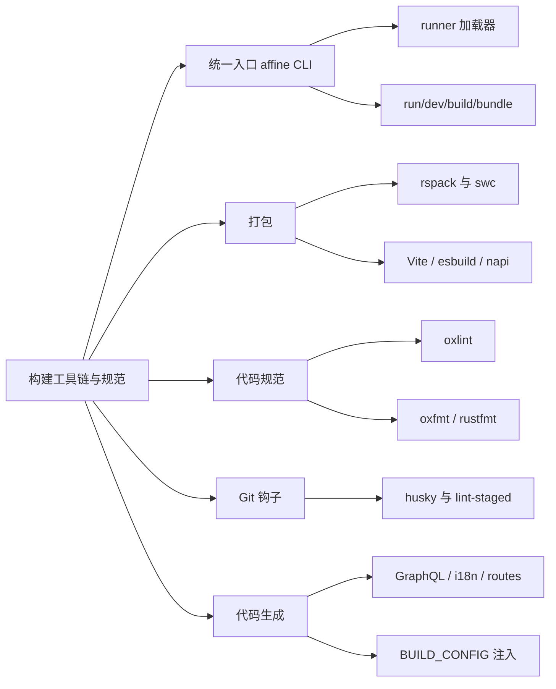
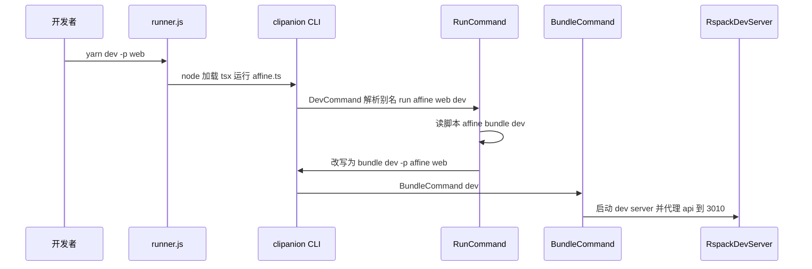
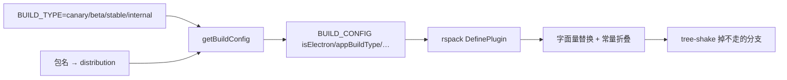

# 第 10 章 构建工具链与代码规范

> 一条 yarn affine 命令背后：rspack、SWC、oxlint 与一众代码生成器

第 4 部分 · 工程化与开发环境 ｜ 难度 ★★★☆☆ ｜ 建议学时 6 小时

===

## 本章要解决的问题

<p class="lead">第 9 章知道了"有哪些包、怎么依赖"。本章回答下一个问题：<b>这些包怎么被运行、打包、检查和生成？</b></p>

在 AFFiNE 里你几乎不直接敲 `rspack`、`tsx` 或 `napi`，而是通过统一入口 `yarn affine ...`（自研 CLI）驱动一切。CLI 之下是一组各司其职的工具：

<div class="cards cols-3">
  <div class="card"><div class="card__icon">📦</div><h4>打包</h4><p>rspack+SWC 打 Web/服务端，Vite 跑 playground，esbuild 打 Electron 主进程，napi 编译 Rust。</p></div>
  <div class="card"><div class="card__icon">🔍</div><h4>检查</h4><p>oxlint+oxfmt 管 JS/TS，taplo/rustfmt/clippy 管 TOML 与 Rust，husky 挂到 Git 提交。</p></div>
  <div class="card"><div class="card__icon">⚙️</div><h4>生成</h4><p>GraphQL、i18n、路由、模板多个生成器，保证"生成物与源头一致"。</p></div>
</div>

<div class="note note--tip">

理解 CLI 就理解了工具链的骨架：**CLI 是总调度，其余工具各管一摊**。本章逐一打开这些配置文件，结合源码讲清每个工具"为什么在这里、怎么配、有什么坑"。

</div>

===

## 知识地图

从统一入口 CLI 出发，依次看打包、代码规范、Git 钩子、代码生成、类型与环境五块。



===

## 学习目标

<ol class="goals">
  <li>画出 <code>yarn dev -p @affine/web</code> 从根脚本到 rspack dev server 的调用链</li>
  <li>解释 <code>yarn affine &lt;包&gt; &lt;脚本&gt;</code> 的执行机制：别名解析、TS 加载器注入、<code>--deps</code></li>
  <li>读懂 rspack 中 HTML、Worker、Node 三类目标配置的差异</li>
  <li>说明 SWC 在 rspack、Vitest、服务端加载器中的三种配置及装饰器版本差异</li>
  <li>解读 <code>.oxlintrc.json</code> 的结构与关键规则，说出 pre-commit 对各文件类型的检查</li>
  <li>列举代码生成器及其输入输出，说明 <code>BUILD_TYPE</code> 如何变成 <code>BUILD_CONFIG</code></li>
</ol>

===

<!-- section -->
## 一、affine CLI：统一入口

从 `yarn affine` 到 `affine.ts`，CLI 用四条规则把 100 多个包的脚本统一起来。

===

## 从 yarn affine 到 affine.ts

`"affine": "r affine.ts"`，`r` 是 CLI 的 bin。`runner.js` 是"智能的 node"：在若干目录查找脚本，并决定用哪个 TS 加载器。

<div class="annotate">

```js [2-3|5-6]
if (scriptLocation.endsWith('.ts')) {
  if (scriptLocation.startsWith(serverRoot)) {
    nodeOptions.unshift(`--import=${tsRuntimeRegister}`);  // SWC hooks
  } else {
    nodeOptions.unshift(`--import=${tsxRuntimeRegister}`); // tsx
  }
}
```

<ol class="annotate__notes">
  <li><b>第 2–3 行</b>：<code>packages/backend/server</code> 下的脚本用 <b>SWC hooks</b>（<code>register.js</code>），开启 <code>legacyDecorator + decoratorMetadata</code>。</li>
  <li><b>第 5–6 行</b>：其余脚本用 <b>tsx</b>（基于 esbuild，零配置运行 TS）。</li>
</ol>
</div>

<div class="note note--warn">

**为什么服务端单独用 SWC hooks**：NestJS 依赖 TypeScript 的**旧版装饰器 + `emitDecoratorMetadata`** 做依赖注入（通过 `reflect-metadata` 读构造函数参数类型），而 tsx 基于 esbuild 不支持 `emitDecoratorMetadata`。查找顺序是"当前目录 → `tools/cli/src` → 仓库根"，所以 `r affine.ts` 在哪执行都能找到。

</div>

===

## RunCommand 的四条规则

`yarn affine @affine/native build` 由 `RunCommand` 处理，核心逻辑归纳为四条：

<ol class="steps">
  <li><h4>脚本存在就执行脚本</h4><p><code>yarn affine @affine/native build</code> → 在该包目录执行其 <code>build</code> 脚本 <code>napi build -p affine_native …</code>。</p></li>
  <li><h4>脚本不存在就当命令</h4><p><code>yarn affine @affine/server prisma migrate deploy</code> 中 <code>prisma</code> 非脚本名，于是执行 <code>yarn prisma migrate deploy</code>。</p></li>
  <li><h4>affine 开头则递归回 CLI</h4><p><code>@affine/web</code> 的 <code>dev</code> 脚本是 <code>affine bundle --dev</code>，改写成 <code>bundle --dev -p @affine/web</code> 再交给 clipanion，进入 <code>BundleCommand</code>。</p></li>
  <li><h4>前缀环境变量被提取</h4><p><code>extractEnvs</code> 把脚本开头的 <code>FOO=bar</code>、<code>cross-env</code> 剥离成环境变量，Windows 上也能工作。</p></li>
</ol>

<div class="note note--tip">

`runCommand` 还为非白名单命令自动注入 TS 加载器：`@affine/server` 用 `serverRuntimeLoader`，其余用 `tsxRuntimeLoader`。所以**服务端命令应通过 `yarn affine @affine/server <script>` 执行，而非 `yarn workspace @affine/server <script>`**——后者不会注入加载器。`--deps` 让 CLI 先在所有依赖上执行同名脚本。

</div>

===

## 一条命令的完整旅程

`yarn dev -p web` 如何一路变成 rspack dev server：



<ul class="takeaways">
  <li><code>dev</code>/<code>build</code> 都只是"翻译"成 <code>run</code>：<code>yarn affine dev -p web</code> ≡ <code>yarn affine @affine/web dev</code>。</li>
  <li>命令基类三种：<code>PackageCommand</code>（单包必填）、<code>PackagesCommand</code>（多包）、<code>PackageSelectorCommand</code>（缺省时交互选择，<code>DevCommand</code> 用）。</li>
</ul>

===

<!-- section -->
## 二、打包：rspack 为主

rspack 按 HTML/Worker/Node 三类目标组织，靠 BUILD_CONFIG 常量、SWC 装饰器、单例 alias 实现多端一套配置。

===

## 每个包打包什么

`getRspackBundleConfigs` 为 8 个包各组装一个**多编译器配置**：

| 包 | 目标 | 入口 |
| --- | --- | --- |
| `@affine/admin` | HTML | `src/index.tsx` |
| `@affine/web`、`mobile` | HTML + Worker | `src/index.tsx` + 基础 Worker + nbstore |
| `@affine/ios`、`android` | HTML + Worker | 不含 mermaid、typst |
| `@affine/electron-renderer` | HTML（多入口）+ Worker | app/shell/popup/background-worker |
| `@affine/server` | Node | `src/index.ts` |
| `@affine/reader` | Node（ESM 库） | 打包全部依赖但 external `yjs` |

<div class="note">

"基础 Worker"来自 `@affine/core` 源码：workspace-profile、pdf、turbo-painter，以及仅 web/mobile 含的 mermaid、typst。HTML 目标的 `dependencies` 设为这些 Worker 配置的 `name`，rspack 保证 Worker 先于主应用编译完成。

</div>

===

## HTML 目标的关键配置

`createHTMLTargetConfig` 最复杂。几项配置的设计意图值得细看：

| 配置 | 设计意图 |
| --- | --- |
| `extensionAlias` `.js → .ts/.tsx` | 源码按 ESM 写 `import './foo.js'`，打包时映射回 `.ts` |
| alias 固定 `yjs`/`lit`/`@preact/signals-core` | 这三个库依赖**全局单例**，多副本会 instanceof 失败、重复注册、响应式失效，强制只用根 `node_modules` 一份 |
| `strictExportPresence: true` | 导入不存在的导出直接报错，而非得到 `undefined` |
| `experiments.asyncWebAssembly` | 支持 wasm 依赖 |

<div class="annotate">

```ts [5-6]
{ test: /\.tsx$/, exclude: /node_modules/, loader: 'swc-loader',
  options: { jsc: {
    parser: { syntax: 'typescript', tsx: true, decorators: true },
    transform: {
      useDefineForClassFields: false,
      decoratorVersion: '2022-03',  // TC39 标准装饰器
    } } } }
```

<ol class="annotate__notes">
  <li><b>前端 <code>decoratorVersion: '2022-03'</code></b>：BlockSuite 的 Lit 组件大量用 <code>@property()</code> 等标准装饰器；服务端则用 legacy + metadata。</li>
  <li><b><code>useDefineForClassFields: false</code></b>：与根 tsconfig 一致，避免类字段语义改变导致 Lit 响应式属性失效。</li>
</ol>
</div>

===

## BUILD_CONFIG：编译期常量

`BUILD_TYPE` 环境变量经 `getBuildConfig` 变成 `BUILD_CONFIG` 常量，再由 `DefinePlugin` 替换为字面量，于是 `if (BUILD_CONFIG.isElectron)` 在 Web 产物里被常量折叠并 tree-shake 掉。



<ul class="takeaways">
  <li>CSS 规则链：<code>style-loader</code>（dev）或 <code>CssExtractRspackPlugin</code>（prod）→ <code>css-loader</code> → <code>postcss-loader</code>；始终启用 <code>VanillaExtractPlugin</code> 处理 <code>.css.ts</code>。</li>
  <li>分包策略（cache-group）：每种语言包独立 chunk 按需加载；React、BlockSuite 等大而稳定的库独立缓存；异步依赖按 npm 包名拆分，避免一处更新导致整个 vendor 缓存失效。</li>
  <li>dev server：关 HMR 用整页 liveReload；<code>/api</code>、<code>/socket.io</code>、<code>/graphql</code> 代理到本地 3010——"只开前端也能连本地后端"。</li>
</ul>

===

## SWC 的三种身份

为什么装饰器配置要在多处保持一致？因为 SWC 在仓库中以三种身份出现，而装饰器语义必须对齐：

<div class="compare">
  <div class="compare__col compare__col--good"><h4>前端（标准装饰器）</h4>

- rspack 打包：`swc-loader`
- Vitest 单测：`unplugin-swc`
- 均用 `decoratorVersion: '2022-03'`
- 服务于 Lit 的 `@property`/`@state`

  </div>
  <div class="compare__col"><h4>服务端（legacy 装饰器）</h4>

- 运行/测试：`@swc/core` + Node 模块钩子
- rspack Node 目标：`swc-loader`
- 均用 `legacyDecorator + decoratorMetadata`
- 服务于 NestJS 依赖注入

  </div>
</div>

<div class="note">

**各工具分工**：Vite 服务于"轻量、快"（BlockSuite playground 单入口、秒级 HMR）；rspack 服务于"复杂产物"（多 Worker、多 HTML、CDN、manifest）；esbuild 服务于"Node 侧简单打包"（Electron 主进程，复用同一个 `getBuildConfig` 保证与渲染进程 `BUILD_CONFIG` 一致）；napi 编译 Rust 原生模块。SWC 作为统一转译内核保证装饰器语义一致。

</div>

===

<!-- section -->
## 三、代码规范

JS/TS 用 oxlint + oxfmt，TOML 用 taplo，Rust 用 nightly rustfmt + clippy，三者都在 CI 中以 --check 强制。

===

## oxlint：原生 + ESLint 插件 + 类型感知

oxlint 是 Oxc 的 Rust linter，比 ESLint 快一到两个数量级。根脚本 `lint:ox` 为 `oxlint --deny-warnings`——**警告也视为失败**。配置三层能力：

| 字段 | 含义 |
| --- | --- |
| `plugins` | oxlint 原生（Rust）规则：import、react、typescript、unicorn、promise |
| `jsPlugins` | **用 oxlint 运行 ESLint 的 JS 插件**（simple-import-sort、sonarjs、lit 等） |
| `categories` | 整类开启：所有 correctness 与 perf 规则默认 error |
| `options.typeAware` | 开启类型感知规则（需 `oxlint-tsgolint`），用于 `no-floating-promises` |

<div class="note note--tip">

这解释了为什么根 `devDependencies` 里仍有 `eslint`、`eslint-plugin-*`：它们不再通过 ESLint 运行，而是作为 oxlint 的 JS 插件被加载。`ignorePatterns` 由 `yarn affine init` 从 `.prettierignore` 同步生成。

</div>

===

## 关键规则与差异化 override

几条规则直接呼应前面各章的架构约束：

| 规则 | 解读 |
| --- | --- |
| `no-restricted-imports`（禁 `**/dist`、`**/src`） | 跨包只能走 `exports` 入口，不能深入别人的 src/dist |
| `import/no-cycle` | 禁模块级循环导入（类型导入除外） |
| `consistent-type-imports` | 只作类型的导入必须 `import type`，配合 `verbatimModuleSyntax` |
| `unicorn/prefer-node-protocol` | 必须 `node:fs` 而非 `fs` |

<div class="note note--warn">

**按目录差异化**：类型感知规则（`no-floating-promises` 等）只对 `packages/**`、`tools/**`、`blocksuite/**` 源码开启（代价高，tests/scripts 没必要）；`packages/backend/**` 关闭 `consistent-type-imports`——NestJS 依赖注入需**值导入**才能运行时拿到类型元数据，写 `import type` 会导致注入失败；`blocksuite/**` 关闭 `eqeqeq` 与 `no-non-null-assertion`（历史风格）。

</div>

===

## 格式化、TOML 与 Rust

三种语言各用一套格式化器，都在 CI 以 `--check` 强制：

<div class="split">
<div class="split__main">

- **oxfmt**（`.oxfmtrc.json`）：Prettier 兼容，80 列、单引号、ES5 尾逗号、2 空格；`sortPackageJson: false`；
- **`.prettierignore`** 首行注释 `# shared by oxfmt|oxlint`，两者共享忽略清单，改一处再 `yarn affine init` 同步；
- **taplo**（`.taplo.toml`）：`align_entries` 让等号对齐、`reorder_keys` 让键按字母排序；
- **rustfmt**：用了 `unstable_features`、`group_imports` 等**只有 nightly 支持**的选项。

</div>
<div class="split__aside">

```yaml
  # CI lint-rust job
- name: fmt check
  run: |
    rustup toolchain add nightly
    cargo +nightly fmt --all -- --check
- name: Clippy
  run: |
    cargo clippy --workspace \
      --exclude affine_server_native \
      -- -D warnings
```

</div>
</div>

<div class="note">

clippy 用 `-D warnings` 把警告当错误；`affine_server_native` 单独跑，避免 `--all-features` 在 workspace 层产生 feature 合并冲突。

</div>

===

## Git 钩子：husky、lint-staged、commitlint

本地 pre-commit 保证"格式化 + lint 零警告"，CI 的 PR Title Lint 保证提交信息规范：

<div class="annotate">

```json [2|3-4]
"lint-staged": {
  "*": "oxfmt --write --no-error-on-unmatched-pattern",
  "*.{ts,tsx,mjs,js,jsx}": ["oxlint --fix"],
  "*.toml": ["taplo format"],
  "*.rs": ["cargo fmt --"]
}
```

<ol class="annotate__notes">
  <li><b>第 2 行</b>：所有暂存文件先 <code>oxfmt --write</code>（不支持的类型静默跳过），修复结果自动加回暂存区。</li>
  <li><b>pre-commit 两步</b>：<code>yarn lint-staged</code>（只查暂存文件）后再 <code>yarn lint:ox</code> 对<b>全仓</b>以 <code>--deny-warnings</code> 跑一次，确保提交不引入任何警告。</li>
</ol>
</div>

<div class="note">

commitlint 没挂本地 `commit-msg`，而在 CI 校验 **PR 标题**（PR 标题会成为合入 canary 后的提交信息）。用 `yarn workspaces focus @affine/commitlint-config` 只装这一个包，CI 几秒完成。规则继承 conventional，`scope-enum` 限定 scope 为 `admin`、`server`、`core` 等 24 个之一。

</div>

===

<!-- section -->
## 四、代码生成与环境

"从单一事实源生成代码"贯穿全仓；CI 重放生成并要求零 diff。BUILD_TYPE 则是最重要的构建变量。

===

## 从单一事实源生成代码

| 生成器 | 输入 | 输出 |
| --- | --- | --- |
| Workspace 元信息 | `yarn workspaces list` | tsconfig references、`workspace.gen.ts`、`.oxlintrc.json` |
| GraphQL | 后端 `schema.gql` + 前端 `*.gql` | `graphql/src/schema.ts`、`graphql/index.ts` |
| i18n | `en.json` + 服务端错误定义 | `i18n.gen.ts`、`i18n-completenesses.json` |
| 路由 | `routes.json` | `routes/src/routes.ts` |
| 服务端配置 Schema | 各模块 `defineModuleConfig` | `schema.json`、admin `config.json` |

<div class="note note--tip">

GraphQL 数据流是**反向**的：服务端 NestJS 以"代码优先"定义 resolver → dev 启动时写出 `schema.gql` → 前端在 `*.gql` 手写查询 → `gql-gen` 生成类型，自定义插件把每个查询导出为 `getCurrentUserQuery` 这样的常量。前后端共享同一份强类型契约。

</div>

===

## 生成物入库，CI 重放零 diff

核心原则：**生成物入库，CI 重放生成并要求零 diff**。好处是读代码无需先运行生成器、IDE 跳转开箱即用；代价是 PR 中会出现生成文件的 diff。

<div class="annotate">

```yaml [2-5|6-7]
- name: Run Check
  run: |
    yarn affine init
    yarn affine gql build
    yarn affine i18n build
    yarn affine server genconfig
    if git status --porcelain | grep -q .; then
      echo "Run ... and make sure all changes are submitted"; exit 1
    fi
```

<ol class="annotate__notes">
  <li><b>第 2–5 行</b>：CI 的 <code>check-git-status</code> job 重放四个生成器。</li>
  <li><b>第 6–7 行</b>：若产生任何 diff 就失败——逼你把生成物和源码一起提交。</li>
</ol>
</div>

<div class="note">

`typecheck` = `tsc -b tsconfig.json`。根 tsconfig 自身 `files:[]`、`include:[]`，只通过 `references` 引用每个 TS 包（由 `yarn affine init` 生成），据此按拓扑顺序增量检查。CI 设 `--max-old-space-size=14384`，说明全量类型检查很吃内存。

</div>

===

## BUILD_TYPE 与环境变量

`BUILD_TYPE` 是最重要的构建变量，决定渠道与 CDN 域名：

| 变量 | 作用 |
| --- | --- |
| `BUILD_TYPE` | 渠道 `canary`(默认)/`beta`/`stable`/`internal`，定 `appBuildType` 与 CDN |
| `NODE_ENV` | `development` 时 `BUILD_CONFIG.debug = true` |
| `SELF_HOSTED` | dev server 回退到 `selfhost.html` |
| `SENTRY_AUTH_TOKEN` 等 | 三者齐全才启用 Sentry 上传 sourcemap |
| `DEV_SERVER_URL` | Electron 开发时加载渲染进程 dev server 地址 |

<div class="note note--warn">

`.vscode` 只提交模板（`extensions.json`、`settings.template.json`、`launch.template.json`），使用时 `cp .vscode/settings.template.json .vscode/settings.json`。模板里默认格式化器为 `oxc.oxc-vscode`、保存时格式化，`rust-analyzer.check.extraEnv` 设 `DATABASE_URL`（sqlx 编译期检查需要）。

</div>

===

## 动手实践

<ol class="steps">
  <li><h4>探索 CLI</h4><p><code>yarn affine -h</code>、<code>yarn affine bundle -h</code>，读 <code>distribution.ts</code> 的别名表。<b>验收</b>：列出 7 个命令及别名；说出 <code>desktop</code> 与 <code>renderer</code> 都指向 <code>@affine/electron-renderer</code>。</p></li>
  <li><h4>推演 yarn affine server dev</h4><p>读 server 的 <code>dev</code> 脚本与 <code>run.ts</code> 的 <code>runCommand</code>。<b>验收</b>：写出最终命令形如 <code>yarn nodemon ./src/index.ts</code>，<code>NODE_OPTIONS</code> 含 <code>--import=.../register.js</code>，并解释为何不是 tsx。</p></li>
  <li><h4>生产打包观察产物（可选）</h4><p><code>BUILD_TYPE=canary yarn affine bundle -p @affine/web</code>，看 <code>dist</code> 结构与 <code>assets-manifest.json</code>。<b>验收</b>：看到 <code>index.html</code>、<code>selfhost.html</code>、<code>nbstore-&lt;版本&gt;.worker.js</code>、<code>npm-blocksuite</code> 等 chunk，并对应到 cache-group 规则。</p></li>
  <li><h4>体验 lint 与格式化</h4><p><code>yarn lint:ox packages/common/infra/src/livedata</code>、<code>yarn oxfmt --check …</code>、<code>yarn taplo format --check Cargo.toml</code>。<b>验收</b>：能说出 <code>--deny-warnings</code> 的含义，预测 <code>import fs from 'fs'</code> 会触发 <code>unicorn/prefer-node-protocol</code>。</p></li>
</ol>

===

## 自测：点击揭晓答案

<details class="quiz">
<summary>Q1. 为什么服务端脚本用 register.js 而不是 tsx？</summary>

NestJS 依赖旧版装饰器与 `emitDecoratorMetadata` 做 DI；tsx 基于 esbuild 不支持 decorator metadata，而 `register.js`（SWC hooks）支持 `legacyDecorator + decoratorMetadata`。

</details>

<details class="quiz">
<summary>Q2. @affine/web 的 dev 脚本 affine bundle --dev 如何被处理？</summary>

`RunCommand` 发现脚本以 `affine` 开头：去掉 `affine`，末尾追加 `-p <包名>`，合并脚本前缀的环境变量后调 `this.cli.run(args)` 重新进入 CLI，于是变成 `bundle --dev -p @affine/web`，进入 `BundleCommand`。

</details>

<details class="quiz">
<summary>Q3. 为什么要把 yjs、lit、signals-core alias 到根 node_modules？</summary>

这三个库依赖模块级单例（Yjs 类型判断、Lit 自定义元素注册与指令、Signals 依赖追踪），多副本会导致 instanceof 失败、重复注册或响应式失效，所以 rspack 强制只用根 `node_modules` 中的一份。

</details>

<details class="quiz">
<summary>Q4. pre-commit 中 lint-staged 之后为什么还要 lint:ox？</summary>

lint-staged 只检查暂存文件，且 `--fix` 后可能仍有无法自动修复的问题；`lint:ox` 以 `--deny-warnings` 对全仓再检查一次，确保提交不引入任何警告。

</details>

===

## 小结与下一步

<ul class="takeaways">
  <li>CLI 用"脚本优先、命令兜底、affine 前缀递归、自动注入加载器"四条规则统一全仓脚本。</li>
  <li>rspack 按 HTML/Worker/Node 三类目标组织，靠 <code>BUILD_CONFIG</code> 常量、SWC 装饰器、单例 alias 实现多端一套配置。</li>
  <li>SWC 以三种身份出现（rspack/Vitest/服务端钩子），装饰器语义前端标准、服务端 legacy。</li>
  <li>oxlint 以原生规则 + ESLint JS 插件 + 类型感知三层覆盖，并按目录差异化 override。</li>
  <li>生成物入库、CI 重放零 diff；<code>BUILD_TYPE</code> 经 <code>getBuildConfig</code> 转为 <code>BUILD_CONFIG</code> 注入各端。</li>
</ul>

<div class="note note--tip">

**下一章预告**：第 11 章讲 `本地开发环境搭建与调试`——如何获取原生模块、起本地服务端、配置 HTTPS 证书与断点调试，把前面几章的工具链真正跑起来。

</div>
