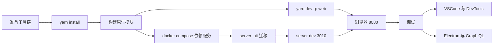
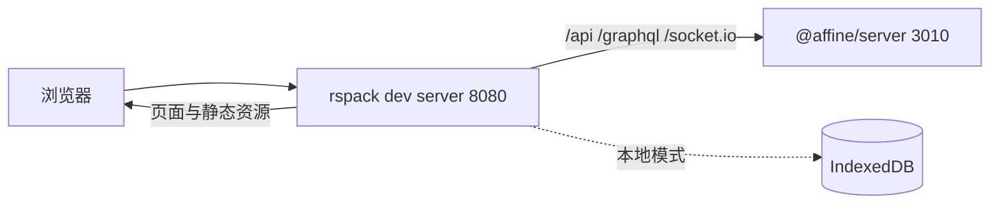
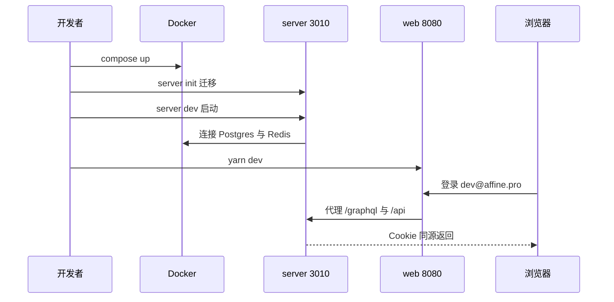
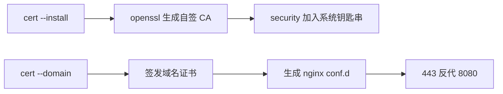

# 第 11 章 本地开发环境搭建与调试

把 AFFiNE 在你的机器上跑起来，并学会在每一层下断点

第 4 部分 · 工程化与开发环境 ｜ 难度 ★★☆☆☆ ｜ 建议学时 4 小时

Note:
欢迎来到第 11 章。前两章我们静态地认识了仓库结构和工具链，这一章开始真正动手。
目标很具体：把 Web 端跑起来，再接上本地服务端和桌面端，最后学会在每一层调试。

---

## 本章导读

- 依据三份仓库文档：`docs/BUILDING.md`、`docs/developing-server.md`、`docs/building-desktop-client-app.md`
- 结合真实配置：`.nvmrc`、`rust-toolchain.toml`、`.docker/dev`、`.vscode`、`.devcontainer`
- 三份文档都声明"不保证最新"——**遇到差异以源码为准**
- 本章末尾给出一份"首次跑通清单"，逐项打勾即可

<div class="callout">

只跑 `@affine/web` 就足以完成大部分编辑器与 UI 开发；云端功能才需要本地服务端。

</div>

Note:
本章的内容都来自仓库自带的三份文档，再加上一系列真实配置文件。
需要提醒的是，这三份文档开头都写着不保证最新，比如邮件服务镜像名就已经和源码不一致了，所以我们始终以源码为准。
另外先给大家吃颗定心丸：大部分前端开发只需要跑 Web 端，不需要服务端。

---

## 学习目标

1. 按 `.nvmrc`、`packageManager`、`rust-toolchain.toml` 准备工具链
2. 解释 `yarn install` 的 `postinstall` 阶段做了什么
3. 构建 `@affine/native` 与 `@affine/server-native` 并说明用途
4. 启动 `@affine/web` 及其他 dev 目标
5. 用 `.docker/dev` 起依赖服务，完成服务端初始化并登录
6. 使用 VSCode、DevTools、Electron inspector、GraphiQL 调试

Note:
这是本章的六个学习目标，从准备工具链一直到多层调试。
学完之后，你应该能独立在一台全新的机器上把整个开发环境搭起来，并且遇到问题知道去哪里下断点。

---

## 知识地图



Note:
整章就是这条主线：先准备工具链，然后 yarn install，再构建原生模块。
之后分两路：前端直接 yarn dev 跑在 8080；服务端要先起 Docker 依赖、做迁移，再在 3010 启动，最后通过 8080 汇合。
所有东西跑起来之后，才进入调试环节。

---

## 工具链：版本全部由仓库锁定

| 工具 | 锁定文件 | 当前值 |
| --- | --- | --- |
| Node.js | `.nvmrc` + `engines.node` | `22.23.4`，`>=22.12.0 <23.0.0` |
| Yarn | `packageManager` + `.yarnrc.yml` | `yarn@4.18.0` |
| Rust | `rust-toolchain.toml` | `channel = "1.97.1"` |

```sh
fnm use --install-if-missing   # 或 nvm install && nvm use
corepack enable && yarn -v     # 应输出 4.x
```

<p class="small">`.npmrc` 中 `engine-strict=true`：版本不符会尽早报错。不要用 Node 23/24。</p>

Note:
三个关键工具的版本都被仓库文件锁死了，用版本管理器自动读取就行，不要依赖全局版本。
Node 由 .nvmrc 和 engines 共同约束，再加上 engine-strict，版本不对会立刻失败。
Yarn 1 是跑不起来的，必须 corepack enable。Rust 第一次在仓库里跑 cargo 时会自动下载 1.97.1。
纯前端开发理论上可以不装 Rust，但桌面端、本地服务端和部分单测都要用原生模块，建议一开始就装好；另外按需准备 Docker、Playwright 浏览器和 openssl。

---

## yarn install 背后发生了什么

| 阶段 | 内容 |
| --- | --- |
| 解析 / 获取 | 依据 `yarn.lock`，下载到全局缓存 |
| 链接 | `nmMode: hardlinks-local`，workspace 包为符号链接 |
| 第三方脚本 | `enableScripts: false`，仅白名单包放行 |
| workspace 脚本 | `@affine/templates` 构建、`@affine/server` 跑 `prisma generate` |
| 根 postinstall | `yarn affine init && yarn husky` |

<p class="small">`yarn affine init` 重新生成 tsconfig references、`workspace.gen.ts` 等；干净的 canary 上不应产生 git diff。</p>

Note:
yarn install 远不只是装包。第三方包的安装脚本默认不执行，只有 prisma、esbuild 等白名单放行。
workspace 自己的脚本不受影响，所以服务端会自动 prisma generate 生成 Prisma Client。
根 postinstall 会跑 affine init 做代码生成，并装好 husky 的 pre-commit 钩子。
如果装完就出现可提交的 diff，通常说明你本地状态和仓库不一致。

---

## 构建两个原生模块

<div class="cols">
<div>

**`@affine/native`**

```sh
yarn affine @affine/native build
```

- 目录 `packages/frontend/native`
- 产物如 `affine.darwin-arm64.node`
- 桌面端、前端部分单测必需
- `build:debug` 编译更快

</div>
<div>

**`@affine/server-native`**

```sh
yarn affine @affine/server-native build
```

- 目录 `packages/backend/native`
- 产物 `server-native.node`
- 仅本地服务端、云端 E2E 需要

</div>
</div>

Note:
两个原生模块都是通过 yarn affine 加包名再加 build 调用 napi 构建的。
affine native 给桌面端和前端单测用，首次编译要编译整棵 Rust 依赖树，会比较慢；调试时可以用 build:debug，编译快但运行慢。
server native 只有在跑本地服务端或云端 E2E 时才需要。

---

## server-native 的加载逻辑

```js
let binding;
try {
  binding = require('./server-native.node');
} catch {
  binding =
    process.arch === 'arm64'
      ? require('./server-native.arm64.node')
      : process.arch === 'arm'
        ? require('./server-native.armv7.node')
        : require('./server-native.x64.node');
}
```

<p class="small">来源：`packages/backend/native/index.js`。报 `Cannot find module './server-native.x64.node'` = 没先 build。</p>

<div class="callout warn">

macOS：确保 `which strip` 输出 `/usr/bin/strip`，而非 binutils 的 strip。

</div>

Note:
加载逻辑优先找本地构建的 server-native.node，找不到再按 CPU 架构找预编译文件，后者是 Docker 镜像构建时用的。
所以如果服务端启动报找不到 x64 的 node 文件，几乎可以确定是你忘了先 build。
macOS 上还有个坑：如果 Homebrew 装的 binutils 排在 PATH 前面，strip 会指向 GNU 版本导致构建失败。

---

## 启动 Web 开发服务器



```sh
yarn dev -p web    # 不带参数则交互选择，默认 @affine/web
```

<p class="small">关闭 HMR、启用整页 liveReload；只跑 Web 时数据存于浏览器 IndexedDB。</p>

Note:
yarn dev 不带参数会弹出交互式选择，默认就是 affine web；也可以直接用 -p web。
启动后访问 8080。dev server 会把 api、graphql、socket.io 三类请求代理到 3010 的服务端。
只跑 Web 时，工作区数据保存在浏览器 IndexedDB，要开发账号、同步、协作、AI 才需要再起服务端。

---

## 其他 dev 目标

| 目标 | 命令 | 说明 |
| --- | --- | --- |
| `@affine/server` | `yarn affine server dev` | 3010，需先初始化 |
| `@affine/electron-renderer` | `yarn dev -p @affine/electron-renderer` | 同样占 8080 |
| `@affine/electron` | `yarn dev -p electron` | 桌面主进程 |
| `@affine/mobile` 等 | `yarn dev -p mobile` / `ios` / `android` | 移动端 Web 层 |
| `@affine/admin` | `yarn dev -p admin` | 自托管管理后台 |
| playground | `yarn workspace @blocksuite/playground dev` | Vite，5173 |

Note:
DevCommand 里一共列了 8 个目标，这里把常用的整理成表。
特别注意 web 和 electron-renderer 都占用 8080，不能同时跑。
如果你只改 BlockSuite 编辑器内核，推荐用 playground，它是独立的 Vite 应用，端口 5173，迭代速度更快。

---

## 桌面端开发：两个进程配合

```sh
yarn dev -p @affine/electron-renderer   # 终端 1：渲染进程 8080
yarn dev -p @affine/electron            # 终端 2：esbuild watch + Electron
```

- `@affine/electron` 的 `dev` 脚本：`cross-env DEV_SERVER_URL=http://localhost:8080 r ./scripts/dev.ts`
- 主进程把页面请求代理到 8080（`protocol.ts` 中 `resolveApiBaseUrl`）
- 前置条件：已构建 `@affine/native`

Note:
桌面端由渲染进程和主进程两部分组成，所以需要开两个终端。
主进程通过 DEV_SERVER_URL 这个环境变量知道去 8080 取页面，相关逻辑在 protocol.ts 的 resolveApiBaseUrl 里。
别忘了前置条件是已经构建好 affine native。打包安装包的完整流程我们放到第 20 章再讲。

---

## 本地服务端：Docker 依赖服务

```sh
cp ./.docker/dev/compose.yml.example ./.docker/dev/compose.yml
cp ./.docker/dev/.env.example ./.docker/dev/.env
docker compose -f ./.docker/dev/compose.yml up
```

| 服务 | 镜像 | 端口 |
| --- | --- | --- |
| postgres | `pgvector/pgvector:pg16` | 5432 |
| redis | `redis:latest` | 6379 |
| mailpit | `axllent/mailpit:latest` | 1025 SMTP / 8025 UI |

<p class="small">文档写 mailhog，模板实际用 mailpit，两者端口一致、对服务端等价。</p>

Note:
服务端依赖 Postgres、Redis 和一个开发用邮件服务，全部通过 .docker/dev 的 compose 文件启动。
复制出来的 compose.yml 和 .env 被 gitignore 忽略，可以按本机情况随意修改。
这里有个文档与源码的差异：文档写的是 mailhog，模板里已经换成了 mailpit。另外 Postgres 镜像从 0.20 起改成了 pgvector，换大版本时要注意数据卷兼容。

---

## 服务端环境变量与 nodemonConfig

<div class="cols">
<div>

```sh
cp packages/backend/server/.env.example \
   packages/backend/server/.env
```

- 全部是注释，**必须手动取消**
- `DATABASE_URL` 对应 `affine/affine/affine`
- `MAILER_PORT=1025` 指向 mailpit
- `COPILOT_*_API_KEY` 可先不填

</div>
<div>

```json
"env": {
  "NODE_ENV": "development",
  "AFFINE_ENV": "dev",
  "AFFINE_SERVER_EXTERNAL_URL":
    "http://localhost:8080",
  "DEBUG": "affine:*"
}
```

<p class="small">节选自 `packages/backend/server/package.json`</p>

</div>
</div>

Note:
.env.example 里的内容全是注释，复制之后一定要手动去掉井号，这是新手最常见的坑。
nodemonConfig 预设了开发环境变量，注意对外地址是 8080 而不是 3010。
原因是浏览器始终访问前端 dev server，由它代理到 3010，这样保证同源，避免跨域和 Cookie 问题，邮件里的邀请链接也会指向前端。

---

## 迁移、启动与测试账号

```sh
yarn affine server init   # prisma migrate dev && yarn data-migration run
yarn affine server dev    # 监听 3010
```

| 账号 | 密码 | 特点 |
| --- | --- | --- |
| `dev@affine.pro` | `dev` | 工作区成员上限 3 |
| `pro@affine.pro` | `pro` | 成员上限 10 |
| `team@affine.pro` | `team` | 自带 Team Workspace |

<p class="small">`data-migration` 以 `SERVER_FLAVOR=script` 运行同一份服务端代码执行数据迁移。</p>

Note:
init 分两步：prisma migrate dev 建表并重新生成客户端，然后以脚本模式运行服务端代码做数据迁移。
src/index.ts 会根据 flavor 决定是运行 CLI 还是启动 HTTP 服务，所以同一份代码既是服务也是运维脚本。
每次拉到新的 migration 都要重跑 init。服务启动时会自动创建三个测试账号，用 dev@affine.pro 登录即可。

---

## 服务端启动全流程



Note:
把服务端相关步骤串成一张时序图：先 compose up 起依赖，再 init 迁移、dev 启动，服务端连上 Postgres 和 Redis。
然后另开终端启动前端，浏览器在 8080 登录，请求被代理到 3010，Cookie 同源返回。
如果前端登录后看到 404 或 502，八成是服务端没在 3010 跑起来。

---

## 本地 HTTPS：yarn affine cert



- 仅支持 macOS（依赖 `security` 命令），仅在 OrbStack 下验证
- 产物位于 `.docker/dev/certs`，需在 `compose.yml` 取消 nginx 注释

Note:
Service Worker、部分剪贴板 API、OAuth 回调在 localhost 和真实域名下表现不同，这时就需要本地 HTTPS。
实现在 tools/cli/src/cert.ts：先用 openssl 生成自签 CA，再用 macOS 的 security 命令加入系统信任，然后签发域名证书并生成 nginx 配置，把 443 反代到 8080。
因为依赖 security 命令，Linux 和 Windows 不能直接用 install。

---

## 云端开发环境

<div class="cols">
<div>

**`.devcontainer`**

- Node + Rust features，`app` + `db` + `redis`
- `build.sh`：install → server-native build → `migrate reset -f`
- Node 用 `"lts"`，可能不是 22
- `migrate reset` 会清空数据库

</div>
<div>

**`.codesandbox/task.json`**

- 启动命令 `yarn dev-core`
- 根 `package.json` 中**已不存在**
- 应改为 `yarn dev -p @affine/web`
- 很好的"首次贡献"机会

</div>
</div>

Note:
Dev Container 能一键得到 Node、Rust、Postgres、Redis 环境，适合 Codespaces。
但要注意两点：Node 用的是 lts 而不是 .nvmrc 的精确版本；build.sh 里的 migrate reset 会清空数据库，只适合全新容器。另外容器里没有邮件服务。
CodeSandbox 的配置已经落后于代码，dev-core 脚本不存在了，这是一个很好的小贡献机会。

---

## VSCode 调试配置

```sh
cp .vscode/launch.template.json .vscode/launch.json
```

| 配置名 | 用途 |
| --- | --- |
| Launch AFFiNE Cloud | 调试 `yarn affine @affine/server dev`，自动附加子进程 |
| Lanuch AFFiNE Web | 调试 CLI 与 rspack 配置本身 |
| Debug AFFiNE Web | 启动受调试 Chrome 打开 8080 |

<p class="small">原文拼写即为 "Lanuch"。也可用 JavaScript Debug Terminal 运行任意 `yarn affine ...`。</p>

Note:
仓库提供的是模板文件，个人的 launch.json 被 gitignore 忽略，复制一份即可。
Launch AFFiNE Cloud 最常用：VSCode 会自动附加到 yarn、CLI、nodemon、node 这一串子进程，SWC 加载器生成了 inline source map，可以直接在 TS 源码上打断点。
另一个省事的方式是 JavaScript Debug Terminal，在里面执行任何命令都会自动附加调试器。

---

## 浏览器调试：日志与 SharedWorker

```ts
const workerUrl = getWorkerUrl('nbstore');
if (
  window.SharedWorker &&
  localStorage.getItem('disableSharedWorker') !== 'true'
) {
  const worker = new SharedWorker(workerUrl, {
    name: 'affine-shared-worker',
  });
  storeManagerClient = new StoreManagerClient(new OpClient(worker.port));
} else {
  const worker = new Worker(workerUrl);
  storeManagerClient = new StoreManagerClient(new OpClient(worker));
}
```

<p class="small">来源：`packages/frontend/apps/web/src/app.tsx`。SharedWorker 需在 `chrome://inspect/#workers` 中调试。</p>

Note:
日志方面，开发模式默认开启全部 debug 日志，生产构建里访问带 ?debug 的 URL 也能在当前会话开启。
存储引擎 nbstore 默认跑在 SharedWorker 里，它不会出现在页面 DevTools 的线程列表中，要去 chrome://inspect 找 affine-shared-worker。
想简化调试，就设置 disableSharedWorker 为 true 后刷新，改用普通 Worker，调完记得删掉这个 localStorage 项。

---

## Electron 主进程与服务端调试

<div class="cols">
<div>

**Electron 主进程**

```ts
spawnProcess = spawn(exe, ['.', '--inspect'], {
  cwd: electronDir,
  env: process.env,
  shell: true,
});
```

- 默认端口 9229，`chrome://inspect` 附加
- 先移除 `NODE_OPTIONS` 中的 `--import=`

</div>
<div>

**服务端**

- 日志：`DEBUG=affine:*`
- GraphiQL：`localhost:3010/graphql`
- `prisma studio`（5555）与 `seed`
- 邮件：mailpit `:8025`

</div>
</div>

Note:
Electron 主进程在 scripts/dev.ts 里带着 --inspect 启动，所以直接去 chrome://inspect 就能看到它。
代码先移除了 CLI 注入的 --import 加载器，因为主进程已经被 esbuild 打包，不需要 TS 加载器。
服务端这边，开发模式下 GraphiQL 自动开启，introspection 也默认开启，可以浏览完整 Schema。
Prisma Studio 在 5555 端口提供数据库 GUI；seed 复用测试里的 Mocker 工厂，比如 seed User feature=administrator 就能造一个管理员来调试 admin 后台。

---

## 源码导读 Top 5

| 优先级 | 路径 | 看什么 |
| --- | --- | --- |
| P0 | `docs/BUILDING.md` | 前置条件、开发、Troubleshooting |
| P0 | `docs/developing-server.md` | 依赖服务、init、测试账号 |
| P0 | `.docker/dev/compose.yml.example` | 依赖服务定义 |
| P0 | `packages/backend/server/package.json` | dev/init/seed 与 nodemonConfig |
| P1 | `packages/frontend/apps/web/src/app.tsx` | SharedWorker/Worker 选择 |

Note:
这五个文件是本章最值得读的。前三个是官方文档和 compose 模板，第四个是服务端的脚本入口。
第五个 app.tsx 能帮你理解 Web 端存储 Worker 是怎么启动的，也是调试 nbstore 的入口。

---

## 动手实践

| 练习 | 验收标准 |
| --- | --- |
| 1 跑通 Web 本地模式 | 能编辑文档，刷新仍在，IndexedDB 可见 |
| 2 接入本地服务端 | mailpit 收到邀请邮件，`currentUser` 返回 Dev User |
| 3 调试 nbstore Worker | 两种 Worker 模式都能命中断点 |
| 4 VSCode 调 resolver | `currentUser` 查询断点命中 |
| 5 修复 codesandbox（可选） | 说清原因，PR 标题符合规范 |

Note:
五个练习循序渐进：先跑通 Web，再接服务端，然后分别调试 Worker 和服务端 resolver。
练习 4 的断点打在 packages/backend/server/src/core/auth/resolver.ts 的 currentUser 查询方法上。
练习 5 是可选的贡献练习，在你自己的 fork 分支完成即可。

---

## 自测

1. Node 版本由哪两个文件共同约束？
2. 为什么 `AFFINE_SERVER_EXTERNAL_URL` 是 8080 而不是 3010？
3. 如何在普通 DevTools 窗口中直接调试 nbstore Worker？

<div class="fragment">

**答案**：① `.nvmrc` 与 `engines.node`，`engine-strict=true` 使其尽早失败；② 8080 代理到 3010，保证同源与 Cookie；③ `localStorage.setItem('disableSharedWorker', 'true')` 后刷新

</div>

Note:
先请大家思考三道题，然后我再揭晓答案。
第二题是理解整个前后端开发架构的关键：浏览器只和 8080 打交道，服务端生成的链接也要指向前端。
第三题记得调试完要把 localStorage 项删掉。

---

## 常见坑

- **Windows 报 `EPERM ... symlink`**：开开发者模式与 `core.symlinks` 后重新克隆
- **两个 8080 冲突**：`web` 与 `electron-renderer` 不要同时运行
- **`.env` 没取消注释**：服务端连不上数据库
- **新 migration 未执行**：报字段缺失，跑 `yarn affine server init`
- **SharedWorker 断点不命中**：用 `chrome://inspect/#workers`
- **绕过 CLI 启动**：`yarn workspace @affine/server dev` 报语法错误
- **数据卷不兼容**：改 `DB_VERSION` 后启动失败，`down -v` 会删数据

Note:
这些坑几乎每个新人都会踩一两个。
特别提醒绕过 CLI 的问题：直接用 yarn workspace 启动服务端不会注入 TS 加载器，必须用 yarn affine server dev。
数据卷问题处理时要谨慎，down -v 会删掉所有数据。

---

## 小结与下一步

- 工具链版本全部由仓库文件锁定，交给版本管理器
- `yarn install` 含代码生成与钩子安装，原生模块按需构建
- 日常开发 `yarn dev -p web`；服务端 = Docker + `.env` + `init` + `dev`
- 调试覆盖浏览器、Worker、Electron 主进程与服务端

<div class="callout">

**下一章**：第 12 章 BlockSuite 架构与 Store 数据层——进入编辑器内核。

</div>

Note:
回顾一下：版本锁定交给工具，install 不只是装包，开发以 Web 为主，服务端四步走，调试覆盖每一层。
环境跑通之后，下一章我们就正式进入 AFFiNE 的发动机——BlockSuite 编辑器内核，先从数据层 Store 讲起。
