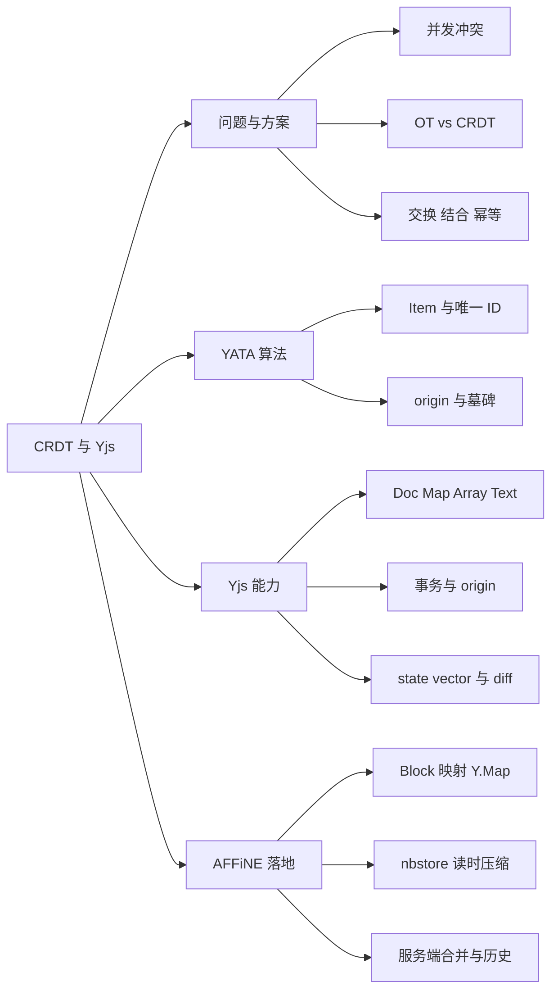
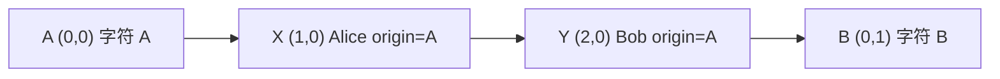
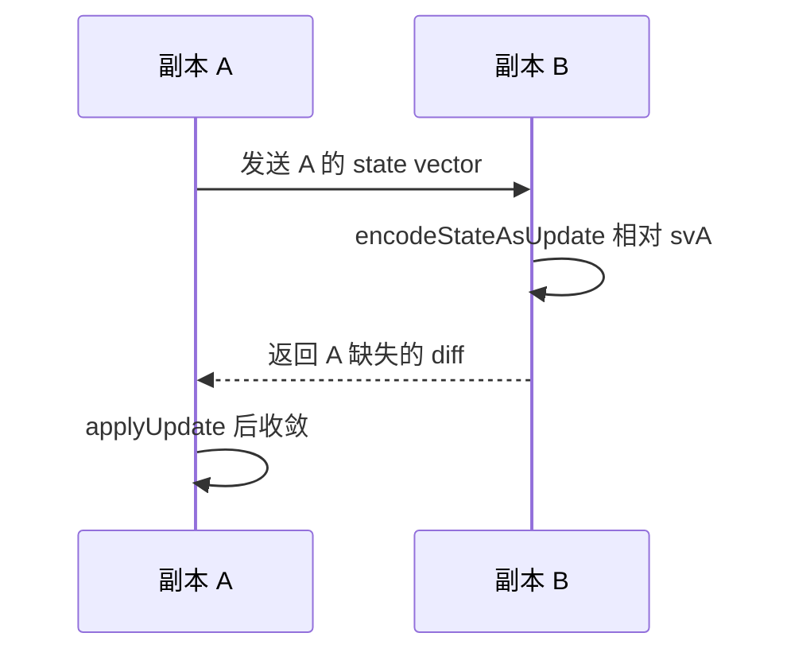
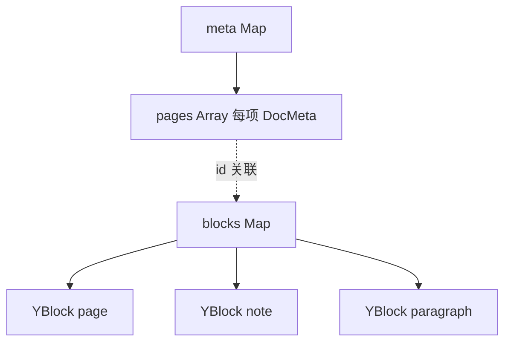
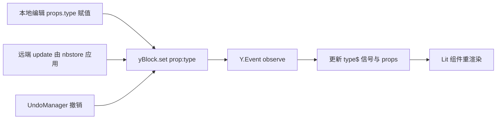
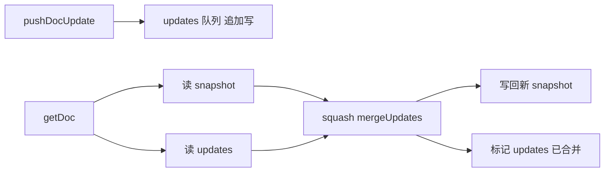

# 第 12 章 CRDT 与 Yjs 原理

> 断网也能编辑、联网自动合并——支撑 local-first 的那套"无冲突"数据

第 3 部分 · 编程语言与基础技术 ｜ 难度 ★★★★☆ ｜ 建议学时 8 小时

===

## 本章要解决的问题

<p class="lead">AFFiNE 宣称 local-first：断网能编辑，联网后与云端、其他设备自动合并，且<b>不会"你的修改覆盖了我的修改"</b>。</p>

支撑这一切的核心是 **CRDT（无冲突复制数据类型）**，实现是 JS 库 **Yjs** 与 AFFiNE 团队的 Rust 版 **y-octo**。在 AFFiNE 里，CRDT 不是同步插件，而是**唯一的数据真相源**：

<div class="cards cols-3">
  <div class="card"><div class="card__icon">📄</div><h4>每个文档</h4><p>就是一个 <code>Y.Doc</code>。</p></div>
  <div class="card"><div class="card__icon">🧱</div><h4>每个 Block</h4><p>就是一个 <code>Y.Map</code>。</p></div>
  <div class="card"><div class="card__icon">✍️</div><h4>段落文字</h4><p>就是一个 <code>Y.Text</code>。</p></div>
</div>

<div class="note note--tip">

本章两条线：**原理线**（冲突问题 → OT vs CRDT → 代数性质 → YATA → Yjs API → snapshot/GC/UndoManager/Awareness）与**落地线**（Block 映射 Y.Map → yjs 补丁 → nbstore 存取 → 服务端合并与历史）。每个原理点都配可在 Node 运行的教学小实验。

</div>

===

## 知识地图

从"问题与方案"出发，经 YATA 算法与 Yjs 能力，落到 AFFiNE 的数据模型与存储链路。



===

## 学习目标

<ol class="goals">
  <li>解释并发编辑的冲突问题，对比 OT 与 CRDT 的核心差异</li>
  <li>说明 CRDT 需满足的交换律、结合律、幂等性，并在 Yjs 实验中验证</li>
  <li>直观描述 YATA 中 Item 的 <code>id</code>、<code>origin</code>、<code>rightOrigin</code> 与冲突排序规则</li>
  <li>用 <code>encodeStateVector</code>、<code>diffUpdate</code>、<code>mergeUpdates</code> 完成双端同步</li>
  <li>画出 Block → <code>Y.Map</code> 的结构，说清 root doc 与 space doc 的关系</li>
  <li>说明 <code>origin</code> 如何决定撤销、回存与防回环，以及 uint53 补丁的作用</li>
</ol>

===

<!-- section -->
## 一、冲突问题与 CRDT 性质

先看并发下为什么会出错，再看 CRDT 用什么代数性质保证"无论如何都收敛"。

===

## 冲突是怎么产生的

Alice 和 Bob 同时打开 `"AB"`。Alice 在位置 1 插入 `X`，Bob 删除位置 1 的字符。若双方**原样**应用对方操作：

<div class="compare">
  <div class="compare__col"><h4>Alice 侧</h4>

- 本地 `insert(1,"X")` → `"AXB"`
- 收到 Bob 的 `delete(1)` → `"AB"`
- **错删了 X！**

  </div>
  <div class="compare__col"><h4>Bob 侧</h4>

- 本地 `delete(1)` → `"A"`
- 收到 Alice 的 `insert(1,"X")` → `"AX"`
- 两端结果不一致

  </div>
</div>

<div class="note note--danger">

根因：**基于"位置下标"的操作，在并发下语义会漂移**。对方先执行的插入/删除会使下标偏移。CRDT 的解法是给每个元素分配全局唯一且不变的 ID，操作引用 ID 而非下标。

</div>

===

## 两大流派：OT 与 CRDT

| 维度 | OT（操作变换） | CRDT（无冲突复制） |
| --- | --- | --- |
| 思路 | 按对方已执行操作**变换**下标 | 给元素全局唯一 ID，操作引用 ID |
| 中心服务器 | 通常需要（定序、变换） | 不需要，任意拓扑都收敛 |
| 离线编辑 | 困难 | 天然支持 |
| 元数据开销 | 小 | 较大（ID、墓碑） |
| 代表 | Google Docs | Yjs、Automerge、y-octo |

<div class="note">

AFFiNE 的 local-first 定位决定它必须选 CRDT：用户可能长时间离线、在桌面与手机间同步、在多个存储间来回，**不存在一个随时在线的权威定序者**。

</div>

===

## 三条代数性质：为什么"无冲突"

状态型 CRDT 可抽象为集合 `S` 与合并函数 `merge`。只要 `merge` 满足三条性质，就构成**半格**，所有副本收到相同更新集必收敛到相同状态（强最终一致性）：

| 性质 | 公式 | 现实含义 | AFFiNE 中的应用 |
| --- | --- | --- | --- |
| **交换律** | `merge(a,b)=merge(b,a)` | 先收到谁的都一样 | load 时内存内容与存储内容谁先谁后都行 |
| **结合律** | `merge(merge(a,b),c)=merge(a,merge(b,c))` | 怎么分组都一样 | 本地攒一批 update 合并后再推 |
| **幂等性** | `merge(a,a)=a` | 收两次也无妨 | 网络重传安全 |

<div class="note note--tip">

Yjs 的 update 恰好具备这三条：`Y.applyUpdate` 可任意顺序、任意分组、重复执行。这正是 nbstore 敢"本地攒批合并再推"、服务端敢"把一堆 update 压成快照"的理论基础。

</div>

===

<!-- section -->
## 二、YATA 与并发合并

Yjs 基于 YATA 算法。抓住 Item 的唯一 ID、左右邻居、确定性排序三点，就能理解两客户端如何无冲突合并。

===

## 两客户端并发插入：逐步合并

Alice（client 1）与 Bob（client 2）都在字符 `A` 之后插入。看 Yjs 如何用确定性规则达成一致：

<ol class="steps">
  <li><h4>每个 Item 有唯一 ID</h4><p>ID 为 <code>(clientID, clock)</code>：<code>clientID</code> 是 Doc 实例随机编号，<code>clock</code> 是自增逻辑时钟。Alice 的 <code>X</code> = <code>(1,0)</code>，Bob 的 <code>Y</code> = <code>(2,0)</code>。</p></li>
  <li><h4>记录左右邻居</h4><p>插入时 Item 记下 <code>origin</code>（左邻居 ID）与 <code>rightOrigin</code>。语义从"插在下标 1"变成"插在 ID=(0,0) 之后"——ID 永不变，语义不漂移。</p></li>
  <li><h4>并发冲突确定性排序</h4><p>两者 <code>origin</code> 相同（都在 <code>A</code> 后），YATA 比较 clientID：较小者排左。client 1 &lt; client 2，故 <code>X</code> 在 <code>Y</code> 左边。</p></li>
  <li><h4>两端都得到 AXYB</h4><p>规则本身不重要，重要的是它<b>确定性</b>——所有副本对同一组 Item 排序结果相同，自然收敛。</p></li>
</ol>



===

## 删除、墓碑与收敛验证

删除不真的移除 Item，而是标记为**墓碑（tombstone）**（别人可能还以它为 `origin` 插入），已删除 ID 以区间记在 **DeleteSet** 中随 update 传输。回到开头的例子：

<div class="split">
<div class="split__main">

Bob 删除的是 ID 为 `B(0,1)` 的 Item，Alice 插入的是 `origin=A(0,0)` 的 `X(1,0)`。两者引用的都是 ID——无论先后应用，结果都是 `"AX"`，冲突消失。

教学实验验证三性质：对 3 个 update 正序、逆序+重复应用，结果恒为 `['c','a','b']`。逆序时后面的 update 依赖前面的 Item，Yjs 先把"缺依赖"的结构暂存为 **pending**，等依赖到达再整合。

</div>
<div class="split__aside">

```js
const d1 = new Y.Doc();
updates.forEach(u => Y.applyUpdate(d1, u));
const d2 = new Y.Doc();
[...updates].reverse()
  .forEach(u => Y.applyUpdate(d2, u));
updates.forEach(u => Y.applyUpdate(d2, u));
// 正序: ['c','a','b']
// 逆序+重复: ['c','a','b']
```

</div>
</div>

<div class="note note--warn">

pending 的工程意义：nbstore 的 `doc.has_pending_updates()` 检查（`packages/frontend/native/nbstore/src/doc.rs`）——若合并后仍有 pending，说明**数据不完整**，必须报 `IncompleteDoc`，不能当快照写回。

</div>

===

## Yjs 核心 API 与两步同步

| API | 作用 |
| --- | --- |
| `encodeStateAsUpdate(doc, sv?)` | 把文档（或相对 `sv` 缺失部分）编码为二进制 |
| `encodeStateVector(doc)` | 编码状态向量 `Map<clientID, 下一个期望 clock>` |
| `diffUpdate(update, sv)` | 不建文档，剪出对方缺失部分 |
| `mergeUpdates(updates)` | 不建文档，把多个 update 合并为一个 |



<ul class="takeaways">
  <li>一次实测：3 个 update 合并后从 75 字节降到 51 字节，<b>全程不构造 Y.Doc</b>——这是存储层压缩的关键能力。</li>
  <li><code>Y.Map</code> 对同一 key 并发写，两端最终一致但只保留一人的值（由 clientID 定）；<code>Y.Text</code> 则字符级合并——这正是文本放 <code>Y.Text</code> 而非字符串属性的原因。</li>
</ul>

===

<!-- section -->
## 三、Yjs 进阶能力

UndoManager 只撤销自己的、snapshot/GC 的取舍、Awareness 临时状态、subdoc 的兴衰——这些决定了协同体验。

===

## UndoManager：只撤销"自己的"

协同场景下 Ctrl+Z 只应撤销**我**的修改。`Y.UndoManager` 用 `trackedOrigins` 实现：只有 origin 在集合中的事务才进撤销栈。

<div class="annotate">

```ts [3-4|7|10]
export class HistoryExtension extends StoreExtension {
  constructor(store: Store) {
    this._history = new Y.UndoManager([this.store.doc.yBlocks], {
      trackedOrigins: new Set([this.store.doc.spaceDoc.clientID]),
    });
  }
}
// 本地写入都用 clientID 作 origin：
spaceDoc.transact(() => fn(),
  shouldTransact ? this.spaceDoc.clientID : null);
```

<ol class="annotate__notes">
  <li><b>第 3–4 行</b>：只追踪 <code>spaceDoc.clientID</code> 这一个 origin。</li>
  <li><b>第 7 行</b>：所有本地写入用 <code>clientID</code> 作 origin，进撤销栈。</li>
  <li><b>第 10 行</b>：<code>withoutTransact</code> 把 origin 置 <code>null</code>（初始化插入的默认块不进撤销栈）；远端数据由 nbstore 以 <code>'nbstore-frontend'</code> 应用，自然不被撤销。</li>
</ol>
</div>

<div class="note">

`captureSync()` 调 `undoManager.stopCapturing()`，把默认 500ms 内合并的变更切成独立撤销项。段落拆分命令在回车前调用它，保证"回车拆分"是单独一步可撤销。

</div>

===

## snapshot 与 GC：AFFiNE 的取舍

Yjs 原生 `Y.snapshot` 能还原历史版本，**前提是关闭 GC**。但 AFFiNE 做了相反的取舍：

<div class="compare">
  <div class="compare__col"><h4>Yjs 原生 snapshot（AFFiNE 未用）</h4>

- `Y.snapshot` + `createDocFromSnapshot`
- 需 `gc: false` 否则删除内容已回收
- 代价：文档体积大

  </div>
  <div class="compare__col compare__col--good"><h4>AFFiNE 方案</h4>

- 保持默认 `gc: true`，文档更小
- 服务端"定期存整份合并后二进制"做历史
- 代价：历史版本占更多服务端存储

  </div>
</div>

<div class="note note--warn">

**术语提醒**：AFFiNE 代码中的 "snapshot" 指"**合并后的完整文档二进制**"（nbstore 的 `snapshots` 表、服务端 `Snapshot` 模型），而非 `Y.snapshot`。实测：删除 1 万字符后，`gc=true` 仅 30 字节，`gc=false` 达 10030 字节——GC 大幅缩小体积。

</div>

===

## Awareness 与 subdoc

两个"不进文档历史"的机制，一个现用一个已弃：

<div class="cards">
  <div class="card"><h4>Awareness：临时状态</h4><p>光标、选区、在线用户名需实时共享但<b>不写入文档历史</b>。y-protocols 的 <code>Awareness</code> 每客户端维护本地状态并广播，带超时自动移除。BlockSuite 用 <code>selectionV2</code> 按选区管理器 ID 存各用户选区，nbstore 用 <code>nanoid()</code> 的 <code>uniqueId</code> 作 origin 防回环。</p></div>
  <div class="card"><h4>subdoc：已弃用</h4><p>早期 root doc 的 <code>spaces</code> Map 里放每个页面的 subdoc。现在改为<b>每文档一个独立 Y.Doc</b>（guid = 文档 ID），仅为兼容旧客户端仍写占位 subdoc。放弃原因：独立 Doc 让存储/同步层只需面对"按 docId 存取二进制"一个简单模型。</p></div>
</div>

<div class="note">

`spaceDoc.clientID = this.rootDoc.clientID` 让同一用户在 root doc 与各 space doc 中用相同 clientID。代码见 `packages/frontend/core/src/modules/workspace/impls/doc.ts`。

</div>

===

<!-- section -->
## 四、AFFiNE 数据模型与存储

Block 如何映射到 Y.Map，两层文档结构，以及 nbstore 与服务端的"写时追加、读时压缩"。

===

## 两层文档与 Block 结构

workspace **root doc**（guid = workspaceId）管 `meta.pages` 等元信息；每个文档一个 **space doc**（guid = docId），其 `blocks` Map 扁平存放所有 Block。



| 键 | 类型 | 含义 |
| --- | --- | --- |
| `sys:id` | string | Block ID |
| `sys:flavour` | string | 类型，如 `affine:paragraph` |
| `sys:version` | number | Schema 版本，不匹配渲染"Version Mismatched" |
| `sys:children` | `Y.Array<string>` | 子块 ID 列表（**树形用 ID 引用，非嵌套**） |
| `prop:xxx` | `native2Y` 转换 | 业务属性 |

<div class="note note--tip">

扁平存储的好处：移动 Block 只需改两个父节点的 `sys:children`，Block 本身（及文本 CRDT 历史）原封不动；按 ID 查找 O(1)；并发移动最多出现"同一 ID 两个父节点"由上层校验，不会丢内容。

</div>

===

## 值的转换决定冲突粒度

`native2Y` 把 JS 值转成 Yjs 类型，**选哪种形态决定了协同时的冲突粒度**——这是设计自定义 Block 必须考虑的问题：

| JS 值 | 存入 Yjs | 并发语义 |
| --- | --- | --- |
| 原始值（string/number/bool） | 直接作为 Y.Map 值 | 整体覆盖（LWW 式） |
| 普通数组 | `Y.Array`（深转换） | 元素级合并 |
| 普通对象 | `Y.Map`（深转换） | 键级合并 |
| `Text` | `Y.Text`（已挂载的 `clone()`） | **字符级合并** |
| `Boxed` | 内部 `Y.Map`，原对象整存 `value` 键 | 整体覆盖（不可分对象） |

<div class="note note--warn">

`isFlatData` 的 Block（目前为表格块 `affine:table`）会把嵌套对象拆平为 `prop:a.b.c` 形式的多个键，使并发修改不同子字段时不互相覆盖——对比原始值"整块覆盖"的语义。`Text._observe` 里的 `isLocal` 判断再次以 **origin** 区分数据来源。

</div>

===

## CRDT-Native 数据流：ui = f(data)

BlockSuite 的设计哲学：直接用 CRDT 模型作唯一真相源。**无论 update 来自本地、远端还是撤销，都走同一条管道**：



<ul class="takeaways">
  <li>应用层只需订阅模型变化，无须区分数据从哪来——这就是 BlockSuite "从第一天起就是协同的"底气。</li>
  <li>加载文档 = "新建空 doc + 连接 provider，让数据流入"。服务端存的不是 JSON，而是 CRDT 二进制。</li>
</ul>

===

## yjs 的 uint53 补丁

根 `package.json` 用 `resolutions` 把 yjs 锁定在 **13.6.21** 并打补丁（尽管各包声明 `^13.6.27`）。补丁只改一行：

<div class="annotate">

```diff [2-3]
-export const generateNewClientId = random.uint32
+export const generateNewClientId = random.uint53
```

<ol class="annotate__notes">
  <li><b>为什么</b>：原版 32 位 clientID（约 43 亿取值），按生日悖论，数万客户端实例时碰撞概率不可忽略；而 <b>clientID 冲突是 CRDT 致命问题</b>——两客户端产生相同 <code>(clientID, clock)</code> 会被当成同一 Item，导致内容丢失。</li>
  <li><b>效果</b>：改为 53 位（JS 安全整数上限）后取值空间扩大约 200 万倍。教学实验打印的 <code>6043159610017570</code> 就是补丁生效的证据。</li>
</ol>
</div>

<div class="note">

Rust 侧 y-octo 必须能处理 >32 位 clientID，后端 crate 启用 `y-octo = { features = ["large_refs"] }`。Yjs 与 y-octo 必须在 clientID 编码上一致，否则 `validate_doc_update` 会把合法 update 判为非法。

</div>

===

## nbstore：两方向一个暗号

`DocFrontend` 用 `NBSTORE_ORIGIN = 'nbstore-frontend'` 这个暗号区分数据方向，避免同步回环：

<div class="annotate">

```ts [3|8-9]
applyUpdate(docId, update) {
  // 存储 → 文档：用 NBSTORE_ORIGIN 作 origin
  applyUpdate(doc, update, NBSTORE_ORIGIN);
}
private readonly handleDocUpdate = (update, origin, doc) => {
  // 文档 → 存储：若 origin 是自己写进去的就忽略
  if (origin === NBSTORE_ORIGIN) return;
  this.schedule({ type: 'save', docId: doc.guid, update });
};
```

<ol class="annotate__notes">
  <li><b>第 3 行</b>：从存储读出的数据用专属 origin 应用。</li>
  <li><b>第 8–9 行</b>：监听到的 update 若 origin 是 <code>NBSTORE_ORIGIN</code> 就忽略，否则会把刚读出的数据又写回，形成回环。其他 update 才调度 save。</li>
</ol>
</div>

<div class="note note--tip">

save 作业把排队的多个 update 先 `mergeUpdates` **合并成一个**再写入——结合律的工程应用，大幅减少写入次数。debug 构建还会检测"应用远端 update 时触发了本地修改"的编码错误（否则"最后编辑者"会被错记）。

</div>

===

## 读时压缩：写时追加、读时合并

存储层设计意图（注释原话）："不立即把 updates 合进 snapshot 能省大量写入时间；读取最新文档时才合并"。即**写时追加、读时压缩**：



<ul class="takeaways">
  <li>前端 nbstore 与服务端 <code>DocStorageAdapter</code> 结构高度相似，都是读时压缩。</li>
  <li>同步 = state vector + diff：<code>getDocDiff</code> 接收对方 state vector，返回缺失的 <code>missing</code> 与自己的 <code>state</code>，<b>全程只操作二进制</b>。</li>
  <li>state vector 只记插入 clock、不记删除，所以 state vector 相等时仍要比较 DeleteSet 差异。</li>
</ul>

===

## 服务端合并与历史、回滚

服务端读时压缩的三步在一个数据库事务中完成：写新快照 → **把旧快照存为一条历史** → 删除已合并 updates。合并引擎用"影子运行"灰度 y-octo：

<div class="split">
<div class="split__main">

**三种合并方式**：
- `mergeUpdatesWithYjs`：二进制层面拼接，快但不做 GC；
- `applyUpdatesWithYjs`：新建 Doc 逐个 apply 再 encode，GC 生效、体积小但慢；
- `applyUpdatesWithNative`：Rust y-octo 的 apply 方式，更快更省内存。

**影子运行**：默认用 Yjs apply；开 `doc.experimental.yocto` 后同时用 y-octo 再合并一遍，`compareCodecResult` 比对不一致就打指标；仅 canary 真正采用 y-octo 结果。

</div>
<div class="split__aside">

```ts
// 回滚不是"时光倒流"
async rollbackDoc(spaceId, docId,
  timestamp, editorId) {
  const to = await getDocHistory(
    spaceId, docId, timestamp);
  const from = await getDocSnapshot(
    spaceId, docId);
  const change =
    generateChangeUpdate(from.bin, to.bin);
  await pushDocUpdates(
    spaceId, docId, [change], editorId);
}
```

</div>
</div>

<div class="note note--danger">

**CRDT 世界没有时光倒流**：已同步出去的操作无法撤回。所谓回滚，是算出一个"让当前内容变回旧版样子的新 update"，再像普通编辑一样推送给所有客户端；同时强制存一条历史，保证"回滚本身也能被回滚"。

</div>

===

## 动手实践

<ol class="steps">
  <li><h4>复现并发冲突与收敛</h4><p>运行离线并发实验；改为三副本 A、B、C 各自离线插入，按 A→B→C→A 环形只交换一轮 diff，观察是否收敛，再补一轮。<b>验收</b>：解释为何只交换一轮不一定收敛、拿到全部 update 后一定收敛。</p></li>
  <li><h4>模拟 AFFiNE 文档结构</h4><p>建 rootDoc（<code>meta.pages</code> 放一条）与 spaceDoc（<code>blocks</code> 按 <code>crud.ts</code> 格式加 page→note→paragraph），打印 <code>yBlocks.toJSON()</code>。<b>验收</b>：每块有 <code>sys:*</code>，段落有 <code>prop:text</code>，能指出树结构靠 <code>sys:children</code> 表达。</p></li>
  <li><h4>验证 origin 的三种用途</h4><p>分别用 origin = <code>clientID</code>、<code>null</code>、<code>'nbstore-frontend'</code> 写入，连续 undo 观察；再模拟 <code>handleDocUpdate</code> 的过滤。<b>验收</b>：做出"能否撤销 / 是否回存"的对照表。</p></li>
  <li><h4>比较三种合并方式</h4><p>逐字插入 2000 字符再删 1900（每次一个 update），用 <code>mergeUpdates</code> 与"apply 后 encode"两种方式合并，比体积与耗时。<b>验收</b>：观察到 apply 方式显著更小（GC 生效），能说明各自适用场景。</p></li>
</ol>

===

## 自测：点击揭晓答案

<details class="quiz">
<summary>Q1. 为什么基于下标的操作在并发下会出错？CRDT 如何解决？</summary>

下标含义依赖执行前的文档状态，对方先执行的插入/删除会使下标偏移，语义漂移。CRDT 为每个元素分配全局唯一且不变的 ID（`(clientID, clock)`），操作引用 ID（如"插在某 ID 之后"）而非下标，无论执行顺序语义都不变。

</details>

<details class="quiz">
<summary>Q2. 同时改同一 Block 的 prop:type 会怎样？prop:text 呢？</summary>

`prop:type` 是 Y.Map 原始值，并发写同 key 最终两端一致但只保留一人的值（clientID 等确定性规则定）。`prop:text` 是 `Y.Text`，并发输入字符级合并，两人输入都保留。

</details>

<details class="quiz">
<summary>Q3. nbstore 如何避免"读出的数据又被写回"？</summary>

应用存储数据时用 `applyUpdate(doc, update, NBSTORE_ORIGIN)`；`handleDocUpdate` 监听时若 `origin === NBSTORE_ORIGIN` 直接返回，不调度 save，从而打破回环。

</details>

<details class="quiz">
<summary>Q4. AFFiNE 对 yjs 打了什么补丁？实际装的是哪个版本？</summary>

把 `generateNewClientId` 从 `random.uint32` 改为 `random.uint53`，clientID 空间从 32 位扩到 53 位以降低碰撞。resolutions 把 yjs 固定为 `patch:yjs@npm%3A13.6.21#...`，实际安装 13.6.21（尽管各包声明 `^13.6.27`）。

</details>

===

## 小结与下一步

<ul class="takeaways">
  <li>并发难题是**下标语义漂移**；CRDT 用"唯一 ID + 确定性排序"代替下标，天然支持离线与任意拓扑。</li>
  <li>Yjs update 满足交换/结合/幂等三律，让"批量合并再写""读时压缩""重复推送"都安全。</li>
  <li>YATA：Item 带 <code>(clientID, clock)</code> 与 <code>origin</code>，并发插入按 clientID 确定性排序；删除留墓碑，GC 回收。</li>
  <li><b>origin 是区分数据来源的暗号</b>：<code>clientID</code>（本地、进撤销栈）、<code>'nbstore-frontend'</code>（来自存储、不回写）、peer 的 <code>uniqueId</code>（防回环）。</li>
  <li>数据模型：root doc + 每文档一个 space doc；Block 扁平存储，树形关系用 <code>sys:children</code> 表达。</li>
</ul>

<div class="note note--tip">

**下一章预告**：第 13 章进入 `Monorepo 结构与包依赖地图`——122 个 workspace 包 + 7 个 Cargo 成员，如何靠 Yarn 4、`workspace:*` 源码直连与一条五层单向依赖链组织起来。

</div>
