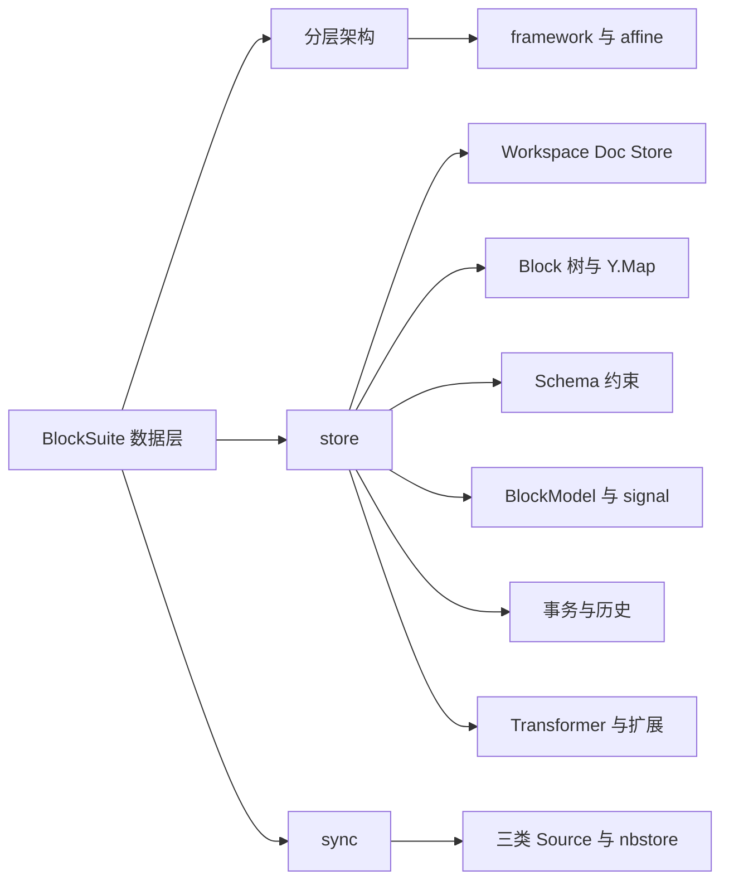
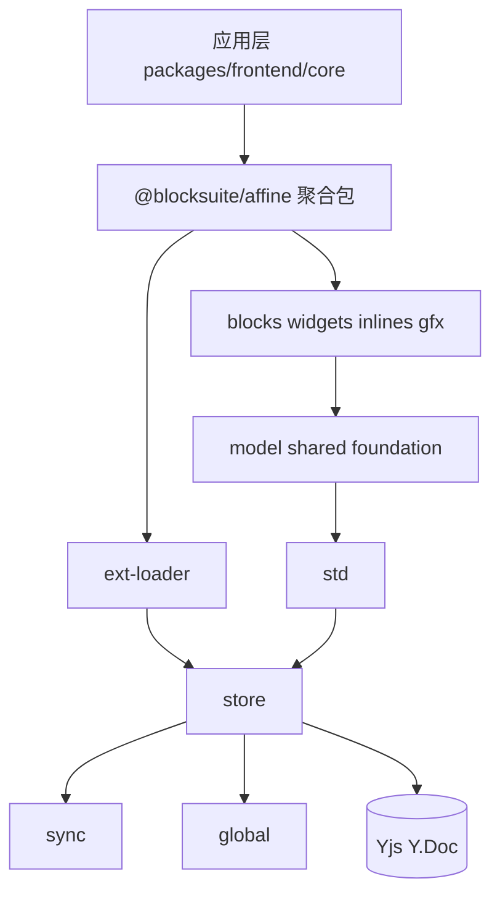
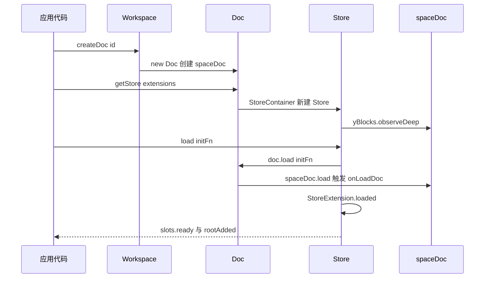
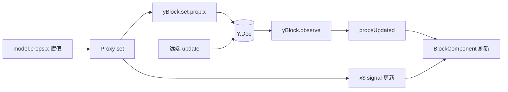
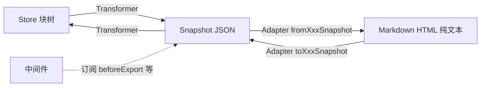
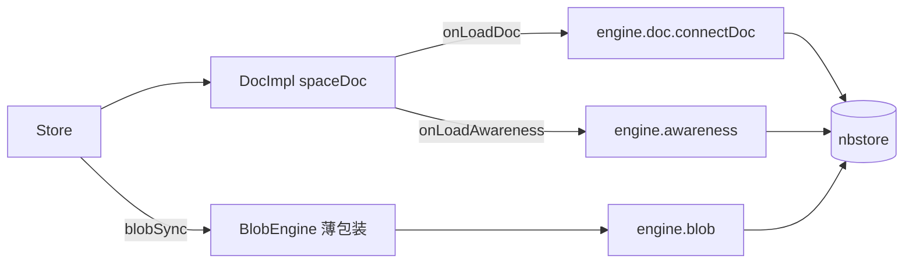

# 第 12 章 BlockSuite 架构与 Store 数据层

自底向上：先看清分层，再吃透存在 Yjs 里的 Block 树

第 5 部分 · 编辑器内核 BlockSuite ｜ 难度 ★★★★☆ ｜ 建议学时 10 小时

Note:
从这一章开始，我们进入 AFFiNE 的发动机——BlockSuite 编辑器内核。
本章聚焦数据层 @blocksuite/store，下一章再看 std 如何把数据变成可交互的 DOM。

---

## 本章导读

- BlockSuite 是**构建编辑器的框架**，不是"一个编辑器"
- 文档页、白板、数据库视图、富文本……编辑能力都来自 `blocksuite/`
- 应用层 `packages/frontend/core` 只负责把它装进 React 车壳
- 正确顺序：**分层 → `@blocksuite/store` → `@blocksuite/std`**
- 所有块最终都是一棵存在 Yjs 里的 **Block 树**，视图只是投影

<div class="callout warn">

`blocksuite/docs-site/guide` 多处落后于源码，务必养成"以源码为准"的习惯。

</div>

Note:
学 BlockSuite 最容易犯的错误，是一上来就钻进某个块的 Lit 渲染代码，被扩展注册、DI、Signal、Yjs 事件绕晕。
正确的姿势是自底向上：先搞清楚哪些包是框架、哪些是预置块，再吃透数据层。
另外官方文档有大量过时 API，比如 DocCollection、Job，本章会逐一指出。

---

## 学习目标

1. 画出 framework / affine 两层架构，说清 `global`、`store`、`sync`、`std` 边界
2. 说清 `Workspace`、`Doc`、`Store` 的关系及 AFFiNE 中的实现类
3. 描述 `sys:*` / `prop:*` 存储布局，跟踪 `store.addBlock()`
4. 用 `defineBlockSchema` 正确设置 `role`、`parent`、`children`、`version`
5. 区分 `model.props.x` 与 `model.props.x$`，用 `transact` 等控制撤销栈
6. 使用 `Transformer` 完成 Doc ↔ Snapshot 转换并编写中间件

Note:
六个目标，覆盖分层、三层容器、存储布局、Schema、响应式与事务、导入导出管线。
这一章难度四颗星，内容比较密，建议边听边对照源码。

---

## 知识地图



Note:
整章分三块：分层架构、store 数据层、sync 同步层。
store 是重头戏，依次是三层容器、Block 树存储、Schema、BlockModel 响应式、事务历史，最后是 Transformer 与扩展体系。
sync 部分我们重点讲它和 AFFiNE 的 nbstore 是什么关系。

---

## 分层架构：依赖只能自上而下



<p class="small">`store` 不依赖 `std`；`std` 不依赖任何 `affine-*`；应用层只从 `@blocksuite/affine` 导入。</p>

Note:
BlockSuite 分为框架层 framework 和预置层 affine。框架层关心块树如何存储、协同、渲染，事件选择命令如何流转，不关心段落白板这些业务。
预置层是 AFFiNE 用到的块、小部件、行内元素和白板元素，不关心 React、路由、账号。
最上面的应用层负责把编辑器嵌入 React 页面，注入主题、AI 等服务。依赖方向严格自上而下。
框架层四个包：global 是 DI、Disposable、几何等地基；store 是数据层；sync 是同步抽象；std 是视图与交互，下一章的主角。global 的根入口只有 export {}，必须用 @blocksuite/global/di 这样的子路径导入。

---

## 聚合包与 store / view 子路径

```text
"./store"                -> 重导出 @blocksuite/store
"./std" "./std/gfx"      -> 重导出 @blocksuite/std
"./blocks/divider"       -> 公共 API
"./blocks/divider/store" -> 无 DOM 的数据扩展
"./blocks/divider/view"  -> 视图扩展
"./extensions/store"     -> getInternalStoreExtensions()
"./schemas"              -> AffineSchemas 数组
```

- `blocksuite/affine/all/package.json` 的 `exports` 有 207 个条目
- `store` / `view` 分离：服务端导出 Markdown 无需加载任何 Lit 组件

Note:
应用层几乎只从 @blocksuite/affine 的各个子路径导入，这个聚合包的 exports 多达 207 项，但模式非常规整。
每个块包都按点、store、view 三段式导出。store 子路径只含 Schema、Adapter 这类能在无 DOM 环境跑的东西。
这样服务端做 Markdown 导出时，就不会意外加载 Lit 组件。

---

## global：两把钥匙

<div class="cols">
<div>

**DI 容器**

- `createIdentifier<T>(name)`：可调用的标识符
- `Id('variant')` 创建同名**变体**
- `BlockSchemaIdentifier('affine:paragraph')`
- `provider.getAll(Id)` 取全部变体
- 支持父 provider 链

</div>
<div>

**SignalWatcher**

- 在 `performUpdate` 中用 `effect` 包裹渲染
- **自动收集读取过的 signal**
- 变化时 `requestUpdate()`
- `EditorHost`、`BlockComponent` 都用它

</div>
</div>

Note:
global 里的东西与编辑器概念无关，却被上层到处使用，其中最关键的是 DI 容器和 SignalWatcher。
DI 的标识符本身是个函数，以 flavour 作为变体参数调用，就能为每种块注册一份实现，getAll 一次取出全部。
父 provider 链让 Store 与 Std 两级容器串起来。SignalWatcher 则是响应式渲染的基础。
另外记住强约定：所有监听都要放进 DisposableGroup 统一释放。

---

## Workspace / Doc / Store

| 概念 | 粒度 | Yjs 对象 | 职责 |
| --- | --- | --- | --- |
| `Workspace` 接口 | 工作区 | 根 `Y.Doc` | 管理多个 Doc、meta、Blob 引擎 |
| `Doc` 接口 | 一篇文档 | `spaceDoc`、`yBlocks` | 加载 Y.Doc、Awareness、建 Store |
| `Store` 类 | 数据切片 | 读写 `yBlocks` | CRUD、Schema、事务、扩展 DI |

| 场景 | Workspace | Doc |
| --- | --- | --- |
| 测试与 playground | `TestWorkspace` | `TestDoc` |
| AFFiNE 应用 | `WorkspaceImpl` | `DocImpl` |

Note:
新版 store 里，Workspace 和 Doc 只是接口，Store 才是具体类，这和旧文档的 DocCollection、doc.addBlock 大不相同。
接口由宿主实现：测试用 TestWorkspace，AFFiNE 用 packages/frontend/core 里的 WorkspaceImpl 和 DocImpl。
一句话：宿主决定 Y.Doc 从哪来、怎么同步；Store 决定如何在 Y.Doc 上安全读写块。

---

## 一个 Doc，多个 Store

```ts
if (readonly || query) {
  idOrOptions = { readonly, query };
} else if (!id) {
  idOrOptions = this.doc.workspace.idGenerator();
} else {
  idOrOptions = id;
}
const key = this._getQueryKey(idOrOptions);
if (this._storeMap.has(key)) return this._storeMap.get(key) as Store;
```

<p class="small">来源：`blocksuite/framework/store/src/model/store-container.ts`（节选）</p>

<div class="callout warn">

AFFiNE `DocImpl.getStore()` 不传 `id` 每次都新建；`TestDoc` 默认用 `spaceDoc.guid`，返回同一个。

</div>

Note:
一个 Doc 可以有多个 Store：主编辑器的可编辑 Store、引用预览的只读 Store、带 query 过滤的 Store。
StoreContainer 按 id 或 readonly、query 组合缓存。关键陷阱是：不传 id 时会生成新 id。
AFFiNE 的 DocImpl 原样透传，所以不传参每次新建；而 TestDoc 默认用 guid。两种实现行为不同，复用一定要传 id。
另外 DocImpl.getStore 会自动注入 getStoreManager 汇总的全部 Store 扩展。

---

## Store 生命周期



<p class="small">AFFiNE 在 `onLoadDoc` 中 `connectDoc` 到 nbstore；`dispose()` 反向调用 `ext.disposed()`。</p>

Note:
看一下完整生命周期：创建 Doc，获取 Store，Store 构造时建 DI 容器、注册 Schema，并对 yBlocks 做 observeDeep。
调用 load 后，Doc 加载 spaceDoc 并触发 onLoadDoc 钩子，AFFiNE 就是在这里把文档接入 nbstore。
随后依次调用每个 StoreExtension 的 loaded，最后发出 ready 和 rootAdded。视图对数据变化的感知几乎都来自 blockUpdated 和 propsUpdated。

---

## 初始化文档的标准姿势

```ts
const doc = collection.getDoc(id) ?? collection.createDoc(id);
const store = doc.getStore();
doc.clear();
doc.load(() => {
  const rootId = store.addBlock('affine:page', { title: new Text() });
  store.addBlock('affine:surface', {}, rootId);
  const noteId = store.addBlock('affine:note', {}, rootId);
  store.addBlock('affine:paragraph', {}, noteId);
});
store.resetHistory();
```

<p class="small">来源：`blocksuite/playground/apps/starter/data/empty.ts`（节选）</p>

<div class="callout">

最小合法结构：`affine:page` → `affine:surface` + `affine:note` → `affine:paragraph`。

</div>

Note:
这是 AFFiNE 文档的最小合法结构：page 是根，下面挂 surface 画布和 note 文档流容器，note 里放段落。
注意 EditorHost 挂载时如果 store.root 为空，会直接抛 NoRootModelError，所以挂编辑器之前必须先初始化根块。
最后 resetHistory，避免用户一上来就能撤销掉初始化内容。

---

## Block 树：扁平存储 + id 引用

```text
yBlocks (Y.Map)
└── "block-abc" (YBlock)
    ├── sys:id        = "block-abc"
    ├── sys:flavour   = "affine:paragraph"
    ├── sys:version   = 1
    ├── sys:children  = Y.Array ["block-def"]
    ├── prop:type     = "text"
    ├── prop:text     = Y.Text("Hello")
    └── prop:collapsed= false
```

- 移动块只改两个 `Y.Array`；按 id 查找 O(1)；冲突粒度更细

Note:
BlockSuite 不嵌套存储块树。yBlocks 是一个以 block id 为键的 Y.Map，每个值又是一个 Y.Map。
系统字段用 sys 前缀，业务属性用 prop 前缀，父子关系由父块的 sys:children 数组引用子块 id 表达。
这种扁平设计让移动块只需改两个数组，查找是常数时间，协同冲突也更细粒度。

---

## 跟踪 store.addBlock()

```ts [1|3-7|9-13]
this._schema.validate(flavour, parentFlavour as string);

const yBlock = new Y.Map() as YBlock;
this._yBlocks.set(id, yBlock);
yBlock.set('sys:id', id);
yBlock.set('sys:flavour', flavour);
yBlock.set('sys:children', Y.Array.from(children ?? []));

const defaultProps = schema.model.props?.(internalPrimitives) ?? {};
const props = { ...defaultProps, ...initialProps };
Object.entries(props).forEach(([key, value]) => {
  if (value === undefined) return;
  yBlock.set(`prop:${key}`, native2Y(value));
});
```

<p class="small">来源：`blocksuite/framework/store/src/model/store/crud.ts`（节选）。`Store.addBlock` 先查只读、生成 id、包 `transact` 再委托 `DocCRUD`。</p>

Note:
Store.addBlock 只做只读检查、生成 id、包事务，然后委托给 DocCRUD。
DocCRUD 第一步做 Schema 嵌套校验，然后新建 Y.Map 写入 sys 字段，最后合并默认 props 写入 prop 字段，undefined 的属性不写。
几个易忽视的语义：不传 parent 默认挂到 root；校验失败会被 transact 的 try/catch 吞掉，只打印错误，addBlock 照常返回 id。
还有一点很重要：Block 对象不是 addBlock 创建的，而是由 Yjs 的 observeDeep 事件触发 _onBlockAdded 创建的，远端新增的块走完全相同的路径。

---

## Schema：defineBlockSchema

```ts
export const NoteBlockSchema = defineBlockSchema({
  flavour: 'affine:note',
  props: (): NoteProps => ({ /* xywh 等默认值 */ }),
  metadata: {
    version: 1,
    role: 'hub',
    parent: ['@root'],
    children: ['@content', 'affine:database', 'affine:data-view',
      'affine:callout'],
  },
  toModel: () => new NoteBlockModel(),
});
```

<p class="small">来源：`blocksuite/affine/model/src/blocks/note/note-model.ts`（节选）。`@` 前缀表示按 role 匹配。</p>

Note:
Schema 由 flavour、默认 props 工厂函数、metadata 和 toModel 组成。props 必须是函数，内部可以用 internal.Text 创建富文本。
重点看 Note 的约束：parent 是 @root，children 里有 @content。@ 前缀表示按 role 匹配。
所以任何 role 为 content 的新块，无需修改 Note 的 Schema 就能放进 Note。
Schema 通过 BlockSchemaExtension 注册到 DI，每个 Store 都有自己的 Schema 实例。

---

## 校验、role 与 version

<div class="cols">
<div>

**校验算法**

- 取 `child.parent ?? ['*']` 与 `parent.children ?? ['*']`
- 两两组合，**任一组满足即合法**
- `@xxx` 对比 role；普通字符串用 `minimatch` glob
- 如 `'affine:embed-*'`

</div>
<div>

**易误解的语义**

- 源码只特殊处理 `role: 'root'`
- 可自定义 role，如 `'attachment-viewer'`
- `version` **只校验，不迁移**
- 不匹配渲染 "Block Version Mismatched"

</div>
</div>

Note:
Schema.validate 的规则是：root 不能有父，非 root 必须有父，然后把子块允许的父和父块允许的子两两组合，任一组匹配就合法。
官方文档说 role 只有三种还有隐式规则，源码里其实没有，只有 root 被特殊处理，其他 role 只在 @role 匹配时生效。
version 更要小心：源码里没有任何迁移实现，改版本号是破坏性操作，老数据会直接显示版本不匹配。AFFiNE 的实践是兼容式演进，新增可选属性。

---

## BlockModel：props 的双形态

| 写法 | 类型 | 用途 |
| --- | --- | --- |
| `model.props.type` | 值 | 读取 / 赋值写入 Yjs |
| `model.props.type$` | `Signal` | 在渲染、`computed`、`effect` 中可被追踪 |



Note:
SyncController 为每个 prop 同时生成值和带美元符号的 signal 两种形态。普通写法用来读写，美元版本用于响应式追踪，computed 里必须读它。
写路径：赋值被 Proxy 拦截，写入 yBlock 的 prop 字段，同时更新 signal，有个 _mutex 防止循环写回。
读路径：远端更新进入 Y.Doc，observe 回调更新 props 和 signal，并发出 propsUpdated。
BlockComponent 既订阅 propsUpdated 又是 SignalWatcher，两条路径保证视图刷新。注意只有 Schema 声明过的 key 才会写入 Yjs。

---

## 复杂属性与 stash

| 类型 | 存储 | 说明 |
| --- | --- | --- |
| 数组 / 纯对象 | `Y.Array` / `Y.Map` | 深代理，子字段修改也同步 |
| `Text` | `Y.Text` | 富文本核心，Inline 编辑器绑定 `text.yText` |
| `Boxed<T>` | `Y.Map` 的 `value` 键 | 不深转换，如 Surface 的 `elements` |
| Flat Data | 点路径扁平键 | 仅 `affine:table`，如 `prop:cells.row1:col1.text` |

<p class="small">`model.stash('xywh')` 让属性只改本地，`model.pop('xywh')` 一次性写回——白板拖拽避免每帧写 Yjs。</p>

Note:
复杂属性有几种存储方式。数组和对象会被包成响应式代理，改子字段也能同步到 Yjs。
Text 对应 Y.Text，是富文本核心。Boxed 适合不希望被深转换的数据。
isFlatData 目前只有表格块在用，把嵌套对象展开成点路径扁平键，适合大量小对象的结构。
stash 和 pop 是白板拖拽的性能利器，拖拽过程中不写 Yjs，松手后一次写回。

---

## 事务与历史：origin 决定能否撤销

```ts
transact(fn: () => void, shouldTransact: boolean = this._shouldTransact) {
  const spaceDoc = this._doc.spaceDoc;
  spaceDoc.transact(
    () => { try { fn(); } catch (e) { /* console.error */ } },
    shouldTransact ? this.spaceDoc.clientID : null
  );
}
```

| 写入方式 | origin | 可撤销 |
| --- | --- | --- |
| `transact` / `addBlock` / `updateBlock` | `clientID` | 是 |
| `withoutTransact(...)` 中 / 事务外直接赋值 | `null` | 否 |
| 远端协作者更新 | 对方 origin | 否 |

Note:
HistoryExtension 用 Y.UndoManager 追踪 yBlocks，trackedOrigins 只包含本地 clientID。
所以经过 transact 的写入可撤销，withoutTransact 里的写入和事务外直接赋值 origin 为 null，不可撤销，适合初始化和 AI 流式写入的中间态。
UndoManager 默认把 500 毫秒内的变更合并，store.captureSync 可以强制切分，比如拆分段落前就会调用它。
撤销时光标能回到原处，是 StoreSelectionExtension 在 store 层保存和恢复选择实现的。

---

## Transformer：快照、中间件与 Adapter



- 快照是**嵌套树**：`BlockSnapshot` / `SliceSnapshot` / `DocSnapshot`
- 块级差异交给 Schema 的 `transformer`，如 `ImageBlockTransformer` 搬运资源
- 获取方式：`store.getTransformer(middlewares)`；`docToSnapshot` 为**同步**

Note:
Yjs 二进制适合同步，却不适合复制粘贴、导入导出和测试断言，所以 BlockSuite 定义了 JSON 快照，与扁平存储相反，快照是嵌套树。
Transformer 负责块树和快照互转，每个块由 Schema 的 transformer 做单节点转换，比如图片块会把 sourceId 记进 AssetsManager。
中间件订阅 beforeImport、afterExport 等钩子处理横切逻辑，Adapter 再在快照之上对接 Markdown、HTML 等外部格式。
最简单的中间件是 shared/src/adapters/middlewares/title.ts 里的 titleMiddleware：在 beforeExport 时把文档标题写进 adapterConfigs，并返回取消订阅的清理函数。
文档里的 Job 已更名为 Transformer。

---

## Store 扩展与 nbstore



- `StoreExtension`：带 `loaded()` / `disposed()`，**必须能在非 DOM 环境运行**
- `StoreExtensionProvider` 按块打包，如 `DividerStoreExtension`
- `@blocksuite/sync` 是参考实现，AFFiNE 中仅用 `BlobEngine`

Note:
Store 层所有可插拔能力都是 ExtensionType，即带 setup(di) 的对象。StoreExtension 子类有生命周期，内置的 HistoryExtension 和 StoreSelectionExtension 最先注册。
预置层用 StoreExtensionProvider 按块打包，由 Manager 汇总成扩展列表。
同步方面，sync 包是 BlockSuite 独立使用时的参考实现，playground 用它做多标签页协同。
AFFiNE 里只用了 BlobEngine，文档和 Awareness 通过 onLoadDoc 等钩子完全交给 nbstore，这正是 Workspace 和 Doc 设计成接口的原因。

---

## 源码导读 Top 5

| 优先级 | 路径 | 看什么 |
| --- | --- | --- |
| P0 | `framework/store/src/model/store/store.ts` | 构造、CRUD、transact、load、slots |
| P0 | `framework/store/src/model/store/crud.ts` | `addBlock` 写 Yjs 全过程 |
| P0 | `framework/store/src/model/block/sync-controller.ts` | Proxy、signal、Yjs 观察 |
| P0 | `framework/store/src/schema/schema.ts` | `validate`、`_matchFlavourOrRole` |
| P1 | `packages/frontend/core/src/modules/workspace/impls/doc.ts` | DocImpl 与 getStore 注入 |

<p class="small">前四项路径均位于 `blocksuite/` 下。</p>

Note:
前四个 P0 文件构成了 store 的骨架：Store 本体、CRUD、双向绑定和 Schema 校验。
第五个是 AFFiNE 自己的 DocImpl，能看到 spaceDoc 怎么创建、扩展怎么注入。
建议再配合 store 包的 __tests__ 目录，那些单测就是可运行的文档。

---

## 动手实践

| 练习 | 验收标准 |
| --- | --- |
| 1 画包依赖链 | 无 `framework/*` 指向 `affine/*` 的箭头 |
| 2 单测观察存储布局 | 输出含 `sys:flavour`、`prop:title`，effect 触发 |
| 3 验证撤销单元切分 | 第一次 undo 只撤最后一块 |
| 4 playground 玩 Transformer | 中间件统计块数与 `store.blockSize` 一致 |

Note:
练习 1 看 callout、model、std 的依赖，画出依赖链。
练习 2 仿照 block.unit.spec.ts 写临时测试，打印 yBlocks，并故意把 parent 改错，观察 addBlock 只打印错误而不抛出。
练习 3 结合 captureSync 和 withoutTransact 验证撤销。练习 4 在 playground 控制台用 window 上的 job 导出快照。

---

## 自测

1. 不传参连续两次 `doc.getStore()`，AFFiNE 与 `TestWorkspace` 结果相同吗？
2. `children: ['@content', 'affine:embed-*']` 两项匹配方式有何不同？
3. 为什么事务外直接 `model.props.x = v` 无法撤销？

<div class="fragment">

**答案**：① 不同，`DocImpl` 每次新建，`TestDoc` 默认 `spaceDoc.guid` 返回同一个；② `@content` 按 role，后者用 `minimatch` glob；③ origin 为 `null`，不在 `trackedOrigins` 中

</div>

Note:
三道题都对应本章的关键陷阱，先自己想一想。
第一题考察 StoreContainer 的缓存键；第二题考察 Schema 校验；第三题考察 UndoManager 的 trackedOrigins。
如果答不上来，建议回看对应的幻灯片和源码。

---

## 常见坑

- `Schema not found`：Store 扩展缺少该块的 `BlockSchemaExtension`
- `addBlock` 返回了 id 但 `getBlock(id)` 为空：异常被 `transact` 吞掉
- `NoRootModelError`：先 `doc.load(() => 初始化)` 再挂编辑器
- 改了属性视图不刷新：字段不在 Schema props（不在 `model.keys`）
- 撤销把多步一起撤：在分界处 `store.captureSync()`
- `getBlockById is not a function` / `Job` 未导出：照抄了过时文档

Note:
这些错误在开发自定义块时非常常见。
第二条最隐蔽：Schema 校验失败只在控制台打印，建议事先用 store.schema.safeValidate 判断。
最后一条提醒：官方文档里的 getBlockById 已移除，用 store.getBlock(id)?.model；Job 已改名为 Transformer。

---

## 小结与下一步

- 框架层 + 预置层，以 `@blocksuite/affine` 聚合
- `Workspace` / `Doc` 由宿主实现，`Store` 是聚合根
- Block 树扁平存于 Yjs：写走 `Store → DocCRUD → Yjs`，读来自 Yjs 事件
- `SyncController` 实现 `model.props` ↔ `Y.Map` 双向绑定；origin 决定可否撤销
- `ExtensionType` 是统一插件模型，AFFiNE 同步由 nbstore 接管

<div class="callout">

**下一章**：第 13 章 BlockSuite Std——视图、扩展、命令与事件。

</div>

Note:
核心哲学是 CRDT 原生数据流：状态更新先写 CRDT，再由 CRDT 事件驱动模型和视图，本地编辑和远端协同走同一条通路。
有了数据层的基础，下一章我们看 std 如何把这棵 Block 树渲染成可交互的编辑器，以及按键如何一路变成数据修改。
