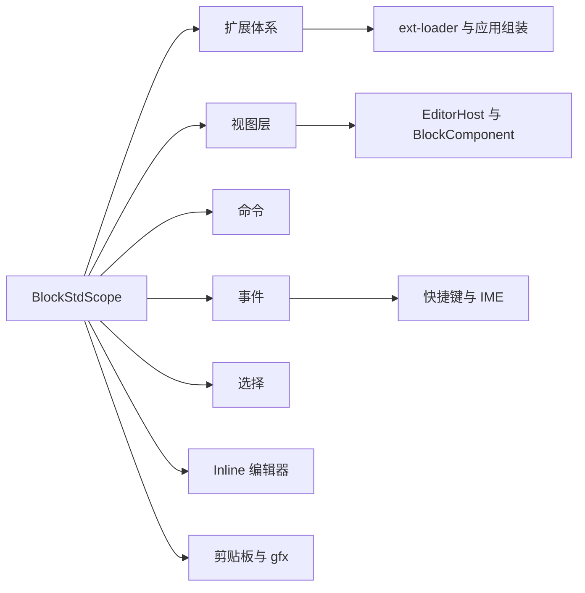
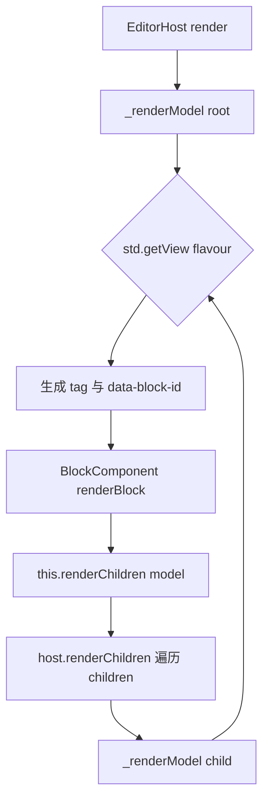
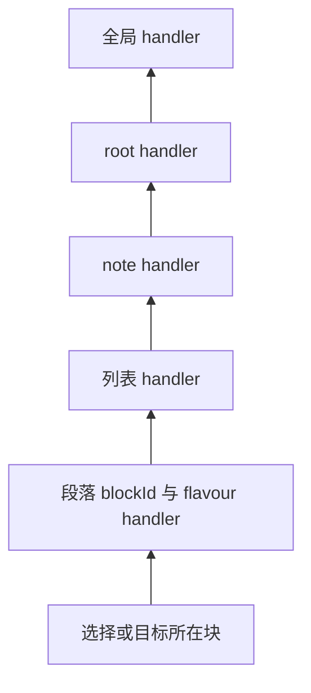
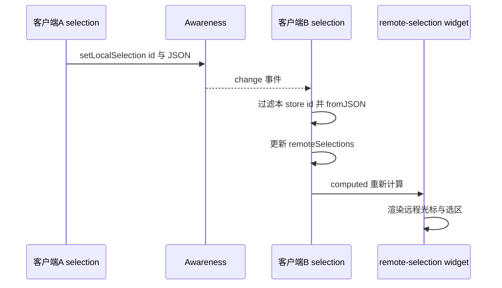
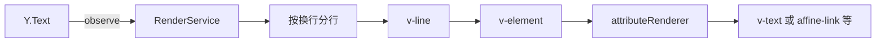
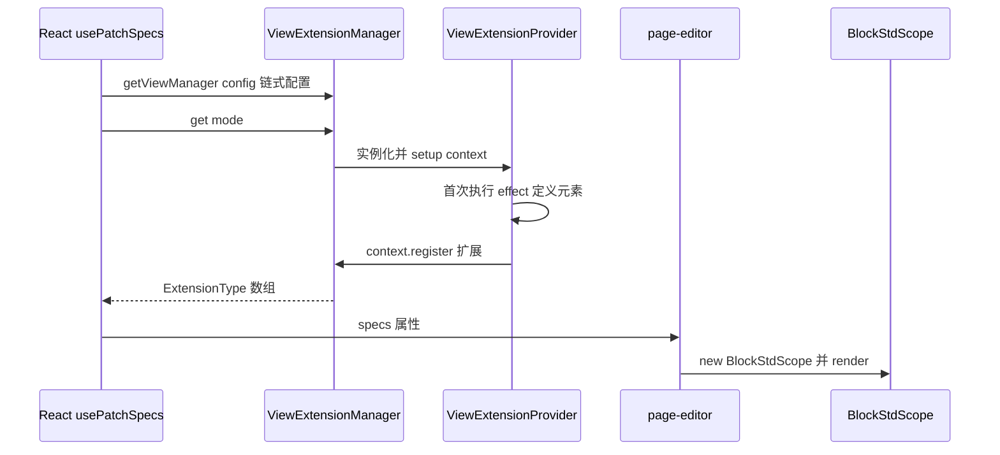
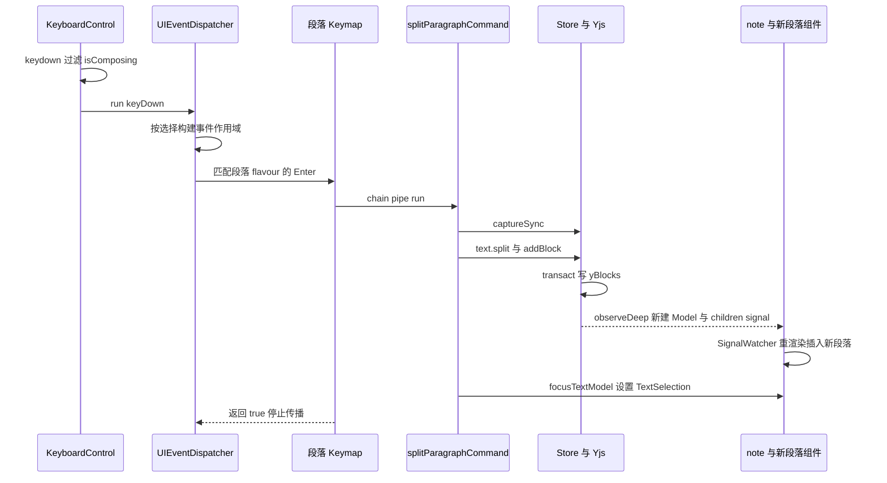

# 第 13 章 BlockSuite Std：视图、扩展、命令、事件

把 Store 里的 Block 树变成可编辑的界面

第 5 部分 · 编辑器内核 BlockSuite ｜ 难度 ★★★★☆ ｜ 建议学时 12 小时

Note:
上一章我们看到文档是一棵存在 Yjs 中的 Block 树，但 Store 不认识 DOM。
这一章的主角 @blocksuite/std，负责把数据变成可编辑的界面：渲染、事件、命令、选择、富文本输入，全在这里。

---

## 本章导读

- `std` 是 BlockSuite 的**编辑器标准库**（`blocksuite/framework/std`）
- 视图级 DI 作用域 `BlockStdScope`，以 Store 的 provider 为父级
- 扩展工厂：`BlockViewExtension`、`WidgetViewExtension`、`KeymapExtension`…
- 视图基类 `EditorHost`、`BlockComponent`、`WidgetComponent`
- 命令、事件、选择、剪贴板、Inline 富文本、gfx 白板基础
- 终点：串起 **一次按键 → 事件 → 命令 → 模型 → 视图**

Note:
std 提供的能力非常多，但它们都挂在同一个中心上：BlockStdScope。
本章先讲作用域和扩展体系，再讲视图层，然后是命令、事件、选择、Inline 这些交互能力。
最后我们会看 AFFiNE 应用侧怎么用 ext-loader 组装编辑器，并用一张时序图把一次按键的完整旅程串起来。

---

## 学习目标

1. 说出 `BlockStdScope` 的内置扩展及其与 Store provider 的父子关系
2. 用 `BlockViewExtension`、`ConfigExtensionFactory`、`KeymapExtension` 等注册能力
3. 描述 `EditorHost` 渲染组件树与 `BlockComponent` 的 renderer 管线
4. 编写并链式执行命令（`pipe`、`with`、`try`、`tryAll`）
5. 解释事件作用域构建、选择类型与远程选择、Inline 的 IME 处理
6. 画出从 `getViewManager()` 到 `BlockStdScope` 的扩展装配流程

Note:
六个目标对应本章的六大块内容。
最核心的是第 3 到第 5 条：渲染、命令、事件，它们共同构成了"按键到视图"的闭环。

---

## 知识地图



Note:
BlockStdScope 是中心，其他能力都是挂在它上面的扩展。
扩展体系往上连着 ext-loader，也就是 AFFiNE 应用侧组装编辑器的方式。
事件这一支要特别关注快捷键和输入法处理，这是富文本编辑器最容易出 bug 的地方。

---

## BlockStdScope：视图层的 DI 作用域

```ts [1-6|8-11|12|13]
export const internalExtensions = [
  ServiceManager, CommandManager, UIEventDispatcher, RangeManager,
  ViewStore, Clipboard, GfxController, GfxSelectionManager,
  GridManager, LayerManager, SurfaceMiddlewareExtension,
  ViewManager, DndController, EditorLifeCycleExtension,
];
// constructor(options) 中：
this.container = new Container();
this.container.addImpl(StdIdentifier, () => this);
internalExtensions.forEach(ext => ext.setup(this.container));
this.userExtensions.forEach(ext => ext.setup(this.container));
this.provider = this.container.provider(undefined, this.store.provider);
this._lifeCycleWatchers.forEach(watcher => watcher.created());
```

<p class="small">来源：`blocksuite/framework/std/src/scope/std-scope.ts`（节选，循环体有合并）</p>

Note:
BlockStdScope 有 14 个内置扩展，先注册内置、再注册用户扩展，所以用户可以用 di.override 覆盖内置实现。
关键在 provider 这一行：Store 的 provider 是父级，视图层能 std.get 到 Store 侧的服务，反过来 Store 拿不到任何视图服务，因为 Store 必须能在无 DOM 环境运行。
生命周期有四个钩子：构造结束 created，render 后 rendered，EditorHost 挂载时 mounted，卸载时 unmounted。扩展的副作用都应在 mounted 建立、unmounted 清理。

---

## 视图层扩展标识符

| 标识符 | 变体键 | 对应工厂 |
| --- | --- | --- |
| `BlockViewIdentifier` | flavour | `BlockViewExtension(flavour, view)` |
| `WidgetViewIdentifier` | `` `${flavour}\|${id}` `` | `WidgetViewExtension(flavour, id, view)` |
| `ConfigIdentifier` | configId | `ConfigExtensionFactory<T>(id)` |
| `KeymapIdentifier` | 自增 `Keymap-n` | `KeymapExtension(factory, options?)` |
| `LifeCycleWatcherIdentifier` | `key` | `LifeCycleWatcher.setup` |
| `BlockServiceIdentifier` | flavour | `BlockService`（**已弃用**） |

<p class="small">集中定义于 `blocksuite/framework/std/src/identifier.ts`</p>

Note:
std 的扩展都是"工厂函数返回 setup"的模式，不同能力落在不同标识符下。
视图按 flavour 注册，小部件用 flavour 加竖线加 id 作变体键，所以两者都不能包含竖线。
KeymapExtension 的 options.flavour 让快捷键只在选择落在该 flavour 块上时生效。
BlockService 已经标注 deprecated，新代码请用 LifeCycleWatcher、ConfigExtensionFactory 或普通 DI 服务。

---

## 两个常用工厂

<div class="cols">
<div>

**按上下文选组件**

```ts
BlockViewExtension(flavour, model => {
  const parent = model.store
    .getParent(model.id);
  if (parent?.flavour
      === 'affine:surface') {
    return literal`affine-edgeless-image`;
  }
  return literal`affine-image`;
}),
```

<p class="small">`blocks/image/src/image-spec.ts`</p>

</div>
<div>

**可被宿主覆盖的配置**

```ts
const extensionFactory =
  (config: Config): ExtensionType => ({
    setup: di => {
      di.override(
        ConfigIdentifier(configId),
        () => config);
    },
  });
```

<p class="small">`std/src/extension/config.ts`（节选）</p>

</div>
</div>

Note:
左边是图片块的视图注册：view 可以是一个函数，根据父块是不是 surface 选择白板版或文档版组件。
右边是 ConfigExtensionFactory 的核心：用的是 override 而不是 addImpl，后注册的配置覆盖先注册的。
这就是应用层能打补丁的原理：块包里注册默认配置，AFFiNE 再通过 manager.configure 覆盖，比如段落占位符文案。读取时用 std.getOptional 加 identifier。

---

## EditorHost：Block 树 → 组件树

```ts
private readonly _renderModel = (model: BlockModel): TemplateResult => {
  const { flavour } = model;
  const block = this.store.getBlock(model.id);
  if (!block || block.blockViewType === 'hidden') return html`${nothing}`;
  const schema = this.store.schema.flavourSchemaMap.get(flavour);
  const view = this.std.getView(flavour);
  if (!schema || !view) {
    console.warn(`Cannot find render flavour ${flavour}.`);
    return html`${nothing}`;
  }
  const tag = typeof view === 'function' ? view(model) : view;
  return html`<${tag} ${unsafeStatic(BLOCK_ID_ATTR)}=${model.id}
    .widgets=${widgets} .viewType=${block.blockViewType}></${tag}>`;
};
```

<p class="small">来源：`std/src/view/element/lit-host.ts`（节选，省略按 flavour 匹配生成 `widgets` 的部分）</p>

Note:
EditorHost 是翻译器，核心在 _renderModel：按 flavour 查 Schema 和 View，生成带 data-block-id 的自定义元素标签。
组件只拿到 block id，模型由组件自己通过 getModelById 获取；小部件以模板形式通过 widgets 属性传进去。
最重要的陷阱：找不到 View 时只是 console.warn 并跳过，所以注册了 Schema 却忘了 View，块会静默消失。

---

## 渲染递归：决定权集中在 DI



<p class="small">`renderChildren` 用 `repeat` + id 作 key，块移动时复用 DOM；组件基于 `ShadowlessElement`，原生选区可跨块。</p>

Note:
BlockComponent 自己不实现递归，它的 renderChildren 就是 host.renderChildren 绑定后的版本，回调宿主，宿主再为每个子模型查 View。
这样"渲染哪个组件"的决定权始终集中在 DI 里。
另外块组件关闭了 Shadow DOM，这样原生 Selection 才能跨块连续选择，全局主题 CSS 变量也能直接生效。

---

## BlockComponent：renderer 管线

```ts
override render() {
  return this._renderers.reduce(
    (acc, cur) => cur.call(this, acc), nothing as unknown);
}
@state()
protected accessor _renderers: Array<(content: unknown) => unknown> = [
  this.renderBlock,
  this._renderMismatchBlock,
  this._renderViewType,
];
```

- 顺序：`renderBlock` → 版本不匹配替换为警告 → 按 `viewType` 显示 / 隐藏 / 仅子块
- `CaptionedBlockComponent` 用 `addRenderer` 追加选中样式、caption 与 widgets

Note:
render 不是直接调 renderBlock，而是把一组 renderer 依次 reduce，子类覆盖 renderBlock 就行。
绝大多数 AFFiNE 块继承的是 CaptionedBlockComponent，它在构造函数里追加一层包装，统一处理选中样式、caption 编辑器和小部件。
挂载时组件会 std.view.setBlock 注册到 ViewStore，并订阅 propsUpdated 调 requestUpdate。重写的 getUpdateComplete 会等待整棵子树渲染完成。

---

## 命令：ctx in，next(out)

```ts
export type Command<Input = InitCommandCtx, Output = {}> = (
  input: Input & InitCommandCtx,
  next: (output?: Output) => void
) => void;
```

| API | 语义 |
| --- | --- |
| `chain().pipe(cmd, input?)` | 追加命令，`input` 与 ctx 合并 |
| `.with(value)` | 向上下文注入数据 |
| `.try(c => [...])` | 第一个成功的分支继续，其余不执行 |
| `.tryAll(c => [...])` | 执行全部分支，至少一个成功即继续 |
| `.run()` | 返回 `[success, ctx]` |

Note:
命令就是纯函数：读上下文，成功就调用 next 并把产出合并进上下文，失败就直接 return 中断链条。
CommandManager 的 run 有个巧妙设计：在链尾追加一个哨兵命令把 success 置为 true，只有全部命令都调了 next，哨兵才会执行。
try 天然表达"多策略回退"，比如粘贴时有文本选择走一条分支，否则走块选择分支。旧文档里的方法式调用已经过时，现在都是 pipe 普通函数。

---

## 真实命令：splitParagraphCommand

```ts [1-4|5-8|9-12|13]
export const splitParagraphCommand: Command<
  { blockId?: string },
  { paragraphConvertedId: string }
> = (ctx, next) => {
  const { std } = ctx; const { store, selection } = std;
  let blockId = ctx.blockId ?? selection.find(TextSelection)?.blockId;
  if (!blockId) return;
  // ... 校验是段落、取得 inlineEditor 与 range
  store.captureSync();
  const right = model.props.text.split(splitIndex, splitLength);
  const id = store.addBlock(model.flavour,
    { text: right, type: model.props.type }, parent, index + 1);
  focusTextModel(std, id);
  return next({ paragraphConvertedId: id });
};
```

<p class="small">来源：`blocksuite/affine/blocks/paragraph/src/commands/split-paragraph.ts`（节选并压缩）</p>

Note:
这是段落按 Enter 时执行的拆分命令。泛型声明了输入是可选的 blockId，输出是新段落的 id。
拿不到 blockId 就直接 return，不调 next，链条中断，run 返回 false。
真正修改前先 captureSync 切分撤销单元，然后用 Text.split 截出右半段、addBlock 新建段落，最后聚焦并通过 next 把新 id 交给后续命令。

---

## 事件作用域：从选择向祖先冒泡



- 起点：键盘事件看**选择**，指针事件看 `closest('[data-block-id]')`
- handler 返回 `true` 即"已处理"，停止后续 handler；同层**后注册的先执行**

Note:
UIEventDispatcher 的 buildEventScope 从起点块开始，每层先收集 blockId 精确匹配的 handler，再收集 flavour 匹配的，然后向父块冒泡，最后追加全局 handler。
所以列表里的段落按 Tab，段落自己先处理，不处理才轮到列表、note、根块。
页面上可能有多个编辑器，只有 active 的那个才分发事件。快捷键字符串会规范化：Mod 在 macOS 是 Meta、其他平台是 Ctrl，顺序统一为 Shift-Meta-Ctrl-Alt-键名。

---

## 选择类型：类型在 std，管理器在 store

| 类型 | type / group | 数据 | 场景 |
| --- | --- | --- | --- |
| `TextSelection` | `text` / `note` | `from`/`to`、`reverse` | 文本光标与跨块选区 |
| `BlockSelection` | `block` / `note` | `blockId` | 整块选中 |
| `SurfaceSelection` | `surface` / `gfx` | `elements[]`、`editing` | 白板元素选中 |
| `CursorSelection` | `cursor` / `gfx` | 光标坐标 | 白板协同光标 |

<p class="small">`std.selection` 返回 Store 层 `StoreSelectionExtension`；`setGroup('note', [...])` 只替换某个 group。</p>

Note:
选择管理器其实在 Store 层，std 只提供具体的选择类型。
group 的意义是不同区域的选择互不覆盖，文档区 note 和白板区 gfx 可以并存。
每个选择类都必须实现 fromJSON、toJSON、equals，因为它要序列化进 Awareness 传给别人，也要存进撤销栈。
旧文档里选择带 path，现在只有 blockId。

---

## 远程选择：经 Awareness 传播



<p class="small">`TextSelection` 与原生 Range 由 `RangeBinding` 双向同步。</p>

Note:
set 选择时，JSON 被写入本地 Awareness，键是 store id 加 nanoid。
其他客户端监听 Awareness 的 change，只取以本 store id 开头的条目，用注册的构造器 fromJSON 还原，写入 remoteSelections。
remote-selection 小部件用 computed 读取它渲染他人的光标。本地这边，RangeBinding 负责 TextSelection 和浏览器原生 Range 的双向同步。

---

## Inline 编辑器：每个文本块一个



- 服务拆分：`AttributeService`、`InlineTextService`、`DeltaService`、`RangeService`、`EventService`、`RenderService`
- 数据模型是 Delta；渲染规则由 `InlineSpecExtension` + `InlineManager` 决定

Note:
@blocksuite/std/inline 是一个绑定单个 Y.Text 的极简富文本编辑器，每个段落、列表、代码块都有独立的实例，跨块结构交给 Block 树处理。
渲染时 RenderService 观察 yText，把 Delta 按换行分行，每段 delta 由 attributeRenderer 决定渲染成什么，比如带 link 属性的渲染为 affine-link。
AFFiNE 默认的 DefaultInlineManagerExtension 汇集了粗体、链接、引用、公式、提及等 13 个 spec。InlineEditor 的 transact 也用 clientID 作 origin，所以打字可撤销。

---

## IME：组合期间放任，结束时以模型为准

1. 非组合状态：`_onBeforeInput` 中 `preventDefault()`，自己写 Yjs
2. 组合期间：记录 `_compositionInlineRange`，放任浏览器改 DOM
3. 组合结束：

```ts
this._isComposing = false;
this.editor.rerenderWholeEditor();
await this.editor.waitForUpdate();
// ... 调用 hooks.compositionEnd?.(ctx)
if (newData && newData.length > 0) {
  this.editor.insertText(newInlineRange, newData, ctx.attributes);
}
```

<p class="small">来源：`std/src/inline/services/event.ts`（节选）。`KeyboardControl` 在组合期间也不触发快捷键。</p>

Note:
中文日文输入要组合输入，输拼音时浏览器在 DOM 里显示临时文字。
EventService 的策略分三步：平时拦截所有原生编辑自己写 Yjs，因为浏览器原生编辑可能删掉 Lit 的标记注释导致崩溃；组合期间放任浏览器改 DOM；组合结束时先用 Yjs 内容整体重渲染覆盖脏 DOM，再把结果一次性 insertText。
同理快捷键层会过滤 isComposing，段落的 Enter handler 也会检查，否则选词时按回车就把段落拆了。

---

## 剪贴板与 gfx

<div class="cols">
<div>

**剪贴板分层**

- 事件：`ClipboardControl`
- 策略：根块的 `PageClipboard`
- 能力：`Clipboard`（不监听 DOM）
- 格式：按 priority 选 Adapter
- 管线：Transformer 中间件

</div>
<div>

**gfx 白板骨架**

- `GfxController` 白板总控
- `Viewport`：缩放 0.1–6.0
- `GridManager` / `LayerManager`
- `ToolController.setTool()`
- `GfxBlockComponent` 拖拽 stash/pop

</div>
</div>

Note:
剪贴板是五层组合：ClipboardControl 把原生 paste 转成事件，PageClipboard 在 mounted 中挂载中间件并监听 copy、paste、cut，Clipboard 只提供能力。
粘贴时按优先级尝试适配器：BlockSuite 快照格式 100，Notion 95，HTML 90，然后是图片和纯文本。
右边 gfx 是白板的通用骨架：视口、空间网格索引、图层、工具、交互。白板拖拽时 GfxBlockComponent 用 stash 和 pop 避免每帧写 Yjs，第 14 章会展开。

---

## ext-loader 与应用侧组装



<p class="small">`ViewScope` 共 6 种：`page`、`edgeless`、`preview-*`、`mobile-*`；装配入口 `packages/frontend/core/src/blocksuite/manager/view.ts`。</p>

Note:
每个块有十几个扩展，不同场景需要不同组合，还要接受宿主配置，ext-loader 就是为此设计的。
Provider 按 scope 产出扩展，effect 每个 Provider 类只执行一次，用于 customElements.define；Manager 汇总并通过 configure 接受配置。
AFFiNE 用单例 ViewProvider 加链式 config，在 React 的 usePatchSpecs 里得到扩展数组，传给 page-editor，后者 new BlockStdScope 并 render。
同一个 affine:page，在 RootViewExtension 中因 scope 不同渲染为 affine-page-root 或 affine-edgeless-root。

---

## 一次按键的完整旅程：Enter



Note:
把全章串起来：在段落中间按 Enter。KeyboardControl 在 document 上监听 keydown，过滤组合输入后交给分发器。
分发器按 TextSelection 构建作用域，匹配到以段落 flavour 注册的 Enter handler，它执行 splitParagraphCommand。
命令里 captureSync、split、addBlock，在事务中写 Yjs；observeDeep 创建新 Model，父块 children signal 变化，note 组件被 SignalWatcher 重渲染，repeat 插入新段落。
整个过程没有任何一处直接操作 DOM 来插入段落，DOM 完全是 Yjs 数据的投影。远端协作者只走后半段，结果一致。

---

## 源码导读 Top 5

| 优先级 | 路径 | 看什么 |
| --- | --- | --- |
| P0 | `std/src/scope/std-scope.ts` | 内置扩展、provider 父子链、生命周期 |
| P0 | `std/src/view/element/lit-host.ts` | `_renderModel`、widget 匹配 |
| P0 | `std/src/view/element/block-component.ts` | renderer 管线、事件注册 |
| P0 | `std/src/command/manager.ts` | 链式调用、`runCmds`、`try` |
| P0 | `std/src/event/dispatcher.ts` | 事件作用域、active 状态 |

<p class="small">以上路径前缀为 `blocksuite/framework/`。</p>

Note:
这五个文件都是 P0，按顺序读下来就能把作用域、渲染、命令、事件串起来。
读完之后，推荐再看 paragraph-keymap.ts 和 split-paragraph.ts，它们是端到端链路的业务端。

---

## 动手实践

| 练习 | 验收标准 |
| --- | --- |
| 1 控制台探索 std | 说明 `selection.value` 中各对象的 `type`、`group`、`blockId` |
| 2 手写命令链 | 第一段变 h1；能解释 `ctx.firstModel` 来源；可撤销 |
| 3 注册全局快捷键 | 带 `flavour` 时只在列表中生效 |
| 4 追踪 Enter 调用栈 | 写出至少 8 个关键函数 |

Note:
练习 1 在 playground 控制台通过 document.querySelector('editor-host').std 拿到 std，逐个探索入口。
练习 2 自己写 getFirst 和 toH1 两个命令，用 pipe 串起来，再试试 try 的回退。
练习 3 在 playground 的扩展列表里追加 KeymapExtension，对比有无 flavour 选项的效果。练习 4 用断点亲自验证刚才那张时序图。

---

## 自测

1. 注册了 `BlockSchemaExtension` 却忘了 `BlockViewExtension`，会怎样？
2. 命令链中某命令没有调用 `next()`，`run()` 返回什么？
3. 列表里的段落，列表与段落都注册了 Tab handler，谁先执行？

<div class="fragment">

**答案**：① 打印 `Cannot find render flavour xxx.`，块静默消失但数据仍在；② `[false, ctx]`，后续命令不执行；③ 段落先执行，返回 `true` 即阻止列表的 handler

</div>

Note:
第一题是开发自定义块最常遇到的问题。
第二题考察 runCmds 只在 next 回调中递归的设计。
第三题考察事件作用域从选择所在块向祖先冒泡的顺序。

---

## 常见坑

- `Host is not ready to use`：在 `std.render()` 之前访问了 `std.host`
- `customElements.define` 重复定义：只在 `effect()` 中定义元素
- 继承 Provider 后元素未注册：静态 `effectRan` 继承了父类的 `true`
- 快捷键不生效：编辑器未激活 / 组合输入中 / 被内层 handler 截断
- 设置 `TextSelection` 光标不出现：先 `await std.host.updateComplete`
- `yText must be attached to a Y.Doc`：用了游离的 `Y.Text`

Note:
第三条最隐蔽：effectRan 是静态属性，子类会继承父类已执行过的 true，导致子类的 effect 永远不执行，需要显式声明 static override effectRan = false。
快捷键不生效时，先检查 std.event.active，再在 handler 里打日志看是否被更内层截断。
光标不出现通常是目标块还没渲染，也可以直接用 focusTextModel。

---

## 小结与下一步

- `BlockStdScope` 以 Store provider 为父，用 DI 扩展组织一切
- `EditorHost` 把 Block 树翻译为组件树，`BlockComponent` 是 renderer 管线
- 命令是纯函数链；事件按"选择/目标 → 祖先 → 全局"分发
- 选择可序列化支持协同；InlineEditor 以 Delta 绑定 `Y.Text` 并处理 IME
- ext-loader 让 AFFiNE 按场景与配置组装编辑器

<div class="callout">

**下一章**：第 14 章 Affine 块组件与 Edgeless 白板。

</div>

Note:
本章的核心是一句话：DOM 是 Yjs 数据的投影，所有交互最终都通过命令修改模型，再由信号驱动视图。
下一章我们离开框架层，进入预置层，看 AFFiNE 的各种块组件和 Edgeless 白板是如何建立在这些基础之上的。
