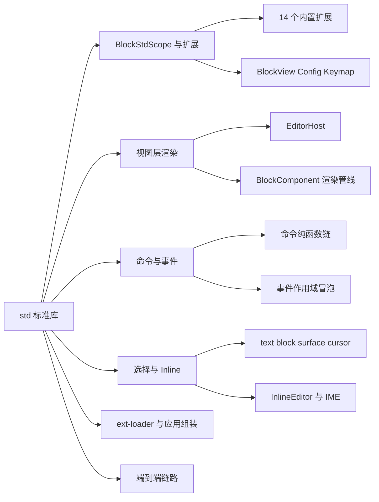
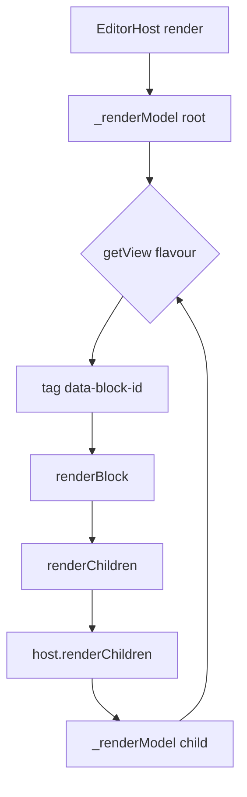
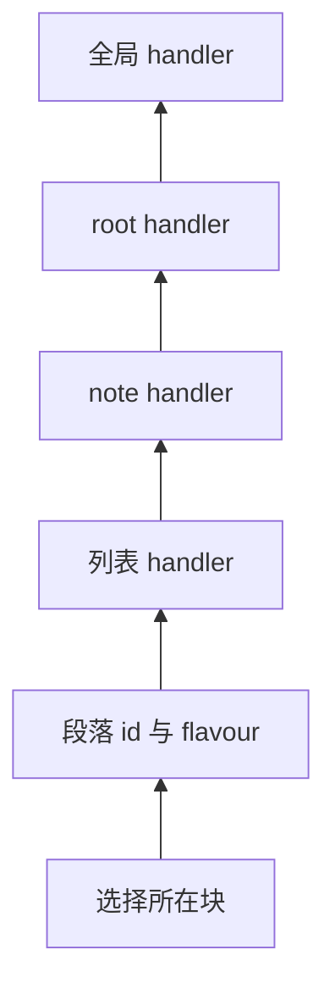
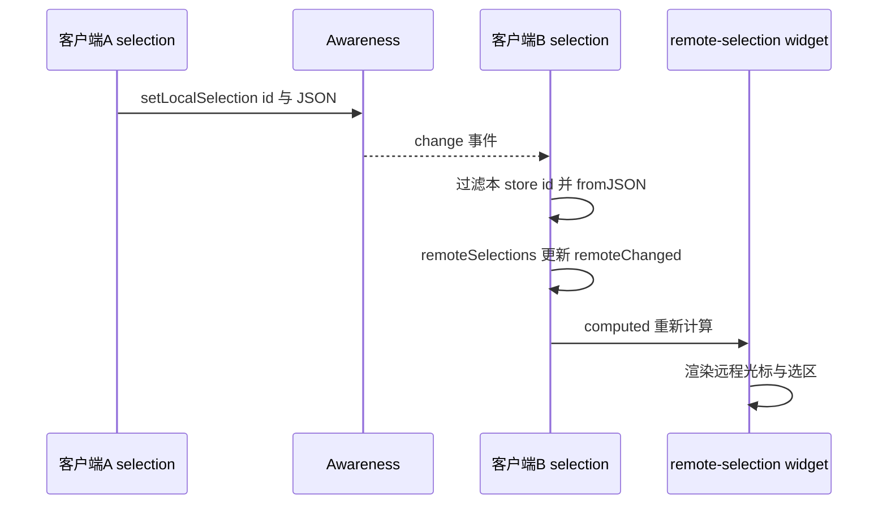
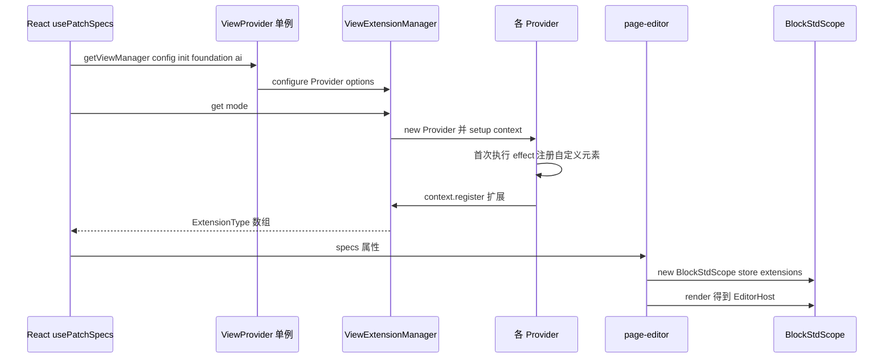
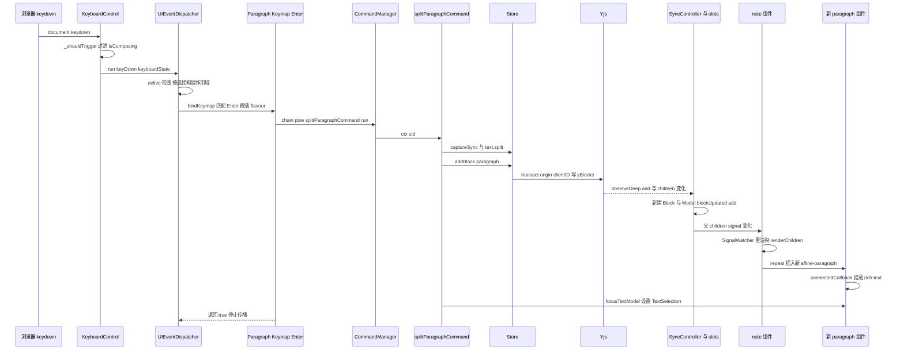

# 第 13 章 BlockSuite Std：视图、扩展、命令、事件

> 把那棵存在 Yjs 里的 Block 树，变成可交互的 DOM

第 5 部分 · 编辑器内核 BlockSuite ｜ 难度 ★★★★☆ ｜ 建议学时 12 小时

===

## 本章要解决的问题

<p class="lead">Store 不认识 DOM：它不知道段落该渲染成什么标签、不知道按下 Enter 该做什么、也不知道光标在哪里。把"数据"变成"可编辑界面"，是 <code>@blocksuite/std</code> 的工作。</p>

`std`（`blocksuite/framework/std`）是 BlockSuite 的**编辑器标准库**。它以一个视图级 DI 作用域 `BlockStdScope` 为中心，用一组可插拔的扩展组织起视图、配置、快捷键与生命周期，再加上命令、事件、选择、剪贴板、Inline 富文本与 gfx 白板基础。

<div class="cards cols-3">
  <div class="card"><div class="card__icon">🧱</div><h4>DI 作用域</h4><p><code>BlockStdScope</code> 以 Store 的 provider 为父，14 个内置扩展 + 用户扩展。</p></div>
  <div class="card"><div class="card__icon">🌳</div><h4>翻译器</h4><p><code>EditorHost</code> 按 flavour 查 View，把 Block 树翻译成组件树。</p></div>
  <div class="card"><div class="card__icon">⌨️</div><h4>一条链路</h4><p>一次按键如何流经 事件 → 命令 → 模型 → 视图，本章最后完整走通。</p></div>
</div>

<div class="note note--warn">

本章会对照 `blocksuite/docs-site/guide` 指出多处"文档落后于源码"：不再有 `BlockSpec` 对象、命令改用 `pipe`、选择不带 `path`、`BlockService` 已弃用……**务必以源码为准**。

</div>

===

## 知识地图

std 的能力围绕"把数据变成可交互 DOM"展开，可分为六大块。



<div class="note">

`package.json` 的 `exports` 只有四个：`.`、`./gfx`、`./effects`、`./inline`。所有 `customElements.define` 都集中在 `effects.ts` 执行，这是 BlockSuite 的约定。

</div>

===

## 学习目标

学完本章，你应当能够：

<ol class="goals">
  <li>说出 <code>BlockStdScope</code> 的内置扩展，解释其 provider 与 Store provider 的父子关系</li>
  <li>用 <code>BlockViewExtension</code>、<code>ConfigExtensionFactory</code>、<code>KeymapExtension</code>、<code>LifeCycleWatcher</code> 为块注册能力</li>
  <li>描述 <code>EditorHost</code> 如何把 Block 树渲染成组件树，以及 <code>BlockComponent</code> 的 renderer 管线</li>
  <li>编写并链式执行命令（<code>pipe</code>、<code>try</code>、<code>tryAll</code>），理解上下文如何累积</li>
  <li>解释 <code>UIEventDispatcher</code> 如何构建"事件作用域"，以及快捷键字符串的规范化规则</li>
  <li>区分四种选择类型，说明远程选择经 Awareness 的传播</li>
  <li>画出"一次按键 → 事件 → 命令 → 模型 → 视图"的完整链路</li>
</ol>

===

<!-- section -->
## 一、BlockStdScope 与扩展

std 的一切从一个以 Store provider 为父的 DI 容器开始；扩展都是"工厂函数返回 `{ setup }`"。

===

## BlockStdScope：视图层 DI 作用域

`BlockStdScope` 构造时建容器、装内置扩展、再装用户扩展，最后把 Store 的 provider 设为父级：

<div class="annotate">

```ts [2|8-10|11|13]
export const internalExtensions = [
  ServiceManager, CommandManager, UIEventDispatcher, RangeManager, ViewStore,
  Clipboard, GfxController, GfxSelectionManager, GridManager, LayerManager,
  SurfaceMiddlewareExtension, ViewManager, DndController, EditorLifeCycleExtension,
];
export class BlockStdScope {
  constructor(options: BlockStdOptions) {
    this.container = new Container();
    this.container.addImpl(StdIdentifier, () => this);
    internalExtensions.forEach(ext => ext.setup(this.container));
    this.userExtensions.forEach(ext => ext.setup(this.container));
    this.provider = this.container.provider(undefined, this.store.provider);
    this._lifeCycleWatchers.forEach(watcher => watcher.created());
  }
}
```

<ol class="annotate__notes">
  <li><b>第 2 行</b>：14 个内置扩展（ServiceManager、CommandManager、UIEventDispatcher…）先注册。</li>
  <li><b>第 8–10 行</b>：内置在前、用户在后，用户可用 <code>di.override</code> 覆盖内置实现。</li>
  <li><b>第 11 行</b>：<code>provider(undefined, this.store.provider)</code> 把 Store 的 provider 设为<b>父级</b>——视图层能 <code>std.get(FeatureFlagService)</code>（注册在 Store 侧），而 Store 侧拿不到任何视图服务。</li>
</ol>
</div>

<div class="note note--tip">

**为什么父子方向只能视图 → Store？** 因为 Store 必须能在**无 DOM 环境**运行（服务端 Markdown 导出只需 Schema 与 Adapter）。便捷 getter 有 `std.command`、`std.event`、`std.selection`（返回 Store 层的 `StoreSelectionExtension`）、`std.view`、`std.host`、`std.getView(flavour)` 等。

</div>

===

## 生命周期与扩展工厂

`LifeCycleWatcher` 定义四个钩子，**扩展的副作用都应在 `mounted` 建立、`unmounted` 清理**：

| 钩子 | 时机 |
| --- | --- |
| `created()` | `new BlockStdScope()` 结束时 |
| `rendered()` | `std.render()` 创建 `EditorHost` 后 |
| `mounted()` | `EditorHost.connectedCallback` |
| `unmounted()` | `EditorHost.disconnectedCallback` |

扩展本身都是"工厂函数返回 `{ setup }`"，落在不同 DI 标识符下：

<div class="cards cols-2">
  <div class="card"><h4><code>BlockViewExtension(flavour, view)</code></h4><p>注册 <code>BlockViewIdentifier(flavour)</code>，值是 Lit <code>literal</code> 标签或 <code>(model) =&gt; literal</code>。</p></div>
  <div class="card"><h4><code>WidgetViewExtension(flavour, id, view)</code></h4><p>变体键 <code>${flavour}|${id}</code>，小部件通常挂在 <code>affine:page</code>。</p></div>
  <div class="card"><h4><code>ConfigExtensionFactory&lt;T&gt;(id)</code></h4><p>块级配置，用 <code>override</code> 让宿主覆盖默认值。</p></div>
  <div class="card"><h4><code>KeymapExtension(factory, options?)</code></h4><p><code>options.flavour</code> 让快捷键只在该 flavour 的块（或子孙）上生效。</p></div>
</div>

<div class="note note--warn">

`BlockService`（`extension/service.ts`）已标注 `@deprecated`——现存使用者只剩 embed 系列与 `EdgelessRootService`。**新代码应使用 `LifeCycleWatcher`、`ConfigExtensionFactory` 或普通 DI 服务。**

</div>

===

## 函数式 View 与配置覆盖

`BlockViewType = StaticValue | ((model) => StaticValue)`。函数形式允许**同一 flavour 按上下文选择不同组件**，图片块就是如此：

<div class="split">
<div class="split__main">

左侧代码是图片块的 View 扩展：父块为 `affine:surface`（在白板中）时渲染 `affine-edgeless-image`，否则渲染文档流里的 `affine-image`。

`ConfigExtensionFactory` 用的是 **`override`** 而非 `addImpl`——后注册的配置覆盖先注册的。这正是应用层"打补丁"的原理：段落块在块内注册一次默认配置，AFFiNE 通过 `manager.configure(ParagraphViewExtension, { getPlaceholder })` 改变参数，最终生效的是带应用文案的版本。读取时用 `std.getOptional(XxxConfigExtension.identifier)`。

</div>
<div class="split__aside">

```ts
BlockViewExtension(flavour, model => {
  const parent =
    model.store.getParent(model.id);
  if (parent?.flavour
      === 'affine:surface') {
    return literal`affine-edgeless-image`;
  }
  return literal`affine-image`;
}),
```

</div>
</div>

<div class="note note--tip">

flavour 还支持 `xxx/*` 形式的"祖先路径匹配"（见 `EditorHost` 的 `isMatchFlavour`），例如 `affine:page/affine:note/*` 表示"父链为 page→note 的任意块"。

</div>

===

<!-- section -->
## 二、视图层渲染

EditorHost 把 Block 树翻译为组件树；BlockComponent 的 `render` 是一条 renderer 管线。

===

## EditorHost：Block 树 → 组件树

`EditorHost` 的 `render()` 只渲染根模型，核心逻辑在 `_renderModel`：

<div class="annotate">

```ts [3-6|8|11-13|14]
private readonly _renderModel = (model: BlockModel): TemplateResult => {
  const { flavour } = model;
  const block = this.store.getBlock(model.id);
  if (!block || block.blockViewType === 'hidden') {
    return html`${nothing}`;
  }
  const schema = this.store.schema.flavourSchemaMap.get(flavour);
  const view = this.std.getView(flavour);
  if (!schema || !view) {
    console.warn(`Cannot find render flavour ${flavour}.`);
    return html`${nothing}`;
  }
  const tag = typeof view === 'function' ? view(model) : view;
  return html`<${tag} ${unsafeStatic(BLOCK_ID_ATTR)}=${model.id}
    .widgets=${widgets} .viewType=${block.blockViewType}></${tag}>`;
};
```

<ol class="annotate__notes">
  <li><b>第 3–6 行</b>：组件<b>只拿到 <code>data-block-id</code> 属性</b>，模型由组件自己 <code>store.getModelById(blockId)</code> 获取。</li>
  <li><b>第 8 行</b>：按 flavour 查 View。</li>
  <li><b>第 11–13 行</b>：找不到 Schema 或 View 时只 <code>console.warn</code> 并跳过——<b>注册了 Schema 却忘了 View，块会"静默消失"</b>。</li>
  <li><b>第 14 行</b>：小部件以 <code>TemplateResult</code> 通过 <code>.widgets</code> 传给块组件，由块决定在哪里渲染。</li>
</ol>
</div>

<div class="note">

`ShadowlessElement` 关闭了 Shadow DOM：块渲染在 light DOM 中，这样**原生 Selection 能跨块连续选择**（Shadow DOM 会切断 Range），全局主题 CSS 变量也直接生效。

</div>

===

## BlockComponent 的渲染管线

`BlockComponent.render()` 不直接调 `renderBlock`，而是把一组 renderer 依次 reduce：

<div class="split">
<div class="split__main">

默认三层：`renderBlock` 生成内容 → 版本不匹配时替换为警告 → 按 `viewType` 决定 display/hidden/bypass。子类可 `addRenderer(fn)` 追加包装层。

**绝大多数 AFFiNE 块继承的是 `CaptionedBlockComponent` 而不是 `BlockComponent`**：它在构造函数中 `addRenderer(this._renderWithWidget)`，统一加上选中样式、caption 编辑器与 widgets。

子块渲染不由组件自己递归，而是回调宿主——`renderChildren = this.host.renderChildren.bind(this)`，宿主再为每个子模型查 View。这让"渲染哪个组件"的决定权始终集中在 DI 中。

</div>
<div class="split__aside">



</div>
</div>

<div class="note note--tip">

重写的 `getUpdateComplete` 会**等待所有子块完成渲染**，所以 `await std.host.updateComplete` 后可安全查询子组件——callout 的 Slash 菜单 action 就是先 `await updateComplete` 再 `std.view.getBlock(paragraphId)` 聚焦。组件通过 `ViewStore`（`blockId → BlockComponent`）互相查找。

</div>

===

<!-- section -->
## 三、命令与事件

命令是"ctx in, next(out)"的纯函数链；事件按"选择/目标 → 祖先 → 全局"分发。

===

## 命令：纯函数链与分支策略

命令是一个**纯函数**：读 `ctx`，成功则 `next(output)` 把产出合并进上下文，失败则直接 `return`（不调 `next`）中断链条。`run()` 在链尾追加一个"哨兵命令"把 `success` 置 `true`——只有所有命令都调用了 `next`，哨兵才执行。

<div class="annotate">

```ts [1|4|6-7]
chain().pipe(getTextSelectionCommand).pipe(cmd).run()
// 分支策略：
std.command.chain()
  .try<{}>(cmd => [
    cmd.pipe(getTextSelectionCommand).pipe(/* 有文本选择则处理 */),
    cmd.pipe(getSelectedModelsCommand)
       .pipe(clearAndSelectFirstModelCommand).pipe(deleteSelectedModelsCommand),
  ])
```

<ol class="annotate__notes">
  <li><b>第 1 行</b>：<code>pipe(cmd, input?)</code> 追加命令，<code>input</code> 与当前 ctx 合并后传入；<code>run()</code> 返回 <code>[success, ctx]</code>。</li>
  <li><b>第 4 行</b>：<code>try</code> 依次尝试分支，<b>第一个成功的分支</b>继续、其余不执行。</li>
  <li><b>第 6–7 行</b>：这段粘贴逻辑表达"有文本选择就走第一条，否则走块选择分支"——<code>try</code> 天然表达"多策略回退"。<code>tryAll</code> 则执行全部分支，至少一个成功即继续。</li>
</ol>
</div>

<div class="note note--warn">

**文档差异**：`docs-site/guide/command.md` 用 `chain().command1().command2()` 的"方法式"调用——那是旧版需要全局注册命令的 API。**当前源码中命令就是普通函数，通过 `pipe(cmd)` 引用**。通用命令放在 `blocksuite/affine/shared/src/commands/`。

</div>

===

## 事件作用域：谁先收到

原生事件经 control 层转换为带多种 state 的上下文后，`UIEventDispatcher` 要决定"谁先收到"。作用域起点有两种来源：**Selection**（键盘等以选择的 `blockId` 为起点）或 **Target**（指针事件以 `event.target.closest('[data-block-id]')` 为起点）。然后**从起点块向祖先冒泡**：

<div class="split">
<div class="split__main">

每层先收集 `blockId` 精确匹配的 handler，再收集 `flavour` 匹配的 handler，最后追加全局 handler。同一层中 `add()` 用 `unshift`，**后注册的先执行**。

这一机制让"列表块里的段落"按 Tab 时，段落自己的 handler 先处理，不处理才轮到列表、Note、根块。**handler 返回 `true` 表示"已处理"**：分发器停止调用后续 handler。

`UIEventDispatcher` 还维护静态 `_activeDispatcher`：页面上可能同时有多个编辑器，只有**当前激活**的那个才分发事件。

</div>
<div class="split__aside">



</div>
</div>

<div class="note">

**快捷键规范化**（`normalizeKeyName`）：`Mod` 在 macOS 为 `Meta`、其它平台为 `Ctrl`；规范化顺序为 `Shift-Meta-Ctrl-Alt-键名`。`KeyboardControl` 会过滤 `event.isComposing`（组合输入），以及不带 Shift/Alt 的 `Mod-c/v/x`（交给剪贴板事件）。

</div>

===

<!-- section -->
## 四、选择与 Inline

选择类型在 std、管理器在 store；每个文本块一个 InlineEditor，绑定一个 `Y.Text`。

===

## 选择类型与远程选择

选择管理器其实在 **Store 层**（`std.selection` 返回 `StoreSelectionExtension`），std 只提供具体类型。每个选择类都必须实现 `fromJSON`/`toJSON`/`equals`——因为选择要被**序列化进 Awareness** 传给其它客户端，也要存入撤销栈的 meta。

| 类型 | `group` | 数据 | 场景 |
| --- | --- | --- | --- |
| `TextSelection` | `note` | `from`/`to: { blockId, index, length }` | 文本光标与跨块选区 |
| `BlockSelection` | `note` | `blockId` | 整块选中 |
| `SurfaceSelection` | `gfx` | `blockId`、`elements[]` | 白板元素选中 |
| `CursorSelection` | `gfx` | 光标坐标 | 白板协同光标 |



<div class="note note--warn">

**文档差异**：旧文档中选择带 `path`（从根到块的 id 序列）、由 `SelectionManager` 管理。**当前源码中选择只有 `blockId`，没有 `path`**；`TextSelection` 与原生 Range 的双向同步由 `RangeBinding` 完成——这得益于"每个块一个独立 Inline 编辑器"的扁平设计。

</div>

===

## InlineEditor 与 IME

`@blocksuite/std/inline` 是一个**绑定单个 `Y.Text` 的极简富文本编辑器**。每个文本块都拥有独立的 `InlineEditor` 实例，职责拆成多个 service（attribute、text、delta、range、event、render、hook），数据模型就是 Yjs 的 **Delta**。渲染由 InlineSpec 决定：`match` 命中某种 attributes 的 delta 就用对应 `renderer` 渲染。

IME（中文/日文输入法）需要"组合输入"，`EventService` 的策略分三步：

<ol class="steps">
  <li><h4>非组合状态拦截原生编辑</h4><p><code>_onBeforeInput</code> 中 <code>preventDefault()</code>，按 <code>inputType</code> 调 <code>transformInput</code> 写 Yjs——否则浏览器可能移除 Lit 标记注释节点导致崩溃。</p></li>
  <li><h4>组合期间放任浏览器改 DOM</h4><p><code>_onCompositionStart</code> 记录起点，<code>_onBeforeInput</code> 检测到 <code>_isComposing</code> 直接 <code>return</code>。</p></li>
  <li><h4>组合结束以模型为准</h4><p>先 <code>rerenderWholeEditor()</code> 用 Yjs 内容<b>覆盖</b>脏 DOM，再把组合结果作为一次 <code>insertText</code> 写入 Yjs。</p></li>
</ol>

<div class="note note--tip">

AFFiNE 块并不直接 `new InlineEditor`，而是用 `<rich-text>`（`blocksuite/affine/rich-text`）：它内部创建 InlineEditor、挂钩子、实现行内 Markdown 转换，并把 Inline 选区与 std 的 `TextSelection` 打通（`inlineRangeProvider`）。

</div>

===

<!-- section -->
## 五、ext-loader 与应用组装

Provider 按 scope 产出扩展，Manager 汇总并接受配置；AFFiNE 用单例 `ViewProvider` + 链式 `config` 在 React 侧组装。

===

## 从 getViewManager 到 BlockStdScope

扩展数量庞大，且同一块在不同场景（页面、白板、预览、移动端）需要不同组合。`@blocksuite/affine-ext-loader` 用 `ViewExtensionProvider`（6 种 `ViewScope`）+ `ExtensionManager` 解决：Provider 的 `effect()` **每类只执行一次**（用于 `customElements.define`），`setup()` 按 scope `context.register` 扩展；`configure(Provider, options)` 修改配置并清缓存。



<div class="note note--warn">

**一个隐蔽的坑**：`effectRan` 是静态属性。若 `class MyParagraph extends ParagraphViewExtension`，子类会**继承到父类的 `true`**，导致子类的 `effect` 永不执行。扩展已有 Provider 时要显式声明 `static override effectRan = false`。根块 `RootViewExtension` 则按 `isEdgeless(scope)` 把**同一个 `affine:page`** 渲染成 `affine-edgeless-root` 或 `affine-page-root`（第 14 章展开）。

</div>

===

<!-- section -->
## 六、端到端：一次按键的旅程

把前面所有部分串起来：在 Page 模式的段落中间按下 Enter。

===

## 一次按键的完整旅程



===

## 逐段解读这条链路

<ol class="steps">
  <li><h4>原生 → BlockSuite 事件</h4><p><code>KeyboardControl</code> 在 <code>document</code> 监听 <code>keydown</code>，过滤组合输入，构造含 <code>keyboardState</code> 的上下文调 <code>dispatcher.run('keyDown')</code>。</p></li>
  <li><h4>事件作用域 + 快捷键</h4><p>当前 <code>TextSelection</code> 在段落上，作用域从段落向上冒泡；<code>ParagraphKeymapExtension</code> 以 <code>{ flavour: 'affine:paragraph' }</code> 注册，匹配成功后执行 <code>chain().pipe(splitParagraphCommand).run()</code> 并返回 <code>true</code>。</p></li>
  <li><h4>命令 → 模型 → Yjs</h4><p>命令中 <code>captureSync()</code> 切分撤销单元，<code>text.split()</code> 截出右半段，<code>store.addBlock()</code> 在事务中写 Yjs（origin 为 <code>clientID</code>）。</p></li>
  <li><h4>Yjs → 模型 → 视图</h4><p>Store 的 <code>observeDeep</code> 创建新 Block 与 Model；note 组件 <code>renderChildren</code> 读过 <code>model.children</code>（computed signal），<code>SignalWatcher</code> 自动重渲染，<code>repeat</code> 只插入新元素。</p></li>
  <li><h4>选择落位</h4><p><code>focusTextModel(std, id)</code> 设置新 <code>TextSelection</code>，<code>RangeBinding</code> 同步为原生 Range，光标出现在新段落开头。</p></li>
</ol>

<div class="note note--tip">

整个过程**没有任何一处直接操作 DOM 来"插入段落"**——DOM 完全是 Yjs 数据的投影。远端协作者收到这次更新时，只走"Yjs → 模型 → 视图"后半段，结果一致。这正是 `ui = f(data)` 的体现。

</div>

===

## 自测：点击揭晓答案

<details class="quiz">
<summary>Q1. BlockStdScope 的 provider 为什么以 store.provider 为父？反过来行不行？</summary>

视图层需访问 Store 层注册的服务（Schema、选择、FeatureFlag、Adapter），父子链让 `std.get` 向上查找；反过来不行，因为 Store 必须能在无 DOM 环境运行，不能依赖任何视图服务。

</details>

<details class="quiz">
<summary>Q2. 注册了 Schema 却忘了 BlockViewExtension，会怎样？</summary>

`EditorHost._renderModel` 找不到 view，打印 `Cannot find render flavour xxx.` 并渲染 `nothing`，该块（及子块）在界面上"静默消失"，但数据仍在。

</details>

<details class="quiz">
<summary>Q3. 命令链中某命令没调 next()，run() 返回什么？后续命令会执行吗？</summary>

返回 `[false, ctx]`，`ctx` 是中断前累积的上下文；后续命令不会执行（`runCmds` 只在 `next` 回调中递归）。`try` 依次尝试、第一个成功即继续；`tryAll` 执行全部、至少一个成功即继续。

</details>

<details class="quiz">
<summary>Q4. 组合输入结束后文本如何写入 Yjs？</summary>

组合期间放任浏览器修改 DOM，`compositionend` 时先 `rerenderWholeEditor()` 用模型覆盖脏 DOM，再以 `insertText` 把 `event.data` 作为一次事务写入 Yjs。

</details>

===

## 小结与下一步

<ul class="takeaways">
  <li>std 以 <code>BlockStdScope</code> 为中心：一个以 Store provider 为父的 DI 容器 + 内置扩展 + 用户扩展。</li>
  <li><code>EditorHost</code> 按 flavour 查 View 把 Block 树翻译成组件树；<code>BlockComponent.render</code> 是一条 renderer 管线，<code>CaptionedBlockComponent</code> 是 AFFiNE 常用基类。</li>
  <li>命令是 <code>ctx in, next(out)</code> 的纯函数链，<code>try</code>/<code>tryAll</code> 表达分支；事件按"选择/目标 → 祖先 → 全局"分发，返回 <code>true</code> 即终止。</li>
  <li>选择类型在 std、管理器在 store，可序列化从而支持远程光标；每个文本块一个 InlineEditor，IME 期间放任 DOM、结束后以模型覆盖。</li>
  <li>ext-loader 让 AFFiNE 按 scope 与配置组装扩展；一次按键完整流经 事件 → 命令 → 模型 → 视图，DOM 只是数据投影。</li>
</ul>

<div class="note note--tip">

**下一章预告**：第 14 章进入 `blocksuite/affine/`——段落、代码、图片、数据库、白板形状与连线、斜杠菜单……看 std 的扩展点如何被真实块与 Edgeless 白板填满。

</div>
