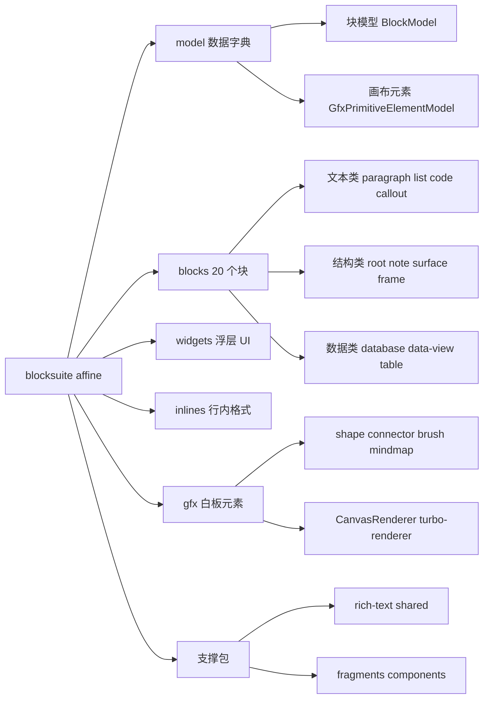
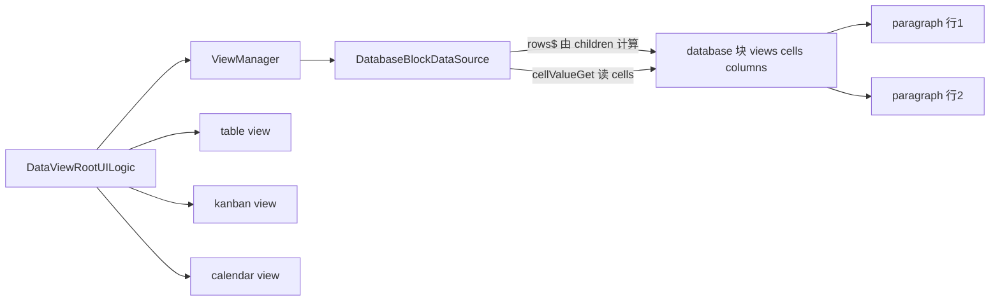
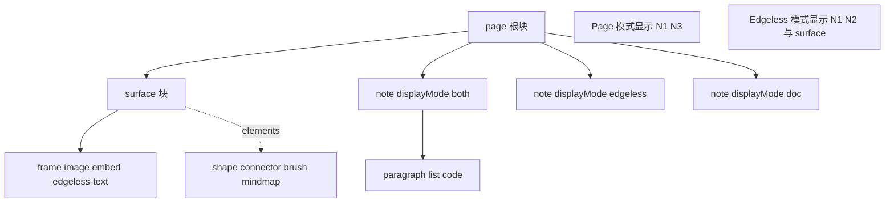
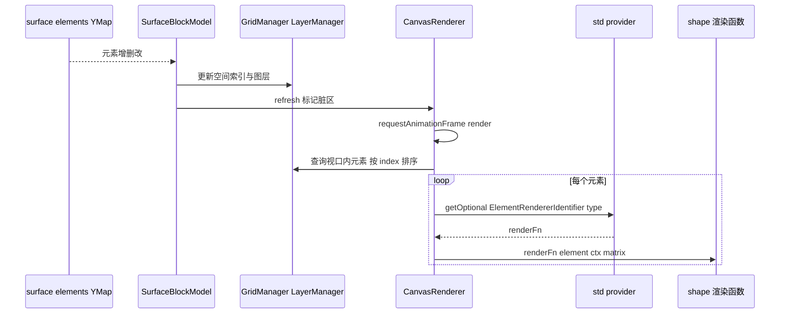

# 第 14 章 Affine 块组件与 Edgeless 白板

> 读完"发动机图纸"，来看 AFFiNE 真正交付给用户的那些功能

第 5 部分 · 编辑器内核 BlockSuite ｜ 难度 ★★★★★ ｜ 建议学时 14 小时

===

## 本章要解决的问题

<p class="lead"><code>blocksuite/affine/</code> 下有十几个目录、六十多个子包。逐个精读既不现实也没必要——我们要学会"看到任何一个编辑器功能，就能快速定位到它的源码包并读懂注册方式"。</p>

本章的策略分三步：

<ol class="steps">
  <li><h4>先建立全景</h4><p>用表格把 model、20 个块、16 个 widget、7 类 inline、11 个 gfx 包、data-view 等的职责一次理清。</p></li>
  <li><h4>再挑代表深读</h4><p>段落/列表（文本块）、代码块（服务）、图片（资源与按上下文切换视图）、数据库（data-view 接入），以及 root/note 在两种模式下的不同面貌。</p></li>
  <li><h4>最后啃白板</h4><p>surface 如何把画布元素渲染到 Canvas、gfx 元素用装饰器绑定 Yjs、工具如何切换、turbo-renderer 如何用 Worker 位图提速。</p></li>
</ol>

<div class="note note--warn">

`docs-site` 仍以 `@blocksuite/blocks`、`@blocksuite/presets` 和 `PageEditor`/`EdgelessEditor` 预置编辑器为基础——**这两个包已不存在**，AFFiNE 的编辑器组件在 `packages/frontend/core/src/blocksuite/editors/`。

</div>

===

## 知识地图

affine 层可分为"数据字典（model）→ 块与 widget → inline → gfx 白板 → 支撑包"。



===

## 学习目标

学完本章，你应当能够：

<ol class="goals">
  <li>区分"块模型"与"画布元素模型"，说出各自的存储与渲染方式</li>
  <li>列出主要块包的 flavour 与职责，并说明哪些块只在 Edgeless 中出现</li>
  <li>读懂 paragraph、list、code、image、database 的关键文件，说出各展示了哪种扩展技巧</li>
  <li>解释 <code>affine:page</code> 按 scope 渲染为哪个根组件，note 的 <code>displayMode</code> 如何连接两种模式</li>
  <li>说明 slash-menu、toolbar 等 widget 的"壳 + 配置聚合"注册模式</li>
  <li>说明 Surface 如何把元素渲染到 Canvas，<code>@field</code> 装饰器如何把属性存入 Yjs</li>
  <li>解释 data-view 的三层抽象、turbo-renderer 的启用条件与原理</li>
</ol>

===

<!-- section -->
## 一、model：两套模型体系

理解 Edgeless 的第一把钥匙，是分清"块模型"与"画布元素模型"。

===

## 块模型 vs 画布元素模型

`blocksuite/affine/model` 是 AFFiNE 的**数据字典**。它分两套体系，差别是理解白板的关键：

<div class="compare">
  <div class="compare__col"><h4>块（Block）</h4>

- 基类 `BlockModel`（白板中可放置的块再混入 `GfxCompatible`）
- 存储：`yBlocks` 中独立的 YBlock
- 渲染：Lit 组件（DOM）
- 例子：note、image、frame、embed-*

  </div>
  <div class="compare__col compare__col--good"><h4>画布元素（Element）</h4>

- 基类 `GfxPrimitiveElementModel`
- 存储：Surface 块 `prop:elements`（一个 `Boxed<Y.Map>`）中的 `Y.Map` 条目
- 渲染：Canvas 绘制函数（或可选 DOM 渲染器）
- 例子：shape、connector、brush、mindmap

  </div>
</div>

画布元素的属性用 `@field` 装饰器声明，它让"属性即 Yjs"：

<div class="annotate">

```ts [1|4-5|7-8]
export class ShapeElementModel extends GfxPrimitiveElementModel<ShapeProps> {
  get type() { return 'shape'; }

  @field(DefaultTheme.shapeTextColor)
  accessor color!: Color;

  @field()
  accessor filled: boolean = false;
}
```

<ol class="annotate__notes">
  <li><b>第 1 行</b>：继承 <code>GfxPrimitiveElementModel</code>，<code>type</code> getter 返回元素类型字符串。</li>
  <li><b>第 4–5 行</b>：<code>@field</code> 在 <code>init</code> 时把初值写入元素自己的 <code>yMap</code>，<code>get</code> 从 <code>yMap</code> 读、<code>set</code> 写回。</li>
  <li><b>第 7–8 行</b>：同目录还有 <code>@local</code>（仅本地不同步）、<code>@derive</code>、<code>@watch</code> 等。这与块的 <code>SyncController</code> Proxy 方案不同，但目标一致。</li>
</ol>
</div>

<div class="note note--tip">

所有 embed 块由 `createEmbedBlockSchema` 统一生成，flavour 为 `affine:embed-${name}`，自动带 `index`/`xywh`/`rotate` 等白板属性——这解释了 Surface 的 `children` 为何能用 glob `'affine:embed-*'` 一次匹配所有嵌入块。

</div>

===

<!-- section -->
## 二、块全景与文本块

20 个块包结构高度一致；文本块 = `CaptionedBlockComponent` + `<rich-text>` + 两层 Keymap。

===

## 20 个块包与统一模板

`blocksuite/affine/blocks/` 下 20 个目录，各是一个 `@blocksuite/affine-block-xxx` 包。几个要点：`root`（`affine:page`）按 scope 渲染不同根；`surface`/`frame`/`edgeless-text` 只在 Edgeless 出现；`surface-ref` 只在 Page 出现；`image` 在两种模式渲染不同组件。每个块包内部结构几乎相同：

```text
paragraph-block.ts      视图组件（继承 CaptionedBlockComponent）
paragraph-keymap.ts     KeymapExtension
paragraph-block-config.ts  ConfigExtensionFactory
commands/               块专属命令
adapters/               markdown / html / notion-html / plain-text 适配器
markdown.ts             InlineMarkdownExtension（如 "## " 转标题）
turbo/                  turbo-renderer 的布局处理器与 Worker 画笔
effects.ts              customElements.define
store.ts / view.ts      StoreExtensionProvider / ViewExtensionProvider
index.ts                公共导出
```

<div class="note">

**注意：Schema 不在块包里**，而集中在 `@blocksuite/affine-model`，块包依赖模型包。记住这个"模板"，读任何块都会轻松很多，第 15 章也照着它写自定义块。

</div>

===

## paragraph 与 list：块间"让出事件"

段落的键盘逻辑分两层：`ParagraphTextKeymapExtension` 复用通用文本快捷键（加粗、斜体），`ParagraphKeymapExtension` 处理结构操作：

| 按键 | 行为 | 命令 |
| --- | --- | --- |
| `Backspace`（行首） | 转 text / 与上块合并 / 反缩进 | `mergeWithPrev`、`dedentParagraphCommand` |
| `Enter` | 引用双空行跳出 / 折叠标题跳过子节点 / 行尾新建 / 否则拆分 | `addParagraphCommand`、`splitParagraphCommand` |
| `Tab` / `Shift-Tab` | 缩进 / 反缩进 | `indentParagraphCommand` |

<div class="note note--tip">

一个值得注意的细节：Enter 与 Backspace 处理器都先判断 `matchModels(model.parent, [CalloutBlockModel])`，若父块是 callout 则**直接返回、交给 `CalloutKeymapExtension`**——这正是第 13 章讲的事件作用域冒泡，**块之间通过"让出事件"协作**。

</div>

list 是同构的另一种文本块：`type` 为 `bulleted/numbered/todo/toggle`。折叠不删子块，只是 `display: none`；只读模式用本地 `_readonlyCollapsed`，避免访客折叠写入文档。有序列表的序号持久化在 `order` 属性，由 `getNumberPrefix(order, depth)` 按嵌套深度轮换生成数字/字母/罗马数字——而非简单 DOM 计数，因为跨嵌套编号规则复杂且需导出到 Markdown。

===

<!-- section -->
## 三、code 与 image

code 展示"服务化 + 独立 InlineManager + 块级 widget"；image 展示"函数式 View + 双栖模型 + 资源控制"。

===

## code：LifeCycleWatcher 驱动的高亮服务

代码块的 View Provider 几乎用上了第 13 章所有扩展类型：

<div class="cards cols-2">
  <div class="card"><h4>服务 <code>CodeBlockHighlighter</code></h4><p>LifeCycleWatcher，用<b>静态单例 + 引用计数</b>共享 shiki 的 <code>HighlighterCore</code>，多个编辑器不重复加载 WASM；<code>highlighter$</code> 是 signal，随主题切换明暗。</p></div>
  <div class="card"><h4>独立 InlineManager</h4><p><code>CodeBlockInlineManagerExtension</code> 只含代码所需行内规格，代码块里不会出现链接、提及等富文本格式。</p></div>
  <div class="card"><h4>块级 widget</h4><p>代码工具栏挂在 <code>affine:code</code> 而非 <code>affine:page</code>。</p></div>
  <div class="card"><h4>按 scope 调整</h4><p>移动端不注册工具栏，并用 <code>CodeBlockConfigExtension</code> 关闭行号。</p></div>
</div>

<div class="note">

应用侧 `view-extensions/code-block-preview/` 还为代码块注册了 HTML、Mermaid、Typst 预览。粘贴进代码块时 `getCodeClipboardExtensions()` 保持纯文本。

</div>

===

## image：函数式 View 与资源控制

图片块用函数形式的 `BlockViewExtension`（父块为 surface 时渲染 `affine-edgeless-image`，否则 `affine-image`）。模型 `ImageBlockModel extends GfxCompatible<ImageBlockProps>(BlockModel)`——**同一个模型既能在文档流中，也能作为白板自由元素**。

<div class="split">
<div class="split__main">

图片二进制**不在 Yjs 中**，模型只存 `sourceId`（blob key）。组件通过 `ResourceController` 管理加载状态，`setEngine(this.std.store.blobSync)` 把它接到 Workspace 的 `BlobEngine`（AFFiNE 中最终落到 nbstore）。导入导出时 `ImageBlockTransformer` 负责搬运二进制。附件块用同样的 `ResourceController` 模式。

</div>
<div class="split__aside">

```ts
export class ImageBlockComponent
  extends CaptionedBlockComponent<ImageBlockModel> {
  resourceController =
    new ResourceController(/* ... */);

  override connectedCallback() {
    this.resourceController
      .setEngine(this.std.store.blobSync);
    this.disposables.add(
      this.resourceController.subscribe());
  }
}
```

</div>
</div>

===

<!-- section -->
## 四、database 与 data-view

data-view 是"DataSource → ViewManager → View UI"的独立框架；database 块用子块表示行、用 `cells` 存列值。

===

## 把 Block 树适配成 DataSource

`@blocksuite/data-view`（注意不带 `affine-` 前缀）是一个**独立于 Block 树**的通用框架：`DataSource` 接口全部以 signal 暴露行、列、单元格、视图，视图层（表格/看板/日历）只依赖这个接口，不知道数据来自何处。

database 块的 Schema 是 `role: 'hub'`、`children: ['affine:paragraph', 'affine:list']`。也就是：**每一行就是一个子块**，行标题是子块文本；其它列值存在 `cells[rowId][columnId]`；视图配置存在 `views`。`DatabaseBlockDataSource` 完成适配，如 `rows$ = computed(() => this._model.children.map(v => v.id))`。



<div class="note note--warn">

写单元格经 `updateCell`，它在 `transact` 中执行，并显式拒绝 `__proto__`、`constructor`、`prototype` 作为 rowId——**防止原型污染**，因为 `cells` 是以用户可控 id 为键的普通对象。

</div>

===

<!-- section -->
## 五、root 与 note：两种视图

同一个 `affine:page` flavour 按 scope 渲染不同根；note 用 `displayMode` 决定在哪种模式出现。

===

## 一个 flavour，四种根组件

`RootViewExtension` 按 scope 注册不同视图。两种根组件的 `renderBlock` 对比最能说明问题：

<div class="compare">
  <div class="compare__col"><h4>Page 根（affine-page-root）</h4>

- 纵向渲染子块
- **过滤掉 `displayMode === EdgelessOnly` 的 note**
- 整个容器是一个大 contenteditable，跨块文本选择由此实现

  </div>
  <div class="compare__col compare__col--good"><h4>Edgeless 根（affine-edgeless-root）</h4>

- 在 `<gfx-viewport>` 中同时渲染根的子块与 **Surface 的子块**
- 通过 `GridManager.search` 只让视口（含 overscan）内的块参与渲染
- `maxConcurrentRenders` 限制并发渲染数——大白板性能的基础

  </div>
</div>

```ts
// edgeless-root-block.ts（节选）
<gfx-viewport
  .maxConcurrentRenders=${6}
  .viewport=${this.gfx.viewport}
  .getModelsInViewport=${() =>
    this.gfx.grid.search(this.gfx.viewport.overscanBlockBounds,
      { useSet: true, filter: ['block'] })}
  .host=${this.host}
>
  ${this.renderChildren(this.model)}
  ${this.renderChildren(this.surfaceBlockModel)}
</gfx-viewport>
```

===

## note：两种模式的桥梁

`NoteDisplayMode` 有三个值：`DocAndEdgeless = 'both'`、`DocOnly = 'doc'`、`EdgelessOnly = 'edgeless'`。note 是文档内容在两种模式下的**共同容器**：Page 模式是 `affine-note`（文档流的一节），Edgeless 模式是 `affine-edgeless-note`（白板上有 `xywh`、背景的卡片）。



<div class="note">

于是：白板上新建的 note 默认 `EdgelessOnly`，不出现在文档模式；文档模式里的 note 默认 `DocAndEdgeless`，切到白板会以卡片形式出现。`NoteBlockModel` 通过 `GfxCompatible` 混入白板能力。

</div>

===

<!-- section -->
## 六、widgets 与 inline

widget 普遍采用"壳 + 配置聚合"，注册顺序决定 z-index；inline 以 spec 为单位扩展行内格式。

===

## slash-menu：配置聚合型 widget

`blocksuite/affine/widgets/` 下 16 个包，都以 `WidgetViewExtension` 挂到某 flavour。slash-menu 是最典型的"**配置聚合**"模式：

<div class="split">
<div class="split__main">

widget 自身只提供默认配置，各块通过 `SlashMenuConfigExtension(flavour, config)` 贡献菜单项，构造时 `getAll` 合并。每个 item 有 `name`、`icon`、`group`（形如 `'0_Basic@9'`，用于分组排序）、`when(ctx)` 与 `action(ctx)`。

有趣的是，标题、引用、分割线等"基础"菜单项**不在各自块包中**，而由 note 块的 `NoteSlashMenuConfigExtension` 基于 rich-text 的 `textConversionConfigs` 统一生成；callout、image 等则在自己的块包中注册。

`getInternalViewExtensions()` 中 Widget 段落的注释写明"order will affect the z-index"——**注册顺序决定叠放层级**。

</div>
<div class="split__aside">

```ts
export class SlashMenuExtension extends Extension {
  static override setup(di: Container) {
    WidgetViewExtension('affine:page',
      AFFINE_SLASH_MENU_WIDGET,
      literal`${unsafeStatic(
        AFFINE_SLASH_MENU_WIDGET)}`).setup(di);
    di.add(this, [StdIdentifier]);
    SlashMenuConfigExtension('default',
      defaultSlashMenuConfig).setup(di);
  }
  constructor(readonly std: BlockStdScope) {
    super();
    this.config = mergeSlashMenuConfigs(
      this.std.provider.getAll(
        SlashMenuConfigIdentifier));
  }
}
```

</div>
</div>

<div class="note note--tip">

同理 **toolbar** 本身是"空壳"，内容来自各块的 `ToolbarModuleExtension`；**drag-handle** 基于 `std.dnd`；**remote-selection** 用 `computed` 读 `std.selection.remoteSelections` 渲染他人光标。

</div>

===

## inline 与 rich-text

七个 inline 包（preset、link、reference、mention、latex、footnote、comment）以 spec 为单位扩展行内格式。每个 spec 的 `schema` 用 `.catch(undefined)`，**非法属性值被静默丢弃而非报错**——协同数据可能来自旧版本或其它客户端，容错比严格更重要。

<div class="note">

`rich-text` 包的 `conversion.ts` 中 `textConversionConfigs` 是一份"块类型转换"清单。分割线条目 `{ flavour: 'affine:divider', type: 'divider', name: 'Divider', hotkey: ['Mod-Alt-d', 'Mod-Shift-d'] }`——**同一份配置驱动了斜杠菜单、格式工具栏、快捷键三个入口**。`dom.ts` 提供 `focusTextModel`、`getInlineEditorByModel` 等跨块焦点工具。

</div>

===

<!-- section -->
## 七、Edgeless：surface 与 Canvas 渲染

画布元素存于 Surface 的 `elements` Y.Map；CanvasRenderer 按视口与图层绘制，单元素绘制由各 gfx 包注入。

===

## surface：elements Y.Map 与 CanvasRenderer

画布元素全部存在 Surface 的 `elements`（`Boxed<Y.Map>`）中，`SurfaceBlockModel` 观察这个 Map，按 `elementsCtorMap`（group/connector/shape/brush/text/mindmap/highlighter）实例化元素模型。`SurfaceBlockComponent` 默认用 `CanvasRenderer`（特性开关可切 `DomRenderer`），绘制单个元素时从 DI 取渲染函数：



<div class="note">

渲染函数由各 gfx 包用 `ElementRendererExtension('shape', shape)` 注册；`rc` 是 RoughJS 的 `RoughCanvas`，用于"手绘风格"。`CanvasRenderer` 还负责视口裁剪、DPR 缩放、**堆叠画布**（block 层与 canvas 层交错时用多张 canvas 叠放保证 z 序）、脏区重绘。

</div>

===

## 工具切换与 turbo-renderer

`blocksuite/affine/gfx/` 下 11 个包几乎都只在 `isEdgeless(scope)` 时注册。**一个 gfx 元素 = 模型 + 渲染器 + 视图 + 工具 + 工具栏按钮 + 元素工具栏 + 交互**（如 `ShapeViewExtension` 注册七个扩展）。一次"画矩形"：点工具栏按钮 → `gfx.tool.setTool(ShapeTool)` → 指针 `dragStart/Move/End` 创建更新元素 → 完成后 `setTool(DefaultTool)` 回选择工具。

<div class="split">
<div class="split__main">

**turbo-renderer** 是"交互期间位图替代 DOM"的可选优化。源码注释："Turbo Rendering optimizes performance by rendering block content onto a canvas bitmap, falling back to standard DOM rendering during interactions."

做法：主线程收集视口内块的布局树发给 Worker 绘成位图，缩放手势期间显示位图、隐藏 DOM；默认 `zoomThreshold: 1` 时回到 DOM。每个支持的块提供 `turbo/xxx-layout-handler.ts` 与 `turbo/xxx-painter.worker.ts`（当前有 paragraph、list、note、code、image）。

</div>
<div class="split__aside">

```ts
// edgeless-toolbar 的两个扩展点
export const QuickToolIdentifier =
  createIdentifier<ToolBuilder<QuickTool>>(
    'edgeless-quick-tool');
export const SeniorToolIdentifier =
  createIdentifier<ToolBuilder<SeniorTool>>(
    'edgeless-senior-tool');
```

</div>
</div>

<div class="note note--warn">

应用侧 `TurboRendererViewExtension` 只在特性标志 `enable_turbo_renderer` 为真**且** scope 为 edgeless 时注册。`shared`（服务/命令/适配器）、`fragments`（编辑器外部件如大纲、标题）、`components`（`CaptionedBlockComponent`、`ResourceController` 等 UI 积木）是所有块的共同依赖。

</div>

===

## 自测：点击揭晓答案

<details class="quiz">
<summary>Q1. 块模型与画布元素模型在存储、渲染上有何不同？</summary>

块存为 `yBlocks` 中独立的 YBlock、用 Lit 组件渲染（DOM），如 note、image；画布元素存在 Surface 块 `elements` 这个 `Y.Map` 的条目中、用 Canvas 绘制函数渲染，如 shape、connector。

</details>

<details class="quiz">
<summary>Q2. 段落的 Enter 处理器为什么在父块是 callout 时直接返回？</summary>

callout 内的段落拆分/删除需要 callout 特有逻辑；段落 handler 返回 `undefined` 让出事件，作用域冒泡到 callout 层由 `CalloutKeymapExtension` 处理。

</details>

<details class="quiz">
<summary>Q3. database 块的"行"和"列值"分别存在哪里？updateCell 为何检查 __proto__？</summary>

行是 database 块的子块（段落/列表），列值存在 `props.cells[rowId][columnId]`。`cells` 是以 id 为键的普通对象，rowId 若为 `__proto__` 会造成原型污染，因此显式拒绝。

</details>

<details class="quiz">
<summary>Q4. CanvasRenderer 如何找到某类元素的绘制函数？新增一种元素 star 要注册什么？</summary>

通过 `std.getOptional(ElementRendererIdentifier(element.type))` 获取。新增 `star` 需要：元素模型（继承 `GfxPrimitiveElementModel`、`type` 返回 `star`）并加入 Surface 构造映射、`ElementRendererExtension('star', renderFn)`，以及工具、工具栏等扩展。

</details>

===

## 小结与下一步

<ul class="takeaways">
  <li>model 有两套体系：块模型（<code>BlockModel</code>）与画布元素模型（<code>GfxPrimitiveElementModel</code> + <code>@field</code>）。</li>
  <li>块包结构统一；文本块 = <code>CaptionedBlockComponent</code> + <code>rich-text</code> + 两层 Keymap，块间通过"让出事件"协作。</li>
  <li>code 用服务 + 独立 InlineManager + 块级 widget；image 用函数式 View + <code>GfxCompatible</code> + <code>ResourceController</code>。</li>
  <li>database 子块即行、<code>cells</code> 存列值，经 <code>DatabaseBlockDataSource</code> 接入独立的 data-view 框架。</li>
  <li>同一 <code>affine:page</code> 按 scope 渲染不同根；note 的 <code>displayMode</code> 连接两种模式。</li>
  <li>画布元素存于 Surface 的 <code>elements</code>，CanvasRenderer 按视口与图层绘制，绘制逻辑由 <code>ElementRendererExtension</code> 注入；turbo-renderer 是可选的位图加速。</li>
</ul>

<div class="note note--tip">

**下一章预告**：第 15 章动手自己写一个块——先解剖最简单的 `affine:divider`，再照着结构实现一个"提示卡片"Block，走通从 Schema 到斜杠菜单、Adapter、playground 验证、AFFiNE 注册的全流程。

</div>
