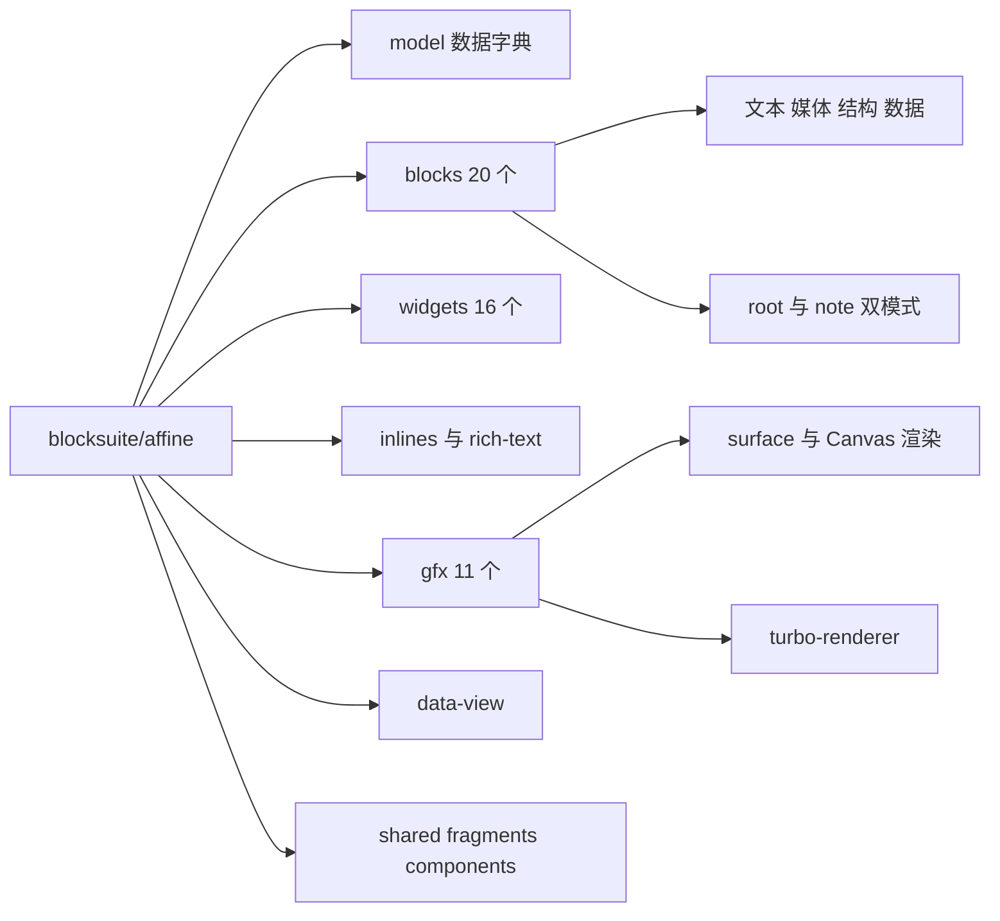
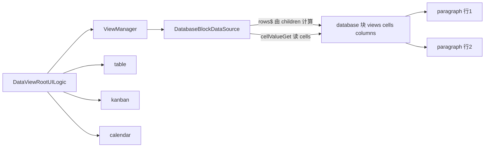
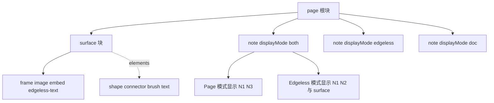
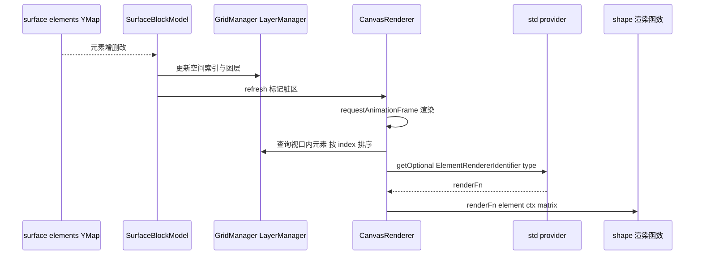

# 第 14 章 Affine 块组件与 Edgeless 白板

从数据字典到画布渲染：AFFiNE 真正交付给用户的编辑能力

第 5 部分 · 编辑器内核 BlockSuite ｜ 难度 ★★★★★ ｜ 建议学时 14 小时

Note:
前两章读完了 BlockSuite 的发动机图纸：Store 管数据，Std 管视图、事件和命令。
这一章进入 blocksuite/affine，也就是用户真正用到的段落、代码块、数据库、白板形状和连线、斜杠菜单这些功能。难度五颗星，是整个编辑器部分最庞大的一章。

---

## 本章导读

`blocksuite/affine/` 有十几个目录、六十多个子包，逐个精读不现实。本章策略：

1. **先建全景**：model、20 个块、16 个 widget、7 类 inline、11 个 gfx 包
2. **再挑代表深读**：paragraph、code、image、database、root / note
3. **最后啃白板**：surface 渲染、`@field` 装饰器、工具切换、turbo-renderer

<div class="callout">

目标：看到任何一个编辑器功能，都能快速定位到源码包并读懂其注册方式。

</div>

Note:
面对六十多个子包，我们采取三步走：先用表格建立全景，再挑几个有代表性的块深读，每个都展示一种扩展技巧，最后集中攻克白板。
学完以后，你看到 AFFiNE 里任何一个功能，都应该能说出它在哪个包、怎么注册的。

---

## 学习目标

1. 区分 `blocksuite/affine/model` 中的"块模型"与"画布元素模型"
2. 列出 20 个块包的职责，说明哪些块只在 Edgeless 中出现
3. 读懂 paragraph、code、image、database 的关键文件与扩展技巧
4. 解释 `affine:page` 在两种模式下的组件，以及 note 的 `displayMode`
5. 描述 slash-menu、toolbar 等 widget 的"配置聚合"模式
6. 说明 Surface 如何把元素渲染到 Canvas，以及 turbo-renderer 原理

Note:
这六个目标从数据模型开始，经过块、模式切换、小部件，最后到白板渲染和性能优化。
其中第 1 条和第 4 条是理解 Edgeless 的两把钥匙，请特别留意。

---

## 知识地图



Note:
blocksuite/affine 下主要是这几类包：model 是数据字典，blocks 是 20 个块，widgets 是浮层 UI，inlines 是行内格式，gfx 是白板元素，data-view 是数据库视图框架。
shared、fragments、components 是所有块的公共依赖。
其中 root 和 note 的双模式，以及 surface 的 Canvas 渲染，是本章的两个重点。

---

## 块模型 vs 画布元素模型

| 维度 | 块（Block） | 画布元素（Element） |
| --- | --- | --- |
| 基类 | `BlockModel`（可混入 `GfxCompatible`） | `GfxPrimitiveElementModel` |
| 存储 | `yBlocks` 中独立的 YBlock | Surface 的 `prop:elements` 中的 `Y.Map` 条目 |
| 渲染 | Lit 组件（DOM） | Canvas 绘制函数（可选 DOM） |
| 例子 | note、image、frame、embed-* | shape、connector、brush、mindmap |

<p class="small">`model/src/` 下：`blocks/` 块模型、`elements/` 画布元素、`themes/` 主题、`consts/` 常量、`utils/` 工具。</p>

Note:
这是理解 Edgeless 的第一把钥匙：画布元素不是块。
块存在 yBlocks 里，用 Lit 组件渲染；画布元素存在 Surface 块的 elements 这个 Boxed Y.Map 里，用 Canvas 绘制函数渲染。
所有 embed 块都通过 createEmbedBlockSchema 统一生成，flavour 都是 affine:embed- 加名字，所以 Surface 的 children 能用 glob 一次匹配。

---

## 画布元素：@field 装饰器

```ts
export class ShapeElementModel extends GfxPrimitiveElementModel<ShapeProps> {
  textBound: IBound | null = null;
  get type() {
    return 'shape';
  }
  @field(DefaultTheme.shapeTextColor)
  accessor color!: Color;
  @field()
  accessor fillColor: Color = DefaultTheme.shapeFillColor;
  @field()
  accessor filled: boolean = false;
  // ... fontFamily、fontSize、shapeType、strokeColor ...
}
```

<p class="small">来源：`blocksuite/affine/model/src/elements/shape/shape.ts`（节选）</p>

Note:
画布元素的属性用 @field 装饰器声明。它在 init 时把初值写入元素自己的 yMap，get 时从 yMap 读，set 时写回 yMap。
同目录还有 @local 仅本地不同步、@derive 派生属性、@watch 等装饰器。
这和块的 SyncController Proxy 方案实现不同，但目标一致：属性即 Yjs。

---

## 块全景：20 个块包

| 类别 | 块（目录） | 场景 |
| --- | --- | --- |
| 文本 | `paragraph`、`list`、`code`、`callout`、`latex`、`divider` | 两者 |
| 媒体 | `image`、`attachment`、`bookmark`、`embed`、`embed-doc` | 两者 |
| 结构 | `root`、`note` | 两者 |
| 数据 | `database`、`data-view`、`table` | 两者 |
| 白板 | `surface`、`frame`、`edgeless-text` | 仅 Edgeless |
| 引用 | `surface-ref`（文档中引用白板区域） | 仅 Page |

Note:
20 个块包按类别分一下就好记了。大部分块在两种模式下都能用。
surface、frame、edgeless-text 只在白板出现；surface-ref 反过来只在文档模式中出现，用于引用白板里的某个 frame 或 group 区域。
每个目录对应一个 @blocksuite/affine-block-xxx 包。

---

## 块包的标准模板

```text
paragraph-block.ts        视图组件（继承 CaptionedBlockComponent）
paragraph-keymap.ts       KeymapExtension
paragraph-block-config.ts ConfigExtensionFactory
commands/                 块专属命令
adapters/                 markdown / html / notion-html / plain-text
markdown.ts               InlineMarkdownExtension
turbo/                    turbo-renderer 布局处理器与 Worker 画笔
effects.ts                customElements.define
store.ts / view.ts        StoreExtensionProvider / ViewExtensionProvider
```

<p class="small">以 `blocksuite/affine/blocks/paragraph/src/` 为例；第 15 章将照此模板编写自定义块。</p>

Note:
每个块包的内部结构高度一致。记住这个模板，读任何块都会轻松很多。
视图组件、快捷键、配置、命令、适配器、Markdown 快捷输入、turbo 渲染、元素注册，最后由 store.ts 和 view.ts 两个 Provider 打包。
下一章我们写自定义块时，就会照着这个模板来。

---

## paragraph：带配置项的 Provider

```ts
export class ParagraphViewExtension extends ViewExtensionProvider<Opts> {
  override setup(context: ViewExtensionContext, options?: Opts) {
    super.setup(context, options);
    const getPlaceholder =
      options?.getPlaceholder ?? (model => placeholders[model.props.type]);
    context.register([
      FlavourExtension('affine:paragraph'),
      BlockViewExtension('affine:paragraph', literal`affine-paragraph`),
      ParagraphTextKeymapExtension, ParagraphKeymapExtension,
      ParagraphBlockConfigExtension({ getPlaceholder }),
      ParagraphMarkdownExtension,
    ]);
  }
}
```

<p class="small">来源：`blocks/paragraph/src/view.ts`（节选；`Opts` 即 `z.infer<typeof optionsSchema>`，省略 `name`、`schema`、`effect()`）</p>

Note:
段落的视图 Provider 展示了带配置项的写法：用 zod 定义 optionsSchema，setup 里读取 options 中的 getPlaceholder，没有就用默认占位符。
AFFiNE 应用侧在 _configureParagraph 里调用 manager.configure 传入新的 getPlaceholder，开启 AI 时占位符就变成"Type '/' for commands, 'space' for AI"。
这正是上一章讲的配置覆盖的真实用法。

---

## 段落快捷键与"让出事件"

| 按键 | 行为 |
| --- | --- |
| `Backspace`（行首） | 转 text → 与上一块合并 → 反缩进 |
| `Enter` | 引用双空行跳出；行尾新建；否则 `splitParagraphCommand` |
| `Mod-Enter` | 在当前块后新建段落 |
| `Tab` / `Shift-Tab` | 缩进 / 反缩进 |

<div class="callout">

父块是 callout 时，Enter / Backspace 直接返回，交给 `CalloutKeymapExtension`——块间靠事件冒泡协作。

</div>

Note:
段落的键盘逻辑分两层：ParagraphTextKeymapExtension 复用通用的加粗斜体等文本快捷键，ParagraphKeymapExtension 处理结构操作。
值得注意的是，Enter 和 Backspace 处理器都先判断父块是不是 callout，是就直接返回，让事件冒泡到 callout 层处理。
列表块是同构的另一种文本块：折叠只是 display none 而不删除子块，有序列表序号存在 order 属性里，渲染时按嵌套深度轮换数字、字母、罗马数字。

---

## code 与 image：两种扩展技巧

<div class="cols">
<div>

**code：服务化**

- `CodeBlockHighlighter`：LifeCycleWatcher
- 静态单例 + 引用计数共享 shiki
- 独立 `CodeBlockInlineManagerExtension`
- 工具栏 widget 挂在 `affine:code`
- 移动端关闭行号、不注册工具栏

</div>
<div>

**image：双栖与资源**

- 函数式 `BlockViewExtension`
- `GfxCompatible<ImageBlockProps>(BlockModel)`
- 模型只存 `sourceId`
- `ResourceController` 管加载状态
- `setEngine(this.std.store.blobSync)`

</div>
</div>

Note:
代码块几乎用上了所有扩展类型。高亮器是 LifeCycleWatcher，用静态单例加引用计数共享 shiki，多个编辑器不会重复加载 WASM。
它有独立的 InlineManager，所以代码块里不会出现链接、提及这些富文本格式。
图片块则展示了另一套技巧：GfxCompatible 混入让同一个模型既能在文档流里，也能作为白板自由元素；二进制不进 Yjs，只存 sourceId，由 ResourceController 接到 BlobEngine，最终落到 nbstore。

---

## data-view：与块无关的数据视图框架

```ts
export interface DataSource {
  readonly$: ReadonlySignal<boolean>;
  properties$: ReadonlySignal<string[]>;
  cellValueGet(rowId: string, propertyId: string): unknown;
  cellValueGet$(rowId: string, propertyId: string):
    ReadonlySignal<unknown | undefined>;
  cellValueChange(rowId: string, propertyId: string, value: unknown): void;
  rows$: ReadonlySignal<string[]>;
  rowAdd(InsertToPosition: InsertToPosition | number): string;
  rowDelete(ids: string[]): void;
  rowMove(rowId: string, position: InsertToPosition): void;
  // ... propertyMetas$、propertyNameGet/Set、viewManager 等
}
```

<p class="small">来源：`blocksuite/affine/data-view/src/core/data-source/base.ts`（节选）。包名 `@blocksuite/data-view`。</p>

Note:
data-view 是一个独立于 Block 树的通用框架，注意包名不带 affine 前缀。
它的核心是 DataSource 接口，全部以 signal 暴露。视图层只依赖这个接口，不知道数据来自 database 块、data-view 查询块，还是应用的文档属性列表。
视图预设有 table、kanban、calendar 三种，属性预设有 checkbox、date、select 等八种。

---

## database 块如何接入



- **每一行是一个子块**；列值存 `cells[rowId][columnId]`；视图配置存 `views`
- `updateCell` 拒绝 `__proto__`、`constructor`、`prototype`——防止原型污染

Note:
database 块的 Schema 是 hub 角色，children 只允许段落和列表，所以每一行就是一个子块，行标题就是子块的文本。
DatabaseBlockDataSource 把块树适配成 DataSource，比如 rows$ 就是由 children 的 id 计算出来的。
写单元格经 updateCell，在事务中执行，并显式拒绝 __proto__ 这类 rowId，因为 cells 是以用户可控 id 为键的普通对象，不检查就有原型污染风险。

---

## affine:page：一个 flavour，四种根组件

| scope | 根组件 | 额外扩展 |
| --- | --- | --- |
| `page` / `mobile-page` | `affine-page-root` | `PageClipboard` |
| `preview-page` | `affine-preview-root` | `ReadOnlyClipboard` |
| `edgeless` / `mobile-edgeless` | `affine-edgeless-root` | `EdgelessRootService`、`EdgelessClipboardController` |
| `preview-edgeless` | `affine-edgeless-root-preview` | `EdgelessLocker` |

<p class="small">由 `blocksuite/affine/blocks/root/src/view.ts` 的 `RootViewExtension` 按 scope 注册。</p>

Note:
affine:page 只有一个 Schema，但 RootViewExtension 按 scope 注册不同的视图组件和扩展。
文档模式用 page-root 加 PageClipboard，白板模式用 edgeless-root 加 EdgelessRootService 和白板剪贴板，预览模式则是只读剪贴板。
这就是上一章说的：同一个 flavour，因 scope 不同渲染为完全不同的组件。

---

## Page 根 vs Edgeless 根

<div class="cols">
<div>

**Page 根 `renderBlock`**

- 纵向 `renderChildren`
- **过滤** `displayMode === EdgelessOnly` 的 note
- 整个容器是一个大 contenteditable
- 跨块文本选择由此实现

</div>
<div>

**Edgeless 根 `renderBlock`**

- 渲染在 `<gfx-viewport>` 中
- 同时渲染根子块与 **Surface 子块**
- `getModelsInViewport` 用 `grid.search`
- `.maxConcurrentRenders=${6}`

</div>
</div>

Note:
两种根组件的 renderBlock 对比最能说明问题。Page 根纵向渲染子块，并过滤掉只在白板显示的 note。
Edgeless 根在 gfx-viewport 中同时渲染根的子块和 Surface 的子块，比如 frame、image、embed。
关键是 getModelsInViewport：通过 GridManager.search 只让视口内含 overscan 的块参与渲染，并限制并发渲染数为 6，这是大白板性能的基础。

---

## note：两种模式的桥梁



<p class="small">Page 中为 `affine-note`（文档流一节），Edgeless 中为 `affine-edgeless-note`（可拖拽卡片）。</p>

Note:
NoteDisplayMode 有三个值：both、doc、edgeless。note 是文档内容在两种模式下的共同容器。
文档模式里 note 是文档流的一节，没有可见边框；白板模式里它变成一张卡片，有 xywh、背景和阴影，可以拖拽缩放。
所以白板上新建的 note 默认是 edgeless，不会出现在文档模式；文档里的 note 默认 both，切到白板会以卡片形式出现。

---

## widgets：壳 + 配置聚合

```ts
export class SlashMenuExtension extends Extension {
  config: SlashMenuConfig;
  static override setup(di: Container) {
    WidgetViewExtension('affine:page', AFFINE_SLASH_MENU_WIDGET,
      literal`${unsafeStatic(AFFINE_SLASH_MENU_WIDGET)}`).setup(di);
    di.add(this, [StdIdentifier]);
    SlashMenuConfigExtension('default', defaultSlashMenuConfig).setup(di);
  }
  constructor(readonly std: BlockStdScope) {
    super();
    this.config = mergeSlashMenuConfigs(
      this.std.provider.getAll(SlashMenuConfigIdentifier));
  }
}
```

<p class="small">来源：`widgets/slash-menu/src/extensions.ts`（节选）。16 个 widget 包大多挂在 `affine:page`，**注册顺序决定 z-index**。</p>

Note:
这是 BlockSuite 最典型的配置聚合模式：widget 自身只提供默认配置，各块用 SlashMenuConfigExtension 贡献菜单项，构造时 getAll 合并。
菜单项的 group 形如 0_Basic@9，表示 Basic 组中的第 9 项，用于分组排序。
toolbar 也一样是空壳，内容来自各块的 ToolbarModuleExtension，AI 按钮也是这样追加的。drag-handle 基于 std.dnd，remote-selection 渲染协作者光标。

---

## inlines 与 rich-text

<div class="cols">
<div>

**7 个 inline 包**

- `preset`：bold、italic、code 等
- `link`、`reference`、`mention`
- `latex`、`footnote`、`comment`
- spec 的 `schema` 用 `.catch(undefined)`

</div>
<div>

**rich-text 包**

- `<rich-text>` 封装 `InlineEditor`
- `focusTextModel` 等焦点工具
- `textConversionConfigs` 块类型转换清单
- 同一配置驱动斜杠菜单、工具栏、快捷键

</div>
</div>

Note:
inline 包以 spec 为单位扩展行内格式，每个包通常有 inline-spec、节点组件、Markdown 规则和适配器。
spec 的 schema 使用 catch(undefined)，非法属性值被静默丢弃而不是报错，因为协同数据可能来自旧版本或其他客户端，容错比严格更重要。
rich-text 里的 textConversionConfigs 很巧妙，比如分割线条目带 Mod-Alt-d 快捷键，同一份配置同时驱动斜杠菜单、格式工具栏和快捷键三个入口。

---

## Surface：从 Y.Map 到 Canvas



<p class="small">元素按 `elementsCtorMap` 实例化；渲染函数由 `ElementRendererExtension('shape', shape)` 注册。</p>

Note:
画布元素全部存在 Surface 的 elements 这个 Boxed Y.Map 里，SurfaceBlockModel 观察它，按 elementsCtorMap 实例化 shape、connector 等元素模型。
CanvasRenderer 约 1300 行，负责视口裁剪、DPR 缩放、堆叠画布和脏区重绘。绘制每个元素时，它从 DI 里按元素 type 取渲染函数，取不到就 continue 跳过。
渲染函数由各 gfx 包注册，shape 用 RoughJS 实现手绘风格。默认走 Canvas，开启 enable_dom_renderer 特性标志则用 DOM 渲染器。

---

## gfx 元素、工具与 turbo-renderer

- 一个 gfx 元素 = **模型 + 渲染器 + 视图 + 工具 + 工具栏按钮 + 元素工具栏 + 交互**
- `ShapeViewExtension` 在 edgeless 下注册上述 7 个扩展
- 画矩形：`gfx.tool.setTool(ShapeTool, { shapeName })` → 拖拽创建 → 回到 `DefaultTool`
- 工具栏扩展点：`QuickToolIdentifier`、`SeniorToolIdentifier`
- turbo-renderer：交互期间用 **Worker 位图**替代 DOM
- 块接入需 `turbo/xxx-layout-handler.ts` 与 `turbo/xxx-painter.worker.ts`

Note:
以 shape 为例，一个完整的画布元素需要七个扩展，每种交互模式都是一个 BaseTool 子类，toolName 有 default、pan、shape、connector、brush 等。
turbo-renderer 是可选的性能优化：缩放平移时，主线程收集视口内块的布局，交给 Worker 画成位图显示，隐藏 DOM，停下来再回到 DOM 渲染。
目前支持 paragraph、list、note、code、image。应用侧只有特性标志 enable_turbo_renderer 开启且 scope 为 edgeless 时才注册。

---

## 源码导读 Top 5

| 优先级 | 路径 | 看什么 |
| --- | --- | --- |
| P0 | `blocks/paragraph/src/` | 文本块完整样板 |
| P0 | `blocks/root/src/view.ts` 及两个根组件 | 按 scope 切换、两种渲染 |
| P0 | `blocks/surface/src/renderer/canvas-renderer.ts` | 画布渲染 |
| P0 | `widgets/slash-menu/src/extensions.ts` | 配置聚合模式 |
| P1 | `blocks/database/src/data-source.ts` | data-view 接入 |

<p class="small">以上路径前缀为 `blocksuite/affine/`。</p>

Note:
四个 P0 分别对应文本块样板、双模式根组件、画布渲染和配置聚合，读完就掌握了本章的骨架。
P1 推荐 database 的 data-source.ts，看块树是怎么适配成通用数据源的。

---

## 动手实践

| 练习 | 验收标准 |
| --- | --- |
| 1 块与 widget 普查 | 各 flavour 对应到包；区分两种模式的 widget |
| 2 观察 note 的 `displayMode` | 改为 `both` 后出现在文档模式 |
| 3 代码画形状 | 出现矩形；改 `fillColor` 自动重绘 |
| 4 追加 Slash 菜单项 | `/insert` 可搜到，插入 3 条分割线，一次撤销 |

Note:
练习 1 在 playground 用 ?init=preset 打开，遍历 getAllModels 统计 flavour，再列出 data-widget-id。
练习 3 通过 affine-edgeless-root 的 gfx.surface.addElement 添加一个 rect，打印它的 yMap，看清元素在 Yjs 中的位置。
练习 4 参照 callout 的 slash-menu 配置，用 addSiblingBlocks 插入三条分割线，体验配置聚合模式。

---

## 自测

1. 块模型与画布元素模型在存储、渲染上有何不同？
2. 图片块为何能在 Page 与 Edgeless 中渲染为不同组件？
3. CanvasRenderer 如何找到某类元素的绘制函数？

<div class="fragment">

**答案**：① 块存于 `yBlocks`、Lit 渲染；元素存于 Surface `elements`、Canvas 绘制；② 函数式 `BlockViewExtension` 按父块是否 `affine:surface` 选择，模型混入 `GfxCompatible`；③ `std.getOptional(ElementRendererIdentifier(element.type))`

</div>

Note:
第一题是本章的根基。第二题考察函数式视图和双栖模型。
第三题延伸一下：如果你新增一种元素类型 star，需要元素模型、加入构造映射、ElementRendererExtension，再按需加工具和交互。

---

## 常见坑

- 白板新建的 note 在文档模式看不到：`displayMode` 为 `edgeless`，属设计行为
- 某块在 Edgeless 中消失：Provider 未在 edgeless 注册 View 或 Surface 不允许
- 自定义画布元素不显示：未注册 `ElementRendererExtension`
- widget 被遮挡：注册顺序决定 z-index
- 数据库单元格修改无法撤销：绕过了 `updateCell` 直接改 `cells`
- `TurboRendererConfig not found`：缺少 `TurboRendererConfigFactory` 配置

Note:
第一条经常被当作 bug 报告，其实是设计行为。
第二条要同时检查 Provider 的 isEdgeless 分支和 Surface Schema 的 children。
另外照着 docs-site 用 @blocksuite/presets 会报包不存在，这两个包已经移除，AFFiNE 自己的编辑器在 packages/frontend/core/src/blocksuite/editors 下。

---

## 小结与下一步

- 块模型与画布元素模型是两套体系，"属性即 Yjs"目标一致
- 块包遵循统一模板，由 store / view 两个 Provider 打包
- `affine:page` 按 scope 渲染不同根，note 的 `displayMode` 连接两种模式
- widget 是"壳 + 配置聚合"；Surface → CanvasRenderer → `ElementRendererExtension`
- 性能：视口裁剪、空间网格、并发限制、堆叠画布、turbo-renderer

<div class="callout">

**下一章**：第 15 章 自定义 Block 实战——照着模板亲手写一个块。

</div>

Note:
这一章信息量很大，但核心模式就几个：统一的块包模板、按 scope 注册、配置聚合、DI 注入渲染函数。
下一章我们动手实战，先解剖最简单的 divider、对照 callout，再从 Schema 到组件、快捷键、斜杠菜单、Adapter，完整写一个 Tip Card 自定义块。
