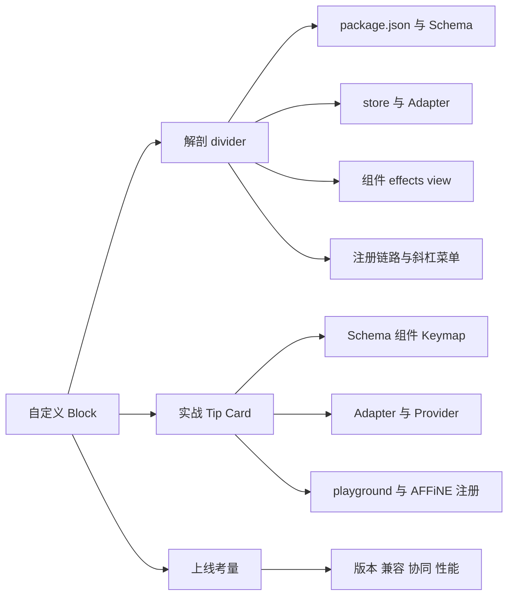
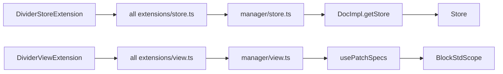

# 第 15 章 自定义 Block 实战

先解剖 divider，再亲手写一个 Tip Card 提示卡片块

第 5 部分 · 编辑器内核 BlockSuite ｜ 难度 ★★★★☆ ｜ 建议学时 8 小时

Note:
前三章我们从数据层、标准库到预置块完整走了一遍 BlockSuite，现在是动手的时候了：自己写一个块。
本章所有教学示例代码都不写入仓库，只供本地实验参照，但用到的每个 API 都与当前源码一致。

---

## 本章导读：解剖 + 实战

| 块 | 规模 | 特点 | 学什么 |
| --- | --- | --- | --- |
| `affine:divider` | 13 个 `.ts`，组件约 50 行 | 无属性、无文本、无子块，四种 Adapter 齐全 | 块的**骨架** |
| `affine:callout` | 14 个 `.ts` | 有属性、`role: 'hub'`、Keymap、Slash 菜单 | 块的**血肉** |

- 第一部分：以 divider 为主线、callout 为补充，读完覆盖全部扩展点
- 第二部分：照同样结构编写**教学示例 Tip Card**：图标、三种样式、富文本、斜杠菜单、导出

Note:
本章分两部分。第一部分解剖仓库里最简单的真实块 divider，必要时对照稍复杂的 callout，把一个块从定义到被用户看见的每个环节对应到具体文件。
第二部分实战，编写一个提示卡片块：有图标、info、warning、success 三种样式、可编辑富文本、能从斜杠菜单插入、能导出 Markdown 和纯文本。
最后讨论 Schema 版本、兼容性、协同这些上线前必须想清楚的问题。

---

## 学习目标

1. 说出块包的标准目录结构与 `package.json` 三段式导出
2. 编写块的 Schema、Model 与 `BlockSchemaExtension`，正确设置嵌套约束
3. 编写 `StoreExtensionProvider` 与 `ViewExtensionProvider`，分清 `effect()` 与 `setup()`
4. 基于 `CaptionedBlockComponent` 与 `<rich-text>` 编写可编辑组件
5. 接入斜杠菜单、快捷键与 Markdown / 纯文本 Adapter
6. 在 playground 验证、在 AFFiNE 注册，并评估版本与协同风险

Note:
六个目标基本就是写一个块的完整流程：包结构、Schema、两个 Provider、组件、交互接入，最后是验证和上线评估。
学完这一章，你应该能独立给 AFFiNE 加一种新块。

---

## 知识地图



Note:
整章就这三条线：解剖 divider、实战 Tip Card、上线考量。
解剖部分按文件顺序走：package.json、Schema、store 侧、view 侧、注册链路。
实战部分照着同样的结构写一遍，最后看怎么在 playground 和 AFFiNE 里跑起来。

---

## divider 的包结构与 package.json

<div class="cols">
<div>

```text
blocks/divider/src/
├── index.ts       公共 API
├── store.ts       Store Provider
├── view.ts        View Provider
├── effects.ts     define 元素
├── divider-block.ts
├── markdown.ts    行内 --- 快捷输入
└── adapters/      四种 Adapter
```

</div>
<div>

```json
"sideEffects": false,
"exports": {
  ".": "./src/index.ts",
  "./view": "./src/view.ts",
  "./store": "./src/store.ts"
}
```

- `exports` 直接指向 `.ts` 源码
- 依赖全部为 `workspace:*`

</div>
</div>

Note:
注意 Schema 不在块包里，而在 blocksuite/affine/model/src/blocks/divider/divider-model.ts，这是预置块的惯例：模型集中在 affine-model 包。
package.json 三个要点：exports 直接指向 TS 源码，monorepo 内由构建工具直接编译；sideEffects 为 false，customElements.define 这种副作用被收敛到 effects.ts，只在 Provider 的 effect 中调用，所以能被安全 tree-shake；依赖都是 workspace 协议，与 tsconfig 的 references 一一对应。

---

## Model：Schema 三件套

```ts [1-9|10-11|12-13]
export const DividerBlockSchema = defineBlockSchema({
  flavour: 'affine:divider',
  metadata: {
    version: 1,
    role: 'content',
    children: [],
  },
  toModel: () => new DividerBlockModel(),
});
type Props = { text: string };
export class DividerBlockModel extends BlockModel<Props> {}
export const DividerBlockSchemaExtension =
  BlockSchemaExtension(DividerBlockSchema);
```

<p class="small">来源：`blocksuite/affine/model/src/blocks/divider/divider-model.ts`（空行与换行有调整）</p>

Note:
第一步，Schema。分割线没有 props，Props 类型里的 text 只是类型占位，Schema 没有默认值，所以不会写入 Yjs。
role 是 content 且没有 parent，parent 缺省为星号，配合 Note 的 children 里的 @content，分割线可以放进 note。children 为空数组表示不允许子块。
第二步，Model 类继承 BlockModel。第三步，用 BlockSchemaExtension 包装成扩展。Schema、Model、SchemaExtension 三件套是所有块模型文件的固定模式。

---

## Store 侧：只放与 DOM 无关的东西

```ts [1-2|4-9]
export class DividerStoreExtension extends StoreExtensionProvider {
  override name = 'affine-divider-block';

  override setup(context: StoreExtensionContext) {
    super.setup(context);
    context.register(DividerBlockSchemaExtension);
    context.register(DividerBlockAdapterExtensions);
  }
}
```

<p class="small">来源：`blocksuite/affine/blocks/divider/src/store.ts`。`DividerBlockAdapterExtensions` 汇总了四个 Adapter 扩展。</p>

Note:
Store 侧的 Provider 非常简单，只注册两样东西：Schema 和 Adapter。
这样服务端渲染、Worker 里的 Markdown 导出、单元测试都可以只加载 store 扩展，完全不碰 DOM。
adapters/extension.ts 把 HTML、Markdown、Notion HTML、纯文本四个扩展汇总成一个数组，一次注册。

---

## Adapter matcher：双向转换

| 字段 | 方向 | divider 的实现 |
| --- | --- | --- |
| `toMatch(o)` | Markdown → Snapshot | `isDividerNode(o.node)`：`thematicBreak` |
| `toBlockSnapshot.enter` | Markdown → Snapshot | `openNode({ flavour: 'affine:divider', ... })` |
| `fromMatch(o)` | Snapshot → Markdown | `o.node.flavour === ...flavour` |
| `fromBlockSnapshot.enter` | Snapshot → Markdown | `openNode({ type: 'thematicBreak' })` |

<p class="small">HTML 匹配 `<hr>`；Notion HTML 只导入（`fromMatch: () => false`）；纯文本只导出 `'---\n'`。</p>

Note:
一个 matcher 包含两个方向：toMatch 判断 Markdown AST 节点是否由本块处理，toBlockSnapshot 用 walkerContext 的 openNode、closeNode 构造快照；fromMatch 和 fromBlockSnapshot 则是反方向。
openNode 的第二个参数 children 指明把新节点挂到当前节点的哪个字段。有子内容的块，比如 callout，会在 enter 里 openNode、在 leave 里 closeNode，让子块输出嵌套进来。
最后用 BlockMarkdownAdapterExtension 包装注册。

---

## View 侧：DividerBlockComponent

```ts [1-2|5|6-10|12|13]
export class DividerBlockComponent
  extends CaptionedBlockComponent<DividerBlockModel> {
  override connectedCallback() {
    super.connectedCallback();
    this.contentEditable = 'false';
    this.handleEvent('click', () => {
      this.host.selection.setGroup('note', [
        this.host.selection.create(BlockSelection, { blockId: this.blockId }),
      ]);
    });
  }
  override renderBlock() { /* <hr /> + this.renderChildren(this.model) */ }
  override accessor useZeroWidth = true;
}
```

<p class="small">来源：`blocksuite/affine/blocks/divider/src/divider-block.ts`（节选）</p>

Note:
组件继承 CaptionedBlockComponent，这是 AFFiNE 块的常用基类。
非文本块必须把 contentEditable 设为 false，否则浏览器会把光标放进 hr 周围。
handleEvent 默认以本块 blockId 为作用域，点击时用 setGroup 设置块选择。renderBlock 渲染 hr 并防御性地调用 renderChildren。
useZeroWidth 会在块末尾渲染零宽占位，让用户点击块下方空白时能创建新段落。

---

## effects.ts 与 view.ts

```ts [1-3|5|6-12]
export function effects() {
  customElements.define('affine-divider', DividerBlockComponent);
}
export class DividerViewExtension extends ViewExtensionProvider {
  override effect() { super.effect(); effects(); }
  override setup(context: ViewExtensionContext) {
    super.setup(context);
    context.register([
      BlockViewExtension('affine:divider', literal`affine-divider`),
      DividerMarkdownExtension,
    ]);
  }
}
```

<p class="small">来源：`divider/src/effects.ts` 与 `view.ts`（节选；`effect()` 合并为一行，省略 `name`）</p>

Note:
分工非常清楚：effect 在每个 Provider 类生命周期内只执行一次，用来定义自定义元素，因为不能重复 define；setup 每次构建扩展列表都会执行，不同 scope、不同配置都会跑。
BlockViewExtension 里的 literal 标签名必须和 customElements.define 的一致。
DividerMarkdownExtension 是行内快捷输入：在段落开头输入三个短横线加空格就转换为分割线，它依赖 InlineEditor，所以注册在 View 侧。

---

## 注册链路：从块包到编辑器



<p class="small">聚合包还需：`all/package.json` 依赖与导出、`all/src/blocks/divider/*` 重导出、`tsconfig` references、`schemas.ts`。</p>

Note:
一个块要被用户看见，需要经过四层注册：块包定义 Provider，聚合包的 getInternalStoreExtensions 和 getInternalViewExtensions 收录，应用侧 manager 展开包含，最终分别进入 Store 和 BlockStdScope。
另外聚合包还要补齐依赖、exports、重导出文件、tsconfig references，Schema 也要进 AffineSchemas 数组。
tools/utils/src/workspace.gen.ts 是自动生成文件，不能手改。

---

## 斜杠菜单接入：两种方式

<div class="cols">
<div>

**divider：经由 note**

- 来自 `rich-text/src/conversion.ts` 的 `textConversionConfigs`
- `NoteSlashMenuConfigExtension` 统一生成
- `when` 检查 `flavourSchemaMap.has(...)`
- 适合可与段落互转的基础块

</div>
<div>

**callout：块包自行注册**

- `SlashMenuConfigExtension('affine:callout', ...)`
- `action` 中 `addBlock` 后
- `await std.host.updateComplete` 再聚焦
- **自定义块推荐这种方式**

</div>
</div>

Note:
在 divider 包里你找不到任何斜杠菜单配置，它的菜单项来自 rich-text 的 textConversionConfigs，由 note 块统一转成菜单项，同一份配置还驱动了快捷键 Mod-Alt-d 和格式工具栏。
callout 则在自己的块包里注册菜单配置。action 中的 model 是触发斜杠菜单时光标所在的块，新块插在它后面。
插入后要等 updateComplete 再聚焦，因为新块的组件要下一轮渲染才存在。自定义块推荐用 callout 这种方式。

---

## Tip Card：需求与设计

| 需求 | 设计决策 | 参照 |
| --- | --- | --- |
| 带图标、可编辑富文本 | `text: Text` + `<rich-text>` | paragraph、callout |
| 三种样式，点击图标切换 | `variant` + `store.updateBlock` | callout |
| 只能放在 note 中，无子块 | `parent: ['affine:note']`、`children: []` | divider |
| 斜杠菜单 / 文末 Enter 跳出 | `SlashMenuConfigExtension`、`KeymapExtension` | callout |
| 导出 Markdown / 纯文本 | `BlockMarkdownAdapterExtension` 等 | paragraph |
| 不与官方冲突 | flavour 用 `custom:tip-card` | 命名约定 |

Note:
进入实战。每条需求都有对应的设计决策，并且都能在真实块里找到参照，这就是我们读源码的意义。
第三方块要用自定义命名空间，比如 custom:tip-card，避免与官方 affine 前缀冲突。
文件结构与 divider 一致：model、block、styles、effects、keymap、slash-menu、adapters、store、view，外加一个单测。

---

## Tip Card：Schema

```ts [1-2|4|5-8|9-11|12]
export type TipCardVariant = 'info' | 'warning' | 'success';
export type TipCardProps = { variant: TipCardVariant; text: Text };
export const TipCardBlockSchema = defineBlockSchema({
  flavour: 'custom:tip-card',
  props: (internal): TipCardProps => ({
    variant: 'info',
    text: internal.Text(),
  }),
  metadata: {
    version: 1, role: 'content', parent: ['affine:note'], children: [],
  },
  toModel: () => new TipCardBlockModel(),
});
```

<p class="small">教学示例 `tip-card-model.ts`（参照 `callout-model.ts`，有压缩）。`TipCardBlockModel` 覆盖 `isEmpty()`。</p>

Note:
Schema 声明了 variant 和 text 两个属性，text 必须用 internal.Text 创建，这样才是 Y.Text，能字符级协同合并。
校验推演一下：本块 parent 是 affine:note，Note 的 children 含 @content，本块 role 是 content，双向成立，合法。放到根块下就会失败。
但要注意，addBlock 不会抛出 SchemaValidateError，异常被 transact 吞掉只打印错误，需要可靠判断时先用 store.schema.safeValidate。

---

## Tip Card：组件渲染

```ts [2|3-4|5-6|7-12]
override renderBlock() {
  const variant = this.model.props.variant$.value;
  return html`<div class=${classMap({
    'custom-tip-card': true, [`custom-tip-card--${variant}`]: true })}>
    <span class="custom-tip-card__icon" contenteditable="false"
      @click=${this._cycleVariant}>${TIP_CARD_ICONS[variant]}</span>
    <rich-text
      .yText=${this.model.props.text.yText}
      .inlineEventSource=${this.topContenteditableElement ?? nothing}
      .undoManager=${this.store.history.undoManager}
      .enableClipboard=${false} .enableUndoRedo=${false}
    ></rich-text>
  </div>`;
}
```

<p class="small">教学示例 `tip-card-block.ts`（节选压缩，其余 `<rich-text>` 属性与 `paragraph-block.ts` 一致）</p>

Note:
第一步读 variant$.value，这是 signal，切换样式时组件自动重渲染。
第二步用 classMap 按 variant 切换样式类。第三步图标区设 contenteditable false，否则点击会把光标放进 emoji；点击调用 _cycleVariant，里面用 store.updateBlock 切换样式，可撤销。
第四步渲染 rich-text，绑定 yText；剪贴板和撤销交给编辑器全局处理，与段落一致。另外组件覆盖了 topContenteditableElement，保证在白板的 note 中事件源正确。

---

## Tip Card：文末 Enter 跳出

```ts [1|4-5|7|8-12|14]
export const TipCardKeymapExtension = KeymapExtension(
  std => ({
    Enter: ctx => {
      const raw = ctx.get('keyboardState').raw;
      if (raw.isComposing) return;
      // ... 取 TextSelection、model、parent、index，不满足则 return
      if (text.from.index !== model.props.text.length) return;
      raw.preventDefault();
      std.store.captureSync();
      const id = std.store.addBlock('affine:paragraph', {}, parent, index + 1);
      focusTextModel(std, id);
      return true;
    },
  }), { flavour: TipCardBlockSchema.model.flavour });
```

<p class="small">教学示例 `keymap.ts`（参照 `callout-keymap.ts`，节选）</p>

Note:
这个快捷键扩展完美体现了第 13 章的事件系统。第一步用 KeymapExtension 注册；第二步检查 isComposing，输入法选词时不能触发。
第三步，不在文末就直接 return，交给 InlineEditor 默认行为软换行。
第四步在文末时，先 captureSync 切分撤销单元，再在卡片后新建段落并聚焦，返回 true 停止传播。
最后的 flavour 选项让它只在选择落在 Tip Card 上时生效。

---

## Tip Card：Markdown Adapter

```ts [1-4|5-8|9-12]
export const tipCardMarkdownAdapterMatcher: BlockMarkdownAdapterMatcher = {
  flavour,
  toMatch: () => false, toBlockSnapshot: {}, // 只支持导出
  fromMatch: o => o.node.flavour === flavour,
  fromBlockSnapshot: {
    enter: (o, context) => {
      const { walkerContext, deltaConverter } = context;
      const variant = String(o.node.props.variant ?? 'info').toUpperCase();
      walkerContext
        .openNode({ type: 'blockquote', children: [] }, 'children')
        // ... 内层 paragraph：`[!${variant}] ` + 文本，再两次 closeNode()
    },
  },
};
```

<p class="small">教学示例 `adapters.ts`（节选）。导出形如 `> [!INFO] 这是一条提示`。</p>

Note:
Adapter 和 divider 的结构一样。教学示例只支持导出，toMatch 返回 false，导入留作练习。
导出时先开一个 blockquote 节点，内部 paragraph 以 [!INFO] 前缀开头，再用 deltaConverter 把富文本 delta 转成 Markdown AST，最后两次 closeNode。
这与 GitHub 的 alert 语法相近。纯文本 Adapter 类似，输出方括号 variant 加文本。

---

## Tip Card：View Provider

```ts [2-7|9|10-12]
const flavour = TipCardBlockSchema.model.flavour;
export const TipCardViewExtensions: ExtensionType[] = [
  FlavourExtension(flavour),
  BlockViewExtension(flavour, literal`custom-tip-card`),
  TipCardKeymapExtension,
  SlashMenuConfigExtension(flavour, tipCardSlashMenuConfig),
];
export class TipCardViewExtension extends ViewExtensionProvider {
  override effect() { super.effect(); effects(); }
  override setup(context: ViewExtensionContext) {
    super.setup(context);
    context.register(TipCardViewExtensions);
  }
}
```

<p class="small">教学示例 `view.ts`（省略 `name`）。Store 侧 `TipCardStoreExtension` 注册 Schema 与两个 Adapter。</p>

Note:
View 侧把四个扩展汇总成数组：FlavourExtension、视图、快捷键、斜杠菜单配置。斜杠菜单的 when 里同样检查 flavourSchemaMap.has，没注册 Schema 的 Store 就不显示。
除了 Provider，还单独导出了扩展数组，这样在 playground 这类已有 Manager、不便追加 Provider 的环境里可以直接拼接。
Store 侧对称地导出 TipCardStoreExtensions 数组和 TipCardStoreExtension Provider。

---

## 运行验证与应用注册

<div class="cols">
<div>

**playground（本地，不提交）**

- 放到 `playground/apps/_common/tip-card/`
- `collection.ts` 追加 `TipCardStoreExtensions`
- `extensions.ts` 追加 `TipCardViewExtensions`
- 模块顶层调用一次 `effects()`

</div>
<div>

**AFFiNE 应用（方式 A）**

- 放到 `core/src/blocksuite/` 下
- `manager/store.ts` 加 `TipCardStoreExtension`
- `manager/view.ts` 加 `TipCardViewExtension`
- 参照 `affine:transcription` 块

</div>
</div>

Note:
playground 用 yarn workspace @blocksuite/playground dev 启动，地址 5173。因为直接拼接扩展数组、不经过 Provider 的 effect，所以要手动调用一次 effects。
为什么不新建 ViewExtensionManager？因为它会在结果末尾附带把自身注册为 Manager 标识符的扩展，覆盖主 Manager。
AFFiNE 自己就有先例：AI 的 transcription 块定义在应用内，由 AIStoreExtension 和 AIViewExtension 注册。方式 B 是作为 BlockSuite 内置块，适合计划贡献上游的通用块。

---

## 上线前：版本、兼容与协同

| 变更类型 | 升版本？ | 做法 |
| --- | --- | --- |
| 新增可选属性 | 否 | 给默认值，`_parseYBlock` 为老数据补写 |
| 新增枚举值 | 否 | 读取时容错，未知值回退默认样式 |
| 属性重命名 / 改类型 | 尽量避免 | 新增属性 + 兼容旧属性读取 |
| 结构性变化 | 是 | 接受老客户端版本不匹配，或定义新 flavour |

<div class="callout warn">

Store 扩展必须**全局一致注册**；不要在 `renderBlock` / `connectedCallback` 中写 Yjs。

</div>

Note:
当前 BlockSuite 只做版本校验不做迁移，改 version 老数据就显示 Block Version Mismatched，所以优先兼容式演进。
真实反例：callout 的 Schema 已经用 icon，Markdown Adapter 还在读写 emoji，Schema 演进时要同步审视 Adapter 和测试快照。
协同方面：富文本必须用 Text；渲染和挂载时写 Yjs 会导致"打开即修改"；本地 UI 状态不要写入文档。
Schema 必须在所有可能打开该文档的客户端注册，否则未注册的客户端会跳过这个块。

---

## 源码导读 Top 5

| 优先级 | 路径 | 看什么 |
| --- | --- | --- |
| P0 | `blocksuite/affine/blocks/divider/` | 块包最小完整结构 |
| P0 | `blocksuite/affine/model/src/blocks/divider/divider-model.ts` | Schema 三件套 |
| P0 | `blocksuite/affine/blocks/callout/src/view.ts`、`configs/slash-menu.ts` | Slash 菜单与快捷键 |
| P0 | `blocksuite/affine/blocks/callout/src/callout-block.ts` | 属性驱动渲染 |
| P1 | `blocksuite/playground/apps/starter/` | playground 装配 |

Note:
divider 的全部文件加起来也不多，建议完整读一遍。
callout 是自定义块最好的参照，斜杠菜单、快捷键、属性驱动渲染、topContenteditableElement 都能在这里找到。
测试方面，可以看 blocksuite/affine/all/src/__tests__/adapters 下的 plain-text 单测，学习用 createJob 和 getProvider 测 Adapter。

---

## 动手实践

| 练习 | 验收标准 |
| --- | --- |
| 1 divider 注册地图 | 找到至少 8 处引用，说明生成文件为何不能手改 |
| 2 playground 跑通 Tip Card | 快照中出现 `custom:tip-card`，两标签页同步 |
| 3 补全 Markdown 导入 | round-trip 快照一致，普通引用不受影响 |
| 4 模拟 Schema 演进 | 解释补写默认值与版本不匹配两种现象 |
| 5 AFFiNE 中注册（可选） | 可插入导出；能解释未注册客户端的报错 |

Note:
练习 1 用 Grep 搜索 DividerStoreExtension 等标识符，画出注册地图。
练习 2 是本章的主线练习，用 ?room=test 打开两个标签页验证协同。
练习 3 参照 callout 的 Markdown adapter，注意不要与 callout 的匹配冲突。练习 4 先加可选属性再改 version，对比两种现象。

---

## 自测

1. `effect()` 与 `setup()` 分别放什么？把 `define` 放进 `setup()` 会怎样？
2. 只在 View 侧注册了 Tip Card、忘了 Store 侧，会出现什么现象？
3. 新增一个可选属性需要升级 `version` 吗？

<div class="fragment">

**答案**：① `effect()` 只执行一次放 `customElements.define`，`setup()` 按 scope 注册扩展；放进 `setup()` 会重复定义抛错；② `when` 返回 false，强行 `addBlock` 只打印 `schema ... not found`；③ 不需要，老数据由 `_parseYBlock` 补写默认值

</div>

Note:
三道题覆盖 Provider 分工、注册一致性和版本策略。
第二题反过来也要会：只注册 Store 不注册 View，数据正常但 EditorHost 打印 Cannot find render flavour，块不渲染。

---

## 常见坑

- 斜杠菜单搜不到：未注册 `SlashMenuConfigExtension`，或 `when` 返回 false
- `addBlock` 返回 id 却没插入：父块不在 `parent` 白名单，异常被 `transact` 吞掉
- `Cannot find render flavour`：`literal` 标签名与 `define` 不一致
- `Failed to execute 'define'`：元素被重复定义
- 修改属性撤销不了：直接给 `x$.value` 赋值，改用 `store.updateBlock`
- 改 `version` 后显示 "Block Version Mismatched"：撤回，改兼容式演进

Note:
这些坑基本都和前几章的原理对应：transact 吞异常、DI 找不到 View、effect 只执行一次、origin 决定撤销。
遇到问题先看控制台，再对照这张表定位。新建正式块包后找不到模块，通常是没补齐聚合包或没执行 yarn affine init。

---

## 小结与下一步

- 块 = Schema 三件套 + Store Provider + View Provider + 组件 + effects
- Store 侧只放 Schema 与 Adapter；`effect()` 只定义元素一次
- 斜杠菜单推荐块包自行注册；Adapter 用 matcher 双向转换
- 注册需穿过块包 → 聚合包 → manager → Store / `BlockStdScope`
- 上线前：兼容式演进、全局一致注册、渲染中不写数据

<div class="callout">

**下一章**：第 16 章 前端基础设施：DI 与 LiveData——回到 React 应用层。

</div>

Note:
到这里，编辑器内核部分就全部结束了：数据层、标准库、预置块，再加上亲手写的自定义块。
下一章我们回到 React 应用层，看 AFFiNE 前端的另一套 DI 和 LiveData 基础设施，可以和 BlockSuite 的 DI 对比着学。
