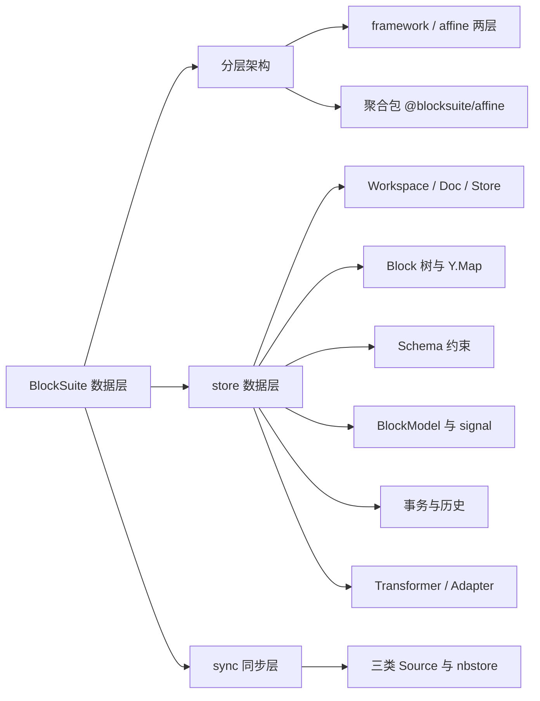
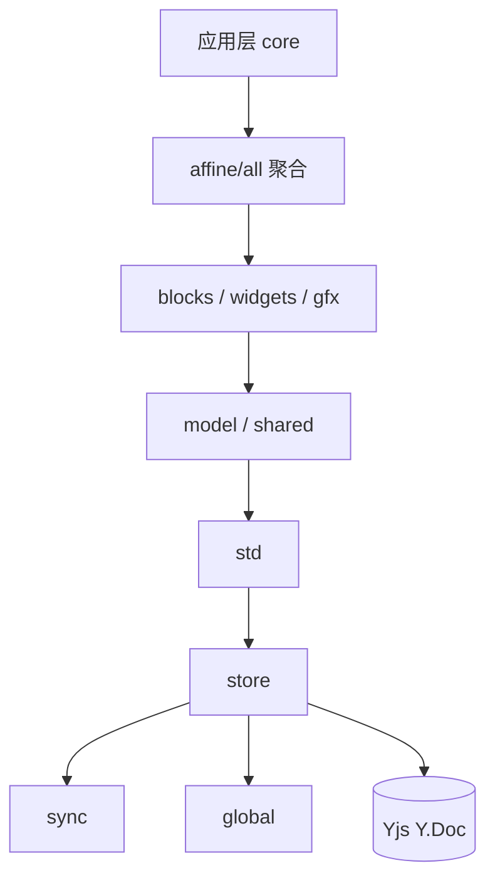
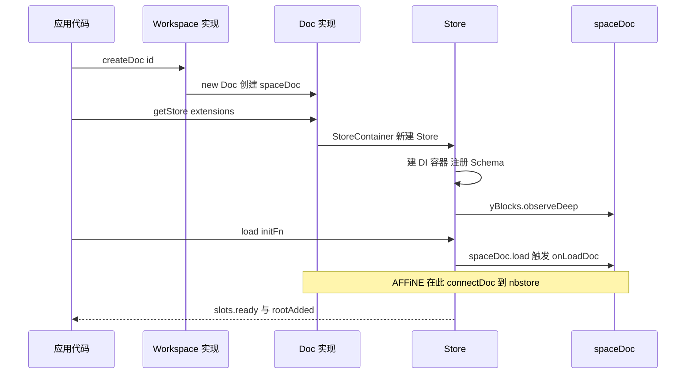
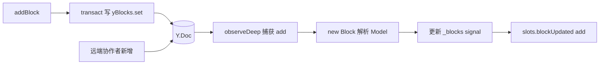
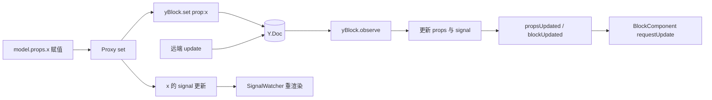
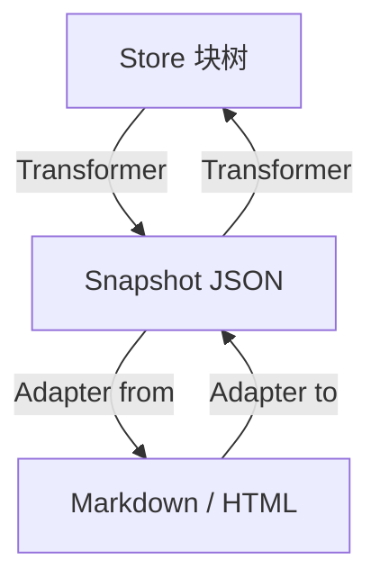
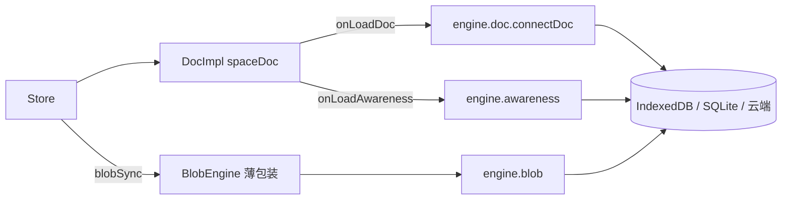

# 第 16 章 BlockSuite 架构与 Store 数据层

> 自底向上：先看清分层，再吃透那棵存在 Yjs 里的 Block 树

第 5 部分 · 编辑器内核 BlockSuite ｜ 难度 ★★★★☆ ｜ 建议学时 10 小时

===

## 本章要解决的问题

<p class="lead">BlockSuite 是“构建编辑器的框架”，不是“一个编辑器”。它之于 AFFiNE，就像 Monaco 之于 VS Code。</p>

几乎所有“编辑”能力——文档页、白板、数据库视图、富文本、协同光标——都来自仓库的 `blocksuite/` 目录；React 应用层 `packages/frontend/core` 只负责把这台“发动机”装进车壳。

<div class="note note--warn">

学 BlockSuite 最容易犯的错误，是一上来就钻进某个块的 Lit 渲染代码，被扩展注册、DI、Signal、Yjs 事件一起绕晕。**正确顺序是自底向上**：先看清分层，再吃透数据层 `@blocksuite/store`，最后（第 17 章）才看 `@blocksuite/std` 如何把数据变成 DOM。

</div>

<div class="cards cols-3">
  <div class="card"><div class="card__icon">🧱</div><h4>分层</h4><p>framework 四包 + affine 预置层，依赖只能自上而下。</p></div>
  <div class="card"><div class="card__icon">🌲</div><h4>Block 树</h4><p>所有块都是存在 Yjs 里的一棵扁平树，视图只是投影。</p></div>
  <div class="card"><div class="card__icon">🔁</div><h4>响应式</h4><p>先写 CRDT，再由事件驱动模型与视图：ui = f(data)。</p></div>
</div>

===

## 知识地图

本章围绕“数据”展开，分三大块：**分层架构 → store 数据层 → sync 同步层**。store 是重头戏。



<div class="note">

本章路径均相对仓库根目录 `AFFiNE/`，对应 `@affine/monorepo` 0.27.5（canary）。我们会对照 `blocksuite/docs-site/guide` 指出文档落后于源码之处——在 BlockSuite 里这很普遍，务必养成“以源码为准”的习惯。

</div>

===

## 学习目标

学完本章，你应当能够：

<ol class="goals">
  <li>画出 framework / affine 两层架构，说清 <code>global</code>、<code>store</code>、<code>sync</code>、<code>std</code> 的职责边界</li>
  <li>说清 <code>Workspace</code>、<code>Doc</code>、<code>Store</code> 的关系，并指出它们在 AFFiNE 中由哪个类实现</li>
  <li>描述 Block 在 Yjs 中的存储布局（<code>sys:*</code> / <code>prop:*</code>），并跟踪 <code>store.addBlock()</code> 的执行路径</li>
  <li>用 <code>defineBlockSchema</code> 正确设置 <code>role</code>、<code>parent</code>、<code>children</code>、<code>version</code>，理解 <code>@role</code> 与 glob 匹配</li>
  <li>区分 <code>model.props.x</code> 与 <code>model.props.x$</code>，并说清一次赋值如何落到 <code>Y.Map</code> 再刷新视图</li>
  <li>用 <code>transact</code>、<code>captureSync</code>、<code>withoutTransact</code> 控制撤销栈；用 <code>Transformer</code> 完成 Doc ↔ Snapshot</li>
</ol>

===

<!-- section -->
## 一、分层架构：先看清包的边界

哪些包是“框架”、哪些是“AFFiNE 预置”？依赖方向是什么？想清楚这件事，后面的扩展、DI、响应式才不会乱。

===

## framework 四包与 affine 预置层

框架层 `blocksuite/framework/` 是与具体业务无关的内核，共四个包：

<div class="cards">
  <div class="card"><h4><code>@blocksuite/global</code></h4><p>DI 容器、Disposable、错误码、几何计算、Lit 混入、平台判断。</p></div>
  <div class="card"><h4><code>@blocksuite/store</code></h4><p>Workspace/Doc 接口、Store、Block 树、Schema、响应式代理、事务、Transformer。</p></div>
  <div class="card"><h4><code>@blocksuite/sync</code></h4><p>DocSource / BlobSource / AwarenessSource 抽象与参考 Engine。</p></div>
  <div class="card"><h4><code>@blocksuite/std</code></h4><p>BlockStdScope、EditorHost、BlockComponent、事件/命令/选择/Inline（第 17 章）。</p></div>
</div>

预置层 `blocksuite/affine/` 是 AFFiNE 用到的块与能力：`model`（Schema/Model）、`blocks/*`（每块一包）、`widgets/*`、`inlines/*`、`gfx/*`、`data-view`、`rich-text`/`shared`/`components`、`fragments/*`、`foundation`/`ext-loader`，最后由 `all` 聚合为 `@blocksuite/affine`。

<div class="note note--warn">

`blocksuite/framework/global/src/index.ts` 只有一行 `export {};`——必须用 `@blocksuite/global/di`、`/disposable` 等**子路径**导入，以利 tree-shaking 并避免循环依赖。

</div>

===

## 依赖只能自上而下

<div class="split">
<div class="split__main">

这张图最该记住的是**箭头方向**：

- `store` 不依赖 `std`；
- `std` 不依赖任何 `affine-*` 包；
- `@blocksuite/affine`（聚合包）是应用层的**唯一入口**。

每个块包都按 **`.`（公共 API）/ `./store`（无 DOM 数据扩展）/ `./view`（视图扩展）** 三段式导出。`store`/`view` 分离很关键：服务端做 Markdown 导出只需 Schema 与 Adapter，**不应加载任何 Lit 组件**。

</div>
<div class="split__aside">



</div>
</div>

===

<!-- section -->
## 二、三层数据容器

`Workspace` → `Doc` → `Store`，粒度从“一个工作区”到“文档的一个数据切片”。注意：**Workspace 与 Doc 只是接口，Store 才是具体类**。

===

## Workspace / Doc / Store 各管什么

<div class="cards cols-3">
  <div class="card"><div class="card__icon">🗂️</div><h4>Workspace</h4><p>一个工作区。持有根 <code>Y.Doc</code>；管理多个 Doc、元信息、ID 生成器、Blob 引擎。</p></div>
  <div class="card"><div class="card__icon">📄</div><h4>Doc</h4><p>一篇文档。持有 <code>spaceDoc</code> 与 <code>yBlocks = spaceDoc.getMap('blocks')</code>；负责加载/卸载、创建 Store。</p></div>
  <div class="card"><div class="card__icon">✍️</div><h4>Store</h4><p>文档的一个数据切片。Block CRUD、Schema 校验、事务与撤销、扩展 DI 容器、Transformer 入口。</p></div>
</div>

这与**旧文档**的 `DocCollection`、`doc.addBlock` 大不相同。谁来实现接口？

<div class="compare">
  <div class="compare__col"><h4>测试 / playground</h4>

- `TestWorkspace`（注释写明 Test only）
- `TestDoc`
- 完整使用 `@blocksuite/sync` 三类 Engine

  </div>
  <div class="compare__col compare__col--good"><h4>AFFiNE 应用</h4>

- `WorkspaceImpl`（`core/.../workspace/impls/workspace.ts`）
- `DocImpl`（同目录 `doc.ts`）
- 同步交给 nbstore

  </div>
</div>

===

## 一个 Doc 可以有多个 Store

主编辑器的可编辑 Store、引用预览的 `readonly` Store、带 `query` 过滤的 Store……`StoreContainer` 按 `id` 或 `{ readonly, query }` 缓存。

<div class="annotate">

```ts [1-3|4|6-7]
if (readonly || query) {
  idOrOptions = { readonly, query };
} else if (!id) {
  idOrOptions = this.doc.workspace.idGenerator();
} else { idOrOptions = id; }
const key = this._getQueryKey(idOrOptions);
if (this._storeMap.has(key)) return this._storeMap.get(key);
```

<ol class="annotate__notes">
  <li><b>第 3–4 行</b>：不传 <code>id</code> 又不传 <code>readonly/query</code> 时会<b>生成新 id</b>。</li>
  <li><b>影响</b>：AFFiNE 的 <code>DocImpl.getStore()</code> 原样透传 <code>id</code>，所以不传参每次都新建 Store，<b>复用必须传 id</b>；而 <code>TestDoc</code> 未传 id 时默认用 <code>spaceDoc.guid</code>，多次调用拿到同一个。两种实现行为不同。</li>
</ol>
</div>

===

## 文档生命周期

从 `createDoc` 到视图可感知的 `slots.ready`，关键是 `onLoadDoc` 钩子——AFFiNE 正是在这里把 Y.Doc 交给 nbstore。



<div class="note">

`Store.slots` 是一组 RxJS `Subject`：`ready`、`rootAdded`、`rootDeleted`、`blockUpdated`（`add`/`delete`/`update`）。视图层对“数据变了”的感知几乎都来自 `blockUpdated` 与 `BlockModel.propsUpdated`。

</div>

===

## 初始化文档的标准姿势

挂编辑器前**必须先初始化根块**，否则 `EditorHost.connectedCallback` 在 `store.root` 为空时抛 `NoRootModelError`。

<div class="annotate">

```ts [1-3|4-9|10]
const doc = collection.getDoc(id) ?? collection.createDoc(id);
const store = doc.getStore();
doc.clear();
doc.load(() => {
  const rootId = store.addBlock('affine:page', { title: new Text() });
  store.addBlock('affine:surface', {}, rootId);
  const noteId = store.addBlock('affine:note', {}, rootId);
  store.addBlock('affine:paragraph', {}, noteId);
});
store.resetHistory();
```

<ol class="annotate__notes">
  <li><b>第 4–9 行</b>：AFFiNE 文档的最小合法结构 <code>page</code>(root) → <code>surface</code>(画布) + <code>note</code>(文档流) → <code>paragraph</code>。</li>
  <li><b>第 10 行</b>：初始化不应进撤销栈，<code>resetHistory()</code> 清空历史。</li>
</ol>
</div>

===

<!-- section -->
## 三、Block 树：Yjs 里的扁平存储

父子不嵌套存，而是用 id 引用。理解这一点，才能看懂写路径与协同为何如此设计。

===

## 扁平存储 + id 引用

<div class="split">
<div class="split__main">

`doc.yBlocks` 是 `Y.Map<YBlock>`，键为 block id，值为一个 `Y.Map`。**父子关系由父块的 `sys:children`（`Y.Array<string>`）引用 id 表达**，而不是把子块嵌套进父块。

这样做的好处：

- 移动块只改两个 `Y.Array`；
- 按 id 查找 O(1)；
- 协同冲突粒度更细。

</div>
<div class="split__aside">

```text
yBlocks (Y.Map)
└── "block-abc" (YBlock)
    ├── sys:id       = "block-abc"
    ├── sys:flavour  = "affine:paragraph"
    ├── sys:version  = 1
    ├── sys:children = Y.Array ["block-def"]
    ├── prop:type    = "text"
    └── prop:text    = Y.Text("Hello")
```

</div>
</div>

===

## 跟踪 store.addBlock()

`addBlock` 只做只读检查、生成 id、包事务，再委托 `DocCRUD` 写 Yjs。

<div class="annotate">

```ts [2|3|4|5-6]
addBlock(flavour, blockProps = {}, parent?, parentIndex?) {
  if (this.readonly) throw new BlockSuiteError(/* 只读直接抛 */);
  const id = blockProps.id ?? this._doc.workspace.idGenerator();
  this.transact(() => {
    this._crud.addBlock(id, flavour, { ...blockProps },
      typeof parent === 'string' ? parent : parent?.id, parentIndex);
  });
  return id;
}
```

<ol class="annotate__notes">
  <li><b>第 2 行</b>：只读检查在 <code>transact</code> 之前，只读模式会真正抛出异常。</li>
  <li><b>第 4–6 行</b>：CRUD 在 <code>transact</code> 内，Schema 校验失败等异常被 try/catch <b>吞掉只打印</b>，<code>addBlock</code> 仍返回预生成的 id。</li>
</ol>
</div>

<div class="note note--warn">

四个易忽视语义：① 不传 parent 默认挂到 root 下；② 校验失败不抛给调用方；③ 值为 `undefined` 的属性不写入 Yjs；④ `native2Y` 把数组转 `Y.Array`、对象转 `Y.Map`、`Text` 转 `Y.Text`。

</div>

===

## 关键：Block 对象由 Yjs 事件创建

写入 Yjs 后，Store 构造时注册的 `observeDeep` 回调捕获 `add` 事件，才真正创建 `Block` 与 `Model`：



<ul class="takeaways">
  <li>本地 <code>addBlock</code> 与远端协作者新增，走的是<b>完全相同</b>的 Yjs 事件路径——这正是 <code>ui = f(data)</code> 的体现。</li>
</ul>

===

<!-- section -->
## 四、Schema：用 defineBlockSchema 声明块

flavour + 默认 props 工厂 + 嵌套约束 + 版本。约束靠 flavour glob 与 `@role` 的双向匹配。

===

## 一个真实的 Schema

以段落块为例，看 `defineBlockSchema` 各字段：

<div class="annotate">

```ts [2|3-7|8-12|13]
export const ParagraphBlockSchema = defineBlockSchema({
  flavour: 'affine:paragraph',
  props: (internal) => ({
    type: 'text',
    text: internal.Text(),
    collapsed: false,
  }),
  metadata: {
    version: 1,
    role: 'content',
    parent: ['affine:note', 'affine:database', 'affine:list'],
  },
  toModel: () => new ParagraphBlockModel(),
});
```

<ol class="annotate__notes">
  <li><b>props 是函数</b>：返回默认属性，<code>internal.Text()</code> 建 <code>Text</code>、<code>internal.Boxed(v)</code> 建 <code>Boxed</code>。</li>
  <li><b>metadata.parent</b>：允许的父块。Note 则用 <code>parent: ['@root']</code>、<code>children: ['@content', …]</code>。</li>
</ol>
</div>

<div class="note">

**`@` 前缀表示按 role 匹配**：任何 `role: 'content'` 的新块，无需改 Note 的 Schema 就能放进 Note。普通字符串则用 `minimatch` 做 **glob** 匹配（如 Surface 的 `'affine:embed-*'`）。

</div>

===

## role 与 version 的两个真相

<div class="compare">
  <div class="compare__col"><h4>文档说法</h4>

- role 只有 `root`/`hub`/`content` 三种
- hub/content 有隐式嵌套规则
- props 不应用 `undefined`

  </div>
  <div class="compare__col compare__col--good"><h4>源码事实</h4>

- `RoleType = 'root' | 'content' | string`，可自定义
- 只特殊处理 `root`；其余 role 仅在 `@role` 匹配时生效
- 官方块大量用 `undefined` 默认值

  </div>
</div>

<div class="note note--danger">

**version 只校验、不迁移**。改 `version` 是破坏性操作：`BlockComponent.isVersionMismatch` 一旦发现不一致，直接渲染 “Block Version Mismatched” 警告而非内容。在 `framework`、`affine` 全局搜 `migrat`/`upgrade` **没有任何迁移实现**。AFFiNE 的实践是“兼容式演进”：新增可选属性、读取容错，而非升版本。

</div>

===

<!-- section -->
## 五、响应式：props 如何落到 Y.Map

`SyncController` 用 Proxy + Signal，在 `model.props` 与 `Y.Map` 之间建立双向绑定。

===

## props 的双形态：值与 signal

`SyncController._createModel` 为每个 prop 同时生成“值”与“`$` signal”：

<div class="compare">
  <div class="compare__col"><h4><code>model.props.type</code></h4>

- 类型：**值**
- 用途：读取 / 赋值写入 Yjs

  </div>
  <div class="compare__col compare__col--good"><h4><code>model.props.type$</code></h4>

- 类型：**Signal**
- 用途：在渲染、`computed`、`effect` 中读取可被追踪；给 `.value` 赋值同样写 Yjs

  </div>
</div>

<div class="note note--tip">

口诀：**读写用 `x`，追踪用 `x$`**。`BlockModel` 用映射类型 `SignaledProps<Props>` 声明了所有 `` `${P}$` `` 形式的 signal 属性。渲染里推荐读 `x$.value`，让 `SignalWatcher` 自动收集依赖。

</div>

===

## 写路径与读路径

一次赋值如何同时落到 Yjs 又刷新视图？两条路径一起保证：



<div class="note note--warn">

**直接赋值不自动包事务**：`this.model.props.icon$.value = x` 会产生 origin 为 `null` 的独立 Yjs 事务（不可撤销）；而 `store.updateBlock(model, { type: 'h1' })` 先 `schema.validate` 再 `transact`（origin 为 `clientID`，可撤销）。

</div>

===

<!-- section -->
## 六、事务、Transformer 与同步

origin 决定能否撤销；Transformer 管 Block 树 ↔ 快照；sync 在 AFFiNE 里交给 nbstore。

===

## 事务 origin 决定能否撤销

`HistoryExtension` 的 `Y.UndoManager` 只追踪一个 origin：`spaceDoc.clientID`。

| 写入方式 | origin | 可撤销 |
| --- | --- | --- |
| `transact` / `addBlock` / `updateBlock` | `clientID` | ✅ |
| `withoutTransact(() => …)` | `null` | ❌（适合初始化、AI 流式中间态） |
| 事务外直接 `model.props.x = v` | `null` | ❌ |
| 远端协作者更新 | 对方 origin | ❌ |

<div class="note note--tip">

`store.captureSync()` 调 `undoManager.stopCapturing()`，把默认 500ms 内合并的变更**切成独立撤销项**。段落拆分命令就在回车前调用它，保证“回车拆分”是单独一步可撤销。

</div>

===

## Transformer：Block 树 ↔ 快照 ↔ 外部格式

<div class="split">
<div class="split__main">

Yjs 二进制适合同步，却不适合复制粘贴、导入导出。于是有了 **JSON 快照**（嵌套树，与 Yjs 扁平存储相反）：

- `Transformer` 做 Block 树 ↔ Snapshot；
- 块级差异交给 Schema 的 `transformer`（如图片块搬运 blob 资源）；
- 横切逻辑交给**中间件**（订阅 `beforeExport` 等）；
- `Adapter` 再把快照对接 Markdown / HTML / 纯文本。

</div>
<div class="split__aside">



</div>
</div>

<div class="note note--warn">

文档差异：旧文档的 `new Job({ collection })` 已更名为 **`Transformer`**，参数为 `{ schema, blobCRUD, docCRUD, middlewares }`；且 `docToSnapshot` 现为**同步**方法。最便捷的获取方式是 `store.getTransformer(middlewares)`。

</div>

===

## sync 与 nbstore 的关系

`@blocksuite/sync` 定义三类 Source（`DocSource`/`BlobSource`/`AwarenessSource`），但在 **AFFiNE 生产环境里 `DocEngine` 不参与文档同步**。



<ul class="takeaways">
  <li><code>WorkspaceImpl</code> 只用 <code>BlobEngine</code> 包装转发到 nbstore；文档与 awareness 通过 <code>onLoadDoc</code>/<code>onLoadAwareness</code> 交给 nbstore（第 23 章）。</li>
  <li>这正是框架把 <code>Workspace</code>/<code>Doc</code> 设计成<b>接口</b>的原因：宿主可挂任意 provider。</li>
</ul>

===

## 动手实践

<ol class="steps">
  <li><h4>画出包依赖链</h4><p>查看 callout、model、std 的 <code>package.json</code> 依赖，用 Mermaid 画出 callout → … → store/global。<b>验收</b>：图中没有 <code>framework/*</code> 指向 <code>affine/*</code> 的箭头。</p></li>
  <li><h4>用单测观察存储布局</h4><p>仿 <code>store/src/__tests__/block.unit.spec.ts</code> 建 page + note，打印 <code>store.doc.yBlocks.toJSON()</code>，对 <code>title$</code> 建 effect 再改 <code>title</code>。<b>验收</b>：输出含 <code>sys:flavour</code>/<code>prop:title</code>，effect 被触发。</p></li>
  <li><h4>验证撤销单元切分</h4><p>连续 addBlock 两次 → <code>captureSync()</code> → 再一次；undo 两次。<b>验收</b>：第一次只撤最后一块，第二次撤前两块；<code>withoutTransact</code> 添加的不可撤销。</p></li>
  <li><h4>玩转 Transformer</h4><p>playground 控制台 <code>job.docToSnapshot(store)</code>，写中间件在 <code>afterExport</code> 统计块数。<b>验收</b>：统计值与 <code>store.blockSize</code> 一致。</p></li>
</ol>

===

## 自测：点击揭晓答案

<details class="quiz">
<summary>Q1. 段落块在 Yjs 中如何存储？父子关系保存在哪里？</summary>

存在 `spaceDoc.getMap('blocks')` 中、以 id 为键的 `Y.Map`，含 `sys:id/flavour/version/children` 和 `prop:*`（`prop:text` 为 `Y.Text`）。父子关系保存在**父块的 `sys:children`**（`Y.Array<string>`）里，而非嵌套。

</details>

<details class="quiz">
<summary>Q2. model.props.type 与 model.props.type$ 有何区别？computed 里该读哪个？</summary>

前者是值，后者是 `Signal`。`computed`/`effect` 只能追踪 `$` 版本；渲染里也推荐读 `type$.value`，让 `SignalWatcher` 自动收集依赖。

</details>

<details class="quiz">
<summary>Q3. 为什么事务外 model.props.x = v 无法撤销，而 store.updateBlock 可以？</summary>

事务外赋值的 Yjs origin 为 `null`，不在 `UndoManager` 的 `trackedOrigins` 中；`updateBlock` 内部 `transact` 使用 `clientID` 作为 origin，正是被追踪的那个。

</details>

===

## 小结与下一步

<ul class="takeaways">
  <li>BlockSuite = 框架层（global/store/sync/std）+ 预置层，以 <code>@blocksuite/affine</code> 聚合；依赖只能自上而下。</li>
  <li><code>Workspace</code>/<code>Doc</code> 由宿主实现，<code>Store</code> 是聚合根：Schema、CRUD、Block 集合、扩展容器都挂在它身上。</li>
  <li>Block 树扁平存于 Yjs：写走 <code>Store → DocCRUD → Yjs</code>，读来自 Yjs 事件驱动的 signal。</li>
  <li>Schema 用 flavour glob + <code>@role</code> 约束嵌套，<code>version</code> 只校验不迁移。</li>
  <li><code>SyncController</code> 用 Proxy + Signal 双向绑定 <code>model.props</code> ↔ <code>Y.Map</code>；origin 决定可否撤销。</li>
</ul>

<div class="note note--tip">

**下一章预告**：第 17 章进入 `@blocksuite/std`——`BlockStdScope` 以 Store 的 provider 为父级，把这棵数据树变成可交互的 DOM：视图、扩展、命令、事件、选择，一次按键如何流经整条链路。

</div>
