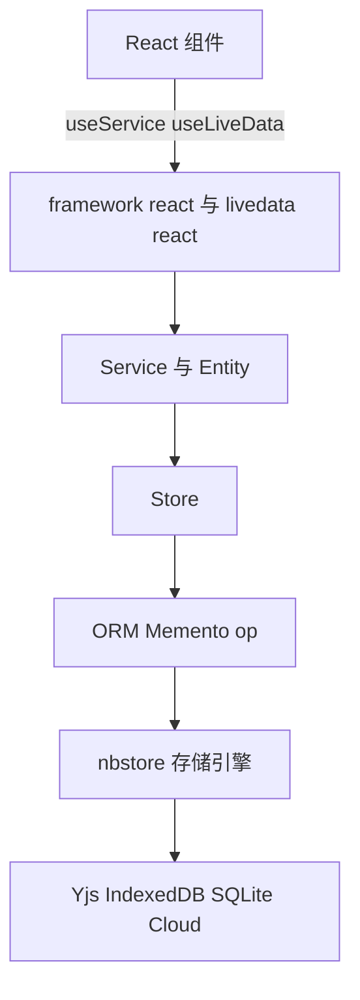
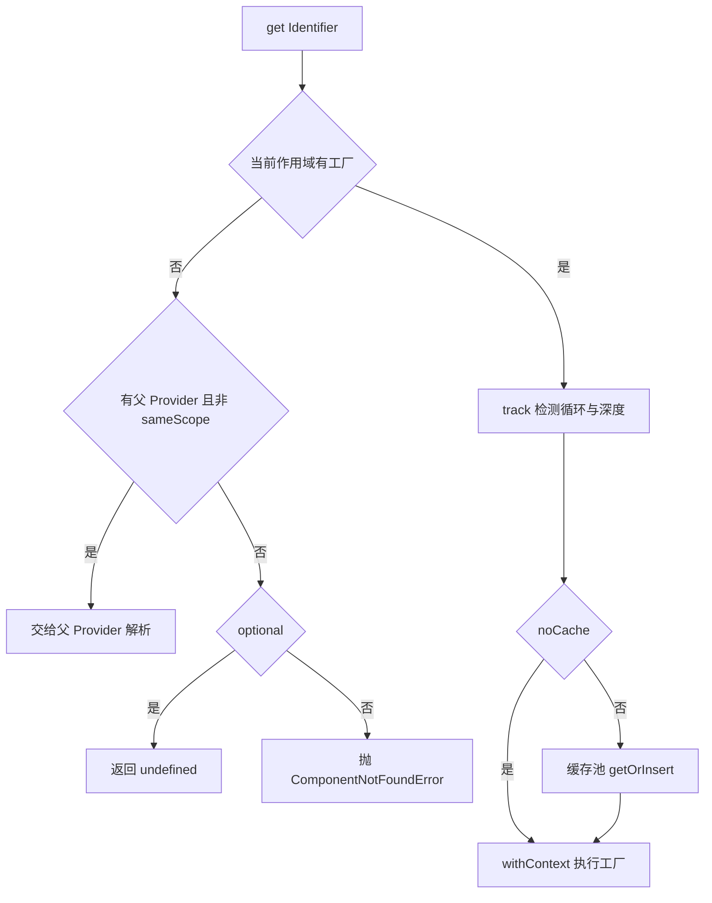
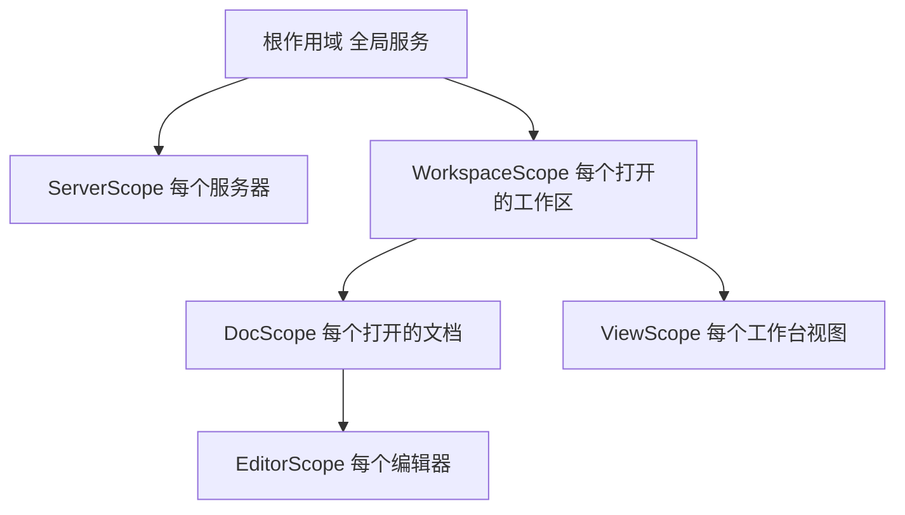
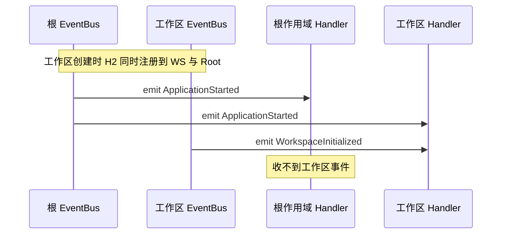
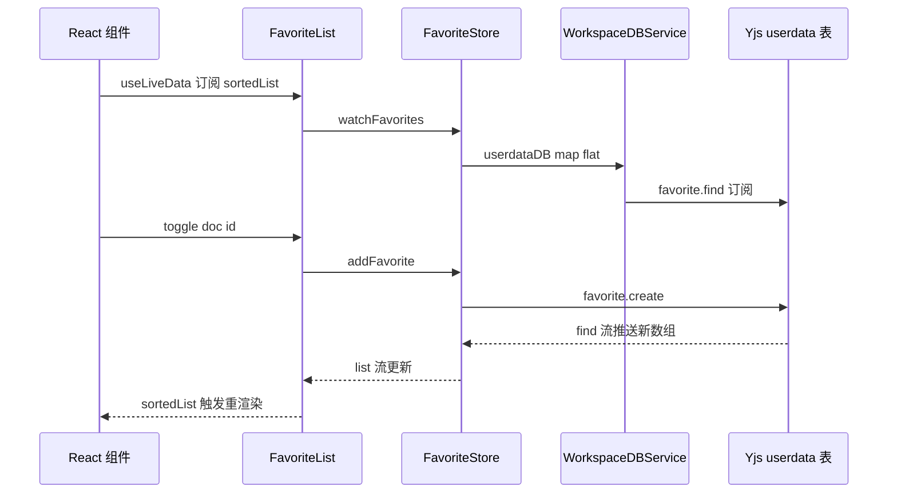

# 第 16 章 前端基础设施：DI 与 LiveData

> 读懂每个 React 组件开头那两行背后的整套地基

第 6 部分 · 前端应用 ｜ 难度 ★★★★☆ ｜ 建议学时 8 小时

===

## 本章要解决的问题

<p class="lead">打开任意一个 AFFiNE React 组件，几乎都以这样两行开场——吃透它们，就吃透了前端最底层的基础设施。</p>

```tsx
const { favoriteService } = useServices({ FavoriteService });
const favorites = useLiveData(favoriteService.favoriteList.sortedList$);
```

这两行背后是 `@toeverything/infra`（`packages/common/infra`），它自研了三样东西：**轻量 DI 容器 `Framework`**（服务、存储、实体、作用域、变体、事件总线）、**响应式类型 `LiveData`**（既是 RxJS `Observable`，又能同步取值，还能桥接 Preact Signals 和 React），以及 ORM、op RPC、Memento、对象池等周边工具。

<div class="note note--warn">

为什么不用 InversifyJS、Redux、Zustand？因为 AFFiNE 有几个特殊需求：同一应用里会**同时打开多个工作区、文档、编辑器**，每个都需要一套"自己的"服务实例并能整体销毁；数据大量来自 Yjs CRDT 和 Worker，天然是"流"；同一套业务代码要跑在 Web、Electron、iOS、Android 上，需要在启动时"换实现"。

</div>

===

## 知识地图

infra 是一个包、三层能力：DI 容器、响应式类型、周边工具。



<div class="note">

记住方向：**UI 只认识 Service/Entity 暴露的 LiveData 与方法；Store 是唯一"碰"外部数据源的层**。唯独 `op` 不在根入口（必须 `import ... from '@toeverything/infra/op'`）——它会在 Worker 里用，不应把 React 打进包里。

</div>

===

## 学习目标

学完本章，你应当能够：

<ol class="goals">
  <li>解释 <code>Framework</code> 的"作用域 → 标识符 → 变体 → 工厂"三层 Map 注册表，以及 6 种注册方法的差异</li>
  <li>描述 Provider 的解析流程（缓存、父作用域回退、循环检测）与 <code>createEntity</code>/<code>createScope</code> 的语义</li>
  <li>解释 <code>CONSTRUCTOR_CONTEXT</code> 如何让组件"零参数"拿到 <code>this.framework</code></li>
  <li>用 <code>createEvent</code> + <code>@OnEvent</code> 编写跨模块事件，说明其在作用域树中的传播方向</li>
  <li>对比 <code>LiveData</code> 与 <code>BehaviorSubject</code>、Preact Signals，熟练使用 <code>map/computed/flat</code> 与 <code>effect</code></li>
  <li>以 <code>favorite</code> 模块为模板，走通 Store → Entity → Service → 注册 → React 的闭环</li>
</ol>

===

<!-- section -->
## 一、Framework：组件注册表

Framework 是"作用域 × 标识符 × 变体 → 工厂"的三层 Map，注册的永远是工厂、不是实例。

===

## 三层 Map 的注册表

<div class="annotate">

```ts [2-5|8|11]
export class Framework {
  private readonly components: Map<
    string,                                  // 作用域栈字符串
    Map<string,                              // 标识符名
      Map<ComponentVariant, ComponentFactory>>  // 变体 → 工厂
  > = new Map();
  get service() { return new FrameworkEditor(this).service; }
  get scope() { return new FrameworkEditor(this).scope; }
}
```

<ol class="annotate__notes">
  <li><b>第 2–5 行</b>：三层键依次是——作用域栈（<code>stringifyScope</code> 把 <code>['WorkspaceScope…']</code> 用 <code>/</code> 拼接，根作用域拼成空串）、标识符名、变体名（默认 <code>'default'</code>）。</li>
  <li><b>第 8 行</b>：值是 <code>ComponentFactory = (provider) =&gt; T</code>——<b>注册的永远是工厂，不是实例</b>，这是懒加载的基础。</li>
  <li><b>第 11 行</b>：每次访问 <code>framework.service</code> 都 <code>new FrameworkEditor</code>，<code>.scope(X)</code> 把 X 压栈。<code>framework.scope</code> 是 getter，每次返回新 editor——所以各模块 <code>configureXxxModule</code> 总是"一条链写到底"。</li>
</ol>
</div>

| 方法 | 用途 | 重复检查 |
| --- | --- | --- |
| `service(Cls, deps?)` | 业务服务（门面） | 是 |
| `store(Cls, deps?)` | 数据访问层 | 是 |
| `entity(Cls, deps?)` | 业务实体（多实例） | 是 |
| `impl(Id, ...)` | 接口标识符注入实现（平台差异） | 是 |
| `override(Id, ...)` | 测试替身、平台覆盖 | 否 |
| `scope(ScopeCls)` | 切换注册作用域 | — |

===

## 依赖数组如何变成工厂

`service` 的第二参数运行时判型：`Function` → 工厂；`Array`/`undefined` → 依赖数组；其他 → 直接作为值。依赖数组最终被包成工厂：

<div class="split">
<div class="split__main">

- `[[X]]`（数组套数组）表示注入 X 的**全部变体**数组。`configureWorkspaceModule` 里 `.service(WorkspaceFlavoursService, [[WorkspaceFlavoursProvider]])` 让本地、云端两种 flavour 一起注入；`[X]` 则只注入默认变体；
- 构造函数额外收到 `provider` 作为最后一个参数；
- 依赖数组与构造参数"手动对齐"，`TypesToDeps` 在类型层面校验顺序。AFFiNE **没用 `reflect-metadata`**——换来零运行时反射、对 SWC/esbuild 友好、依赖关系在注册处一目了然。

`collection-rules` 把变体用到极致：`FilterProvider('system:tags')`、`FilterProvider('property:date')`……几十个变体按 `type:key` 动态挑选，本质是一个**插件注册表**。

</div>
<div class="split__aside">

```ts
return (provider: FrameworkProvider) => {
  const args = [];
  for (const dep of deps) {
    if (isAll) {  // [[X]] 形式
      args.push(Array.from(
        provider.getAll(identifier).values()));
    } else {
      args.push(provider.get(identifier));
    }
  }
  return isConstructor(cls)
    ? new cls(...args, provider)
    : cls(...args, provider);
};
```

</div>
</div>

===

## Identifier、Variant 与面向接口

业务层大量使用"`interface` + 同名 `const`"写法（TS 允许类型与值同名），让业务只依赖**接口**、平台在启动时注入不同**实现**：

<div class="split">
<div class="split__main">

- **类即标识符**：`framework.service(FavoriteService)` 时用 `类名 + stableHash(类)` 生成标识符，加哈希避免不同模块的同名类冲突；
- **显式标识符**：`createIdentifier` 返回值"既是对象又是函数"——当对象用表示默认变体，`X('local')` 得到具名变体；
- Web 端注入 `configureLocalStorageStateStorageImpls`、Electron 端注入 `configureElectronStateStorageImpls`，业务只依赖 `GlobalState` 接口。

</div>
<div class="split__aside">

```ts
export interface GlobalState extends Memento {}
export const GlobalState =
  createIdentifier<GlobalState>('GlobalState');

// 变体：一个接口多份并存实现
framework
  .impl(WorkspaceFlavoursProvider('LOCAL'),
    LocalWorkspaceFlavoursProvider)
  .impl(WorkspaceFlavoursProvider('CLOUD'),
    CloudWorkspaceFlavoursProvider,
    [GlobalState, ServersService]);
```

</div>
</div>

===

<!-- section -->
## 二、组件模型与 Provider

四个子类分工明确；Provider 按作用域树解析、缓存与销毁。

===

## Component 与四个子类

四个子类都继承 `Component`（提供 `framework`、`props`、`disposables`、`eventBus`、`dispose`）：

| 类型 | 生命周期 | 实例数 | 职责 |
| --- | --- | --- | --- |
| `Service` | 首次 `get` 时创建并缓存 | 每作用域 1 个 | 对外门面，持有 Entity |
| `Store` | 同 Service | 每作用域 1 个 | 访问外部数据源，不含业务状态 |
| `Entity` | `createEntity` 时创建，不缓存 | 任意多个 | 业务对象，暴露 LiveData 与方法 |
| `Scope` | `createScope` 时创建，`dispose` 销毁整个子 Provider | 任意多个 | 承载 props，划定子容器边界 |

<div class="split">
<div class="split__main">

**零参数拿到 framework**：Provider 在 `withContext` 中执行工厂，先解析完所有依赖，再 `new cls(...args)`，子类第一句 `super()` 读取上下文并**立即清空**。清空防止"上下文泄漏"——组件里若直接 `new` 别的 Component，会立刻抛错而不是拿到错误的 provider。

**推论**：永远不要 `new SomeService()`；需要实体时用 `this.framework.createEntity(X, props)`。所以 `FavoriteService` 的字段初始化器可放心写 `favoriteList = this.framework.createEntity(FavoriteList)`。

</div>
<div class="split__aside">

```ts
constructor() {
  if (!CONSTRUCTOR_CONTEXT.current.provider) {
    throw new Error(
      'Component must be created in the ' +
      'context of a provider');
  }
  this.framework =
    CONSTRUCTOR_CONTEXT.current.provider;
  this.props = CONSTRUCTOR_CONTEXT.current.props;
  CONSTRUCTOR_CONTEXT.current = {};  // 立即清空
}
```

</div>
</div>

===

## Provider 解析流程



<ul class="takeaways">
  <li><b>子作用域能注入父作用域的组件，反之不行</b>：<code>DocScope</code> 的 Doc 可依赖 <code>WorkspaceService</code>；根作用域服务拿不到某工作区的东西——从结构上杜绝泄漏。</li>
  <li>组件在<b>定义它的作用域</b>的 Provider 中创建并缓存，所以同一工作区所有文档共享同一个 <code>WorkspaceService</code>。</li>
  <li><code>track</code> 把标识符压栈，重复抛 <code>CircularDependencyError</code>，深度 ≥ 100 抛 <code>RecursionLimitError</code>。</li>
</ul>

===

## createScope 与作用域树

`createScope` 新建子 `BasicFrameworkProvider`（作用域栈 = 当前栈 + Scope 名）并实例化 Scope 本身。`Scope.dispose()` → `ComponentCachePool.dispose()` 遍历缓存组件调 `Symbol.dispose`——**这就是"关掉一个工作区，其所有服务一起销毁"的实现**。AFFiNE 实际的作用域树：



<div class="note">

`WorkspaceRepositoryService` 用 `ObjectPool<string, Workspace>`，`onDelete(workspace)` 调 `workspace.scope.dispose()`；`instantiate()` 中 `createScope(WorkspaceScope, {...})` 后 `workspace.engine.start()` 并 `emitEvent(WorkspaceInitialized, workspace)`。各 Scope 定义于 `modules/*/scopes/`（第 17 章展开）。

</div>

===

<!-- section -->
## 三、事件：createEvent 与 @OnEvent

事件从发出的作用域向子孙广播；`@OnEvent` 让服务在事件触发时才被创建。

===

## 事件的传播方向

事件就是带类型的普通对象 `createEvent<T>(id)`。订阅方用 `@OnEvent(ApplicationStarted, e => e.setupRestartListener)` 声明式绑定——装饰器不立即订阅，只往类上挂 `SUB_COMPONENTS`，`framework.service(X)` 注册时额外注册 `EventHandler` 变体。关键在于 `EventBus.on`：

<div class="split">
<div class="split__main">

`on` 把监听器**同时注册到所有祖先总线**，而 `emit` 只触发本总线的监听器。结论：

- 根作用域 `emit(ApplicationStarted)`：根与**所有已创建子作用域**的 handler 都收到；
- 工作区作用域 `emit(WorkspaceInitialized)`：只有该工作区（及其子作用域）的 handler 收到，其他工作区与根**收不到**。

handler 中 `provider.get(target)`——**事件触发时才实例化服务**，从未被 UI 使用的服务也会因订阅 `ApplicationStarted` 而在启动时被创建。

</div>
<div class="split__aside">

```ts
on<T>(event, listener) {
  this.listeners[event.id] ??= [];
  this.listeners[event.id].push(listener);
  // 同时注册到父总线
  const off = this.parent?.on(event, listener);
  return () => {
    off?.();
    this.off(event.id, listener);
  };
}
```

</div>
</div>



===

<!-- section -->
## 四、React 绑定

`framework/react` 用栈式 Provider 把 DI 容器接进组件树，因为 React 树与作用域树不一定同构。

===

## 把容器接进组件树

<div class="split">
<div class="split__main">

`useService` 从 `FrameworkProviderContext` 取；`useServices({ AuthService })` 把 key 首字母小写返回 `{ authService }`，是语法糖。

**为什么 `FrameworkScope` 用 `FrameworkStackProvider` 而非直接 `scope.framework`？** 因为 React 树与 DI 作用域树**不一定同构**：`ServerScope` 与 `WorkspaceScope` 在 DI 里是兄弟，页面上却是 `<FrameworkScope scope={server?.scope}>` 包着 `<FrameworkScope scope={workspace.scope}>`。栈式 Provider 依次查找内外层，让内层组件同时取到两个作用域的服务。

应用根在 `app.tsx` 中 `new Framework()` → `configureCommonModules` 等 → `framework.provider()` → `get(LifecycleService).applicationStart()`，再用 `<FrameworkRoot>` 包住整个应用。

</div>
<div class="split__aside">

```tsx
export const FrameworkScope = ({ scope, children }) => {
  const provider = useContext(FrameworkProviderContext);
  const nextStack = useMemo(() => {
    if (!scope) return provider;
    // 栈顺序：内层在前、外层在后
    return new FrameworkStackProvider(
      [scope.framework, provider]);
  }, [scope, provider]);
  return (
    <FrameworkProviderContext.Provider value={nextStack}>
      {children}
    </FrameworkProviderContext.Provider>
  );
};
```

</div>
</div>

===

<!-- section -->
## 五、favorite 模块的五层闭环

一个完整模块：Store 碰数据、Entity 表达业务、Service 做门面、注册到作用域、React 消费。

===

## Store / Entity / Service 三层

<div class="split">
<div class="split__main">

**Store 只管数据**：`watchFavorites()` 中 `userdataDB$`（本身是 `LiveData<DB>`，切账号时 DB 会换）`.map(db => LiveData.from(db.favorite.find$(), [])).flat()` 是"**切换数据源并自动重订阅**"的惯用法，相当于 `switchMap`。存储格式 `key = "doc:xxxx"` 由 Store 编解码，上层无感。

**Entity 表达业务**：`FavoriteList` 暴露 `list$`、`sortedList$`、`toggle()`。`index` 是**分数索引**字符串，在 a、b 之间插入时生成字典序介于两者的新串——多人同时拖拽排序不会互相覆盖整个列表。

**Service 做门面**：`FavoriteService` 只有一行 `favoriteList = this.framework.createEntity(FavoriteList)`。

</div>
<div class="split__aside">

```ts
// 注册：收藏"每个工作区一份"
export function configureFavoriteModule(
  framework: Framework) {
  framework
    .scope(WorkspaceScope)
    .service(FavoriteService)
    .entity(FavoriteList, [FavoriteStore])
    .store(FavoriteStore, [WorkspaceDBService])
    .service(MigrationFavoriteItemsAdapter,
      [WorkspaceService]);
}
// React 消费
const { favoriteService } =
  useServices({ FavoriteService });
const fav = useLiveData(
  favoriteService.favoriteList
    .isFavorite$('tag', tag.id));
```

</div>
</div>

<div class="note">

`index.ts` 只 `export type { FavoriteList }`——对外隐藏 Entity 的构造能力，外部只能通过 `FavoriteService.favoriteList` 访问。注册顺序无关紧要（注册的是工厂）。

</div>

===

## 全链路时序：写走方法、读走 LiveData



<ul class="takeaways">
  <li><code>toggle</code> 没有任何"通知 UI"的代码——写入 Yjs 后，观察链自动把新数据推回 UI。</li>
  <li>这就是 AFFiNE 前端的<b>单向数据流</b>：写走方法，读走 LiveData。</li>
</ul>

===

<!-- section -->
## 六、LiveData：量身定做的响应式

LiveData = 能同步读的、懒的、可当 Signal 用的 Observable。

===

## 本质与引用计数式懒订阅

<div class="split">
<div class="split__main">

LiveData 继承 `Observable`，内部用 `BehaviorSubject` 存当前值，**另维护一条 `ops$` 操作流**：`getValue` 发 `'get'`、`subscribe` 发 `'watch'`、退订发 `'unwatch'`。上游由此"看见"下游的使用情况。

`LiveData.from` 把这些 op 翻译为引用计数：**有订阅者（计数 > 0）才订阅上游，最后一个离开即退订**——冷启动、自动释放。而读 `.value` 被翻译为"瞬时 watch + unwatch"：若上游同步发射，这一瞬间就把最新值灌进 `raw$`，所以**没有订阅者时 `.value` 也是新鲜的**。

这解决了 RxJS 的经典痛点：`BehaviorSubject` 能同步取值但不懒；`shareReplay` 懒但取不到同步值。

</div>
<div class="split__aside">

```ts
stream$.pipe(
  mergeMap(v =>
    v === 'set' ? EMPTY
    : v === 'get' ? of('watch', 'unwatch')
    : of(v)),
  scan((acc, op) =>
    op === 'watch' ? acc + 1
    : op === 'unwatch' ? acc - 1 : acc, 0),
  map(count => count > 0 ? 'watch' : 'unwatch'),
  distinctUntilChanged(),
  switchMap(op =>
    op === 'watch' ? upstream$ : EMPTY)
)
```

</div>
</div>

<div class="note note--warn">

**Poisoned**：上游抛错时 LiveData 进入不可恢复的 poisoned 状态，之后任何读写都抛 `PoisonedError`。源码理念是"livedata 不抛任何错误，进入 poisoned 通常意味着编程错误"——异步错误应用 `catchErrorInto(error$)` **建模为数据**。

</div>

===

## 与 BehaviorSubject、Signals 对比

| 维度 | `BehaviorSubject` | Preact Signals | `LiveData` |
| --- | --- | --- | --- |
| 同步取值 | `.value` | `.value` | `.value`（派生值也最新） |
| 派生是否懒 | 需 `shareReplay` 手工控制 | 惰性计算 | `from` 引用计数自动懒订阅 |
| 异步编排 | 强 | 弱 | 强（本身是 Observable） |
| 自动依赖追踪 | 无 | 有 | `computed` 提供 |
| React 集成 | 需手写 hook | 需额外包 | `useLiveData` |
| 错误语义 | error 终止流 | 抛出 | poisoned，强制把错误建模为数据 |

<div class="note">

`useLiveData` 基于 `useSyncExternalStore`，`reactSubscribe`/`reactGetSnapshot` 是箭头函数属性保证引用稳定。**坑**：`useLiveData(list.isFavorite$('doc', id))` 每次渲染都新建 LiveData，长列表里有开销，必要时 `useMemo`。`computed` 的动态依赖（`location$` 先 get 活动视图、再 get 该视图 location）让活动视图切换时依赖自动更换。

</div>

===

## effect：把异步流程写成管道

`effect(op1, op2, ...)` 内部创建 `Subject`、`pipe` 操作符并订阅，返回"调用即推值"的函数。若管道 complete 或 error，会在 `setTimeout` 中抛 `EffectError`——**错误必须在管道内处理**。真实用法（发票分页）一次性解决并发控制、取消、重试、加载态、错误态：

<div class="annotate">

```ts [2|3|6-8|10-11]
readonly revalidate = effect(
  map(() => this.pageNum$.value),
  exhaustMapSwitchUntilChanged((a, b) => a === b, pageNum =>
    fromPromise(signal =>
      this.store.fetchInvoices(pageNum * SIZE, SIZE, signal)
    ).pipe(
      tap(data => this.pageInvoices$.setValue(data.invoices)),
      smartRetry(),
      catchErrorInto(this.error$),
      onStart(() => this.isLoading$.setValue(true)),
      onComplete(() => this.isLoading$.setValue(false))
    ))
);
```

<ol class="annotate__notes">
  <li><b>第 2 行</b>：触发时读当前页码。</li>
  <li><b>第 3 行</b>：<code>exhaustMapSwitchUntilChanged</code>——同页重复请求忽略，换页立即取消旧请求。</li>
  <li><b>第 6–8 行</b>：<code>fromPromise</code> 把 AbortSignal 传给 fetch（退订即 abort）；<code>smartRetry</code> 网络错误无限重试、其他最多 3 次；<code>catchErrorInto</code> 把错误写进 <code>error$</code>。</li>
  <li><b>第 10–11 行</b>：<code>onStart/onComplete</code> 管理加载态。该实体 <code>dispose()</code> 中调 <code>this.revalidate.unsubscribe()</code>。</li>
</ol>
</div>

<div class="note note--tip">

周边工具：**ORM** 把 Yjs 当数据库（每张表一个 YDoc，`engine.doc.connectDoc` 接入 nbstore 获得持久化与同步）；**op** 是跨 Worker 的极简 RPC（8 种消息，`call`/`subscribe`）；**Memento**、**ObjectPool**（引用计数 + GC）、**AsyncLock** 把 KV、Worker、锁统一纳入"可观察 + 可注入"体系。

</div>

===

## 对比 BlockSuite 的 DI

BlockSuite 在 `blocksuite/framework/global/src/di` 有一套几乎同源的 DI。可以把 infra framework 看作它的"应用层增强版"：

| 维度 | `@toeverything/infra` | `@blocksuite/global/di` |
| --- | --- | --- |
| 容器类 | `Framework` | `Container` |
| 注册 API | `service/store/entity/impl/override/scope` | `add/addImpl/override/scope` |
| 组件基类 | `Component` 四子类，构造上下文注入 | 无基类，任意类 |
| 事件 | 内置 `EventBus` + `@OnEvent` | 无 |
| React 集成 | 有 | 无（Lit 世界） |
| 用途 | 应用层业务模块 | 编辑器扩展（第 13 章） |

<div class="note note--warn">

两套容器**互不相通**：AFFiNE 向编辑器注入应用能力时，在 `view-extensions` 中让各 `ViewExtensionProvider` 通过 options 接收 infra 的 `FrameworkProvider`，再把服务包装成 BlockSuite 扩展 `context.register(...)`。

</div>

===

## 自测：点击揭晓答案

<details class="quiz">
<summary>Q1. framework.scope(WorkspaceScope).service(A); framework.service(B); B 注册在哪？</summary>

根作用域。`framework.scope`/`framework.service` 都是 getter，每次返回新的 `FrameworkEditor`，`currentScopeStack` 从 `ROOT_SCOPE` 开始。

</details>

<details class="quiz">
<summary>Q2. 依赖写成 [[X]] 与 [X] 有何区别？Entity 为何不适合作依赖注入？</summary>

`[[X]]` 表示 `getAll`，注入所有变体数组；`[X]` 表示 `get`，只注入默认变体。Entity 以 `noCache` 解析、设计为多实例，注入会导致每次新建且生命周期失控，约定由 Service 持有。

</details>

<details class="quiz">
<summary>Q3. 工作区作用域 emitEvent(WorkspaceInitialized)，根作用域订阅的服务能收到吗？</summary>

不能。`emit` 只触发本总线监听器。反过来，根作用域发出的事件能到达已创建子作用域的 handler（因为子 handler 也注册到了祖先总线）。

</details>

<details class="quiz">
<summary>Q4. LiveData.from 没有订阅者时读 .value，能拿到上游最新值吗？</summary>

能，前提是上游在被订阅时同步发射（如另一个 LiveData、Yjs 观察、`of`）。读取会触发瞬时 watch/unwatch，引发一次同步订阅。

</details>

===

## 小结与下一步

<ul class="takeaways">
  <li><code>Framework</code> 是"作用域 × 标识符 × 变体 → 工厂"的注册表，Provider 按作用域树解析、缓存与销毁。</li>
  <li>四件套分工：Store 碰数据、Entity 表达业务、Service 做门面、Scope 划生命周期；永远用 <code>createEntity</code> 而非 <code>new</code>。</li>
  <li>事件从发出的作用域向子孙广播，<code>@OnEvent</code> 让服务在事件触发时才被创建。</li>
  <li>LiveData 是同步可读、引用计数懒订阅、可桥接 Signal 的 Observable，<code>effect</code> + <code>ops</code> 把异步流程写成声明式管道。</li>
  <li>infra framework 与 BlockSuite DI 同源但互不相通，通过 options 传 <code>FrameworkProvider</code> 桥接。</li>
</ul>

<div class="note note--tip">

**下一章预告**：第 17 章把本章的作用域树在业务中完整展开——Core 的业务模块如何组织、路由如何与 WorkspaceScope/DocScope/ViewScope 对应。

</div>
