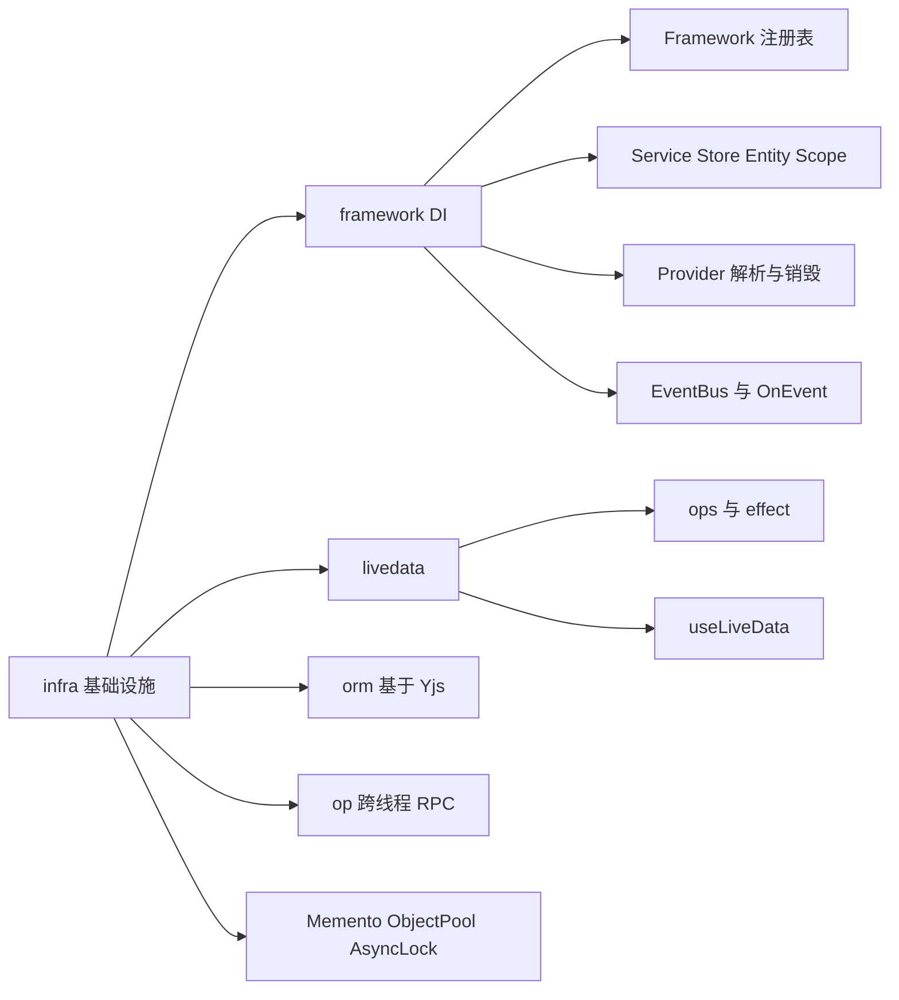
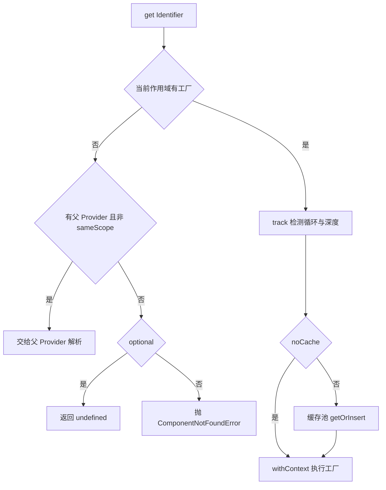
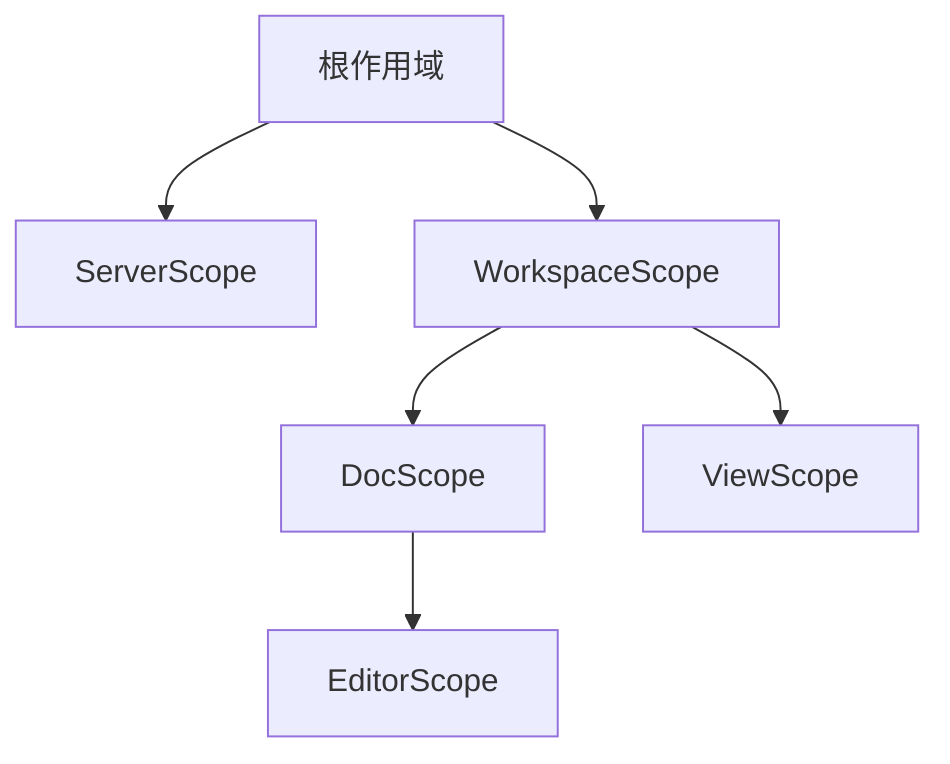
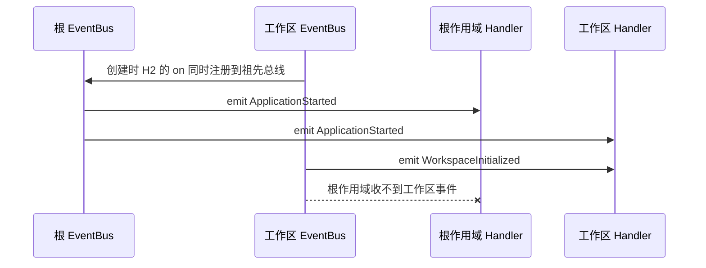
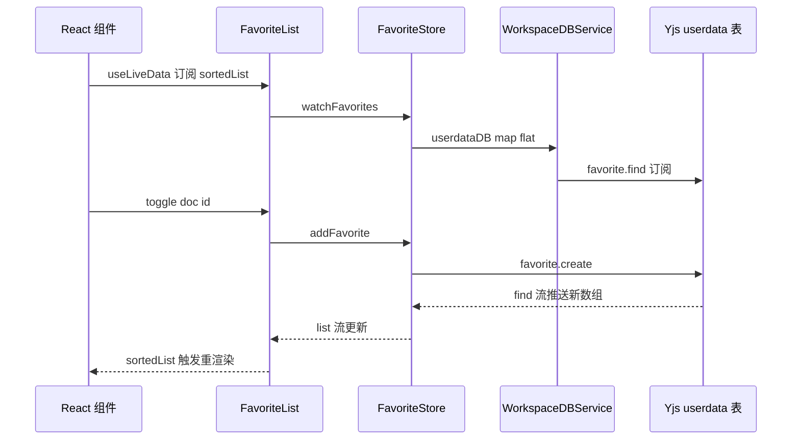

# 第 16 章 前端基础设施：DI 与 LiveData

`@toeverything/infra`：AFFiNE 前端的地基

第 6 部分 · 前端应用 ｜ 难度 ★★★★☆ ｜ 建议学时 8 小时

Note:
这一章我们拆开 AFFiNE 前端最底层的基础设施包 `@toeverything/infra`，目录在 `packages/common/infra`。
它自研了依赖注入容器 Framework、响应式类型 LiveData，以及 ORM、op RPC 等周边工具。
后面第 17 到 20 章的所有业务代码都建立在它之上，所以这一章一定要先吃透。

---

## 为什么先学 infra

```tsx
const { favoriteService } = useServices({ FavoriteService });
const favorites = useLiveData(favoriteService.favoriteList.sortedList$);
```

- 多工作区、多文档、多编辑器并存，各需一套可整体销毁的服务
- 数据来自 Yjs CRDT 与 Worker，天然是"流"
- 同一套业务跑在 Web、Electron、iOS、Android，需启动时"换实现"

Note:
打开任何一个 React 组件，几乎都是这两行开场：用 useServices 拿服务，用 useLiveData 订阅数据。
为什么 AFFiNE 不用 InversifyJS、Redux 或 Zustand？因为它有三个特殊需求：作用域化的多实例、流式数据、以及多端换实现。
这三点正好对应本章要讲的作用域、LiveData 和 impl 注入。

---

## 学习目标

- 说清 infra 各子目录职责与导出入口
- 理解 `Framework` 注册表与六种注册方法
- 掌握 Provider 解析、作用域树与销毁语义
- 会用 `createEvent` + `@OnEvent` 做跨模块事件
- 熟练使用 `LiveData`、`useLiveData` 与 `effect`
- 能仿照 `favorite` 模块写出 Store/Entity/Service

Note:
这是本章的六个学习目标。前三个围绕 DI 容器，第四个是事件，第五个是响应式数据。
最后一个是落地能力：读完之后，你应该能独立仿写一个完整的业务模块。

---

## 知识地图



Note:
整张地图分三块：framework 是 DI 容器，livedata 是响应式数据，另外还有 orm、op、storage 与 utils 这些周边工具。
我们会按这个顺序讲，中间穿插 favorite 模块这个完整案例。

---

## infra 全景：一个包，三层能力

| 子目录 | 核心导出 | 职责 |
|---|---|---|
| `framework` | `Framework`、`Service`、`useService` | DI 容器与 React 桥 |
| `livedata` | `LiveData`、`effect`、`useLiveData` | 响应式状态 |
| `orm` | `createORMClient`、`YjsDBAdapter` | 基于 Yjs 的表存储 |
| `op` | `OpClient`、`OpConsumer`、`transfer` | 跨线程 RPC |
| `storage` / `utils` | `Memento`、`ObjectPool`、`AsyncLock` | KV 抽象与通用工具 |

<div class="callout">

`op` 不在根入口，需从 `@toeverything/infra/op` 导入——Worker 里不应打进 React

</div>

Note:
infra 是 private 的 workspace 包，package.json 的 exports 直接指向 ts 源文件，由上层构建统一转译。
根入口 src/index.ts 导出了 framework、livedata、orm、storage、utils 等，唯独 op 不在其中。
这是有意为之：op 会在 Worker 里使用，而根入口会带上 framework/react 和 livedata/react，Worker 不该把 React 打进去。

---

## Framework：三层 Map 注册表

键依次为 **作用域栈** → **标识符名** → **变体名**（默认 `'default'`），值是工厂

| 方法 | 注册什么 | 重复检查 | 典型用途 |
|---|---|---|---|
| `service(Cls, deps?)` | Service 子类 | 是 | 业务服务 |
| `store(Cls, deps?)` | Store 子类 | 是 | 数据访问层 |
| `entity(Cls, deps?)` | Entity 子类 | 是 | 多实例业务对象 |
| `impl(Id, ClsOrValue, deps?)` | 接口实现 | 是 | 平台差异注入 |
| `override(Id, ...)` | 覆盖，`null` 表示删除 | 否 | 测试替身、平台覆盖 |

<p class="small">另有 <code>scope(ScopeCls)</code> 切换注册作用域；<code>framework.scope</code> 是 getter，每次返回新的 <code>FrameworkEditor</code></p>

Note:
Framework 内部是一个三层 Map：第一层键是作用域栈字符串，用斜杠拼接，根作用域是空串；第二层是标识符名；第三层是变体名。
注册的永远是工厂，不是实例，这是懒加载的基础。
注意 framework.scope 是 getter，每次都 new 一个 FrameworkEditor，所以 scope(A).service(X) 之后再写 framework.service(Y)，Y 会回到根作用域。这就是各模块 configure 函数总是"一条链写到底"的原因。

---

## 依赖数组如何变成工厂

```ts
// 来源：framework/core/framework.ts（dependenciesToFactory 节选）
return (provider: FrameworkProvider) => {
  const args = [];
  for (const dep of deps) {
    // ... dep 为数组时 isAll = true, identifier = dep[0]
    if (isAll) {
      args.push(Array.from(provider.getAll(identifier).values()));
    } else {
      args.push(provider.get(identifier));
    }
  }
  // ... isConstructor(cls) 时 new，否则直接调用
  return new cls(...args, provider);
};
```

- `[[X]]` 注入 X 的**全部变体**数组；构造函数最后一个参数总是 `provider`
- 不用 `reflect-metadata`：零运行时反射，依赖关系在注册处一目了然

Note:
service 的第二参数在运行时判型：函数是工厂，数组或 undefined 是依赖数组，其他值直接当实例。
依赖数组里套一层数组，比如 WorkspaceFlavoursService 的 [[WorkspaceFlavoursProvider]]，表示注入所有变体，本地和云端 flavour 一起进来。
依赖数组与构造参数是手动对齐的，TypesToDeps 在类型层面校验顺序，对 SWC、esbuild 也很友好。

---

## Identifier 与 Variant

<div class="cols">
<div>

```ts
// storage/providers/global.ts
export interface GlobalState
  extends Memento {}
export const GlobalState =
  createIdentifier<GlobalState>(
    'GlobalState'
  );
```

- 类即标识符：`类名 + stableHash(类)`
- 接口与同名 `const`，业务只依赖接口

</div>
<div>

```ts
// workspace-engine/index.ts
framework
  .impl(WorkspaceFlavoursProvider('LOCAL'),
    LocalWorkspaceFlavoursProvider)
  .impl(WorkspaceFlavoursProvider('CLOUD'),
    CloudWorkspaceFlavoursProvider,
    [GlobalState, ServersService]);
```

- `X('local')` 得到具名变体
- `FilterProvider('system:tags')` 即插件注册表

</div>
</div>

Note:
直接用类注册时，parseIdentifier 会用类名加 stableHash 生成标识符，避免不同模块同名类冲突。
显式标识符由 createIdentifier 创建，它既是对象又是函数：当对象用是默认变体，调用它得到具名变体。
业务层大量使用"interface 加同名 const"的写法，Web 和 Electron 在启动时分别注入 GlobalState 的不同实现。collection-rules 模块把变体用到了极致，几十个 FilterProvider 变体按 type:key 动态挑选。

---

## 组件模型：四件套

| 类型 | 生命周期 | 实例数 | 约定职责 |
|---|---|---|---|
| `Service` | 首次 `get` 创建并缓存 | 每作用域 1 个 | 对外门面，持有 Entity |
| `Store` | 同 Service | 每作用域 1 个 | 访问 Yjs、GraphQL、Memento |
| `Entity` | `createEntity` 时创建，不缓存 | 任意多个 | 业务对象，暴露 LiveData |
| `Scope` | `createScope` 创建，`dispose` 销毁 | 任意多个 | 承载 props，划定子容器 |

<p class="small">共同基类 <code>Component</code>：提供 <code>framework</code>、<code>props</code>、<code>disposables</code>、<code>eventBus</code>、<code>dispose</code></p>

Note:
四个子类都继承 Component。Store 是唯一碰外部数据源的层，不含业务状态；Entity 表达业务语义；Service 做门面；Scope 划定生命周期边界。
真正决定语义的是解析方式：Entity 以 noCache 解析，每次都是新实例，所以不适合作为单例依赖注入给别人。
Component 还实现了 Symbol.dispose，可以配合 TS 的 using 语法。

---

## CONSTRUCTOR_CONTEXT：零参数拿到 framework

```ts
// 来源：framework/core/components/component.ts（节选）
constructor() {
  if (!CONSTRUCTOR_CONTEXT.current.provider) {
    throw new Error('Component must be created in the context of a provider');
  }
  this.framework = CONSTRUCTOR_CONTEXT.current.provider;
  this.props = CONSTRUCTOR_CONTEXT.current.props;
  CONSTRUCTOR_CONTEXT.current = {};
}
```

- Provider 在 `withContext` 中执行工厂，`super()` 读取上下文后**立即清空**
- 字段初始化器可直接写 `this.framework.createEntity(FavoriteList)`
- 推论：永远不要 `new SomeService()`

Note:
执行顺序是：Provider 在 withContext 里执行工厂，工厂先把依赖都解析完，再 new 类，子类第一句 super 读取上下文并马上清空。
清空是为了防止上下文泄漏：如果你在组件里直接 new 另一个 Component，会立刻抛错，而不是拿到错误的 provider。
正因如此，子类的字段初始化器可以放心使用 this.framework，FavoriteService 就是这么写的。

---

## Provider 解析流程



<p class="small">子作用域能取父作用域组件，反之不行；组件在<strong>定义它的作用域</strong>中创建并缓存</p>

Note:
这是 Resolver.getRaw 的流程。当前作用域没有工厂就交给父 Provider，所以子作用域能注入父作用域的组件，反过来不行。
这从结构上杜绝了"全局服务持有工作区引用导致泄漏"。
另外 DocScope 解析 WorkspaceService 时由父 Provider 缓存，所以同一工作区的所有文档共享一个 WorkspaceService。track 检测到循环会抛 CircularDependencyError，深度超过 100 抛 RecursionLimitError。

---

## 作用域树与销毁

<div class="cols">
<div>



</div>
<div>

- `createEntity`：`noCache` + `sameScope`，每次新建
- `createScope`：新建子 Provider，再实例化 Scope 本身
- `Scope.dispose()` → 缓存组件逐个 `Symbol.dispose`
- 关掉工作区 = 其所有服务一起销毁

</div>
</div>

Note:
AFFiNE 实际的作用域树是：根作用域下有 ServerScope 和 WorkspaceScope，工作区下有 DocScope 和 ViewScope，文档下有 EditorScope。
createScope 会新建一个子 BasicFrameworkProvider，Scope 实例的 framework 就是这个新 Provider。
WorkspaceRepositoryService 的对象池在 onDelete 里调用 workspace.scope.dispose()，这就是"关掉一个工作区，所有服务一起销毁"的实现。

---

## 事件：@OnEvent 与传播方向



<p class="small"><code>on</code> 注册到所有祖先总线，<code>emit</code> 只触发本总线；<code>@OnEvent</code> 只挂 <code>SUB_COMPONENTS</code>，事件触发时才 <code>provider.get</code> 实例化服务</p>

Note:
事件就是 createEvent 生成的带类型对象，比如 lifecycle 模块的 ApplicationStarted。订阅方用 @OnEvent 类装饰器声明式绑定。
装饰器并不立即订阅，只往类上挂 SUB_COMPONENTS，注册服务时再额外注册 EventHandler 变体。
传播规则记一句话：从发出者向子孙广播。根作用域发的事件，所有已创建的子作用域都能收到；工作区发的事件，根作用域和其他工作区收不到。

---

## framework/react：FrameworkScope

```tsx
// 来源：framework/react/index.tsx（节选，类型省略）
export const FrameworkScope = ({ scope, children }) => {
  const provider = useContext(FrameworkProviderContext);
  const nextStack = useMemo(() => {
    if (!scope) return provider;
    // make sure the stack order is inside to outside
    return new FrameworkStackProvider([scope.framework, provider]);
  }, [scope, provider]);
  return (
    <FrameworkProviderContext.Provider value={nextStack}>
      {children}
    </FrameworkProviderContext.Provider>
  );
};
```

- React 树 ≠ DI 树：`ServerScope` 与 `WorkspaceScope` 是兄弟，页面上却嵌套
- 栈式 Provider 让内层组件同时取到两个作用域的服务

Note:
framework/react 只有 81 行，导出 useService、useServices、FrameworkRoot、FrameworkScope 等。
为什么不直接用 scope.framework？因为 React 树和 DI 作用域树不一定同构。工作区页面里是 server 的 FrameworkScope 包着 workspace 的 FrameworkScope，但两者在 DI 里是兄弟。
FrameworkStackProvider 依次查找内外层，解决了这个问题。useServices 则是把 key 首字母小写返回的语法糖。

---

## 案例 favorite：Store 与 Entity

<div class="cols">
<div>

```ts
// stores/favorite.ts（节选）
watchFavorites() {
  return this.workspaceDBService
    .userdataDB$
    .map(db => LiveData.from(
      db.favorite.find$(), []))
    .flat()
    .map(raw => /* toRecord + filter */);
}
```

- `map + flat` = 切换数据源并重订阅

</div>
<div>

```ts
// entities/favorite-list.ts（节选）
export class FavoriteList extends Entity {
  list$ = this.store.watchFavorites();
  sortedList$ = this.list$.map(v =>
    v.sort((a, b) =>
      (a.index > b.index ? 1 : -1)));
  // isFavorite$ / toggle / indexAt
}
```

- `index` 为分数索引，多人拖拽互不覆盖

</div>
</div>

Note:
favorite 模块是本章的完整范例。Store 只管数据：userdataDB$ 本身是一个 LiveData，登录或切换账号时 DB 会换。
map 成 LiveData 再 flat，相当于 switchMap，切换数据源时自动重新订阅。存储格式 key 等于 "doc:xxxx"，由 Store 编解码，上层无感。
Entity 表达业务语义：排序、是否收藏、toggle。index 是分数索引字符串，在两项之间插入时不用改动其他条目，对 CRDT 场景很重要。

---

## 案例 favorite：Service 与注册

```ts
// services/favorite.ts
export class FavoriteService extends Service {
  favoriteList = this.framework.createEntity(FavoriteList);
}
// index.ts
export function configureFavoriteModule(framework: Framework) {
  framework
    .scope(WorkspaceScope)
    .service(FavoriteService)
    .entity(FavoriteList, [FavoriteStore])
    .store(FavoriteStore, [WorkspaceDBService])
    .service(MigrationFavoriteItemsAdapter, [WorkspaceService])
    .service(CompatibleFavoriteItemsAdapter, [FavoriteService]);
}
```

- 收藏"每个工作区一份"→ 挂在 `WorkspaceScope`；注册顺序无关紧要
- `index.ts` 只 `export type { FavoriteList }`，对外隐藏 Entity 构造能力
- 组件中：`useLiveData(favoriteService.favoriteList.isFavorite$('tag', tag.id))`

Note:
Service 只有一行：用字段初始化器创建 Entity，这正依赖了前面讲的构造上下文。
configureFavoriteModule 把所有组件挂在 WorkspaceScope 下，由 modules/index.ts 的 configureCommonModules 统一调用。
index.ts 只导出 FavoriteList 的类型，外部只能通过 FavoriteService.favoriteList 访问，这是一种封装约定。

---

## favorite 全链路时序



<p class="small">单向数据流：<strong>写走方法，读走 LiveData</strong>——<code>toggle</code> 里没有任何"通知 UI"的代码</p>

Note:
这张时序图把五层串起来了。上半段是订阅链路：组件订阅 sortedList，一路订阅到 Yjs 表的 find 流。
下半段是写入：toggle 调用 addFavorite，写入 Yjs。写完之后观察链自动把新数组推回 UI。
这就是 AFFiNE 前端的单向数据流，写和读完全分离。

---

## LiveData：同步可读的懒 Observable

<div class="cols">
<div>

**原理**

- `BehaviorSubject` 存值 + `ops$` 记录 get/watch/unwatch/set
- `from`：订阅计数 > 0 才订阅上游，归零即退订
- 读 `.value` 触发瞬时 watch，无订阅者也新鲜
- 上游报错 → poisoned，错误须建模为数据

</div>
<div>

**API**

- `new LiveData(v)` / `LiveData.from(ob$, init)`
- `.map` / `.selector`（浅比较去重）
- `.flat()` 拍平嵌套，`LiveData.computed(get => ...)`
- `.signal` / `fromSignal` 与 Preact Signals 互转

</div>
</div>

<div class="callout">

LiveData = 能同步读的、懒的、可当 Signal 用的 Observable

</div>

Note:
LiveData 继承 Observable，内部用 BehaviorSubject 存当前值，另外维护一条 ops$ 操作流，让上游看见下游的使用情况。
LiveData.from 做了引用计数式懒订阅；读 .value 会被翻译成一次瞬时的 watch 加 unwatch，上游同步发射时就能拿到最新值，比如 LiveData.from(of(1,2,3,4), 0).value 直接是 4。
这解决了 RxJS 的经典痛点：BehaviorSubject 能同步取值但不懒，shareReplay 懒但取不到同步值。上游一旦抛错就进入 poisoned，之后任何读写都抛 PoisonedError。

---

## useLiveData 与 effect 管道

```ts
// 来源：modules/cloud/entities/invoices.ts（节选，部分参数与回调简化）
readonly revalidate = effect(
  map(() => this.pageNum$.value),
  exhaustMapSwitchUntilChanged(
    (a, b) => a === b,
    pageNum => fromPromise(signal => this.store.fetchInvoices(/* ... */)).pipe(
      tap(data => this.pageInvoices$.setValue(data.invoices)),
      smartRetry(),
      catchErrorInto(this.error$),
      onStart(() => this.isLoading$.setValue(true)),
      onComplete(() => this.isLoading$.setValue(false))
    )
  )
);
```

- `useLiveData` 基于 `useSyncExternalStore`，可传 `null/undefined` 条件订阅
- 一条管道解决并发、取消、重试、加载态与错误态
- 管道 error/complete 会抛 `EffectError`——必须 `catchErrorInto`

Note:
useLiveData 用 useSyncExternalStore 实现，reactSubscribe 和 reactGetSnapshot 都是箭头函数属性，引用稳定。
effect 把操作符 pipe 起来，返回一个"调用即推值"的函数。发票分页这个例子里：同页重复请求被忽略，换页立即取消旧请求，fromPromise 把 AbortSignal 传给 fetch。
smartRetry 对网络错误无限重试、其他错误最多三次。如果管道 complete 或 error，effect 会在 setTimeout 中抛出未捕获异常，所以错误必须在管道内处理。

---

## 周边工具：ORM、op、storage

<div class="cols cols-3">
<div>

**ORM**

- `f.string().primaryKey()` 定义表
- 每张表一个 YDoc，每行一个 YMap
- `connectDoc` 接入 nbstore，自动同步

</div>
<div>

**op RPC**

- 8 种消息：`call`、`subscribe`、`return`、`next` 等
- 通道只需 `postMessage` + 事件监听
- `transfer` 把 `MessagePort` 交给 Worker

</div>
<div>

**storage / utils**

- `Memento`：`get/watch/set/del`
- `ObjectPool`：引用计数 + GC
- `AsyncLock`：配合 `using` 自动释放

</div>
</div>

Note:
ORM 解决的是"非文档结构化数据也要像文档一样同步合并"的问题，收藏、文件夹、文档属性都存在 Yjs 表里，删除用软删除标记。
op 是 Worker 间的极简 RPC，Worker、MessagePort、BroadcastChannel 都能当通道，nbstore 正是用 transfer 把端口交给 Worker，第 19 章会详细讲。
Memento 是 KV 抽象，MemoryMemento 被 GlobalContext 用来存当前工作区 id 等上下文；ObjectPool 用在 WorkspaceRepositoryService 和 DocsService 的对象池里。

---

## 源码导读 Top 5

| 优先级 | 路径 | 看什么 |
|---|---|---|
| P0 | `infra/src/framework/core/framework.ts` | 注册表、`FrameworkEditor`、`dependenciesToFactory` |
| P0 | `infra/src/framework/core/provider.ts` | `Resolver.getRaw`、`createEntity`、`createScope` |
| P0 | `infra/src/livedata/livedata.ts` | `from` 引用计数、`computed`、`reactSubscribe` |
| P0 | `core/src/modules/favorite/` | 完整模块范式 |
| P1 | `infra/src/framework/core/event.ts` | `EventBus` 传播、`OnEvent` 子组件 |

<p class="small"><code>infra</code> = <code>packages/common/infra</code>；<code>core</code> = <code>packages/frontend/core</code></p>

Note:
建议按这个顺序读：先 framework.ts 看注册表，再 provider.ts 看解析与作用域，然后 livedata.ts。
favorite 模块是最好的模板，event.ts 则帮你理解事件传播。
另外 framework/__tests__/framework.spec.ts 包含了所有特性的最小用例，读源码卡住时可以对照。

---

## 动手实践

| 练习 | 验收要点 |
|---|---|
| 1 在单测里玩转 Framework | 两次 `createScope(ProjectScope)`：`ProjectService` 不同、`LoggerService` 相同 |
| 2 观察 LiveData 懒订阅 | 写出读 `.value`、两次订阅/退订的日志顺序 |
| 3 仿写"最近浏览"模块 | `RecentStore`/`RecentList`/`RecentService` 注册到 `WorkspaceScope` |
| 4 用 effect 重写请求 | 连续调用只有一个请求，失败自动重试，`dispose` 时停止 |
| 5 追踪一次事件广播 | 链路含 `createScope`、`EventBus` 构造、`provider.get(target)` |

Note:
练习一用 yarn vitest run 跑你自己的临时测试文件，不要提交。练习二能帮你亲眼看到引用计数。
练习三是重点，完成后可以对照 quicksearch 模块里的 RecentDocsService；思考一下要在文档打开时自动 push，应该订阅哪个事件。
练习五从 blocksuite-writer-info.ts 的 @OnEvent 出发，到 repo.ts 的 emitEvent，画出完整调用链。

---

## 自测

1. `framework.scope(WorkspaceScope).service(A); framework.service(B);` 中 B 注册在哪？
   - 根作用域：getter 每次返回新 editor，栈从根开始 <!-- .element: class="fragment" -->
2. 工作区作用域 `emitEvent(WorkspaceInitialized)`，根作用域服务能收到吗？
   - 不能：`emit` 只触发本总线；反向根发子收可以 <!-- .element: class="fragment" -->
3. 为什么 Entity 不适合注入给 Service？
   - 以 `noCache` 解析，每次新建，生命周期失控 <!-- .element: class="fragment" -->
4. `map` 与 `selector` 的区别？
   - `selector` 发射前浅比较，适合返回新对象但内容常不变的场景 <!-- .element: class="fragment" -->

Note:
先让大家自己想一想再逐个揭晓答案。
第一题考 getter 语义，第二题考事件传播方向，第三题考 Entity 的 noCache 解析，第四题考 selector 避免无谓重渲染。

---

## 常见坑

| 现象 | 原因 | 解决 |
|---|---|---|
| `Component must be created in the context of a provider` | 手动 `new` 了 Service/Entity | 用 `framework.get` 或 `createEntity` |
| `Missing dependency [X] in creating [Y]` | X 在更深子作用域，或模块未 configure | 检查 configure 调用与作用域 |
| 拿不到工作区服务 | 缺 `FrameworkScope scope={workspace.scope}` | 在页面根部包裹 Scope |
| `The livedata is poisoned` | 上游 Observable 抛错 | 上游 `catchError`，错误建模到 `error$` |
| 关闭工作区后仍有回调 | 订阅未登记到 `disposables` | `this.disposables.push(() => sub.unsubscribe())` |

Note:
这五个坑几乎每个新人都会踩一遍。前两个是 DI 相关的报错，看到错误信息就能对号入座。
第三个最隐蔽：组件渲染在 FrameworkScope 之外，比如全局对话框。
还有一个常见性能坑：长列表每行都 useLiveData(entity.xxx$(id))，每次渲染都新建 LiveData，必要时用 useMemo 缓存。

---

## 小结与下一步

- `Framework`：作用域 × 标识符 × 变体 → 工厂，按作用域树解析、缓存与销毁
- Store 碰数据、Entity 表业务、Service 做门面、Scope 划生命周期
- 事件向子孙广播，`@OnEvent` 让服务在事件触发时才创建
- LiveData 同步可读、引用计数懒订阅，配合 `effect` 写声明式异步管道
- 下一章：**第 17 章 Core 业务模块与路由**——作用域树在业务中的完整展开

Note:
总结一下：DI 容器解决了多实例和换实现，LiveData 解决了流式数据与同步读取。
ORM、op、Memento、ObjectPool 则把 Yjs、Worker、KV 存储统一纳入"可观察加可注入"的体系。
下一章我们用这套工具去看 @affine/core 这台完整的机器：启动链路、69 个模块、以及 Workbench 的双层路由。
