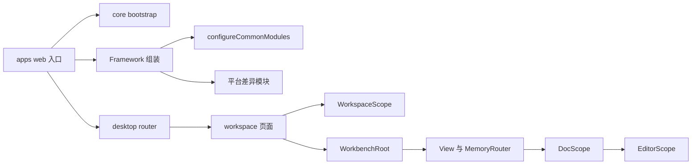
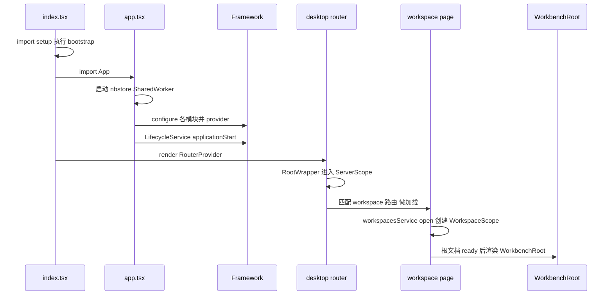
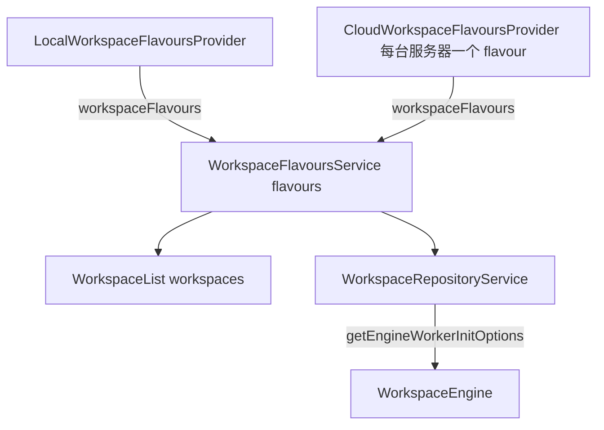
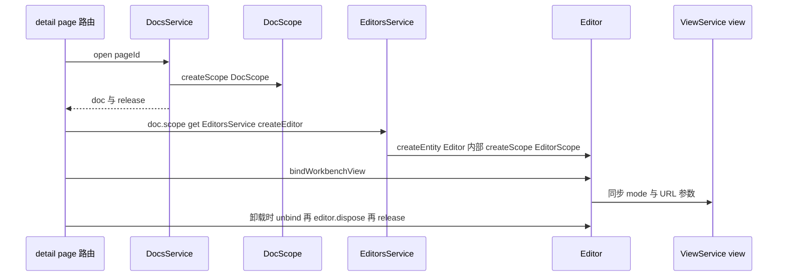
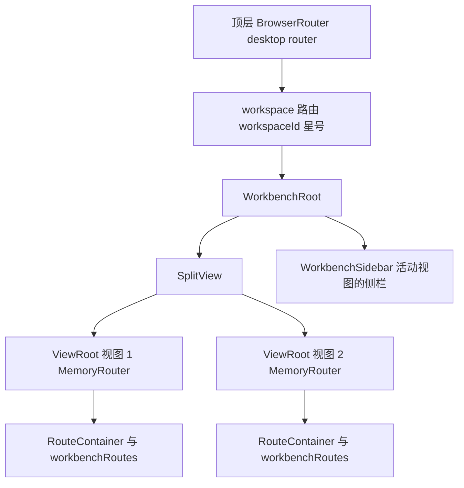
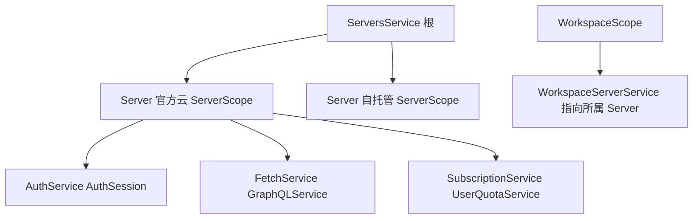

# 第 17 章 Core 业务模块与路由

`@affine/core`：69 个模块、作用域树与双层路由

第 6 部分 · 前端应用 ｜ 难度 ★★★★☆ ｜ 建议学时 12 小时

Note:
上一章我们拆开了 infra 这把螺丝刀，这一章用它看清整台机器：@affine/core，目录在 packages/frontend/core。
它是 AFFiNE 前端体量最大的包，桌面版和移动版的所有页面、69 个业务模块、编辑器集成、命令系统都在这里。
apps 下的 web、electron-renderer、mobile 只是应用壳。

---

## 本章导读：三个问题

- 打开 `/workspace/abc/xyz`，从 `index.tsx` 到编辑器渲染经过哪些文件、创建哪些作用域？
- 69 个模块属于哪些领域？各挂在哪个作用域？
- 为什么有"两层路由"？多视图、分屏、多标签如何与 React Router 共存？

<div class="callout">

应用壳只做一件事：**按平台挑选模块、组装 Framework、把根组件挂到 DOM**

</div>

Note:
读完本章你应该能回答这三个问题。
路线是：先走通启动链路，再按领域把模块摊开，重点深读 workspace、doc、editor、workbench 四个骨干模块，最后梳理路由、命令系统与移动端差异。

---

## 学习目标

- 说出 `core/src` 下 bootstrap、modules、desktop 等目录职责
- 画出 Web 端从 `index.tsx` 到 `WorkbenchRoot` 的启动链路
- 按领域分组模块，说明三端入口的组装差异
- 解释 flavour 机制与 `WorkspaceRepositoryService.open`
- 描述 `DocsService.open` → `DocScope` → `EditorScope` 链路
- 说明"BrowserRouter + 每个 View 一个 MemoryRouter"双层路由

Note:
六个目标分三组：前两个是整体结构与启动；中间两个是工作区和文档的打开过程；最后一个是 Workbench 与路由。
命令系统、collection-rules、cloud 模块我们也会覆盖，作为"注册表加插件"设计的例子。

---

## 知识地图



Note:
从入口出发有三条线：bootstrap 副作用、Framework 组装、路由。
路由进入工作区页面后创建 WorkspaceScope 并渲染 WorkbenchRoot；每个 View 有自己的 MemoryRouter，进入文档详情页后再创建 DocScope 和 EditorScope。

---

## core/src 目录结构

```text
packages/frontend/core/src
├── bootstrap/    启动副作用 env、public-path、polyfill（顺序敏感）
├── modules/      69 个 DI 业务模块 + configureCommonModules
├── components/   跨端共享的 React 组件
├── desktop/      桌面/Web 版页面、对话框、路由
├── mobile/       移动版页面、路由、移动专属模块
├── blocksuite/   编辑器集成 editors、view-extensions、ai
├── commands/     CMD-K 命令定义与注册表
└── utils/ types/ 纯函数工具与全局类型
```

- 模块约定：`entities/` `services/` `stores/` `scopes/` `providers/` `impls/` `events/` `view/`
- 唯一出口 `index.ts`：导出 + `configureXxxModule`；`bootstrap/browser.ts` 注明 `ORDER MATTERS`

Note:
bootstrap 里只有副作用 import，而且顺序敏感：env.ts 调用 setupGlobal 设置 environment 等全局对象，后续模块在顶层就会读取，所以必须最先执行。
modules 是唯一依赖 DI 的目录，每个模块内部遵循统一约定，providers 放接口标识符，impls 放接口实现。
commands 不依赖 DI，依赖通过参数注入。

---

## Web 入口：app.tsx 三步组装

```tsx
// 来源：apps/web/src/app.tsx（节选）
// ① 启动存储 Worker（优先 SharedWorker，多标签共享）
const worker = new SharedWorker(workerUrl, { name: 'affine-shared-worker' });
storeManagerClient = new StoreManagerClient(new OpClient(worker.port));
// ② 组装 Framework
const framework = new Framework();
configureCommonModules(framework);
configureBrowserWorkbenchModule(framework);
configureLocalStorageStateStorageImpls(framework);
configureBrowserWorkspaceFlavours(framework);
framework.impl(NbstoreProvider, { /* realtime、openStore */ });
// ③ 创建根 Provider，触发生命周期事件
const frameworkProvider = framework.provider();
frameworkProvider.get(LifecycleService).applicationStart();
```

- 不支持 SharedWorker 或 `disableSharedWorker` 为 `'true'` 时回退普通 `Worker`
- `App`：`FrameworkRoot` → `I18nProvider` → `AffineContext` → `RouterProvider`

Note:
index.tsx 先 import './setup'，setup.ts 依次引入 bootstrap/browser、bootstrap/cleanup 和组件库主题。
app.tsx 是真正的组装车间：第一步启动 nbstore 存储 Worker，第二步组装 Framework 并注入 NbstoreProvider，第三步创建根 Provider 并触发 applicationStart。
窗口 focus 时还会触发 applicationFocus。

---

## 启动到渲染的时序



<p class="small"><code>RootWrapper</code>（<code>desktop/pages/root/index.tsx</code>）包裹 <code>FrameworkScope scope={defaultServerService.server.scope}</code></p>

Note:
注意三个作用域的创建点：根 Provider 在 app.tsx 模块顶层创建；ServerScope 由 RootWrapper 在等待默认服务器配置后进入；WorkspaceScope 在工作区页面 open 时创建。
还有一个等待条件：根文档 ready 之前只渲染骨架，ready 后才渲染 WorkspaceLayout 和 WorkbenchRoot。

---

## 三端组装差异

| 入口 | 共同部分 | 平台专属 configure |
|---|---|---|
| `apps/web/src/app.tsx` | `configureCommonModules` | `configureBrowserWorkbenchModule`、`configureLocalStorageStateStorageImpls`、`configureBrowserWorkspaceFlavours` |
| `electron-renderer/.../modules.ts` | 同上 | `configureElectronStateStorageImpls`、`configureDesktopWorkbenchModule`、`configureDesktopApiModule` 等 |
| `apps/mobile/src/app.tsx` | 同上 | 浏览器三件套 + `configureMobileModules` |

<p class="small">workbench 两套实现只差 <code>WorkbenchDefaultState</code> 与 <code>WorkbenchNewTabHandler</code>（<code>window.open</code> 或 Electron <code>addTab</code>）</p>

Note:
三端都调用 configureCommonModules，业务模块完全共享。差异只在少量平台模块。
Electron 额外组装了标签栏、页内查找、桌面 API、拼写检查、托盘、备份等模块。移动端额外调用 configureMobileModules，页面、路由表和工作台根组件也换成 mobile 目录下的版本。
这就是"同一份业务代码，多端换实现"的落地方式，第 20 章会展开。

---

## modules 全景：按领域分组

| 领域 | 代表模块 | 主要作用域 |
|---|---|---|
| 工作区与文档 | `workspace` `workspace-engine` `db` `doc` `journal` | 根 + Workspace + Doc |
| 编辑器 | `editor` `editor-setting` `at-menu-config` | Doc + Editor |
| 导航与布局 | `workbench` `navigation` `peek-view` `app-sidebar` | Workspace + View |
| 组织与搜索 | `collection` `collection-rules` `tag` `favorite` `quicksearch` | Workspace |
| 云 / AI / 系统 | `cloud` `permissions` `ai-button` `lifecycle` `feature-flag` | 根 + Server + Workspace |

<p class="small">调用顺序不影响依赖解析（注册的是工厂），但同一标识符只能被一个模块注册</p>

Note:
configureCommonModules 依次调用了 60 余个 configure 函数。这里按领域把 69 个目录归成五大类。
不在 configureCommonModules 里的有 workbench、workspace-engine，它们由平台入口调用；app-tabs-header、find-in-page、desktop-api、backup 是 Electron 专属；share-menu、mermaid 等只提供视图，没有 configure 函数。

---

## workspace 模块：flavour 机制



<p class="small"><code>WorkspaceMetadata = { id, flavour }</code>，键为 <code>`${flavour}:${id}`</code>；本地为 <code>'local'</code>，云端为<strong>服务器 id</strong></p>

Note:
flavour 表示工作区"住在哪"。本地工作区是 local，云工作区是服务器 id——因为一个用户可以同时连接官方云和自托管服务器，每台服务器就是一个 flavour。
WorkspaceFlavoursService 用 [[WorkspaceFlavoursProvider]] 收集所有变体并 combineLatest 拍平。
configureWorkspaceModule 一半注册在根作用域负责"管理所有工作区"，一半注册在 WorkspaceScope 负责"一个工作区的内部"。

---

## open：对象池 + 作用域

```ts
// 来源：modules/workspace/services/repo.ts（open 节选，类型省略）
open = (options, customEngineWorkerInitOptions) => {
  if (options.isSharedMode) {
    // 分享页不进池：每次独立 instantiate，dispose 直接销毁 scope
  }
  const exist = this.pool.get(workspaceMetadataKey(options.metadata));
  if (exist) {
    return { workspace: exist.obj, dispose: exist.release };
  }
  const workspace = this.instantiate(options, customEngineWorkerInitOptions);
  const ref = this.pool.put(workspaceMetadataKey(workspace.meta), workspace);
  return { workspace: ref.obj, dispose: ref.release };
};
```

- `instantiate`：flavour provider → `createScope(WorkspaceScope)` → `engine.start()` → `emitEvent(WorkspaceInitialized)`
- 页面 `useLayoutEffect` 中 `open`，卸载即 `dispose`，引用计数归零后 `scope.dispose()`

Note:
同一工作区被多处 open 时共享实例，引用计数归零后由 ObjectPool 的 GC 调用 onDelete，也就是 workspace.scope.dispose()。
Workspace 实体是工作区作用域内的根实体：持有 guid 等于工作区 id 的根 YDoc，懒创建 BlockSuite 的 docCollection，并把文档加载、Blob、Awareness 委托给 engine。
WorkspaceEngine.start 通过 NbstoreService.openStore 打开 key 形如 workspace:flavour:id 的存储，这正是第 19 章的入口。

---

## doc 模块：DocRecord 与 Doc

| 对象 | 作用域 | 代表什么 | 典型 API |
|---|---|---|---|
| `DocRecordList` / `DocRecord` | Workspace | 元信息记录，**不加载内容** | `title$` `trash$` `moveToTrash` |
| `Doc` | Doc | 已打开文档，持有 BlockSuite `Store` 与 YDoc | `blockSuiteDoc` `yDoc` `record` |

- `DocsService.open`：对象池 + `createScope(DocScope)` + `emitEvent(DocInitialized)`
- `Doc` 构造时 `addPriority(id, 100)`：打开的文档优先同步与索引
- `createDoc` 执行所有 `[DocCreateMiddleware]`，最后发 `DocCreated`

Note:
列表页只需要轻量的 DocRecord，打开文档才创建 DocScope 和 Doc，因为文档数量多时逐个打开成本极高。
DocsService.open 和工作区的 open 完全同构：对象池、createScope、发事件。
DocCreateMiddleware 是一个标识符，依赖写成数组收集所有实现，是"开放扩展、封闭修改"的例子；cloud 模块的 DocCreatedByService 就订阅 DocCreated 写入创建者。

---

## 打开文档全链路



<p class="small">渲染时嵌两层 <code>FrameworkScope</code>（<code>doc.scope</code> → <code>editor.scope</code>），编辑器内 <code>useService(EditorService)</code> 即得当前编辑器</p>

Note:
这条链路在 detail-page-wrapper.tsx 的 useLoadDoc 里串起来。
EditorsService.createEditor 只做两件事：createEntity(Editor) 和 emitEvent(EditorInitialized)。Editor 构造时立即 createScope(EditorScope)，持有 mode$、selector$ 等状态。
bindWorkbenchView 把编辑器模式、聚焦位置与 URL 查询参数双向同步。详情页还会给当前文档 addPriority 10。

---

## Workbench：AFFiNE 的窗口管理器

- Workbench 管理主区若干并排 View 与右侧 Sidebar
- 每个 View 有**自己的历史栈**与当前 URL
- 永远有一个活动 View，其 URL 即整个应用的 URL
- `open(to, { at })`：`'beside'` 分屏，`'new-tab'` 交给 `WorkbenchNewTabHandler`
- `View` 构造时 `createScope(ViewScope)`，用 `createNavigableHistory` 建内存历史
- 路由变化经 `eventBus.root.emit(WorkbenchLocationChanged)` 广播

Note:
这些要点来自 modules/workbench/README.md。每个路由还可以通过 ViewIsland 渲染自己的 Header、Body 和 Sidebar。
Workbench 的 open 方法 at 参数可以取 beside、active、head、tail、数字或 new-tab。
WorkbenchService 向根总线广播 WorkbenchLocationChanged，回忆第 16 章，根总线发出的事件能到达所有已创建子作用域，所以 PeekViewService 能据此关闭预览层。

---

## ViewRoot：每个 View 一个 MemoryRouter

```tsx
const viewRouter = useMemo(() => createMemoryRouter(routes), [routes]);
const location = useLiveData(view.location$);
useLayoutEffect(() => {
  viewRouter.navigate(location).catch(err => { /* ... */ });
}, [location, view, viewRouter]);
return (
  <FrameworkScope scope={view.scope}>
    <UNSAFE_LocationContext.Provider value={null as any}>
      <UNSAFE_RouteContext.Provider value={routeContextValue}>
        <RouterProvider router={viewRouter} />
      </UNSAFE_RouteContext.Provider>
    </UNSAFE_LocationContext.Provider>
  </FrameworkScope>
);
```

- `modules/workbench/view/view-root.tsx`：View 的 `location$` 一变就 `navigate`
- 重置 `UNSAFE_*Context` 隔离父路由，绕开"禁止嵌套 RouterProvider"

Note:
这是整个前端最巧的一段代码。WorkbenchRoot 把 views$ 交给 SplitView，每个面板放一个 ViewRoot。
嵌套 RouterProvider 在 React Router 里本不被允许，作者通过把两个 UNSAFE context 重置为空来隔离父路由，源码注释还附了 issue 链接。
外层的 FrameworkScope 让路由页面里 useService(ViewService).view 拿到"我所在的 View"。

---

## 双层路由结构



<p class="small"><code>useBindWorkbenchToBrowserRouter</code>：活动 View 的 PUSH/REPLACE 同步给浏览器，location state 标记来源防死循环</p>

Note:
顶层 BrowserRouter 只负责到工作区为止，工作区内部全部交给 Workbench。
活动 View 的历史与浏览器历史是两个栈：View 的 PUSH 和 REPLACE 同步到浏览器，POP 无法同步就跳过；浏览器地址变化时只以 PUSH 更新活动 View。
Electron 下改用 useBindWorkbenchToDesktopRouter，由 WorkbenchRoot 根据 BUILD_CONFIG.isElectron 选择。

---

## 路由表：顶层与工作台

```ts
// desktop/route-paths.ts（顶层 BrowserRouter）
export const WORKSPACE_ROUTE_PATH = '/workspace/:workspaceId/*';
export const SHARE_ROUTE_PATH = '/share/:workspaceId/:pageId';

// desktop/workbench-router.ts（View 内 MemoryRouter，节选）
export const workbenchRoutes = [
  { path: '/all', lazy: () => import('./pages/workspace/all-page/all-page') },
  {
    path: '/:pageId',
    lazy: () => import('./pages/workspace/detail-page/detail-page'),
  },
  { path: '*', lazy: () => import('./pages/404') },
] satisfies RouteObject[];
```

- 工作台路径**没有** `/workspace/:id` 前缀，由 `basename$` 补上
- `/:pageId` 吞掉所有单段路径，需 `matchPath` 判断是否文档页
- `@affine/routes`：`routes.json` + `build.ts` 生成 `ROUTES`、`FACTORIES`（目前仅 admin）

Note:
顶层路由表在 desktop/router.tsx，以 RootRouter 为根元素，子路由几乎都用 lazy 按需加载，basename 取 environment.subPath 支持子路径部署。
工作台路由的 /:pageId 会匹配任何单段路径，所以工作区页面判断是否文档详情页时，要用 matchPath 找到的 path 是否等于 /:pageId 来判断，注释里还留了 TODO。
@affine/routes 是个小型代码生成器，注意当前 routes.json 里已有 queue 而生成产物里没有，修改后务必重新生成。

---

## 注册表 + 插件：规则与搜索

<div class="cols">
<div>

**collection-rules**

- 三接口：`FilterProvider`、`GroupByProvider`、`OrderByProvider`
- 按 `${type}:${key}` 查找变体，如 `FilterProvider('system:tags')`
- 新增过滤 = 新 Provider + 注册变体

</div>
<div>

**quicksearch**

- `QuickSearch.show(sources, callback)` 接收一组会话
- CMD-K 塞入 7 种会话：最近、命令、文档、标签等
- `DocsQuickSearchSession` 查 nbstore 索引

</div>
</div>

Note:
收藏夹也就是智能文件夹，数据存在根 YDoc 的 setting Map 里，Collection 实体把规则交给 CollectionRulesService，并追加"不在回收站"等系统过滤器。
新增一种过滤条件无需修改引擎本身，"所有文档"页的筛选、分组、排序也复用这套引擎。
quicksearch 同样是插件化：每个 Session 负责一类结果，CommandsQuickSearchSession 通过 AffineCommandRegistry.getAll 取出所有命令。

---

## commands：VSCode 风格命令注册表

```tsx
// 来源：commands/affine-layout.tsx（节选）
registerAffineCommand({
  id: 'affine:toggle-left-sidebar',
  category: 'affine:layout',
  icon: <SidebarIcon />,
  label: () =>
    appSidebarService.sidebar.open$.value
      ? t['com.affine.cmdk.affine.left-sidebar.collapse']()
      : t['com.affine.cmdk.affine.left-sidebar.expand'](),
  keyBinding: { binding: '$mod+/' },
  run() {
    appSidebarService.sidebar.toggleSidebar();
  },
})
```

- `AffineCommandRegistry` 单例：有 `keyBinding` 即用 tinykeys 绑定到 `window`
- `$mod`：macOS 为 ⌘，其他为 Ctrl；`preconditionStrategy` 只影响 CMD-K 可见性
- 由 `useRegisterWorkspaceCommands` 在工作区挂载时统一注册

Note:
commands/registry/README.md 说这套抽象高度借鉴 VSCode 的命令。
commands 目录下的 affine-xxx.tsx 按类别提供 register 工厂函数，依赖通过参数注入，比如 appSidebarService 和 t。
如果快捷键与编辑器冲突，可以在 keyBinding 里设置 skipRegister 或换按键。

---

## cloud：服务器即作用域



<p class="small">同时登录官方云与自托管，各有独立会话与订阅；<code>@OnEvent(AccountChanged)</code> 刷新配额。系统模块：<code>feature-flag</code>、<code>dialogs</code>、<code>global-context</code></p>

Note:
configureCloudModule 在根作用域注册 ServersService 等，在 ServerScope 下注册每台服务器一套的认证、请求、订阅服务，在 WorkspaceScope 下注册 WorkspaceServerService 把工作区与所属服务器关联。
几个系统模块也值得一提：feature-flag 定义了 34 个开关；dialogs 用 schema 描述对话框，调用方只需 open('sign-in', {})；global-context 用 MemoryMemento 存当前工作区、文档等，是"当前在哪"的唯一真相来源。

---

## 源码导读 Top 5

| 优先级 | 路径 | 看什么 |
|---|---|---|
| P0 | `apps/web/src/app.tsx` | Worker 启动、Framework 组装、根组件 |
| P0 | `core/src/modules/index.ts` | 全部模块的 configure 调用 |
| P0 | `modules/workspace/services/repo.ts` | 对象池、`instantiate` |
| P0 | `modules/doc/services/docs.ts` | `open`、`createDoc` |
| P0 | `modules/workbench/view/view-root.tsx` | 双层路由 |

<p class="small"><code>apps</code> = <code>packages/frontend/apps</code>；<code>core</code> / <code>modules</code> 位于 <code>packages/frontend/core/src</code></p>

Note:
这五个文件读完，本章的骨架就清楚了。
第二梯队建议读 desktop/pages/workspace/index.tsx 看工作区页面挂载，workbench.ts 看 View 管理，以及 detail-page-wrapper.tsx 看文档到编辑器的链路。

---

## 动手实践

| 练习 | 验收要点 |
|---|---|
| 1 画出启动时序 | 含根 Provider、ServerScope、WorkspaceScope 创建点与"根文档 ready" |
| 2 模块归属调查 | 5 个模块的作用域/Service/Store/Entity 表；解释 `permissions` 双作用域 |
| 3 在 Workbench 中分屏 | `workbench.openAll({ at: 'beside' })` 出现两个并排 View |
| 4 新增 CMD-K 命令 | `affine:open-trash` 可搜到并执行，快捷键生效 |
| 5 新增规则过滤器 | 设计 `system:title-length` 并说明引擎如何按 `type:key` 找到它 |

Note:
练习三需要本地启动开发环境，然后利用 WorkbenchRoot 挂出的调试变量 window.workbench 在控制台执行。
练习四只做本地实验，不要提交。练习五重点是理解 variant 插件化，写出实现和注册代码即可。

---

## 自测

1. Web 入口为什么优先使用 SharedWorker？
   - 多标签共享同一存储与同步连接；不支持时回退 Worker <!-- .element: class="fragment" -->
2. 云工作区的 `flavour` 为什么不是固定的 `'cloud'`？
   - 它是服务器 id，用户可同时连接多台服务器 <!-- .element: class="fragment" -->
3. `DocRecord` 与 `Doc` 有何区别？
   - 前者轻量元信息不加载内容；后者是 DocScope 内已打开文档 <!-- .element: class="fragment" -->
4. View 内部为什么用 MemoryRouter？
   - 多 View 各需独立历史，浏览器只有一个地址栏，活动 View 再同步给它 <!-- .element: class="fragment" -->

Note:
这四题分别对应入口、flavour、文档对象、双层路由。
可以追问一下：WorkbenchLocationChanged 为什么用 eventBus.root.emit 发出？答案是要通知所有作用域里关心路由变化的服务。

---

## 常见坑

| 现象 | 原因 | 解决 |
|---|---|---|
| 新增模块后 `ComponentNotFoundError` | 没在 `configureCommonModules` 或平台入口调用 | 在 `modules/index.ts` 或 apps 中加调用 |
| `useService(WorkspaceService)` 报错 | 组件在工作区 `FrameworkScope` 之外 | 改用根作用域服务或移入工作区布局 |
| `Doc record not found` | 根文档未 ready 就 `docsService.open` | 等 `list.isReady$` 或 `doc$(id)` 非空 |
| 分屏后拿到别的 View 的状态 | 用了全局 `useLocation` 或 `window.location` | 用 View 内路由或 `view.location$` |
| 切换后旧工作区服务仍运行 | `open` 后没有 `dispose/release` | 检查 `useLayoutEffect` 清理函数 |

Note:
最常见的是第一个：只写了 configure 函数却忘了调用。
第四个在分屏场景下很隐蔽，因为单视图时看不出问题。
另外修改 routes.json 不生效，多半是没在 packages/frontend/routes 重新执行 build 脚本。

---

## 小结与下一步

- 应用壳只负责"启动 Worker + 组装 Framework + 挂载路由"
- 作用域树 Root → Server / Workspace → Doc → Editor、Workspace → View 是骨架
- `ObjectPool + createScope + emitEvent` 是工作区与文档打开的统一套路
- Workbench 用"每个 View 一个 MemoryRouter"实现多视图与分屏
- 下一章：**第 18 章 组件库、主题与国际化**——界面长什么样、说什么话

Note:
回顾一下：规则引擎、quicksearch 会话、命令注册表、对话框 schema 都是"注册表加插件"的设计。
移动端复用全部业务模块，只替换页面、工作台根与少量平台模块。
下一章从数据流转向 UI 层：@affine/component 组件库、主题 CSS 变量和 i18n。
