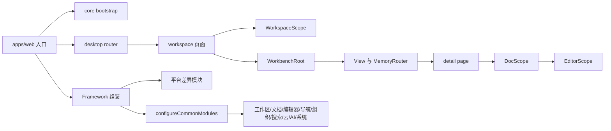
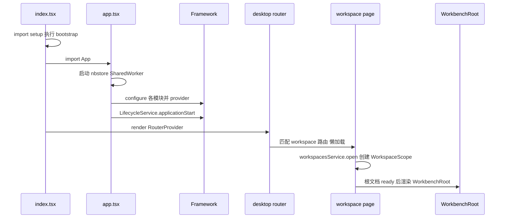
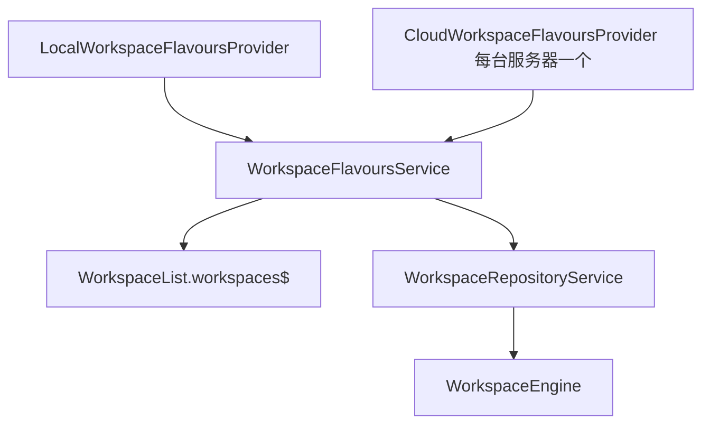
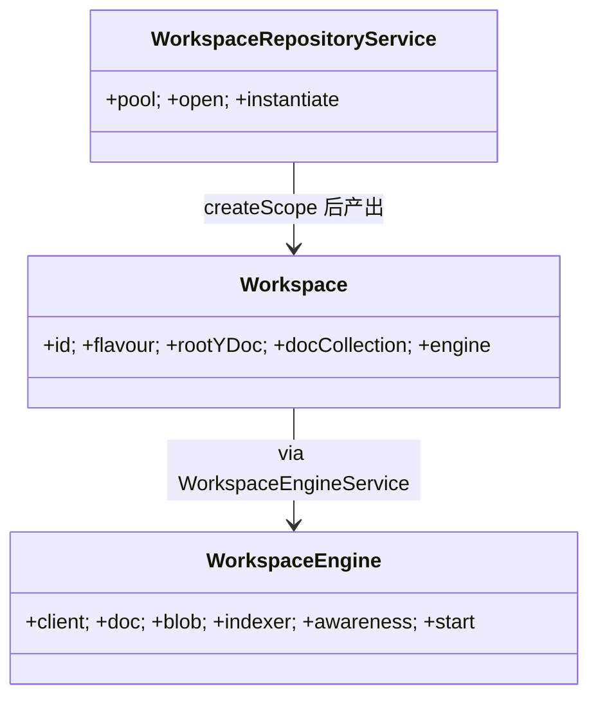
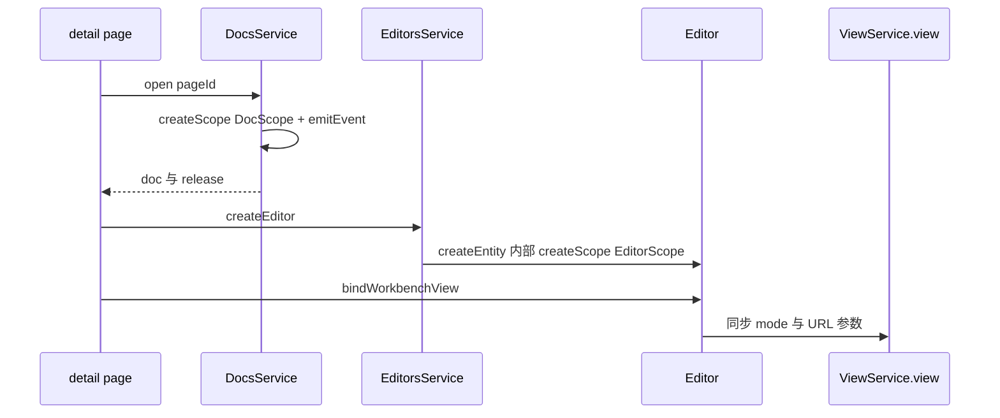
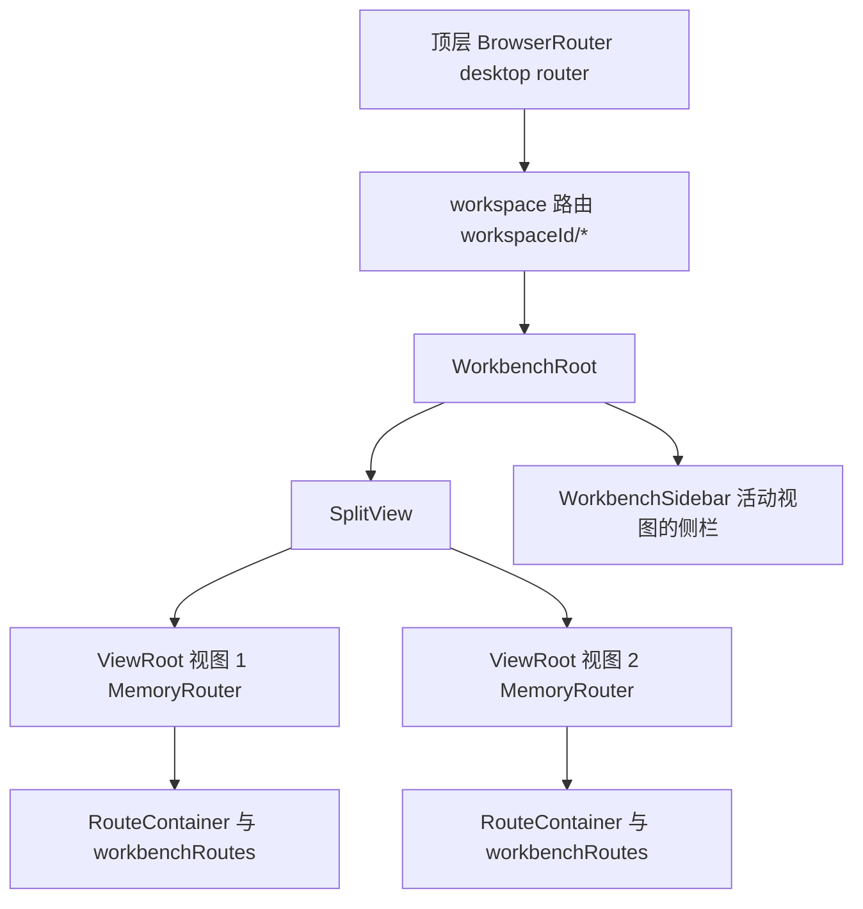
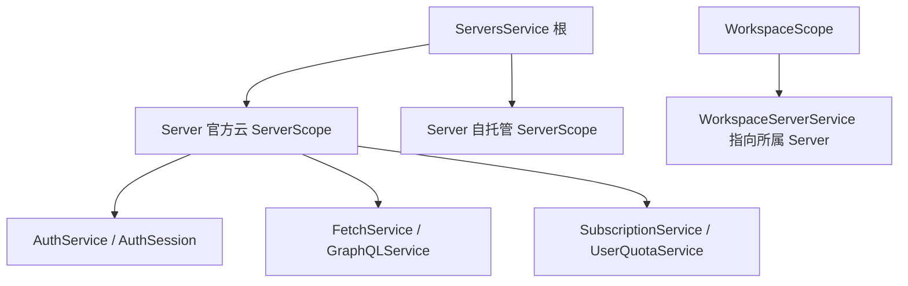

# 第 17 章 Core 业务模块与路由

> 应用壳只管"组装与挂载"，69 个业务模块与双层路由都住在 @affine/core

第 6 部分 · 前端应用 ｜ 难度 ★★★★☆ ｜ 建议学时 12 小时

===

## 本章要解决的问题

<p class="lead">AFFiNE 前端最大的包 <code>@affine/core</code> 装着桌面版与移动版的所有页面、69 个业务模块、编辑器集成与命令系统；而 <code>apps/web</code>、<code>apps/electron-renderer</code>、<code>apps/mobile</code> 只是薄薄的"应用壳"。</p>

应用壳只做一件事：**按平台挑选模块、组装 Framework，然后把根组件挂到 DOM 上**。读懂这一章，你要能回答三个具体问题。

<div class="cards cols-3">
  <div class="card"><div class="card__icon">🚀</div><h4>启动链路</h4><p>浏览器打开一个工作区文档 URL，从 <code>index.tsx</code> 到编辑器渲染经过了哪些文件、创建了哪些作用域？</p></div>
  <div class="card"><div class="card__icon">🧩</div><h4>模块归属</h4><p>69 个模块属于哪些领域？哪些挂根作用域，哪些挂工作区 / 文档作用域？</p></div>
  <div class="card"><div class="card__icon">🪟</div><h4>两层路由</h4><p>为什么要"两层路由"？Workbench 的多视图、分屏、多标签如何与 React Router 共存？</p></div>
</div>

<div class="note note--warn">

学 core 最容易犯的错误，是直奔某个页面组件读起。**正确顺序是先走通启动链路，再按领域把模块摊开**，重点深读 workspace、doc、editor、workbench 四个骨干，最后才看路由、命令与移动端差异。

</div>

===

## 知识地图

本章从"壳如何启动 core"切入，沿作用域树 Root → Server / Workspace → Doc → Editor 逐层深入，最后收束到路由、组织、搜索、命令与多端。



<div class="note">

本章路径均相对仓库根目录 `AFFiNE/`。`ObjectPool + createScope + emitEvent` 是工作区与文档打开的统一套路，看懂一次，就看懂了全部。

</div>

===

## 学习目标

<ol class="goals">
  <li>说出 <code>core/src</code> 下 bootstrap、modules、components、desktop、mobile、blocksuite、commands、utils 各目录职责</li>
  <li>画出 Web 端从 <code>apps/web/src/index.tsx</code> 到 <code>WorkbenchRoot</code> 的启动与渲染链路</li>
  <li>解释 workspace 模块的 flavour 机制与 <code>WorkspaceRepositoryService.open</code> 的对象池 + 作用域创建</li>
  <li>描述 <code>DocsService.open</code> → <code>DocScope</code> → <code>EditorsService.createEditor</code> → <code>EditorScope</code> 的打开链路</li>
  <li>说明"顶层 BrowserRouter + 每个 View 一个 MemoryRouter"的双层路由设计</li>
  <li>说明 CMD-K 命令系统 <code>AffineCommandRegistry</code> 与 quicksearch 会话如何协作</li>
</ol>

===

<!-- section -->
## 一、从壳到核：启动链路

应用壳只负责"启动 Worker + 组装 Framework + 挂载路由"，我们先跟着入口文件走一遍。

===

## core/src 目录与启动副作用

`core/src` 的目录分工清晰：`modules/` 放 69 个 DI 业务模块，`bootstrap/` 只放**顺序敏感的副作用 import**，`desktop/`、`mobile/` 放页面与路由表。

<div class="split">
<div class="split__main">

`bootstrap/browser.ts` 顶部注释直接写着 `// ORDER MATTERS`。`env.ts` 调用 `setupGlobal()` 设置 `environment` 等全局对象，后续模块在顶层求值时就会读它们，所以**必须最先执行**。

`cleanup.ts` 则清理历史版本遗留的 IndexedDB 库（如以 `:server-clock`、`:sync-metadata` 结尾的库），属于"静默迁移"。

</div>
<div class="split__aside">

```ts
// bootstrap/browser.ts
// ORDER MATTERS
import './env';
import './public-path';
import './polyfill/browser';
import './telemetry';
```

</div>
</div>

<div class="note">

`modules` 内部遵循统一约定：`entities/`、`services/`、`stores/`、`scopes/`、`providers/`（接口标识符）、`impls/`（实现）、`events/`、`view/`，以及唯一出口 `index.ts`（导出 + `configureXxxModule`）。

</div>

===

## Web 入口的三个文件

`apps/web` 的入口链路只有三个文件，职责层层递进：`index.tsx` 挂载、`setup.ts` 跑副作用、`app.tsx` 是真正的"组装车间"。

<div class="annotate">

```ts [1-2|4]
// setup.ts
import '@affine/core/bootstrap/browser';
import '@affine/core/bootstrap/cleanup';
import '@affine/component/theme';
// index.tsx: import './setup' 后 createRoot(...).render(<App/>)
```

<ol class="annotate__notes">
  <li><b>第 1–2 行</b>：先执行 bootstrap 的顺序敏感副作用。</li>
  <li><b>第 4 行</b>：全局样式在应用启动最早期注入（第 18 章）。</li>
</ol>
</div>

`app.tsx` 分三步：① 启动存储 Worker（优先 `SharedWorker`，多标签共享）；② `new Framework()` 后 `configureCommonModules` 等一串 configure；③ `framework.provider()` 创建根 Provider 并触发 `LifecycleService.applicationStart()`。

===

## app.tsx 组装车间细读

三步里最关键的是 Worker 选择与 Framework 组装。SharedWorker 能让同源多个标签页共享同一存储实例与同步连接，避免重复同步。

<div class="annotate">

```ts [2-5|8-11]
// app.tsx（节选）
const workerUrl = getWorkerUrl('nbstore');
if (window.SharedWorker &&
    localStorage.getItem('disableSharedWorker') !== 'true') {
  const worker = new SharedWorker(workerUrl, { name: 'affine-shared-worker' });
  storeManagerClient = new StoreManagerClient(new OpClient(worker.port));
}
const framework = new Framework();
configureCommonModules(framework);
configureBrowserWorkbenchModule(framework);
configureBrowserWorkspaceFlavours(framework);
```

<ol class="annotate__notes">
  <li><b>第 2–5 行</b>：不支持 SharedWorker 或设了 <code>disableSharedWorker</code> 时回退为普通 <code>Worker</code>。</li>
  <li><b>第 8–11 行</b>：先装公共模块，再叠加平台专属模块。</li>
</ol>
</div>

`App` 组件依次包裹 `Suspense` → `FrameworkRoot` → emotion `CacheProvider` → `I18nProvider` → `AffineContext`（Jotai、ThemeProvider、各种 ModalProvider）→ `RouterProvider`。

===

## 启动到渲染的时序

从加载入口到工作台渲染，中间有两个关键等待点：根 Provider 创建、以及"根文档 ready"。



<div class="note">

`RootWrapper`（`desktop/pages/root/index.tsx`）在最外层包了 `<FrameworkScope scope={defaultServerService.server.scope}>`，挂载 `GlobalDialogs`、`NotificationCenter`、`CustomThemeModifier`。

</div>

===

## 三端组装差异：同代码换实现

三端都调 `configureCommonModules`，差异在平台专属 configure。workbench 有 Browser / Desktop 两套实现，区别在 `WorkbenchDefaultState`（是否从桌面端恢复视图）与 `WorkbenchNewTabHandler`（`window.open` 还是 Electron `addTab`）。

<div class="compare">
  <div class="compare__col"><h4>Web / Mobile</h4>

- `configureBrowserWorkbenchModule`
- `configureLocalStorageStateStorageImpls`
- `impl(NbstoreProvider)` 用 SharedWorker 客户端

  </div>
  <div class="compare__col compare__col--good"><h4>Electron</h4>

- `configureDesktopWorkbenchModule`（多标签）
- `configureElectronStateStorageImpls`
- `configureAppTabsHeaderModule`、`configureDesktopApiModule`、`configureFindInPageModule`、`configureDesktopBackupModule` 等

  </div>
</div>

```ts
// modules/workbench/index.ts（节选）
export function configureBrowserWorkbenchModule(services: Framework) {
  configureWorkbenchCommonModule(services);
  services.scope(WorkspaceScope)
    .impl(WorkbenchDefaultState, InMemoryWorkbenchDefaultState)
    .impl(WorkbenchNewTabHandler, () => BrowserWorkbenchNewTabHandler);
}
```

===

## 69 个模块按领域分组

`configureCommonModules` 依次调用了 60 余个 `configureXxx`。按业务领域归类，才能在脑中建立"这个功能住哪个模块"的地图。

| 领域 | 代表模块 | 主要作用域 |
|---|---|---|
| 工作区 | `workspace`、`workspace-engine`、`db`、`userspace` | 根 + Workspace |
| 文档 | `doc`、`doc-link`、`journal`、`comment`、`blob-management` | Workspace + Doc |
| 编辑器 | `editor`、`editor-setting`、`at-menu-config`、`mermaid` | Doc + Editor |
| 导航布局 | `workbench`、`navigation`、`app-sidebar`、`peek-view` | Workspace + View |
| 组织 | `collection`、`collection-rules`、`tag`、`favorite`、`organize` | Workspace |
| 搜索 | `quicksearch`、`docs-search` | Workspace |
| 云与协作 | `cloud`、`permissions`、`quota`、`share-doc`、`notification` | 根 + Server + Workspace |
| 系统 | `lifecycle`、`global-context`、`feature-flag`、`dialogs`、`i18n` | 根 |

<div class="note note--warn">

不在 `configureCommonModules` 里的：`workbench`、`workspace-engine`（平台入口调用）、`app-tabs-header`、`find-in-page`、`desktop-api`、`backup`（Electron 专属）。`share-menu`、`mermaid`、`typst`、`shared` 只提供视图/渲染器，没有 configure 函数。

</div>

===

<!-- section -->
## 二、workspace 模块：工作区的生与死

根作用域"管理所有工作区"，工作区作用域"管理一个工作区的内部"——注册位置就把这条边界画清了。

===

## 元数据与 flavour 机制

工作区的身份由 `WorkspaceMetadata` 描述，核心是 `flavour`——它表示工作区"住在哪"。

<div class="annotate">

```ts [3|7-8]
// modules/workspace/metadata.ts
export type WorkspaceMetadata = {
  id: string;
  flavour: string;
  initialized?: boolean;
};
export const workspaceMetadataKey = (m: WorkspaceMetadata) =>
  `${m.flavour}:${m.id}`;
```

<ol class="annotate__notes">
  <li><b>第 3 行</b>：本地工作区 flavour 固定 <code>'local'</code>；云工作区 flavour = <b>服务器 id</b>（<code>this.server.id</code>）。</li>
  <li><b>第 7–8 行</b>：一个用户可同时连官方云与多台自托管服务器，<code>flavour:id</code> 拼接避免不同服务器同 id 冲突。</li>
</ol>
</div>

`WorkspaceFlavourProvider` 接口定义每种 flavour 必须实现的能力：`createWorkspace`、`deleteWorkspace`、`workspaces$`、`getWorkspaceProfile`、`getEngineWorkerInitOptions` 等。三层聚合如下图。



===

## open：对象池 + 作用域

`WorkspaceRepositoryService.open` 是理解"打开工作区"的核心。它用 `ObjectPool` 按 `flavour:id` 缓存实例，引用计数归零才真正销毁。

<div class="annotate">

```ts [2-4|6-9|11-13]
open = (options, customEngineWorkerInitOptions?) => {
  if (options.isSharedMode) {
    const workspace = this.instantiate(options, customEngineWorkerInitOptions);
    return { workspace, dispose: () => { workspace.scope.dispose(); } };
  }
  const exist = this.pool.get(workspaceMetadataKey(options.metadata));
  if (exist) {
    return { workspace: exist.obj, dispose: exist.release };
  }
  const workspace = this.instantiate(options, customEngineWorkerInitOptions);
  const ref = this.pool.put(workspaceMetadataKey(workspace.meta), workspace);
  return { workspace: ref.obj, dispose: ref.release };
};
```

<ol class="annotate__notes">
  <li><b>第 2–4 行</b>：分享页（<code>isSharedMode</code>）不进池，每次独立实例，<code>dispose</code> 直接销毁作用域。</li>
  <li><b>第 6–9 行</b>：普通模式已存在则复用并增加引用计数。</li>
  <li><b>第 11–13 行</b>：首次打开 <code>instantiate</code>：找 flavour provider → 取 engineWorkerInitOptions → <code>createScope(WorkspaceScope)</code> → <code>engine.start()</code> → <code>emitEvent(WorkspaceInitialized)</code>。</li>
</ol>
</div>

===

## Workspace 实体与 WorkspaceEngine

`Workspace` 是工作区作用域内的"根实体"：持有根 YDoc（guid = 工作区 id），懒创建 BlockSuite 的 `docCollection`，并把文档加载、Blob 读写、Awareness 全部委托给 `engine`。



<div class="note">

`WorkspaceEngine.start()` 通过 `NbstoreService.openStore` 打开存储（key 形如 `workspace:<flavour>:<id>`），得到 `StoreClient`，再暴露 `doc`/`blob`/`indexer`/`awareness` 四个 frontend——这正是第 19 章的入口。

</div>

页面里用法极简：`useLayoutEffect` 中 `workspacesService.open({ metadata })` 拿到 `ref`，组件卸载即 `ref.dispose()`，引用计数 -1。根文档就绪前只渲染 `<AppContainer fallback />` 骨架。

===

<!-- section -->
## 三、doc 与 editor：打开文档全链路

工作区装好后，打开一篇文档走的是与工作区完全同构的套路：对象池 + createScope + 事件。

===

## 两类对象：DocRecord 与 Doc

列表页有成百上千篇文档，若每篇都加载内容会卡死。所以 core 把"元信息"与"已打开的文档"分成两类对象。

<div class="compare">
  <div class="compare__col"><h4>DocRecord（Workspace 作用域）</h4>

- 文档"元信息记录"，来自根文档 meta 与 db 属性
- **不加载内容**
- `title$`、`trash$`、`meta$`、`setPrimaryMode`、`moveToTrash`

  </div>
  <div class="compare__col compare__col--good"><h4>Doc（Doc 作用域）</h4>

- 一个**已打开**的文档
- 持有 BlockSuite `Store` 与 YDoc
- `blockSuiteDoc`、`yDoc`、`record`、`setUpdatedAt`

  </div>
</div>

<div class="note note--tip">

`Doc` 实体构造时会 `engine.doc.addPriority(this.id, 100)` 与 `engine.indexer.addPriority(this.id, 100)`——打开的文档在同步与索引队列中优先，`dispose` 时自动撤销优先级。它还监听 YDoc 的 `afterTransaction`，本地事务节流 1 秒更新 `updatedAt`。

</div>

===

## DocsService.open 与打开链路

`DocsService.open` 与 `WorkspaceRepositoryService.open` 完全同构。而详情页 `useLoadDoc` 把 doc 与 editor 串成一条链。

<div class="annotate">

```ts [3-5|7-9|11]
// detail-page-wrapper.tsx 的 useLoadDoc（节选）
useLayoutEffect(() => {
  const { doc, release } = docsService.open(pageId);
  setDoc(doc);
  const editor = doc.scope.get(EditorsService).createEditor();
  const unbind = editor.bindWorkbenchView(viewService.view);
  setEditor(editor);
  return () => { unbind(); editor.dispose(); release(); };
}, [docRecord, docsService, pageId, viewService.view]);
```

<ol class="annotate__notes">
  <li><b>第 3–5 行</b>：<code>DocsService.open</code> 内部 <code>createScope(DocScope)</code> 后 <code>emitEvent(DocInitialized)</code>。</li>
  <li><b>第 7–9 行</b>：<code>EditorsService.createEditor()</code> 创建 <code>Editor</code> 实体，构造时立即 <code>createScope(EditorScope)</code>。</li>
  <li><b>第 11 行</b>：卸载时严格逆序 <code>unbind → dispose → release</code>。</li>
</ol>
</div>

渲染时再嵌两层 `FrameworkScope`：`<FrameworkScope scope={doc.scope}><FrameworkScope scope={editor.scope}>`，于是编辑器内组件 `useService(EditorService)` 就能拿到当前编辑器。



===

<!-- section -->
## 四、workbench：前端的窗口管理器

Workbench 是整个前端最"巧"的一段设计：用"每个 View 一个 MemoryRouter"实现多视图与分屏。

===

## Workbench 与 View 的概念

`modules/workbench/README.md` 用一张 ASCII 图描述：顶部若干 Tab，主区若干并排的 View，右侧 Sidebar。

<div class="cards cols-3">
  <div class="card"><div class="card__icon">🪟</div><h4>Workbench</h4><p>窗口管理器，含主区与右侧栏。永远有一个<b>活动 View</b>，其 URL 被视为整个应用的 URL。</p></div>
  <div class="card"><div class="card__icon">📑</div><h4>View</h4><p>被管理的窗口，每个 View 有<b>自己的历史栈</b>与当前 URL，可前进后退。</p></div>
  <div class="card"><div class="card__icon">🏝️</div><h4>ViewIsland</h4><p>每个路由通过它渲染自己的 <code>Header</code>、<code>Body</code> 与多个 <code>Sidebar</code>。</p></div>
</div>

`Workbench.open(to, { at })` 的 `at` 参数取 `'beside' | 'active' | 'head' | 'tail' | number | 'new-tab'`——`beside` 就是"在旁边分屏打开"，`new-tab` 交给 `WorkbenchNewTabHandler`（浏览器 `window.open`，桌面端 Electron `addTab`）。

<div class="note">

`WorkbenchService` 监听 `location$` 变化后通过 `this.eventBus.root.emit(WorkbenchLocationChanged, ...)` 向**根总线**广播（根总线事件能到达所有已创建子作用域）。`PeekViewService` 用 `@OnEvent(WorkbenchLocationChanged, e => () => e.peekView.close())` 在路由变化时关闭预览层。

</div>

===

## 每个 View 一个 MemoryRouter

这是整个前端最该精读的一段：如何让多个窗口共享一个浏览器地址栏。

<div class="annotate">

```tsx [2|6-9|11-15]
export const ViewRoot = ({ view, routes }) => {
  const viewRouter = useMemo(() => createMemoryRouter(routes), [routes]);
  const location = useLiveData(view.location$);
  useLayoutEffect(() => {
    viewRouter.navigate(location).catch(err => console.error(err));
  }, [location, view, viewRouter]);
  return (
    <FrameworkScope scope={view.scope}>
      <UNSAFE_LocationContext.Provider value={null as any}>
        <UNSAFE_RouteContext.Provider value={routeContextValue}>
          <RouterProvider router={viewRouter} />
        </UNSAFE_RouteContext.Provider>
      </UNSAFE_LocationContext.Provider>
    </FrameworkScope>
  );
};
```

<ol class="annotate__notes">
  <li><b>第 2 行</b>：每个 View 拥有<b>独立的 MemoryRouter</b>，<code>location$</code> 一变就 <code>navigate</code>。</li>
  <li><b>第 6–9 行</b>：外包 <code>FrameworkScope scope=&#123;view.scope&#125;</code>，页面里 <code>useService(ViewService).view</code> 拿到"我所在的 View"。</li>
  <li><b>第 11–15 行</b>：嵌套 <code>RouterProvider</code> 本不被允许，作者把 <code>UNSAFE_*Context</code> 重置为空来"隔离"父路由（注释附了 issue 链接）。</li>
</ol>
</div>

===

## 双层路由全景与浏览器同步

顶层 BrowserRouter 只负责到工作区为止，工作区内部全交给 Workbench 的 MemoryRouter。



<div class="note note--warn">

`useBindWorkbenchToBrowserRouter`：活动 View 历史与浏览器历史是**两个栈**。View 历史 PUSH/REPLACE 时同步到浏览器（POP 跳过）；浏览器地址变化时仅以 PUSH 更新活动 View；为避免死循环，在 location state 上标记来源（`'fromView,'`、`'fromBrowser'`）。Electron 下改用 `useBindWorkbenchToDesktopRouter`。

</div>

===

<!-- section -->
## 五、路由体系与类型安全生成

两层路由各有一张表；此外 `@affine/routes` 用代码生成提供类型安全路由。

===

## 两张路由表

顶层 `desktop/router.tsx` 的路径带 `/workspace/:workspaceId/*` 前缀；工作台 `workbench-router.ts` 的路径**没有前缀**，前缀由 `basename$` 补上。

<div class="split">
<div class="split__main">

顶层以 `<RootRouter />` 为根元素，子路由几乎都用 `lazy: () => import('./pages/...')`，用 `createBrowserRouter` 创建，`basename: environment.subPath` 支持部署在子路径。

工作台路由是 View 内部 MemoryRouter 的路径。注意 `/:pageId` 会吞掉所有未匹配的单段路径，所以 `workspace/index.tsx` 判断"是否文档详情页"时用 `workbenchRoutes.find(r => matchPath(r.path, '/' + docId))?.path === '/:pageId'`（注释里也留了 TODO）。

</div>
<div class="split__aside">

```ts
// workbench-router.ts（压缩为单行）
export const workbenchRoutes = [
  { path: '/all', lazy: () => import(...) },
  { path: '/collection/:collectionId', lazy },
  { path: '/tag/:tagId', lazy },
  { path: '/trash', lazy },
  { path: '/:pageId', lazy },
  { path: '/journals', lazy },
  { path: '/settings', lazy },
  { path: '*', lazy: () => import('./pages/404') },
] satisfies RouteObject[];
```

</div>
</div>

===

## @affine/routes：类型安全路由生成

`@affine/routes` 是一个小型代码生成器：`routes.json` 描述路由树，`build.ts` 用 `path-to-regexp` 解析后生成 `src/routes.ts`。

<div class="annotate">

```ts [1|4-7]
const { tokens } = parse(schema.fromRoot);
for (const token of tokens) {
  switch (token.type) {
    case 'param':
    case 'wildcard':
      types.push(token.name);
      factories.push(`\${params.${token.name}}`);
      break;
    case 'text': factories.push(token.value); break;
  }
}
```

<ol class="annotate__notes">
  <li><b>第 1 行</b>：用 <code>path-to-regexp</code> 的 <code>parse</code> 解析路径参数。</li>
  <li><b>第 4–7 行</b>：生成四类产物——<code>RouteParamsTypes</code>、<code>ROUTES</code>、<code>RELATIVE_ROUTES</code>、<code>FACTORIES</code>（带类型的路径工厂）。</li>
</ol>
</div>

<div class="note note--warn">

**产物与源 JSON 可能不同步**：当前 `routes.json` 已有 `queue`，而生成的 `src/routes.ts` 中没有——修改 `routes.json` 后务必在包内重新 `build`。目前只有 admin 后台用它，主应用仍使用手写的 `route-paths.ts` 与 `workbench-router.ts`。

</div>

===

<!-- section -->
## 六、组织、搜索、命令与云

组织（collection-rules）、搜索（quicksearch 会话）、命令（registry）都是"注册表 + 插件"的设计。

===

## collection-rules：variant 插件引擎

收藏夹（智能文件夹）的规则引擎由三个接口组成，用 variant 机制注册几十个实现，新增条件无需改引擎。

<div class="split">
<div class="split__main">

`Collection.watch()` 把规则交给 `CollectionRulesService.watch`，并额外追加"不在回收站""不是空日记"两条系统过滤器。

`configureCollectionRulesModule` 用 `FilterProvider('system:tags')`、`GroupByProvider('property:date')`、`OrderByProvider('system:title')` 等变体注册实现，服务按 `${type}:${key}` 查找对应变体。**新增一种过滤条件 = 新写一个 Provider + 注册一个变体**。

</div>
<div class="split__aside">

```ts
// collection-rules/provider/index.ts
export interface FilterProvider {
  filter$(p: FilterParams): Observable<Set<string>>;
}
export interface GroupByProvider {
  groupBy$(items$, p): Observable<Map<string, Set<string>>>;
}
export interface OrderByProvider {
  orderBy$(items$, p): Observable<string[]>;
}
```

</div>
</div>

<div class="note">

`tag`、`favorite`、`organize` 三者存储位置不同：`tag` 存根 YDoc meta 的 tags 字段，`favorite` 存 userdata DB（按用户隔离），`organize`（文件夹树）存 workspace DB 的 `folders` 表、`index` 为分数索引。

</div>

===

## quicksearch：会话插件化

`QuickSearch.show(sources, callback, options)` 接收一组"会话"（Session），每个会话负责一类结果。CMD-K 就是把七种会话一起塞进去。

```ts
// quicksearch/services/cmdk.ts（节选）
this.quickSearchService.quickSearch.show(
  [
    this.framework.createEntity(RecentDocsQuickSearchSession),
    this.framework.createEntity(CollectionsQuickSearchSession),
    this.framework.createEntity(CommandsQuickSearchSession),
    this.framework.createEntity(CreationQuickSearchSession),
    this.framework.createEntity(DocsQuickSearchSession),
    this.framework.createEntity(LinksQuickSearchSession),
    this.framework.createEntity(TagsQuickSearchSession),
  ],
  result => { /* 按结果类型 openDoc / 运行命令 / 创建文档 */ }
);
```

<div class="note">

`DocsQuickSearchSession` 依赖 `DocsSearchService`（查询 nbstore 索引，第 19 章）；`CommandsQuickSearchSession` 通过 `AffineCommandRegistry.getAll()` 取出所有命令。`peek-view` 则以浮层预览文档/图片/附件/AI 对话块，路由变化时由 `@OnEvent(WorkbenchLocationChanged)` 自动关闭。

</div>

===

## commands：VSCode 风格命令注册表

命令抽象"highly inspired by VSCode Command Abstractions"。注册时若有 `keyBinding` 就用 tinykeys 绑定到 `window`。

<div class="annotate">

```ts [5|9-12|15]
registerAffineCommand({
  id: 'affine:toggle-left-sidebar',
  category: 'affine:layout',
  icon: <SidebarIcon />,
  label: () => appSidebarService.sidebar.open$.value
    ? t['com.affine.cmdk.affine.left-sidebar.collapse']()
    : t['com.affine.cmdk.affine.left-sidebar.expand'](),
  keyBinding: { binding: '$mod+/' },
  run() {
    appSidebarService.sidebar.toggleSidebar();
  },
})
```

<ol class="annotate__notes">
  <li><b>第 5 行</b>：<code>label</code> 可以是函数，随 LiveData 动态变化。</li>
  <li><b>第 9–12 行</b>：<code>$mod</code> 在 macOS 上是 ⌘，其他系统是 Ctrl。</li>
  <li><b>第 15 行</b>：<code>preconditionStrategy</code>（<code>Always</code>、<code>InPaper</code>、<code>InEdgeless</code>）只控制命令在 CMD-K 中是否可见，不影响快捷键。</li>
</ol>
</div>

`commands/affine-*.tsx` 按类别提供工厂，依赖通过参数注入，由 `use-register-workspace-commands.ts` 在工作区挂载时统一注册。

===

## cloud：服务器即作用域

`cloud` 模块把"每台服务器"做成一个 `ServerScope`——这让"同时登录官方云与自托管服务器，各自有独立会话与订阅"成为自然的结构。



<div class="note">

`.scope(ServerScope)` 下注册**每台服务器一套**的 `ServerService`、`FetchService`、`GraphQLService`、`AuthService`、`SubscriptionService` 等。登录状态变化发出 `AccountChanged` 等事件，`UserQuotaService`、`SubscriptionService` 通过 `@OnEvent(AccountChanged)` 刷新。`permissions` 模块的 `useGuard('Doc_Read', pageId)` 则决定详情页显示内容还是"无权限"页。

</div>

===

## 动手实践

<ol class="steps">
  <li><h4>画出启动时序</h4><p>从 <code>apps/web/src/index.tsx</code> 跟读到 <code>workspace/index.tsx</code>，记录每步创建的 Provider/Scope。<b>验收</b>：时序图含根 Provider、ServerScope、WorkspaceScope 三个创建点，并标出"根文档 ready"等待条件。</p></li>
  <li><h4>模块归属调查</h4><p>任选 <code>tag</code>、<code>peek-view</code>、<code>permissions</code>、<code>doc-link</code>、<code>journal</code> 读其 <code>index.ts</code>，填"注册作用域 / Service / Store / Entity / 依赖"表。<b>验收</b>：能说明为何 <code>permissions</code> 同时在 WorkspaceScope 与 DocScope 注册。</p></li>
  <li><h4>分屏打开</h4><p>控制台用 <code>window.workbench</code> 执行 <code>workbench.openAll({ at: 'beside' })</code>，再看 <code>views$.value.length</code>。<b>验收</b>：出现两个并排 View，能解释地址栏为何跟随活动 View。</p></li>
  <li><h4>新增一个过滤器</h4><p>仿 <code>collection-rules/impls/filters</code>，设计 <code>system:title-length</code> 过滤器实现 <code>FilterProvider.filter$</code> 并注册变体。<b>验收</b>：能说明引擎如何按 <code>type:key</code> 找到它。</p></li>
</ol>

===

## 自测：点击揭晓答案

<details class="quiz">
<summary>Q1. 云工作区的 flavour 值是什么？为什么不是固定字符串 'cloud'？</summary>

是服务器 id（`this.server.id`）。用户可同时连接多台服务器（官方云、自托管），每台服务器的工作区需要区分，flavour 即"工作区所属的存储提供方"，用 `flavour:id` 拼接 key 避免冲突。

</details>

<details class="quiz">
<summary>Q2. WorkspaceRepositoryService.open 对分享模式与普通模式有何不同？</summary>

分享模式（`isSharedMode`）不进对象池，每次 `instantiate` 新实例，`dispose` 直接销毁作用域；普通模式按 `flavour:id` 放入 `ObjectPool`，已存在则复用并增加引用计数，`dispose` 只是 `release`。

</details>

<details class="quiz">
<summary>Q3. 一个 View 内部为什么用 MemoryRouter？如何与浏览器地址同步？</summary>

一个窗口里有多个 View，每个需要独立的历史与路由状态，而浏览器只有一个地址栏。`useBindWorkbenchToBrowserRouter` 把活动 View 的 PUSH/REPLACE 同步给浏览器，浏览器变化时以 PUSH 更新活动 View，并用 location state 标记来源防止循环。

</details>

===

## 小结与下一步

<ul class="takeaways">
  <li>应用壳只负责"启动 Worker + 组装 Framework + 挂载路由"，业务全部在 <code>@affine/core</code>。</li>
  <li>作用域树 Root → Server / Workspace → Doc → Editor、Workspace → View 是理解所有模块的骨架。</li>
  <li><code>ObjectPool + createScope + emitEvent</code> 是工作区与文档打开的统一套路。</li>
  <li>Workbench 用"每个 View 一个 MemoryRouter"实现多视图与分屏，顶层 BrowserRouter 只到工作区为止。</li>
  <li>组织、搜索、命令、云都是"注册表 + 插件"设计；移动端复用全部业务模块，仅替换页面与少量平台模块。</li>
</ul>

<div class="note note--tip">

**下一章预告**：第 18 章讲"界面长什么样、说什么话"——组件库 `@affine/component` 的 vanilla-extract 样式、`@toeverything/theme` 的 CSS 变量明暗切换，以及 `@affine/i18n` 的类型安全文案。

</div>
