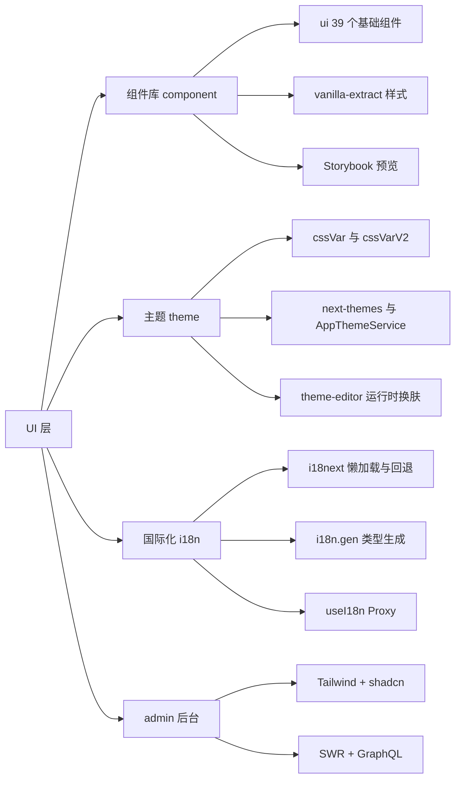
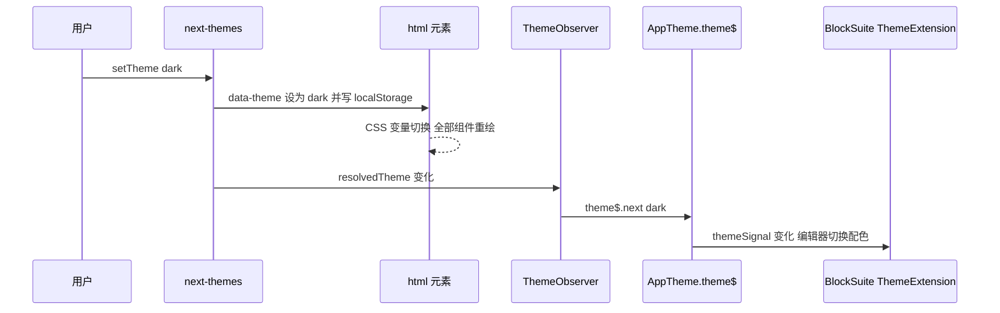
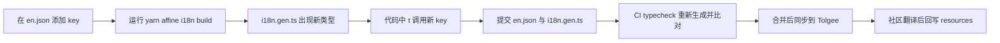

# 第 18 章 组件库、主题与国际化

> 界面长什么样、说什么话——三大支柱：组件库、主题令牌、类型安全 i18n

第 6 部分 · 前端应用 ｜ 难度 ★★☆☆☆ ｜ 建议学时 6 小时

===

## 本章要解决的问题

<p class="lead">前两章讲"数据怎么流"，本章讲"界面长什么样、说什么话"。AFFiNE 的 UI 层靠三个支柱撑起来，加上一套走另一条路线的管理后台做对照。</p>

<div class="cards cols-3">
  <div class="card"><div class="card__icon">🧱</div><h4>组件库</h4><p><code>@affine/component</code>：39 个基础 + 15 个复合组件，样式用 <b>vanilla-extract</b>（编译期 CSS-in-TS），行为基于 Radix UI，配 Storybook。</p></div>
  <div class="card"><div class="card__icon">🎨</div><h4>主题</h4><p><code>@toeverything/theme</code>：以 CSS 变量为载体的设计令牌，v1/v2 两代并存，配 <code>next-themes</code> 明暗切换。</p></div>
  <div class="card"><div class="card__icon">🌍</div><h4>国际化</h4><p><code>@affine/i18n</code>：i18next + 代码生成的<b>类型安全 key</b>，26 份语言资源，经 Tolgee 协作。</p></div>
</div>

<div class="note note--tip">

管理后台 `@affine/admin` 走的是另一条技术路线：**Tailwind CSS + shadcn/ui 风格组件 + SWR 包装的 GraphQL hooks**。把两套做法放在一起，能帮你理解"产品主应用"与"内部后台"在 UI 工程上的不同取舍。

</div>

===

## 知识地图

本章四条主线：组件库怎么写、主题怎么切、文案怎么管、admin 为何不同。建议边读边打开 Storybook 对照组件效果。



===

## 学习目标

<ol class="goals">
  <li>说出 <code>component/src</code> 下 ui、components、hooks、lit-react、styles、theme、fonts、utils 各目录职责</li>
  <li>以 Button、Modal、Menu 为例解释 vanilla-extract 的 <code>createVar/style/selectors</code> 与 <code>data-*</code> 属性驱动变体</li>
  <li>区分 <code>cssVar</code> 与 <code>cssVarV2</code> 命名规则，说明 next-themes、AppThemeService、BlockSuite ThemeExtension 如何协作</li>
  <li>描述 <code>@affine/i18n</code> 的初始化、懒加载、回退策略，以及 <code>i18n.gen.ts</code> 生成与 <code>useI18n</code> 的 Proxy 机制</li>
  <li>独立新增一个文案 key 并通过 CI 的 i18n 检查</li>
  <li>说明 admin 后台的技术栈与 <code>useQuery</code>/<code>useMutation</code> 的实现</li>
</ol>

===

<!-- section -->
## 一、组件库：单 class + data 属性 + CSS 变量

组件库 `@affine/component` 不依赖 DI——这是一条重要的分层约束：组件只接收 props，不认识任何 Service。

===

## 目录与导出约定

组件库按目录精确导出，`exports` 中 `"./*"` 映射到复合组件。全局样式由 `theme/index.ts` 四行副作用 import 注入。

<div class="split">
<div class="split__main">

- `src/ui/`：39 个基础组件，`import { Button } from '@affine/component'` 或 `@affine/component/ui/button`；
- `src/components/`：15 个复合组件，`@affine/component/<目录名>`；
- `src/lit-react/`：Lit 组件转 React（`createReactComponentFromLit`、`LitPortal`）；
- `src/hooks/`、`src/utils/`、`src/styles/`：从根入口导出。

Web 应用的 `setup.ts` 第三行就是 `import '@affine/component/theme'`——全局样式在启动最早期注入。

</div>
<div class="split__aside">

```ts
// component/src/theme/index.ts
import '@toeverything/theme/style.css';
import './fonts.css';
import './global.css';
import './theme.css';
```

</div>
</div>

<div class="note note--warn">

**组件库不依赖 DI**：复合组件（登录表单、设置项布局）更贴近业务，但仍不认识 `@toeverything/infra` 的 Service。依赖 DI 的逻辑要放到 core 层，组件只接收 props——否则在 Storybook（没有 FrameworkRoot）里 `useService` 会直接报错。

</div>

===

## Button：data 属性驱动的变体

Button 只有**一个 className**，所有变体用 `data-variant`、`data-size` 等属性表达。这比"根据 props 拼接多个 class"更易调试——DevTools 里一眼可见状态。

<div class="annotate">

```tsx [4|6|8]
<button
  className={clsx(styles.button, className)}
  data-loading={loading || undefined}
  data-size={size}
  data-variant={variant}
  data-no-hover={withoutHover || BUILD_CONFIG.isMobileEdition || undefined}
  disabled={disabled}
  onClick={handleClick}
>
```

<ol class="annotate__notes">
  <li><b>第 4 行</b>：用 <code>undefined</code> 而非 <code>false</code>——React 不渲染值为 <code>undefined</code> 的属性，而 <code>false</code> 会渲染成字符串 <code>"false"</code> 导致 <code>[data-loading]</code> 误匹配。</li>
  <li><b>第 6 行</b>：变体全用属性表达，样式层用属性选择器匹配。</li>
  <li><b>第 8 行</b>：<code>handleClick</code> 内 <code>if (loading || disabled) return;</code> 防止重复提交；移动版自动关 hover。</li>
</ol>
</div>

===

## vanilla-extract：变量即"可覆盖接口"

`button.css.ts` 的注释点出了精髓："使用变量可以从外部覆盖，而无需考虑选择器优先级"。组件内部只"读变量"，变体只"写变量"。

<div class="annotate">

```ts [2-3|6|9-11]
// button.css.ts（节选）
export const hVar = createVar('height');
const bgVar = createVar('bg');
export const button = style({
  backgroundColor: bgVar,
  height: hVar,
  selectors: {
    '&[data-size="default"]': { vars: { [hVar]: '28px' } },
    '&[data-variant="primary"]': {
      vars: { [bgVar]: cssVarV2('button/primary') },
    },
  },
});
```

<ol class="annotate__notes">
  <li><b>第 2–3 行</b>：<code>createVar</code> 声明 CSS 变量作为"接口"。</li>
  <li><b>第 6 行</b>：组件基础样式只"读"变量。</li>
  <li><b>第 9–11 行</b>：变体只"写"变量。外部想定制尺寸只需 <code>assignInlineVars(&#123;[hVar]:'36px'&#125;)</code>，不必和 <code>[data-size]</code> 比优先级。</li>
</ol>
</div>

<div class="note note--tip">

vanilla-extract 是"**编译期** CSS-in-TS"：`.css.ts` 在构建时执行，产出静态 CSS 与哈希类名，**运行时零开销**。hover 效果用 `:before` 伪元素叠加 `cssVarV2('layer/background/hoverOverlay')`，与背景色解耦，任意 variant 都有统一悬浮反馈。

</div>

===

## Modal 与 Menu：Radix 封装与双端实现

Modal 基于 Radix Dialog，结构是 `Dialog.Root → Portal → Overlay → SafeArea → Content`；Menu 则是"一套 API、两套实现"。

<div class="compare">
  <div class="compare__col"><h4>Modal 的几个细节</h4>

- **未打开即不渲染**（`if (!props.open) return;`），重组件不提前挂载
- 嵌套计数 `InsideModalContext` + `useIsInsideModal()`
- 尺寸通过 `assignInlineVars` 写变量，延续"变量即接口"
- 无 `title` 时仍渲染 `VisuallyHidden` 包裹的空 `Dialog.Title`（可访问性）

  </div>
  <div class="compare__col compare__col--good"><h4>Menu 双端切换</h4>

```ts
const Menu = BUILD_CONFIG.isMobileEdition
  ? MobileMenu : DesktopMenu;
```

- `BUILD_CONFIG.isMobileEdition` 是构建期常量，打包器做死代码消除
- 桌面包不含移动菜单实现，反之亦然
- `children` 是触发器、`items` 是菜单内容

  </div>
</div>

<div class="note">

命令式用法由 `confirm-modal.tsx` 提供：`useConfirmModal()` 返回 `openConfirmModal(props, { autoClose, onSuccess })`，`onConfirm` 被包装为"设置按钮 loading → 等待 Promise → 关闭"。`AffineContext` 把 `ConfirmModalProvider`、`PromptModalProvider` 挂在应用根部。

</div>

===

## Storybook：改样式的首选验证手段

仓库确有 Storybook，但只收录 `src/ui` 下的 story（当前 34 个 `*.stories.tsx`）。框架是 `@storybook/react-vite`。

<div class="split">
<div class="split__main">

`main.ts` 的 `viteFinal` 中加入 `vanillaExtractPlugin()` 与 `unplugin-swc`，并把 `getBuildConfig(new Package('@affine/web'), { mode: 'development', channel: 'canary' })` 的结果注入为 `BUILD_CONFIG.*` 常量——这就是 Storybook 里 `BUILD_CONFIG` 的来源。

`preview.tsx` 引入 `'../src/theme'`、`I18nextProvider`、`ConfirmModalProvider`，并通过 `globalTypes.theme` 在工具栏提供 light/dark 切换。

</div>
<div class="split__aside">

```tsx
// button.stories.tsx（节选）
export default {
  title: 'UI/Button',
  component: Button,
} satisfies Meta<ButtonProps>;

const types = ['primary', 'secondary',
  'plain', 'error', 'success'];
const sizes = ['default', 'large',
  'extraLarge'];
```

</div>
</div>

启动命令：`yarn workspace @affine/component dev`（即 `storybook dev -p 6006`）。

===

<!-- section -->
## 二、主题：设计令牌与 CSS 变量

主题以 CSS 变量为载体，v1 `--affine-*` 与 v2 `--affine-v2-*` 并存，逐步迁移。

===

## 两代命名规则

主题已独立为 npm 包 `@toeverything/theme`（源码迁至 `toeverything/design` 仓库）。它导出 v1、v2、typography、style.css 等。

| 代际 | TS 访问方式 | 生成的 CSS 变量 |
|---|---|---|
| v1 | `cssVar('textPrimaryColor')` | `var(--affine-text-primary-color)` |
| v2 | `cssVarV2('button/primary')` | `var(--affine-v2-button-primary)` |

<div class="note">

v2 的实现是一个递归 `Proxy`：属性访问逐级拼接路径，到叶子 token 返回 `var(--affine-v2-...)` 字符串，也可函数调用传 fallback。v2 按"语义层级"组织（`layer/background/hoverOverlay`、`text/primary`、`button/primary`），更适合设计系统演进。统计 import：`@toeverything/theme` 296 处、`/v2` 270 处——两代并存、逐步迁移是现状，**新代码优先用 v2**。

</div>

===

## 明暗主题切换链路

用户在设置里选 dark，这个选择要一路传到 CSS 变量、再传给 BlockSuite 编辑器。关键是 `ThemeObserver` 把 React 世界的结果写进 DI 世界。



<div class="annotate">

```tsx [2|4-6]
function ThemeObserver() {
  const { resolvedTheme } = useTheme();
  const service = useService(AppThemeService);
  useEffect(() => {
    service.appTheme.theme$.next(resolvedTheme);
  }, [resolvedTheme, service.appTheme.theme$]);
  return null;
}
```

<ol class="annotate__notes">
  <li><b>第 2 行</b>：<code>next-themes</code> 把主题写到 <code>&lt;html data-theme&gt;</code>，命中 <code>style.css</code> 的 <code>[data-theme=dark]</code> 选择器。</li>
  <li><b>第 4–6 行</b>：<code>ThemeObserver</code> 把 React 的 <code>resolvedTheme</code> 写入 DI 的 <code>AppTheme.theme$</code>，后者用 <code>createSignalFromObservable</code> 生成 <code>themeSignal</code> 给 Lit/BlockSuite。</li>
</ol>
</div>

===

## theme-editor：覆盖变量即换肤

`ThemeEditorService` 把自定义主题存在 `GlobalState` 的 `custom-theme` 键下，结构是 `{ light: Record, dark: Record }`。因为所有组件都读 CSS 变量，**覆盖变量 = 换肤，无需重新构建**。

<div class="split">
<div class="split__main">

应用到页面的是 `CustomThemeModifier`：当实验开关 `enable_theme_editor` 打开时，订阅 `customTheme$`，按当前 `resolvedTheme` 选择 light/dark 映射，逐个 `document.documentElement.style.setProperty(key, value)`。

编辑器侧的桥接 `getThemeExtension` 是"infra 服务 → BlockSuite 扩展"的典型写法：`getEdgelessTheme` 让每个白板文档可独立设置配色（文档属性 `edgelessColorTheme`，取 `'system'` 时跟随应用主题）。

</div>
<div class="split__aside">

```ts
// view-extensions/theme/theme.ts（节选）
getAppTheme() {
  const theme$ = framework
    .get(AppThemeService)
    .appTheme.theme$.map(t =>
      t === ColorScheme.Dark
        ? ColorScheme.Dark
        : ColorScheme.Light);
  const { signal, cleanup } =
    createSignalFromObservable(theme$,
      ColorScheme.Light);
  this.disposables.push(cleanup);
  return signal;
}
```

</div>
</div>

<div class="note">

图标来自独立包 `@blocksuite/icons`：React 用 `@blocksuite/icons/rc`，Lit 用 `@blocksuite/icons/lit`。图标默认 `1em` 大小、`currentColor` 着色，所以 Button 的 `IconSlot` 只需给容器设尺寸与颜色变量即可统一风格。

</div>

===

<!-- section -->
## 三、国际化：en.json 是唯一真相源

i18n 以 `en.json` 为唯一真相源，代码生成提供类型安全，CI 保证生成物已提交。

===

## 初始化与懒加载

`getOrCreateI18n` 用自定义 backend 直接调用动态 import，**只有英文打进主包**，其余语言切换时才加载对应 chunk。

<div class="annotate">

```ts [5-9|12|14]
_instance.use(initReactI18next).use({
  type: 'backend',
  read: (lng, _ns, callback) => {
    const resource = SUPPORTED_LANGUAGES[lng].resource;
    if (typeof resource === 'function') {
      resource().then(d => callback(null, d.default))
        .catch(() => callback(null, null));
    } else callback(null, resource);
  },
}).init({
  lng: defaultLng,
  fallbackLng: code => { /* 回退链 */ },
  partialBundledLanguages: true,
  interpolation: { escapeValue: false },
});
```

<ol class="annotate__notes">
  <li><b>第 5–9 行</b>：英文是静态 import，其余语言是 <code>() => import('./ko.json')</code> 形式。</li>
  <li><b>第 12 行</b>：回退链——总是回退到 <code>en</code>；<code>xx-YY</code> 先回退 <code>xx</code>（如 <code>es-AR → es</code>）。</li>
  <li><b>第 14 行</b>：<code>escapeValue: false</code>，React 自身会转义，避免二次转义。</li>
</ol>
</div>

<div class="note note--warn">

`resources/` 下有 26 个 JSON，但 `resources/index.ts` 的 `SUPPORTED_LANGUAGES` 只登记 **25 种**——`el-GR.json` 文件存在、完成度也有（84%），却没出现在注册表中，所以用户在界面上选不到希腊语。这是阅读源码时容易忽略的细节。

</div>

===

## useI18n：Proxy 包装的类型安全调用

`t['com.affine.xxx']()` 本质是 `i18n.t('com.affine.xxx')`。实现靠一个 Proxy：访问任意属性时返回 `t.bind(null, key)`。

<div class="annotate">

```ts [2-5|8-9]
return new Proxy(I18nMethod, {
  get(self, key: string) {
    if (key in self) return self[key];
    return I18nMethod.t.bind(null, key);
  },
}) as typeof I18nMethod &
  ReturnType<typeof useAFFiNEI18N> &
  { [unknownKey: string]: () => string };
```

<ol class="annotate__notes">
  <li><b>第 2–5 行</b>：<code>I18nMethod</code> 自带 <code>t</code>、<code>language</code>、<code>changeLanguage</code>；访问其他属性时返回绑定了 key 的 <code>t</code>。</li>
  <li><b>第 8–9 行</b>：<b>类型安全来自 <code>useAFFiNEI18N</code> 的返回类型</b>——带插值的 key 生成"必须传参"的函数签名。</li>
</ol>
</div>

<div class="note note--tip">

`createI18nWrapper.t` 有一个兜底：`i18n.exists(key)` 为假时**返回 key 本身**，所以界面上出现 `com.affine.xxx` 字样就说明缺翻译或 key 写错。

</div>

===

## 新增一个文案的完整流程

`en.json` 是唯一真相源，`i18n.gen.ts` 由代码生成，CI 会重新生成并比对——忘了跑生成脚本就会失败。



<div class="note">

`build.ts` 末尾四步：① `appendErrorI18n` 导入后端 `USER_FRIENDLY_ERRORS`，把错误 message 写成 `error.<NAME>`——**前后端共享错误文案**；② `cleanupResources`（`--cleanup` 时）删除未引用 key；③ `i18nnext` 生成 `i18n.gen.ts`；④ `calcCompletenesses` 计算各语言完成度。CI 的 typecheck job 重跑 `build` 后若仍有 diff 就失败。翻译协作用 **Tolgee**（注意 README 描述的同步流程与仓库现状有出入，以维护者做法为准）。

</div>

===

<!-- section -->
## 四、Admin 后台：务实的另一套栈

后台功能单一、使用者少、迭代快，shadcn 的"复制即拥有"模式非常合适。

===

## 技术选型对比

主应用需要像素级一致的品牌视觉、与 BlockSuite 共享主题、多端复用，自研组件库更可控；admin 则选最快能搭起来的方案。

<div class="compare">
  <div class="compare__col"><h4>主应用 core + component</h4>

- 样式：vanilla-extract + CSS 变量
- 组件：自研 `@affine/component`
- 数据：DI + LiveData + nbstore
- 路由：自研 Workbench + React Router
- i18n：`@affine/i18n`

  </div>
  <div class="compare__col compare__col--good"><h4>Admin</h4>

- 样式：Tailwind CSS v4 + `tailwindcss-animate`
- 组件：shadcn/ui 风格（`src/components/ui/`）
- 数据：SWR + `@affine/graphql`
- 路由：`BrowserRouter` + `@affine/routes`
- i18n：无（界面为英文）

  </div>
</div>

<div class="note">

shadcn 风格组件用 `cva`（class-variance-authority）定义变体，`cn()`（`twMerge(clsx(...))`）合并类名，`asChild` 时用 Radix `Slot` 渲染。`tailwind.config.js` 用 `themeToVar` 把 `fontFamily`、`fontSize` 映射到 `@toeverything/theme` 变量，保持与主应用一致的字体基线。

</div>

===

## use-query：SWR 包装 GraphQL

admin 的数据层是 SWR 对 GraphQL 的薄包装，默认开 suspense。

<div class="annotate">

```ts [5|8-11]
const createUseQuery =
  (immutable: boolean): useQueryFn =>
  (options, config) => {
    const configWithSuspense = useMemo(
      () => ({ suspense: true, ...config }), [config]);
    const useSWRFn = immutable ? useSWRImmutable : useSWR;
    return useSWRFn(
      options ? () =>
        ['cloud', options.query.id, options.variables] : null,
      options ? () => gqlFetcher(options) : null,
      configWithSuspense
    );
  };
```

<ol class="annotate__notes">
  <li><b>第 5 行</b>：默认 <code>suspense: true</code>，配合 <code>app.tsx</code> 的 <code>SWRConfig</code>（关闭 focus/mount 重验证）。</li>
  <li><b>第 8–11 行</b>：SWR key 是 <code>['cloud', query.id, variables]</code>，<code>query.id</code> 来自 <code>@affine/graphql</code> 代码生成的查询对象（第 23 章）。</li>
</ol>
</div>

<div class="note">

`app.tsx` 的路由守卫：`RootRoutes` 服务器未初始化时强制跳 `/admin/setup`；`AuthenticatedRoutes` 未登录或非管理员跳 `/admin/auth`；自托管环境下 `dashboard`、`workspaces` 重定向到 `accounts`。所有页面用 `@affine/routes` 的 `lazy()` 懒加载。

</div>

===

## 可访问性与响应式

组件库大量依赖 Radix 原语的默认行为，也有自己的一组做法——但不足之处同样值得了解。

| 主题 | 做法 |
|---|---|
| 焦点管理 | 依赖 Radix 焦点陷阱与 Esc 关闭；Modal 支持 `disableAutoFocus` |
| 键盘可见焦点 | `:focus-visible::after` 绘制 1px 边框，移动端关闭 |
| 读屏文本 | 无标题对话框渲染 `VisuallyHidden` 包裹的 `Dialog.Title` |
| 语言与方向 | 切换语言时设置 `<html lang dir>`，RTL 语言 `dir="rtl"` |
| 端适配 | 构建期 `BUILD_CONFIG.isMobileEdition` 切换实现 |
| 安全区软键盘 | `SafeArea` + `dynamicKeyboardHeight`、`100dvh` |

<div class="note note--warn">

在 `component/src/ui` 中显式使用 `aria-` 属性的文件只有 8 个，较多依赖 Radix 默认行为；自研组件（如 `editable`、`masonry`）的无障碍支持需要贡献者额外关注。

</div>

===

## 动手实践

<ol class="steps">
  <li><h4>跑起 Storybook</h4><p>执行 <code>yarn workspace @affine/component dev</code> 打开 6006，找到 <code>UI/Button</code>，切换 dark 主题，在 DevTools 观察 <code>data-variant</code> 与 <code>--affine-v2-button-primary</code>。<b>验收</b>：能说明切换主题时哪个 DOM 属性变化、哪些 CSS 变量随之改变。</p></li>
  <li><h4>为 Switch 写 story</h4><p>参考 <code>switch.stories.tsx</code> 与 <code>button.stories.tsx</code>，新增"禁用 + 选中"组合。<b>验收</b>：新 story 出现，切主题外观正确。</p></li>
  <li><h4>新增文案 key</h4><p>在 <code>en.json</code> 加 <code>"com.affine.demo.greeting": "Hello &#123;&#123;name&#125;&#125;"</code>，运行 <code>yarn affine @affine/i18n build</code>，组件中 <code>t['com.affine.demo.greeting']({ name })</code>；故意不传 name 观察类型报错。<b>验收</b>：<code>i18n.gen.ts</code> 出现带 <code>options: &#123; readonly name: string &#125;</code> 的签名。</p></li>
  <li><h4>用 theme-editor 换肤</h4><p>确认 <code>enable_theme_editor</code> 开启，打开 <code>/theme-editor</code> 改 <code>--affine-v2-button-primary</code>，观察按钮颜色。<b>验收</b>：能说明修改如何从 <code>GlobalState</code> 流到 <code>&lt;html style&gt;</code>。</p></li>
</ol>

===

## 自测：点击揭晓答案

<details class="quiz">
<summary>Q1. Button 为什么用 data-variant 而不是多个 className？值为什么用 undefined？</summary>

单 className + 属性选择器让状态在 DOM 上直观可见、样式组合简单；React 不渲染值为 `undefined` 的属性，而 `false` 会被渲染为字符串 `"false"`，导致 `[data-loading]` 选择器误匹配。

</details>

<details class="quiz">
<summary>Q2. cssVar('textPrimaryColor') 与 cssVarV2('text/primary') 分别生成什么？用户切换暗色后编辑器如何得知？</summary>

分别生成 `var(--affine-text-primary-color)` 与 `var(--affine-v2-text-primary)`。切暗色后：`next-themes` 更新 `resolvedTheme` → `ThemeObserver` 写入 `AppThemeService.appTheme.theme$` → `AffineThemeExtension.getAppTheme()` 的 signal 变化 → BlockSuite 组件响应重渲染配色。

</details>

<details class="quiz">
<summary>Q3. t['com.affine.xxx']() 在 key 不存在时返回什么？类型安全从哪里来？修改 en.json 忘了生成脚本 CI 会怎样？</summary>

返回 key 字符串本身（`i18n.exists(key)` 为假时）。类型安全来自代码生成的 `useAFFiNEI18N` 返回类型。CI 的 typecheck job 会重跑 `yarn affine @affine/i18n build`，`git status` 出现差异则失败并提示运行该命令后提交生成物。

</details>

===

## 小结与下一步

<ul class="takeaways">
  <li><code>@affine/component</code> 以"单 className + data 属性 + CSS 变量"组织样式，vanilla-extract 保证零运行时；组件库不依赖 DI。</li>
  <li>Storybook 只收录 <code>src/ui</code> 的 story，是改组件样式的首选验证手段。</li>
  <li>主题以 CSS 变量为载体，v1/v2 并存；next-themes 改 <code>data-theme</code>，<code>ThemeObserver</code> 把结果同步给 DI 与 BlockSuite；theme-editor 靠覆盖变量运行时换肤。</li>
  <li>i18n 以 <code>en.json</code> 为唯一真相源，代码生成提供类型安全，CI 保证生成物已提交，Proxy 让调用像访问属性一样自然。</li>
  <li>admin 采用 Tailwind + shadcn + SWR，是"内部工具"的务实选择。</li>
</ul>

<div class="note note--tip">

**下一章预告**：第 19 章进入 local-first 的心脏 `@affine/nbstore`——七类存储、三种时钟、五种任务，以及一张"离线编辑 → 上线同步"的完整时序图。

</div>
