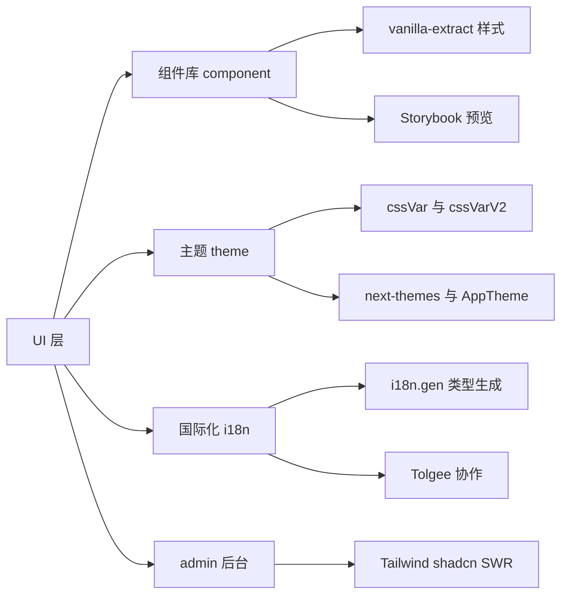
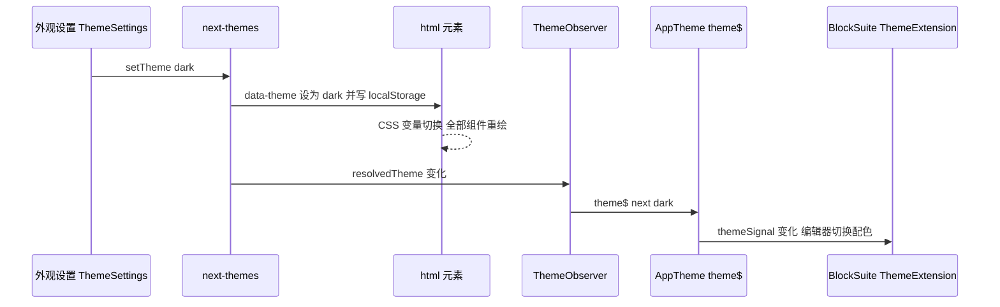
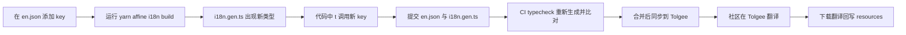

# 第 18 章 组件库、主题与国际化

界面长什么样、说什么话：`@affine/component`、`@toeverything/theme`、`@affine/i18n`

第 6 部分 · 前端应用 ｜ 难度 ★★☆☆☆ ｜ 建议学时 6 小时

Note:
前两章讲的是数据怎么流，这一章讲界面长什么样、说什么话。
本章难度不高但细节多，建议边讲边打开 Storybook，对照组件效果看源码。

---

## 本章导读：UI 层三支柱

- **组件库** `@affine/component`：39 个基础组件 + 15 个复合组件
- 样式用 **vanilla-extract**（编译期 CSS-in-TS），行为基于 **Radix UI**
- **主题** `@toeverything/theme`：CSS 变量设计令牌，v1/v2 两代并存
- **国际化** `@affine/i18n`：i18next + 代码生成的类型安全 key
- 对照组：admin 后台走 **Tailwind + shadcn/ui + SWR**

Note:
三根支柱分别是组件库、主题和国际化。组件库在 packages/frontend/component，带 Storybook 预览。
主题是 npm 包，源码已迁到 toeverything/design 仓库，配合 next-themes 做明暗切换，theme-editor 还支持运行时改色。
i18n 有 26 份语言资源，翻译经 Tolgee 平台协作。admin 后台则是另一条技术路线，对比着看能理解产品主应用与内部后台的不同取舍。

---

## 学习目标

- 说出组件库 ui、components、hooks、theme 等目录与导出方式
- 用 Button、Modal、Menu 解释 `data-*` 变体与 CSS 变量接口
- 本地启动 Storybook，并为组件编写 story
- 区分 `cssVar` 与 `cssVarV2`，讲清明暗切换链路
- 描述 i18n 懒加载、回退、`i18n.gen.ts` 与 `useI18n()` Proxy
- 说明 admin 后台技术栈与 `useQuery` 实现

Note:
六个目标对应本章六块内容：组件库结构、三个组件深读、Storybook、主题、国际化、admin。
可访问性与响应式我们会在最后用一页表格归纳。

---

## 知识地图



Note:
地图分四块：组件库的样式与预览、主题的变量与切换、i18n 的类型生成与翻译协作，以及 admin 后台的独立技术栈。

---

## 组件库：目录与导出

| 目录 | 内容 | 导入方式 |
|---|---|---|
| `src/ui/` | 39 个基础组件 | `@affine/component` 或 `@affine/component/ui/button` |
| `src/components/` | 15 个复合组件 | `@affine/component/<目录名>` |
| `src/hooks/` `src/utils/` | `useAutoFocus`、`observeResize` 等 | 根入口 |
| `src/lit-react/` | Lit 组件转 React | 根入口 |
| `src/theme/` | 全局 CSS：主题变量、字体、reset | `import '@affine/component/theme'` |

<div class="callout">

分层约束：组件库**不依赖 DI**——不认识 `@toeverything/infra` 的 Service

</div>

Note:
package.json 的 exports 里，点号指向 src/index.ts，"./ui/*" 指向 ui 下各组件，"./*" 映射到 src/components 下的复合组件，例如 @affine/component/provider-composer。
src/theme/index.ts 只有四行副作用 import，Web 应用 setup.ts 第三行就引入它，全局样式在启动最早期注入。
复合组件比如登录表单、设置项布局更贴近业务，但仍然不依赖 DI，这是一条重要的分层约束。

---

## Button：data 属性驱动变体

```tsx
// 来源：component/src/ui/button/button.tsx（节选）
<button
  {...otherProps}
  ref={buttonRef}
  className={clsx(styles.button, className)}
  data-loading={loading || undefined}
  data-block={block || undefined}
  disabled={disabled}
  data-disabled={disabled || undefined}
  data-size={size}
  data-variant={variant}
  data-no-hover={withoutHover || BUILD_CONFIG.isMobileEdition || undefined}
  onClick={handleClick}
>
```

- 只有一个 className，变体全靠 `data-*` 属性，DevTools 一眼可见状态
- 用 `undefined` 而非 `false`：否则渲染成 `"false"`，`[data-loading]` 误匹配
- `handleClick` 中 loading/disabled 直接 return；内建 `tooltip` 与快捷键提示

Note:
ButtonType 有 primary、secondary、plain、error、success、custom 六种，尺寸有 default、large、extraLarge、custom。
样式层用属性选择器匹配这些 data 属性，比根据 props 拼接多个 class 更易调试。
移动版通过 BUILD_CONFIG.isMobileEdition 自动关闭 hover 效果。

---

## vanilla-extract：CSS 变量即接口

```ts
// 来源：ui/button/button.css.ts（节选，vars 只保留一项）
export const hVar = createVar('height');
const bgVar = createVar('bg');
export const button = style({
  backgroundColor: bgVar,
  height: hVar,
  selectors: {
    '&[data-size="default"]': { vars: { [hVar]: '28px' } },
    '&[data-variant="primary"]': {
      vars: { [bgVar]: cssVarV2('button/primary') },
    },
    '&[data-disabled]': { opacity: 0.5 },
  },
});
```

- 编译期执行 `.css.ts`，产出静态 CSS 与哈希类名，运行时零开销
- 源码注释：用变量可从外部覆盖，无需考虑选择器优先级
- 组件只"读"变量，变体只"写"变量；外部 `assignInlineVars` 即可覆盖

Note:
这里的设计精髓就是源码注释第一句：用变量可以从外部覆盖，不必和选择器比拼优先级。
外部想定制尺寸，只需 assignInlineVars 设置 hVar，CSS 变量按 DOM 继承就近生效。
hover 效果用 before 伪元素叠加 layer/background/hoverOverlay，与背景色解耦，任何 variant 都有统一的悬浮反馈。

---

## Modal 与 Menu

<div class="cols">
<div>

**Modal**

- `Dialog.Root → Portal → Overlay → SafeArea → Content`
- `if (!props.open) return;` 未打开不渲染
- `InsideModalContext` 计数 → `useIsInsideModal()`
- 无标题也渲染 `VisuallyHidden` 包裹的 `Dialog.Title`

</div>
<div>

**Menu**

```ts
const Menu = BUILD_CONFIG.isMobileEdition
  ? MobileMenu
  : DesktopMenu;
```

- 构建期常量 → 死代码消除
- `children` 是触发器，`items` 是菜单内容
- 受控/非受控两用，`ref.changeOpen` 命令式开关

</div>
</div>

Note:
Modal 基于 Radix Dialog。未打开时直接 return，内部的重组件不会提前挂载；persistent 属性拦截点击外部和 Esc；移动端用 SafeArea 和 dynamicKeyboardHeight 避开软键盘。
命令式用法由 confirm-modal.tsx 提供：useConfirmModal 返回 openConfirmModal，onConfirm 被包装成"按钮 loading、等 Promise、关闭"。
Menu 是一套 API 两套实现，桌面版基于 @radix-ui/react-dropdown-menu，移动版是底部弹出的抽屉式菜单，桌面包里不含移动实现。

---

## Storybook：本地预览组件

- 配置在 `packages/frontend/component/.storybook/`
- 只收录 `src/ui/**/*.stories.*`，当前共 34 个 story
- `@storybook/react-vite` + `vanillaExtractPlugin()` + `unplugin-swc`
- `getBuildConfig(...)` 的结果注入为 `BUILD_CONFIG.*` 常量
- `preview.tsx` 引入主题、`I18nextProvider`，工具栏切 light/dark

```bash
yarn workspace @affine/component dev
```

Note:
仓库确实有 Storybook，启动命令就是 yarn workspace @affine/component dev，即 storybook dev -p 6006。
button.stories.tsx 用一个表格把 5 种 variant 乘 3 种 size 全部渲染出来，是检验样式改动最快的方式。
注意 story 要放在 src/ui 下，否则不会被收录，自己新建配置还可能报 BUILD_CONFIG is not defined。

---

## 主题：两代命名规则

| 代际 | TS 访问方式 | 生成的 CSS 变量 | 示例 |
|---|---|---|---|
| v1 | `cssVar('textPrimaryColor')` | `--affine-` + kebab-case | `var(--affine-text-primary-color)` |
| v2 | `cssVarV2('button/primary')` | `--affine-v2-` + 路径 | `var(--affine-v2-button-primary)` |

- `@toeverything/theme` 已迁至 `toeverything/design` 仓库，依赖 `^1.1.23`
- `style.css` 在 `:root`、`[data-theme=light]`、`[data-theme=dark]` 定义变量
- v2 是递归 `Proxy`，按语义层级组织；新代码优先用 v2
- 现状：`theme` 296 处、`theme/v2` 270 处 import，逐步迁移

Note:
packages/common/theme 目录现在只剩一个 README，写着已迁移到 toeverything/design。
v2 的 cssVarV2 是一个递归 Proxy：属性访问逐级拼接路径，到叶子 token 时返回 var 字符串，也可以函数调用并传 fallback。
v2 按语义层级组织，比如 layer/background/hoverOverlay、text/primary，比 v1 的扁平命名更适合设计系统演进。

---

## 明暗主题切换链路



<p class="small">设置入口：<code>appearance/index.tsx</code> 的 <code>ThemeSettings</code>；CMD-K 也注册了 system/dark/light 切换命令</p>

Note:
next-themes 默认把主题写到 html 的 data-theme 属性上，正好命中主题 style.css 里的 data-theme 选择器，enableSystem 支持跟随系统。
外壳组件靠 CSS 变量自动重绘；而编辑器要靠 ThemeObserver 把结果同步到 DI 世界，再生成 signal 给 BlockSuite。
所以切换主题一定要走 setTheme，不要直接改 data-theme，否则编辑器颜色不同步。

---

## 主题桥接：React → DI → BlockSuite

```tsx
// 来源：core/src/components/theme-provider/index.tsx（节选）
function ThemeObserver() {
  const { resolvedTheme } = useTheme();
  const service = useService(AppThemeService);
  useEffect(() => {
    service.appTheme.theme$.next(resolvedTheme);
  }, [resolvedTheme, service.appTheme.theme$]);
  return null;
}
```

- `ThemeProvider` 用 `NextThemeProvider themes enableSystem` 包裹，内挂 `ThemeObserver`
- `AffineThemeExtension` 用 `createSignalFromObservable` 得到 `themeSignal`
- theme-editor：`CustomThemeModifier` 逐个 `setProperty`，**覆盖变量 = 换肤**

Note:
ThemeObserver 是 React 世界到 DI 世界的桥。编辑器侧在 view-extensions/theme/theme.ts 里定义 AffineThemeExtension，是"infra 服务到 BlockSuite 扩展"的典型写法。
getEdgelessTheme 还让每个白板文档可以独立设置配色，取值 system 时跟随应用主题。
theme-editor 把自定义主题存在 GlobalState 的 custom-theme 键下，开关 enable_theme_editor 打开时注入到 html 的 style 上，无需重新构建。

---

## @affine/i18n：结构与懒加载

<div class="cols">
<div>

**包结构**

- `src/i18next.ts`：实例、懒加载、回退
- `src/react.ts`：`useI18n`、`Trans`
- `src/i18n.gen.ts`：生成的类型
- `resources/`：26 份 JSON，登记 25 种

</div>
<div>

**初始化**

- 只有 `en` 静态打包，其他语言动态 import
- 自定义 backend：`read` 中直接 import
- 回退：`xx-YY → xx → en`；`cn` → `zh-Hans`
- `escapeValue: false`：React 自身会转义

</div>
</div>

Note:
resources 下有 26 个 JSON，但 SUPPORTED_LANGUAGES 只登记了 25 种：el-GR 文件存在、完成度也有 84%，却没登记，用户选不到希腊语，这是容易忽略的细节。
getOrCreateI18n 创建实例时用了一个自定义 backend，没有 http 请求，直接调用动态 import 加载对应 chunk。
en.json 约 2600 个 key，是唯一真相源。

---

## useI18n：Proxy 包装的类型安全

```ts
// 来源：i18n/src/i18next.ts（createI18nWrapper 节选）
return new Proxy(I18nMethod, {
  get(self, key: string) {
    if (key in self) {
      return self[key];
    }
    return I18nMethod.t.bind(null, key);
  },
}) as typeof I18nMethod &
  ReturnType<typeof useAFFiNEI18N> & { [unknownKey: string]: () => string };
// i18n.gen.ts（生成）：带插值的 key 生成"必须传参"的签名
Heading(options: { readonly number: string; }): string;
```

- `t['com.affine.xxx']()` 本质是 `i18n.t('com.affine.xxx')`
- 类型安全来自 `useAFFiNEI18N` 返回类型；key 不存在时**返回 key 本身**

Note:
I18nMethod 自带 t、language、changeLanguage、on，访问其他任意属性时返回 t.bind(null, key)，所以调用像访问属性一样自然。
带数字标签富文本标记的 key 会生成 TypedTrans 下的组件类型。
界面上出现 com.affine.xxx 原文，就说明缺翻译或者 key 写错了。

---

## i18n build：四步生成

1. `appendErrorI18n`：后端 `USER_FRIENDLY_ERRORS` → `error.<NAME>` 写入 `en.json`
2. `cleanupResources`（`--cleanup`）：删除未被引用的 key
3. `i18nnext`：`@magic-works/i18n-codegen` 生成 `i18n.gen.ts`
4. `calcCompletenesses`：计算各语言完成度 → 设置页百分比

<p class="small">配置 <code>.i18n-codegen.json</code>：input <code>./src/resources/en.json</code>，generator hooks <code>useAFFiNEI18N</code></p>

Note:
这是 build.ts 末尾的四步。第一步很有意思：从后端错误定义 def.ts 导入错误文案写入 en.json，实现了前后端共享错误文案。
第二步扫描所有前端源码，删除未被引用的 key，并识别模板字符串前缀等动态用法。
第四步变体语言如 es-AR 会合并父语言 es 计算完成度。

---

## 新增一个文案的完整流程



<p class="small">只改英文；CI 有 diff 即失败。README 描述 Tolgee 流程，但仓库中未见 <code>languages-sync</code> 工作流</p>

Note:
具体做法是在 en.json 里加 key，运行 yarn affine @affine/i18n build，i18n.gen.ts 就会多出带参数类型的签名。
CI 的 typecheck job 会重新执行这个命令，忽略完成度文件后若仍有 diff 就失败，并提示你运行命令后提交生成物。
需要注意：README 描述的 languages-sync 工作流和同步脚本在当前仓库里找不到，实际同步方式以维护者当前做法为准。

---

## Admin 后台：另一套技术栈

| 维度 | 主应用（core + component） | Admin（`packages/frontend/admin`） |
|---|---|---|
| 样式 | vanilla-extract + CSS 变量 | Tailwind CSS v4 + `tailwindcss-animate` |
| 组件 | 自研 `@affine/component` | shadcn/ui 风格，位于 `src/components/ui/` |
| 数据 | DI + LiveData + nbstore | SWR + `@affine/graphql` |
| 路由 | 自研 Workbench + React Router | `BrowserRouter` + `@affine/routes` 常量 |
| 国际化 | `@affine/i18n` | 无，界面为英文 |

<p class="small">后台使用者少、迭代快，shadcn"复制即拥有"合适；主应用要品牌一致、与 BlockSuite 共享主题、多端复用</p>

Note:
两套做法放在一起，能看出产品主应用和内部后台在 UI 工程上的不同取舍。
admin 主题同样用 next-themes，tailwind.config.js 用 themeToVar 把字体、字号映射到 @toeverything/theme 变量，保持字体基线一致。

---

## Admin：SWR 包装的 useQuery

```ts
const createUseQuery =
  (immutable: boolean): useQueryFn =>
  (options, config) => {
    const configWithSuspense: SWRConfiguration = useMemo(
      () => ({ suspense: true, ...config }),
      [config]
    );
    const useSWRFn = immutable ? useSWRImmutable : useSWR;
    return useSWRFn(
      options ? () => ['cloud', options.query.id, options.variables] : null,
      options ? () => gqlFetcher(options) : null,
      configWithSuspense
    );
  };
```

- `admin/src/use-query.ts`：SWR key 为 `['cloud', query.id, variables]`
- shadcn 组件：`cva` 定义变体，`cn()` = `twMerge(clsx(...))`
- 路由守卫：未初始化跳 `/admin/setup`，非管理员跳 `/admin/auth`

Note:
默认 suspense 为 true，配合 app.tsx 里的 SWRConfig 关闭 focus 和 mount 时的重新校验。
另有 useQueryInfinite 包装分页，use-mutation.ts 包装 useSWRMutation。
业务里比如 use-user-list.ts 用 listUsersQuery 加分页参数调用，列表用基于 @tanstack/react-table 的 data-table 渲染。

---

## 可访问性与响应式

| 主题 | 做法 | 源码位置 |
|---|---|---|
| 焦点 | Radix 焦点陷阱与 Esc；`:focus-visible` 边框 | `ui/modal`、`ui/button` |
| 读屏 | 隐藏的 `Dialog.Title`、`aria-label="Close"` | `ui/modal/modal.tsx` |
| 语言方向 | 切换语言时设置 `<html lang dir>`，支持 RTL | `modules/i18n/entities/i18n.ts` |
| 端适配 | `BUILD_CONFIG.isMobileEdition` 切换实现 | `ui/menu/index.ts` 等 |
| 安全区 | `SafeArea` + `dynamicKeyboardHeight`、`100dvh` | `ui/safe-area`、`ui/modal` |

<p class="small">不足：<code>component/src/ui</code> 中显式使用 <code>aria-</code> 的文件只有 8 个，自研组件需额外关注</p>

Note:
大多数可访问性依赖 Radix 原语的默认行为。
core 的 I18n 模块在 languageChanged 时同步设置 html 的 lang 和 dir，SUPPORTED_LANGUAGES 里有三种语言标记了 rtl。
像 editable、masonry 这类自研组件的无障碍支持，需要贡献者额外关注。

---

## 源码导读 Top 5

| 优先级 | 路径 | 看什么 |
|---|---|---|
| P0 | `component/src/ui/button/button.tsx`、`button.css.ts` | data 属性变体、`createVar` |
| P0 | `component/src/ui/modal/modal.tsx`、`confirm-modal.tsx` | Radix Dialog 封装、命令式确认框 |
| P0 | `i18n/src/i18next.ts` | 实例、懒加载、回退、Proxy |
| P0 | `i18n/build.ts` | 生成流程四步 |
| P1 | `core/src/components/theme-provider/index.tsx` | next-themes 与 DI 同步 |

<p class="small">以上路径均位于 <code>packages/frontend/</code> 下</p>

Note:
Button 和 Modal 是组件库写法的范本，i18next.ts 和 build.ts 是国际化的核心。
第二梯队可以读 Menu 的双端切换、.storybook 配置、BlockSuite 主题桥接 theme.ts，以及 admin 的 use-query.ts。

---

## 动手实践

| 练习 | 验收要点 |
|---|---|
| 1 跑起 Storybook | 说明切主题时哪个 DOM 属性与哪些 CSS 变量变化 |
| 2 为 Switch 写 story | 新增"禁用 + 选中" story，切换主题外观正确 |
| 3 新增文案 key | `i18n.gen.ts` 出现 `options: { readonly name: string }` 签名 |
| 4 用 theme-editor 换肤 | 说明修改如何从 `GlobalState` 流到 `<html style>` |
| 5 admin 新增只读页 | 用 `useQuery` + shadcn 组件，暗色模式正常 |

Note:
练习一在 DevTools 里选中按钮，观察 data-variant、data-size 和 --affine-v2-button-primary 的计算值。
练习三可以故意不传 name 看类型报错，再补一条中文翻译切换语言验证。
练习四要先确认 enable_theme_editor 开关处于开启状态，它仅在 canary 构建且非移动端时可配置。

---

## 自测

1. Button 的 `data-*` 值为什么用 `undefined` 而不是 `false`？
   - React 不渲染 `undefined`；`false` 会变成 `"false"` 误匹配选择器 <!-- .element: class="fragment" -->
2. `cssVarV2('text/primary')` 生成什么？
   - `var(--affine-v2-text-primary)` <!-- .element: class="fragment" -->
3. 用户切到暗色后，BlockSuite 编辑器如何得知？
   - `resolvedTheme` → `ThemeObserver` → `theme$` → `themeSignal` <!-- .element: class="fragment" -->
4. 改了 `en.json` 忘跑生成脚本，CI 会怎样？
   - typecheck 重新生成 `i18n.gen.ts` 出现 diff，CI 失败 <!-- .element: class="fragment" -->

Note:
第一题考 data 属性的细节，第二题考 v2 命名规则。
第三题是整条主题链路，可以请同学完整复述。第四题考 CI 对生成物的检查。

---

## 常见坑

| 现象 | 原因 | 解决 |
|---|---|---|
| 界面出现 `com.affine.xxx` 原文 | key 拼错或未加到 `en.json` | 检查 key，跑 i18n build 让类型报错 |
| 新增语言选不到 | 未在 `Language` 与 `SUPPORTED_LANGUAGES` 登记 | 同时更新类型与注册表 |
| 组件样式覆盖不掉 | 与 `[data-*]` 选择器比优先级 | 改设组件暴露的 CSS 变量 |
| 编辑器颜色与外壳不同步 | 直接改了 `data-theme` | 通过 next-themes `setTheme` 切换 |
| 组件库里 `useService` 报错 | 组件库不应依赖 DI | DI 逻辑放 core，组件只收 props |

Note:
最常见的是第一个和第三个。样式覆盖不掉时，第一反应应该是去找组件暴露的变量，比如 hVar、widthVar，而不是写更高优先级的选择器。
暗色下某个颜色不变，多半是写死了色值，应改用 cssVar 或 cssVarV2。

---

## 小结与下一步

- 组件库：单 className + `data-*` 属性 + CSS 变量，vanilla-extract 零运行时
- Storybook 只收录 `src/ui` 的 story，是改样式的首选验证手段
- 主题以 CSS 变量为载体，`ThemeObserver` 把结果同步给 DI 与 BlockSuite
- i18n 以 `en.json` 为真相源，代码生成保类型安全，CI 保证生成物已提交
- 下一章：**第 19 章 存储与同步引擎 nbstore**——local-first 的核心

Note:
admin 采用 Tailwind 加 shadcn 加 SWR，是内部工具的务实选择。
下一章难度最高：nbstore 存储与同步引擎，我们会看到 local-first 是怎么实现的，以及离线编辑后上线时到底发生了什么。
