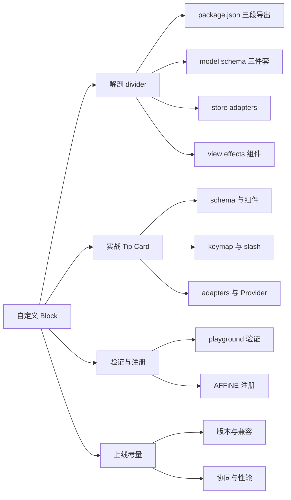
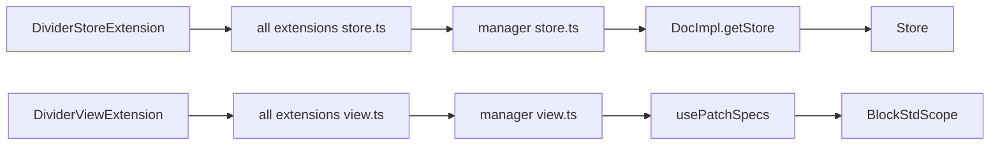

# 第 19 章 自定义 Block 实战

> 先解剖最简单的真实块，再照着结构亲手写一个"提示卡片"

第 5 部分 · 编辑器内核 BlockSuite ｜ 难度 ★★★★☆ ｜ 建议学时 8 小时

===

## 本章要解决的问题

<p class="lead">前三章从数据层、标准库到预置块完整走了一遍 BlockSuite。现在是动手的时候了：<b>自己写一个块</b>。</p>

本章分两部分。**解剖**：选仓库里最简单的真实块——分割线 `affine:divider`（必要时对照稍复杂的 `affine:callout`），从 `package.json` 一路读到测试，把一个块从"定义"到"被用户看见"的每个环节都对应到具体文件。**实战**：照着同样的结构编写一个教学示例——提示卡片（Tip Card）Block，有图标、三种样式、可编辑富文本、能从斜杠菜单插入、能导出 Markdown/纯文本。

<div class="note note--warn">

本章所有"教学示例"代码**不写入仓库**，仅供本地实验时参照；用到的每个 API 都与当前源码一致，并标注了参照的真实文件。

</div>

<div class="compare">
  <div class="compare__col"><h4><code>affine:divider</code>（骨架）</h4>

- 13 个 `.ts`，组件约 50 行
- 无属性、无文本、不可有子块
- 四种 Adapter 齐全，有行内 Markdown（`---`）

  </div>
  <div class="compare__col compare__col--good"><h4><code>affine:callout</code>（血肉）</h4>

- 14 个 `.ts`
- 有 `icon`、`text`、`backgroundColorName`
- `role: 'hub'`、自带 Keymap、命令、Slash 菜单、工具栏

  </div>
</div>

===

## 知识地图

本章是一条"解剖 → 仿写 → 验证 → 上线考量"的实战路径。



===

## 学习目标

学完本章，你应当能够：

<ol class="goals">
  <li>说出块包的标准目录结构与 <code>package.json</code> 三段式导出</li>
  <li>独立编写块的 Schema、Model 与 <code>BlockSchemaExtension</code>，正确设置嵌套约束</li>
  <li>编写 <code>StoreExtensionProvider</code> 与 <code>ViewExtensionProvider</code>，理解 <code>effect()</code> 与 <code>setup()</code> 的分工</li>
  <li>基于 <code>CaptionedBlockComponent</code> 与 <code>&lt;rich-text&gt;</code> 编写可编辑块组件</li>
  <li>为块接入斜杠菜单、快捷键与 Markdown / 纯文本 Adapter</li>
  <li>在 playground 加载验证、在 AFFiNE 应用侧通过 manager 注册</li>
  <li>评估 Schema 版本、兼容性、协同冲突与性能风险</li>
</ol>

===

<!-- section -->
## 一、解剖 divider

从包结构、Schema、Store、View 到注册链路，把一个最小块拆到底。

===

## 包结构与三段式导出

divider 包的目录与 `package.json` 都是所有块的模板。**注意 Schema 不在块包里**，而在 `blocksuite/affine/model/src/blocks/divider/divider-model.ts`：

<div class="annotate">

```json [4|10-12|13]
{
  "name": "@blocksuite/affine-block-divider",
  "type": "module",
  "sideEffects": false,
  "dependencies": {
    "@blocksuite/affine-model": "workspace:*",
    "@blocksuite/affine-rich-text": "workspace:*",
    "@blocksuite/std": "workspace:*"
  },
  "exports": {
    ".": "./src/index.ts",
    "./view": "./src/view.ts",
    "./store": "./src/store.ts"
  }
}
```

<ol class="annotate__notes">
  <li><b>第 4 行</b>：<code>sideEffects: false</code> 声明包无副作用以便 tree-shake——<code>customElements.define</code> 这类副作用被刻意收敛到 <code>effects.ts</code>。</li>
  <li><b>第 10–12 行</b>：三段式导出 <code>.</code> / <code>./view</code> / <code>./store</code>；直接指向 <code>.ts</code> 源码，monorepo 内由构建工具直接编译，无需预先 build。</li>
  <li><b>第 13 行</b>：依赖全是 <code>workspace:*</code>，与 <code>tsconfig.json</code> 的 <code>references</code> 一一对应。</li>
</ol>
</div>

<div class="note">

为什么分 `./store` 与 `./view`？Store 部分（Schema、Adapter）必须能在**无 DOM 环境**运行（服务端/测试只引 `./store`），View 部分包含 Lit 组件与浏览器 API。

</div>

===

## Model：Schema 三件套

<div class="annotate">

```ts [1|4-6|11|13]
export const DividerBlockSchema = defineBlockSchema({
  flavour: 'affine:divider',
  metadata: {
    version: 1,
    role: 'content',
    children: [],
  },
  toModel: () => new DividerBlockModel(),
});
type Props = { text: string };
export class DividerBlockModel extends BlockModel<Props> {}
export const DividerBlockSchemaExtension =
  BlockSchemaExtension(DividerBlockSchema);
```

<ol class="annotate__notes">
  <li><b>第 1 行</b>：没有 <code>props</code>——分割线没有可编辑属性（<code>Props</code> 里的 <code>text</code> 只是类型占位，Schema 未声明默认值，故不写入 Yjs）。</li>
  <li><b>第 4–6 行</b>：<code>role: 'content'</code> 且无 <code>parent</code>（缺省 <code>['*']</code>），配合 Note 的 <code>children: ['@content', …]</code> 即可放进 note；<code>children: []</code> 不允许子块。</li>
  <li><b>第 11 行</b>：<code>DividerBlockModel</code> 空实现——没有属性。</li>
  <li><b>第 13 行</b>：三件套 <code>Schema</code> / <code>Model</code> / <code>SchemaExtension</code>，所有块模型文件的固定模式。</li>
</ol>
</div>

<div class="note note--tip">

对照 callout 的 Schema：它声明了 `props`（`icon`、`text`、`backgroundColorName`）、`role: 'hub'`、显式 `parent` 列表与 `children: ['affine:paragraph', 'affine:list']`。

</div>

===

## Store 侧：Schema 与 Adapter

Store 侧只放**与 DOM 无关**的东西。`DividerStoreExtension.setup` 注册 `DividerBlockSchemaExtension` 与 `DividerBlockAdapterExtensions`。一个 Markdown matcher 包含两个方向：

<div class="annotate">

```ts [2|3|4|12-15]
export const dividerBlockMarkdownAdapterMatcher: BlockMarkdownAdapterMatcher = {
  flavour: DividerBlockSchema.model.flavour,
  toMatch: o => isDividerNode(o.node),
  fromMatch: o => o.node.flavour === DividerBlockSchema.model.flavour,
  toBlockSnapshot: {
    enter: (_, context) => {
      context.walkerContext
        .openNode({ type: 'block', flavour: 'affine:divider',
          props: {}, children: [] }, 'children').closeNode();
    },
  },
  fromBlockSnapshot: {
    enter: (_, context) => {
      context.walkerContext.openNode({ type: 'thematicBreak' }, 'children').closeNode();
    },
  },
};
```

<ol class="annotate__notes">
  <li><b>第 2 行</b>：matcher 以 flavour 为变体注册。</li>
  <li><b>第 3 行</b>：<code>toMatch</code> 用于 <b>Markdown AST → Snapshot（导入）</b>，判断某 mdast 节点是否由本块处理（这里是 <code>thematicBreak</code>）。</li>
  <li><b>第 4 行</b>：<code>fromMatch</code> 用于 <b>Snapshot → Markdown（导出）</b>，按 flavour 判断；<code>openNode(node, 'children')</code> 第二参数指明把新节点挂到哪个字段。</li>
  <li><b>第 12–15 行</b>：另三个 Adapter 形态相同——HTML 匹配 <code>&lt;hr&gt;</code>；Notion HTML 只导入（<code>fromMatch: () =&gt; false</code>）；纯文本只导出（<code>toMatch: () =&gt; false</code>，输出 <code>---\n</code>）。</li>
</ol>
</div>

===

## View 侧：组件、effects 与 ViewExtension

<div class="annotate">

```ts [5|6-10|13]
export class DividerBlockComponent extends CaptionedBlockComponent<DividerBlockModel> {
  static override styles = dividerBlockStyles;
  override connectedCallback() {
    super.connectedCallback();
    this.contentEditable = 'false';
    this.handleEvent('click', () => {
      this.host.selection.setGroup('note', [
        this.host.selection.create(BlockSelection, { blockId: this.blockId }),
      ]);
    });
  }
  override renderBlock() {
    return html`<div class="affine-divider-block-container">
      <hr />${this.renderChildren(this.model)}</div>`;
  }
  override accessor useZeroWidth = true;
}
```

<ol class="annotate__notes">
  <li><b>第 5 行</b>：<code>contentEditable = 'false'</code>——非文本块必须关闭可编辑，否则浏览器会把光标放进 <code>&lt;hr&gt;</code> 周围。</li>
  <li><b>第 6–10 行</b>：<code>handleEvent('click')</code> 默认以本块 <code>blockId</code> 为作用域，点击时 <code>setGroup('note', …)</code> 设置块选择。</li>
  <li><b>第 13 行</b>：<code>renderBlock</code> 渲染 <code>&lt;hr /&gt;</code> 并照例调 <code>renderChildren</code>（防御性，即便 <code>children: []</code>）；<code>useZeroWidth</code> 在块末尾渲染零宽占位，使点击块下方空白时能创建新段落。</li>
</ol>
</div>

<div class="note note--tip">

**`effect()` 与 `setup()` 的分工**：`effect()` 每个 Provider 类生命周期内**只执行一次**（`customElements.define('affine-divider', ...)` 不能重复）；`setup()` 每次构建扩展列表都执行（不同 scope、配置）。`BlockViewExtension` 中的 `literal\`affine-divider\`` 必须与 define 的标签名一致。

</div>

===

## 注册链路：从块包到编辑器

一个块要被用户看见，需经过四层注册——Store 侧与 View 侧各一条链：



<div class="note">

具体位置：块包的 `store.ts`/`view.ts` 定义两个 Provider → `blocksuite/affine/all` 的 `package.json` 依赖/导出、`src/blocks/divider/*` 重导出、`src/extensions/{store,view}.ts` 的 `getInternal*Extensions()`、`src/schemas.ts` 的 `AffineSchemas` → 应用 `packages/frontend/core/src/blocksuite/manager/{store,view}.ts` 通过展开运算符间接包含。

</div>

===

## 斜杠菜单：两种接入方式

<div class="compare">
  <div class="compare__col"><h4>divider：经 note 与 textConversionConfigs</h4>

- 菜单项来自 rich-text 的 `textConversionConfigs`
- note 的 `NoteSlashMenuConfigExtension` 转成菜单项
- 带 `when`：只有当前 Store 注册了该 flavour 才显示
- 同一配置还驱动快捷键与"转换为"菜单
- 适合"可与段落互转"的基础块

  </div>
  <div class="compare__col compare__col--good"><h4>callout：块包自行注册</h4>

- `SlashMenuConfigExtension('affine:callout', config)`
- `action` 中 `model` 是触发时光标所在块，新块插在其后
- 插入后 `await std.host.updateComplete` 再聚焦
- **自定义块推荐这种方式**

  </div>
</div>

<div class="note note--tip">

测试分三层：框架单测（`framework/*/src/__tests__/*.unit.spec.ts`）、Adapter 单测（`affine/all/src/__tests__/adapters/*`，Markdown 用快照、纯文本用断言）、端到端（`tests/blocksuite/e2e/*`，Playwright 自动启动 playground）。

</div>

===

<!-- section -->
## 二、实战：提示卡片 Block

照着 divider/callout 的结构，写一个有图标、三种样式、可编辑富文本的 Tip Card。

===

## 需求与设计

<div class="split">
<div class="split__main">

| 需求 | 设计决策 | 参照 |
| --- | --- | --- |
| 带图标、可编辑富文本 | `text: Text`，组件内 `<rich-text>` | paragraph、callout |
| 三种样式切换 | `variant` 属性，`updateBlock` 修改 | callout 图标点击 |
| 只能放 note、不含子块 | `role: 'content'`、`parent: ['affine:note']` | divider、code |
| 斜杠菜单插入 | `SlashMenuConfigExtension` | callout |
| 文末 Enter 跳出 | `KeymapExtension` + `{ flavour }` | paragraph、callout |
| 导出 Markdown / 纯文本 | 两个 Adapter | paragraph、divider |
| 不与官方冲突 | flavour 用 `custom:tip-card` | flavour 约定 |

</div>
<div class="split__aside">

```text
tip-card/
  tip-card-model.ts   Schema+Model
  tip-card-block.ts   组件
  styles.ts           样式与图标
  effects.ts          define
  keymap.ts           Enter 跳出
  slash-menu.ts       斜杠菜单
  adapters.ts         Markdown+纯文本
  store.ts            StoreExtension
  view.ts             ViewExtension
  tip-card.unit.spec.ts  Store 单测
```

</div>
</div>

===

## Schema 与 Model

<div class="annotate">

```ts [2|3-6|9-11|15-17]
export const TipCardBlockSchema = defineBlockSchema({
  flavour: 'custom:tip-card',
  props: (internal): TipCardProps => ({
    variant: 'info',
    text: internal.Text(),
  }),
  metadata: {
    version: 1,
    role: 'content',
    parent: ['affine:note'],
    children: [],
  },
  toModel: () => new TipCardBlockModel(),
});
export class TipCardBlockModel extends BlockModel<TipCardProps> {
  override isEmpty(): boolean {
    return this.props.text$.value.length === 0;
  }
}
```

<ol class="annotate__notes">
  <li><b>第 2 行</b>：flavour 用自定义命名空间 <code>custom:tip-card</code>，避免与官方块冲突。</li>
  <li><b>第 3–6 行</b>：<code>props</code> 是工厂函数，<code>internal.Text()</code> 建 <code>Y.Text</code>——富文本必须用 <code>Text</code> 才能字符级协同合并。</li>
  <li><b>第 9–11 行</b>：<code>parent: ['affine:note']</code> 显式限制只能放 note；与 Note 的 <code>children: ['@content', …]</code> 双向匹配成立。</li>
  <li><b>第 15–17 行</b>：覆盖 <code>isEmpty</code>，供空块判断（如空块占位）。</li>
</ol>
</div>

<div class="note note--warn">

`Store.addBlock` 把 CRUD 包在 `transact` 中，而 `transact` 会 **catch 并 `console.error`** 回调里的异常。所以插到非法父块下时 `addBlock` **不抛异常**，只打印错误、照常返回 id，但块并未创建。需要可靠判断时请先调用 `store.schema.safeValidate(flavour, parentFlavour)`。

</div>

===

## 组件：图标切换 + rich-text

组件继承 `CaptionedBlockComponent`，覆盖 `topContenteditableElement`（取自 callout，保证白板中事件源正确）并提供样式切换：

<div class="annotate">

```ts [2|7-8|9-13]
override renderBlock() {
  const variant = this.model.props.variant$.value;
  const inlineManager = this.inlineManager;
  return html`
    <div class=${classMap({ 'custom-tip-card': true,
        [`custom-tip-card--${variant}`]: true })}>
      <span class="custom-tip-card__icon" contenteditable="false"
        @click=${this._cycleVariant}>${TIP_CARD_ICONS[variant]}</span>
      <rich-text class="custom-tip-card__text"
        .yText=${this.model.props.text.yText}
        .attributesSchema=${inlineManager.getSchema()}
        .attributeRenderer=${inlineManager.getRenderer()}
        .enableClipboard=${false} .enableUndoRedo=${false}
      ></rich-text>
    </div>`;
}
```

<ol class="annotate__notes">
  <li><b>第 2 行</b>：读 <code>variant$.value</code>（signal），切换样式时组件自动重渲染。</li>
  <li><b>第 7–8 行</b>：图标区 <code>contenteditable="false"</code>，否则点击会把光标放进 emoji；<code>@click</code> 调 <code>_cycleVariant</code>（内部用 <code>store.updateBlock</code> 轮换 variant，可撤销）。</li>
  <li><b>第 9–13 行</b>：<code>&lt;rich-text&gt;</code> 的属性与 paragraph 一致；<code>enableClipboard/enableUndoRedo</code> 设 <code>false</code>，剪贴板与撤销交给编辑器全局处理（<code>PageClipboard</code> 与 <code>HistoryExtension</code>）。</li>
</ol>
</div>

===

## keymap 与 slash-menu

两个关键细节都借鉴自 callout/note：

<div class="annotate">

```ts [4|5|9]
export const TipCardKeymapExtension = KeymapExtension(
  std => ({
    Enter: ctx => {
      if (ctx.get('keyboardState').raw.isComposing) return;
      const text = std.selection.find(TextSelection);
      if (!text || !text.isCollapsed()) return;
      const model = std.store.getBlock(text.from.blockId)?.model;
      if (!model || !matchModels(model, [TipCardBlockModel])) return;
      if (text.from.index !== model.props.text.length) return;
      // 文末：在卡片后新建段落并聚焦
      return true;
    },
  }),
  { flavour: TipCardBlockSchema.model.flavour }
);
```

<ol class="annotate__notes">
  <li><b>第 4 行</b>：先查 <code>isComposing</code>——组合输入期间不触发快捷键（第 17 章）。</li>
  <li><b>第 5 行</b>：只在光标折叠（无选区）时处理。</li>
  <li><b>第 9 行</b>：<b>非文末直接返回</b>，交给 InlineEditor 默认行为（软换行）；文末才 <code>addBlock('affine:paragraph')</code> 跳出。</li>
</ol>
</div>

<div class="note">

slash-menu 的 `when` 中要有 `model.store.schema.flavourSchemaMap.has(TipCardBlockSchema.model.flavour)`——借鉴自 note 的配置，确保在**没注册该 Schema 的 Store** 中不显示菜单项（否则 `addBlock` 内部校验失败、只在控制台报错）。`group: '0_Basic@20'` 决定它在 Basic 组的位置。

</div>

===

## Adapters 与 Provider

Adapter 导出形如 `> [!INFO] 这是一条提示`（与 GitHub alert 语法相近）。View Provider 一次注册 flavour、视图、keymap 与 slash 菜单：

<div class="annotate">

```ts [2|3|5|8]
export const TipCardViewExtensions: ExtensionType[] = [
  FlavourExtension(flavour),
  BlockViewExtension(flavour, literal`custom-tip-card`),
  TipCardKeymapExtension,
  SlashMenuConfigExtension(flavour, tipCardSlashMenuConfig),
];
export class TipCardViewExtension extends ViewExtensionProvider {
  override effect() { super.effect(); effects(); }
  override setup(context: ViewExtensionContext) {
    super.setup(context);
    context.register(TipCardViewExtensions);
  }
}
```

<ol class="annotate__notes">
  <li><b>第 2 行</b>：<code>FlavourExtension</code> 供按 flavour 注入依赖使用。</li>
  <li><b>第 3 行</b>：<code>BlockViewExtension</code> 的 <code>literal\`custom-tip-card\`</code> 必须与 <code>effects()</code> 里 <code>define</code> 的标签名一致。</li>
  <li><b>第 5 行</b>：斜杠菜单在 View 侧注册；单独导出 <code>TipCardViewExtensions</code> 数组，便于 playground 直接拼接。</li>
  <li><b>第 8 行</b>：<code>effect()</code> 调 <code>effects()</code> 定义自定义元素，只执行一次。Store 侧对应 <code>TipCardStoreExtension</code> 注册 Schema 与 Adapter。</li>
</ol>
</div>

===

<!-- section -->
## 三、验证与注册

在 playground 本地验证，再在 AFFiNE 应用侧通过 manager 注册。注意 Store 扩展必须"全局一致"。

===

## 在 playground 中运行验证

<ol class="steps">
  <li><h4>放文件</h4><p>把 15.9 的文件放到 <code>blocksuite/playground/apps/_common/tip-card/</code>，导入用聚合包 <code>@blocksuite/affine/*</code>。</p></li>
  <li><h4>接 Store 扩展</h4><p>在 <code>apps/starter/utils/collection.ts</code> 的 <code>collection.storeExtensions</code> 后追加 <code>...TipCardStoreExtensions</code>（<code>TestDoc.getStore</code> 会把它拼进每个 Store）。</p></li>
  <li><h4>接 View 扩展</h4><p>在 <code>utils/extensions.ts</code> 的 <code>getTestCommonExtensions</code> 返回数组追加 <code>...TipCardViewExtensions</code>，并在模块顶层调一次 <code>effects()</code>——因为直接拼数组不经过 Provider 的 <code>effect()</code>。</p></li>
  <li><h4>验证</h4><p>输入 <code>/tip</code> 插入，验证编辑、点图标切样式、撤销重做、文末 Enter 跳出；用 <code>?room=test</code> 两个标签页验证协同。</p></li>
</ol>

<div class="note note--warn">

**为什么不往 `getTestViewManager()` 里加 Provider？** `ExtensionManager` 的 Provider 集合在构造时确定，没有公开追加 API；而单独 `new ViewExtensionManager([TipCardViewExtension]).get('page')` 会在结果末尾附带"把该 Manager 注册进 DI"的扩展，覆盖主 Manager。直接拼接扩展数组最干净。

</div>

===

## 在 AFFiNE 应用侧注册

<div class="split">
<div class="split__main">

**方式 A：应用内定义块**（不改 blocksuite 目录，AFFiNE 自己就这么做——AI 的 `affine:transcription` 块定义在 `core/src/blocksuite/ai/`）：把文件放到 `core/src/blocksuite/tip-card/`，在 `manager/store.ts` 与 `manager/view.ts` 的 Manager 数组中分别加入 `TipCardStoreExtension`、`TipCardViewExtension`。

**方式 B：作为内置块**：建正式包并加入 `getInternal*Extensions()`，应用侧无需改动（manager 通过展开运算符自动包含）。适合计划贡献到上游的通用块；记得把聚合包导入换成细粒度包名，并在 `blocksuite/affine/all` 补齐依赖/导出，最后 `yarn affine init`。

</div>
<div class="split__aside">

```ts
// manager/store.ts
new StoreExtensionManager([
  ...getInternalStoreExtensions(),
  AIStoreExtension,
  TipCardStoreExtension, // 新增
]);

// manager/view.ts
new ViewExtensionManager([
  ...getInternalViewExtensions(),
  AffineThemeViewExtension,
  TipCardViewExtension,  // 新增
]);
```

</div>
</div>

<div class="note note--danger">

**Store 扩展必须"全局一致"**：Schema 要在**所有可能打开该文档的环境**注册。未注册的客户端打开文档时，`SyncController` 抛 `schema for flavour: custom:tip-card not found`，`Store._onBlockAdded` 捕获并跳过该块；若 Schema 已注册但 View 未注册，`EditorHost` 打印 `Cannot find render flavour` 并静默不渲染。所以 Store 扩展应放在 `manager/store.ts`（随 `DocImpl` 全局生效）。

</div>

===

<!-- section -->
## 四、上线考量

当前 BlockSuite 只做版本校验、不做迁移，这决定了"兼容式演进"的实践原则。

===

## 版本、兼容、协同与性能

当前 BlockSuite **只校验、不迁移**：`BlockComponent.isVersionMismatch` 在版本不一致时渲染 "Block Version Mismatched"。由此得出变更策略：

| 变更类型 | 升版本？ | 做法 |
| --- | --- | --- |
| 新增可选属性 | 否 | `props` 给默认值；`_parseYBlock` 为老数据补写默认值（一次 Yjs 写入） |
| 新增枚举值 | 否 | 读取时容错：未知值回退默认样式 |
| 属性重命名/改类型 | 尽量避免 | 新增属性保留旧读取逻辑，Adapter 同步处理 |
| 结构性变化 | 是 | 整体升版本或定义新 flavour |

<div class="note note--tip">

一个真实反例：callout 的 Schema 已用 `icon: IconData`，而其 Markdown Adapter 仍读写 `props.emoji`——**Schema 演进时要同步审视 Adapter、测试快照与 Transformer**，否则导入导出会悄悄丢信息。

</div>

<div class="cards cols-2">
  <div class="card"><h4>协同</h4><p>富文本用 <code>Text</code>（字符级合并）；<b>不要在渲染/挂载阶段写 Yjs</b>（会"打开即修改"、污染撤销栈）；一次用户操作一个事务并在边界 <code>captureSync()</code>；本地 UI 状态（折叠、拖拽中间态）不写入文档。</p></div>
  <div class="card"><h4>性能</h4><p>渲染中只读 signal；监听放进 <code>disposables</code> 避免泄漏；大资源懒加载（参照 <code>CodeBlockHighlighter</code>）；白板视口外的块不渲染，别假设"始终挂载"；<code>customElements</code> 只在 <code>effect()</code> 定义一次。</p></div>
</div>

===

## 自测：点击揭晓答案

<details class="quiz">
<summary>Q1. 块包 exports 为何分三段？sideEffects: false 与 effects.ts 有何关系？</summary>

Store 部分（Schema、Adapter）须在无 DOM 环境运行，View 部分含 Lit 组件与浏览器 API，拆分后服务端/测试只引 `./store`。`sideEffects: false` 便于 tree-shaking，所以把 `customElements.define` 集中在 `effects.ts`，只在 View Provider 的 `effect()` 中调用。

</details>

<details class="quiz">
<summary>Q2. effect() 与 setup() 分别放什么？把 define 放进 setup() 会怎样？</summary>

`effect()` 每类只执行一次，适合定义自定义元素；`setup()` 每次构建扩展都执行，适合按 scope 与 options `context.register`。放进 `setup()` 会在第二次构建时重复 `define` 抛异常。

</details>

<details class="quiz">
<summary>Q3. 只注册了 View、忘了 Store 会怎样？反过来呢？</summary>

只注册 View：Store 不认识 flavour，`addBlock` 内部校验失败（被 `transact` 吞掉打印），块不创建；已有数据加载时同样报错被跳过。只注册 Store：块数据正常，但 `EditorHost` 找不到 View，打印 `Cannot find render flavour` 不渲染。

</details>

<details class="quiz">
<summary>Q4. 给块新增可选属性要升 version 吗？老文档首次打开会怎样？</summary>

不需要。`SyncController._parseYBlock` 发现缺失属性会用 Schema 默认值补写到 `yBlock`（一次 Yjs 写入），模型立即拥有新属性；若升 `version`，老数据会因版本不匹配显示警告。

</details>

===

## 小结与下一步

<ul class="takeaways">
  <li>块包 = <code>package.json</code> 三段导出 + model 三件套 + store（Schema/Adapter）+ view（组件/effects/Provider）。</li>
  <li><code>effect()</code> 定义自定义元素（只一次），<code>setup()</code> 按 scope 注册扩展（每次）。</li>
  <li>斜杠菜单两种接入：经 note + <code>textConversionConfigs</code>（基础块），或块包自行 <code>SlashMenuConfigExtension</code>（推荐）。</li>
  <li>富文本块 = <code>CaptionedBlockComponent</code> + <code>&lt;rich-text&gt;</code>，<code>Text</code> 属性、<code>contenteditable=false</code> 的非文本区、覆盖 <code>topContenteditableElement</code>。</li>
  <li>Store 扩展必须在所有打开该文档的环境一致注册；Schema <b>只校验不迁移</b>，走兼容式演进。</li>
</ul>

<div class="note note--tip">

**下一章预告**：第 20 章转向前端应用的基础设施——自研的轻量 DI 容器 `Framework` 与响应式类型 `LiveData`，看 React 组件那两行 `useServices` + `useLiveData` 背后的整套机制。

</div>
