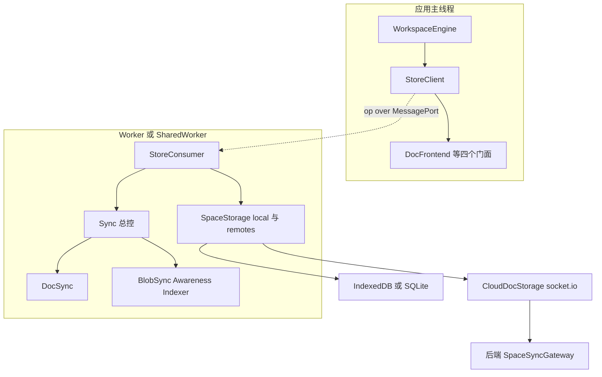
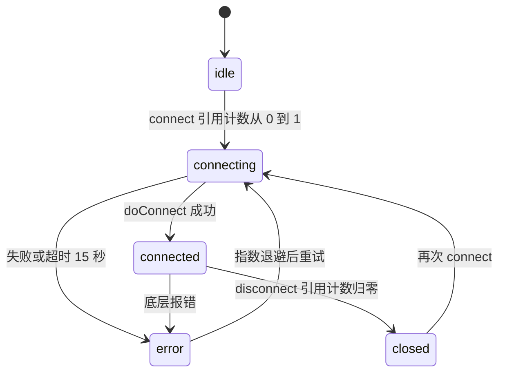
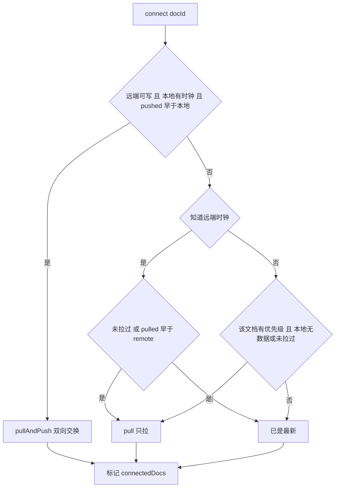
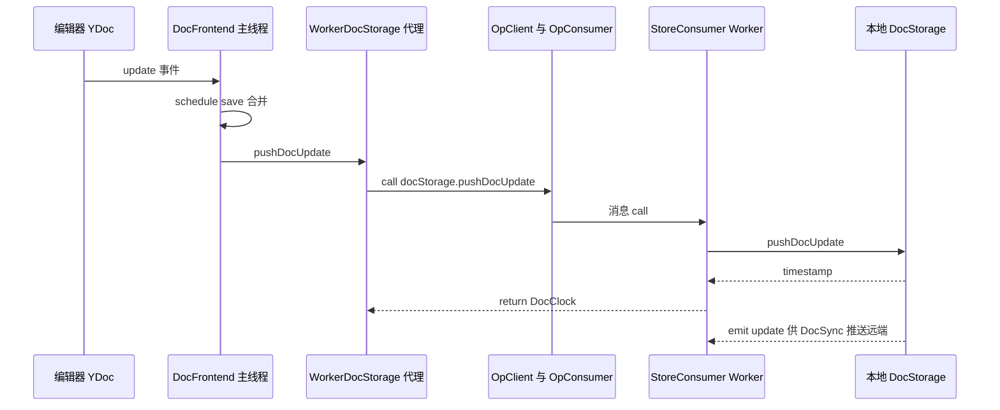
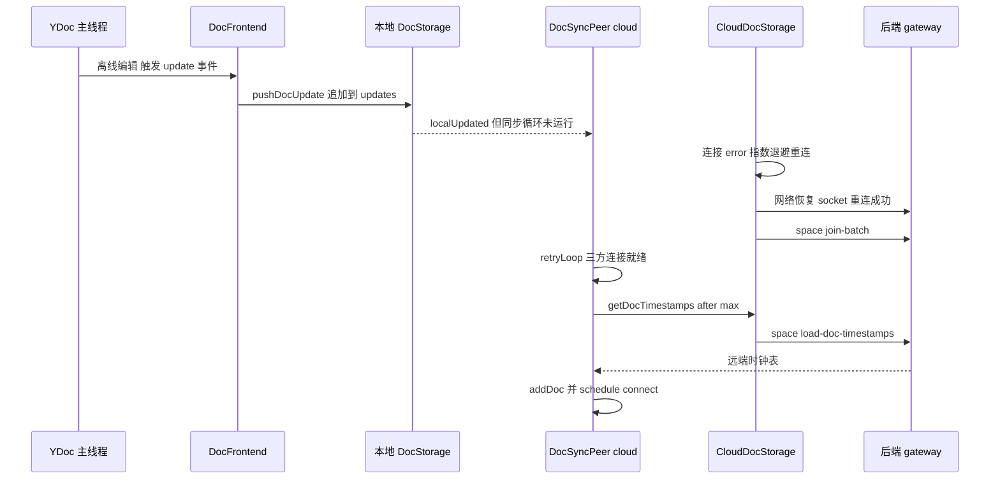
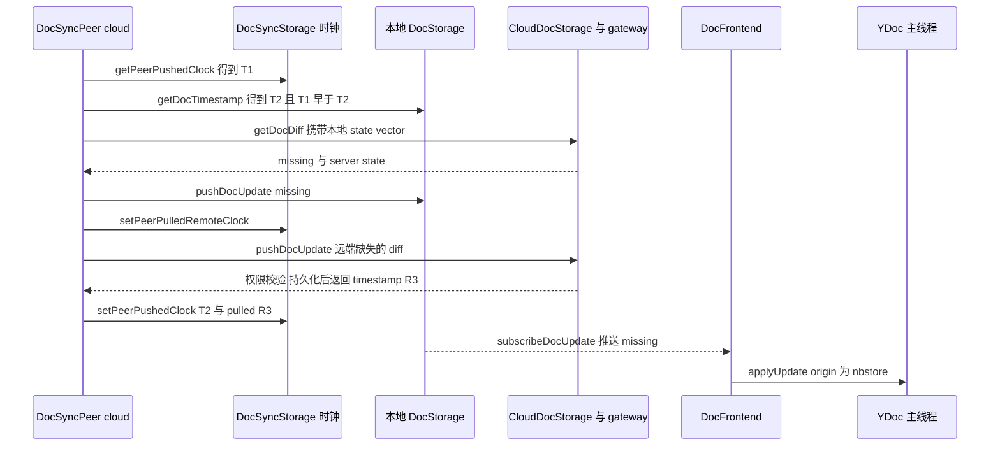

# 第 19 章 存储与同步引擎 nbstore

`@affine/nbstore`：以 Yjs 更新为核心的 local-first 存储引擎

第 6 部分 · 前端应用 ｜ 难度 ★★★★★ ｜ 建议学时 10 小时

Note:
这是第 6 部分难度最高的一章。nbstore 位于 packages/common/nbstore，是 AFFiNE local-first 能力的核心。
它以 Yjs 二进制更新为核心数据单元，支持可插拔多存储、多对端同步，并且运行在 Worker 中。

---

## 本章导读：local-first 意味着什么

- 断网照常编辑，联网后自动合并
- 打开文档不等网络，直接读本地
- 开五个标签页，只维持一条同步连接
- 桌面 SQLite、浏览器 IndexedDB、移动端原生插件——上层一无所知

<div class="callout warn">

`nbstore/README.md` 中的 `SpaceStorageWorkerClient`、`@affine/nbstore/op` 已与源码不一致，API 以源码为准

</div>

Note:
这四条就是 AFFiNE 自称 local-first 的含义，承担这一切的就是 nbstore。
本章路线：先看分层，再逐层下钻存储抽象、连接、各端实现，然后重点剖析文档同步算法，最后看 Worker 化、云端协议，以一张离线编辑到上线同步的完整时序收尾。
注意 README 已过时，Worker 客户端实际是 worker/client.ts 的 StoreManagerClient，README 只能用来理解"组合多个存储"的思想。

---

## 学习目标

- 阐述 nbstore"存储 → 同步 → 门面 → Worker"分层
- 列出七种 `StorageType`，解释"快照 + 增量更新"设计
- 描述 `AutoReconnectConnection` 的引用计数与退避
- 讲清三种时钟与 connect、pull、pullAndPush、push、save
- 描述 `DocFrontend` 双向绑定与 Worker 的 op 通信
- 画出"离线编辑 → 上线同步"完整时序

Note:
六个目标里，第四个是本章核心：文档同步算法。
最后一个是综合能力，我们会用两张时序图把整条链路串起来。

---

## 知识地图



Note:
主线程只持有门面：WorkspaceEngine 拿到 StoreClient，上面挂着 Doc、Blob、Awareness、Indexer 四个 frontend。
Worker 里才是真正的存储和同步：StoreConsumer 持有本地与远端的 SpaceStorage，以及 Sync 总控下的四个同步器。
两边通过 op 协议在 MessagePort 上通信，云端存储通过 socket.io 连接后端网关。

---

## local-first 的存储需求

| 需求 | nbstore 的回应 |
|---|---|
| 本地优先读写 | `DocFrontend` 只与**本地** DocStorage 交互 |
| 无冲突、增量合并 | Yjs update + state vector `getDocDiff` + 时钟 |
| 多对端 | `remotes: Record<peerId, SpaceStorage>`，每端一个 `DocSyncPeer` |
| 多标签共享 | SharedWorker + `share()` 连接复用 + BroadcastChannel |
| 不阻塞 UI、优先级 | 存储同步跑在 Worker；`addPriority` 贯穿各层 |

<p class="small">另有 BlobStorage（附件不进 CRDT）、AwarenessStorage（光标）、IndexerStorage（离线全文搜索）</p>

Note:
这张表把需求和实现一一对应。最关键的是第一行：DocFrontend 只和本地存储打交道，远端同步全部在后台。
包结构上，storage、connection、impls、sync、frontend、worker 各司其职；每个实现单独一个 exports 入口，按端按需打包，Web Worker 只引入 idb、cloud、broadcast-channel，Electron 只引入 sqlite、disk、cloud。

---

## storage 抽象：七类存储

| 类型 | 存什么 | 关键方法 |
|---|---|---|
| `doc` | Yjs 文档二进制 | `getDoc`、`getDocDiff`、`pushDocUpdate`、`getDocTimestamps` |
| `blob` | 二进制资源 | `get`、`set`、`delete`、`list` |
| `awareness` | 协作感知（不持久化） | `update`、`subscribeUpdate` |
| `indexer` | 全文索引 | `search`、`aggregate` |
| `docSync` `blobSync` `indexerSync` | **同步元数据** | `setPeerPushedClock` 等 |

<p class="small">同步元数据与数据分开存 → 同一本地库可对多个对端（云端、磁盘、v1 迁移）分别记账</p>

Note:
StorageType 一共七种。前四种存数据，后三种存同步元数据：每个对端每个文档的时钟、每个 blob 的上传时间、每个文档的已索引时钟。
DocStorage 的时钟就是时间戳，每次 pushDocUpdate 都返回一个 timestamp，作为该文档在这个存储里的版本号。
subscribeDocUpdate 的注释特别强调：本地存储只在用户写入时产生更新，而云存储会因其他客户端广播而自发产生更新。

---

## SnapshotDocStorageBase：追加写、惰性压实

```ts
// 来源：storage/doc.ts（SnapshotDocStorageBase.getDoc 节选）
override async getDoc(docId: string) {
  // await using _lock：非只读时 lockDocForUpdate，保证只有一个在合并
  const snapshot = await this.getDocSnapshot(docId);
  const updates = await this.getDocUpdates(docId);
  if (updates.length) {
    const { timestamp, bin, editor } = await this.squash(
      snapshot ? [snapshot, ...updates] : updates
    );
    // ... 非只读时 setDocSnapshot(newSnapshot) + markUpdatesMerged
    return newSnapshot;
  }
  return snapshot;
}
```

- **写入只追加**（append-only），**读取时惰性压实**（lazy compaction）
- 子类只实现四个原语：`getDocSnapshot`、`setDocSnapshot`、`getDocUpdates`、`markUpdatesMerged`

Note:
源码注释解释了动机：如果不立即把更新合并进快照，可以节省大量写入时间，在读取最新文档时再合并。编辑是高频操作，所以写入必须极快。
await using 配合 lockDocForUpdate，保证并发读取时只有一个在做合并。
setDocSnapshot 的注释还提醒，多线程下可能收到过期快照，实现应只在时间戳更新时才写入。HistoricalDocStorage 继承这个基类，监听 snapshot 事件生成页面历史。

---

## connection：自动重连与共享



<p class="small">退避 <code>min(3000 * 2 ** n, 60000)</code> ms；<code>share(conn)</code> 按 <code>shareId</code> 去重——同一工作区六类 IDB 存储共用一个数据库连接</p>

Note:
AutoReconnectConnection 用引用计数管理连接：第一个 connect 真正建连，最后一个 disconnect 才真正断开。
重试间隔从 3 秒开始翻倍，上限 60 秒，连接超时 15 秒；同步器启动前都会 waitForConnected。
share 函数按 shareId 在模块级 Map 中去重，IDBConnection 的 shareId 包含 schema 版本、flavour、type 和 id；云端则按端点缓存 SocketManager，同一服务器的所有工作区共用一条 socket。

---

## SpaceStorage：组合成一个"空间"

| 位置 | doc / blob | awareness | indexer |
|---|---|---|---|
| `local` | IndexedDB / SQLite | `BroadcastChannelAwarenessStorage` | IndexedDB / SQLite |
| `remotes['cloud:<serverId>']` | `CloudDocStorage` / `CloudBlobStorage` | `CloudAwarenessStorage` | `CloudIndexerStorage` |
| `remotes.v1` | v1 存储（存在时） | — | — |

- 一个工作区 = 一个本地 + 若干远端 `SpaceStorage`，未配置类型自动填 dummy
- Electron/iOS/Android 选 `SqliteDocStorage`，Web 选 `IndexedDBDocStorage`
- 磁盘同步多一个 `remotes.disk`；"迁移旧数据"与"同步云端"是同一套机制

Note:
这是云工作区的配置，来自 workspace-engine/impls/cloud.ts 的 getEngineWorkerInitOptions。CloudIndexerStorage 只在服务器开启 Indexer 特性时出现。
各端选择在 impls/local.ts 里用 BUILD_CONFIG 判断。每个存储类都有静态 identifier，Worker 根据字符串名字实例化，因为构造参数要跨线程传递。
IndexedDB 实现还会通过 BroadcastChannel 广播更新，所以即使不用 SharedWorker，多个标签页也能互相感知变化。

---

## 文档同步：三种时钟

| 时钟 | 含义 | 何时更新 |
|---|---|---|
| remote clock | 所知远端该文档最新版本 | 启动 `getDocTimestamps(after)`；收到广播 |
| pulled remote clock | 已拉取并写入本地的远端版本 | pull / pullAndPush / save 成功后 |
| pushed clock | 已推送给远端的**本地**版本 | push / pullAndPush 成功后 |

- 本地时钟 > pushed clock ⇒ 本地有未推送改动
- remote clock > pulled clock ⇒ 远端有未拉取改动
- 上线一次 `getDocTimestamps` 即知几千篇文档中哪些要同步

Note:
每个对端、每个文档，在 DocSyncStorage 里记三种时钟，再加上本地存储自身的 getDocTimestamp，就能做出所有判断。
这比每次都交换 state vector 高效得多。
Sync 总控为每个远端创建一个 DocSyncPeer，并把各 peer 的状态聚合成 state$，节流 1 秒避免刷屏 UI。

---

## 五种任务

```ts
// 来源：sync/doc/peer.ts（Job 类型，成员压缩为单行）
type Job =
  | { type: 'connect'; docId: string }
  | { type: 'push'; docId: string; update?: Uint8Array; clock: Date }
  | { type: 'pull'; docId: string }
  | { type: 'pullAndPush'; docId: string }
  | { type: 'save'; docId: string; update?: Uint8Array; remoteClock: Date };
```

- **pull** 只拉 `missing`；**push** 合并排队更新推远端；**save** 写入远端广播
- **pullAndPush** 先拉后推，推"远端缺的部分"（`docDiffUpdate`，含删除集比较）
- 同一文档按 connect → pullAndPush → pull → push → save 顺序批处理

Note:
pullAndPush 是本地有改动时的完整双向同步：先用本地 state vector 向远端要我缺的部分写入本地，再算出远端缺的部分推上去。若远端没有这个文档，就直接全量推送。
docDiffUpdate 很精细：两边 state vector 相同时，还会比较删除集是否一致，因为 Yjs 的 state vector 不包含删除信息。
pull 之后会安排一个空 push 推进 pushed clock，因为写入本地产生了新本地时钟，而这份数据本就来自远端，无需再推。

---

## connect 任务：决定初次做什么



Note:
这张图对应 peer.ts 里 jobs.connect 的逻辑。先读出 pushed clock、本地时钟和远端时钟。
本地有没推上去的改动，就走 pullAndPush；否则看远端有没有更新，有就 pull。
还有一个特殊分支：不知道远端时钟时，只有带优先级的文档、且本地无数据或从未拉过，才会主动 pull。练习三就是让大家手推这些组合。

---

## 事件驱动与主循环

<div class="cols">
<div>

```ts
// peer.ts（events 节选）
remoteUpdated: ({ docId, update,
  remoteClock }) => {
  this.actions.addDoc(docId);
  this.actions.updateRemoteClock(
    docId, remoteClock);
  if (isEmptyUpdate(update)) {
    this.schedule({ type: 'pull', docId });
  } else { /* schedule save */ }
},
```

</div>
<div>

**retryLoop**

- 等 local、remote、syncMetadata 就绪（30 秒超时）
- 过滤 origin 为自身 `uniqueId` 的更新，防回声
- 本地与远端全部文档 `addDoc` → connect
- `jobDocQueue.asyncPop()` 取优先级最高文档

</div>
</div>

Note:
本地更新触发 push，远端更新触发 save；但远端发来空更新时调度 pull，这是云端"失效通知"的落点，后面协议部分会讲。
retryLoop 订阅三个连接状态，任何一个断开就 abort 本轮。mainLoop 包住 retryLoop，异常后重置状态，5 秒后重试。
权限错误 DOC_ACTION_DENIED 只标记该文档，不影响其他文档。

---

## 优先级与其他同步器

<div class="cols cols-3">
<div>

**优先级**

- 根文档（docId = spaceId）为 Infinity
- `addPriority`：根 +100、打开 +100、详情页 +10、ORM 表 +50
- 返回撤销函数，精确借还

</div>
<div>

**BlobSync**

- 内容哈希为 key，只上传/下载
- `set` 写本地后后台上传，图片立即可见
- `OverCapacityError` 暂停上传

</div>
<div>

**Awareness / Indexer**

- 感知不持久化，广播给已连接对端
- `crawlingDocData` 抽块写 `doc`/`block` 表
- 窗口失焦时暂停索引

</div>
</div>

Note:
根文档优先级是无穷大，源码注释说：新文档上传需要先同步其在根文档中的成员关系。
Blob 天然不可变，BlobSyncPeer 每 15 秒扫描本地未上传的 blob；OverSizeError 只标记单个 blob。
感知数据本地对端是 BroadcastChannel，远端是云端 socket。IndexerSync 订阅本地文档更新，用 @affine/reader 抽取所有块写入索引；Web 端窗口 blur 时 pause，focus 时 resume。

---

## DocFrontend：YDoc 与存储双向绑定

| 任务 | 触发 | 行为 |
|---|---|---|
| `load` | `connectDoc` | 读本地 `getDoc` 并 `applyUpdate`，标记 ready |
| `save` | YDoc 本地 `update` 事件 | 合并排队更新，`pushDocUpdate(..., uniqueId)` |
| `apply` | `subscribeDocUpdate`（非自己） | `applyUpdate(doc, update, NBSTORE_ORIGIN)` |

- `handleDocUpdate` 见到 `origin === NBSTORE_ORIGIN` 直接跳过——防"写回自己"
- `docState$` 合并自身 ready 与 DocSync 的 syncing/synced；工作区页面等根文档 ready
- 同一 guid 只能 `connectDoc` 一次，否则 `doc already connected`

Note:
YDoc 必须留在主线程，因为编辑器要用，所以 frontend 在主线程，存储与同步在 Worker。
NBSTORE_ORIGIN 作为 Yjs transaction origin 是防回声的关键。debug 模式下，如果应用远端更新期间有代码修改了文档，会打印醒目警告，因为这会导致编辑者被误记为当前用户。
其他门面：BlobFrontend 先读本地没有再下载；AwarenessFrontend 监听 y-protocols 的 change；IndexerFrontend 全部委托给 IndexerSync。

---

## Worker 化：打开一个 store

```ts
open(key: string, options: StoreInitOptions) {
  const { port1, port2 } = new MessageChannel();
  const client = new OpClient<WorkerOps>(port1);
  const closeKey = uuid();
  this.client
    .call('open', transfer({ key, closeKey, options, port: port2 }, [port2]))
    .catch(err => { console.error('error opening', err); });
  const connection = {
    store: new StoreClient(client),
    dispose: () => { /* call('close', closeKey)，删除 connections */ },
  };
  this.connections.set(closeKey, connection);
  return connection;
}
```

- `worker/client.ts`：每个工作区一条**专属 MessageChannel**，管理通道只管 open/close
- Worker 侧 `StoreManagerConsumer` 按 key 复用 `StoreConsumer`（引用计数）
- 配合 SharedWorker：多标签打开同一工作区，只有一份存储与同步

Note:
worker/ops.ts 定义了两级协议：WorkerManagerOps 是管理级，包括 open、close、telemetry、realtime；WorkerOps 是单个 store 级，用模板字面量类型展开成 docStorage.getDoc 这样的扁平名字。
transfer 把 port2 的所有权移交给 Worker，这就是第 16 章讲的 Transferable 机制。
Worker 侧用 serialize 让同一 key 的 open 和 close 串行执行，只在远端配置变化时 reconfigure。

---

## 写入路径：主线程 → Worker



<p class="small"><code>WorkerDocStorage</code> 实现与真实存储<strong>相同的接口</strong> → 同一份 <code>DocFrontend</code> 可直连 IndexedDB，也可接 Worker 代理</p>

Note:
StoreClient 构造时创建了一组 Worker 代理：WorkerDocStorage、WorkerDocSync、WorkerBlobSync 等，再用它们构造 DocFrontend、BlobFrontend。
精妙之处在于代理类实现了与真实存储相同的接口：getDoc 变成 client.call，subscribeDocUpdate 变成 client.ob$。
所以单测 frontend.spec.ts 可以直接把 DocFrontend 接到 IndexedDB 上测试。

---

## 云端协议：space:* 事件

| 方向 | 事件 | 用途 |
|---|---|---|
| C→S | `space:join-batch` / `space:leave-batch` | 加入/离开空间与文档 |
| C→S | `space:load-doc` / `space:load-doc-timestamps` | 拉取 diff / 拉取时钟表 |
| C→S | `space:push-doc-update` | 推送更新，ack 返回 `timestamp` |
| S→C | `space:broadcast-doc-updates` | 给**活跃订阅者**完整增量 |
| S→C | `space:broadcast-doc-invalidation` | 给**全空间**失效通知（仅时间戳） |

<p class="small">失效通知 → 50ms 防抖 <code>repairInvalidatedDocs</code> → 对变新文档 emit <strong>空更新</strong> → <code>DocSyncPeer</code> 调度 <code>pull</code></p>

Note:
客户端类型定义在 impls/cloud/socket.ts，服务端处理在 backend/server/src/core/sync/gateway.ts。所有二进制都以 base64 传输。
服务端 publishDocUpdate 做两级广播：向整个空间房间发失效通知，只含时间戳；向 join-batch 时带了 docId 的活跃订阅 socket 发完整增量，排除发送者。
这样没打开某文档的客户端不必接收全部增量，只在需要时按 state vector 拉差量，大幅节省带宽。服务端抛的 DocActionDenied 到客户端就是 DOC_ACTION_DENIED。

---

## 离线编辑 → 上线同步（一）：离线与重连



<p class="small">离线期间所有编辑都安全落在本地 <code>updates</code> 表；此时本地时钟 T2 晚于 pushed 时钟 T1</p>

Note:
这是完整时序的上半段。离线时 DocFrontend 照常把更新写入本地存储，从不等待网络。
连接处于 error 状态并指数退避重连。网络恢复后 socket 重连，join-batch 加入空间。
DocSyncPeer 的 retryLoop 等到三方连接就绪，先读缓存的 remote clocks，再增量拉取时钟表，然后把文档 addDoc，调度 connect 任务。

---

## 离线编辑 → 上线同步（二）：双向交换



<p class="small"><strong>数据永远经由本地存储流向 UI</strong>：远端数据先写本地，再由 <code>DocFrontend</code> 应用到 YDoc</p>

Note:
下半段是 connect 判断出 T1 早于 T2，执行 pullAndPush：先拉 missing 写入本地，记录 pulled clock；再算出远端缺失部分推上去，服务端校验权限、持久化并 publishDocUpdate，返回远端时钟 R3。
最后调度 save 和 push，分别记录 pulled R3 和 pushed T2。
写入本地的 missing 通过 subscribeDocUpdate 回到 DocFrontend，再 applyUpdate 到 YDoc，界面就合并了他人离线期间的修改。其他在线客户端：打开该文档的收到增量走 save，没打开的收到失效通知后稍后 pull。

---

## 源码导读 Top 5

| 优先级 | 路径 | 看什么 |
|---|---|---|
| P0 | `nbstore/src/sync/doc/peer.ts` | 三种时钟、五种任务、`retryLoop` |
| P0 | `nbstore/src/storage/doc.ts` | DocStorage 接口、`SnapshotDocStorageBase` |
| P0 | `nbstore/src/frontend/doc.ts` | load/save/apply、origin 防回声 |
| P0 | `nbstore/src/worker/client.ts`、`consumer.ts` | Worker 化与 store 复用 |
| P0 | `nbstore/src/impls/cloud/doc.ts`、`socket.ts` | 云端协议与失效修复 |

<p class="small"><code>nbstore</code> = <code>packages/common/nbstore</code>；服务端对照 <code>packages/backend/server/src/core/sync/gateway.ts</code></p>

Note:
peer.ts 是全章最值得反复读的文件。建议先读 Job 类型和 jobs.connect，再读 events，最后读 retryLoop。
P1 可以读 connection.ts 和 shared-connection.ts、SpaceStorage 与 Sync 组合，以及应用侧的 workspace/entities/engine.ts。

---

## 动手实践

| 练习 | 验收要点 |
|---|---|
| 1 读懂 frontend 单测 | 解释 doc2 为何读到 doc1 的数据、`DocSyncImpl.dummy` 的作用 |
| 2 观察 IndexedDB | 在 `updates`/`snapshots`/`clocks` 表看出"追加写、惰性压实" |
| 3 手推三种时钟 | 至少 4 种组合的结论与 connect 流程图一致 |
| 4 抓包云同步事件 | 标注三个事件，解释第二窗口为何只收到失效通知 |
| 5 实现内存 DocStorage | 继承 `SnapshotDocStorageBase`，两个存储经 `DocSyncPeer` 同步一致 |

Note:
练习一执行 yarn vitest run 跑 nbstore 的 frontend.spec.ts，需要已安装依赖。
练习二打开 DevTools 的 IndexedDB，找名为 local:workspace:id 的库，刷新页面后看 updates 是否被合并进 snapshots。
练习四里 SharedWorker 的请求需要在 chrome://inspect/#workers 中调试对应 Worker。

---

## 自测

1. `SnapshotDocStorageBase` 写入与读取各做什么？
   - 写只追加更新；读时在锁内 squash 成新快照并标记已合并 <!-- .element: class="fragment" -->
2. `connect` 何时执行 `pullAndPush`？
   - 远端可写、本地有时钟，且 pushed 为空或早于本地时钟 <!-- .element: class="fragment" -->
3. 多个标签页打开同一工作区，Worker 中有几个 `StoreConsumer`？
   - 一个：按 key 在 `storePool` 复用并引用计数 <!-- .element: class="fragment" -->
4. 客户端如何处理"失效通知"？
   - 防抖重拉时间戳，对变新文档发空更新，触发 `pull` 拉差量 <!-- .element: class="fragment" -->

Note:
四道题分别覆盖存储设计、同步算法、Worker 复用和云端协议。
可以追问：DocSyncPeer 和 DocFrontend 各自如何防回声？答案是 DocSyncPeer 用 sync:peerId 开头的 uniqueId 作 origin 过滤，DocFrontend 写存储用自己的 uniqueId，应用到 YDoc 用 NBSTORE_ORIGIN。

---

## 常见坑

| 现象 | 原因 | 解决 |
|---|---|---|
| 照 README 写 `SpaceStorageWorkerClient` 报错 | README 过时 | 用 `@affine/nbstore/worker/client` 的 `StoreManagerClient` |
| `doc already connected` | 同一 guid 被 `connectDoc` 两次 | 每个 guid 只连接一次 |
| 同步状态一直 retrying | 远端连接失败等非权限异常 | 看 `docState$` 的 `errorMessage`，查鉴权 |
| 某文档停止同步、其他正常 | 文档级 `DOC_ACTION_DENIED` | 检查权限，本地再次编辑触发重试 |
| `Storage implementation X not found` | 该端 Worker 未注册对应实现 | 检查 Worker 入口传入的存储列表 |

Note:
最后一个坑很典型：比如 Web 端 Worker 不含 sqlite 实现，StoreInitOptions 里写了 SqliteDocStorage 就会报这个错。
另外控制台出现"nbstore 应用远端更新时某些代码触发了本地修改"的警告，说明观察 YDoc 的回调在应用远端更新时写入了文档，应在回调里判断 transaction origin。

---

## 小结与下一步

- 以 Yjs 更新为数据单元：七类存储 + `SpaceStorage` 组合 + 多对端同步
- 追加写惰性压实、引用计数退避重连、`share()` 复用是性能与稳定基础
- 三种时钟判方向，五种任务执行，配合优先级队列与回声过滤
- 门面在主线程绑定 YDoc，存储与同步在（Shared）Worker
- 下一章：**第 20 章 多端：Electron 与移动端**——SQLite 如何经 helper 与原生插件接入

Note:
云端协议是一组 space 事件，"活跃订阅推增量、全员推失效"的两级广播兼顾实时性与带宽。
应用侧只需要提供 StoreInitOptions 并 connectDoc，不同端通过注入原生 API 切换实现。
下一章我们就去看这些原生 API 从哪里来：Electron 的 helper 进程、background worker，以及 iOS、Android 的 Capacitor 插件。
