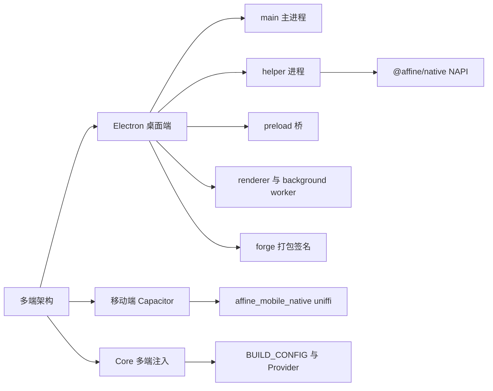
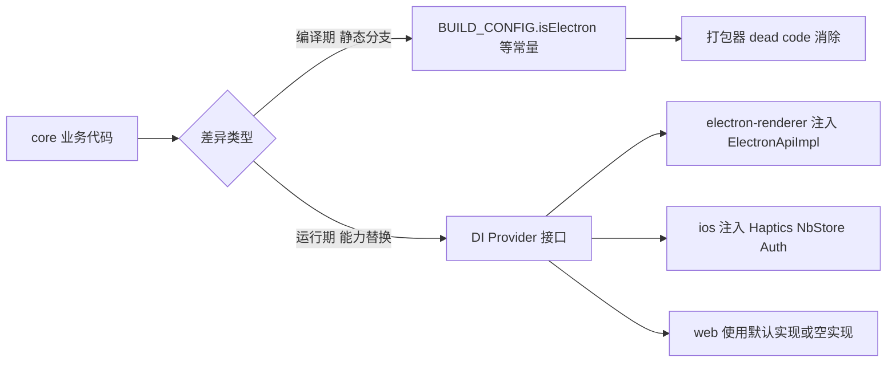
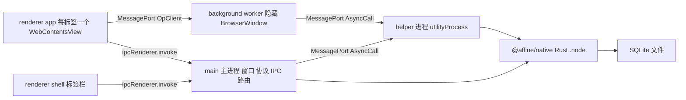
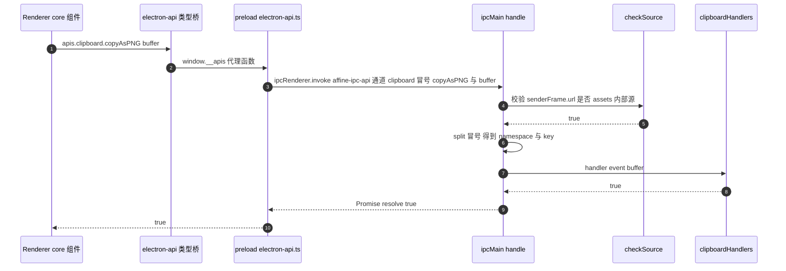
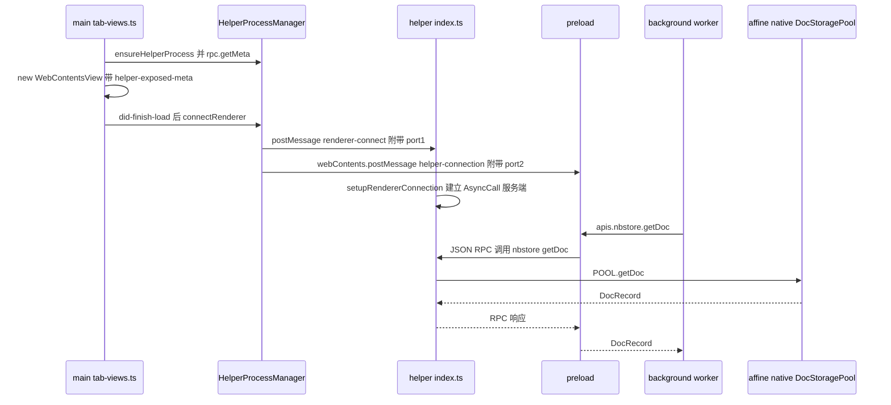
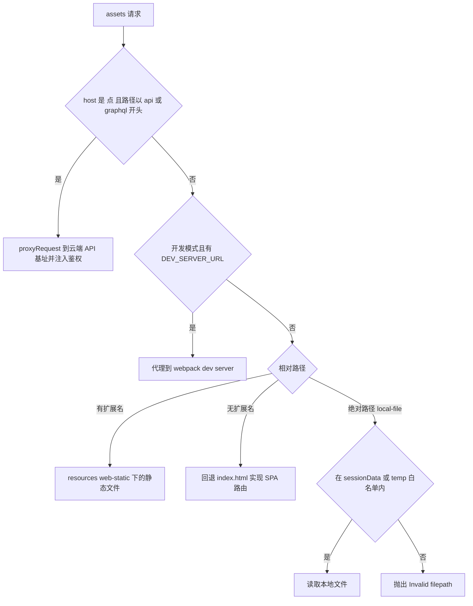
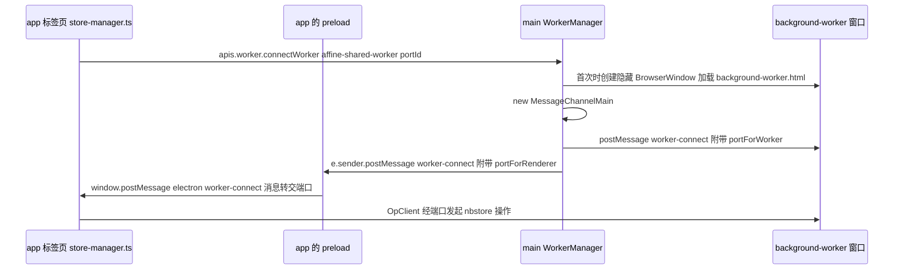
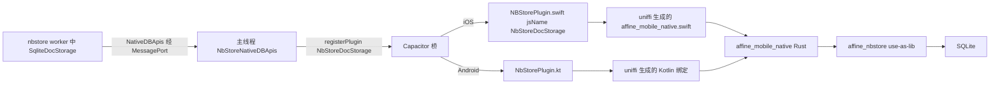

# 第 20 章 多端：Electron 与移动端

多个壳 + 一个核：进程模型、IPC、原生模块与 Capacitor

第 6 部分 · 前端应用 ｜ 难度 ★★★★☆ ｜ 建议学时 10 小时

Note:
同一份 @affine/core 业务代码，要跑在浏览器、Electron 桌面端，以及 iOS、Android 原生壳上。
这一章从 Electron 进程模型讲起，画出 IPC 调用时序，再讲打包签名、Rust 原生模块，最后转到移动端的 Capacitor 插件与 uniffi 绑定。

---

## 本章导读：不只是"套个壳"

- **能力差异**：桌面要 SQLite、录音、托盘、自动更新；移动端要震动、键盘、原生登录
- **安全边界**：渲染进程本质是 Chromium 页面，乱暴露 Node 能力 = XSS 变 RCE
- **类型与工程**：IPC 两侧（JS/Swift/Kotlin/Rust）类型一致，还要打包签名发布

<div class="callout">

读完本章要能回答：桌面端点一下"导出数据库"，这条调用穿过了几个进程？

</div>

Note:
把网页套个壳听起来简单，真正难的是这三件事。
能力差异决定了要有注入机制，安全边界决定了 IPC 要层层校验，类型与工程决定了要有类型桥和代码生成。
带着结尾这个问题听完本章。

---

## 学习目标

- 说出 main、helper、renderer、background worker 四类进程职责
- 解释 `handlers.ts` / `exposed.ts` / `preload/electron-api.ts` 的协作
- 画出 renderer → main 与 renderer → helper 两条 IPC 时序
- 说明 `assets://` 协议、`checkSource` 与 Fuses 的安全作用
- 区分 `@affine/native`（NAPI-RS）与 `affine_mobile_native`（uniffi）
- 描述 Capacitor 插件链路，并用 `framework.impl` 注入平台差异

Note:
前四个目标集中在 Electron：进程、IPC 机制、IPC 时序和安全。
后两个是原生模块与移动端，最后落到 core 里的多端注入模式。

---

## 知识地图



Note:
Electron 这一支最重：主进程、helper 进程、preload 桥、渲染层，以及打包签名。
原生模块分两套绑定：桌面走 NAPI，移动走 uniffi。最后所有差异都在 core 里通过编译期常量和 DI Provider 注入。

---

## 多个壳 + 一个核

| 包名 | 运行环境 | distribution |
|---|---|---|
| `@affine/web` | 桌面浏览器 | `web` |
| `@affine/mobile` | 移动浏览器 | `mobile` |
| `@affine/electron` / `@affine/electron-renderer` | Electron main/helper/preload / 渲染进程 | `desktop` |
| `@affine/ios` / `@affine/android` | WKWebView / Android WebView | `ios` / `android` |
| `@affine/admin` | 浏览器后台 | `admin` |

<p class="small"><code>tools/utils/src/build-config.ts</code> 由 distribution 计算 <code>BUILD_CONFIG.isElectron</code>、<code>isMobileEdition</code>、<code>isNative</code> 等布尔常量</p>

Note:
所有 UI 与业务都在 packages/frontend/core，apps 下的目录只是一层很薄的入口壳。
distribution 这一列来自 tools/utils/src/distribution.ts 的 PackageToDistribution。
构建时根据 distribution 算出 isDesktopEdition、isMobileEdition、isElectron、isIOS 等常量，通过 define 注入为 BUILD_CONFIG。

---

## 两条注入通道



<div class="callout">

经验法则：**"有没有"用 BUILD_CONFIG，"怎么做"用 Provider**

</div>

Note:
多端差异有两条注入通道。编译期常量适合"有没有"，比如移动端不显示某个菜单，打包器会把死分支消除掉。
运行期 Provider 适合"怎么做"，比如震动反馈调用哪个 API，各端入口注入不同实现。

---

## Electron 进程模型



<p class="small">SQLite 放 helper：主进程管所有窗口事件循环，被阻塞即全局卡顿；helper 崩溃后 <code>ensureHelperProcess()</code> 可重新拉起</p>

Note:
Electron 天生是多进程的。AFFiNE 在主进程和渲染进程之外，又加了 utilityProcess 形式的 helper 进程，以及一个隐藏窗口形式的 background worker。
renderer 分 app 和 shell：每个标签页一个 app 视图，shell 视图渲染顶部标签栏；popup 管录音提示小窗。
background worker 扮演浏览器里 SharedWorker 的角色，运行共享的 nbstore 消费者。helper 负责 SQLite、磁盘同步、文件对话框和 Mermaid、Typst 预览。

---

## 主进程启动：src/main/index.ts

```ts
// 来源：apps/electron/src/main/index.ts（节选）
app.enableSandbox();
ensureSecureLinuxPasswordStore();
const isSingleInstance = app.requestSingleInstanceLock();
setupDeepLink(app);
registerSecurityRestrictions();
app
  .whenReady()
  .then(registerProtocol)
  .then(registerHandlers)
  .then(registerEvents)
  .then(launch)
  // .then(createApplicationMenu) ... .then(setupTrayState)
  .catch(e => console.error('Failed create window:', e));
```

- `enableSandbox` 全局强制沙箱；单实例锁把 `affine://` 链接转发给首个实例
- ready 后**严格有序**：协议 → IPC handler → 事件 → 创建窗口

Note:
enableSandbox 比单个窗口设置 sandbox 更强，是全局兜底。Linux 下 ensureSecureLinuxPasswordStore 选择 gnome-libsecret 或 kwallet，保证 safeStorage 不退化成明文。
深链和安全限制必须在 ready 前注册，因为 open-url、web-contents-created 事件可能在 ready 前触发；assets 特权协议也必须在 ready 前用 registerSchemesAsPrivileged 注册。
ready 之后先有协议，否则窗口加载 assets 地址会失败，然后才是 IPC、事件和 launch。

---

## IPC ①：单通道路由 + 来源校验

```ts
// 来源：apps/electron/src/main/handlers.ts（节选，略有简化）
const handleIpcMessage = async (e, ...args: any[]) => {
  // args[0] is the `{namespace:key}`
  if (!checkSource(e) || typeof args[0] !== 'string') {
    logger.error('invalid ipc message', args);
    return;
  }
  const [namespace, key] = (args[0] as string).split(':');
  const handler = allHandlers[namespace]?.[key];
  const realArgs = args.slice(1);
  return await handler(e, ...realArgs);
  // ... 省略校验、耗时日志
};
ipcMain.handle(AFFINE_API_CHANNEL_NAME, handleIpcMessage); // 外层另有 try/catch
```

- `allHandlers` 是唯一真相源：`debug`、`ui`、`clipboard`、`worker`、`auth` 等 14 个命名空间
- 唯一通道 `'affine-ipc-api'`，首参 `"namespace:key"`；只需一处 `checkSource`

Note:
目标是：在主进程写一个普通 async 函数，渲染进程就能以 apis.namespace.method 调用，并且有完整类型。
每个 handler 的签名由 type.ts 约束，第一个参数永远是 IpcMainInvokeEvent；剪贴板 handler 用 satisfies NamespaceHandlers 保留精确类型。
单通道的好处是只需要在一个地方做来源校验，新增 handler 不会忘记；还注册了 ipcMain.on 版本支持少量同步调用。

---

## IPC ②：元数据驱动的 preload 代理

```ts
// 来源：apps/electron/src/preload/electron-api.ts（节选）
const all = handlersMeta.map(([namespace, functionNames]) => {
  const namespaceApis = functionNames.map(name => {
    const channel = `${namespace}:${name}`;
    return [
      name,
      (...args: any[]) => {
        return ipcRenderer.invoke(AFFINE_API_CHANNEL_NAME, channel, ...args);
      },
    ];
  });
  return [namespace, Object.fromEntries(namespaceApis)];
});
```

- `getExposedMeta()` 把字典压成"命名空间 → 方法名列表"，经 `--main-exposed-meta` 传入
- helper 元数据经 `rpc.getMeta()` 异步拉取，只有 tab view 与 worker 携带
- 仅 `isInternalUrl` 时才 `exposeInMainWorld('__apis', apis)`

Note:
preload 运行在沙箱里，不能 import 主进程代码，函数也无法跨进程序列化，所以主进程只传名字。
tab-views.ts 的 getAdditionalArguments 把 main 和 helper 两份元数据 JSON 化后放进命令行参数，preload 再动态生成调用 ipcRenderer.invoke 的代理函数。
两层防护：preload 只在内部源暴露 API，外部页面拿不到 __apis；即使被绕过，主进程 checkSource 还会再校验一次。

---

## IPC ③：类型桥 @affine/electron-api

```ts
// 来源：packages/frontend/electron-api/src/index.ts（节选，换行有调整）
import type { handlers as mainHandlers } from '@affine/electron/main/exposed';
type MainClientHandlers = {
  [namespace in keyof MainHandlers]: {
    [method in keyof MainHandlers[namespace]]: MainHandlers[namespace][method]
      extends (arg0: any, ...rest: infer A) => any
      ? (...args: A) => ReturnType<MainHandlers[namespace][method]> extends
          Promise<any>
          ? ReturnType<MainHandlers[namespace][method]>
          : Promise<ReturnType<MainHandlers[namespace][method]>>
      : never;
  };
};
export const apis = (globalThis as any).__apis as ClientHandler | undefined;
```

- 映射类型**去掉首参** `IpcMainInvokeEvent`，并**统一包装为 Promise**
- 全部 `import type`：渲染层打包不含任何主进程代码；新增 handler 无需改 preload

Note:
渲染层从 window.__apis 拿到的是 any，类型就来自这个包。它用条件类型判断返回值是否已经是 Promise，不是就包一层。
因为全是 import type，所以 @affine/electron 的 package.json 专门在 exports 里暴露了 main/exposed、helper/exposed 和 preload/electron-api。
练习四就是验证这一点：只在 allHandlers 里加一行，不改 preload 就能在渲染层带类型调用。

---

## IPC 时序：renderer → main



<p class="small">事件反向（main → renderer）：<code>events.ts</code> 维护 webContents 订阅表，preload 引用计数 subscribe/unsubscribe</p>

Note:
以"复制图片为 PNG"为例走一遍。core 组件调用类型桥上的 apis.clipboard.copyAsPNG，实际是 preload 生成的代理函数。
代理把 "clipboard:copyAsPNG" 和参数一起 invoke 到唯一通道，主进程先 checkSource，再 split 出命名空间与方法名，调用 handler。
事件方向相反：主进程只向订阅了该 channel 的 webContents 推送，避免一个托盘状态变化广播给十个标签页。

---

## IPC 时序：renderer → helper



<p class="small">主进程只"牵线"：<code>MessageChannelMain</code> 两端分别递给 helper 与 preload，之后数据<strong>不经过主进程</strong></p>

Note:
这条链路的关键在 helper-process.ts 的 connectRenderer：创建一对 MessageChannelMain 端口，一个经 utilityProcess.postMessage 给 helper，一个经 webContents.postMessage 给 preload。
之后大块的 Yjs update、Blob 二进制直接在两端传输，比绕道主进程少一次序列化和一次事件循环排队。
反方向 helper 需要弹系统对话框时，走 main-rpc.ts 的 mainRPC 调用主进程，因为 dialog 只能在主进程使用。

---

## assets:// 协议分流



<p class="small"><code>onBeforeSendHeaders</code> 删掉渲染层的 <code>Authorization</code>，由主进程注入 <code>Bearer</code> token——<strong>token 永不进渲染进程</strong></p>

Note:
渲染进程加载的不是 file 也不是 localhost，而是 assets://./ 这样的自定义协议；another-host 是为了让弹窗不和主窗口共享缩放级别。
API 基址按渠道区分：stable 指向 app.affine.pro，beta 指向 insider.affine.pro，canary 指向 affine.fail。
onHeadersReceived 还为 assets 响应强制 X-Frame-Options，并为 AFFiNE 自有域名补 CORS 头。

---

## 安全边界：导航、窗口与 webPreferences

<div class="cols">
<div>

```ts
// security-restrictions.ts（节选）
contents.on('will-navigate',
  (event, url) => {
    if (isInternalUrl(url)) {
      return;
    }
    event.preventDefault();
    openExternalSafely(url);
  });
```

</div>
<div>

- 应用内永不导航到外部，也永不新开窗口
- `openExternalSafely` 只放行 `http:`/`https:`/`mailto:`
- `checkSource` 校验 `e.senderFrame.url`
- `buildWebPreferences`：`sandbox`、`contextIsolation` 开，`nodeIntegration` 关

</div>
</div>

Note:
setWindowOpenHandler 最终总是返回 action deny，外链一律交给系统浏览器，防止 file、smb 之类协议被滥用。
checkSource 取的是 senderFrame.url，子 frame 场景下不信任 sender.getURL，还考虑了正在导航中的 pending 状态。
所有窗口都通过 buildWebPreferences 创建，避免某个新窗口忘了开启隔离。第 28 章会从安全角度再展开。

---

## background worker：替代 SharedWorker



<p class="small">存储路径：app（<code>OpClient</code>）→ background worker（<code>StoreManagerConsumer</code> + <code>SqliteDocStorage</code>）→ helper → <code>DocStoragePool</code> → SQLite</p>

Note:
浏览器里多个标签页共享一个 SharedWorker 运行 nbstore；Electron 每个 WebContentsView 是独立进程，所以 AFFiNE 用一个隐藏 BrowserWindow 扮演 SharedWorker。
background-worker/index.ts 在隐藏窗口里调用 bindNativeDBApis(apis.nbstore)，把 helper 的 nbstore API 绑定为 SQLite 存储实现。
端口数降为 0 时销毁隐藏窗口，并监听 render-process-gone、unresponsive 做故障清理。回到开头的问题：一次存储调用穿过了渲染进程、worker 窗口、helper 三个进程，最后进入 Rust。

---

## 打包签名：forge.config.mjs

```js
// 来源：apps/electron/forge.config.mjs（Fuses 节选）
new FusesPlugin({
  version: FuseVersion.V1,
  [FuseV1Options.RunAsNode]: false,
  [FuseV1Options.EnableCookieEncryption]: true,
  [FuseV1Options.EnableNodeOptionsEnvironmentVariable]: false,
  [FuseV1Options.EnableNodeCliInspectArguments]: false,
  [FuseV1Options.EnableEmbeddedAsarIntegrityValidation]: true,
  [FuseV1Options.OnlyLoadAppFromAsar]: true,
}),
```

- Fuse 写进二进制、运行期不可改：禁 `ELECTRON_RUN_AS_NODE`、`NODE_OPTIONS`、`--inspect`
- makers：dmg、zip、squirrel、AppImage、deb、flatpak；esbuild 打出 main/preload/helper
- macOS `osxSign` + `notarytool` 公证；Windows 走远程签名服务，CI 不放私钥

Note:
build-layers.ts 用 esbuild 把三个入口打成 dist 下的 main.js、preload.js、helper.js；它还检查所有 workspace 依赖必须放在 devDependencies 并被打包，因为 asar 里不会有 monorepo 链接。
asar 完整性校验加只从 asar 加载，防止应用代码被篡改；plugin-auto-unpack-natives 把 .node 原生模块解包，因为原生模块不能从 asar 内直接 dlopen。
非 stable 渠道的 productName 带上 buildType，使 stable 与 canary 的数据目录互不干扰。

---

## 原生模块：NAPI-RS 与 uniffi

| 维度 | NAPI-RS `@affine/native` | uniffi `affine_mobile_native` |
|---|---|---|
| 宿主 | Node.js / Electron | Swift / Kotlin |
| 产物 | `.node` 动态库 + `index.d.ts` | `.a`/`.so` + 生成的 Swift/Kotlin 源码 |
| 异步 | 返回 JS Promise | 生成 `async` 函数（`tokio` feature） |
| 共享核心 | `affine_nbstore` 默认 feature | `affine_nbstore` 的 `use-as-lib` feature |

- `use-as-lib` 去掉 NAPI 宏：同一份 SQLite 存储，桌面走 NAPI、移动走 uniffi
- 聚合 crate 还含 `affine_media_capture`（ScreenCaptureKit / WASAPI 录音）

Note:
packages/frontend/native 是一个聚合 crate，导出 affine_nbstore、affine_sqlite_v1、affine_media_capture、disk_sync 等，preview 在移动端不编译。
affine_nbstore 默认编译出 DocStoragePool 的 NAPI 绑定；开启 use-as-lib 时只作为普通 Rust 库，被移动端的 uniffi crate 依赖。
iOS 的 codegen.ts 先跑 apollo 生成 GraphQL Swift 包，再 cargo build 并用 uniffi-bindgen 生成 Swift 绑定。

---

## Capacitor 插件全链路：NbStore



<p class="small">插件只能在主线程调用：iOS <code>app.tsx</code> 用 <code>MessageChannel</code> + <code>AsyncCall</code> 把插件 API "借"给 worker，worker 再 <code>bindNativeDBApis</code></p>

Note:
TS 侧 registerPlugin('NbStoreDocStorage') 的名字必须和 Swift 插件类的 jsName 一致。插件实例在 AffineViewController 的 capacitorDidLoad 中手动注册，Android 在 MainActivity 的 registerPlugins 中注册。
nbstore 跑在 Web Worker 里，但 Capacitor 插件只能在有 window.Capacitor 的主线程调用，所以主线程把 port2 通过 native-db-api-channel 消息交给 worker。
对比 Electron：一个经 preload 拿 helper 的 apis.nbstore，一个经 MessagePort 回调主线程插件，最终都 bindNativeDBApis 喂给同一个 sqliteStorages，这就是第 19 章抽象接口的价值。

---

## core 中的多端注入

```ts
// 来源：core/src/mobile/modules/haptics（providers/haptic.ts 与 index.ts 节选）
export const HapticProvider =
  createIdentifier<HapticProvider>('HapticProvider');

export function configureMobileHapticsModule(framework: Framework) {
  framework.service(
    HapticsService,
    f => new HapticsService(f.getOptional(HapticProvider))
  );
}
```

- 三步：core `createIdentifier` 定义接口 → 服务 `getOptional` 依赖 → 入口 `framework.impl`
- 移动 Web 不提供 → 调用变空操作；iOS 接 `@capacitor/haptics`
- 桌面能力统一依赖 `DesktopApiService`（`ElectronApiImpl` 包装 `window.__apis`）

Note:
haptics 是最小范例：HapticProvider 接口定义 impact、notification、vibrate 等方法。iOS 在 app.tsx 里 framework.impl(HapticProvider, ...) 接上 Capacitor 插件。
core 中任何模块想调桌面能力，都应依赖 DesktopApiService，而不是直接 import @affine/electron-api，因为前者在非 Electron 环境下根本不会被注册，从依赖图上约束住了"桌面专属"。
同样的模式还用于 NbstoreProvider、PopupWindowProvider、ValidatorProvider 和 AuthProvider。

---

## 源码导读 Top 5

| 优先级 | 路径 | 看什么 |
|---|---|---|
| P0 | `electron/src/main/index.ts` | 启动顺序、单实例、特权协议 |
| P0 | `electron/src/main/handlers.ts` | 单通道 IPC 路由、`checkSource` |
| P0 | `electron/src/preload/electron-api.ts` | 元数据驱动 API 生成、helper AsyncCall |
| P0 | `frontend/electron-api/src/index.ts` | 去首参并包装 Promise 的映射类型 |
| P0 | `electron/src/main/helper-process.ts` | `utilityProcess.fork`、`connectRenderer` |

<p class="small"><code>electron</code> = <code>packages/frontend/apps/electron</code>；<code>frontend</code> = <code>packages/frontend</code></p>

Note:
五个 P0 文件把 IPC 暴露机制完整串起来了。
P1 推荐 protocol.ts、security-restrictions.ts、tab-views.ts、worker/pool.ts、background-worker/index.ts 和 forge.config.mjs；P2 是 iOS 的 app.tsx、NBStorePlugin.swift 和 mobile-native 的 lib.rs。

---

## 动手实践

| 练习 | 验收要点 |
|---|---|
| 1 数一数 IPC 方法 | 表格：命名空间 / 所属进程 / 至少一个调用点 |
| 2 跟踪 helper 调用 | 8 步内写出流程，解释刷新后 helper 调用为何仍可用 |
| 3 观察 IPC 日志 | 找到 `nbstore.` 开头的 helper 调用与 `ui:` 开头的 main 调用 |
| 4 新增 main handler | 不改 preload 即可调用，TS 推断出 `Promise<NodeJS.Platform>` |
| 5 对比三端 nbstore | 说明 Electron 直传 `Uint8Array` 而 Capacitor 需 base64 的原因 |

Note:
练习三先在仓库根执行 yarn affine @affine/native build，需要 Rust 工具链；再在 electron 目录 generate-assets 后 yarn dev。
练习四是本章最好的"一次声明处处可调"体验，做完记得丢弃改动，不要提交。
练习二的提示：did-finish-load 会先断开旧的 helper 连接再重新连接。

---

## 自测

1. 为什么把 SQLite 读写放在 helper 而非主进程？
   - 主进程管所有窗口事件循环；helper 崩溃不拖垮主进程且可重启 <!-- .element: class="fragment" -->
2. `--main-exposed-meta` 传的是什么？为何不直接传函数？
   - 命名空间与方法名的 JSON；沙箱 preload 不能 import，函数也不能序列化 <!-- .element: class="fragment" -->
3. renderer 与 helper 之间的数据经过主进程吗？
   - 不经过：主进程用 `MessageChannelMain` 牵线后两端直连 <!-- .element: class="fragment" -->
4. `use-as-lib` feature 解决了什么问题？
   - 同一 Rust 存储既导出 NAPI 给桌面，又作普通库供 uniffi 依赖 <!-- .element: class="fragment" -->

Note:
四道题覆盖进程划分、IPC 元数据、端口直连和原生模块。
可以追问：checkSource 和 preload 的 isInternalUrl 为什么要两层？答案是纵深防御，即使某个 frame 绕过了 preload 判断，主进程仍会拒绝。

---

## 常见坑

| 现象 | 可能原因 | 解决 |
|---|---|---|
| 白屏，日志 `invalid source` | 页面不是从 `assets://` 内部源加载 | 检查 `DEV_SERVER_URL` 与 `internal-origin.ts` 常量 |
| `window.__apis` 为 `undefined` | preload 未加载或 URL 非内部源 | 确认 `webPreferences.preload` 指向 `dist/preload.js` |
| `apis.nbstore.*` 一直 pending | helper 端口未建立或 helper 崩溃 | 查日志 `[helper] process exited` |
| 新 handler 报 `handler not found` | 未加入 `allHandlers` 或方法名含冒号 | 检查 `handlers.ts` |
| iOS 改 Rust 后无效果 | 未重新生成 uniffi 绑定 | 运行 `yarn affine @affine/ios codegen` |

Note:
桌面端开发最常遇到前三个。Linux 下每次重启都要重新登录，多半是 safeStorage 后端退化为 basic_text，需要安装 gnome-keyring 或 KWallet。
Android 模拟器连不上 dev server，要用 sync:dev 脚本里的 10.0.2.2:8080，而不是 localhost。

---

## 小结与下一步

- Electron 四类进程：main 管窗口与路由，helper 跑 SQLite，worker 替代 SharedWorker
- IPC"一次声明处处可调"：handler 字典 → 元数据 → preload 代理 → 类型桥
- 安全层层设防：沙箱隔离、`checkSource`、导航拦截、token 不进渲染层、Fuses
- 同一 Rust 存储：桌面 NAPI、移动 uniffi，统一实现 `NativeDBApis`
- 下一章：**第 21 章 后端架构与基础设施层**——从前端走向服务端

Note:
core 只定义接口和默认或可选实现，各 app 入口像装配车间，按平台把具体实现插进去。
至此第 6 部分前端应用就讲完了：从 DI 与 LiveData，到业务模块与路由、组件库主题国际化、nbstore，再到多端。
下一部分我们转向后端，看 AFFiNE 服务端的架构与基础设施层。
