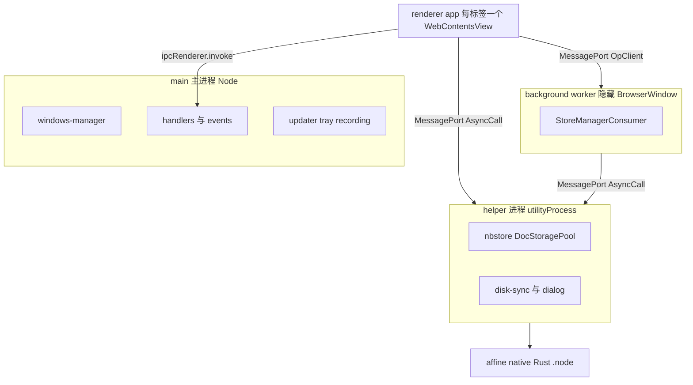
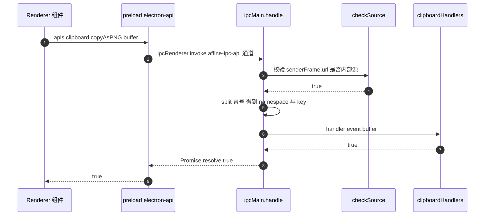
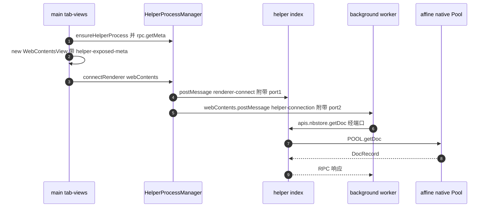
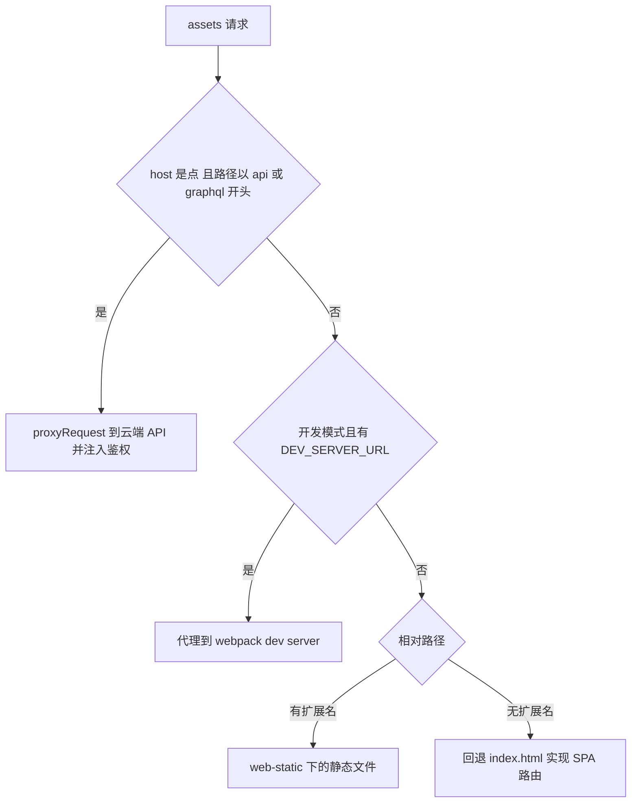
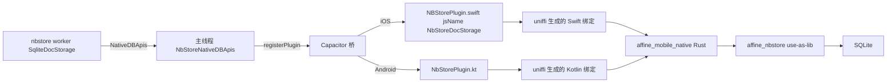

# 第 20 章 多端：Electron 与移动端

> 一个核、多个壳——同一份 @affine/core 跑在浏览器、桌面与移动原生

第 6 部分 · 前端应用 ｜ 难度 ★★★★☆ ｜ 建议学时 10 小时

===

## 本章要解决的问题

<p class="lead">AFFiNE 的口号是"Local-first，随处可用"。同一份 <code>@affine/core</code> 业务代码，要跑在浏览器、Electron 桌面端、iOS / Android 原生壳（基于 Capacitor 8）。</p>

这听起来像"把网页套个壳"，但真正难的是三件事：

<div class="cards cols-3">
  <div class="card"><div class="card__icon">⚙️</div><h4>能力差异</h4><p>桌面要读写 SQLite、录音、托盘、自动更新；移动要震动、虚拟键盘、原生 SQLite；浏览器只能用 IndexedDB。</p></div>
  <div class="card"><div class="card__icon">🛡️</div><h4>安全边界</h4><p>Electron 渲染进程本质是 Chromium 页面，一旦把 Node 能力随手暴露，任何 XSS 都会变成 RCE。</p></div>
  <div class="card"><div class="card__icon">🔗</div><h4>类型与工程</h4><p>IPC 两侧（主/渲染、JS/Swift/Kotlin/Rust）要保持类型一致，还要能打包、签名、发布。</p></div>
</div>

<div class="note note--tip">

读完本章，你应该能回答："我在桌面端点了一下'导出数据库'，这条调用究竟穿过了几个进程？"

</div>

===

## 知识地图：一个核、多个壳

"应用"目录 `packages/frontend/apps/*` 只是一层很薄的入口壳。多端差异有两条注入通道。


<div class="note">

**经验法则："有没有"用 BUILD_CONFIG，"怎么做"用 Provider**。例如"移动端不显示某个菜单"适合编译期常量；"震动反馈调用哪个 API"适合 Provider。`distribution`（`web`/`desktop`/`mobile`/`ios`/`android`/`admin`）由 `tools/utils/src/distribution.ts` 映射，再经 `build-config.ts` 算出 `isElectron`、`isMobileEdition` 等布尔常量通过 `define` 注入。

</div>

===

## 学习目标

<ol class="goals">
  <li>说出桌面端四类进程（main、helper、renderer、background worker）及其职责边界</li>
  <li>解释 <code>handlers.ts</code> / <code>exposed.ts</code> / <code>preload/electron-api.ts</code> 如何实现"声明一次、类型安全处处可调"</li>
  <li>画出 renderer → main 与 renderer → helper 两条 IPC 链路时序，指出 <code>checkSource</code> 的安全作用</li>
  <li>说明 <code>assets://</code> 自定义协议如何加载静态资源、代理 API 并注入鉴权头</li>
  <li>读懂 <code>forge.config.mjs</code> 中的 makers、Fuses、签名公证</li>
  <li>描述 Capacitor 插件从 TS <code>registerPlugin</code> 到 Swift/Kotlin 实现的完整链路，以及 <code>framework.impl</code> 注入模式</li>
</ol>

===

<!-- section -->
## 一、Electron 进程模型

Electron 天生多进程。AFFiNE 在主进程 + 渲染进程之外，又加了 helper 进程与 background worker。

===

## 四类进程与职责

主进程负责所有窗口的事件循环，一旦被同步磁盘 IO 或 CRDT 合并阻塞，整个应用都会卡顿。所以把 SQLite 放进独立的 helper 进程。



<div class="note">

utilityProcess 是 Electron 官方的"Node 子进程 + MessagePort"方案，崩溃也不拖垮主进程——`helper-process.ts` 监听 `exit` 事件并把单例置空，下次 `ensureHelperProcess()` 重新拉起。`app` view 用 `WebContentsView` 多标签，切换标签只是改可见性，不重新加载页面，这就是桌面端标签"秒开"的原因。background worker 是一个**隐藏 BrowserWindow**，扮演浏览器端的 SharedWorker。

</div>

===

## 主进程启动流程

主进程入口分"ready 之前"和"ready 之后"两段。ready 之后的 Promise 链**严格有序**：先协议、再 IPC、再事件、最后建窗口。

<div class="annotate">

```ts [1|4-5|9-15]
app.enableSandbox();
ensureSecureLinuxPasswordStore();
const isSingleInstance = app.requestSingleInstanceLock();
if (!isSingleInstance) { app.quit(); process.exit(0); }
setupDeepLink(app);
registerSecurityRestrictions();
app.whenReady()
  .then(registerProtocol)
  .then(registerHandlers)
  .then(registerEvents)
  .then(launch)
  .then(createApplicationMenu)
  .then(registerUpdater)
  .then(setupRecordingFeature)
  .then(setupTrayState);
```

<ol class="annotate__notes">
  <li><b>第 1 行</b>：全局强制所有渲染进程开启 Chromium 沙箱，比单窗口 <code>sandbox: true</code> 更强。</li>
  <li><b>第 4–5 行</b>：单实例锁。第二个实例启动时把命令行转发给第一个的 <code>second-instance</code> 事件再退出。</li>
  <li><b>第 9–15 行</b>：必须先有协议（否则窗口加载 <code>assets://</code> 失败），最后才 <code>launch()</code> 建窗口。</li>
</ol>
</div>

<div class="note">

`src/main` 下目录基本"一个能力一个目录"，大多导出 `xxxHandlers`（供渲染进程调用）和/或 `xxxEvents`（向渲染进程推送）。多标签逻辑全部在 `windows-manager/tab-views.ts`（约 1300 行），仓库里**没有**独立的 `tabs` 目录。

</div>

===

<!-- section -->
## 二、IPC 暴露机制：声明一次，处处可调

目标：在主进程写一个普通 async 函数，渲染进程就能以 `apis.namespace.method(...)` 调用，且有完整 TS 类型。

===

## 五步链路：从声明到类型

preload 运行在沙箱里，无法 import 主进程代码。AFFiNE 的做法是传"元数据"而非"函数"。

<ol class="steps">
  <li><h4>声明 handler 字典</h4><p>主进程 <code>handlers.ts</code> 的 <code>allHandlers</code> 汇总所有命名空间；每个 handler 第一个参数永远是 <code>IpcMainInvokeEvent</code>，用 <code>satisfies NamespaceHandlers</code> 约束。</p></li>
  <li><h4>单通道路由 + 来源校验</h4><p>所有调用走同一 channel <code>affine-ipc-api</code>，第一个参数是 <code>"namespace:key"</code>；只需在一处做 <code>checkSource</code>。</p></li>
  <li><h4>传元数据给 preload</h4><p><code>getExposedMeta</code> 把字典压成"命名空间 → 方法名列表"，通过 <code>additionalArguments</code> 命令行参数传给 preload；helper 元数据经 <code>rpc.getMeta()</code> 异步拉取。</p></li>
  <li><h4>preload 生成代理并 expose</h4><p>preload 按元数据动态生成调用 <code>ipcRenderer.invoke</code> 的代理函数，仅在 <code>isInternalUrl</code> 为真时 <code>exposeInMainWorld('__apis', ...)</code>。</p></li>
  <li><h4>类型桥 @affine/electron-api</h4><p>用 <code>import type</code> 引用主/helper 的 <code>exposed</code>，映射类型去掉首参并统一包装 Promise。</p></li>
</ol>

===

## 单通道路由与来源校验

单通道的好处：只需在一个地方做 `checkSource`，不会因新增 handler 忘记校验。

<div class="annotate">

```ts [3-6|7-8|10]
const handleIpcMessage = async (e, ...args) => {
  if (!checkSource(e) || typeof args[0] !== 'string') {
    logger.error('invalid ipc message', args);
    return;
  }
  const [namespace, key] = (args[0] as string).split(':');
  const handler = allHandlers[namespace]?.[key];
  const result = await handler(e, ...realArgs);
  return result;
};
ipcMain.handle(AFFINE_API_CHANNEL_NAME, handleIpcMessage);
```

<ol class="annotate__notes">
  <li><b>第 3–6 行</b>：<code>checkSource</code> 取 <code>e.senderFrame.url</code> 校验只有内部源 frame 能调用 IPC。</li>
  <li><b>第 7–8 行</b>：按 <code>namespace:key</code> 拆分查表调用。</li>
  <li><b>第 10 行</b>：统一注册、统一打印耗时日志。</li>
</ol>
</div>

<div class="note">

类型桥 `@affine/electron-api` 全部是 `import type`，打包渲染层时不会把任何主进程代码打进来。映射类型做两件事：**去掉第一个参数**（Electron 注入）、**统一包装成 Promise**。core 中任何模块想调桌面能力，都应依赖 `DesktopApiService` 而不是直接 import `apis`——前者在非 Electron 环境根本不会注册，从依赖图上约束"桌面专属"。

</div>

===

## IPC 时序一：renderer → main

以"复制图片为 PNG"为例。这条链路绕道主进程，适合轻量、需要主进程能力的调用。



===

## IPC 时序二：renderer → helper

以 nbstore 读文档为例。**关键洞察：renderer 与 helper 之间的数据不经过主进程**——主进程只负责"牵线"。



<div class="note note--tip">

主进程创建一对 `MessageChannelMain` 端口分别递给两边，之后大块的 Yjs update、Blob 二进制直接在两端之间传输。这比 `ipcRenderer.invoke` 绕道主进程少一次序列化与一次事件循环排队。反方向，helper 需要弹系统对话框（`dialog.showSaveDialog` 只能在主进程）时，走 `main-rpc.ts` 的 `mainRPC`。

</div>

===

<!-- section -->
## 三、assets 协议与安全限制

渲染进程加载的不是 `file://` 也不是 `http://localhost`，而是自定义的 `assets://` 协议。

===

## assets:// 的三种分流

`protocol.ts` 的 `handleFileRequest` 对一个 `assets://` 请求做分流：代理 API、代理 dev server、读静态文件或回退 SPA。



<div class="note note--warn">

`registerProtocol` 挂了两个 `webRequest` 钩子：`onHeadersReceived` 对 `assets:` 响应强制 `X-Frame-Options: SAMEORIGIN`；`onBeforeSendHeaders` 对受管鉴权端点**删掉渲染层带来的 `Authorization`**，改由主进程 `getAccessTokenForUrl` 注入 `Bearer` token——**token 永远不进渲染进程**。`another-host` 的存在是为绕开 Chromium "同源共享缩放级别"的问题。

</div>

===

## 导航拦截与窗口默认值

`security-restrictions.ts` 确保**应用内永远不会被导航到外部网页，也永远不会创建新窗口**；外链一律交给系统浏览器。

<div class="split">
<div class="split__main">

```ts
contents.on('will-navigate', (event, url) => {
  if (isInternalUrl(url)) return;
  event.preventDefault();
  openExternalSafely(url);
});
contents.setWindowOpenHandler(({ url }) => {
  if (!isInternalUrl(url)) openExternalSafely(url);
  return { action: 'deny' };
});
```

`openExternalSafely` 只放行 `http:`、`https:`、`mailto:`，防止 `file://`、`smb://` 之类协议被滥用。

</div>
<div class="split__aside">

```ts
// web-preferences.ts
const DEFAULT_WEB_PREFERENCES = {
  sandbox: true,
  contextIsolation: true,
  nodeIntegration: false,
};
// main-window / tab-views / popup
// 全部经 buildWebPreferences(...)
// 创建窗口，避免某个新窗口
// 忘了开启隔离
```

</div>
</div>

<div class="note">

`checkSource` 是 IPC 层的守门人：取 `e.senderFrame.url`（子 frame 场景不信任 `sender.getURL()`），确保只有内部源的 frame 能调用 IPC。**两层防护**：preload 只在内部源才 `exposeInMainWorld`；即使被绕过，`checkSource` 还会再校验一次。

</div>

===

<!-- section -->
## 四、渲染层注入与打包签名

渲染层四个入口，`app/effects/modules.ts` 是理解"桌面端额外注入了什么"的最佳入口。

===

## 渲染层四入口与模块注入

`electron-renderer/src` 有四个入口：`app`（完整 core）、`shell`（标签栏）、`popup`（录音弹窗）、`background-worker`（nbstore 消费者）。

<div class="annotate">

```ts [3-5|6-9|11-13]
export function setupModules() {
  const framework = new Framework();
  configureCommonModules(framework);
  configureElectronStateStorageImpls(framework);
  configureBrowserWorkspaceFlavours(framework);
  configureDesktopWorkbenchModule(framework);
  configureAppTabsHeaderModule(framework);
  configureDesktopApiModule(framework);
  configureDesktopBackupModule(framework);
  framework.impl(PopupWindowProvider, p => {
    const apis = p.get(DesktopApiService).api;
    return { open: url => apis.handler.ui.openExternal(url) };
  });
}
```

<ol class="annotate__notes">
  <li><b>第 3–5 行</b>：先装公共模块与平台状态存储。</li>
  <li><b>第 6–9 行</b>：桌面专属——多标签工作台、标签头、桌面 API、备份。</li>
  <li><b>第 11–13 行</b>：<code>framework.impl</code> 把具体能力插进 Provider 接口。</li>
</ol>
</div>

<div class="note">

`configureDesktopApiModule` 把 `window.__apis` 包装成 `ElectronApiImpl`（`DesktopApiProvider`），构造时校验 `apis`/`events`/`appInfo` 存在。background worker 在隐藏窗口中 `bindNativeDBApis(apis.nbstore)` 把 helper API 绑定为 SQLite 存储实现。完整存储路径：**app 标签页 → background worker → helper → `@affine/native` DocStoragePool → SQLite 文件**。

</div>

===

## Fuses：编译期锁死危险能力

Fuse 是写进 Electron 二进制的开关，运行期无法修改——这是桌面端安全的最后一道防线。

<div class="annotate">

```js [2|4|6-7]
new FusesPlugin({
  [FuseV1Options.RunAsNode]: false,
  [FuseV1Options.EnableCookieEncryption]: true,
  [FuseV1Options.EnableNodeOptionsEnvironmentVariable]: false,
  [FuseV1Options.EnableNodeCliInspectArguments]: false,
  [FuseV1Options.EnableEmbeddedAsarIntegrityValidation]: true,
  [FuseV1Options.OnlyLoadAppFromAsar]: true,
})
```

<ol class="annotate__notes">
  <li><b>第 2 行</b>：禁止 <code>ELECTRON_RUN_AS_NODE</code> 把应用当 Node 解释器用（常见提权手段）。</li>
  <li><b>第 4 行</b>：禁止 <code>NODE_OPTIONS</code> 注入代码；配合下一行禁 <code>--inspect</code>。</li>
  <li><b>第 6–7 行</b>：只加载经完整性校验的 asar，防止篡改。</li>
</ol>
</div>

<div class="note">

`plugin-auto-unpack-natives` 把 `.node` 原生模块解包到 `app.asar.unpacked`（无法从 asar 内 `dlopen`）。签名：macOS 用 `osxSign` + `notarytool` 公证；Windows 不在 CI 放私钥，而是下载签名客户端连远程签名服务。makers 产出 `.dmg`/`.zip`/Squirrel/AppImage/`.deb`/Flatpak。`build-layers.ts` 有约束检查：**所有 `workspace:*` 依赖必须放 devDependencies 并被打包**。

</div>

===

<!-- section -->
## 五、原生模块与移动端

同一份 Rust SQLite 存储实现，桌面走 NAPI、移动走 uniffi。

===

## @affine/native：use-as-lib 双形态

`@affine/native` 是 NAPI-RS 聚合 crate。`affine_nbstore` 的 `use-as-lib` feature 是巧妙设计：默认编译 NAPI 绑定，开启后去掉 NAPI 宏仅作普通 Rust 库。

<div class="annotate">

```rust [1-2|4-6]
#[cfg(not(feature = "use-as-lib"))]
#[napi]
pub struct DocStoragePool { pool: SqliteDocStoragePool }

#[cfg(not(feature = "use-as-lib"))]
#[napi]
impl DocStoragePool {
  #[napi]
  pub async fn connect(&self, universal_id: String, path: String)
    -> Result<()> { self.pool.connect(universal_id, path).await?; Ok(()) }
}
```

<ol class="annotate__notes">
  <li><b>第 1–2 行</b>：默认（桌面）编译出 NAPI 绑定给 Electron。</li>
  <li><b>第 4–6 行</b>：开启 <code>use-as-lib</code> 时去掉这些宏，仅作为普通 Rust 库被移动端的 uniffi crate 依赖。<b>同一份 SQLite 存储实现，桌面走 NAPI、移动走 uniffi</b>。</li>
</ol>
</div>

<div class="note">

`@affine/native` 还含 `affine_media_capture`（系统音频捕获：macOS 用 ScreenCaptureKit，Windows 用 WASAPI，编码为 Ogg/Opus）、`hashcash`（工作量证明）、`preview`（Mermaid/Typst 渲染，移动端不编译）。

</div>

===

## Capacitor 插件全链路：以 NbStore 为例

Capacitor 插件把 TS 调用桥接到 Swift/Kotlin，再经 uniffi 调到同一份 Rust 存储。



<div class="note">

TS 侧 `export const NbStore = registerPlugin<NbStorePlugin>('NbStoreDocStorage')`；Swift 侧插件类的 `jsName` 必须与之**一致**。插件在 `AffineViewController.capacitorDidLoad` 中手动注册。`affine_mobile_native` 用 `uniffi::setup_scaffolding!`，`codegen.ts` 先 `cargo build --features use-as-lib`，再 `uniffi-bindgen generate --language swift` 生成已提交到仓库的 Swift/Kotlin 绑定。

</div>

===

## Worker 与原生插件的"中转"

Capacitor 插件只能在主线程调用，而 nbstore 跑在 Web Worker 里。iOS 用一对 `MessageChannel` 把插件 API "借"给 worker。

<div class="annotate">

```ts [3-4|6|13-16]
function createStoreManagerClient() {
  const worker = new Worker(getWorkerUrl('nbstore'));
  const { port1: server, port2: client } = new MessageChannel();
  AsyncCall<typeof NbStoreNativeDBApis>(NbStoreNativeDBApis, {
    channel: {
      on(listener) { /* server.addEventListener('message', ...) */ },
      send(data) { server.postMessage(data); },
    },
    log: false,
  });
  server.start();
  worker.postMessage(
    { type: 'native-db-api-channel', port: client }, [client]);
  return new StoreManagerClient(new OpClient(worker));
}
```

<ol class="annotate__notes">
  <li><b>第 3–4 行</b>：主线程创建 MessageChannel，在 port1 上用 <code>AsyncCall</code> 暴露 <code>NbStoreNativeDBApis</code>。</li>
  <li><b>第 6 行</b>：把插件调用桥接到端口。</li>
  <li><b>第 13–16 行</b>：port2 发给 worker，worker 中再 <code>bindNativeDBApis</code> 到这个远程代理。</li>
</ol>
</div>

<div class="note note--tip">

对比：Electron 中 nbstore worker 通过 preload 直接拿到 helper 的 `apis.nbstore`；iOS 中 worker 通过 MessagePort 回调主线程的 Capacitor 插件。**两者最终都调用 `bindNativeDBApis(...)` 喂给同一个 `sqliteStorages`**——这就是第 19 章抽象接口的价值。

</div>

===

## core 中的多端差异注入模式

把前面的零散例子归纳成模式：core 只定义"接口 + 默认/可选实现"，各 app 入口像"装配车间"按平台把实现插进去。

<div class="annotate">

```ts [2-3|5]
export function configureMobileHapticsModule(framework: Framework) {
  framework.service(HapticsService,
    f => new HapticsService(f.getOptional(HapticProvider)));
}
// iOS app.tsx 中：framework.impl(HapticProvider, { impact, ... })
```

<ol class="annotate__notes">
  <li><b>第 2–3 行</b>：<code>getOptional</code>——移动 Web 不提供 <code>HapticProvider</code>，服务照样创建，调用变成空操作。</li>
  <li><b>第 5 行</b>：iOS 在入口 <code>framework.impl</code> 接上 <code>@capacitor/haptics</code>。</li>
</ol>
</div>

<div class="note note--tip">

**三步标准做法**：① 在 core 用 `createIdentifier` 定义 Provider 接口；② 服务用 `getOptional` 或构造参数依赖它；③ 在各入口 `framework.impl(Provider, 实现)`。各入口注入清单差异：状态存储（local vs Electron）、工作台（Browser vs Desktop 多标签）、`NbstoreProvider`（SharedWorker vs background worker vs Worker+插件中转）、`AuthProvider`（默认 vs `override` 调原生）。

</div>

===

## 动手实践

<ol class="steps">
  <li><h4>数 IPC 方法</h4><p>列出 <code>handlers.ts</code> 的 <code>allHandlers</code> 与 <code>helper/exposed.ts</code> 的命名空间，在 core 中搜 <code>handler.clipboard</code>、<code>handler.nbstore</code> 找调用点。<b>验收</b>：画表——命名空间 / 所属进程 / 调用点路径。</p></li>
  <li><h4>跟踪 helper 调用</h4><p>读 <code>tab-views.ts</code> 的 <code>did-finish-load</code>、<code>helper-process.ts</code> 的 <code>connectRenderer</code>、<code>helper/index.ts</code> 的 <code>setupRendererConnection</code>。<b>验收</b>：能解释"为什么页面刷新后 helper 调用仍可用"。</p></li>
  <li><h4>新增 main handler</h4><p>新建 <code>systemInfoHandlers = { platform: async () => process.platform }</code>，加入 <code>allHandlers</code>，不改 preload 重启，在 DevTools 执行 <code>window.__apis.systemInfo.platform()</code>。<b>验收</b>：无需改 preload 即可调用，TS 推断出 <code>Promise&lt;NodeJS.Platform&gt;</code>。</p></li>
  <li><h4>对比三端 nbstore</h4><p>对比 <code>getBlob</code> 在 Electron helper、iOS、Android 的实现差异，读 <code>mobile-shared/src/nbstore/payload.ts</code>。<b>验收</b>：写 200 字说明"为什么 Electron 可直接传 Uint8Array，而 Capacitor 插件需 base64 或文件路径"。</p></li>
</ol>

===

## 自测：点击揭晓答案

<details class="quiz">
<summary>Q1. 为什么把 SQLite 读写放在 helper 进程而不是主进程？</summary>

主进程负责所有窗口的事件循环，磁盘 IO 与 CRDT 合并会阻塞 UI；utilityProcess 崩溃不影响主进程，`helper-process.ts` 监听 `exit` 后重置单例以便重新拉起。

</details>

<details class="quiz">
<summary>Q2. --main-exposed-meta 传的是什么？为什么不直接把函数传给 preload？</summary>

传的是 `[namespace, methodNames[]][]` 形式的 JSON 元数据。preload 运行在沙箱中不能 import 主进程模块，函数也无法跨进程序列化，所以只传"名字"，由 preload 生成调用 `ipcRenderer.invoke` 的代理函数。

</details>

<details class="quiz">
<summary>Q3. renderer 与 helper 之间的数据是否经过主进程？</summary>

不经过。主进程用 `MessageChannelMain` 创建一对端口，一个经 `utilityProcess.postMessage` 给 helper（`renderer-connect`），一个经 `webContents.postMessage` 给 preload（`helper-connection`），之后两端直接通信。

</details>

<details class="quiz">
<summary>Q4. affine_nbstore 的 use-as-lib feature 解决了什么？</summary>

同一份 Rust 存储实现既要导出 NAPI 绑定给 Electron，又要作为普通库被移动端 uniffi crate 依赖；`use-as-lib` 关闭 NAPI 宏，避免移动端编译 NAPI 相关代码。

</details>

===

## 小结与下一步

<ul class="takeaways">
  <li>桌面端四类进程：main（窗口/协议/IPC）、helper（SQLite/磁盘同步）、renderer（每标签一个 WebContentsView）、background worker（隐藏窗口当 SharedWorker）。</li>
  <li>IPC "声明一次、处处可调"：单通道路由 + <code>checkSource</code> + 元数据驱动 preload + 映射类型桥。</li>
  <li>renderer ↔ helper 数据不经主进程，靠 <code>MessageChannelMain</code> 直连。</li>
  <li><code>assets://</code> 协议分流静态资源/API 代理，token 永不进渲染进程；Fuses 编译期锁死危险能力。</li>
  <li>同一份 Rust 存储（<code>use-as-lib</code>）桌面走 NAPI、移动走 uniffi；core 用"接口 + getOptional + impl"三步注入多端差异。</li>
</ul>

<div class="note note--tip">

**下一章预告**：第 21 章走到网线另一端——后端 `packages/backend/server` 基于 NestJS 11，看一个进程如何"按角色（Flavor）拼装"模块，以及 `base` 基础设施层的配置、错误、事件、Redis 四件套。

</div>
