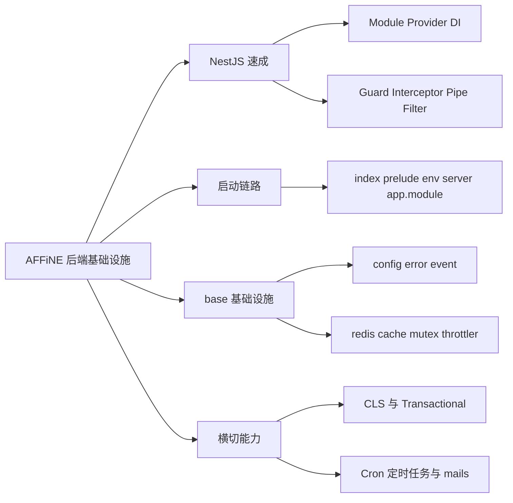
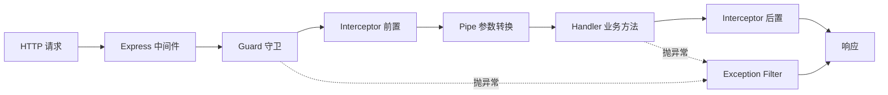
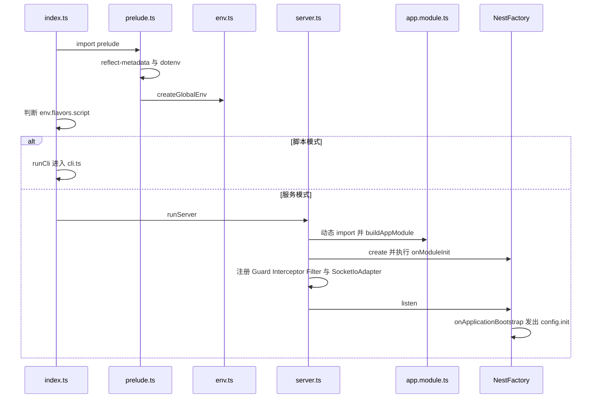
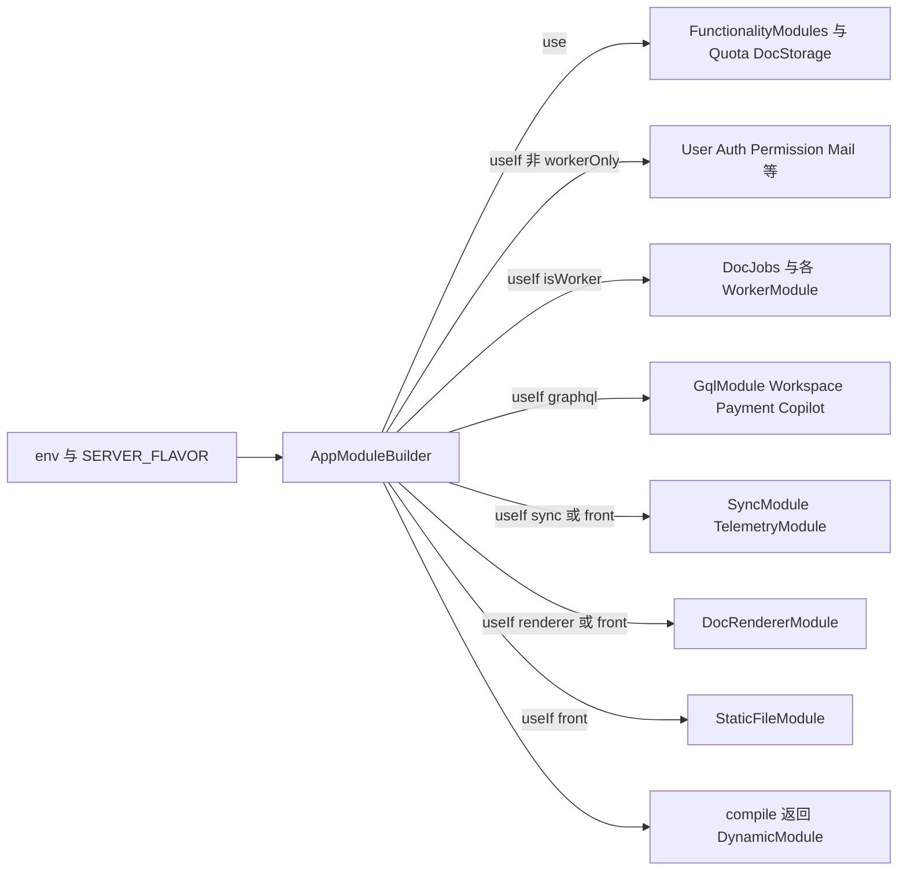
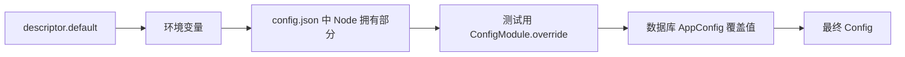
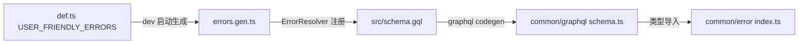

# 第 21 章 后端架构与基础设施层

NestJS 进程如何按 Flavor 拼装，以及 `src/base` 基础设施全景

第 7 部分 · 后端服务 ｜ 难度 ★★★★☆ ｜ 建议学时 10 小时

Note:
欢迎来到后端部分的第一章。我们从 `packages/backend/server` 出发，先补 NestJS 的核心概念，再顺着启动链路看一个进程如何按角色拼装，最后逐个拆解 base 基础设施层。

---

## 为什么学这一章

- 后端仓库：`packages/backend/server`，云端与自托管共用
- 一个进程服务海量用户：请求上下文、并发、分布式锁
- 数据写错就是事故：事务、迁移、幂等
- 依赖靠 **DI 容器**组装，而不是 props 层层传递
- 框架基于 **NestJS 11**，主线 `index.ts` → `app.module.ts`

<div class="callout warn">

0.27.x 中权限、配额、会话、存储等已下沉到 Rust `@affine/server-native`，TS 常只是"薄壳"

</div>

Note:
对前端同学来说，后端的门槛不在语法，同样是 TypeScript，而在思维方式。一个进程要同时服务很多用户，所以需要请求上下文和分布式锁；数据写坏了不能刷新了事，所以需要事务和迁移。另外要记住版本特征：很多领域逻辑已经在 Rust 原生模块里，读源码时别惊讶 TS 只是转发。

---

## 学习目标

- 说清 NestJS 核心概念，并各找到一个 AFFiNE 例子
- 画出 `index.ts` 到 `app.listen()` 的启动时序
- 区分 `Flavor` 与 `ServerRole`，推导 `buildAppModule`
- 讲清 `defineModuleConfig` → `ConfigFactory` 配置链路
- 区分 `emit`、`emitAsync`、`emitDetached`、`broadcast`
- 正确使用 `@Transactional()`、`@Cron()` 与数据迁移命令

Note:
这六个目标对应本章的六块内容。学完后你应该能自己推导"某个 Flavor 的进程里到底装了哪些模块"，也能在业务代码里正确地加事务、发事件和写定时任务。

---

## 知识地图



Note:
全章分四大块：NestJS 速成、启动链路、base 层逐个拆解、横切能力。左边是概念，右边是落到 AFFiNE 源码的具体模块，后面每一页都会挂一段真实代码。

---

## 一个请求经历了什么



全局守卫顺序：`AuthGuard` → `CloudThrottlerGuard`，均在 `server.ts` 注册

<p class="small">本章路径均相对 <code>packages/backend/server/</code></p>

Note:
NestJS 在 Express 之上加了更细的切面，这就是请求生命周期。中间件之后依次是守卫、拦截器、管道、业务方法，任何一步抛异常都会走到异常过滤器。AFFiNE 的中间件包括 CLS、`serverTimingAndCache`、上传和 cookie 解析。

---

## Module、Provider 与依赖注入

```ts
// src/core/backend-runtime/index.ts
@Global()
@Module({
  providers: [
    BackendRuntimeProvider,
    BackendRuntimeEmbeddingService,
    { provide: CRYPTO_KEY_SOURCE, useExisting: BackendRuntimeProvider },
  ],
  // ...
})
export class BackendRuntimeModule {}
```

- `@Global()` 模块的 Provider 全局可注入，`base` 层几乎全是全局模块
- `useExisting` 让 `CryptoHelper` 只依赖 Symbol 令牌，`base` 不反向依赖 `core`
- 构造函数声明类型即注入（靠 `reflect-metadata`）；循环依赖用 `ModuleRef` 懒加载

Note:
模块用 `@Module` 声明 imports、providers、controllers 和 exports。这里的 `useExisting` 是个分层技巧：有人要 `CRYPTO_KEY_SOURCE` 时，直接给已有的运行时实例。依赖注入类比前端的 Context，但它在启动期一次性装配、默认单例；`AuthGuard` 就在 `onModuleInit` 里用 `ModuleRef` 懒取服务来绕开循环依赖。

---

## 三种入口与 AuthGuard

```ts
async canActivate(context: ExecutionContext) {
  const { req, res } = getRequestResponseFromContext(context);
  const clazz = context.getClass();
  const handler = context.getHandler();
  // api is public
  const isPublic = this.reflector.getAllAndOverride<boolean>(
    PUBLIC_ENTRYPOINT_SYMBOL,
    [clazz, handler]
  );
  const authedUser = await this.signIn(req, res, isPublic);
  if (isPublic) {
    return true;
  }
  // ... 未登录抛 AuthenticationRequired
```

入口：`@Controller` 管 REST、`@Resolver` 管 GraphQL、`@WebSocketGateway` 管实时

`@Public()` 即 `SetMetadata(PUBLIC_ENTRYPOINT_SYMBOL, true)`：装饰器贴标签，Guard 读标签

Note:
AFFiNE 有三种入口：REST 控制器、code-first 的 GraphQL Resolver、socket.io Gateway。`AuthGuard` 来自 `src/core/auth/guard.ts`，它通过 `Reflector` 读取 `@Public` 元数据。注意即使是公开接口也会尝试 `signIn`，所以公开接口里仍能拿到"可能存在"的用户。同一个 Guard 通过 `getRequestResponseFromHost` 抹平 HTTP、GraphQL、WS 三种上下文差异。

---

## 切面在 AFFiNE 中的实现

| 切面 | AFFiNE 实现 | 作用 |
| --- | --- | --- |
| Guard | `AuthGuard`、`CloudThrottlerGuard`、`@Admin()` | 认证、限流、管理员 |
| Interceptor | `CacheInterceptor` | 读 `@MakeCache`，命中直接返回 |
| Pipe | `PaginationInput.decode` | 解码游标，`first` 夹在 1–100 |
| Filter | `GlobalExceptionFilter` | `mapAnyError` 统一错误出口 |
| 生命周期 | `onModuleInit`、`onApplicationBootstrap` | 绑定事件、发出 `config.init` |

<p class="small">Filter 位于 <code>src/base/nestjs/exception.ts</code>；Pipe 位于 <code>src/base/graphql/pagination.ts</code></p>

Note:
拦截器环绕 handler，`next.handle()` 返回的是 RxJS Observable，前端学过的 RxJS 在这里同样适用。管道体现"不信任客户端输入"，把 `first` 夹在 1 到 100 之间。异常过滤器把各种异常映射成 `UserFriendlyError`，未知异常一律变成 `InternalServerError`，绝不泄露内部信息。

---

## 启动链路时序



Note:
`prelude.ts` 最先执行：加载 `reflect-metadata`、两份 `.env`、私钥，然后创建全局 `env`。`server.ts` 动态 import `app.module`，是因为后者顶层就调用 `buildAppModule(env)`，必须等 `env` 就绪。另外 `bufferLogs` 会先缓存早期日志，Worker 角色不装 `AuthGuard`，默认端口是 3010。

---

## Flavor 与 ServerRole

```ts
isFlavor(flavor: Flavor) {
  return this.FLAVOR === flavor || this.FLAVOR === Flavor.AllInOne;
}

get flavors() {
  return {
    graphql: this.isFlavor(Flavor.Graphql),
    sync: this.isFlavor(Flavor.Sync),
    renderer: this.isFlavor(Flavor.Renderer),
    front: this.FLAVOR === Flavor.Front,
    worker: this.isFlavor(Flavor.Worker),
    script: this.FLAVOR === Flavor.Script,
  };
}
```

`Flavor`（`SERVER_FLAVOR`）：`allinone` `graphql` `sync` `renderer` `front` `worker` `script`

`ServerRole`：`frontend` `api` `worker` `allinone`；`front`、`script` 是**精确匹配**

Note:
这段来自 `src/env.ts`。Flavor 决定"这个进程跑哪些功能"，ServerRole 是更粗的归类，`front`、`sync`、`renderer` 都归为 frontend。关键是 `isFlavor` 让 allinone 对任何 Flavor 都返回 true，但 `front` 和 `script` 是精确匹配，所以 allinone 不会装静态文件模块。

---

## 按 Flavor 装配模块



同一份代码多种部署：自托管跑一个 `allinone`，官方云拆成多个 Deployment

Note:
`buildAppModule` 在 `src/app.module.ts` 第 161 到 235 行，只用 `use`、`useIf`、`compile` 三个方法。`FunctionalityModules` 是所有进程的地基，连 CLI 的 `CliAppModule` 也复用它。Worker 是无头的，只跑定时任务与后台消费；`GCloudModule` 则只看 `DEPLOYMENT_PLATFORM=gcp`，与 Flavor 无关。

---

## CLI 与数据迁移

| 类型 | 改什么 | 工具 | 位置 |
| --- | --- | --- | --- |
| Schema 迁移 | 表结构 | Prisma Migrate | `migrations/` |
| 数据迁移 | 已有数据内容 | AFFiNE 自研 CLI | `src/data/migrations/` |

- `predeploy`：`prisma migrate deploy` → `cli run` → `validate-cutover`
- 命令跑在 `createApplicationContext(CliAppModule)`，无 HTTP 服务器
- `RunCommand` 先跑 Rust 运行时迁移，再按时间戳执行 TS 迁移
- 大表回填：**分批 + 每批一个事务**，避免长时间持锁

Note:
新手常把两类迁移混淆：Prisma 改表结构，CLI 改数据内容。开发时用 `yarn data-migration`，生产镜像用 `yarn cli`。`CutoverCommand` 还用 PostgreSQL advisory lock 保证多个 Pod 同时 predeploy 时只有一个真正执行。

---

## 配置：就近声明、强类型

```ts
defineModuleConfig('throttle', {
  enabled: {
    desc: 'Whether the throttler is enabled.',
    default: true,
  },
  'throttlers.default': {
    desc: 'The config for the default throttler.',
    default: { ttl: 60_000, limit: 120 },
  },
  'throttlers.strict': {
    desc: 'The config for the strict throttler.',
    default: { ttl: 60_000, limit: 20 },
  },
});
```

声明合并扩展全局 `AppConfigSchema`，`ConfigItem<T>` 推导出 `'throttlers.default'` 点路径键

Rust 拥有的配置用 `defineNativeModuleConfig`；注入的 `Config` 实为 `NodeConfig`

Note:
这段来自 `src/base/throttler/config.ts`。两个 TS 技巧：声明合并让各模块向全局接口追加字段，`ConfigItem` 标记叶子，于是第二个参数是强类型的。`NodeConfig` 在类型层面剔除了 auth、oauth、payment、redis 等 Rust 拥有的敏感配置，Node 根本读不到它们。

---

## 配置合并与在线修改



在线修改：写库 → 本地 `config.changed` → `broadcast('config.changed.broadcast')` 同步其他实例

`yarn genconfig` 生成 `.docker/selfhost/schema.json` 与管理后台表单元数据

Note:
越靠右优先级越高，校验失败会直接阻止启动。数据库覆盖值由 `ServerService.setup()` 应用，随后发出 `config.init`。全进程共享同一个可变 Config 对象，所以在线修改后立即可见；类型、默认值、校验、文档和表单全部源自同一处声明。

---

## 错误码：一处定义，前后端共享



`type` 映射状态码：`resource_not_found→404`、`no_permission→403`、`quota_exceeded→402`

业务中直接 `throw new DocNotFound({ spaceId: workspaceId, docId })`

Note:
所有业务错误集中在 `src/base/error/def.ts`，当前生成 158 个错误类。开发环境下 `ErrorModule.onModuleInit` 重写 `errors.gen.ts`，为每个错误生成类和参数类型。前端的 `ErrorData['DOC_NOT_FOUND']` 能精确推出 `spaceId` 和 `docId`，前后端错误类型完全打通。

---

## EventBus：四种发布语义

| 方法 | 范围 | 等待完成 | 继承事务 |
| --- | --- | --- | --- |
| `emit` | 本实例 | 否，错误被捕获 | 是 |
| `emitAsync` | 本实例 | 是 | 是 |
| `emitDetached` | 本实例 | 否（Async 版为是） | **否**，新 CLS 上下文 |
| `broadcast` | **集群所有实例** | 否 | 否 |

`EventBus` 本身是 `s2s` 命名空间 Gateway，借 Redis Adapter `serverSideEmit` 跨实例

Note:
事件名靠声明合并到全局 `Events` 接口，`@OnEvent` 只贴元数据，`EventBus.onModuleInit` 扫描所有 Provider 完成注册。`emitAsync` 用于必须等订阅者完成的场景，比如 `config.init`；`emitDetached` 用于事务内发事件但订阅者不该随主事务回滚。`broadcast` 复用已有的 Redis pub/sub，真实客户端连 `s2s` 会被立刻断开以防伪造。

---

## Redis 分库与分布式锁

<div class="cols">
<div>

| 类 | DB 偏移 · 用途 |
| --- | --- |
| `CacheRedis` | +0 · Cache、限流存储 |
| `SessionRedis` | +2 · SessionCache、锁 |
| `SocketIoRedis` | +3 · socket.io Adapter |

`Cache` 出错吞掉返回默认值

</div>
<div>

```lua
if redis.call("get", key) == owner then
  return 0
elseif redis.call("set", key, owner, "NX", "EX", 60) then
  return 1
else
  return 0
end
```

`SET NX EX 60` 防死锁；释放时比对 owner

</div>
</div>

Note:
`src/base/redis/instances.ts` 在同一个 Redis URL 上按偏移拆出三个逻辑库。缓存失败不应导致业务失败，所以 CacheProvider 吞掉错误，复合操作用 Lua 保证原子性。分布式锁来自 `src/base/mutex/locker.ts`，`Mutex.acquire()` 重试 5 次、间隔 100 毫秒，`Lock` 实现了 `AsyncDisposable`，可以配合 `await using` 自动释放。

---

## 限流：登录用户豁免

```ts
override async canActivate(context: ExecutionContext): Promise<boolean> {
  if (!this.config.throttle.enabled) {
    return true;
  }
  const { req } = this.getRequestResponse(context);
  const throttler = this.getSpecifiedThrottler(context);

  // if user is logged in, bypass non-protected handlers
  if (!throttler && req.session?.user) {
    return true;
  }
  return super.canActivate(context);
}
```

策略：`'default'` 60 秒 120 次、`'strict'` 60 秒 20 次、`'authenticated'`

Note:
这是 `src/base/throttler/index.ts` 的 `CloudThrottlerGuard`。存储用 Lua 在 Redis 里实现计数和封禁窗口，Redis 不可用时降级为进程内存。它解释了为什么全局守卫顺序是 `AuthGuard` 在前：先认证出 `req.session`，限流器才知道是不是登录用户。

---

## CLS 与 @Transactional()

```ts
// src/models/base.ts（节选）
export class BaseModel {
  @Inject(MODELS_SYMBOL)
  protected readonly models!: Models;

  @Inject(TransactionHost)
  private readonly txHost!: TransactionHost<TransactionalAdapterPrisma>;

  protected get db() {
    return this.txHost.tx;
  }
}
```

CLS 基于 `AsyncLocalStorage`：HTTP 走中间件写 `X-Request-Id`，WS 用 `ClsInterceptor`

方法加 `@Transactional()` 后，调用链上所有 Model 的 `this.db` 自动是同一事务

Note:
CLS 就是后端的隐式 Context，日志的 requestId、错误的 requestId、多域名下的 host 都从这里取。`this.db` 在事务内返回事务客户端，事务外返回普通 PrismaClient。比如 `WorkspaceMemberModel.setOwner` 加了事务，并用 `pg_advisory_xact_lock` 让同一工作区的 owner 变更串行化；全项目有 78 处 `@Transactional()`。

---

## 定时任务与邮件

| 文件 | Cron | 作用 |
| --- | --- | --- |
| `src/core/doc-jobs/job.ts` | `EVERY_30_SECONDS` | 合并文档更新、同步 embedding |
| `src/core/mail/job.ts` | `EVERY_MINUTE` | 认领待发邮件并发送 |
| `src/core/auth/job.ts` | `EVERY_DAY_AT_MIDNIGHT` | 清理过期会话 |
| `src/plugins/copilot/cron.ts` | 每分钟、每天零点等 | Copilot 后台任务 |

- Job 类只注册在 `*WorkerModule`，仅 `env.isWorker` 时装载
- 邮件模板是 React 组件（`@react-email/*`），`src/mails/render.ts` 渲染

Note:
官方云只有 Worker Pod 跑定时任务，allinone 两者兼得，这样避免多个 API Pod 重复执行。`waitForCompletion` 防止上一轮没跑完下一轮又开始；`AuthCronJob` 还演示了"分批加上限"：每批 1000 条、最多 100 批。邮件实际发送由 `MailJob` 每分钟从投递表认领，下一章会展开这个发件箱模式。

---

## 源码导读 Top 5

| 优先级 | 路径 | 看什么 |
| --- | --- | --- |
| P0 | `src/index.ts` | 脚本模式与服务模式分流 |
| P0 | `src/env.ts` | `Flavor`、`ServerRole`、`isFlavor` |
| P0 | `src/server.ts` | 全局 Guard、Interceptor、Filter 注册顺序 |
| P0 | `src/app.module.ts` | `FunctionalityModules`、`buildAppModule` |
| P0 | `src/base/event/eventbus.ts` | 四种发布语义、`s2s` 广播 |

<p class="small">路径前缀：<code>packages/backend/server/</code>；进阶再读 <code>base/config/factory.ts</code>、<code>base/mutex/locker.ts</code></p>

Note:
建议按这个顺序读：先看入口分流，再看 env 的两组枚举，然后是 server 的注册顺序，最后看 app.module 的装配和事件总线。读完这五个文件，本章的骨架就清楚了。

---

## 动手实践

| 练习 | 验收要点 |
| --- | --- |
| 1 推导 Flavor 装配 | front 自托管是否有 GraphQL、是否跑 Cron，附行号 |
| 2 声明虚构模块配置 | 说清点路径键如何类型检查、env 在哪解析 |
| 3 追踪错误到前端 | 画出 `DocNotFound` 5 个文件的生成关系 |
| 4 设计事件订阅 | 说明何时用 `emitAsync`、何时用 `emitDetached` |
| 5 观察 requestId | 找到生成并写入 `X-Request-Id` 的回调 |

Note:
练习 1 最推荐，逐行推导 `useIf` 的结果。练习 5 可以直接 `curl -i http://localhost:3010/info`，对照日志里的 requestId 前缀。所有练习都是阅读或草稿，不需要提交代码。

---

## 自测

**Q1** `allinone` 下 `env.flavors.front` 的值？

`false`：`front` 精确匹配 `Flavor.Front` <!-- .element: class="fragment" -->

**Q2** 为何 `server.ts` 动态 import `app.module`？

其顶层调用 `buildAppModule(env)`，需先由 `prelude.ts` 创建 `env` <!-- .element: class="fragment" -->

**Q3** 未标 `@Throttle` 的查询，登录用户会被限流吗？

不会：`!throttler && req.session?.user` 直接放行 <!-- .element: class="fragment" -->

**Q4** 为何 `@Cron` 任务类只注册在 `*WorkerModule`？

避免多个 API/Sync Pod 重复执行、互相争抢 <!-- .element: class="fragment" -->

Note:
先让大家想一想再翻答案。第二题还有一层：脚本模式不必加载整个业务模块树。第四题对应的是"只有 Worker 或 allinone 跑定时任务"的部署约定。

---

## 常见坑

| 现象 | 解决 |
| --- | --- |
| `Nest can't resolve dependencies` | 检查 imports/exports、`@Global()`；循环依赖用 `ModuleRef` |
| `Invalid config for module [xxx]` | 按报错修正环境变量或 `config.json` |
| 新增 `@OnEvent` 不触发 | 确认是 Provider、当前 Flavor 已装载、非请求作用域 |
| 改了 `def.ts` 但未生成 | 仅 `NODE_ENV=development` 生成，勿手改 |
| `@Transactional()` 内未回滚 | 直接注入了 `PrismaClient`，Model 中一律用 `this.db` |

Note:
第一条是 NestJS 新手最常见的报错，括号里的问号位置就是缺失的依赖。最后一条很隐蔽：绕过 `TransactionHost` 的写入不在事务里，回滚不了。

---

## 小结与下一步

- 请求：中间件 → `AuthGuard` → 限流 → 缓存拦截 → 入口 → Model
- 进程：`buildAppModule` 按 `Flavor` 用 `useIf` 拼装模块
- 配置与错误：一处声明，生成类型、Schema 与前端类型
- 协作：`EventBus` 广播、`Mutex`、Redis 三个逻辑库
- 横切：CLS 传 requestId 与事务，Cron 只在 Worker 跑

<div class="callout">

下一章：**第 22 章 数据层：Prisma、PostgreSQL、Redis**——数据到底存在哪里

</div>

Note:
一句话总结：请求沿着切面链路走到 Model，进程按 Flavor 拼装，横向靠事件总线、锁和 Redis 支撑多实例协作，所有异常最终汇入 `mapAnyError`。下一章我们打开 `schema.prisma`，看这些 Model 背后的表结构。
