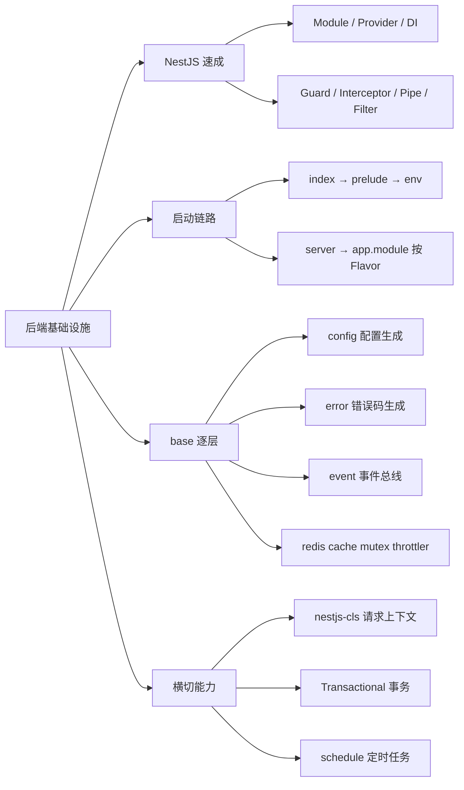
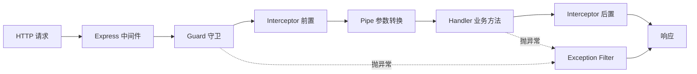
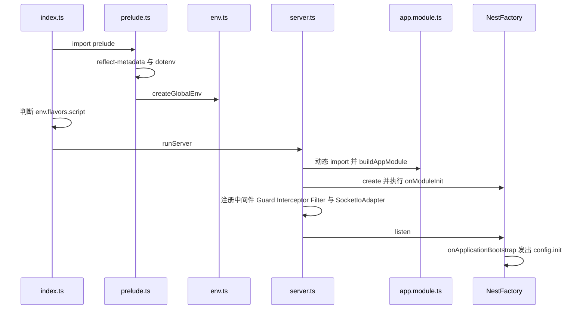
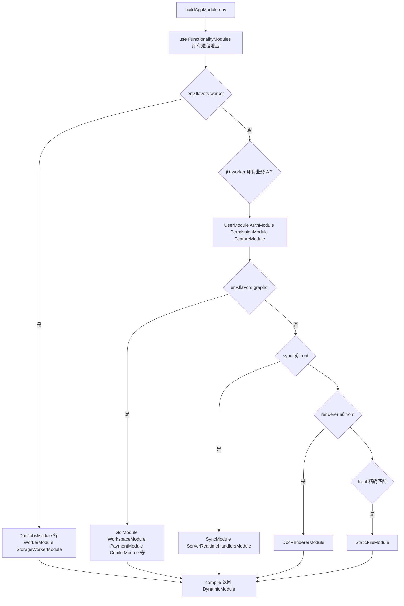
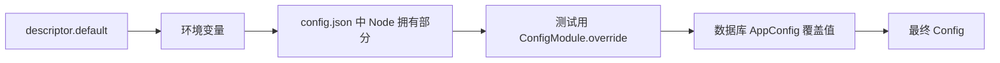
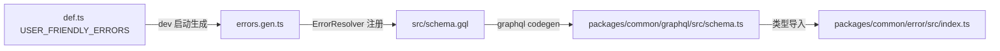

# 第 21 章 后端架构与基础设施层

> 一份代码、多种部署——NestJS 11 如何按角色（Flavor）拼装一个进程

第 7 部分 · 后端服务 ｜ 难度 ★★★★☆ ｜ 建议学时 10 小时

===

## 本章要解决的问题

<p class="lead">从这一章起走到网线另一端——<code>packages/backend/server</code>，AFFiNE Cloud 与自托管版本共用的 Node.js 服务端，基于 <b>NestJS 11</b>。</p>

对前端开发者来说，后端的门槛往往不在语法（同样是 TypeScript），而在**思维方式**的转变。

<div class="cards cols-3">
  <div class="card"><div class="card__icon">👥</div><h4>一进程服务万人</h4><p>前端"一用户一进程"，后端"一进程服务上万用户"，于是需要请求上下文、并发控制、分布式锁。</p></div>
  <div class="card"><div class="card__icon">💥</div><h4>数据写错即事故</h4><p>前端状态丢了刷新即可，后端数据写错就是事故，于是需要事务、迁移、幂等。</p></div>
  <div class="card"><div class="card__icon">🔌</div><h4>DI 容器组装</h4><p>前端组件靠 props 传依赖，后端服务靠<b>依赖注入容器</b>组装依赖。</p></div>
</div>

<div class="note note--warn">

**版本特征**：0.27.x canary 中，大量领域逻辑（权限、配额、认证、对象存储、配置持久化）已下沉到 Rust 原生模块 `@affine/server-native`，Node 侧通过 `BackendRuntimeProvider`、`StorageRuntimeProvider` 调用。读源码时常发现 TS 只是一层"薄壳"。

</div>

===

## 知识地图

本章先把 NestJS 核心概念挂接真实代码，再顺着启动链路理解"按 Flavor 拼装"，最后拆解 `base` 基础设施层与横切能力。



===

## 学习目标

<ol class="goals">
  <li>解释 NestJS 的 Module、Provider、Controller、Resolver、Gateway、Guard、Interceptor、Pipe、Filter 与 DI，并在源码中各找一例</li>
  <li>画出从 <code>src/index.ts</code> 到 <code>app.listen()</code> 的启动时序</li>
  <li>解释 <code>Flavor</code> 与 <code>ServerRole</code> 的区别，说出 <code>buildAppModule</code> 在不同 Flavor 下装配了哪些模块</li>
  <li>描述 <code>defineModuleConfig</code> → <code>ConfigFactory</code> 合并 → <code>genconfig</code> 生成 <code>schema.json</code> 的链路</li>
  <li>说明 <code>USER_FRIENDLY_ERRORS</code> → <code>errors.gen.ts</code> → GraphQL → 前端 <code>@affine/error</code> 的错误共享</li>
  <li>区分 <code>EventBus</code> 的 emit / emitAsync / emitDetached / broadcast，正确使用 <code>@Transactional()</code> 与 <code>@Cron()</code></li>
</ol>

===

<!-- section -->
## 一、NestJS 速成：概念对照真实代码

NestJS 在 Express 之上增加了更细的"切面"，称为请求生命周期。

===

## 一个请求经历了什么

浏览器发出 `POST /graphql` 后，依次经过守卫、拦截器、管道、业务方法，异常统一汇入过滤器。



| 环节 | AFFiNE 实现 | 注册位置 |
|---|---|---|
| 全局守卫 | `AuthGuard`（登录态）→ `CloudThrottlerGuard`（限流） | `server.ts` |
| 全局拦截器 | `CacheInterceptor` | `server.ts` |
| 管道 | `PaginationInput.decode` | `base/graphql/pagination.ts` |
| 异常过滤器 | `GlobalExceptionFilter` | `base/nestjs/exception.ts` |

<div class="note">

两个后端概念会反复出现：**多实例部署**——生产有很多 Pod，内存变量无法共享，需 Redis 做共享缓存、锁与消息转发；**事务**——多条 SQL 要么全成功要么全回滚，用 `@nestjs-cls/transactional` 让事务沿调用链隐式传播。

</div>

===

## Module、Provider 与依赖注入

模块用 `@Module()` 声明依赖关系。Provider 除了"类"，还可以是工厂、值或别名——`useExisting` 是保持分层纪律的利器。

<div class="annotate">

```ts [4-6|8]
@Global()
@Module({
  providers: [
    BackendRuntimeProvider,
    { provide: CRYPTO_KEY_SOURCE, useExisting: BackendRuntimeProvider },
  ],
})
export class BackendRuntimeModule {}
```

<ol class="annotate__notes">
  <li><b>第 4–6 行</b>：<code>useExisting</code> 表示"有人要 <code>CRYPTO_KEY_SOURCE</code> 时，给他已有的 <code>BackendRuntimeProvider</code> 实例"。</li>
  <li><b>第 8 行</b>：于是 <code>base/helpers/crypto.ts</code> 的 <code>CryptoHelper</code> 只依赖一个 Symbol 令牌，不必 import <code>core</code>——保持 <code>base</code> 不反向依赖 <code>core</code>。</li>
</ol>
</div>

<div class="note note--tip">

DI 规则：**构造函数参数声明类型，容器负责创建并传入实例**。Nest 依赖 `reflect-metadata` 读取参数类型，这就是 `prelude.ts` 第一行 `import 'reflect-metadata'` 的原因。它**启动期一次性装配**、默认**单例**。遇到循环依赖，AFFiNE 常在 `onModuleInit` 中用 `ModuleRef` 懒加载（如 `AuthGuard`）。

</div>

===

## 三种入口与四类切面

Controller（REST）、Resolver（GraphQL code-first）、Gateway（WebSocket）是三种入口；Guard/Interceptor/Pipe/Filter 是四类切面。

<div class="compare">
  <div class="compare__col"><h4>Guard：能否进门</h4>

- `SetMetadata` + `Reflector` 的"元数据通信"：装饰器贴标签，Guard 读标签
- `@Public()` 接口也会尝试 `signIn`，所以公开接口里仍可用 `@CurrentUser()`
- 同一 Guard 服务 HTTP/GraphQL/WebSocket，`getRequestResponseFromHost` 抹平差异

  </div>
  <div class="compare__col compare__col--good"><h4>Filter：统一错误出口</h4>

- `mapAnyError` 把 GraphQLError、`ThrottlerException`、`ZodError` 等统一映射为 `UserFriendlyError`
- 未知异常一律变 `InternalServerError`，原异常挂 `cause`
- **绝不把内部信息泄露给客户端**

  </div>
</div>

<div class="note">

**Interceptor** 环绕 handler 能替换返回值，`CacheInterceptor` 命中缓存直接返回（`next.handle()` 返回 RxJS `Observable`——第 6 章的 RxJS 在后端同样适用）。**Pipe** 在参数进入 handler 前转换校验，`PaginationInput.decode` 顺手把 `first` 夹在 `[1, 100]`——后端必须"不信任客户端输入"。

</div>

===

<!-- section -->
## 二、启动链路：按 Flavor 拼装

一个进程从 `src/index.ts` 到 `app.listen()`，核心是"这个进程跑哪些功能"由 Flavor 决定。

===

## 从 index.ts 到 listen

`index.ts` 先执行 `prelude`（加载 `reflect-metadata` 与 `dotenv`、创建全局 `env`），再按 `env.flavors.script` 分流到 CLI 或服务模式。



<div class="note">

`AppModule` **动态 import**，确保 `env` 已就绪（`app.module.ts` 顶层就调 `buildAppModule(env)`）；`bufferLogs` 先缓存早期日志待自定义 Logger 就绪再输出；Worker 角色不装 `AuthGuard`（它不加载 `AuthModule`）。`server.ts` 中 `if (env.prod) app.enableShutdownHooks()`——只有生产环境监听进程信号触发关闭钩子。

</div>

===

## Flavor 与 ServerRole

`env.ts` 挂上两组枚举。`Flavor` 决定"跑哪些功能"，`ServerRole` 是粗粒度归类。`isFlavor()` 让 `allinone` 对任何 Flavor 都返回 `true`。

<div class="annotate">

```ts [2|5-11]
isFlavor(flavor: Flavor) {
  return this.FLAVOR === flavor || this.FLAVOR === Flavor.AllInOne;
}
get flavors() {
  return {
    graphql: this.isFlavor(Flavor.Graphql),
    sync: this.isFlavor(Flavor.Sync),
    renderer: this.isFlavor(Flavor.Renderer),
    front: this.FLAVOR === Flavor.Front,
    worker: this.isFlavor(Flavor.Worker),
    script: this.FLAVOR === Flavor.Script,
  };
}
```

<ol class="annotate__notes">
  <li><b>第 2 行</b>：<code>allinone</code> 对任何 Flavor 判定都为真——自托管跑一个全能容器。</li>
  <li><b>第 5–11 行</b>：注意 <code>front</code> 与 <code>script</code> 是<b>精确匹配</b>，不被 <code>allinone</code> 覆盖。</li>
</ol>
</div>

<div class="note">

`Flavor` 共七种：`allinone`、`graphql`、`sync`、`renderer`、`front`、`worker`、`script`。`ServerRole`（`frontend`、`api`、`worker`、`allinone`）由 `role` getter 把 `front`/`sync`/`renderer` 归为 `frontend`、`graphql` 归为 `api`。`serverConfigHandle` 创建 Rust 的 `ServerConfigHandle`，据 `config.json` 决定 `DEPLOYMENT_TYPE` 是 `affine`（官方云）还是 `selfhosted`。

</div>

===

## 按 Flavor 装配模块（核心流程图）

`buildAppModule` 用 `AppModuleBuilder` 的 `use`/`useIf`/`compile` 三个方法，按环境变量在运行时拼装 `DynamicModule`。下图是装配决策流程。



===

## 装配表与设计意图

同一份代码，自托管跑一个 `allinone` 容器；官方云把 GraphQL、同步、渲染、Worker 拆成独立 Deployment 各自扩缩容。

| 模块组 | allinone | graphql | sync | front | worker |
|---|---|---|---|---|---|
| FunctionalityModules | ✓ | ✓ | ✓ | ✓ | ✓ |
| `DocJobsModule`、各 `*WorkerModule` | ✓ | | | | ✓ |
| `UserModule`、`AuthModule`、`PermissionModule` | ✓ | ✓ | ✓ | ✓ | |
| `GqlModule`、`WorkspaceModule`、`PaymentModule`、`CopilotModule` | ✓ | ✓ | | | |
| `SyncModule`、`TelemetryModule` | ✓ | | ✓ | ✓ | |
| `DocRendererModule` | ✓ | | | ✓ | |
| `StaticFileModule` | | | | ✓ | |

<div class="note note--tip">

**Worker 是"无头"的**：只跑 `@Cron` 任务与后台消费，不对外提供业务 API。**`AppController` 恒存在**，提供 `GET /info` 返回版本、部署类型与 Flavor，便于探活。`src/data/app.ts` 的 `CliAppModule` 也 `imports: [...FunctionalityModules]`——**CLI 拥有与服务进程一致的基础设施**，只是没有业务 API。

</div>

===

<!-- section -->
## 三、base/config：配置系统全链路

目标：每个模块就近声明配置、类型安全、可被环境变量覆盖、可在后台在线修改、自动生成文档与 JSON Schema。

===

## 声明：声明合并 + ConfigItem

各模块用 `declare global` 向全局 `AppConfigSchema` 追加字段，再用 `defineModuleConfig` 声明描述符。

<div class="annotate">

```ts [2-8|11-14]
declare global {
  interface AppConfigSchema {
    throttle: {
      enabled: boolean;
      throttlers: {
        [key in ThrottlerType]: ConfigItem<{ ttl: number; limit: number }>;
      };
    };
  }
}
defineModuleConfig('throttle', {
  enabled: { desc: '...', default: true },
  'throttlers.default': { desc: '...', default: { ttl: 60_000, limit: 120 } },
});
```

<ol class="annotate__notes">
  <li><b>第 2–8 行</b>：<b>声明合并</b>让各模块向全局 schema 追加字段。</li>
  <li><b>第 11–14 行</b>：<code>ConfigItem&lt;T&gt;</code> 标记叶子项，<code>AppConfigByPath</code> 据此算出点路径键（如 <code>'throttlers.default'</code>），于是第二个参数强类型。</li>
</ol>
</div>

<div class="note note--warn">

注入用的 `Config` 类型是 `NodeConfig`：从 `AppConfig` 中 `Omit` 掉 `auth`、`copilot`、`crypto`、`db`、`oauth`、`payment`、`redis`、`storages`——这些是 **Rust 拥有的配置**。**从类型层面阻止 Node 读取不归它管的敏感配置**。Rust 拥有的用 `defineNativeModuleConfig` 登记。

</div>

===

## 合并顺序与在线修改

配置值按优先级逐层覆盖，后者覆盖前者。管理员在线修改后还要跨实例同步。



<div class="note">

`getDefaultConfig` 遍历描述符读默认值与环境变量并校验，**校验失败直接抛错阻止启动**。`ConfigProvider` 用 `factory.config` 作为 `Config` 值，**全进程共享同一个可变对象**。在线修改链路：`ServerService` 写库 → 本地 `override()` 并 `emitAsync('config.changed')` → `broadcast('config.changed.broadcast')` → 其他实例重新读库。全项目 13 处 `@OnEvent('config.init')`、10 处 `@OnEvent('config.changed')`。

</div>

<div class="note note--tip">

`yarn genconfig` 先 `import '../src/app.module'` 触发所有 `defineModuleConfig` 副作用，再生成两份产物：`.docker/selfhost/schema.json`（自托管 JSON Schema）与 `packages/frontend/admin/src/config.json`（后台表单元数据）。**类型、默认值、校验、文档、表单全部源自同一处声明**。

</div>

===

<!-- section -->
## 四、base/error：一处定义，前后端共享

所有业务错误集中在 `src/base/error/def.ts`（当前生成 158 个错误类）。

===

## 错误码生成与共享链路

开发环境下 `ErrorModule.onModuleInit` 把 `def.ts` 生成为 `errors.gen.ts`，再经 GraphQL schema 一路传到前端。



<div class="annotate">

```ts [3-5|7-8]
export const USER_FRIENDLY_ERRORS = {
  doc_not_found: {
    type: 'resource_not_found',
    args: { spaceId: 'string', docId: 'string' },
    message: ({ spaceId, docId }) =>
      `Doc ${docId} under Space ${spaceId} not found.`,
  },
};
// 教学示例：throw new DocNotFound({ spaceId: workspaceId, docId });
```

<ol class="annotate__notes">
  <li><b>第 3–5 行</b>：<code>type</code> 经 <code>BaseTypeToHttpStatusMap</code> 映射状态码——<code>resource_not_found→404</code>、<code>no_permission→403</code>、<code>quota_exceeded→402</code>。</li>
  <li><b>第 7–8 行</b>：带参数的 message 是函数；生成时为每个错误生成类及参数 ObjectType。</li>
</ol>
</div>

<div class="note">

前端 `packages/common/error` 从 `@affine/graphql` 导入 `ErrorNames`、`ErrorDataUnion`，用 `ToPascalCase<K>` 把 `DOC_NOT_FOUND` 映射到 `DocNotFoundDataType`，`ErrorData['DOC_NOT_FOUND']` 能精确推出 `{ spaceId, docId }`。`UserFriendlyError.log()` 只记录少数事件，`toJSON()` 仅在 5xx 时附带 `requestId`。

</div>

===

<!-- section -->
## 五、base/event 与 Redis 四件套

事件总线让发布者只说"用户被删了"，订阅者各自响应；Redis 支撑多实例协作。

===

## EventBus 的四种发布语义

事件类型靠声明合并（`interface Events`）。`@OnEvent` 只贴元数据，`EventBus.onModuleInit` 扫描所有 Provider 方法完成注册。

| 方法 | 范围 | 等待完成 | 继承事务 | 场景 |
|---|---|---|---|---|
| `emit` | 本实例 | 否 | 是 | 通知型事件 |
| `emitAsync` | 本实例 | 是 | 是 | 必须等订阅者完成，如 `config.init` |
| `emitDetached` | 本实例 | 否/是 | **否**，新开 CLS | 事务内发事件但订阅者不应加入事务 |
| `broadcast` | **集群所有实例** | 否 | 否 | 配置变更、缓存失效 |

<div class="note note--tip">

`broadcast` 的巧妙之处：`EventBus` 本身是命名空间 `s2s` 的 socket.io Gateway，借 Redis Adapter 的 `serverSideEmit` 发往所有实例，各实例在 `onApplicationBootstrap` 监听 `broadcast` 转为本地 `emit`——**复用已有 Redis pub/sub，无需额外消息队列**。真实客户端连 `s2s` 会被立即断开以防伪造内部事件。

</div>

===

## Redis 四件套

Redis 按用途拆成逻辑库（不同 DB 偏移），上层封装为 cache、mutex、throttler 三件套。

<div class="cards cols-2">
  <div class="card"><h4>redis + cache</h4><p>按用途拆库：<code>CacheRedis</code>(+0)、<code>SessionRedis</code>(+2)、<code>SocketIoRedis</code>(+3)。<code>Cache</code> 值 JSON 序列化，<b>Redis 错误一律吞掉返回默认值</b>——缓存失败不应导致业务失败；复合操作用 Lua 保证原子性。</p></div>
  <div class="card"><h4>mutex 分布式锁</h4><p><code>SET NX EX 60</code> 防死锁，释放脚本校验 owner 防误删。<code>Lock</code> 实现 <code>AsyncDisposable</code>，可 <code>await using lock = await mutex.acquire(key)</code> 自动释放。</p></div>
</div>

<div class="annotate">

```ts [5-6|8-9]
override async canActivate(context): Promise<boolean> {
  if (!this.config.throttle.enabled) return true;
  const { req } = this.getRequestResponse(context);
  const throttler = this.getSpecifiedThrottler(context);
  if (!throttler && req.session?.user) return true;
  return super.canActivate(context);
}
```

<ol class="annotate__notes">
  <li><b>第 5–6 行</b>：throttler 用 Lua 在 Redis 实现"计数 + 封禁窗口"，Redis 不可用时降级为进程内存储。</li>
  <li><b>第 8–9 行</b>：<b>登录用户豁免</b>非保护 handler——这解释了全局守卫顺序为何是 <code>AuthGuard</code> 在前：先认证出 <code>req.session</code>，限流器才知道是不是登录用户。</li>
</ol>
</div>

===

<!-- section -->
## 六、横切能力：上下文、事务、定时任务

CLS 是后端的隐式 Context，`@Transactional()` 让事务隐式传播，`@Cron` 只在 Worker 跑。

===

## CLS 与隐式传播的事务

前端用 React Context 避免 props 层层传递；后端用 CLS（基于 `AsyncLocalStorage`）在一次异步调用链中共享 requestId、host 等。`@Transactional()` 让事务沿调用链隐式传播。

<div class="annotate">

```ts [4-5|7-9]
export class BaseModel {
  @Inject(TransactionHost)
  private readonly txHost!: TransactionHost<TransactionalAdapterPrisma>;
  protected get db() {
    return this.txHost.tx;
  }
}
// 方法加 @Transactional() 后，它调用到的所有 Model 方法
// 自动加入同一事务；this.db 在事务内返回事务客户端
```

<ol class="annotate__notes">
  <li><b>第 4–5 行</b>：<code>this.db</code> 在事务内返回事务客户端，事务外返回普通 <code>PrismaClient</code>。</li>
  <li><b>第 7–9 行</b>：全项目 78 处 <code>@Transactional()</code>。这也是 <code>emitDetached()</code> 存在的理由：订阅者若不应随主事务回滚，就必须脱离当前 CLS 事务。</li>
</ol>
</div>

<div class="note">

`WorkspaceMemberModel.setOwner` 用事务级 advisory lock `pg_advisory_xact_lock(...)` 保证"同一工作区 owner 变更串行化"，锁在提交/回滚时自动释放。

</div>

===

## 定时任务只在 Worker 跑

`@Cron` 任务类**只注册在 `*WorkerModule` 中**，而它们只在 `env.isWorker` 时装载——官方云只有 Worker Pod 跑定时任务，`allinone` 两者兼得。

| 文件 | Cron | 作用 |
|---|---|---|
| `doc-jobs/job.ts` | 每 30 秒 | 合并文档更新、同步 embedding |
| `mail/job.ts` | 每分钟 | 认领待发邮件并发送 |
| `auth/job.ts` | 每天零点 | 清理过期会话 |
| `notification/job.ts` | 零点 + 每 30 秒 | 通知清理与处理 |

<div class="note note--tip">

`waitForCompletion` 防止上一轮未完成下一轮又开始。`AuthCronJob.cleanExpiredUserSessions` 演示了"分批 + 上限"：每批 `CLEANUP_BATCH_SIZE = 1000` 条、最多 `CLEANUP_MAX_BATCHES = 100` 批，避免一次清理拖垮数据库。数据迁移命令（`cli.ts` 基于 commander）在无 HTTP 服务器的 `CliAppModule` 容器中执行，大表回填同样"分批 + 每批一个事务"，`CutoverCommand` 用 PostgreSQL advisory lock 保证多 Pod 同时 predeploy 时只有一个真正执行。

</div>

===

## 目录分层与邮件

`src` 依赖方向单向：`app.module` → `plugins` → `core` → `models` → `base` → `native`。

<div class="split">
<div class="split__main">

判断标准：`base`"换个产品也能用"；`models` 只关心"数据怎么存取"；`core`"没它产品跑不起来"；`plugins`"按部署形态可选"。`src/native.ts` 是**防腐层**：业务代码一律 `import from '../../native'`，不直接依赖 NAPI 包。

`mails` 用 `@react-email/*` 组件写模板，`render.ts` 用 `renderToReadableStream` 渲染为 HTML。实际发送由 `MailJob` 每分钟从投递表**认领（claim）**一批——基于数据库租约的"发件箱"模式。

</div>
<div class="split__aside">

```text
src/
├── index.ts prelude.ts env.ts
├── server.ts app.module.ts
├── native.ts  # 防腐层
├── base/      # 基础设施
├── core/      # 核心业务
├── plugins/   # 可选业务
├── models/    # 数据访问
├── mails/     # react-email
└── data/      # CLI 与迁移
```

</div>
</div>

===

## 动手实践

<ol class="steps">
  <li><h4>推导 Flavor 装配</h4><p>针对 <code>SERVER_FLAVOR=front</code> 自托管、<code>=worker</code> 两种情况逐行推导 <code>useIf</code> 结果。<b>验收</b>：能回答"front 自托管进程是否注册 GraphQL 端点？是否跑 <code>@Cron</code>？"并给行号依据。</p></li>
  <li><h4>声明虚构模块配置</h4><p>仿 <code>throttler/config.ts</code> 写 <code>declare global</code> + <code>defineModuleConfig('demo', ...)</code> 绑定 <code>['AFFINE_DEMO_LIMIT', 'integer']</code>；故意把默认值写成字符串观察报错。<b>验收</b>：说清点路径键如何被类型检查，环境变量在哪个函数被解析。</p></li>
  <li><h4>追踪错误到前端</h4><p>在 <code>def.ts</code>、<code>errors.gen.ts</code>、<code>schema.gql</code>、<code>common/graphql</code>、<code>common/error</code> 中搜 <code>DocNotFound</code>。<b>验收</b>：画出 5 个文件的生成/引用关系，指出哪一步在 dev 启动时自动发生。</p></li>
  <li><h4>观察 requestId 贯穿日志</h4><p><code>curl -i http://localhost:3010/info</code> 记下 <code>X-Request-Id</code>，对照 <code>AFFiNELogger.stringifyMessage</code> 查找该前缀。<b>验收</b>：指出 requestId 在哪个回调生成并写入响应头。</p></li>
</ol>

===

## 自测：点击揭晓答案

<details class="quiz">
<summary>Q1. allinone 下 env.flavors.front 的值是什么？为什么 server.ts 用动态 import 加载 app.module？</summary>

`false`。`flavors.front` 是精确匹配 `this.FLAVOR === Flavor.Front`，`allinone` 不会自动装载 `StaticFileModule`。动态 import 是因为 `app.module.ts` 顶层执行 `buildAppModule(env)` 依赖全局 `env`，须保证 `prelude.ts` 先创建 `env`。

</details>

<details class="quiz">
<summary>Q2. throttle.throttlers.default 的最终值可能来自哪些来源？优先级如何？</summary>

`default` → 环境变量（若声明 `env`）→ `config.json` 中 Node 拥有部分 → 测试中的 `ConfigModule.override()` → 数据库 `AppConfig` 覆盖值，后者覆盖前者。

</details>

<details class="quiz">
<summary>Q3. EventBus.broadcast 如何跨实例投递？为何在 handleConnection 中断开客户端？</summary>

`EventBus` 是 `s2s` 命名空间的 Gateway，调用 `serverSideEmit('broadcast', ...)` 经 Redis Adapter 发到所有实例，各实例监听后转本地 `emit`。`s2s` 仅供服务端间通信，客户端连接可能伪造内部事件，必须断开。

</details>

<details class="quiz">
<summary>Q4. 为什么 @Cron 任务类只注册在 *WorkerModule 中？</summary>

官方云有多个 API/Sync Pod，若都跑定时任务会重复执行、互相争抢；只在 `env.isWorker` 时装载 `*WorkerModule` 保证仅 Worker（或 `allinone`）执行。

</details>

===

## 小结与下一步

<ul class="takeaways">
  <li>请求经中间件（CLS、计时、上传）→ <code>AuthGuard</code> → <code>CloudThrottlerGuard</code> → <code>CacheInterceptor</code> → Controller/Resolver/Gateway → Service → Model（<code>this.db</code>）→ Prisma/Rust 运行时。</li>
  <li>一份代码按 Flavor 拼装：<code>allinone</code> 自托管全能容器，官方云把 graphql/sync/renderer/worker 拆分扩缩容。</li>
  <li>配置、错误都"一处声明、代码生成、前后端/多端共享"；<code>NodeConfig</code> 从类型上阻止 Node 读 Rust 拥有的敏感配置。</li>
  <li><code>EventBus</code> 四种发布语义 + <code>s2s</code> 广播复用 Redis；Redis 四件套支撑多实例缓存、锁、限流。</li>
  <li>CLS 提供隐式上下文，<code>@Transactional()</code> 沿调用链传播事务，<code>@Cron</code> 只在 Worker 执行。</li>
</ul>

<div class="note note--tip">

**下一章预告**：第 22 章深入数据层——Prisma 的 `schema.prisma` 与 SQL 迁移、PostgreSQL 的建模取舍，以及 Redis 在会话、缓存、锁之外更细的用法。

</div>
