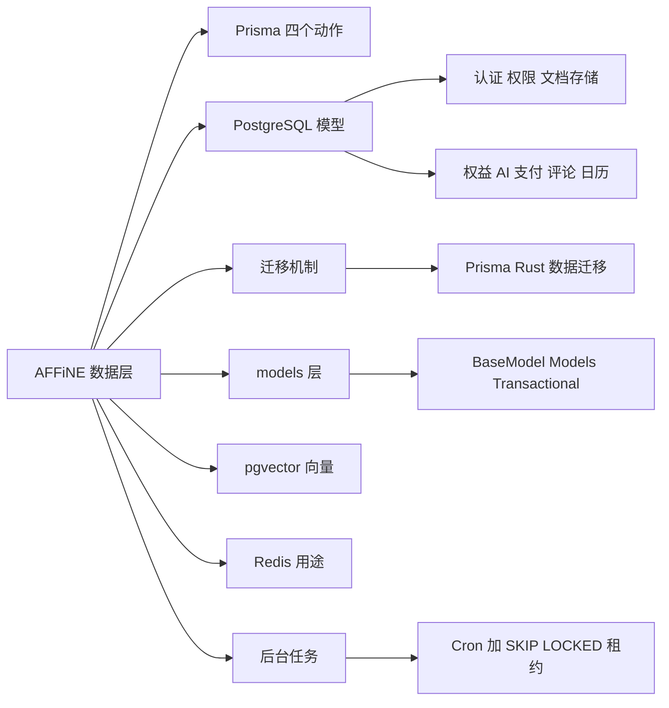
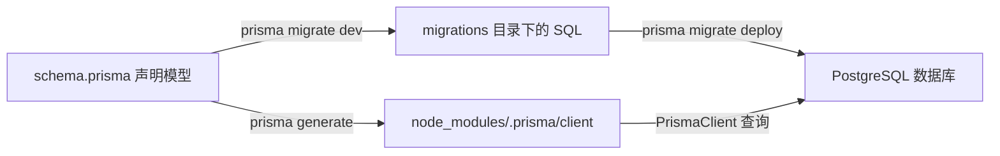
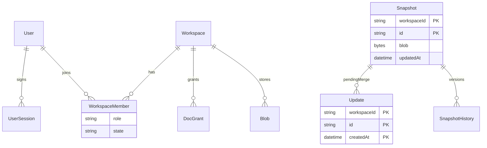
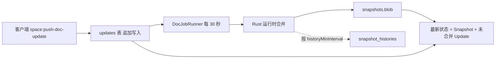
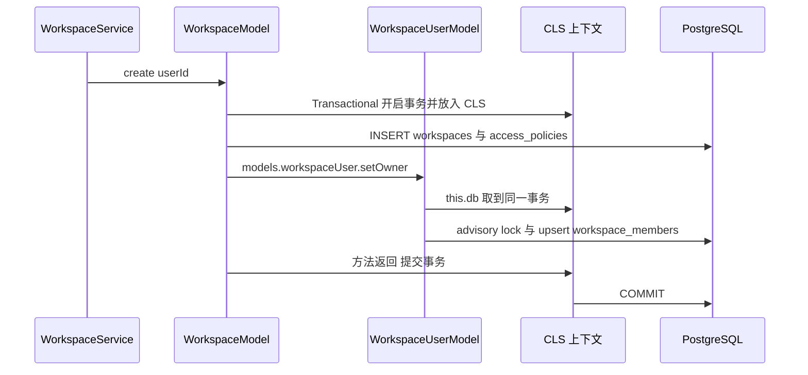
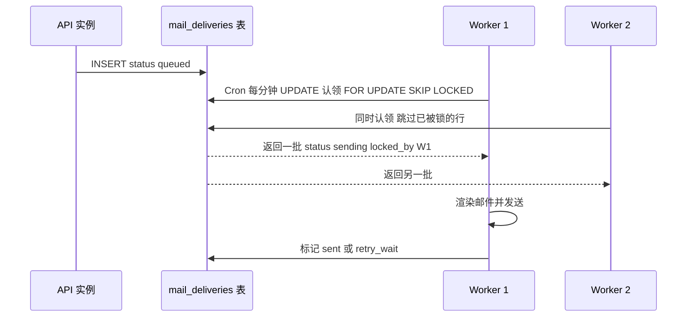

# 第 22 章 数据层：Prisma、PostgreSQL、Redis

从 `schema.prisma` 到 models 层、pgvector 与"数据库即队列"

第 7 部分 · 后端服务 ｜ 难度 ★★★☆☆ ｜ 建议学时 8 小时

Note:
上一章讲进程如何组装，这一章讲数据存在哪里。我们会读懂 65 个 Prisma 模型、三套迁移机制、models 层的设计，以及 AFFiNE 为什么不用消息队列。

---

## 本章导读

- **PostgreSQL**：唯一权威数据源，借 **pgvector** 存向量
- **Prisma 6**：描述表结构、生成类型化客户端、管理迁移
- **Redis**：缓存、限流、锁、跨实例消息、失效通知
- `schema.prisma`：**65 个模型、11 个枚举**，按领域分组
- 后台任务不用 MQ，而是"**数据库租约 + 定时任务**"

<div class="callout warn">

部分表不在 `schema.prisma` 中，由 Rust 运行时自建：如 `embedding_chunks`、`runtime_leases`

</div>

Note:
前端习惯把数据放在 IndexedDB 或 nbstore，后端最终都要落到数据库。三者分工很清楚：PostgreSQL 是唯一事实来源，Prisma 是类型化的访问层，Redis 只放可丢失的数据。理解"有些表由 Rust 运行时自己建"是本章的关键背景。

---

## 学习目标

- 说出 Prisma schema、generate、migrate、client 对应文件与命令
- 按领域讲清主要模型，画出认证、权限、文档存储 ER 图
- 解释 `Snapshot` + `Update` + `SnapshotHistory` 如何表示 CRDT 文档
- 区分 Prisma 迁移、Rust 运行时迁移与数据迁移
- 描述 `BaseModel`、`Models` 代理、`@Transactional()` 的协作
- 解释 `FOR UPDATE SKIP LOCKED` 租约模式与不用 BullMQ 的原因

Note:
这六条覆盖了本章的主线。最后一条最有意思，它是一个很实用的工程取舍，学完你可以在自己的项目里直接借鉴。

---

## 知识地图



Note:
地图从左往右：先学 Prisma 的基本动作，再按领域看模型，然后是迁移、models 层，最后是向量、Redis 和后台任务。后面每个节点都会有对应页面。

---

## Prisma 的四个动作



`postinstall` 自动 `prisma generate`；`yarn init` = `prisma migrate dev && yarn data-migration run`

Note:
`schema.prisma` 有 1537 行，生成的客户端输出到仓库根的 `node_modules/.prisma/client`。文件头里 `binaryTargets` 让同一份产物在 macOS 与 Linux 容器里都能跑，`previewFeatures` 打开了 `metrics`、`relationJoins` 和 `postgresqlExtensions`，后者用于声明 pgvector 扩展。生产环境由 `predeploy` 执行 `prisma migrate deploy`。

---

## 读懂一个模型：User

```prisma
model User {
  id              String    @id @default(uuid()) @db.VarChar
  name            String    @db.VarChar
  email           String    @unique @db.VarChar
  emailVerifiedAt DateTime? @map("email_verified") @db.Timestamptz(3)
  // ... avatarUrl、createdAt、registered 等
  /// Not available if user signed up through OAuth providers
  password        String?   @db.VarChar
  disabled        Boolean   @default(false)
  authEpoch       Int       @default(0) @map("auth_epoch")
  // ... 共 20 余个反向关联
  @@index([email])
  @@map("users")
}
```

约定：时间列一律 `Timestamptz(3)`；表名、列名一律 snake_case（`@map`/`@@map`）

Note:
`String?` 表示可空，`@id` 是主键，`@map` 把驼峰映射到下划线列名。`password` 为空表示 OAuth 注册；`authEpoch` 自增可以让该用户全部旧凭证失效。这两条统一约定分别来自 2024 年的迁移 `use_timestamp_with_timezone` 和 `standardize_table_columns`。

---

## 模型全景：按领域分组

| 领域 | 代表模型 | 数量 |
| --- | --- | --- |
| 用户与认证 | `User`、`UserSession`、`AuthSession`、`AuthRefreshToken` | 9 |
| 工作区与权限 | `Workspace`、`WorkspaceMember`、`DocGrant` | 7 |
| 文档与文件存储 | `Snapshot`、`Update`、`SnapshotHistory`、`Blob` | 5 |
| 权益与配额 | `Entitlement`、`EffectiveUserQuotaState` | 5 |
| AI | `AiSession`、`AiSessionMessage`、`McpCredential` | 11 |
| 其他 | 支付 7、License 2、评论通知 5、日历 6、统计 6、系统 2 | 28 |

新模型多用 `String` + `@db.Text` 存状态，而非 Prisma `enum`

Note:
65 个模型可以按 11 个领域记忆。注意一个趋势：`WorkspaceMember.role`、`Entitlement.status` 都用文本列，因为 PG 枚举改值需要迁移，滚动发布时新旧版本共存容易冲突。`AiSessionMessageRole` 上的 `@@map("AiPromptRole")` 就记录了一次兼容旧客户端的痛苦经历。

---

## 核心实体关系（精简）



Note:
这是三张领域 ER 图的精简合并版，只保留 8 个核心实体。左边是"人和工作区"，右边是"文档怎么存"。注意 `Snapshot` 没有声明到 `Workspace` 的外键，源码注释说需要先清理历史遗留的悬挂数据才能启用。

---

## 认证域与权限域

<div class="cols">
<div>

**用户与认证**

- `Session`：一个 cookie 挂多个账号
- `UserSession`：记录客户端版本
- `AuthSession`：原生设备会话
- `AuthRefreshToken`：`generation` 轮换链

</div>
<div>

**工作区与权限**

- `WorkspaceMember`：`owner`/`admin`/`member`
- `WorkspaceAccessPolicy`：默认策略
- `DocGrant`：四元复合主键授权
- 权限计算交给 Rust 运行时

</div>
</div>

Note:
认证域的亮点是刷新令牌轮换：每次刷新签发新令牌，旧令牌被再次使用就说明可能被盗，可以整条链吊销；`graceUsedAt` 为网络抖动留了宽限。权限域是 2026 年中大重构的结果，旧的 `workspace_user_permissions` 表已被删除，职责拆成成员、邀请、策略、显式授权四类单一职责的表。

---

## 部分唯一索引：数据库兜底

```sql
CREATE UNIQUE INDEX "workspace_members_active_owner_key"
  ON "workspace_members"("workspace_id")
  WHERE "role" = 'owner' AND "state" = 'active';
CREATE UNIQUE INDEX "workspace_members_active_user_key"
  ON "workspace_members"("workspace_id", "user_id")
  WHERE "state" = 'active';
```

<p class="small">来源：<code>migrations/20260512133700_workspace_runtime_states/migration.sql</code>（已折行）</p>

- Prisma 表达不了的约束只存在于迁移 SQL 中
- 应用层 `pg_advisory_xact_lock` 串行化 + 数据库约束兜底

Note:
第一条索引在数据库层面保证"每个工作区最多一个活跃 owner"，即便应用代码有 bug，也写不进第二个 owner。结合上一章 `setOwner` 中的 advisory lock，这就是应用层串行化加数据库约束兜底的双保险。

---

## 文档存储：快照 + 增量



`Update` 主键 `(workspaceId, id, createdAt)`；`Snapshot.size` 避免在 `bytea` 上求和

Note:
这一页和第 8 章的 Yjs 关系最紧密。写入时先追加到 updates 表，写得快且无冲突；Worker 每 30 秒把积压合并进快照，并按间隔存历史版本。读取时快照加尚未合并的增量才是最新状态，源码注释原话是 "Snapshot + Updates are the latest state of the doc"。`Blob` 表只存元数据，文件本体在对象存储。

---

## 条件 upsert：旧快照不覆盖新快照

```sql
-- DocModel.upsert 中的 $queryRaw（节选，列清单省略）
INSERT INTO "snapshots" ("workspace_id", "guid", "blob", ...)
VALUES (${spaceId}, ${docId}, ${blob}, ...)
ON CONFLICT ("workspace_id", "guid")
DO UPDATE SET "blob" = ${blob}, "size" = ${size},
  "updated_at" = ${updatedAt}, "updated_by" = ${editorId}
WHERE "snapshots"."workspace_id" = ${spaceId}
  AND "snapshots"."guid" = ${docId}
  AND "snapshots"."updated_at" <= ${updatedAt}
RETURNING ...
```

Prisma 的 `upsert` 不支持附加 where 条件，只能写原生 SQL —— 一种乐观并发控制

Note:
关键在最后的 WHERE：只有更新的快照才能覆盖旧快照，并发写入时旧数据永远不会盖掉新数据。这依赖 `Snapshot.updatedAt` 的特殊语义：它记录的是最后一条被合并的 update 的时间，而不是行修改时间。另外 `$queryRaw` 模板字符串会自动参数化，防 SQL 注入。

---

## 权益、AI 与支付要点

- `Entitlement`：统一权益表，`targetType` + `targetId` 指向用户或工作区
- `Effective*QuotaState`：派生投影，**正在退役**，回归单一事实来源
- AI：`AiSession`、`AiSessionMessage`，schema 中**没有向量字段**
- `PaymentEvent`：`@@unique([provider, externalEventId])` 保证幂等
- `Invoice`：金额按最小货币单位整数存储
- 评论 `Comment` 用自增 `sid` 作增量拉取游标

Note:
两个配额投影表头上都有 `TODO(gc-convergence)` 注释，说明当前配额读取已经改为"从权威事实计算加有界内存缓存"。这是个好案例：派生数据加速读取，但要承担一致性成本。支付系统的铁律是 Webhook 一定会重复投递，所以必须用外部事件 ID 做唯一约束。

---

## 迁移：三套机制并存

| 机制 | 管理对象 | 执行入口 | 记录表 |
| --- | --- | --- | --- |
| Prisma Migrate | `schema.prisma` 中的表 | `prisma migrate deploy` | `_prisma_migrations` |
| Rust 运行时迁移 | 向量、搜索投影、租约等 | `BackendRuntimeProvider.runMigrations()` | `native_schema_migrations` |
| 数据迁移 | 已有数据内容 | `yarn cli run` | `_data_migrations` |

规律：**扩展 → 回填 → 收缩**（expand/contract），破坏性变更拆成多个版本

Note:
`migrations/` 下有 122 个迁移目录，从 2023 年 4 月的 init 一路演进。典型的两步走是 `20260714000000_backfill_*` 先回填，`20260714000001_drop_legacy_permission_and_subscription` 再删旧表，这样滚动发布时新旧 Pod 能同时连同一个库。用 `psql \dt` 看到 schema 里没有的表时，去 `packages/backend/native/src/runtime/sql/` 找。

---

## pgvector 与 embedding 存储

```sql
CREATE TABLE embedding_chunks (
  generation_token UUID NOT NULL,
  workspace_id TEXT NOT NULL,
  -- ... index_id source_id chunk_index content
  embedding vector(1024) NOT NULL,
  -- ...
  PRIMARY KEY (generation_token, chunk_index),
  -- ... CHECK 约束
);
CREATE INDEX embedding_chunks_hnsw
  ON embedding_chunks USING hnsw (embedding vector_cosine_ops)
  WITH (m = 32, ef_construction = 200);
```

Rust 中用 `<=>` 余弦距离查询；无 pgvector 时 `EmbeddingHealth::disabled`，服务照常启动

Note:
这张表定义在 `packages/backend/native/src/runtime/sql/embedding.sql`，由 Rust 运行时自管。`embedding_projections` 带租约字段做向量化队列，`embedding_v2.sql` 还加了触发器：内容 revision 一变，投影自动重置为 pending。开发和自托管的 compose 都用 `pgvector/pgvector:pg16` 镜像。

---

## Models 代理：一次注入拿全部

```ts
return new Proxy({} as any, {
  get: (target, prop) => {
    if (prop in target) {
      return target[prop];
    }
    const Model = MODELS[prop];
    if (!Model) {
      return undefined;
    }
    const model = ref.get(Model);
    // ...
    target[prop] = model;
    return model;
  },
```

映射类型从 `MODELS` 推导 `models.workspace` 类型；`Proxy` 懒加载避免循环依赖

Note:
这段来自 `src/models/index.ts` 的 `ModelsProvider.useFactory`。`MODELS` 对象注册了 35 个 Model，新增一个只需加一行。`MODELS_SYMBOL` 通过 `useExisting` 指向 `Models`，所以任何 Model 内部都能写 `this.models.workspaceUser.setOwner(...)` 调用其他 Model。

---

## 跨 Model 的同一事务



建工作区、默认策略、设置 owner 三件事，任何一步失败全部回滚

Note:
`WorkspaceModel.create` 加了 `@Transactional()`，用 Prisma 嵌套写入同时创建访问策略，再跨 Model 调用 `setOwner`。因为事务放在 CLS 里，`setOwner` 内部的 `this.db` 自然取到同一个事务客户端。Model 设计规范还有几条：方法名用业务语义、多表写入加事务、领域事件由 Model 发出、批量操作设上限。

---

## Redis 的真实用途

| 用途 | 位置 | 实例 |
| --- | --- | --- |
| GraphQL 缓存、接口限流 | `base/cache`、`base/throttler` | `CacheRedis` |
| 登录频率限制 | `core/auth/service.ts` | `Cache.increaseWithTtl` |
| 分布式锁 | `base/mutex/locker.ts` | `SessionRedis` |
| 跨实例"只做一次" | `tryFixDocOwner` | `setnx` + 24 小时 TTL |
| socket.io 与 EventBus 广播 | `base/websocket/adapter.ts` | `SocketIoRedis` |
| Rust 缓存失效通知 | `invalidation.rs` | `PUBLISH`/订阅 |

**Redis 不存任何必须持久的数据**，宕机时缓存 miss、限流降级、广播暂停

Note:
以上都经源码 grep 确认，表里只挑了一部分，还有 OAuth state 暂存、链接预览缓存、独立访客统计等。Redis 全部是缓存、计数器、锁和消息通道。`invalidation.rs` 里的测试名 `degraded_redis_never_blocks_local_invalidation_and_reports_reconnects` 直白地表达了这个设计目标。

---

## 没有消息队列：数据库租约



W1 崩溃时 `locked_until` 过期，行可被重新认领 ——"至少一次"语义

Note:
`package.json` 里没有任何队列依赖，后台任务统一用"定时轮询、表即队列、租约认领"。`SKIP LOCKED` 让多个 Worker 并发时自动跳过别人锁住的行，天然保证一条任务只被一个 Worker 拿到。`max_attempts > attempt_count` 限制重试次数，`send_after` 实现延迟与退避。

---

## 租约模式的取舍

| 维度 | 数据库租约 | Redis 队列（如 BullMQ） |
| --- | --- | --- |
| 事务一致性 | 入队可与业务写入同事务 | 需处理"写库成功、入队失败" |
| 可观测性 | 一条 SQL 查积压与失败原因 | 需专用面板 |
| 运维依赖 | 只依赖 PostgreSQL | Redis 变强依赖且需持久化 |
| 吞吐与延迟 | 秒级轮询，中低吞吐 | 毫秒级推送，高吞吐 |

同一模式还用于向量化、支付 Webhook、日历同步、统计重算等

Note:
对 AFFiNE 这种自托管优先、任务量中等、强调一致性的产品，数据库租约是更稳妥的选择。邮件表配套了索引 `mail_deliveries_ready_idx`，让认领查询走索引。日历的 `calendar_subscriptions` 用 `syncClaimedUntil`，向量化用 `lease_owner` 和 `lease_until`，都是同一个思路。

---

## 源码导读 Top 5

| 优先级 | 路径 | 看什么 |
| --- | --- | --- |
| P0 | `schema.prisma` | 按领域通读模型，关注主键、索引、注释 |
| P0 | `src/models/index.ts` | `MODELS` 注册表、`Models` Proxy |
| P0 | `src/models/base.ts` | `TransactionHost` 与 `this.db` |
| P0 | `src/models/doc.ts` | Snapshot/Update 读写、条件 upsert |
| P1 | `src/models/mail-delivery.ts` | `claimReady` 租约认领与重试 |

<p class="small">路径前缀：<code>packages/backend/server/</code>；进阶读 <code>packages/backend/native/src/runtime/sql/embedding.sql</code></p>

Note:
先通读 schema，建立模型和表的映射感；再看 models 层三个核心文件；最后用 `mail-delivery.ts` 理解租约模式的完整实现。`workspace.ts` 也值得一读，它展示了事务嵌套写入和领域事件。

---

## 动手实践

| 练习 | 验收要点 |
| --- | --- |
| 1 对照 schema 看表 | 写出"模型 → 表 → 关键列"，找出 3 张 Rust 自管表 |
| 2 追踪文档存储生命周期 | 描述合并前后 `updates` 与 `snapshots` 的变化 |
| 3 写风格一致的 Model 方法 | 说清是否需要 `@Transactional()` 与 `notifyUpdate` |
| 4 画租约竞态时间线 | 指出崩溃后哪个条件让任务可被重新认领 |

Note:
练习 2 最直观：新建文档输入几段文字，马上查 updates 表，等 30 秒以上再查一次，就能看到增量被合并。练习 3 是教学草稿，不要提交；思考为什么现有代码给 `update()` 加了 `notifyUpdate` 参数而不是新增方法。

---

## 自测

**Q1** `Snapshot.updatedAt` 的语义有何特殊？

最后一条被合并的 update 的时间，用来判断快照新旧 <!-- .element: class="fragment" -->

**Q2** 如何在数据库层面保证每个工作区最多一个活跃 owner？

部分唯一索引 `workspace_members_active_owner_key` <!-- .element: class="fragment" -->

**Q3** `schema.prisma` 没有向量字段，embedding 存在哪？

Rust 自管的 `embedding_chunks`，`vector(1024)` + HNSW 索引 <!-- .element: class="fragment" -->

**Q4** `setOwner` 为何能与建工作区处于同一事务？

事务放在 CLS，`this.db` 即 `TransactionHost.tx` <!-- .element: class="fragment" -->

Note:
这四题分别对应文档存储、权限约束、向量存储和事务传播。答不上来的同学可以回到对应页面再看一遍。

---

## 常见坑

| 现象 | 解决 |
| --- | --- |
| `@prisma/client did not initialize yet` | 在 `packages/backend/server` 下 `yarn prisma generate` |
| 启动报表或列不存在 | `yarn prisma migrate dev` 或 `yarn init` |
| 迁移报 `pgvector extension not found` | 改用 `pgvector/pgvector:pg16` 镜像 |
| `migrate dev` 想删除 `embedding_*` 表 | 不要接受，这些表由 Rust 运行时管理 |
| `$queryRaw` 有注入风险 | 只用模板字符串形式，别用 `$queryRawUnsafe` |

Note:
第四条最容易踩：Prisma 看不到 Rust 自建的表，会把它们视为漂移并建议删除，千万别点确认。另外 AI 检索不可用但服务正常时，多半是 pgvector 版本低于 0.8，运行时把 embedding 标记成了 disabled。

---

## 小结与下一步

- PostgreSQL 是唯一事实来源，Redis 只放可丢失数据
- 文档 = `Snapshot` + 未合并 `Update`，条件 upsert 防覆盖
- 三套迁移并存，破坏性变更遵循 expand/contract
- models 层：`Models` 代理 + `this.db` + `@Transactional()`
- 后台任务用 Cron + `FOR UPDATE SKIP LOCKED` 租约

<div class="callout">

下一章：**第 23 章 API 层：GraphQL、WebSocket、认证与权限**——前端怎样和后端说话

</div>

Note:
本章的核心是"数据放在哪、怎么安全地读写"。下一章我们站到 API 层，看 Resolver、Gateway 和认证权限如何调用今天讲的这些 Model。
