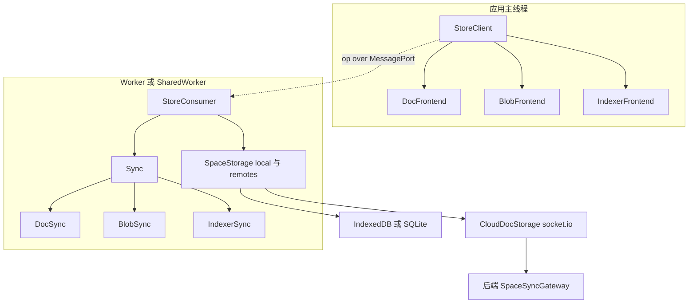
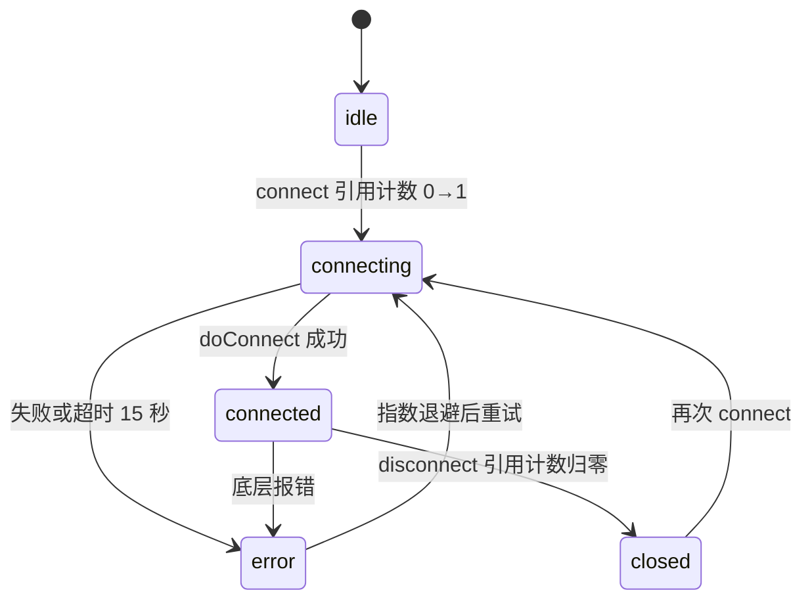
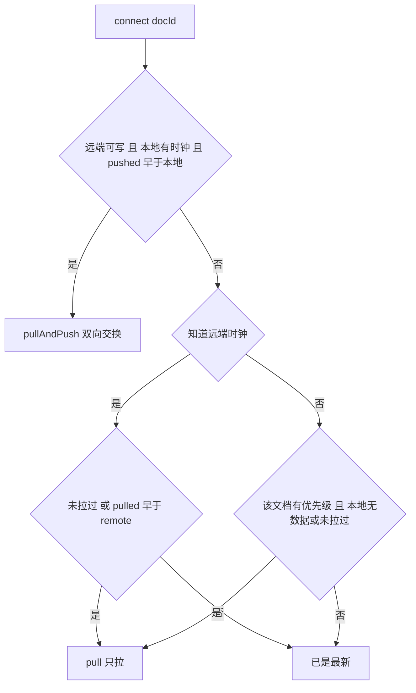
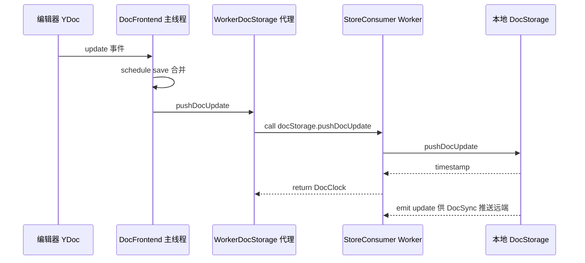
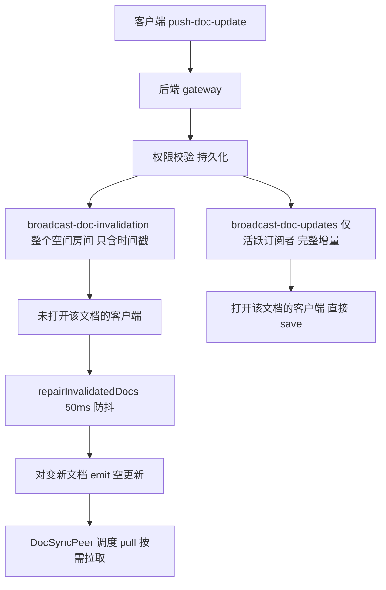
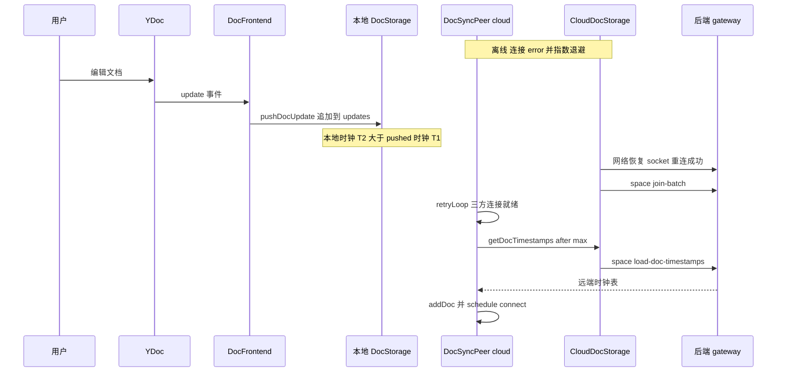
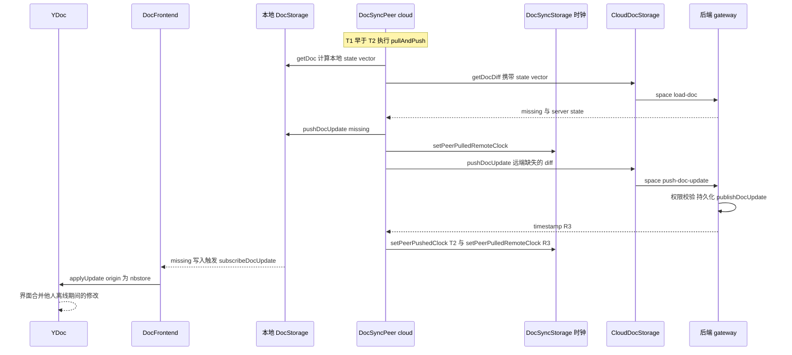

# 第 23 章 存储与同步引擎 nbstore

> 以 Yjs 更新为数据单元，可插拔多存储、多对端同步，运行在 Worker 里

第 6 部分 · 前端应用 ｜ 难度 ★★★★★ ｜ 建议学时 10 小时

===

## 本章要解决的问题

<p class="lead">AFFiNE 自称 local-first：断网照常编辑，联网自动合并；打开文档不等网络；五个标签页只维持一条同步连接；桌面 SQLite、浏览器 IndexedDB、移动原生插件——而上层业务代码对此<b>一无所知</b>。</p>

承担这一切的是 `@affine/nbstore`（`packages/common/nbstore`）。它是一个**以 Yjs 二进制更新为核心数据单元、可插拔多存储、多对端同步、运行在 Worker 中**的存储引擎。

<div class="cards cols-3">
  <div class="card"><div class="card__icon">💾</div><h4>本地优先</h4><p><code>DocFrontend</code> 只与<b>本地</b> DocStorage 交互，远端同步在后台；打开文档从不等网络。</p></div>
  <div class="card"><div class="card__icon">🔀</div><h4>多对端</h4><p>本地 ↔ 云端、本地 ↔ 磁盘、旧版迁移，每个对端一个 <code>DocSyncPeer</code>。</p></div>
  <div class="card"><div class="card__icon">🧵</div><h4>Worker 化</h4><p>二进制合并、索引开销大，存储与同步跑在 Worker，主线程只持有门面。</p></div>
</div>

<div class="note note--warn">

`nbstore/README.md` 的示例（`SpaceStorageWorkerClient`、`@affine/nbstore/op`）与当前源码**不一致**——Worker 客户端实际是 `worker/client.ts` 的 `StoreManagerClient`。README 只能用来理解"组合多个存储"的思想，**API 请以源码为准**。

</div>

===

## 知识地图

主线程只有门面（frontend），存储与同步跑在 Worker，两者通过 op over MessagePort 通信。云端经 socket.io 连后端网关。



===

## 学习目标

<ol class="goals">
  <li>阐述 local-first 存储需求与 nbstore 的"存储 → 同步 → 门面 → Worker"分层</li>
  <li>列出七种 <code>StorageType</code>，解释 <code>SnapshotDocStorageBase</code> 的"快照 + 增量更新队列"设计</li>
  <li>描述 <code>AutoReconnectConnection</code> 的状态机、引用计数、指数退避与 <code>share()</code> 连接复用</li>
  <li>讲解 <code>DocSyncPeer</code> 的三种时钟（remote/pulled/pushed）与五种任务</li>
  <li>说明 <code>DocFrontend</code> 如何把 YDoc 与存储双向绑定，以及 Worker 的 op 通信结构</li>
  <li>画出"离线编辑 → 上线同步"的完整时序图</li>
</ol>

===

<!-- section -->
## 一、storage 抽象：七类存储

数据单元是 Yjs update；合并靠 `mergeUpdates`/`diffUpdate`；增量同步基于 state vector 的 `getDocDiff` 加时钟判断。

===

## 七类 StorageType

`StorageType` 共七种，其中带 `Sync` 后缀的三类是"**同步元数据**"——与数据本身分开存，所以同一份本地数据库可对多个对端分别记账。

```ts
// storage/storage.ts
export type StorageType =
  | 'blob' | 'blobSync'
  | 'doc'  | 'docSync'
  | 'awareness'
  | 'indexer' | 'indexerSync';
```

| 类型 | 存什么 | 关键方法 |
|---|---|---|
| `doc` | Yjs 文档二进制 | `getDoc`、`getDocDiff`、`pushDocUpdate`、`getDocTimestamp` |
| `docSync` | 每对端每文档的三种时钟 | `get/setPeerRemoteClock`、`get/setPeerPushedClock` |
| `blob` | 二进制资源 | `get`、`set`、`delete`、`list` |
| `blobSync` | 每对端每 blob 的上传时间 | `setBlobUploadedAt`、`getBlobUploadedAt` |
| `awareness` | 协作感知（不持久化） | `update`、`subscribeUpdate` |
| `indexer` | 全文索引 | `search`、`aggregate`、`insert/update/delete` |
| `indexerSync` | 每文档已索引时钟与索引版本 | `get/setDocIndexedClock` |

===

## 快照 + 更新队列：追加写、惰性压实

`SnapshotDocStorageBase` 实现了 nbstore 最关键的性能设计：**写入只追加（append-only），读取时才惰性压实（lazy compaction）**。

<div class="annotate">

```ts [2-4|6-7|9-14]
override async getDoc(docId: string) {
  await using _lock = this.isReadonly
    ? undefined
    : await this.lockDocForUpdate(docId);
  const snapshot = await this.getDocSnapshot(docId);
  const updates = await this.getDocUpdates(docId);
  if (updates.length) {
    const { timestamp, bin, editor } = await this.squash(
      snapshot ? [snapshot, ...updates] : updates);
    const newSnapshot = { spaceId: this.spaceId, docId, bin, timestamp, editor };
    if (!this.isReadonly) {
      await this.setDocSnapshot(newSnapshot, snapshot);
      await this.markUpdatesMerged(docId, updates);
    }
    return newSnapshot;
  }
  return snapshot;
}
```

<ol class="annotate__notes">
  <li><b>第 2–4 行</b>：<code>await using</code> + <code>lockDocForUpdate</code> 保证并发读取时只有一个在做合并。</li>
  <li><b>第 6–7 行</b>：读取时才把快照与所有未合并更新一起取出。</li>
  <li><b>第 9–14 行</b>：<code>squash</code> 成新快照、写回并标记已合并。写入极快（编辑高频），合并成本摊到读取时且只做一次。</li>
</ol>
</div>

<div class="note">

子类只需实现 `getDocSnapshot`、`setDocSnapshot`、`getDocUpdates`、`markUpdatesMerged` 四个原语。`HistoricalDocStorage` 继承它，监听 `'snapshot'` 事件生成历史版本，供"页面历史"功能使用。

</div>

===

<!-- section -->
## 二、connection：自动重连与连接共享

多个存储共用一个连接；只有第一个 `connect` 真正建连、最后一个 `disconnect` 真正断开。

===

## AutoReconnectConnection 状态机

连接是一台状态机：引用计数决定建连/断开，错误后按指数退避重连。



<div class="annotate">

```ts [4-5|8-12]
export abstract class AutoReconnectConnection<T = any> {
  retryDelay = 3000;
  maxRetryDelay = 60000;
  connectingTimeout = 15000;
  private refCount = 0;
  protected getRetryDelay(retryCount: number) {
    return Math.min(this.retryDelay * 2 ** retryCount, this.maxRetryDelay);
  }
  connect() {
    this.refCount++;
    if (this.refCount === 1) this.innerConnect();
  }
}
```

<ol class="annotate__notes">
  <li><b>第 4–5 行</b>：连接超时 15s；引用计数让多个使用者共享一个连接。</li>
  <li><b>第 8–12 行</b>：退避间隔 <code>min(3s·2^n, 60s)</code>，即 3s、6s、12s……上限 60s。<code>waitForConnected(signal)</code> 返回 Promise，同步器启动前都会等它。</li>
</ol>
</div>

===

## share()：同库共用一条连接

`share(conn)` 按 `conn.shareId` 在模块级 `Map` 中去重。`IndexedDBDocStorage` 等都写 `readonly connection = share(new IDBConnection(this.options))`。

```ts
// connection/shared-connection.ts（节选）
export function share<T extends AutoReconnectConnection<any>>(conn: T): T {
  if (!conn.shareId) throw new Error(`Connection ... is not shareable.`);
  const existing = CONNECTIONS.get(conn.shareId);
  if (existing) return existing as T;
  CONNECTIONS.set(conn.shareId, conn);
  return conn;
}
```

<div class="note note--tip">

`IDBConnection.shareId` 为 `idb(<schema 版本>):<flavour>:<type>:<id>`——**同一工作区的六类 IDB 存储共用一个数据库连接**。云端则由 `getSocketManager(endpoint, isSelfHosted)` 按端点缓存 `SocketManager`，同一服务器的所有工作区共用一条 socket。

</div>

===

## 各端实现与 SpaceStorage 组合

每个实现单独一个入口，**按端按需打包**：Web Worker 只 import idb/cloud/broadcast-channel，Electron 只 import sqlite/disk/cloud。

<div class="split">
<div class="split__main">

`SpaceStorage` 把七类存储组合成一个"空间"，未配置的类型自动填充 dummy 空实现。一个工作区 = 一个本地 `SpaceStorage` + 若干远端 `SpaceStorage`。

云工作区的本地放 IndexedDB/SQLite + BroadcastChannel awareness；`remotes['cloud:<serverId>']` 放 `CloudDocStorage` 等。本地工作区在 Electron 开启磁盘同步时多一个 `remotes.disk`。

**"迁移旧数据"与"同步云端"用的是同一套机制**——都只是多了一个对端。

</div>
<div class="split__aside">

```ts
// storage/index.ts（节选）
constructor(storages) {
  this.storages = {
    awareness: storages.awareness
      ?? new DummyAwarenessStorage(),
    blob: storages.blob
      ?? new DummyBlobStorage(),
    doc: storages.doc
      ?? new DummyDocStorage(),
    docSync: storages.docSync
      ?? new DummyDocSyncStorage(),
    // ... 其余同理
  };
}
```

</div>
</div>

<div class="note">

IndexedDB 实现里，`pushDocUpdate` 在一个事务里写 `updates` 与 `clocks`（`ConstraintError` 时把时间戳 +1ms 重试最多 10 次，保证时钟单调唯一），然后本地 `emit('update')` 并通过 `BroadcastChannel('idb:'+dbName)` 广播给其他标签页——**即使不用 SharedWorker，多标签页也能互相感知 IndexedDB 变化**。

</div>

===

<!-- section -->
## 三、Doc 同步算法：核心

文档同步以三种时钟判断方向，以五种任务执行，配合优先级队列与回声过滤。

===

## 三种时钟

每个 `(peerId, docId)` 在 `DocSyncStorage` 中记录三种时钟，再加本地存储自身的时钟，就能做出所有判断——**只比较时间戳大小，不比较内容**。

| 时钟 | 含义 | 何时更新 |
|---|---|---|
| **remote clock** | 我所知道的远端该文档有多新 | 启动时 `getDocTimestamps` 拉取；收到广播时 `updateRemoteClock` |
| **pulled remote clock** | 已拉取并写入本地的远端版本 | pull / pullAndPush / save 成功后 |
| **pushed clock** | 已推送给远端的**本地**版本 | push / pullAndPush 成功后 |

<div class="note note--tip">

有了这套时钟：**本地时钟 > pushed clock ⇒ 本地有没推上去的改动；remote clock > pulled clock ⇒ 远端有没拉下来的改动**。这比"每次都交换 state vector"高效得多——几千篇文档的工作区，上线时只需一次 `getDocTimestamps` 就知道哪些文档需要同步。

</div>

===

## 五种任务与 connect 决策

五种任务 `connect / push / pull / pullAndPush / save`。`connect` 决定一个文档初次需要什么，是最复杂的一步。

```ts
// sync/doc/peer.ts（Job 类型，压缩为单行）
type Job =
  | { type: 'connect'; docId: string }
  | { type: 'push'; docId: string; update?: Uint8Array; clock: Date }
  | { type: 'pull'; docId: string }
  | { type: 'pullAndPush'; docId: string }
  | { type: 'save'; docId: string; update?: Uint8Array; remoteClock: Date };
```



===

## 五种任务各做什么

`pullAndPush` 是本地有改动时的完整双向同步，其余四种各司其职。

<ol class="steps">
  <li><h4>pullAndPush</h4><p>读本地算 state vector → 向远端 <code>getDocDiff</code> 要"我缺的"→ 写本地记 pulled clock → <code>docDiffUpdate</code> 算"远端缺的"→ <code>remote.pushDocUpdate</code> 并 schedule save → 最后 schedule push 标记 pushed clock。远端没有该文档则全量推上去。</p></li>
  <li><h4>pull</h4><p>只拉 <code>missing</code> 写本地、记 pulled clock，再安排一个"空 push"推进 pushed clock（数据本就来自远端，无需再推）。</p></li>
  <li><h4>push</h4><p>把同一文档排队的多个本地更新 <code>mergeUpdates</code> 合并成一个推给远端，记 pushed clock（取这批最大 clock）；仅对已 connect、可写远端执行。</p></li>
  <li><h4>save</h4><p>远端广播来的更新，合并后写入本地，记 pulled clock。</p></li>
</ol>

<div class="note">

`docDiffUpdate` 处理了 Yjs 的一个精细点：若两边 state vector 不同，直接 `diffUpdate`；若相同，再比较删除集（deleteSet）是否一致——因为 **state vector 不包含删除信息**。

</div>

===

## 主循环、回声过滤与优先级

`remoteUpdated` 收到**空更新**时调度 `pull`——这是云端"失效通知"的落点。`retryLoop` 则串起整个同步循环。

<div class="annotate">

```ts [4-5|7-11]
// sync/doc/peer.ts（events 节选）
localUpdated: ({ docId, update, clock }) => {
  this.actions.addDoc(docId);
  this.schedule({ type: 'push', docId, clock, update });
},
remoteUpdated: ({ docId, update, remoteClock }) => {
  this.actions.addDoc(docId);
  this.actions.updateRemoteClock(docId, remoteClock);
  if (isEmptyUpdate(update)) this.schedule({ type: 'pull', docId });
  else this.schedule({ type: 'save', docId, remoteClock, update });
},
```

<ol class="annotate__notes">
  <li><b>第 4–5 行</b>：本地更新触发 push；订阅时会过滤掉 origin 为自己 <code>uniqueId</code> 或以 <code>sync:&lt;peerId&gt;:</code> 开头的，<b>防止回声</b>。</li>
  <li><b>第 7–11 行</b>：空更新 → pull，非空 → save。</li>
</ol>
</div>

<div class="note note--tip">

`schedule` 把 docId 以 `getJobPriority(docId)` 推进 `AsyncPriorityQueue`。**工作区根文档（docId 等于 spaceId）优先级为 Infinity**——"新文档上传需要先同步其在根文档中的成员关系"。其余由 `addPriority(id, n)` 累加：`WorkspaceEngine.start()` 给根文档 +100，`Doc` 打开时 +100，详情页 +10。`mainLoop` 包住 `retryLoop`，异常后（权限错误除外）重置状态 5 秒后重试。

</div>

===

<!-- section -->
## 四、frontend 门面与 Worker 化

YDoc 必须留在主线程（编辑器要用），所以 frontend 在主线程，存储与同步在 Worker。

===

## DocFrontend：YDoc 与存储双向绑定

`DocFrontend` 有 `load`/`save`/`apply` 三种任务，核心是用 `NBSTORE_ORIGIN` 防止"写回自己"。

<div class="annotate">

```ts [3|8-10]
// frontend/doc.ts（handleDocUpdate 节选）
private readonly handleDocUpdate = (update, origin, doc, transaction) => {
  if (origin === NBSTORE_ORIGIN) return;
  if (!this.status.docs.has(doc.guid)) return;
  this.schedule({ type: 'save', docId: doc.guid, update });
};
// 三种任务：
// load  → connectDoc 时读本地 getDoc 并 applyUpdate，标记 ready
// save  → YDoc 本地 update，合并后 pushDocUpdate(..., uniqueId)
// apply → subscribeDocUpdate（origin 非自己）→ applyUpdate(NBSTORE_ORIGIN)
```

<ol class="annotate__notes">
  <li><b>第 3 行</b>：应用远端更新时用 <code>NBSTORE_ORIGIN</code> 作 transaction origin，<code>handleDocUpdate</code> 见到它就跳过——<b>防回声的关键</b>。</li>
  <li><b>第 8–10 行</b>：debug 模式下若在应用远端更新期间有代码改了文档，会打印警告（会导致"编辑者"被误记）。</li>
</ol>
</div>

<div class="note">

`docState$(docId)` 把自身的 `ready/loaded/updating` 与 `DocSync.docState$` 的 `syncing/synced/retrying` 合并；第 21 章工作区页面正是等 `docState$(workspace.id)` 的 `ready` 才渲染工作台。

</div>

===

## Worker 化：代理实现相同接口

精妙之处：`WorkerDocStorage` 等类**实现了与真实存储相同的接口**（`getDoc` → `client.call('docStorage.getDoc', docId)`）。于是**同一份 `DocFrontend` 代码**既能直接接 IndexedDB，也能接 Worker 代理。



<div class="note note--tip">

Worker 侧 `StoreManagerConsumer` 按 `key`（如 `workspace:<flavour>:<id>`）维护 `storePool`，**同 key 的第二次 open 复用已有 `StoreConsumer`（引用计数 +1）**。结合 SharedWorker，这意味着**多个标签页打开同一工作区，只有一份存储与同步实例**。每个工作区一条专属 MessageChannel，`transfer(..., [port2])` 把端口所有权移交 Worker。

</div>

===

<!-- section -->
## 五、云端协议与完整时序

云端是一组 `space:*` socket.io 事件，"活跃订阅推增量 + 全员推失效"的两级广播兼顾实时性与带宽。

===

## 两级广播：活跃订阅 vs 失效通知

服务端 `publishDocUpdate` 做两件事：向整个空间房间发失效通知（只含时间戳），向正在订阅该文档的 socket 发完整更新。



<div class="note">

客户端收到失效通知后，`CloudDocStorage` 50ms 防抖执行 `repairInvalidatedDocs`：重新 `getDocTimestamps()`，对时间戳比已知更新的文档 `emit('update', { bin: new Uint8Array() })`——一个**空更新**。这样，没打开某文档的客户端不必接收全部增量，只在需要时按 state vector 拉取差量，大幅节省带宽。抛出的 `DocActionDenied` 到客户端变成 `DOC_ACTION_DENIED` 错误——正是 `DocSyncPeer` 识别的名字。

</div>

===

## 完整时序：离线编辑 → 上线同步（上半）

现在把全链路拼起来。离线期间所有编辑都已安全落在本地 `updates` 表，`DocFrontend` 从不等待网络。下图是"上线 → 发现差异"阶段。



===

## 完整时序：离线编辑 → 上线同步（下半）

接上图。`connect` 判定 `T1 < T2` 执行 `pullAndPush`：先拉远端缺失、写本地，再把"远端缺的部分"推上去。



<ul class="takeaways">
  <li>上线后一次 <code>load-doc-timestamps</code> 就找出全部需同步的文档，当前打开的因优先级高先处理。</li>
  <li><code>pullAndPush</code> 先拉后推，推送的是"远端缺的部分"而非整个文档。</li>
  <li>远端数据写入本地后经 <code>subscribeDocUpdate</code> 回到 <code>DocFrontend</code> 再应用到 YDoc——<b>数据永远经由本地存储流向 UI</b>。</li>
</ul>

===

## Blob、Awareness、Indexer 同步

除了文档，还有三类同步器。Blob 以内容哈希为 key 天然不可变，只上传/下载不合并。

<div class="cards cols-3">
  <div class="card"><h4>BlobSync</h4><p><code>set</code> 写本地后<b>不等待</b>上传（后台进行），用户插图立即可见。<code>fullUploadLoop</code> 每 15 秒扫描未上传的；<code>OverCapacityError</code> 暂停上传循环。</p></div>
  <div class="card"><h4>AwarenessSync</h4><p>感知数据不持久化，同步就是"广播给所有已连接对端"：本地是 BroadcastChannel，远端是云端 socket（<code>space:update-awareness</code>）。</p></div>
  <div class="card"><h4>IndexerSync</h4><p>订阅本地更新，用 <code>crawlingDocData</code> 抽取块写入索引；记录每文档已索引时钟，索引版本升级时全量重建；支持电池节省模式。</p></div>
</div>

<div class="note">

索引 schema：`doc` 表（`title` 全文、`summary` 不索引）与 `block` 表（`content` 全文、`flavour`、`refDocId`、`markdownPreview` 等）。查询可通过 `prefer: 'local' | 'remote'` 选择本地索引（Web 自研 BM25 倒排 / 原生 Rust）或云端索引。`DocsSearchService` 的反链、数据库引用、摘要都建立在 `refDocId`/`ref`/`flavour` 字段上。

</div>

===

## 动手实践

<ol class="steps">
  <li><h4>读懂一个单测</h4><p>阅读 <code>__tests__/frontend.spec.ts</code> 的 doc 用例（两个 <code>DocFrontend</code> 共享一个 <code>IndexedDBDocStorage</code>）。<b>验收</b>：能解释 doc2 为什么能读到 doc1 写入的数据，以及 <code>DocSyncImpl.dummy</code> 的作用。</p></li>
  <li><h4>观察本地存储</h4><p>Web 端创建本地工作区输入文字，DevTools → IndexedDB 找到 <code>local:workspace:&lt;id&gt;</code> 库，看 <code>updates</code>/<code>snapshots</code>/<code>clocks</code>，刷新后看 updates 是否合并进 snapshots。<b>验收</b>：能说明"追加写、惰性压实"在数据上的表现。</p></li>
  <li><h4>手推三种时钟</h4><p>设 local=10:05、pushed=10:00、remote=10:03、pulled=10:01，按 <code>jobs.connect</code> 逻辑推导执行哪个任务；再换几组组合。<b>验收</b>：写出至少 4 种组合结论，与流程图一致。</p></li>
  <li><h4>抓包云同步</h4><p>云端工作区 DevTools → Network → WS 观察 <code>space:push-doc-update</code> ack 与另一窗口的 <code>space:broadcast-doc-updates</code>；第二窗口打开另一文档，看是否只收到失效通知。<b>验收</b>：能解释第二窗口为何收不到完整更新。</p></li>
</ol>

===

## 自测：点击揭晓答案

<details class="quiz">
<summary>Q1. 七种 StorageType 中哪三种是"同步元数据"？为什么与数据分开存？</summary>

`docSync`、`blobSync`、`indexerSync`。分开存储使同一份本地数据能针对多个对端（云端、磁盘、v1 迁移）分别记录同步进度，也便于在不动数据的情况下清空/重置同步状态（如 `clearClocks`）。

</details>

<details class="quiz">
<summary>Q2. SnapshotDocStorageBase 写入与读取各做什么？收益是什么？</summary>

写入只追加到更新队列（不合并）；读取 `getDoc` 时在锁内把快照与所有未合并更新 `squash` 成新快照、写回并标记。收益是写入极快（编辑高频），合并成本摊到读取时且只做一次。

</details>

<details class="quiz">
<summary>Q3. connect 在什么条件下执行 pullAndPush？什么条件下执行 pull？</summary>

远端可写、本地有时钟且（pushed 为空或早于本地时钟）时执行 `pullAndPush`；否则若已知远端时钟且（未拉过或 pulled 早于 remote），或不知远端时钟但该文档有正优先级且本地无数据/未拉过，执行 `pull`。

</details>

<details class="quiz">
<summary>Q4. 多个标签页打开同一工作区时，Worker 中会有几个 StoreConsumer？</summary>

一个。`StoreManagerConsumer` 按 key（`workspace:<flavour>:<id>`）在 `storePool` 中复用 `StoreConsumer` 并做引用计数；在 SharedWorker 中所有标签页连到同一个 consumer。

</details>

===

## 小结与下一步

<ul class="takeaways">
  <li>nbstore 以 Yjs 更新为数据单元，用"七类存储 + SpaceStorage 组合 + 多对端同步"实现 local-first。</li>
  <li><code>SnapshotDocStorageBase</code> 的追加写惰性压实、<code>AutoReconnectConnection</code> 的引用计数退避、<code>share()</code> 的连接复用，是性能与稳定性基础。</li>
  <li>文档同步以 remote/pulled/pushed 三种时钟判断方向，以 connect/pull/pullAndPush/push/save 五种任务执行。</li>
  <li>frontend 门面留主线程绑定 YDoc，存储与同步在 Worker 运行，通过两级 op 协议与独占 MessagePort 通信。</li>
  <li>云端"活跃订阅推增量 + 全员推失效"两级广播兼顾实时性与带宽；数据永远经由本地存储流向 UI。</li>
</ul>

<div class="note note--tip">

**下一章预告**：第 24 章把这套存储装进多端——Electron 的四类进程与 IPC、helper 里的 SQLite，以及 iOS/Android 用 Capacitor 插件 + uniffi 复用同一套 Rust 存储逻辑。

</div>
