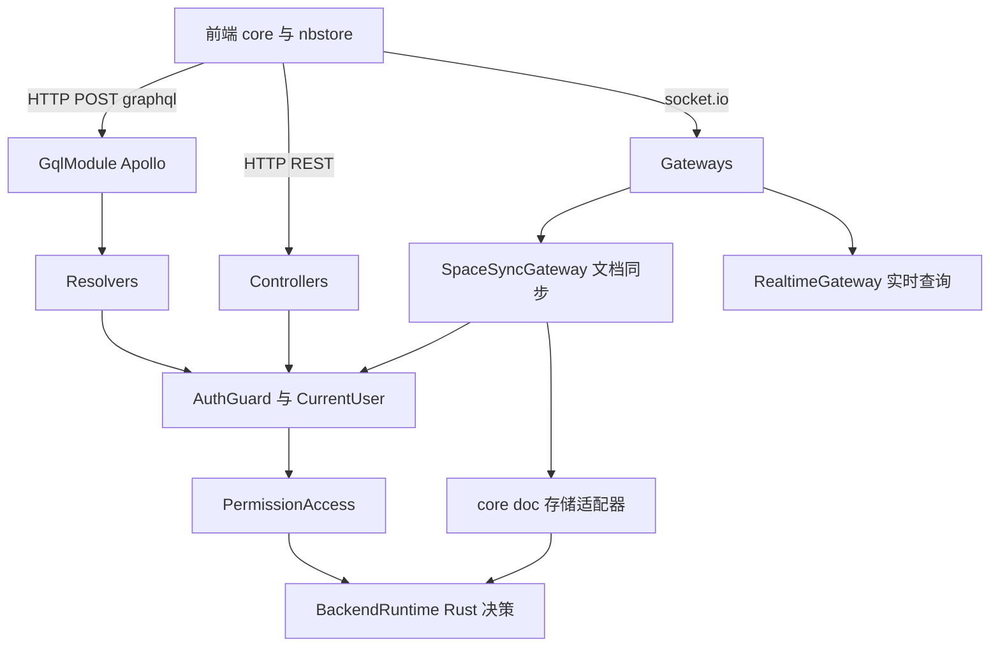
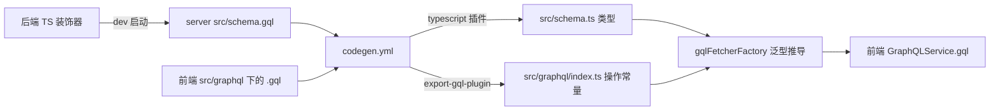
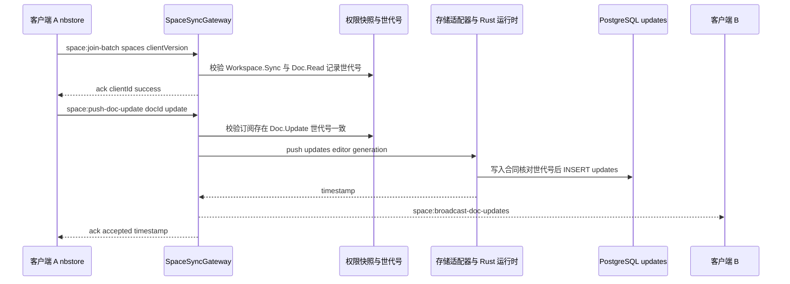
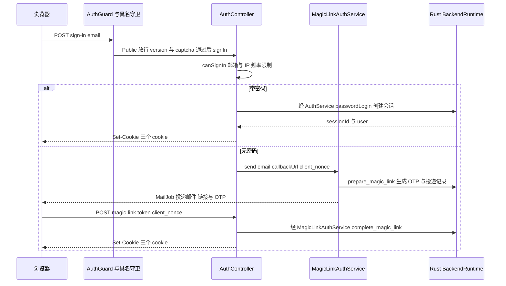
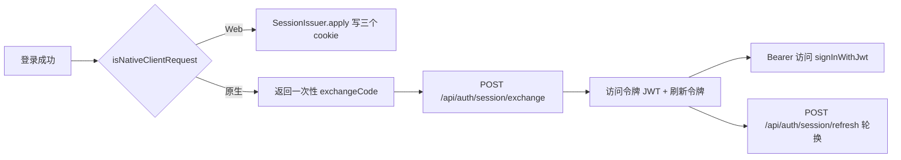

# 第 23 章 API 层：GraphQL、WebSocket、认证与权限

前端怎样和后端说话：协议入口、实时同步、身份与权限

第 7 部分 · 后端服务 ｜ 难度 ★★★★★ ｜ 建议学时 12 小时

Note:
这是后端部分最复杂的一章。我们会依次走过 GraphQL、REST、WebSocket 三种通道，再看认证和权限这两道每次调用都绕不开的关卡。

---

## 本章导读

- **GraphQL**：绝大多数业务 API，前端 180 多个 `.gql` 文件
- **REST**：认证、Blob 下载、上传代理、SSE、Webhook
- **WebSocket**：Yjs 增量同步、awareness、`realtime:*` 协议
- **认证**：cookie 会话、JWT、刷新令牌轮换、Magic Link、OAuth
- **权限**：工作区与文档两级 Action

<div class="callout">

分界线：**TS 协议层**负责适配、校验、错误映射；**Rust 领域核心**负责权限决策、配额、会话签发

</div>

Note:
第 21 章讲进程如何组装，第 22 章讲数据存在哪，本章讲前后端如何通信。读源码时请始终记住那条分界线：TS 越来越像协议适配层，真正的规则在 Rust 运行时里。

---

## 学习目标

- 解释 Query、Mutation、ResolveField 与 code-first 模式
- 描述 `.gql` → codegen → `gqlFetcherFactory` 的完整调用链
- 列出 `SpaceSyncGateway` 的客户端与服务端事件
- 解释 `core/realtime` 的 request/topic 注册机制
- 画出密码登录、Magic Link、原生客户端令牌交换时序
- 使用 `PermissionAccess` 链式 API 做权限检查

Note:
目标覆盖三条通道加两道关卡。尤其是同步事件表和登录时序，建议课后自己再画一遍。

---

## 知识地图



Note:
三种入口最后都汇到同一套横切能力：AuthGuard 识别身份，PermissionAccess 判定权限，最终交给 Rust 决策。文档同步还会经过 core/doc 的存储适配器写入数据。

---

## code-first：动态生成 ObjectType

```ts
const WorkspacePermissions = registerObjectType<
  Record<DotToUnderline<WorkspaceAction>, boolean>
>(
  Object.fromEntries(
    WORKSPACE_ACTIONS.map(action => [
      action.replaceAll('.', '_'),
      {
        type: () => Boolean,
        options: { name: action.replaceAll('.', '_') },
      },
    ])
  ),
  { name: 'WorkspacePermissions' }
);
```

TS 装饰器生成 SDL：非生产环境写入 `src/schema.gql`，`sortSchema: true` 便于 diff

`Workspace.Settings.Update` → 字段 `Workspace_Settings_Update`：**新增 Action 自动多一个字段**

Note:
GraphQL 有一个端点，客户端声明要哪些字段；Query 读、Mutation 写、字段解析器按需计算。AFFiNE 用 `@nestjs/graphql` 的 code-first 模式。这段来自 `src/core/workspaces/resolvers/workspace.ts`，`registerObjectType` 在运行时给空类挂上装饰器；因为 GraphQL 字段名不能有点号，`DotToUnderline` 在类型层同步完成转换。

---

## Resolver 三段式

```ts
@Mutation(() => WorkspaceType, {
  description: 'Update workspace',
})
async updateWorkspace(
  @CurrentUser() user: CurrentUser,
  @Args({ name: 'input', type: () => UpdateWorkspaceInput })
  { id, ...updates }: UpdateWorkspaceInput
) {
  await this.ac
    .user(user.id)
    .workspace(id)
    .assert('Workspace.Settings.Update');
  return this.models.workspace.update(id, updates);
}
```

固定模板：**取当前用户 → 断言权限 → 调 Model/Service**

Note:
几乎所有 Resolver 都是这个三段式。没有 `@Public()` 的 Resolver 由全局 AuthGuard 保证 user 一定存在。`WorkspaceModule` 注册了 6 个 Resolver，它们大多挂在同一个 `WorkspaceType` 上，按成员、文档、Blob、历史拆文件。

---

## ResolveField：避免 N+1

```ts
@ResolveField(() => WorkspaceRole, {
  description: 'Role of current signed in user in workspace',
  complexity: 2,
})
async role(
  @CurrentUser() user: CurrentUser,
  @Parent() workspace: WorkspaceType
) {
  // may applied in workspaces query
  if ('role' in workspace) {
    return workspace.role;
  }
  // ... 否则经 this.ac 计算 permissions()，缺省 External
}
```

分页用 `Paginated(DocType)` + `paginate(rows, 'createdAt', pagination, count)`

Note:
只有前端查询包含 `role` 字段时它才执行；列表查询已经批量查好角色放在父对象上，这里直接复用，这就是避免 N+1 的经典手法。再补一个安全范例：`UserResolver` 的 `user(email)` 查询，"邮箱不存在"和"无权查看"都返回 null，源码注释直接写着 prevent user enumeration。

---

## 前端 GraphQL 生成链



自研插件：检测重名、拼接 `#import` fragment、标记 `Upload` 文件、收集废弃字段

Note:
前端包是 `packages/common/graphql`，`src/graphql` 下递归共有 182 个 `.gql` 文件。每个 `.gql` 会生成一个导出常量，比如 `getCurrentUserQuery`，带 `id`、`op`、`query` 字段。`export-gql-plugin.cjs` 补上了 codegen 自带插件不做的几件事。

---

## fetcher：从 id 推导类型

```ts
export type _QueryVariables<Q extends GraphQLQuery> =
  Q['id'] extends Queries['name']
    ? Extract<Queries, { name: Q['id'] }>['variables']
    : Q['id'] extends Mutations['name']
      ? Extract<Mutations, { name: Q['id'] }>['variables']
      : undefined;
// ...
export type QueryResponse<Q extends GraphQLQuery> = Extract<
  Queries | Mutations,
  { name: Q['id'] }
>['response'];
```

调用：`await this.gqlService.gql({ query: getCurrentUserQuery })`，401 自动 `revalidate()`

Note:
生成的常量带 `id: 'getCurrentUserQuery' as const` 字面量类型，`Extract` 据此取出变量和响应类型，传错变量或读错字段都会编译报错。运行时它还设置 `x-operation-name` 头、含文件时走 multipart，并把错误包装成 `@affine/error` 的 GraphQLError。

---

## REST Controller 与 Blob 下载

| 前缀 | 控制器 | 用途 |
| --- | --- | --- |
| `/api/auth` | `src/core/auth/controller.ts` | 登录、登出、Magic Link、会话 |
| `/api/oauth` | `src/plugins/oauth/controller.ts` | OAuth preflight 与 callback |
| `/api/workspaces` | `src/core/workspaces/controller.ts` | Blob、文档二进制、历史版本 |
| `/workspace` | `src/core/doc-renderer/controller.ts` | 分享页 SSR、Markdown 输出 |
| `/api/copilot` | `src/plugins/copilot/controller.ts` | AI 流式输出、附件 |

Blob 下载 `/:id/blobs/v1/:name` 必须声明来源作用域，异步生成器分块流式输出

Note:
GraphQL 不适合二进制流、cookie 写入、第三方回调和 SSE，这些就交给 REST。Blob 下载要求带 `sourceType=currentDoc&docId=...`，Rust 据此判断这个 Blob 是否真的被该文档引用、你能否读这篇文档；旧接口直接抛 `UnsupportedClientVersion`。上传则走 GraphQL 的 `createBlobUpload` 到 `completeBlobUpload` 流程。

---

## 同步事件表：客户端 → 服务端

| 事件 | 作用 |
| --- | --- |
| `space:join-batch` | 批量加入订阅，需 `clientVersion >= 0.27.5-0` 与 `Workspace.Sync` |
| `space:leave` / `space:leave-batch` | 离开空间 / 批量取消文档订阅 |
| `space:load-doc` | 带可选 `stateVector` 拉取文档 |
| `space:push-doc-update` | 推送 Yjs 增量（base64），需 `Doc.Update` |
| `space:load-doc-timestamps` | 拉取各文档最后更新时间，过滤不可读文档 |
| `space:delete-doc` / `space:doc-lifecycle` | 删除；回收站、恢复、彻底删除 |

<p class="small">awareness：<code>space:load-awarenesses</code>、<code>space:update-awareness</code>；均带 ack 回包</p>

Note:
这些事件定义在 `src/core/sync/gateway.ts`，每个都通过 `@SubscribeMessage` 注册，ack 回包是 data 或 error。`space:join-batch` 单批上限 100。握手阶段 `SocketIoAdapter` 已经复用 `AuthGuard.signIn()` 鉴权，所以 Gateway 方法里的 `@CurrentUser()` 总是有值。

---

## 同步事件表：服务端 → 客户端

| 事件 | 触发时机 |
| --- | --- |
| `space:broadcast-doc-updates` | 有人推送了更新，附 `updates[]`、`timestamp`、`editor` |
| `space:broadcast-doc-invalidation` | 权限变化等导致订阅失效，需重新加入 |
| `space:collect-awareness` | 请求你上报 awareness |
| `space:broadcast-awareness-update` | 转发他人的光标与选区 |
| `realtime:event` | 实时主题事件 |

前端类型在 `packages/common/nbstore/src/impls/cloud/socket.ts` 的 `ServerEvents`/`ClientEvents`

Note:
事件名和负载在前后端各声明一份，靠测试与版本校验保证一致。房间名由 `Room(spaceId, type)` 生成，比如 `${spaceId}:sync-027`，按客户端版本隔离协议；广播经 Redis Adapter 到达其他实例上的客户端。

---

## 一次推送的完整流程



**权限世代号**：权限撤销后旧订阅推送被拒，并通过 invalidation 让客户端重新加入

Note:
权限世代号是这里最精巧的设计：加入订阅时记录世代号，之后每次推送都交给 Rust 写入合同核对。所以权限不是只在连接时检查一次，而是在长连接整个生命周期内持续有效。存储适配器是 `PgWorkspaceDocStorageAdapter`，基类 `DocStorageAdapter` 用模板方法定义"加锁、读快照、读增量、合并、写回"的骨架。

---

## 通用实时层 realtime

| 事件 | 处理 |
| --- | --- |
| `realtime:request` | `registry.getRequest(op)` → Zod 校验 → `handler.handle` |
| `realtime:subscribe` | `handler.authorize` → `client.join(room)`，返回 `subscriptionId` |
| `realtime:unsubscribe` | 离开房间 |

- 契约在 `@affine/realtime`：`RealtimeRequestMap`、`RealtimeTopicMap`
- 模块用 `registerRealtimeLiveQuery` 注册一对 request + topic
- **通知 + 拉取**：事件只带 `{ changed: true }`，避免越权数据

Note:
成员列表、通知数、配额这些小数据过去靠轮询，0.27 引入了统一的实时查询协议。数据变化时 `RealtimePublisher.publishChanged` 先本地推送，再经 EventBus 广播到其他实例。`required-handlers.ts` 列出 14 个 request 和 13 个 topic，front 或 sync 启动时缺一个就拒绝启动，把漏装模块的运维错误前置到启动期。

---

## 认证：三种凭证

| 凭证 | 载体 | 客户端 | 校验位置 |
| --- | --- | --- | --- |
| Cookie 会话 | `affine_session` 等三个 cookie | Web 浏览器 | `AuthGuard.signInWithCookie` |
| 访问令牌 JWT | `Authorization: Bearer` | 桌面/移动 | `AuthGuard.signInWithJwt` |
| 刷新令牌 | 请求体 | 原生客户端 | `POST /api/auth/session/refresh` |

- `affine_user_id`、`affine_csrf_token` 非 httpOnly，供前端读取
- 修改会话需 `x-affine-csrf-token` 与 cookie 一致：**双提交防 CSRF**

Note:
三个 cookie 名定义在 `src/core/auth/input.ts`。`affine_session` 是 httpOnly 的会话 ID；`affine_user_id` 只让前端知道当前用户，服务端仍以会话为准；CSRF 令牌必须被前端读出来放进请求头，所以不能是 httpOnly。相关装饰器有 `@Public()`、`@CurrentUser()`、`@Session()`、`@Admin()`。

---

## 登录时序：密码与 Magic Link



Note:
同一个 `/api/auth/sign-in` 端点：有密码走密码登录，没有密码就发 Magic Link 邮件，含链接和 6 位 OTP。`client_nonce` 把发起登录的浏览器和完成登录的请求绑定，防止链接被转发后在别人设备上登录。会话统一由 `SessionIssuer.apply` 写入 cookie。

---

## 原生客户端与 OAuth



OAuth：`/api/oauth/preflight` → 第三方授权 → `/api/oauth/callback`，结果 `login` 或 `handoff`

Note:
原生应用的 cookie 不可靠，还需要设备级会话管理，所以登录后只拿一次性交换码，再换成令牌对，对应第 22 章的 `AuthSession` 和 `AuthRefreshToken`。刷新时按 `generation` 轮换并检测重放。OAuth 的 `handoff` 用于从桌面应用发起的场景，通过 `/open-app/url` 把 code 交回原生应用。

---

## 权限：Action 目录

```ts
/** Action names for Node callers; Rust owns permission decisions. */
export const Actions = {
  Workspace: {
    Read: '',
    // ... Preview Sync CreateDoc Delete TransferOwner 等
    Users: { Read: '', Manage: '' },
    Settings: { Read: '', Update: '' },
  },
  Doc: {
    Read: '',
    // ... Preview Copy Trash Restore Update Publish 等
    Comments: { Read: '', Create: '', Moderate: '' },
  },
} as const;
```

`LeafPaths` 推导出 `'Workspace.Settings.Update'` 等联合类型；`WORKSPACE_ACTIONS` 为全部叶子

测试断言 TS 目录与 Rust `permissionActionCatalogV1()` **完全一致**

Note:
权限以"资源乘动作"建模，定义在 `src/core/permission/types.ts`。注释写得很直白：Rust owns permission decisions。完整的角色乘 Action 矩阵不在本仓库 TS 里，而在 Rust 依赖 `affine_core` 的 `access_control` 模块。角色枚举 `DocRole`、`WorkspaceRole` 数值越大权限越高，是面向 GraphQL 的兼容角色。

---

## PermissionAccess 链式 API

```ts
// 教学示例：三种常见用法（API 均来自 builder.ts）
await this.ac.user(user.id).workspace(workspaceId)
  .assert('Workspace.Blobs.Upload'); // 无权限抛 SpaceAccessDenied
const ok = await this.ac.user(user.id).doc(workspaceId, docId)
  .can('Doc.Read'); // 返回布尔
const visible = await this.ac.user(user.id).workspace(workspaceId)
  .docs(items, 'Doc.Read'); // 批量过滤
```

- 链路：`PermissionService` → `BackendRuntimeProvider` → Rust 决策器
- 决策附来源（`workspace-member`、`doc-grant`）与拒绝原因（`sharing-disabled`）
- 拒绝统一映射为 `SpaceAccessDenied` / `DocActionDenied`

Note:
`PermissionModule` 把 `AccessControllerBuilder` 以别名 `PermissionAccess` 导出。`PermissionService` 只做三件事：组装 Rust 输入、映射结果、把拒绝转成错误。好处是 GraphQL、REST、WebSocket、AI 工具、MCP 所有入口得到完全一致的判定；要看某用户的实际权限，最可靠的是查 `workspace(id) { role permissions }`。

---

## 配额与其他核心模块

| 模块 | 职责 |
| --- | --- |
| `core/quota` | 存储配额、席位、只读状态，读 `getWorkspaceQuotaStateV1` |
| `core/entitlement` | `hasCommercialWorkspace`、管理员发放/撤销权益 |
| `core/doc` | `DocStorageAdapter` 模板方法、`DocReader`、`DocWriter` |
| `core/comment` | 评论回复 CRUD、`commentChanges` 增量拉取 |
| `core/notification` | 通知分页、已读、提及 |
| `core/doc-renderer` | 分享页 SSR、OG 元信息、Markdown 输出 |

Note:
配额读取时要注意 `Number(state.usedStorageQuota)`：Rust 侧是 64 位整数，经 NAPI 到 JS 需要显式转换。配额的强制执行发生在 Rust 运行时，TS 层主要负责展示。`core/doc` 的 `getDoc` 用 `await using` 加锁，读时如有积压增量会顺手合并回快照。

---

## 源码导读 Top 5

| 优先级 | 路径 | 看什么 |
| --- | --- | --- |
| P0 | `core/workspaces/resolvers/workspace.ts` | 三段式、动态 ObjectType |
| P0 | `core/sync/gateway.ts` | 事件接口、`onReceiveDocUpdate`、世代号 |
| P0 | `core/auth/guard.ts` | cookie 与 JWT 两条认证路径 |
| P0 | `core/permission/types.ts`、`builder.ts` | Action 目录、链式 API |
| P0 | `packages/common/graphql/src/fetcher.ts` | 从操作 id 推导类型 |

<p class="small">后端路径前缀：<code>packages/backend/server/src/</code>；进阶读 <code>core/realtime/gateway.ts</code>、<code>core/auth/controller.ts</code></p>

Note:
前四个是后端，最后一个是前端。建议先读 Resolver 熟悉 GraphQL 写法，再读 Gateway 理解同步协议，然后是认证和权限，最后回到前端看类型推导如何闭环。

---

## 动手实践

| 练习 | 验收要点 |
| --- | --- |
| 1 GraphiQL 探索 Schema | 解释字段为何是下划线形式 |
| 2 为 Workspace 加只读字段 | 写出生成的常量名与类型推导方式 |
| 3 抓包观察同步协议 | 至少 6 个事件对上事件表，解释 base64 |
| 4 画认证时序 | 体现 `exchangeCode`、三个 cookie、JWT 校验点 |
| 5 追踪一次权限拒绝 | 说出错误名、状态码与 `data` 字段 |

Note:
练习 1 在开发模式下访问 `http://localhost:3010/graphql`，查询 `workspaces { role permissions { ... } }`。练习 3 用浏览器开发者工具的 WS 面板，开两个窗口同时编辑就能看到广播。练习 2 是本地草稿，完成后丢弃改动。

---

## 自测

**Q1** `gqlFetcherFactory` 如何不写泛型就推导响应类型？

常量 `id` 是 `as const` 字面量，`Extract` 匹配 `Queries`/`Mutations` 的 `name` <!-- .element: class="fragment" -->

**Q2** 什么是权限世代号？

加入订阅时记录的权限版本，每次推送交 Rust 核对，撤销即时生效 <!-- .element: class="fragment" -->

**Q3** 收到 `realtime:event` 后前端为何还要发 `realtime:request`？

事件只带 `changed`，再拉快照，推送通道不泄露越权数据 <!-- .element: class="fragment" -->

**Q4** 原生客户端为何不直接用 cookie？

cookie 不可靠且需设备级会话，改用交换码换 JWT 与刷新令牌 <!-- .element: class="fragment" -->

Note:
这四题覆盖了生成链、同步、实时层和认证四块。第二题是本章最值得记住的设计，可以和传统"只在连接时鉴权"的做法对比讨论。

---

## 常见坑

| 现象 | 解决 |
| --- | --- |
| 前端 `xxxQuery` 不存在或类型不对 | 开发模式起后端更新 `schema.gql`，再跑 codegen |
| WebSocket 连接立即断开 | 检查 cookie/JWT 与 `clientVersion >= 0.27.5-0` |
| `NotInSpace` 错误 | 先 `space:join-batch`；收到 invalidation 后重新加入 |
| 修改会话返回 `ActionForbidden` | 从 `affine_csrf_token` 读取并放入请求头 |
| `Realtime gateway missing handlers` | 检查 `ServerRealtimeHandlersModule` 装配条件 |

Note:
第一条最常见：只改了后端或只改了 `.gql`，忘了重新生成。最后一条是部署形态问题，回到第 21 章的 `buildAppModule` 条件去排查。

---

## 小结与下一步

- GraphQL code-first，`schema.gql` 驱动前端类型安全调用
- 同步走 `space:*` 事件，权限世代号让鉴权贯穿长连接
- 实时层"通知 + 拉取"，契约在 `@affine/realtime` 共享
- 认证：Web 用 cookie + CSRF，原生用交换码 + 令牌轮换
- 权限：`PermissionAccess` → Rust 单点决策，多入口一致

<div class="callout">

下一章：**第 24 章 业务插件：AI、搜索、支付等**——Copilot、indexer、payment 如何挂到这套 API 上

</div>

Note:
所有入口共享同一套横切能力：AuthGuard 识别身份、PermissionAccess 判定权限、UserFriendlyError 统一错误。下一章我们看业务插件，它们正是在这套 API 层之上扩展出 AI、搜索和支付能力。
